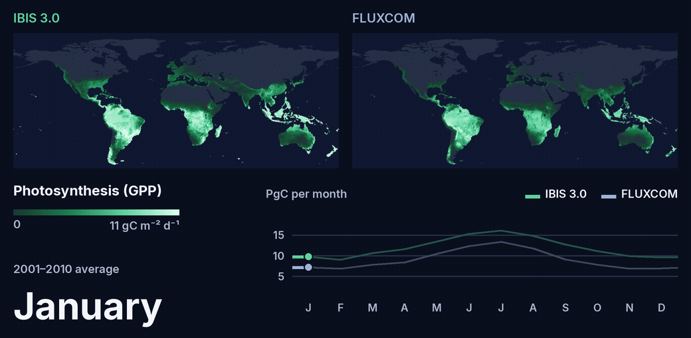
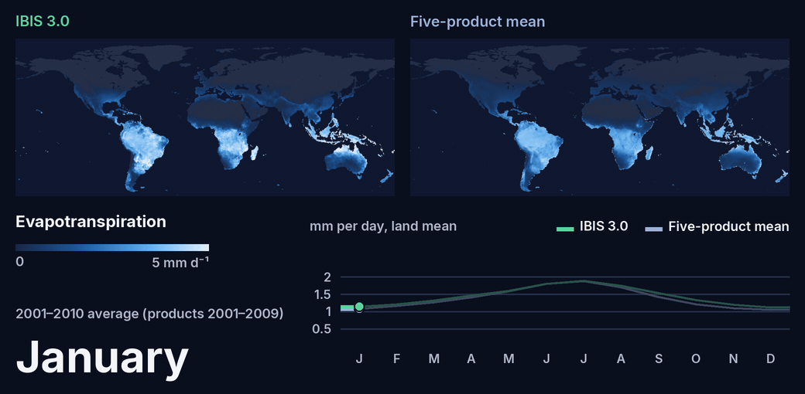
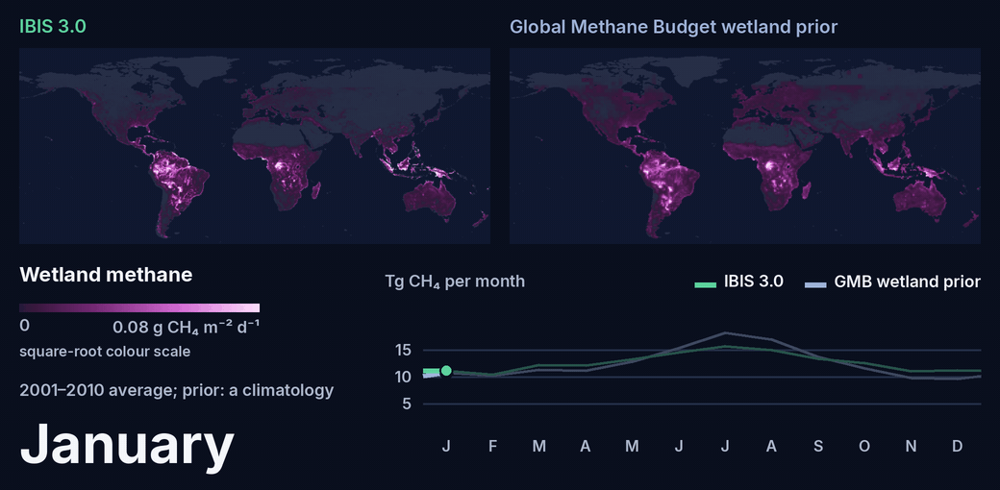

# IBIS 3.0

**The Integrated Biosphere Simulator, rewritten in JAX for GPUs, extended with new processes and calibrated from the flux
towers to the globe.**

IBIS 3.0 is a land-surface and terrestrial-ecosystem model. Every hour it computes the exchange of energy, water and
carbon between the land and the atmosphere; every day, leaf phenology and the decomposition of litter and soil carbon;
every year, the growth of vegetation, its competition, fire and other disturbance. It is a rewrite of IBIS 2.6b4 (Foley
et al. 1996; Kucharik et al. 2000), checked against the original Fortran, corrected where either was wrong, and extended
with new processes. Driven by the daily GSWP3 weather of 1901–2010 at 0.5° (95,333 land cells, with a diurnal weather
generator), a full global simulation (a 200-year spin-up and 1901–2010) takes about eight and a half hours on one GPU (an
RTX 4090); calibrating the model at one flux tower takes 20 minutes to an hour and a half on four CPU cores.

**Status.** The scores, figures and parameter set
([`params_31s_ch4h.yaml`](python-port/configs/params/params_31s_ch4h.yaml)) below are those of the release of 30
October 2026 (commit `e54e342`, the code on `main`; [`docs/RELEASE_3.0.md`](docs/RELEASE_3.0.md)). Development continues
on a branch that is not yet public; a paper describing the model is in preparation.







*The release run month by month, 2001–2010. Photosynthesis against FLUXCOM, both on the land FLUXCOM covers (144 and 109
PgC yr⁻¹); evapotranspiration against the mean of five products, land north of 60 °S (529 and 508 mm yr⁻¹); wetland
methane against the model-based wetland prior of the Global Methane Budget inversions, a monthly climatology (152 and 151
Tg CH4 yr⁻¹), on a square-root colour scale. Drawn by [`readme_gifs.py`](verify/calibration/diagnostics/readme_gifs.py).*

## Highlights

- **On the GPU.** JAX, in single precision, checked against double precision.
- **Checked against the Fortran.** Routine by routine and hour by hour, in double precision with fixed vegetation; what
  the comparisons cover, what they leave out and the cases still unresolved are in
  [technote section 17.9.5](docs/technote/17_numerics_verification.md).
- **Canopy.** Sunlit and shaded leaves, with photosynthetic acclimation.
- **Vegetation.** 40 climate-zone (Köppen) plant types in IBIS's 12 plant-type slots, a water-limited maximum tree
  cover, photoperiod-driven senescence.
- **Fire.** Fire-season length, weather and fuel danger, closed-canopy damping and mortality by plant type, calibrated
  against GFED5 burned area.
- **Wetland methane.** Computed every time step on a dynamic wetland area: the WAD2M seasonal cycle plus a
  year-to-year anomaly learned from the model's own soil water.
- **Cropland.** A managed share of each grid cell, simulated as a managed grass with harvest.
- **Deeper soil.** 8 m of thermal bedrock below the 4 m soil column; a permafrost diagnostic.
- **Calibrated tower-first.** 356 flux towers, 48 wetland-methane towers and 16 cropland towers; then, zone by zone
  inside the full protocol, tree cover, wood, soil carbon and burned area against gridded products. No global total was
  a term in any fit.

## Evaluation against budgets and products

The release run (a cold 200-year spin-up, then 1901–2010 with rising CO2). Fluxes are 2001–2010 means weighted by each
cell's land fraction; pools are those at the end of 2010. Rows marked \* were calibration targets, fitted zone by zone;
the soil turnover was also chosen with the literature range of global stocks and the land sink in view.

| Quantity | IBIS 3.0 | Reference |
|---|---|---|
| Land carbon sink (change of stored carbon) | +2.91 PgC yr⁻¹ | Global Carbon Budget 2024: 2.78 (interannual s.d. 0.69); its TRENDY v13 models 2.83 (1.44–4.36) |
| Gross primary production (GPP) | 148 PgC yr⁻¹ | published estimates 110–160; FLUXCOM 109 on the land it covers, where the model has 144 |
| GPP rise, 1901–1910 to 2001–2010 | +22 % | +31 ± 5 % over the twentieth century (Campbell et al. 2017) |
| Evapotranspiration | 529 mm yr⁻¹ | mean of five products (2001–2009): 508 |
| Wetland methane | 152 Tg CH4 yr⁻¹ | Global Methane Budget 2025, bottom-up, 2000–2009: 153 (116–189) |
| Wood carbon of the trees, end of 2010 \* | 388 PgC | Xu et al. 2021 live biomass, leaves, roots and shrubs included: 362 |
| Soil carbon, end of 2010 \* | 1982 PgC | HWSD2 top metre: 2793; literature range of stocks to 1 m: 1500–2400 |
| Peak leaf area index, land mean, 2006–2010 | 2.33 | GLASS and GIMMS LAI4g: 2.12 |
| Burned area, 2010 \* | 2.42 % of land yr⁻¹ | GFED5, mean of 2001–2005: 4.62 (products 2.4–4.6) |

**In short:** the land sink and the global methane total are on their budgets, and evapotranspiration is 1.04 times
the mean of the products; GPP is inside the published range, and 1.32 times FLUXCOM, the lowest product, on the land
FLUXCOM covers. Wood, soil carbon and burned area were fitted to their maps, so their rows are not independent tests.
The largest misses, listed below, are burned area, the spring and autumn photosynthesis north of 30 °N, the methane
north of 30 °N and the century rise of GPP. Definitions and sources of every row: technote
[Table 16.11](docs/technote/16_calibration.md).

**At the flux towers,** one parameter set per plant type (the set of 26 October; the release changed it afterwards in its
allocation, wood and soil-turnover stages and was not re-scored at the towers) gives median annual model/tower ratios of
1.01 for GPP, 1.03 for evapotranspiration and 1.13 for ecosystem respiration, with 53 %, 62 % and 43 % of the towers
within 25 %. Net ecosystem exchange is weaker: monthly correlation 0.52, and a median error of 131 gC m⁻² yr⁻¹ of too
little uptake against a median tower sink of 156. Fitted at each tower on its own (largely in-sample), GPP is 0.97 and
evapotranspiration 1.06 (technote [Table 16.5](docs/technote/16_calibration.md)).

The full evaluation, with the regional breakdowns, wetland methane by latitude band and wetland-area source, maps of GPP
and ET against FLUXCOM and the products, and maps of the model's wood and soil carbon, is in
[`docs/RESULTS.md`](docs/RESULTS.md).

## Known limitations

- **Burned area** is half of GFED5, a quarter in the African savannas, where the fires are largely lit by people: the
  human-ignition terms are coded but not available in the global driver, and there is no agricultural or lightning
  ignition.
- **Wood** is globally 1.07 times the live-biomass map it was fitted to, which also holds leaves, roots and shrubs (like
  for like, parity would be about 0.8); temperate wood is 1.7 times the map, as the model grows old-growth forest without
  land-use history.
- **GPP north of 30 °N** is 1.5–3 times FLUXCOM in spring and autumn, while July is close; the century rise of GPP,
  +22 %, is below the +31 ± 5 % of Campbell et al. (2017).
- **Wetland methane by latitude** follows the towers rather than the wetland-model ensemble: 1.23 times the budget in the
  tropics and a third of it between 30 °N and 60 °N.
- **Soil carbon** is 0.71 of the HWSD2 top metre and short in the cold zones, whose peat and permafrost carbon a
  mineral-soil scheme does not accumulate. The 200-year spin-up also stops short of equilibrium: in a run of the revised
  model on the same schedule, the soil holds 78 % of its equilibrium stock when the spin-up ends and still gains about
  0.24 PgC yr⁻¹ in 2005, a tenth of the land sink ([technote 12.7.1](docs/technote/12_soil_biogeochemistry.md)).
- **Tree cover** on natural land is 0.45 against 0.39 (CLM / MODIS).
- **Cropland** is a managed grass, without crop phenology, sowing or harvest dates.
- **Nitrogen** is not simulated (fixed C:N ratios), and there is no land-use history.
- **Other:** the time step is not yet differentiable (its gradients are not finite), the canopy is unclumped, and the
  forcing ends in 2010.

The complete list is in [`docs/RELEASE_3.0.md`](docs/RELEASE_3.0.md) section 6.

## Getting started

The input data (GSWP3 forcing, HWSD soils, ESA CCI land cover, the Köppen–Geiger zones of Beck et al. 2023, WAD2M
inundation and the learned wetland-area file, the cropland map, the tower data of FLUXNET2015, ICOS, AmeriFlux, NEON,
regional networks and Fluxnet-Methane_V2.0, and the evaluation products) are not in the repository;
[`docs/DATA_INVENTORY.md`](docs/DATA_INVENTORY.md) lists each with its source. The configurations and the calibration
harness carry the input paths of our machine.

```bash
# environment: Python 3.12 and JAX 0.11 (all pinned versions in docs/ENVIRONMENT.md)
python3 -m venv .venv && source .venv/bin/activate
pip install -e "python-port[wetland]" "jax==0.11.0" "jaxlib==0.11.0" cma pandas pytest
# [wetland]: xgboost + scipy, for the learned wetland area; on a GPU, "jax[cuda12]==0.11.0" instead of the two jax pins

# tests (~10 min); tests/f2py compares with the Fortran and needs a gfortran build that is not part of this repository
cd python-port && PYTHONPATH=. python -m pytest tests/ -q --ignore=tests/f2py && cd ..

# a global run: copy verify/calibration/protocol/spinup.yaml, set its input, output and restart paths, and add
#   params_file: python-port/configs/params/params_31s_ch4h.yaml
PYTHONPATH=python-port:. python python-port/scripts/run_global.py <your_spinup.yaml>

# calibration at the evergreen-needleleaf flux towers (CMA-ES; --sites <ID> for one tower)
PYTHONPATH=python-port:. python verify/calibration/site_fit.py --igbp ENF \
  --params python-port/configs/params/params_31s_ch4h.yaml \
  --fit vmax:temp_con_ever,acclim_tau,acclim_s0 --n-evals 200 --workers 4 --out <dir>
```

A run writes yearly NetCDF files (monthly or daily on request) and a restart file per year. To reproduce the release run
and its scores, with every stage and switch, follow [`docs/RELEASE_3.0.md`](docs/RELEASE_3.0.md) section 4;
[`docs/RUNNING.md`](docs/RUNNING.md) covers the common tasks and the gotchas.

## Documentation

| Document | What it holds |
|---|---|
| [Technical note](docs/technote/README.md) | the scientific description of the model, process by process |
| [`docs/RELEASE_3.0.md`](docs/RELEASE_3.0.md) | the release in short: the parameter file and its provenance, what was calibrated against what, reproduction, limitations |
| [`docs/RESULTS.md`](docs/RESULTS.md) | the full evaluation of the release: towers, global scores, figures, wetland methane |
| [`docs/WHATS_NEW.md`](docs/WHATS_NEW.md) | what changed from IBIS 2.6b4, component by component |
| [`docs/CALIBRATION.md`](docs/CALIBRATION.md) | the calibration log: every stage, its baseline, its tests and its verdict |
| [`docs/VERIFICATION_HISTORY.md`](docs/VERIFICATION_HISTORY.md), [technote Chapter 17](docs/technote/17_numerics_verification.md), [`verify/STATUS.md`](verify/STATUS.md) | the verification of the port against the Fortran |
| [`docs/DEFECTS_FOR_REVIEW.md`](docs/DEFECTS_FOR_REVIEW.md) | defects found in the port and in the Fortran |
| [`docs/DATA_INVENTORY.md`](docs/DATA_INVENTORY.md) | every input, evaluation product and archived run |
| [`docs/RUNNING.md`](docs/RUNNING.md), [`docs/ENVIRONMENT.md`](docs/ENVIRONMENT.md) | how to run, environments, pinned versions |
| [`docs/GPP.md`](docs/GPP.md), [`docs/FIRE.md`](docs/FIRE.md), [`docs/METHANE.md`](docs/METHANE.md), [`docs/BEDROCK.md`](docs/BEDROCK.md) | design and build logs of the canopy, fire, methane and bedrock work |

## Repository layout

| Directory | What it contains |
|---|---|
| [`python-port/`](python-port/) | the model: `ibis/` (physics, biogeochemistry, time stepping, input/output), `scripts/run_global.py`, `configs/params/` (parameter sets), `tests/` |
| [`verify/`](verify/) | the calibration harness and diagnostics (`calibration/`) and the verification against the Fortran (`timestepping/`, `STATUS.md`) |
| [`fortran/`](fortran/) | the original IBIS 2.6b4 (Fortran 77) and a Fortran 2008 rewrite |
| [`docs/`](docs/) | the documentation above and the figures |
| [`configs/`](configs/) | spin-up configurations of earlier stages |

## Citation

A paper describing IBIS 3.0 is in preparation; until it appears, please cite this repository (IBIS 3.0, release of 30
October 2026, commit `e54e342`) and the original model:

- Foley, J.A. et al. (1996), "An integrated biosphere model of land surface processes, terrestrial carbon balance, and vegetation dynamics", _Global Biogeochemical Cycles_ 10(4): 603–628.
- Kucharik, C.J. et al. (2000), "Testing the performance of a dynamic global ecosystem model: water balance, carbon balance, and vegetation structure", _Global Biogeochemical Cycles_ 14(3): 795–825.

## License

MIT — see [LICENSE](LICENSE). The original IBIS 2.6b4 code in [`fortran/ibis_2.6b4/`](fortran/ibis_2.6b4/) is included
for reference.

## Contact

- Hangkai You · hyou34@wisc.edu · University of Wisconsin–Madison · [UW-GCRL](https://github.com/UW-GCRL)
- Min Chen · min.chen@wisc.edu · University of Wisconsin–Madison · [UW-GCRL](https://github.com/UW-GCRL)
