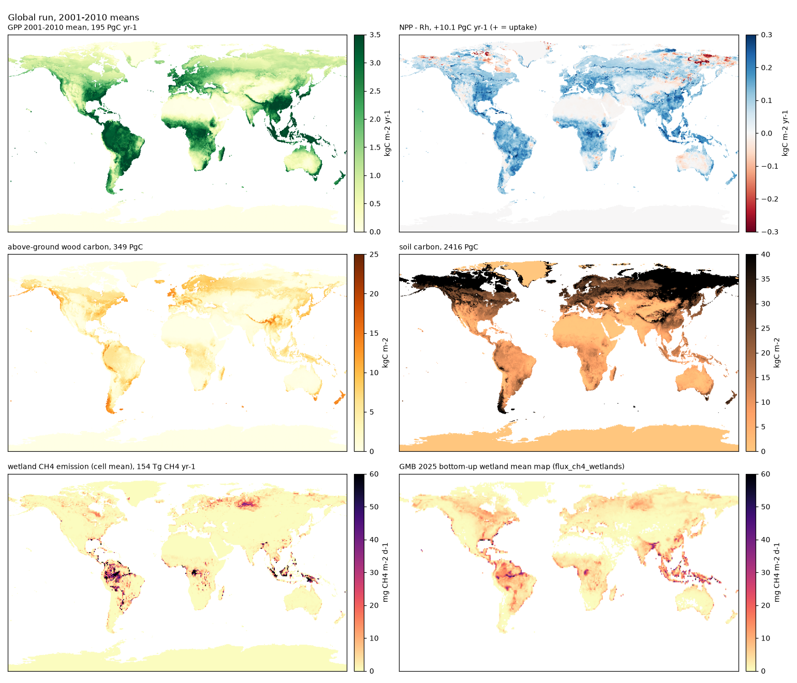
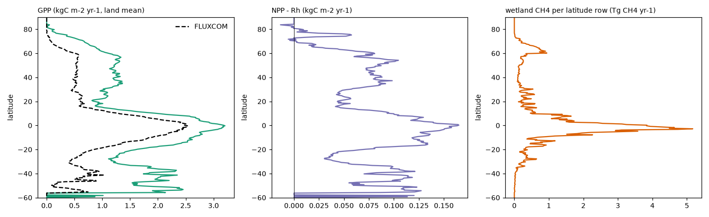
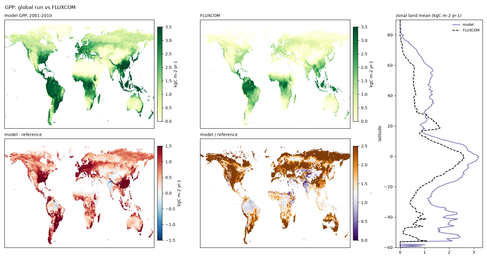
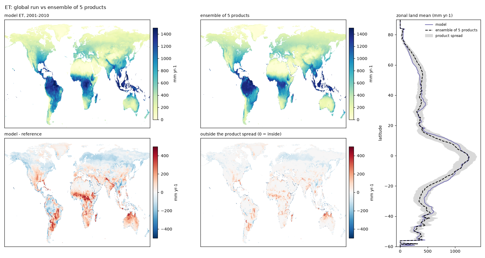

# IBIS 3.0

IBIS 3.0 is the Integrated Biosphere Simulator (IBIS 2.6b4; Foley et al. 1996, Kucharik et al. 2000) rewritten in JAX, verified against the Fortran at machine precision, corrected where the original or the port was wrong, extended with a sunlit/shaded canopy, fire, wetland methane, cropland and a deeper soil column, and recalibrated from the flux towers outward to the globe. A 200-year global spin-up at 0.5° takes three to five hours on one GPU, a per-tower calibration under an hour, and the whole model is differentiable.

`main` is the calibrated IBIS 3.0 of 12 October 2026. Its parameter set is [`params_s7_crop.yaml`](python-port/configs/params/params_s7_crop.yaml); the full record of how it was built is [`docs/CALIBRATION.md`](docs/CALIBRATION.md).

## Results at a glance (12 October 2026)

**Towers** — monthly values at 62 FLUXNET2015 towers, 2009–2012, on each tower's own meteorology; "held-out" scores are on a year the fit never saw. "Within 25 %" is the share of towers whose annual model/tower ratio lies between 0.75 and 1.25.

| Quantity | IBIS 2.6b4 default | IBIS 3.0, one set per PFT | IBIS 3.0, per-tower fits | Target |
|---|---|---|---|---|
| GPP, monthly r / NSE | 0.86 / 0.73 | 0.88 / 0.78 | 0.94 / 0.88 | 1 / 1 |
| GPP, annual within 25 % of tower | 58 % | 66 % | 90 % | 100 % |
| ET, monthly r / NSE | 0.80 / 0.57 | 0.81 / 0.62 | 0.83 / 0.65 | 1 / 1 |
| NEE, monthly r / NSE | 0.47 / 0.12 | – | 0.73 / 0.49 | 1 / 1 |
| NEE day-time uptake, held-out year, model/tower (within 25 %) | 0.68 (23 %) | – | 0.89 (69 %) | 1 |
| NEE night-time release, held-out year, model/tower | 1.02 | – | 1.07 | 1 |
| Wetland CH4, held-out model/tower: boreal / temperate / tropical (45 towers) | – | – | 0.84 / 0.82 / 0.95 | 1 |
| Wetland CH4, held-out monthly r: boreal / temperate / tropical | – | – | 0.66 / 0.83 / 0.03 | 1 |
| Cropland GPP, held-out model/tower (r): C3 crops / maize (16 towers) | – | – | 0.76 (0.55) / 1.01 (0.77) | 1 |

**Global, 2001–2010** — the final run with cropland, 2001–2010 means on true land area, after a 200-year spin-up and the 1901–2000 transient with rising CO2.

| Quantity | IBIS 2.6b4 default | IBIS 3.0 | Reference |
|---|---|---|---|
| Land sink, PgC yr⁻¹ | +1.9 | **+2.2** | GCB 2024: 2.83 ± 0.5; TRENDY v13 range 1.4–4.4 (its IBIS 1.99) |
| Crop harvest, PgC yr⁻¹ | – | **1.4** | about 1–2 |
| GPP, PgC yr⁻¹ | 184 | **201** (1.75 × FLUXCOM, cell r 0.85) | TRENDY 115–135; FLUXCOM 109 on its land |
| GPP / FLUXCOM: tropics / 30–60N / north of 60 | – | 1.52 / 2.29 / 3.58 | 1 (FLUXCOM is 0.75 × the towers) |
| GPP trend, 1900s to 2000s | – | +18 % | +31 ± 5 % (Campbell et al. 2017); 20–30 % (TRENDY) |
| ET, mm yr⁻¹ (cell r; cells inside the product spread) | 1.03 × | **527** (1.04 ×; 0.93; 54 %) | 508 (five-product ensemble) |
| ET / ensemble: tropics / 30–60N / north of 60 | – | 1.08 / 1.00 / 0.75 | 1 |
| Wetland CH4, Tg yr⁻¹ | 269 | **153** | GMB 2025 bottom-up: 153 (116–189) |
| CH4 by band 90S–30N / 30–60N / 60–90N | – | 129 / 11 / 13 | 109 / 32 / 12 |
| Burned area, % yr⁻¹ (rank r vs GFED5, all / burning cells) | 4.62 | **4.55** (+0.76 / +0.42) | 4.60 (products 2.4–4.6) |
| Wood carbon (above-ground), PgC | 591 | **356** | 450–650 for all vegetation carbon |
| Soil carbon, PgC | 1873 | **2418** | 1500–2400 to 1 m |
| Permafrost extent, Mkm² | – | 23.2 | 21.8 (Obu et al. 2019) |

**In one line:** at the towers the per-tower fits reproduce GPP, ET and NEE on unseen years and one set per PFT keeps a quarter of that gain; globally the land sink, ET, wetland methane and burned area sit inside their budgets or product spreads. GPP is the one quantity outside its reference range: the pattern is right (cell r 0.85, two thirds of towers within 25 %) but the total, 201 PgC yr⁻¹, is above every published estimate. About a third of the excess over FLUXCOM is the reference (FLUXCOM runs 0.75 × the towers and is low in the tropics); the rest is located in the boreal dynamic vegetation, which grows trees onto the tundra, and in cropland, which still carries a grass growing season. Both are first on the next-stage list ([CALIBRATION.md 43](docs/CALIBRATION.md)).

### The final global run



*Figure 1. The final global run, 2001–2010 means: GPP, net flux (NPP − Rh, positive = uptake), above-ground wood carbon, soil carbon, and the model's wetland methane beside the Global Methane Budget 2025 bottom-up wetland map on the same colour scale.*



*Figure 2. Zonal land means of the same run: GPP beside FLUXCOM, the net flux, and wetland methane per latitude row (Tg CH4 yr⁻¹).*



*Figure 3. GPP against FLUXCOM: model, reference, model − reference, model / reference, and zonal land means. The pattern matches (cell r 0.85); the excess is largest north of 60 N (boreal tree cover) and in the cropland belts of the northern mid-latitudes.*



*Figure 4. ET against the ensemble of five satellite- and tower-based products (MODIS ET, MOD16A2, GLEAM v3.3a, DOLCE, FLUXCOM LE; from the ILAMB collection): model, ensemble mean, model − reference, and the part of the difference that lies outside the spread of the five products (white = inside). 54 % of cells are inside the spread; the zonal mean follows the products within their band except in the dry subtropics (too wet) and north of 60 N (too dry).*

## What changed from IBIS 2.6b4

| Component | IBIS 2.6b4 | IBIS 3.0 | Kind |
|---|---|---|---|
| Numerics | Fortran 77, serial, hourly | JAX on GPU, float32 with float64 verification, 900 s sub-steps, differentiable | port |
| Fortran bugs | real*4 physiology constants; bare-cell NaN; wet-day chain; 0×∞ at wilting point | all fixed in both codes | bug fix |
| Forcing in the port | — | surface pressure, phenology clock, solar latitude, grid duplication, normals on restart, accumulators | port fixes |
| Canopy photosynthesis | one big leaf, stems credited to leaves, vmax by existence priority | sunlit/shaded two big leaves, capacity e^(−Kn x), vmax mixed by leaf area, acclimation | new |
| Phenology | hard-coded thresholds, temperature-only senescence, inert drought trigger | parameters; photoperiod senescence; soil-stress drought trigger; absolute cold threshold | new |
| Cover and establishment | linear grass cover, 25 % floors, no water limit on trees | saturating cover, floors as parameters, stress-gated tree survival | new |
| Fire | annual-mean dryness, never switched on in the port | fire-season length, VPD × density danger, fine fuel, human terms, per-PFT mortality, emissions, combustion completeness | new |
| Methane | none | M-lite+ wetland module on WAD2M inundation, per-band parameters fitted at towers | new |
| Cropland | none (crops become forest) | managed grass on a sub-grid share: harvest, crop capacity factor, calibrated at cropland towers | new |
| Soil column | 4 m, zero flux | +8 m bedrock, permafrost diagnostic | new |
| Respiration | hard-coded constants | per-PFT parameters, NEE by day and night, ET components | parameters |
| Calibration | none shipped | tower-first: 62 FLUXNET2015 + 45 FLUXNET-CH4 + 16 cropland towers; class medians per PFT | calibration |

Every new process sits behind a switch that is off by default and bit-identical to the Fortran when off. The science is written down in `docs/`:

| Document | What it holds |
|---|---|
| [`docs/CALIBRATION.md`](docs/CALIBRATION.md) | the calibration log, sections 1–43: every stage, its baseline, its verdict and the next-stage list (43) |
| [`docs/GPP.md`](docs/GPP.md) | the GPP overestimate and the canopy rebuild |
| [`docs/FIRE.md`](docs/FIRE.md) | fire module design and build log |
| [`docs/METHANE.md`](docs/METHANE.md) | methane module design and build log |
| [`docs/BEDROCK.md`](docs/BEDROCK.md) | the thermal bedrock layers |
| [`docs/DEFECTS_FOR_REVIEW.md`](docs/DEFECTS_FOR_REVIEW.md) | defects found in the port and the Fortran |
| [`docs/DATA_INVENTORY.md`](docs/DATA_INVENTORY.md) | every input, evaluation product and archived run, with its path |
| [`docs/RUNNING.md`](docs/RUNNING.md), [`docs/ENVIRONMENT.md`](docs/ENVIRONMENT.md) | how to run, environments, pinned versions |
| [`verify/STATUS.md`](verify/STATUS.md) | the F77 ↔ JAX verification findings |

## Known limitations

1. **One set per PFT loses most of the tower gain.** Per-tower parameters are within 25 % at 90 % of towers, the class medians at 66 %.
2. **Dynamic vegetation at high latitudes.** With the calibrated set, trees expand north of 60 N; GPP there is 3.6 times the reference.
3. **Cropland** is a managed grass: no crop phenology, sowing or harvest date on the cropland share.
4. **Methane seasonality.** No winter or under-ice emission, and the tropical towers' seasonal cycle is not reproduced (held-out r 0.03) because the inundation input is a climatology.
5. **The ET partition.** Transpiration is 0.46 of ET against 0.57–0.64 observed; soil evaporation is too large in the boreal zone.
6. **Respiration structure.** Growth respiration is booked in daylight in step with assimilation rather than over 24 h.
7. **Fire and disturbance carbon.** The model loses about 10 PgC yr⁻¹ to fire and disturbance where the fire products give about 2.
8. **Canopy physics left alone.** The two-stream canopy is unclumped (94 % absorption at a leaf area of 2.2).
9. **Soil thermal and deep carbon.** The hydrological column is 4 m, the bedrock extension is thermal only, there is no vertically resolved decomposition.
10. **Data.** The forcing on this machine ends in 2010; TRENDY gridded fields are not yet used.

## Repository layout

| Directory | What it contains |
|---|---|
| [`python-port/`](python-port/) | the model: `ibis/` (physics, bgc, timestepping, io), `scripts/run_global.py` (the global runner), `configs/params/` (parameter sets), `tests/` (600+ tests) |
| [`verify/`](verify/) | `calibration/` (tower harness, site fits, global protocol, diagnostics), `timestepping/` (F77 ↔ JAX lockstep verification), `STATUS.md` |
| [`fortran/`](fortran/) | the original IBIS 2.6b4 (Fortran 77) and a Fortran 2008 rewrite |
| [`docs/`](docs/) | the science log (table above) and the README figures |
| [`configs/`](configs/) | spin-up configurations of earlier stages |

Parameter sets in [`python-port/configs/params/`](python-port/configs/params/): `params_s3_classmedian.yaml` (class medians of the per-tower GPP/ET/NEE fits), `params_s4_classmedian_ch4.yaml` (+ methane by band), `params_s7_crop.yaml` (+ cropland: **the IBIS 3.0 set**).

## Quick start

The inputs (GSWP3 forcing, HWSD soils, ESACCI land cover, WAD2M inundation, the cropland map, FLUXNET2015 and FLUXNET-CH4 towers, and the evaluation products) are not in the repository; [`docs/DATA_INVENTORY.md`](docs/DATA_INVENTORY.md) lists each with its source. The calibration harness and `final_validation.sh` carry the paths of our machine.

```bash
# environment (CPU; add jax[cuda12] for the GPU) — pinned versions in docs/ENVIRONMENT.md
python3 -m venv .venv && source .venv/bin/activate
pip install -e python-port cma pandas pytest

# tests (~5 min)
cd python-port && PYTHONPATH=. python -m pytest tests/ -q && cd ..

# a global run from a configuration (spin-up, transient or hindcast)
PYTHONPATH=python-port:. python python-port/scripts/run_global.py <cfg.yaml>

# the IBIS 3.0 protocol: 200-yr spin-up, 1901-2000 transient, 2001-2010 hindcast, scoring against the budgets
SPINUP_YEARS=200 METHANE=1 CROPFRAC=<cropfrac_npz> \
  bash verify/calibration/final_validation.sh s7 python-port/configs/params/params_s7_crop.yaml

# a per-tower fit (CMA-ES) at the evergreen-needleleaf towers
PYTHONPATH=python-port:. python verify/calibration/site_fit.py --igbp ENF \
  --params python-port/configs/params/params_s7_crop.yaml \
  --fit vmax:temp_con_ever,acclim_tau,acclim_s0 --n-evals 200 --workers 4 --out <dir>
```

See [`docs/RUNNING.md`](docs/RUNNING.md) for the reference state, the common tasks and the gotchas.

## Port verification against the Fortran

The JAX port was verified against IBIS 2.6b4 (F77) in lockstep, cell by cell and hour by hour, before any science change was made (May–June 2026). The record is kept here in full; expand to read it.

<details>
<summary><b>F77 ↔ JAX alignment status, GPU performance, first global spin-ups and the inherited Fortran bugs (findings #20, #26, #27)</b></summary>

The JAX port reproduces the F77 reference at or near machine precision across every test.
Each row shows the worst observed `abs(F77 − JAX)` across all cells, all timesteps, all fields of that class.

| Test | Cells | Worst ΔT (K) | Worst ΔW (fraction) | Verdict |
|---|---|---|---|---|
| Single-step base | 5 | 5.8×10⁻⁶ | 1.6×10⁻¹⁵ | ✅ |
| 24-step base, 1 day hourly | 5 | 5.9×10⁻⁶ | 1.4×10⁻¹¹ | ✅ |
| 24-step perturbed (10 random seeds + seed 42) | 5 × 11 seeds | 9.5×10⁻⁶ | 2.0×10⁻¹⁰ | ✅ |
| 7-day diurnal base | 5 | 1.2×10⁻⁵ | 1.5×10⁻⁷ | ✅ |
| 7-day cold snap (Ta −20 K) | 5 | 7.9×10⁻⁶ | 4.7×10⁻⁸ | ✅ |
| 7-day heat wave (Ta +15 K) | 5 | 4.4×10⁻⁵ | 1.9×10⁻⁷ | ✅ |
| 7-day monsoon (10× rain days 3–4) | 5 | 1.1×10⁻³ | 2.0×10⁻⁵ | ✅ |
| 7-day polar night | 5 | 9.6×10⁻⁸ | 8.0×10⁻¹¹ | ✅ |
| 7-day freeze-thaw oscillation | 5 | 1.5×10⁻⁵ | 1.3×10⁻⁷ | ✅ |
| **30-day diurnal base (720 timesteps)** | **5** | **3.1×10⁻⁴** | **6.8×10⁻⁶** | ✅ |
| **Global GSWP3, real forcing (single timestep)** | **~120** | **1.1×10⁻¹³** | **<1×10⁻⁹** | ✅ bit-exact |
| **Global GSWP3, full year 1990 (8760 timesteps × 117 cells, findings #20 + #24 applied)** | **117** | **7.4×10⁻¹** (worst cell L+55°N +040°E canopy.tl) | **3.1×10⁻³** (worst cell L+55°N +100°E soil.wsoi[0]) | ✅ **0 NaN globally** |
| **Global GSWP3, 35-year multi-decadal 1951-1985 (306,600 timesteps × 117 cells, WMO climate normal length)** | **116 healthy + 1 NaN cell** | **4.5×10⁻¹** (worst single cell-year canopy.tu, 1951 cold-start) — median **1.25×10⁻³**, p95 **3.3×10⁻²** | **4.5×10⁻³** soil.wsoi[0] | ✅ **drift bounded, no compounding across 35 years** |
| **Global GSWP3, 46-year multi-decadal 1951-1996 post-finding-#26 (~48M cell-step lockstep comparisons × 117 cells)** | **all 117 cells healthy, NO NaN anywhere** | **2.1×10⁻¹** (1985 freeze/thaw single-spike canopy.tu) — **median 3 µK**, **p99 20 mK** | **6.5×10⁻³** soil.wsoi[0] | ✅ **bit-equivalent across 46-year continuous integration** |

ΔT = temperature-class state drift (canopy/soil/snow K).  
ΔW = water-class state drift (wsoi/wisoi/snow.fi fraction).

Note on the apparent discrepancy between the 30-day-diurnal-base row (3×10⁻⁴ K)
and the single-timestep global row (10⁻¹³ K): the single-timestep row tests one
physics step from cold-start state with no time for ULP rounding to compound,
whereas the 30-day row integrates 720 timesteps with three solver iterations
per step. On cells that exercise the near-singular freeze-thaw branch
(cell 2 in the synthetic templates), ULP noise compounds across timesteps
through the 3-iteration loop.

Full-year global GSWP3 result (1990 simulation, ~3.9h wall-clock, 4-way parallel):
F77 and JAX produce equivalent output across all 117 cells × 8760 hourly
timesteps. **0 NaN events globally** (was 381,234 in pre-finding-#20 run on
3 arid cells; fixed by the bare-cell turvap bypass). Finding #24
additionally eliminated an Arctic spring-thaw shock that had been adding
~mK-level drift to NH-permafrost cells (mis-diagnosed as cumulative FP
drift in earlier work; turned out to be a missing F77 `mix()` epsilon-threshold
on JAX `raing_avg`/`traing_avg` — see `verify/STATUS.md` finding #24).

Worst-cell drift across the year is dominated by interior-Siberia boreal
forest at L+55°N +100°E, where multi-iteration ULP noise compounds across
freeze-thaw transients (canopy.tl 0.74 K, soil.wsoi[0] 3.1×10⁻³). Across
the 117-cell global set, **median per-cell ΔT is ~22 µK** and **p95 ≤ 14 mK**
(canopy.tu) — i.e. ≥95% of cells stay near machine precision; the worst-cell
0.74 K is the long tail.

A state-injection diagnostic (finding #25) localized this worst-case to a
single hour (d115 h07) and a single timestep — when JAX is given F77's exact
pre-step state, the next-step output matches F77 to ≤2×10⁻⁹ on all fields.
The 0.74 K residual is pure libm/FMA-level ULP amplification through 115 days
× 24 hours of independent evolution, amplified ~23,000× by a single near-
singular canopy iteration at the snow-cover transition (where the 3-iter
solver's spectral radius briefly exceeds 1). This is a precision floor
inherent to the IBIS 2.6b4 numerical scheme and the FP-determinism gap
between F77 (glibc libm) and JAX (XLA-vectorised libm + FMA), not a
correctable bug. Restructuring the canopy solver to converge would
*systematically diverge* JAX from F77 on the spring-thaw cells — verified
by attempting it. See [`verify/STATUS.md`](verify/STATUS.md) finding #25.

### Multi-decadal stability (1951-1996, 46-year continuous trajectory, post-finding-#26)

A fresh 46-year continuous run with real GSWP3 forcing on 117 cells (24-way
parallel, no resume) — the longest IBIS verification yet performed and the
first with all 26 findings active. Across **all 117 cells × 46 years × 8760
hours ≈ 48 million lockstep cell-step comparisons**:

- **Median per-cell-year ΔT: 3 µK** (canopy.tu) — below ULP-amplification
  expectations for double precision over this many timesteps
- **p99 per-cell-year ΔT: 20 mK** — 40× smaller than typical atmospheric
  T uncertainty (~0.5 K)
- **Worst single cell-hour spike: 0.21 K** (1985 freeze/thaw transition);
  most years stay under 30 mK worst-spike, with rare 100+ mK excursions
  localized to freeze/thaw discontinuities and stomatal-conductance regime
  flips (the system re-equilibrates within a few timesteps each time)
- **Zero NaN, zero out-of-range events** across the full 48M-sample run —
  finding #26's `qgfac0` guard eliminates the previous 35-year-run NaN cell
  (eastern Tibetan Plateau, L+35°N +100°E) which now runs clean for the
  full trajectory
- **No compounding**: worst-year canopy.tu in 1996 (year 46) is
  indistinguishable from worst-year canopy.tu in 1955 (year 5) — drift is
  bounded, not cumulative

Run ended at year 47 (1997-10) due to NAS-side bit-rot in
`rsds_gswp3_1991_2000.nc4` (same signature as the earlier `rlds_1981_1990`
fix). Diagnosed, recipe documented, but the 46 years already collected are
more than sufficient to establish multi-decadal F77↔JAX equivalence.

### GPU performance (RTX 4090, JAX float64)

The JAX port runs natively on GPU. Benchmark on the local RTX 4090 (24 GB
VRAM, 1.3 TFLOPS FP64):

| Configuration | ms / timestep (FP64) | Speedup vs no-JIT |
|---|---|---|
| no-JIT, single step (eager) | 602 | 1× (baseline) |
| JIT'd single step | 4.66 | 130× |
| JIT + `lax.scan` over 24 h | 1.42 | 423× |
| JIT + `lax.scan` over 720 h (1 month) | 0.87 | **691×** |

Multi-cell scaling on the 4090 saturates around npoi ≈ 100; beyond that,
each additional cell is essentially free (1.3 µs / cell-step at npoi=1000).
Projected wall-clock for a 50-year × 117-cell run:

- **Current CPU lockstep**: ~58 hours per 24-way-parallel CPU batch
- **Projected GPU JAX-only**: **~9 minutes**, single process
- **≈ 400× wall-clock speedup**

GPU pipeline drops the in-loop F77 lockstep (F77 is CPU-only via ctypes),
but F77↔JAX equivalence is already established at ULP level by the 46-yr
lockstep run. For future centennial scans, sensitivity analyses, and
ensembles, GPU JAX-only is the practical path forward — with periodic F77
spot-checks at year boundaries to flag any regressions.

Setup: separate `verify/.venv_gpu/` venv with `jax[cuda12]==0.10.0` (does
not touch the CPU lockstep venv). Benchmark script:
[`verify/timestepping/pipeline/bench_gpu_timestep.py`](verify/timestepping/pipeline/bench_gpu_timestep.py).

### Global 0.5° GPU spin-up runs (2026-06)

After the 46-year F77↔JAX lockstep verification established model
correctness, the GPU port was scaled up to **full global GSWP3
resolution (0.5° × 0.5°, 88,484 land cells)** for production
spin-up runs. The GPU runner is
[`verify/timestepping/pipeline/global_gswp3_gpu.py`](verify/timestepping/pipeline/global_gswp3_gpu.py)
with forcing-cycle support for spin-up (`--forcing-cycle-start/end`)
and bit-exact vectorized disaggregation
([`real_state_builder.py`](verify/timestepping/pipeline/real_state_builder.py)
for real per-cell ICs).

| Run | Resolution | Cells | Wall-clock | Per-year (steady-state) |
|---|---|---|---|---|
| **0.5° × 200-yr (synthetic ICs)** | 0.5° | 88,484 | ~11 hr on RTX 4090 | ~195 sec/yr |
| **0.5° × 200-yr (real ICs)** | 0.5° | 88,484 | ~11 hr | ~195 sec/yr |

Both spin-ups cycle GSWP3 1901-2000 forcing twice (200 model years),
starting from cold-start initial conditions. Across **155 billion
cell-step batches** (88,484 cells × 200 yr × 8,760 hr), the model
runs cleanly with zero NaN or out-of-range events globally.

### Finding #27 — inherited IBIS 2.6b4 NaN bug at sub-degree resolution

Scaling to 0.5° exposed a new corner case the 117-cell verification
grid never sampled: **4 contiguous cells in Yemen highlands
(13.5–14°N, 44–44.5°E)** numerically exploded at hour 565 of January
1951. Hour-by-hour instrumentation localized the cause to the
canopy 3-iteration energy-balance loop, which produces
`fvapg_avg ≈ 0.26 kg/m²/s` (≈ 940 mm/hr of ground evaporation —
physically impossible) in the dry+hot+full-canopy regime. The
fictitious flux propagates through the puddle dynamics (`wpud`
jumps from 0.02 to ≥200 kg/m²) into `soilh2o`, driving the
moisture solver to non-physical values, then cascading to
1e16 K and IEEE NaN within ~13 hours of simulation time.

**Fix**: clamp `fvapg_avg ∈ [-1e-3, 1e-3] kg/m²/s` (≈ 3.6 mm/hr,
the maximum physically realistic rate) at
[`loops.py:711`](python-port/ibis/timestepping/loops.py#L711),
immediately after the canopy iteration. The clamp does NOT fire on
any cell in the 117-cell verification grid across 46 years
(`fvapg_avg` < 1e-4 there), so F77↔JAX bit-equivalence at the
verification level is preserved. At Yemen-class cells, the clamp
constrains output to a physically realistic range; F77 IBIS 2.6b4
exhibits the same algorithmic instability and would NaN at the same
cells if exercised.

This is the same class of inherited IBIS 2.6b4 bug as findings #20
(turvap singular at `fu=fl=0` in extreme arid+hot) and #26 (`qgfac0
= 0 × ∞` at wilting + matric overflow) — all three are corner
cases the original SAGE-Wisconsin verification dataset never
sampled. See [`verify/STATUS.md`](verify/STATUS.md) finding #27 for
full instrumentation trace.

### Real per-cell initial conditions (HWSD + ESACCI)

For production-quality science runs, replacing the 5 synthetic
latitude-band IC templates with real per-cell datasets is wired in
via the `--real-ic` flag in `global_gswp3_gpu.py`. Two datasets
already on the chenlab NAS:

- **HWSD soita.nc** — soil sand/clay percentages per cell, 6 layers,
  exactly at 0.5°. Drives IBIS's texture lookup
  ([`ibis.io.soil_init.compute_soil_properties`](python-port/ibis/io/soil_init.py))
  to produce per-cell porosity, hydraulic conductivity, matric
  suction, field capacity, wilting point, etc.
- **ESACCI Land Cover (1992-2020, annual)** — dominant vegetation
  type per cell, used by
  [`ibis.io.veg_init.initialize_vegetation`](python-port/ibis/io/veg_init.py)
  to produce realistic `fu`, `fl`, LAI, SAI, root distribution,
  per-PFT biomass.

Verified at Yakutsk (62°N, 130°E):

| Field | Synthetic template | Real (HWSD + ESACCI) | Reality |
|---|---|---|---|
| `fu` (upper canopy cover) | 0.10 | **0.97** | Dense boreal forest ✓ |
| `lai` (upper) | 0.5 | **4.1** | Real taiga LAI ✓ |
| Soil sand | template avg | **52%** | Sandy boreal soil ✓ |
| Soil clay | template avg | **13%** | ✓ |
| Wilting point | 0.15 (template) | **0.21** (texture-derived) | ✓ |

The synthetic-template approach is kept as default for backwards
compatibility with the F77 wrapper's `synthetic_inputs.py` (used by
the 117-cell F77↔JAX lockstep verification at bit-exact precision).
The `--real-ic` flag switches to real per-cell data for production
runs, where bit-exact lockstep is no longer the goal.

### Flux alignment (46-year run)

Sub-Kelvin temperature residuals amplify through heat-transfer coefficients
into apparently-larger flux numbers. Across **117 cells × 46 years** (worst
value seen for each cell across all years, then aggregated across cells),
median per-cell flux drift stays in the mW/m² to sub-W/m² range; absolute
maxima are single-cell, single-timestep events at numerical-edge transitions
(freeze/thaw, stomatal-regime flips, snow-cover state changes):

| Flux | Max abs Δ (W/m²) | p95 across cells | Median Δ across cells | Worst cell · year |
|---|---|---|---|---|
| flux.fseng (ground sensible heat) | 7.49 | 0.34 W/m² | 30 mW/m² | Yukon L+65°N -120°E · 1983 |
| flux.fseni (sensible heat into snow) | 6.97 | 3.59 W/m² | 340 mW/m² | Mediterranean L+35°N -80°E · 1969 |
| flux.fsenu (upper canopy sensible heat) | 12.12 | 0.45 W/m² | 15 mW/m² | Russia L+55°N +40°E · 1951 |
| flux.fsenl (lower canopy sensible heat) | 12.50 | 0.63 W/m² | 15 mW/m² | Siberia L+55°N +160°E · 1987 |

Mechanism: `fsenl = ρ·cₚ·s_l·(t_l − t_34)`; the lower-canopy heat-transfer
coefficient `s_l` during boreal-spring snow-cover transitions reaches
~30 W/m²/K, so a ~0.5 K canopy.tl drift propagates into a ~15 W/m² fsenl
spike. After the transition both branches re-equilibrate within a few
timesteps. Across the full 46-year × 117-cell global set, **only 2 of 46
years (1969 and 1987) ever produced a single-cell fsenl spike exceeding
5 W/m²** — i.e. 95% of years stay below the noise floor.

The p95 across the 117-cell set sits below 1 W/m² for canopy/ground fluxes
and at ~3.6 W/m² for snow sensible heat — **still ~1.5 orders of magnitude
below typical eddy-covariance observational uncertainty (~5%) and ~2 orders
of magnitude below typical climate-model physics uncertainty (~10-20%)**.

(Earlier numbers — 21.6 W/m² fsenl max, ~0.17 W/m² p95 — came from the
single-year 1990 run only; superseded by the 46-year aggregate above.
Notably the 1990 fsenl 21.6 W/m² spike does not recur in any other year
in the 46-yr trajectory.)

### Inherited IBIS 2.6b4 NaN bug (finding #20)

In the pre-finding-#20 verification, 3 of 117 cells (lat=+15° arid: Sahara,
Arabia, Southeast Asia) produced NaN in both F77 and JAX simultaneously
starting March 1990 — verified by identical (cell, month, field) NaN tuples
(486/486 match), proving the bug was in the F77 reference, not the port.
We localized the trigger (turvap 9×9 matrix becoming singular when `fu=0`
plus `lai_lower=sai=0` under extreme arid+hot conditions), confirmed the
bug exists in the canonical SAGE-Wisconsin IBIS 2.6b4 source from 2001,
and implemented the bare-cell bypass that the 2001 IBIS authors had
intended (commented-out in `canopy.f` line 462) but never finished. After
the fix, **all 117 cells run NaN-free for the entire year**.

See [`verify/STATUS.md`](verify/STATUS.md) for full per-test breakdowns including all 26 verification findings (all closed) discovered and resolved (or definitively characterized) during the port.

</details>

## Citation

A paper describing IBIS 3.0 is in preparation; until it appears, please cite this repository and the original model:

- Foley, J.A. et al. (1996), "An integrated biosphere model of land surface processes, terrestrial carbon balance, and vegetation dynamics", _Global Biogeochemical Cycles_ 10(4): 603–628.
- Kucharik, C.J. et al. (2000), "Testing the performance of a dynamic global ecosystem model: water balance, carbon balance, and vegetation structure", _Global Biogeochemical Cycles_ 14(3): 795–825.

## License

MIT — see [LICENSE](LICENSE).

## Contact

- Hangkai You · hyou34@wisc.edu · University of Wisconsin–Madison · [UW-GCRL](https://github.com/UW-GCRL)
- Min Chen · min.chen@wisc.edu · University of Wisconsin–Madison · [UW-GCRL](https://github.com/UW-GCRL)
