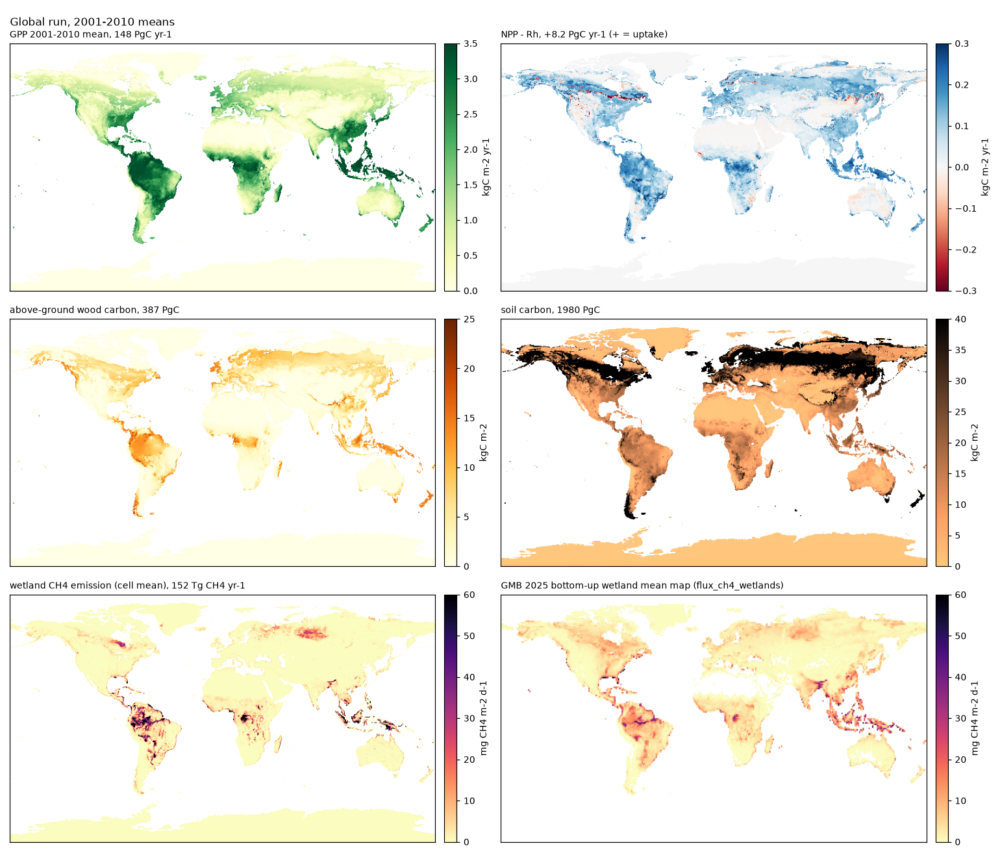
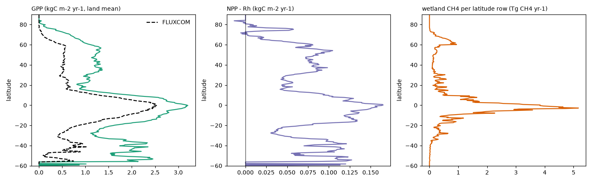
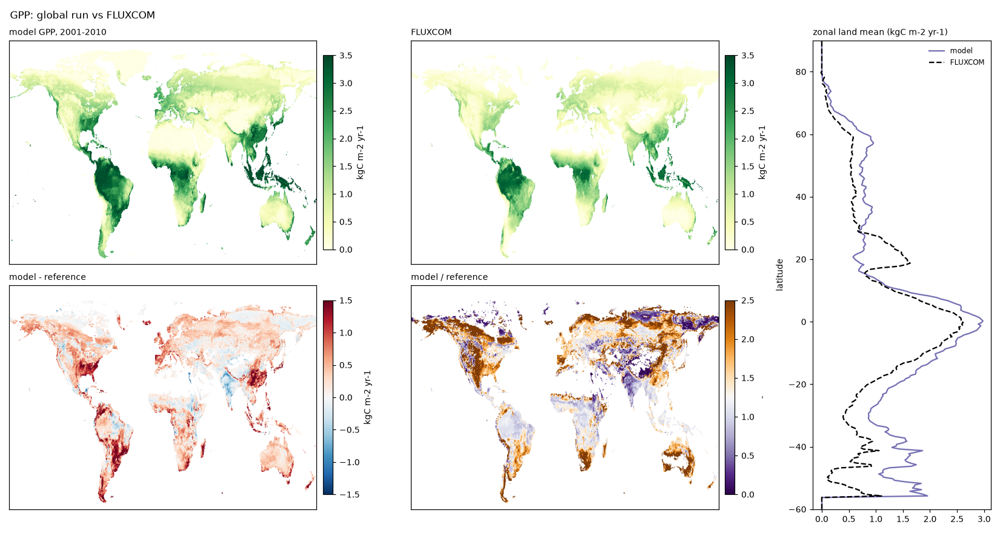
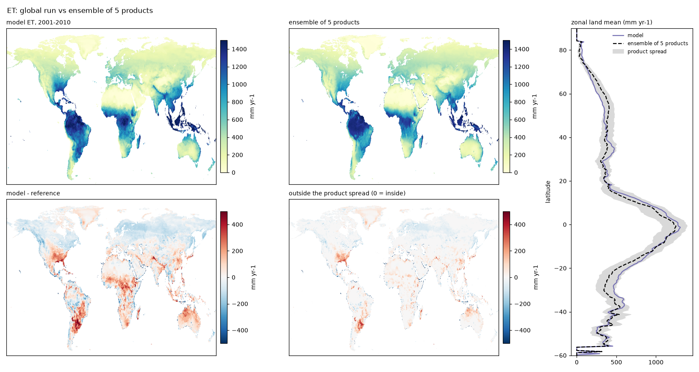

# IBIS 3.0: evaluation of the 30 October 2026 release

This page holds the complete evaluation of the release that the [README](../README.md) summarises: the tower and
global scores, the figures, the wetland-methane analysis, the limitations as they were listed then and the parameter sets.
Moved here from the README on 10 November 2026, unchanged apart from link texts and one alt text. The release itself, its provenance and how to reproduce
it are in [RELEASE_3.0.md](RELEASE_3.0.md).

> **Corrections of 10 November 2026.** The text below is the README as it stood on `main` on 2 November 2026,
> describing the release of 30 October; these notes correct it without rewriting it. They concern the release column
> ("IBIS 3.0, final") unless they say otherwise.
> - The rows of the global table are 2001–2010 means except where technote Table 16.11 states otherwise: the wood and
>   soil carbon are the pools at the end of 2010, the peak leaf area and the tree cover are 2006–2010 means, and the
>   burned area is the burned fraction of 2010 against the GFED5 mean of 2001–2005.
> - "Wood carbon (above-ground)" is the wood of the tree positions. Its reference, Xu et al. 2021, is live biomass with
>   the leaves, roots and shrubs, so like-for-like parity is a ratio of about 0.8 (CALIBRATION 67).
> - The GPP trend, +21 %, is that of the binary-mask series; weighted by each cell's land fraction it is +22 % (Table
>   16.11).
> - In "2.78 ± 0.69", the 0.69 is the interannual standard deviation of the Global Carbon Budget land sink, not an
>   uncertainty.
> - The column "IBIS 2.6b4 default" is the run `final_base_default` (CALIBRATION.md 20, run on 23 September 2026 and
>   scored 2006–2010): the port with the IBIS 2.6b4 default parameters and the new fire and methane modules on. Its wood
>   entry (471) is total vegetation carbon, its burned area (4.62 %) is that run's own value (GFED5 then read 4.60 %),
>   and its ET entry (1.03 ×) differs from that record's 1.16 of the ensemble; the column has not been re-checked as a
>   whole.
> - The net flux of Figure 1 (NPP − Rh, +8.2 PgC yr⁻¹) is before the losses to fire, disturbance and harvest; the land
>   sink after them is +2.91. Figure 1's wood and soil totals (387 and 1980 PgC) are 2001–2010 means over all positions
>   and cells, the table's (388 and 1982) the end-of-2010 values on the scored cells.
> - Limitation 5 is superseded: a run of the revised model on the release's spin-up schedule ends the spin-up with the
>   soil carbon at 78 % of its equilibrium (technote 12.7.1), so the release's soil stock is not the equilibrium stock.
> - The limitations below are those of the README; [RELEASE_3.0.md](RELEASE_3.0.md) section 6 has the complete list.

## Release state

The release state (30 October 2026) is the parameter set [`params_31s_ch4h.yaml`](../python-port/configs/params/params_31s_ch4h.yaml) on branch `main`, run with hourly wetland methane, its carbon taken out of the respiration CO2, and the learned wetland area (`methane_hourly`, `methane_carbon_partition`, `wetland_source: learned`). [`RELEASE_3.0.md`](RELEASE_3.0.md) describes it in short: what was calibrated against what, the file's provenance, how to reproduce the run and its scores, and the limitations. [`CALIBRATION.md`](CALIBRATION.md) is the full record, including the subsequent review in sections 86–87.1. The previous release on `main` was that of 12 October 2026 ([`params_s7_crop.yaml`](../python-port/configs/params/params_s7_crop.yaml)); the calibration that led from it to this one is the history of branch `calibration-s1`.

**Early technote edition, 2 November 2026.** The [technical note](technote/README.md) has been edited for clearer explanations while retaining its scientific content. It includes the completed diagnostic comparisons and distinguishes them from dated release results. This publication changes documentation only; the model code on main remains the 30 October release. Chapter 16 describes the remaining scientific work.

## Results at a glance (30 October 2026)

**Towers.** The tower campaign fitted 356 flux towers (FLUXNET2015, ICOS, AmeriFlux, NEON and regional networks) one by one on their own meteorology, with one year held out, built one parameter set per climate-zone plant type from the medians of each type's towers, and re-scored every tower under two of the shared type sets: that of 20 October 2026 (`params_31a.yaml`, the set of the first global run of the types, which differs from the release in 113 tower-derived type values) and that of 26 October (`params_31k.yaml`). At the release date, the release set itself had not been re-scored at the towers; it differs from the 26 October set in the cold-shrub allocation, the cover-limit, wood, soil and fire stages and the methane bands ([technote](technote/) Table 16.5 and section 16.14). Annual model/tower ratios, medians over the towers with a scored record (in brackets the share of towers within 25 % of the tower):

| Quantity | per-tower fits | shared type set of 20 October (`params_31a`) | shared type set of 26 October (`params_31k`) |
|---|---|---|---|
| GPP, 331 towers | 0.97 (80 %) | 0.98 (50 %) | 1.01 (53 %) |
| ET, 356 towers | 1.06 (63 %) | 1.02 (61 %) | 1.03 (62 %) |
| Ecosystem respiration, 331 towers | 1.01 (78 %) | 1.11 (44 %) | 1.13 (43 %) |
| Monthly correlation, GPP / ET / NEE | 0.88 / 0.89 / 0.60 | 0.87 / 0.89 / 0.55 | 0.87 / 0.89 / 0.52 |

The 12 October comparison at the original 62 FLUXNET2015 towers, 2009–2012 ("held-out" = a year the fit never saw; "within 25 %" = share of towers whose annual model/tower ratio lies between 0.75 and 1.25):

| Quantity | IBIS 2.6b4 default | IBIS 3.0, one set per PFT | IBIS 3.0, per-tower fits | Target |
|---|---|---|---|---|
| GPP, monthly r / NSE | 0.86 / 0.73 | 0.88 / 0.78 | 0.94 / 0.88 | 1 / 1 |
| GPP, annual within 25 % of tower | 58 % | 66 % | 90 % | 100 % |
| ET, monthly r / NSE | 0.80 / 0.57 | 0.81 / 0.62 | 0.83 / 0.65 | 1 / 1 |
| NEE, monthly r / NSE | 0.47 / 0.12 | – | 0.73 / 0.49 | 1 / 1 |
| NEE day-time uptake, held-out year, model/tower (within 25 %) | 0.68 (23 %) | – | 0.89 (69 %) | 1 |
| NEE night-time release, held-out year, model/tower | 1.02 | – | 1.07 | 1 |
| Wetland CH4, held-out model/tower: boreal / temperate / tropical (45 Fluxnet-Methane_V2.0 towers) | – | – | 0.84 / 0.82 / 0.95 | 1 |
| Wetland CH4, held-out monthly r: boreal / temperate / tropical | – | – | 0.66 / 0.83 / 0.03 | 1 |
| Wetland CH4, the release (flux every time step, 48 towers), held-out model/tower: boreal / temperate / tropical; middle column at the band parameters the global run uses | – | 0.99 / 0.79 / 1.51 | 0.82 / 0.69 / 0.78 | 1 |
| Wetland CH4, the release, held-out monthly r: boreal / temperate / tropical | – | 0.75 / 0.64 / 0.33 | 0.74 / 0.83 / 0.30 | 1 |
| Cropland GPP, held-out model/tower (r): C3 crops / maize (16 towers) | – | – | 0.76 (0.55) / 1.01 (0.77) | 1 |

**Global, 2001–2010** — means on true land area after the cold 200-year spin-up and the 1901–2000 transient with rising CO2; pools from the 2010 state. The 12 October column is the previous release; the final is this one.

| Quantity | IBIS 2.6b4 default | IBIS 3.0, 12 October | IBIS 3.0, final | Reference |
|---|---|---|---|---|
| Land sink (change of stored carbon), PgC yr⁻¹ | +2.8 | +1.6 | **+2.91** | GCB 2024: 2.78 ± 0.69; TRENDY v13 mean 2.83, range 1.4–4.4 |
| Crop harvest, PgC yr⁻¹ | – | 1.4 | **0.67** | about 1–2 |
| GPP, PgC yr⁻¹ | 178 | 195 (1.75 × FLUXCOM, cell r 0.85) | **148** (1.32 × FLUXCOM on its land, cell r 0.90) | published 110–160; FLUXCOM 109 on its land (0.70 × the towers) |
| GPP / FLUXCOM: tropics / 30–60N / north of 60 | – | 1.52 / 2.29 / 3.58 | **1.25 / 1.49 / 1.82** | 1 |
| GPP at the 435 tower cells, model / tower | – | – | **1.14** (Köppen A 0.96, B 1.30, C 1.18, D 1.05, E 1.04) | 1 |
| GPP trend, 1900s to 2000s | – | +18 % | **+21 %** | +31 ± 5 % (Campbell et al. 2017); 20–30 % (TRENDY) |
| ET, mm yr⁻¹ (cell r; cells inside the product spread) | 1.03 × | 527 (1.04 ×; 0.93; 54 %) | **529** (1.04 ×; 0.94; 55 %) | 508 (five-product ensemble) |
| ET / ensemble: tropics / 30–60N / north of 60 | – | 1.08 / 1.00 / 0.75 | **1.08 / 0.99 / 0.80** | 1 |
| Wetland CH4, Tg yr⁻¹ | 269 | 154 | **152** | GMB 2025 bottom-up: 153 (116–189) |
| CH4 by band 90S–30N / 30–60N / 60–90N | – | 130 / 11 / 13 | **135 / 11 / 7** | 109 / 32 / 12 |
| Burned area, % yr⁻¹ (rank r vs GFED5, all / burning cells) | 4.62 | 4.55 (+0.76 / +0.42) | **2.42** (+0.78 / +0.44) | 4.62 (products 2.4–4.6; the final column re-scored on the corrected GFED5 registration, CALIBRATION 81) |
| Wood carbon (above-ground), PgC | 471 | 349 | **388** (1.07 × the map; temperate 1.70, savanna 0.71, humid tropics 1.01) | Xu & Saatchi 2021: 362 |
| Soil carbon, PgC | 1938 | 2416 | **1982** (0.71 × HWSD2 0–1 m; 30–60N 0.80, north of 60 0.47) | HWSD2 0–1 m: 2793; literature 1500–2400 |
| Tree cover on natural land | – | – | **0.450** (phantom forest 3.6 %, lost forest 1.9 %) | 0.388 (CLM / MODIS) |
| Peak leaf area, land mean | – | 2.3 × | **2.33** (1.10 ×, cell r 0.79) | GLASS / GIMMS LAI4g 2.12 |
| Permafrost extent, Mkm² | – | 23.2 | not re-scored | 21.8 (Obu et al. 2019) |

**In one line:** at the towers the shared type sets re-scored before the release (20 and 26 October; the release set itself had not yet been re-scored) keep GPP and ET within a few percent of the towers at the median (0.98-1.03), put ecosystem respiration at 1.11-1.13, and lose spread; globally the land sink, ET, wetland methane, wood and soil carbon sit on their budgets, maps or product ranges, GPP is inside the published range and 1.3 times the lowest product, and the two quantities still outside are burned area, at half of GFED5 because the African savanna fires are lit by people, and the spring and autumn photosynthesis north of 30 N. The limitations are listed in full below and in [`RELEASE_3.0.md`](RELEASE_3.0.md).

### The final global run

*Figure 1. The release run, 2001–2010 means: GPP (148 PgC yr⁻¹), net flux (NPP − Rh with Rh as CO2 only, +8.2 PgC yr⁻¹, positive = uptake), above-ground wood carbon (387 PgC), soil carbon (1980 PgC), and the model's wetland methane (152 Tg yr⁻¹, hourly flux on the learned wetland area) beside the Global Methane Budget 2025 bottom-up wetland map on the same colour scale.*

*Figure 2. Zonal land means of the same run: GPP beside FLUXCOM, the net flux, and wetland methane per latitude row (Tg CH4 yr⁻¹).*

### Wetland methane: hourly flux, learned wetland area

Wetland CH4 is computed every time step from the hourly soil temperature, water and ice and the day's heterotrophic
respiration, with the band parameters refitted at the 48 Fluxnet-Methane_V2.0 wetland towers at that cadence. The methane
carbon is taken out of the respiration booked as CO2, so the emitted carbon is counted once (0.11 PgC yr⁻¹). The wetland area is dynamic,
seasonally and from year to year: the WAD2M seasonal climatology plus an anomaly from a learned model (gradient-boosted
trees per wetland band, monotone in water) of the month's inundation from the model's own month-mean soil water and
water totals and static topography. Held out by year, the learned area beats the fixed climatology against WAD2M in
every band (monthly R² 0.56 / 0.48 / 0.81 against 0.52 / 0.46 / 0.80, tropical / temperate / boreal) and follows the
year-to-year variation (r of the annual area 0.90 / 0.48 / 0.58), with damped amplitude (a quarter of the observed
swings in the tropics). Details: [`METHANE.md`](METHANE.md) 8-12, [`CALIBRATION.md`](CALIBRATION.md) 80-84.

Wetland CH4, Tg CH4 yr⁻¹, 2001–2010, under three wetland-area sources (hourly flux, refitted bands):

| Band | fixed climatology | learned (the release) | observed WAD2M month | GMB 2025 bottom-up, 2000–2009 |
|---|---|---|---|---|
| 90S–30N | 134.3 | **134.7** | 138.3 | 109.5 (66–146) |
| 30–60N | 10.5 | **10.6** | 10.5 | 32.1 (16–60) |
| 60–90N | 6.7 | **6.8** | 6.7 | 11.7 (4–28) |
| Global | 151.5 | **152.1** | 155.6 | 153.3 (116–189) |

The three runs are compared on one extraction (cell areas on the model's land fraction); the scorecard's true-land
totals, used in the table above, give the release 152.5 (135.0 / 10.7 / 6.8).

Learned against observed wetland area, and the CH4 each gives (learned / observed − 1):

| Band | area, decade mean | area, range over years | methane, range over years |
|---|---|---|---|
| tropics | −1.7 % | −3.5 to +2.0 % | −0.7 to −5.0 % |
| 30–60°N | +0.3 % | −4.3 to +3.6 % | −0.3 to +3.0 % |
| 60–90°N | +1.1 % | −0.8 to +3.3 % | −1.0 to +1.5 % |
| global | −0.8 % | −2.9 to +1.3 % | −0.6 to −4.4 % |

The annual CH4 anomalies of the learned and the observed run correlate at 0.98; the decade-mean area maps at cell r
0.999. The learned run is the release setting because it is the like-for-like protocol for the budget's numbers above,
which are the models' own (prognostic) wetland extents; the observed source remains a switch for diagnostic runs.

*Figure 3. GPP against FLUXCOM: model, reference, model − reference, model / reference, and zonal land means. The pattern matches (cell r 0.90); the excess is north of 30 N (1.5 ×) and largest north of 60 N (1.8 ×), where FLUXCOM is also lowest against the towers.*

*Figure 4. ET against the ensemble of five satellite- and tower-based products (MODIS ET, MOD16A2, GLEAM v3.3a, DOLCE, FLUXCOM LE; from the ILAMB collection): model, ensemble mean, model − reference, and the part of the difference that lies outside the spread of the products (55 % of cells are inside it); the tropics are 8 % high and the far north 20 % low.*

## Known limitations (README of 2 November 2026)

1. **Burned area is half of GFED5**, a quarter in the African savannas, where the fires are lit by people and the scheme has no agricultural or lightning ignition term. The fire parameters sit at the optimum of the zone objective.
2. **Temperate wood is 1.7 times the biomass map** (temperate Europe 2.0, Asia 1.5, North America 1.35): young, managed forests against a model that grows old growth with no land-use history. The humid African tropics (the Congo basin) are 0.66 of the map.
3. **Wetland methane by band follows the towers, not the wetland-model ensemble**: 1.23 times the ensemble in the tropics, 0.33 and 0.58 in the two northern bands; frozen soil is excluded from the active substrate, although thawed subsurface layers can still support winter production; the learned wetland area's year-to-year swings are a quarter of the observed in the tropics.
4. **GPP north of 30 N in spring and autumn** is 1.5–3 times FLUXCOM while July is close; north of 60 N the annual GPP is 1.8 times FLUXCOM with eight polar towers behind the types.
5. **Soil carbon is 0.71 of the HWSD2 top metre**, the cold zones short of it (boreal 0.59, north of 60 N 0.47). The soil is at equilibrium by the end of the spin-up (drift at most 0.13 PgC yr⁻¹ per zone group), so this is the equilibrium stock under the model's turnover and inputs; the HWSD2 top metre in the boreal zones is largely peat and permafrost carbon that a mineral-soil decomposition scheme does not accumulate.
6. **Tree cover is 0.45 against 0.39** on natural land (phantom forest 3.6 %).
7. **Cropland** is a managed grass: no crop phenology, sowing or harvest date; harvest 0.67 PgC yr⁻¹.
8. **Other limits and subsequent diagnostics.** The canopy remains unclumped, decomposition has no vertical resolution, and forcing ends in 2010. The ET partition has since been examined in the 624-run comparison (technote 16.14.2), without validation against observed transpiration. Growth respiration follows net carbon gain rather than daylight: the release also reduced deficits; revised code charges only positive gain (technote 11.2.3).

## Parameter sets

Parameter sets in [`python-port/configs/params/`](../python-port/configs/params/): `params_31s_ch4h.yaml` (**the IBIS 3.0 release**: the type set with the cover limit, the production refit, the soil-carbon factors and the methane bands refitted at the hourly cadence), its chain `params_31s_soil_strong.yaml` (the same without the hourly methane bands), `params_31r.yaml` (cover limit and production) and `params_31n.yaml` (the allocation stage), and `params_s7_crop.yaml` (the 12 October release on `main`; class medians of the 62-tower fits with methane and cropland). The provenance of each step is in [`RELEASE_3.0.md`](RELEASE_3.0.md) section 2.
