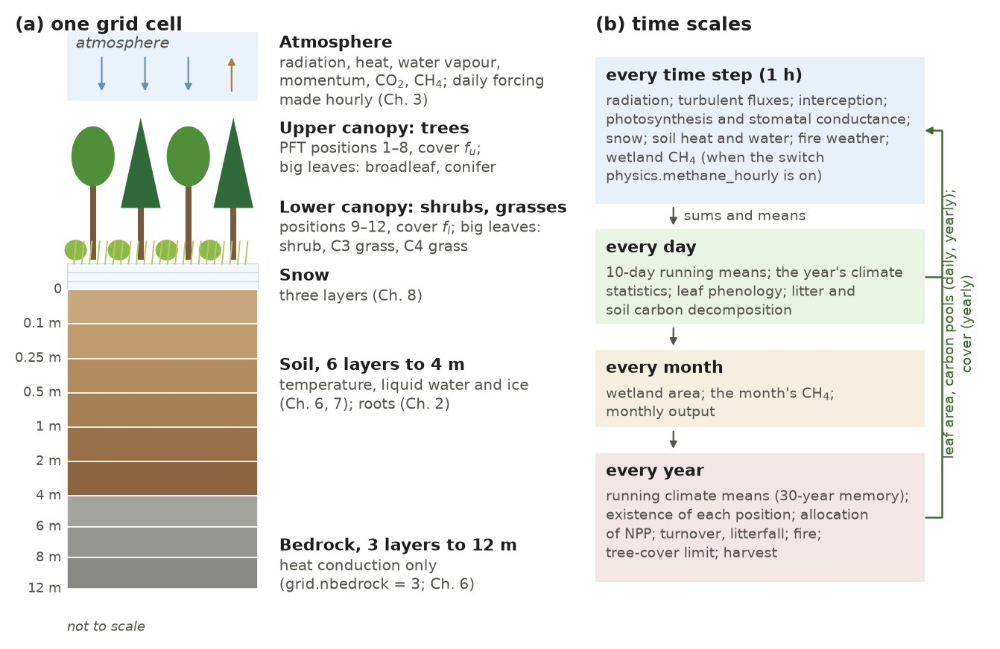

# 1. Introduction

This note describes version 3.0 of the Integrated Biosphere Simulator (IBIS 3.0) for people who run the model and use
its results. It explains the physical and biological processes represented in the model, the equations used to
describe them, the methods used to solve those equations, and the required input data. Each chapter presents the
equations as implemented in the code, together with the values in the release parameter file. Chapter 16 summarizes
the calibration of those parameters; the full record is in the calibration log (`docs/CALIBRATION.md`). Chapter 17
describes the comparisons with the Fortran model that this implementation replaces.

## 1.1 Model history

### 1.1.1 IBIS 1

Foley et al. (1996) introduced IBIS as a common framework for land-surface physics, canopy physiology, plant phenology,
vegetation dynamics and the terrestrial carbon balance. Changes in vegetation composition and structure feed back
on the exchange of energy, water and carbon with the atmosphere. The land-surface physics derive from the
Land Surface Transfer scheme LSX (Pollard and Thompson, 1995); the Fortran routine that advances IBIS by one time step
is still called `lsxmain`.

### 1.1.2 IBIS 2

IBIS 2 (Kucharik et al., 2000) revised the model and evaluated its water balance, carbon balance and vegetation
structure against site and global observations. Further revisions to the Fortran code led to release 2.6b4. The
history file distributed with the code (`fortran/ibis_2.6b4/history.txt`) records changes from version 2.1 onward.
IBIS 2.6b4 serves as the reference for IBIS 3.0; its source is retained under `fortran/ibis_2.6b4/`.

### 1.1.3 IBIS 3.0

IBIS 3.0 is IBIS 2.6b4 rewritten in Python with JAX (Bradbury et al., 2018), a library that compiles numerical code for
CPUs and GPUs. The rewrite was checked against the Fortran in double precision, first routine by routine and then for
the hourly time step as a whole; the daily and annual routines (phenology, decomposition, climate statistics and
vegetation dynamics) were checked routine by routine (`verify/STATUS.md`; Chapter 17). Errors found in the port, and
several inherited from the Fortran, were then corrected (`docs/DEFECTS_FOR_REVIEW.md`, `verify/STATUS.md`); a few
remain open.

The two codes were compared side by side for 46 years at 117 grid cells, using the same forcing and fixed vegetation.
That comparison used the code of May-June 2026 and simplified test soils. For each cell and year, the largest hourly
difference in upper-canopy temperature was recorded: the median was 3 µK and the 99th percentile was 20 mK. With
IBIS 2.6b4's own soils and settings, one-step tests of the revised code agree with the Fortran to about 10⁻¹² K. A
one-year comparison at 20 of the cells used these settings on an earlier revision. It gave 0.67 mK at the median
cell and 21 mK at the worst cell. Part of that difference remains unexplained (Chapter 17, section 17.9).

IBIS 3.0 adds the following to IBIS 2.6b4:

1. Sunlit and shaded leaves: each of the five big leaves of IBIS 2.6b4 (the groups of plant types that photosynthesis
   treats as one leaf; Chapter 2) is divided into its sunlit and its shaded leaves (the two-big-leaf approximation of
   de Pury and Farquhar, 1997); photosynthetic capacity that declines through the canopy and is mixed over the plant
   types of each big leaf by their leaf area; and seasonal acclimation of capacity to temperature in the evergreen
   conifer and evergreen shrub positions (Chapter 9).
2. Plant types defined by growth form and Köppen climate zone: 35 tree, shrub and grass types that fill the twelve
   plant functional type positions of IBIS 2.6b4 cell by cell, three wetland types that give each zone its methane
   parameters, and two crop types that name the C3 and C4 crops of the cropland parameters (Chapter 2).
3. A maximum tree cover limited by water (Chapter 11).
4. A fire scheme driven by the fraction of the year with fire-prone weather, with a mortality for each
   plant functional type position and the emission of CO2, CO, CH4, N2O and NOx from the carbon the fire burns
   (Chapter 13).
5. A wetland methane module evaluated every time step, with the wetland area from an observed seasonal climatology and
   a learned year-to-year anomaly (Chapter 14).
6. Cropland as a managed grass on an observed cropland share, with harvest (Chapter 15).
7. Three bedrock layers beneath the 4 m soil column that conduct heat (Chapter 6).
8. Respiration and allocation parameters for each plant type (Chapter 11); and new outputs: quantities used to compare with flux
   towers (evapotranspiration and day- and night-time net ecosystem exchange), the components of evapotranspiration, fire
   emissions and harvest (Chapters 13 and 15), and, on request, a yearly account of the water balance (Chapter 7).
9. The release calibration of the vegetation parameters at 356 flux towers (358 for the respiration parameters), of the methane
   parameters at 48 wetland towers and of the cropland parameters at 16 cropland towers, evaluated against global
   products (Chapter 16).

Most of these additions have a configuration switch (section 1.6). The release is dated 30 October 2026. After it, a
review of this note led to changes in the code. Each chapter describes the code as it is now, and lists what changed
since the release in its closing section, "Notes for developers". Results of the release run (global totals, tower
scores, maps) are quoted as the release run's.

The development update of 4 November 2026 adds the completed natural-site and crop refits, new soil-carbon pool
preparations, and the water-accounting diagnosis. The NEE refits and final evaluation are still in progress
(Chapter 16). These developments do not replace the release-run maps or global totals. This GitHub update
publishes the documentation; the model code on GitHub main remains the 30 October release.

## 1.2 Biogeophysical and biogeochemical processes

The processes that IBIS 3.0 simulates, and the chapters that describe them, are:

1. Surface characterization: plant functional types and their climate-zone types, vegetation cover, soil texture and
   cropland share (Chapter 2).
2. Atmospheric forcing and its conversion from daily to hourly values (Chapter 3).
3. Absorption, reflection and transmission of solar radiation by the canopy and the ground, and longwave exchange
   (Chapter 4).
4. Momentum, sensible heat and water vapour fluxes from the canopy, the ground and the snow; interception, drip and
   evaporation of rain and snow held on the canopy (Chapter 5).
5. Heat transfer in the soil, the bedrock and the snow, with freezing and thawing of soil water (Chapters 6 and 8).
6. Soil hydrology: infiltration, redistribution, surface runoff and drainage (Chapter 7).
7. Snow accumulation, melt and fractional cover (Chapter 8).
8. Photosynthesis and stomatal conductance (Chapter 9).
9. Leaf phenology (Chapter 10).
10. Autotrophic respiration, carbon allocation, biomass turnover, litterfall and vegetation dynamics (Chapter 11).
11. Litter and soil carbon decomposition (Chapter 12).
12. Fire and fire emissions (Chapter 13).
13. Wetland methane emission (Chapter 14).
14. Cropland and harvest (Chapter 15).

## 1.3 Model structure

IBIS 3.0 runs on a regular latitude-longitude grid. The release uses a global resolution of 0.5° with 95,333 land
cells. Water, energy and carbon do not move between cells. The only lateral link is in the learned wetland-area
model: it uses precipitation and runoff averaged over a neighbourhood of 5 × 5 cells (Chapter 14).

Within a grid cell the vegetation is organized in two canopy layers (Table 1.1): an upper canopy of trees (plant
functional type positions 1-8) and a lower canopy of shrubs and grasses (positions 9-12). The cover of each layer and
the leaf area of each position change during the run. Solar radiation is treated in two wavebands,
visible and near-infrared. Beneath the vegetation the model resolves a snowpack of three layers, a soil column of
six layers to 4 m (Table 1.2) and, when `grid.nbedrock` is 3 (default 0; 3 in the release), three bedrock layers that
conduct heat only and extend the column to 12 m (Figure 1.1).

**Figure 1.1** (a) The structure of a grid cell: the upper canopy of trees, which covers the fraction $`f_u`$ of the
cell, and the lower canopy of shrubs and grasses, which covers the fraction $`f_l`$ of its snow-free part, above a
snowpack of three layers, six soil layers to 4 m and, in the release, three bedrock layers to 12 m (Table 1.2); the
layers are not drawn to scale. (b) The time scales of the calculations (Tables 1.3 and 1.4): sums and means of the
hourly calculations, with the daily forcing, drive the daily, monthly and yearly ones. In turn, the daily and the
yearly calculations update the leaf area and the carbon pools, and the yearly ones also the cover, which the hourly
calculations use.

**Table 1.1** The twelve plant functional type (PFT) positions of IBIS 2.6b4. With the climate-zone types of Chapter 2,
the positions of a cell are filled by the tree, shrub and grass types of its zone; a tree position with no type in the
zone is off, and a shrub or grass position with no type keeps its base parameters.

| Position | Plant functional type | Canopy layer |
|---|---|---|
| 1 | tropical broadleaf evergreen trees | upper |
| 2 | tropical broadleaf drought-deciduous trees | upper |
| 3 | warm-temperate broadleaf evergreen trees | upper |
| 4 | temperate conifer evergreen trees | upper |
| 5 | temperate broadleaf cold-deciduous trees | upper |
| 6 | boreal conifer evergreen trees | upper |
| 7 | boreal broadleaf cold-deciduous trees | upper |
| 8 | boreal conifer cold-deciduous trees | upper |
| 9 | evergreen shrubs | lower |
| 10 | deciduous shrubs | lower |
| 11 | warm (C4) grasses | lower |
| 12 | cool (C3) grasses | lower |

**Table 1.2** Layers of the soil and bedrock column.

| Layer | Thickness (m) | Depth of the layer bottom (m) |
|---|---|---|
| soil 1 | 0.10 | 0.10 |
| soil 2 | 0.15 | 0.25 |
| soil 3 | 0.25 | 0.50 |
| soil 4 | 0.50 | 1.00 |
| soil 5 | 1.00 | 2.00 |
| soil 6 | 2.00 | 4.00 |
| bedrock 1 | 2.0 | 6.0 |
| bedrock 2 | 2.0 | 8.0 |
| bedrock 3 | 4.0 | 12.0 |

## 1.4 Time stepping

The model advances in time steps of 3600 s. It calculates fast processes—radiation, turbulent exchange,
photosynthesis, soil heat and soil water—every hour. Slower processes, including phenology, growth and vegetation
change, are calculated once a day, a month or a year. The weather generator (Chapter 3) converts each day's forcing
into values for the individual time steps, evaluated at the middle of each step. The biophysical calculations follow
the order of the Fortran routine `lsxmain` (Table 1.3). Table 1.4 lists the calculations performed at longer intervals.

**Table 1.3** Order of the calculations within one time step.

| Step | Calculation | Chapter |
|---|---|---|
| 1 | diagnostic soil properties: thermal conductivity, and the fractions and latent heats of soil evaporation | 6, 7 |
| 2 | wetted fractions of the canopy | 5 |
| 3 | solar and longwave radiation | 4 |
| 4 | interception of precipitation by the canopy, drip and throughfall | 5 |
| 5 | wetted fractions after interception | 5 |
| 6 | canopy exchange: three iterations of turbulent transfer coefficients, stomatal conductance and photosynthesis, and the implicit energy and water vapour balance | 5, 9 |
| 7 | evaporation of intercepted water and the final heat adjustment of the canopy water | 5 |
| 8 | nominal temperatures and intercepted water where a canopy layer is absent | 5 |
| 9 | snow heat transfer, melt, layer adjustment and fractional cover | 8 |
| 10 | soil water, soil heat, freezing and thawing, and the water-content bounds | 6, 7 |
| 11 | fire weather of the step: the fuel dryness, and the fire-prone time (all steps by default) | 13 |
| 12 | wetland methane flux, when evaluated every time step | 14 |

With `physics.water_balance` on, the model also adds the step's water terms to the year's water account after step 11
(Chapter 7).

**Table 1.4** Calculations on daily, monthly and annual time scales.

| Time scale | Calculation | Chapter |
|---|---|---|
| day | 10-day running means of temperature and canopy photosynthesis | 10 |
| day | the year's climate statistics: its lowest and highest 10-day mean temperature and its degree-days above 0 and 5 °C | 11 |
| day | acclimation and senescence states from the day's mean temperature | 9, 10 |
| day | leaf phenology | 10 |
| day | growing-season soil-water stress sums of the water-limited tree cover | 10, 11 |
| day | litter and soil carbon decomposition (repeated 10 times a day during the accelerated part of the spin-up) | 12 |
| month | wetland area and the month's methane total; monthly output | 14 |
| year | running means of the climate statistics with a 30-year memory (section 2.3.5), and which positions may hold vegetation | 11 |
| year | allocation of the year's net primary production, biomass turnover, litterfall, fire, tree cover limit, harvest | 11, 13, 15 |

## 1.5 Model requirements

### 1.5.1 Atmospheric forcing

The release uses the daily GSWP3 data set at 0.5° (Kim, 2017), in the version processed for ISIMIP2. Table 1.5 lists
the required variables. The weather generator receives air temperature, precipitation, humidity, wind and pressure.
It also receives a cloud fraction derived from the daily mean shortwave radiation (Chapter 3). Downward longwave
radiation is applied directly: its daily mean is used in every time step. Atmospheric CO2 is a single annual value
for the globe, obtained by linear interpolation between values entered in the code. These use Law Dome and firn air
before 1959 and Mauna Loa from 1959 as a stand-in for the CMIP6 historical record (Meinshausen et al., 2017).

**Table 1.5** Atmospheric forcing variables (GSWP3, daily).

| Variable | Description | Units |
|---|---|---|
| tas, tasmax, tasmin | daily mean, maximum and minimum near-surface air temperature | K |
| pr | precipitation | kg m-2 s-1 |
| rsds | downwelling shortwave radiation at the surface | W m-2 |
| rlds | downwelling longwave radiation at the surface | W m-2 |
| huss | near-surface specific humidity | kg kg-1 |
| wind | wind speed at 10 m | m s-1 |
| ps | surface pressure | Pa |

### 1.5.2 Surface data

Besides the forcing, the model reads maps that describe the land surface of each cell (Table 1.6).

**Table 1.6** Surface data of the release.

| Data | Source | Use |
|---|---|---|
| land mask | binary mask of the cells with any IBIS vegetation type, ice and bare ground included, in the ESA CCI land cover of 1992 (`surta.nc`) | the land cells |
| soil texture | HWSD-based IBIS soil file (`soita.nc`) | sand and clay fractions of the six soil layers |
| vegetation type | ESA CCI land cover of 1992, converted to IBIS vegetation types | the vegetation of the cold start |
| Köppen climate class | Beck et al. (2023), 30-year periods from 1901-1930 to 1991-2020 | the climate zone of each cell in the period of the model year, which selects its plant types (Chapter 2) |
| cropland share | ESA CCI land cover, 2000 | the cropland fraction of each cell (Chapter 15) |
| wetland area | WAD2M version 2.0 (Zhang et al., 2021) | the seasonal climatology of the inundated fraction (Chapter 14) |
| learned wetland model | trained on WAD2M and a reference hindcast of the model (`wetland_learned_v2_s31t.npz`) | the year-to-year anomaly of the inundated fraction (Chapter 14) |

### 1.5.3 Initialization and spin-up

A run starts from either an earlier run's restart file or a cold start. At a cold start, the litter and soil carbon
pools are empty. The cell's land-cover type sets the initial leaf area, from which the model derives leaf, root and
wood carbon (Chapter 2). The soil, ground surface and bedrock start at 278.13 K, and liquid water fills half of the
soil pore space (Chapters 6 and 7).

The release run starts cold and follows a three-stage protocol: a 200-year spin-up (model years 1701-1900) that cycles
the 1901-1930 forcing at a CO2 concentration of 296 ppm; a transient run from 1901 to 2000 with the forcing of each
year and rising CO2; and a hindcast from 2001 to 2010 with monthly output. The spin-up brings the slow soil carbon pools
close to equilibrium. To speed this up, the litter and soil carbon routine runs ten times on each model day of the
spin-up, so that these pools evolve ten times faster; the last 50 years of the spin-up run at the normal rate
(Chapter 12). Wetland methane is computed in the transient and the hindcast.

### 1.5.4 Parameters

The model reads parameters from a YAML parameter file and uses the code's default for any value the file omits.
Parameters that vary among plant types are specified for the climate-zone types. For each cell, the model selects
the types belonging to its zone and gathers their parameters into arrays over the twelve PFT positions (Chapter 2).
The release parameter file is `python-port/configs/params/params_31s_ch4h.yaml`.

## 1.6 Configuration switches

Two YAML files set up a run: the run configuration, which names the input files, the period and the processes to run
(Table 1.7), and the parameter file (Table 1.8). Most processes that IBIS 3.0 adds to IBIS 2.6b4 have a switch that is
off by default. A few are turned on by a parameter value instead of a switch, such as the soil-water trigger of leaf
drop (`pheno.drop_stress_thresh`, Chapter 10) and the zone factor on the turnover of soil carbon (`bgc.som_k_scale`,
Chapter 12). Several details of the fire scheme are on by default (Table 13.1), among them the fire-season form and
the mortality per position. They act only when fire is on (`physics.isimfire` = 1); with fire off the annual update
uses the background disturbance of IBIS 2.6b4 (Chapter 13).

Most error corrections in IBIS 2.6b4 or the port have no switch. A few do: some are on by default and restore the
earlier behaviour when turned off. Three correction switches are off by default. Two,
`soil.h2o_consistent_weights` and `pft.exact_litterfall`, are enabled in the release; a parameter file that omits them
therefore runs the earlier form. The third, `soil.evap_needs_store`, was added after the release. It is off in the
release, preserving IBIS 2.6b4's behaviour, and on in `params_32a_base.yaml`, the starting parameter file for the new
calibration. `docs/RELEASE_3.0.md` lists corrections that change results relative to earlier runs of the port.

The switches added after the release are marked * in Tables 1.7 and 1.8. Five that change the physics,
`pheno.drop_stress_gate`, `pheno.climate_stats_daily`, `bgc.rgrowth_positive_only`, `methane.t_anaer_substrate` and
`weather.sun_midstep`, default to true; set to false, each gives the release's rule for that process. The optional
`fire.daylight_only` rule defaults to false, so fire-prone weather is counted in every step, as in the release.
The other additions keep the release's behaviour by default: `soil.evap_needs_store`
(above); `crop.aleaf`, which remains unset for this release (Chapter 15); `physics.water_balance`, which adds output only;
and `canopy.za_above_top`, `canopy.ca_cap`, `canopy.dew_on_dry` and `weather.wind_keep_mean`, variants evaluated in
the completed hourly energy test at flux towers; the current settings were retained (Chapter 16).
For each starred switch the Release column gives the setting that restores
the release's behaviour of that switch. Other changes since the release have no switch, so the current code as a whole
does not reproduce the release run (section 1.8).

Two limits on surface fluxes and temperatures are set through environment variables: `IBIS_FLUX_MAX` (default
2000 W m⁻²) and `IBIS_T_MAX_DEV` (default 40 K). These are read separately from the two configuration files. The
global runner records both limits in the run log (Chapter 17).

**Table 1.7** Switches of the run configuration (* added after the release).

| Switch | Default | Release | Meaning | Chapter |
|---|---|---|---|---|
| `physics.isimveg` | 0 | 1 | dynamic vegetation | 11 |
| `physics.isimfire` | 0 | 1 | fire | 13 |
| `physics.fire_scheme` | `seasonlength` | `seasonlength` | fire occurrence from the length of the fire season (`legacy`: IBIS 2.6b4) | 13 |
| `physics.enable_fire_emissions` | false | true | trace-gas emissions of fire | 13 |
| `physics.koppen_types` | false | true | climate-zone plant types (with `forcing.koppen_file`) | 2 |
| `forcing.cropfrac_file` | none | ESA CCI 2000 | cropland as a managed grass on this share | 15 |
| `grid.nbedrock` | 0 | 3 | bedrock layers that conduct heat | 6 |
| `physics.enable_methane` | false | true in the transient and hindcast | wetland methane | 14 |
| `physics.methane_hourly` | false | true in the transient and hindcast | methane flux evaluated every time step | 14 |
| `physics.wetland_source` | `climatology` | `learned` in the transient and hindcast | source of the inundated fraction | 14 |
| `physics.methane_carbon_partition` | false | true in the transient and hindcast | methane carbon booked out of the heterotrophic respiration released as CO2 | 14 |
| `physics.transient_co2` | false | true in the transient and hindcast | CO2 from the historical record | 3 |
| `physics.soilcspin`, `physics.nsoilcall` | 1, 1 | 1, 10 in the spin-up | accelerated decomposition during the spin-up | 12 |
| `physics.soilcspin_tail_years` | 50 | 50 | final spin-up years at the normal decomposition rate | 12 |
| `physics.et_components` | false | true in the hindcast | output of the components of evapotranspiration | 5 |
| `physics.soil_organic` | false | false | organic-soil hydraulic and thermal properties | 7 |
| `physics.water_balance` * | false | false | yearly water-conservation output: the water that bounds and floors add, the change in storage, and counters (outputs only) | 7 |

**Table 1.8** Switches of the parameter file (* added after the release; for these the Release column gives the setting
that restores the release's behaviour of that switch).

| Switch | Default | Release | Meaning | Chapter |
|---|---|---|---|---|
| `stomata.sunshade_u`, `stomata.sunshade_l` | false | true | sunlit and shaded leaves in the upper and the lower canopy | 9 |
| `stomata.vmax_mix`, `stomata.coefm_mix` | false | true | capacity and stomatal slope of a big leaf mixed over its positions by leaf area (IBIS 2.6b4: one position's values) | 9 |
| `stomata.gpp_split_by_capacity` | false | true | photosynthesis of a big leaf split among its positions by capacity and leaf area | 9 |
| `stomata.acclim_on`, `stomata.acclim_per_pft` | false | true | seasonal temperature acclimation of capacity, with per-position parameters | 9 |
| `pheno.sen_photoperiod_u`, `pheno.sen_photoperiod_l` | false | true | senescence triggered by day length | 10 |
| `pheno.drop_stress_gate` * | true | false | the lower canopy's soil-water trigger of leaf drop acts on growing-season days only | 10 |
| `pheno.climate_stats_daily` * | true | false | the year's climate statistics from daily temperatures, as IBIS 2.6b4 (false: from monthly means) | 11 |
| `pft.tree_cover_limit` | false | true | maximum tree cover limited by water | 11 |
| `pft.exact_litterfall` | false | true | litterfall booked as the carbon the pool update removes | 11 |
| `bgc.rgrowth_positive_only` * | true | false | growth respiration charged only on a positive net carbon gain of the step, as IBIS 2.6b4 | 11 |
| `soil.h2o_consistent_weights` | false | true | soil-water solver linearized at the point of its interpolation weights (IBIS 2.6b4 when false) | 7 |
| `soil.evap_needs_store` * | false | false | the ground evaporates only from soil water or a puddle (true in `params_32a_base.yaml`, the base of the refits) | 7 |
| `fire.use_canopy_damping` | false | true | damping of fire under a closed canopy | 13 |
| `fire.daylight_only` * | false | false | optionally restrict the fire-prone time to daylight steps | 13 |
| `methane.t_anaer_substrate` * | true | false | the methane production temperature weighted by the depth profile of the decomposing substrate | 14 |
| `weather.sun_midstep` * | true | false | the sun and the weather generator evaluated at the middle of each step (false: at its start, as IBIS 2.6b4) | 3 |
| `weather.wind_keep_mean` * | false | false | hourly wind draws rescaled to keep the day's mean wind (energy-test variant) | 3 |
| `canopy.za_above_top` * | 1.0 m | 1.0 m | least height of the reference level above the canopy top (energy-test variant) | 5 |
| `canopy.ca_cap` * | 1 | 1 | the cap of IBIS 2.6b4 on the canopy-air transfer; 0 lifts it (energy-test variant) | 5 |
| `canopy.dew_on_dry` * | 0 | 0 | above 0, dew forms on dry leaves and stems (energy-test variant) | 5 |
| `crop.aleaf` * | unset | unset | leaf share of the crops' carbon allocation on the cropland share | 2, 15 |

## 1.7 Software

IBIS 3.0 is written in Python with JAX (Bradbury et al., 2018) and Equinox (Kidger and Garcia, 2021). The model state
is stored as a tree of arrays over the land cells. JAX's just-in-time compiler treats the days of a month as one
compiled unit, including the hourly steps and daily phenology and decomposition. Annual vegetation updates, learned
wetland area, and input and output operations run outside that unit.

The same code runs on CPUs for tower calibration and tests, and on a GPU for global runs. Global runs use single
precision; the three stages of the release run (section 1.5.3) took 8 h 16 min on one NVIDIA RTX 4090. Comparisons
with IBIS 2.6b4 used double precision. JAX can automatically differentiate the compiled time step, but those results
are not yet usable: the gradient tests return values that are not numbers (Chapter 17, section 17.11). The
calibration described in Chapter 16 did not use gradients.

## 1.8 Notes for developers

1. **Release and current code.** The release is commit `e54e342` with `params_31s_ch4h.yaml`; its run is
   `final_rel30`. The review of this note (97 decisions; `docs/CALIBRATION.md` section 87, `docs/DEFECTS_FOR_REVIEW.md`)
   changed the code on branch `technote-review-fixes`, which no longer reproduces the release run. Refits and a final
   protocol run are to replace the release numbers. The base file of the refits, `params_32a_base.yaml`, is the release
   file plus the G06 timing of decision D18, the D9 degree-day minima of 975 K d for temperate conifers and
   700 K d for the boreal tree types, and `soil.evap_needs_store: true`, without the two unread solid-phase keys
   of D80 (Chapter 2). These are values of the named refit preset, not new fallback values for every parameter file.
2. **Verification harness (D62).** Until 2026-11-01 the harness gave both codes synthetic soils with a saturated
   suction of -0.15 m, which held the soil-water diffusivity at its floor, so that water moved between the soil layers
   by gravity only and capillary flow was checked routine by routine only; solids of 870 J kg⁻¹ K⁻¹ and 2650 kg m⁻³;
   a base permeability of 0.04; the wrapper's snow constants; and zero existence flags. The negative suction caused
   the NaN in soil-surface humidity reported as finding 26 of `verify/STATUS.md`; that finding is withdrawn. Since
   commit bed0ae7, both codes use IBIS 2.6b4's own soils, snow constants and settings
   (`python-port/tests/f2py/synthetic_inputs.py`). The single-step comparison then agreed to about 10⁻⁵ K. Agreement improved to about
   10⁻¹² K since the heat flux into the top soil layer is formed from the layer temperature at the start of the step,
   as in IBIS 2.6b4 (D51; Chapter 6). The lockstep year 1951 at 20 cells (section 1.1.3) ran on 307d0f8, before D51.
   With the D51 order and the bounds of Table 17.4 lifted, four of its five cells at 15-25°N agree to 4 × 10⁻¹² K or
   better over the year. Those two settings changed together. The fifth cell retains one event that has not been
   examined. At three of the five cells at 55°N, rounding differences grow during soil or snow freezing and thawing.
   At the other two (40°E and 120°E), differences begin in spring (23 March and 1 April 1951). The first begins within
   one step, at snow-laden leaves at the melting point. A later replay of that event found that a last-digit change
   in compiled arithmetic selects a different ice/water saturation branch in the third canopy iteration. Selecting
   the same branch removes the recreated temperature gap. The exact historical March input was not saved, so this
   explains the recreated event rather than proving exact recovery of the original input or all long-run differences.
   The second event and the southern cells have not been examined (`verify/STATUS.md`, "Harness settings";
   Chapter 17, section 17.9.3). The 46-year lockstep comparison has not been repeated.
3. **Fire off (D29; no switch).** The annual update applies the fire scheme's mortality per position and its combustion
   completeness only when `physics.isimfire` is 1, so a run with fire off has the background disturbance of IBIS 2.6b4.
   The release code applied them also to the background disturbance of a fire-off run; in the review's fire-off test
   (`check_fireoff.py`), the disturbance then removed 0.0867 instead of 0.1498 kg C m⁻² yr⁻¹
   (`docs/DEFECTS_FOR_REVIEW.md`, D29). The release had fire on and is unaffected.
4. **Time step and day (D30, D33, D9).** The default fire rule again counts every step (`fire.daylight_only: false`),
   as in the release. A daylight-only variant remains available; its normalization can lengthen the inferred fire
   season even though it excludes night-time steps (Chapter 13). The sun and
   the generator are evaluated at mid-step (`weather.sun_midstep`). Start-of-step evaluation gave each hour the sun
   position of its first minute, centring the day's sunlight on 12:30. Climate statistics are accumulated day by day,
   as in IBIS 2.6b4 (`pheno.climate_stats_daily`). The release derived them from monthly means, which give different
   values: the coldest monthly mean lies above the year's lowest 10-day mean. The latter two switches default to true;
   false gives the release's rule for each process. Tables 1.3, 1.4 and Figure 1.1 show the current order.
5. **Cold start (D54; no switch).** The soil and the ground start at 278.13 K, as in IBIS 2.6b4
   (`initial.f:628-630`), and the bedrock at the same temperature; the release code used 278.0 K. The change matters
   only for short cold-start comparisons with the Fortran; it has no effect after the 200-year spin-up.
6. **Restarts and output (D71, D77, D69).** `load_state` refuses a restart written with the other `grid.nbedrock`
   instead of loading it misaligned. The yearly files of the spin-up carry an `nsoilcall` attribute: in the accelerated
   years their heterotrophic respiration and NEE are those of the last of the day's soil calls. The run log records
   `IBIS_FLUX_MAX` and `IBIS_T_MAX_DEV`.
7. **Learned wetland file (D39).** The release's learned wetland model was trained on the release's root-zone water.
   The current code counts only the liquid part of that water, so the file is to be retrained on the final run's
   hindcast (Chapter 14).

## References

Beck, H. E., et al., 2023: High-resolution (1 km) Köppen-Geiger maps for 1901-2099 based on constrained CMIP6
projections. *Scientific Data*, 10, 724.

Bradbury, J., et al., 2018: JAX: composable transformations of Python+NumPy programs. http://github.com/google/jax.

de Pury, D. G. G., and G. D. Farquhar, 1997: Simple scaling of photosynthesis from leaves to canopies without the
errors of big-leaf models. *Plant, Cell and Environment*, 20, 537-557.

Foley, J. A., I. C. Prentice, N. Ramankutty, S. Levis, D. Pollard, S. Sitch, and A. Haxeltine, 1996: An integrated
biosphere model of land surface processes, terrestrial carbon balance, and vegetation dynamics. *Global
Biogeochemical Cycles*, 10, 603-628.

Kidger, P., and C. Garcia, 2021: Equinox: neural networks in JAX via callable PyTrees and filtered transformations.
*Differentiable Programming workshop at Neural Information Processing Systems 2021*.

Kim, H., 2017: Global Soil Wetness Project Phase 3 Atmospheric Boundary Conditions (Experiment 1). Data Integration
and Analysis System (DIAS), doi:10.20783/DIAS.501.

Kucharik, C. J., et al., 2000: Testing the performance of a dynamic global ecosystem model: water balance, carbon
balance, and vegetation structure. *Global Biogeochemical Cycles*, 14, 795-825.

Meinshausen, M., et al., 2017: Historical greenhouse gas concentrations for climate modelling (CMIP6). *Geoscientific
Model Development*, 10, 2057-2116.

Pollard, D., and S. L. Thompson, 1995: Use of a land-surface-transfer scheme (LSX) in a global climate model: the
response to doubling stomatal resistance. *Global and Planetary Change*, 10, 129-161.

Zhang, Z., et al., 2021: Development of the global dataset of Wetland Area and Dynamics for Methane Modeling
(WAD2M). *Earth System Science Data*, 13, 2001-2023.
