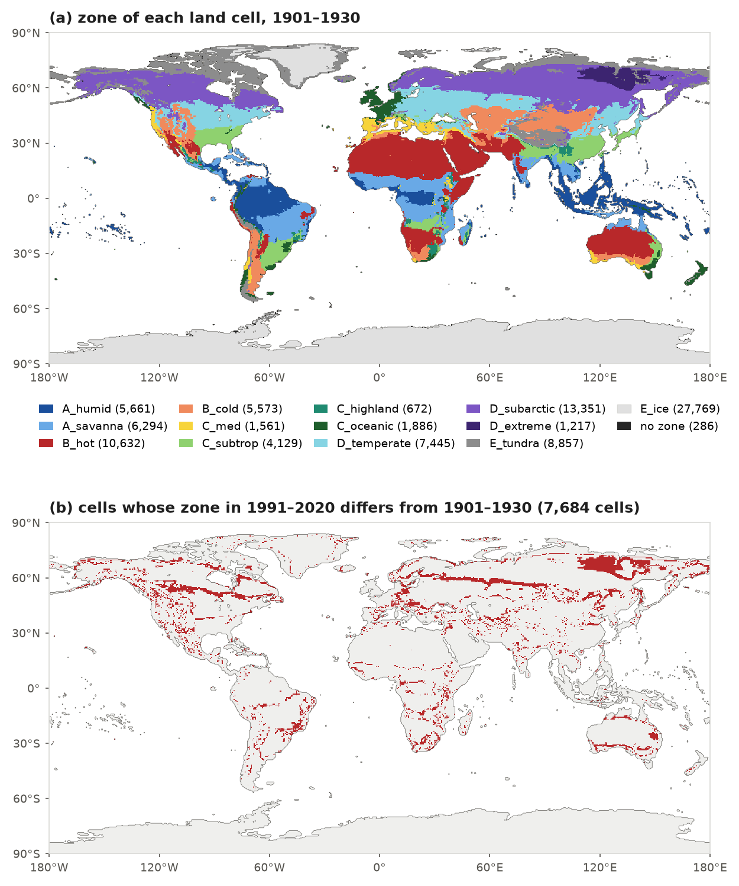
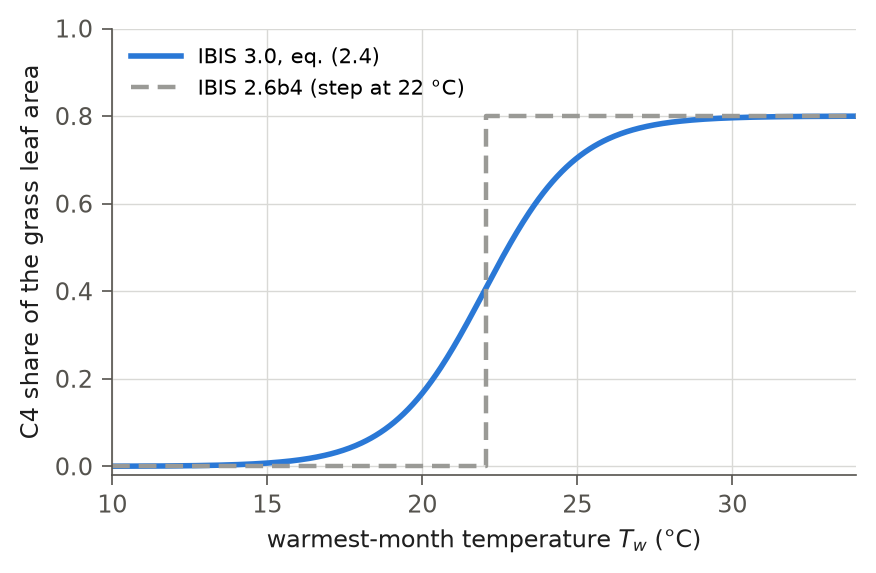
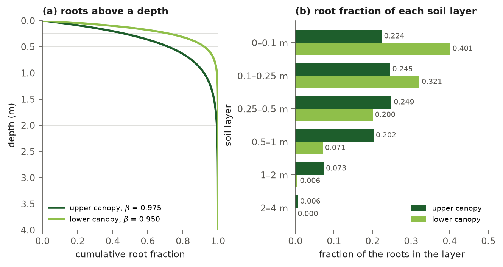
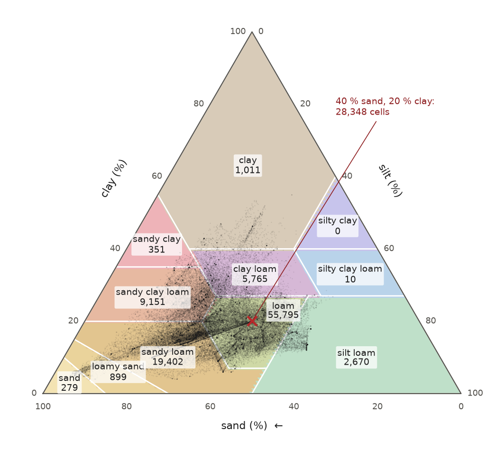
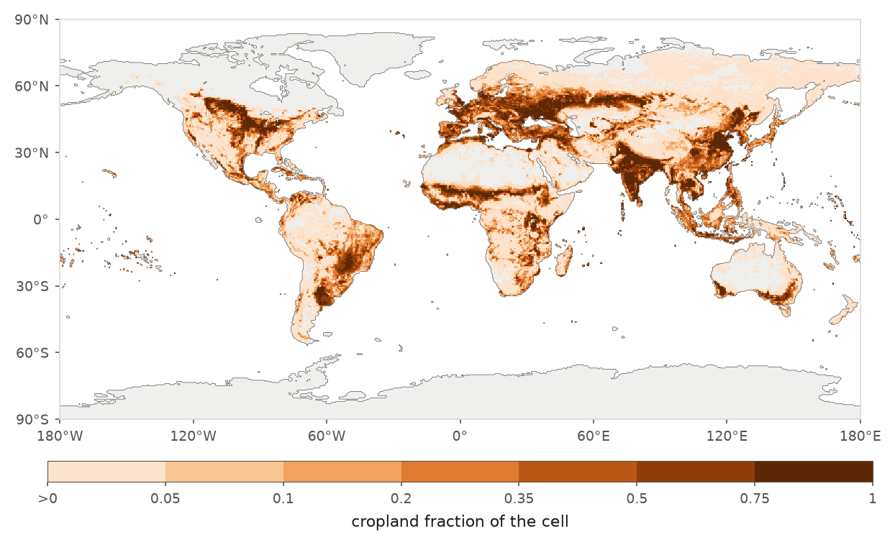

# 2. Surface Characterization and Plant Functional Types

Before calculating fluxes, the model needs a description of each grid cell's land cover and subsurface. This chapter
explains that description: the land mask, the twelve plant functional type positions and their climate-zone types,
the vegetation used at a cold start, root depth profiles, soil properties derived from texture, and cropland share.
Chapters 10 and 11 describe how vegetation changes during a run, including leaf phenology, carbon allocation,
turnover and the climate limits on each type.

## 2.1 Grid and land mask

The release uses the global 0.5° grid of the GSWP3 forcing (360 × 720 cells). A binary land mask (`surta.nc`) selects
95,333 cells. These are cells with a non-zero fraction of any IBIS vegetation type, including ice and bare ground,
in the ESA CCI land cover of 1992 after conversion to IBIS vegetation types. The model treats each selected cell as
entirely land. It stores no fractional land area, and expresses all fluxes and pools per square metre of the cell.

## 2.2 Plant functional type positions

Vegetation occupies the twelve plant functional type (PFT) positions inherited from IBIS 2.6b4 (Table 1.1). Eight
tree positions form the upper canopy; four shrub and grass positions form the lower canopy. Each position has a leaf
area index, leaf, wood and root carbon pools, and an existence flag that determines whether it may hold vegetation.
For photosynthesis, the positions are grouped into five "big leaves", each represented as a single leaf. The upper
canopy has separate broadleaf and conifer groups; the lower canopy has shrub, C3 grass and C4 grass groups
(Table 2.1; Chapter 9). A tree position's leaf habit—evergreen, drought-deciduous or cold-deciduous—selects its
phenology (Chapter 10). Lower-canopy positions use their own phenology.

**Table 2.1** Properties of the twelve PFT positions.

| Position | Plant functional type | Big leaf | Leaf habit | Photosynthetic pathway |
|---|---|---|---|---|
| 1 | tropical broadleaf evergreen trees | upper broadleaf | evergreen | C3 |
| 2 | tropical broadleaf drought-deciduous trees | upper broadleaf | drought-deciduous | C3 |
| 3 | warm-temperate broadleaf evergreen trees | upper broadleaf | evergreen | C3 |
| 4 | temperate conifer evergreen trees | upper conifer | evergreen | C3 |
| 5 | temperate broadleaf cold-deciduous trees | upper broadleaf | cold-deciduous | C3 |
| 6 | boreal conifer evergreen trees | upper conifer | evergreen | C3 |
| 7 | boreal broadleaf cold-deciduous trees | upper broadleaf | cold-deciduous | C3 |
| 8 | boreal conifer cold-deciduous trees | upper conifer | cold-deciduous | C3 |
| 9 | evergreen shrubs | lower shrub | (lower canopy) | C3 |
| 10 | deciduous shrubs | lower shrub | (lower canopy) | C3 |
| 11 | warm (C4) grasses | lower C4 grass | (lower canopy) | C4 |
| 12 | cool (C3) grasses | lower C3 grass | (lower canopy) | C3 |

## 2.3 Climate zones and plant types

With a single set of twelve PFTs, Mediterranean and continental broadleaf deciduous trees share the same parameters
(PFT 5). IBIS 3.0 allows those parameters to vary by filling the twelve positions in each cell with types defined by
growth form and climate zone (`physics.koppen_types`, on in the release). The number of positions remains twelve.
Their assigned types, and therefore their parameters, vary among zones. With this switch off, every cell uses the
twelve PFTs of IBIS 2.6b4 with one parameter set.

### 2.3.1 Climate zones

Each cell's climate zone is derived from its Köppen-Geiger class (Beck et al., 2023). The thirty Köppen classes are
grouped into thirteen zones (Table 2.2). Cells classified as ocean in the Köppen map but as land in the model mask
have no zone. Class maps are available for four 30-year periods: 1901-1930, 1931-1960, 1961-1990 and 1991-2020.
Each model year uses the map for its period. Years before 1901 use the first map; years after 2020 use the last.
At the start of a new period, the model reapplies the type assignments in every cell.

**Table 2.2** Climate zones and their Köppen-Geiger classes.

| Zone | Köppen classes |
|---|---|
| A_humid | Af, Am |
| A_savanna | Aw |
| B_hot | BWh, BSh |
| B_cold | BWk, BSk |
| C_med | Csa, Csb, Csc |
| C_subtrop | Cwa, Cfa |
| C_highland | Cwb, Cwc |
| C_oceanic | Cfb, Cfc |
| D_temperate | Dfa, Dfb, Dwa, Dwb, Dsa, Dsb |
| D_subarctic | Dfc, Dwc, Dsc |
| D_extreme | Dfd, Dwd, Dsd |
| E_tundra | ET |
| E_ice | EF |

Figure 2.1 shows the zones of the first period and the cells whose zone differs in the last.



**Figure 2.1** (a) The climate zone of each land cell in the Köppen map of 1901-1930, which the release uses from the
start of the spin-up to 1930; the legend gives the number of cells in each zone. The 286 cells without a Köppen class,
262 of them bordering a non-land cell, have no zone. (b) The 7,684 cells whose zone in the map of 1991-2020 differs from
that of 1901-1930; the largest changes are from D_subarctic to D_temperate (1,736 cells), from E_tundra to D_subarctic
(1,292) and from D_extreme to D_subarctic (939).

### 2.3.2 Plant types

The plant types include twenty tree, seven shrub and eight grass types (Table 2.3). Each represents a growth form
in one or more climate zones and inherits its initial parameters from a parent PFT of IBIS 2.6b4. Three wetland types
and two crop types complete the list. These additional types occupy no PFT position and carry no parameters of their
own.

The wetland types assign each zone to one of three bands. The methane parameters for that band, from the
`methane_bands` section of the parameter file, apply in the zone. Normally, band assignments use the zones in the
first year of a run; cells outside a wetland zone are assigned a band by latitude. With learned inundated area, as
in the release, cells included in the learned-model file instead use the band stored in that file. These are their
bands in the Köppen map of 1991-2020 (Chapter 14).

The crop types identify C3 and C4 crops. Their parameters, in the `crop` section of the parameter file, act on the
grass positions over the cropland share (section 2.7; Chapter 15). The type identifiers omit T20, which was merged
into another type during calibration.

**Table 2.3** Plant types. Growth forms: tree_be, tree_bd, tree_ne, tree_nd = broadleaf evergreen, broadleaf
deciduous, needleleaf evergreen and needleleaf deciduous trees; shrub_e, shrub_d = evergreen and deciduous shrubs;
grass_c4, grass_c3 = C4 and C3 grasses. The growth form decides the placement (section 2.3.3); the leaf habit of a
type is that of its parent PFT (Table 2.1), so T05, labelled broadleaf evergreen, is drought-deciduous like PFT 2. The
descriptions are names; a property such as "fire-adapted" is not a parameter of the type.

| Type | Description | Growth form | Zones | Parent PFT |
|---|---|---|---|---|
| T01 | tropical humid broadleaf evergreen tree | tree_be | A_humid | 1 |
| T02 | tropical seasonal semi-deciduous tree | tree_bd | A_savanna | 2 |
| T03 | tropical savanna tree (drought-deciduous, fire-adapted) | tree_bd | A_savanna, B_hot | 2 |
| T04 | tropical highland broadleaf evergreen tree | tree_be | C_highland | 3 |
| T05 | hot-arid woodland tree (acacia, mulga) | tree_be | B_hot | 2 |
| T06 | subtropical broadleaf evergreen tree | tree_be | C_subtrop | 3 |
| T07 | subtropical conifer (southern pines) | tree_ne | C_subtrop, C_highland | 4 |
| T08 | subtropical broadleaf deciduous tree | tree_bd | C_subtrop, C_highland | 5 |
| T09 | Mediterranean sclerophyll evergreen tree | tree_be | C_med | 3 |
| T10 | Mediterranean conifer | tree_ne | C_med | 4 |
| T11 | Mediterranean broadleaf deciduous tree | tree_bd | C_med | 5 |
| T12 | oceanic temperate broadleaf deciduous tree | tree_bd | C_oceanic | 5 |
| T13 | oceanic temperate conifer evergreen tree | tree_ne | C_oceanic | 4 |
| T14 | oceanic temperate broadleaf evergreen tree | tree_be | C_oceanic | 3 |
| T15 | continental temperate broadleaf deciduous tree | tree_bd | D_temperate, B_cold | 5 |
| T16 | continental temperate conifer evergreen tree | tree_ne | D_temperate | 4 |
| T17 | subarctic conifer evergreen tree (closed and open taiga) | tree_ne | D_subarctic, D_extreme, E_tundra | 6 |
| T18 | subarctic broadleaf deciduous tree (birch, aspen) | tree_bd | D_subarctic, D_extreme | 7 |
| T19 | subarctic conifer deciduous tree (larch) | tree_nd | D_subarctic, D_extreme | 8 |
| T21 | cold-steppe conifer woodland (juniper, pinyon) | tree_ne | B_cold | 4 |
| S01 | hot-arid evergreen shrub | shrub_e | B_hot | 9 |
| S02 | cold-desert and steppe shrub (sagebrush) | shrub_d | B_cold | 10 |
| S03 | Mediterranean shrub (maquis, chaparral) | shrub_e | C_med | 9 |
| S04 | temperate deciduous shrub | shrub_d | C_subtrop, C_oceanic, D_temperate, C_highland | 10 |
| S05 | boreal evergreen shrub (ericaceous) | shrub_e | D_subarctic, D_extreme | 9 |
| S06 | tundra dwarf shrub | shrub_d | E_tundra | 10 |
| S07 | tropical shrub and understorey | shrub_e | A_humid, A_savanna | 9 |
| G01 | tropical C4 grass | grass_c4 | A_humid, A_savanna | 11 |
| G02 | hot-arid C4 grass | grass_c4 | B_hot | 11 |
| G03 | subtropical C4 grass | grass_c4 | C_subtrop, C_highland | 11 |
| G04 | cold-steppe C3 grass | grass_c3 | B_cold | 12 |
| G05 | Mediterranean annual C3 grass | grass_c3 | C_med | 12 |
| G06 | temperate C3 grass | grass_c3 | C_oceanic, D_temperate | 12 |
| G07 | subarctic C3 grass and forb | grass_c3 | D_subarctic, D_extreme | 12 |
| G08 | tundra graminoid (sedge, moss) | grass_c3 | E_tundra | 12 |
| W01 | tropical and subtropical wetland vegetation | wetland | A_humid, A_savanna, B_hot, C_subtrop, C_highland | – |
| W02 | temperate wetland graminoid | wetland | C_med, C_oceanic, D_temperate, B_cold | – |
| W03 | boreal and arctic sedge-moss wetland | wetland | D_subarctic, D_extreme, E_tundra | – |
| C01 | C3 crop (managed) | crop | all | – |
| C02 | C4 crop (managed) | crop | all | – |

### 2.3.3 Placement of the types

Within a zone, fixed rules place the tree, shrub and grass types in the twelve positions. A tree type takes the
position of its parent PFT if that position is free; otherwise it takes the first free position of its leaf form, in
the order 1, 3, 5, 7, 2 for broadleaf types and 4, 6, 8 for needleleaf types. Tree positions that receive no type are
off in that zone. An evergreen shrub type takes position 9 and a deciduous shrub type position 10; a C4 grass type
takes position 11 and a C3 grass type position 12. Shrub and grass positions that receive no type keep the base
parameters of the position. In the zone E_ice all tree positions are off; in cells without a zone every position
keeps its base parameters. A type carries the leaf habit of its parent PFT into the position it occupies. Table 2.4
gives the resulting placement.

**Table 2.4** The type in each position, by zone ("off": the position cannot hold vegetation; "base": the position
keeps its base parameters).

| Zone | 1 | 2 | 3 | 4 | 5 | 6 | 7 | 8 | 9 | 10 | 11 | 12 |
|---|---|---|---|---|---|---|---|---|---|---|---|---|
| A_humid | T01 | off | off | off | off | off | off | off | S07 | base | G01 | base |
| A_savanna | T03 | T02 | off | off | off | off | off | off | S07 | base | G01 | base |
| B_hot | T05 | T03 | off | off | off | off | off | off | S01 | base | G02 | base |
| B_cold | off | off | off | T21 | T15 | off | off | off | base | S02 | base | G04 |
| C_med | off | off | T09 | T10 | T11 | off | off | off | S03 | base | base | G05 |
| C_subtrop | off | off | T06 | T07 | T08 | off | off | off | base | S04 | G03 | base |
| C_highland | off | off | T04 | T07 | T08 | off | off | off | base | S04 | G03 | base |
| C_oceanic | off | off | T14 | T13 | T12 | off | off | off | base | S04 | base | G06 |
| D_temperate | off | off | off | T16 | T15 | off | off | off | base | S04 | base | G06 |
| D_subarctic | off | off | off | off | off | T17 | T18 | T19 | S05 | base | base | G07 |
| D_extreme | off | off | off | off | off | T17 | T18 | T19 | S05 | base | base | G07 |
| E_tundra | off | off | off | off | off | T17 | off | off | base | S06 | base | G08 |
| E_ice | off | off | off | off | off | off | off | off | base | base | base | base |
| no zone | base | base | base | base | base | base | base | base | base | base | base | base |

### 2.3.4 Parameters of a position

Each position needs a complete parameter set. Values come from its assigned type, its parent PFT where the type
omits a value, or the position's base values where no type is assigned. With climate-zone types enabled, sixteen
per-PFT parameters become arrays over cells and the twelve positions:

- photosynthetic capacity, stomatal slope and the two acclimation parameters (Chapter 9);
- specific leaf area, leaf, root and wood turnover times, and leaf, root and wood allocation fractions (Chapter 11);
- growth, root and wood respiration coefficients (Chapter 11);
- temperature sensitivity of litter and soil carbon decomposition, subsequently averaged over positions by leaf area
  to obtain one value per cell (Chapter 12);
- fire mortality (Chapter 13).

A seventeenth parameter, maximum leaf area, becomes an array when a type specifies it. No type does so in the
release, which has no maximum leaf area. The value of such a parameter $`p`$ in position $`j`$ of cell $`c`$ is

```math
p_{c,j} =
\begin{cases}
p_{\tau} & \text{if position } j \text{ holds type } \tau \text{ and the parameter file gives } p \text{ for } \tau, \\
p^{0}_{\pi(\tau)} & \text{if position } j \text{ holds type } \tau \text{ and the parameter file gives no } p \text{ for } \tau, \\
p^{0}_{j} & \text{if position } j \text{ is off or keeps its base parameters,}
\end{cases}
\qquad\text{(2.1)}
```

where $`\tau`$ is the type that the zone of cell $`c`$ places in position $`j`$ (Table 2.4); $`p_{\tau}`$ is the value of the
type in the `types` section of the parameter file; $`\pi(\tau)`$ is the parent PFT of the type (Table 2.3); and
$`p^{0}_{j}`$ is the base value of position $`j`$ in the twelve-entry vector of the parameter file. A type placed away from
its parent's position therefore keeps its parent's values for every parameter it does not set.

Thirteen further parameters that a type may set (the release sets eleven of them) are single values per cell rather
than per position: the phenology thresholds of the upper and the lower canopy (Chapter 10), the soil-water stress
factor and the stress threshold of leaf drop (Chapters 9 and 10), the three parameters of the water-limited tree cover
(Chapter 11) and the turnover factor of the slow and passive soil carbon (Chapter 12). The value of such a parameter
$`s`$ in cell $`c`$ is the median over the types of the cell's zone that set it,

```math
s_{c} = \operatorname{median}\left\{ s_{\tau} : \tau \in T_{s}(z_{c}) \right\},
\qquad\text{(2.2)}
```

where $`s_{\tau}`$ is the value set for type $`\tau`$; $`z_{c}`$ is the zone of the cell; and $`T_{s}(z)`$ is the set of the
zone's types that set the parameter, chosen among the types the parameter acts on:

- the upper-canopy phenology thresholds: the zone's cold-deciduous tree types;
- the lower-canopy phenology thresholds: the zone's grass type, or its shrub type if the grass sets none;
- the stress threshold of leaf drop: the types in the positions whose leaves the drought trigger acts on, that is the
  drought-deciduous tree types, the deciduous shrub (position 10) and the grasses (positions 11 and 12);
- the other cell parameters: all the zone's types.

If no eligible type in a cell's zone supplies a value, the cell retains the base value. Cells in E_ice and cells
without a zone also retain base values. Bioclimatic limits (Chapter 11) are handled separately: each position uses
its parent PFT's limits rather than gathering them from the types. The release parameter file supplies values for
all 35 tree, shrub and grass types, although the parameters specified differ among types.

### 2.3.5 Existence of a position

Once a year, the model uses each cell's climate to determine whether a position may hold vegetation (Chapter 11).
The climate statistics are the year's lowest and highest 10-day mean air temperatures, representing the coldest and
warmest months, and degree-days above 0 °C and 5 °C. Running means retain a 30-year memory: each new annual value
has a weight of about 1/30, while earlier values lose weight with an e-folding time of 30 years. This differs from
an average over the last 30 years. With climate-zone types enabled:

- a position that is off cannot grow; any biomass it received at the cold start decays (Chapter 11);
- a position that holds a type exists wherever its zone places it, subject only to the growing-degree-day minimum of
  its parent PFT and, for the C4 grass, its warmest-month minimum (the tropical and warm-temperate tree positions 1-3
  have no such minimum);
- a position that keeps its base parameters takes the full bioclimatic limits of its PFT.

The refit preset `params_32a_base.yaml` sets the degree-day minimum above 5 °C to 975 K d for the temperate conifer
(position 4) and 700 K d for the boreal tree positions 6–8. The release preset used 900 and 600 K d, respectively.
These limits belong to the parameter file; selecting another file can retain its own values.

For a position assigned a climate-zone type, the zone therefore replaces the temperature limits of IBIS 2.6b4.
Those limits admit warm-temperate and temperate tree PFTs (3, 4 and 5) only when the coldest temperature, adjusted
by an offset toward the absolute minimum, is below 0 °C. IBIS 3.0 sets that offset to zero. A Köppen C climate has
a coldest month above 0 °C, so applying these limits would exclude temperate trees from most C-zone cells.

For the spin-up climate (GSWP3 1901-1930, with the zones of 1901-1930), the year's lowest 10-day mean temperature,
averaged over the 30 years, is below 0 °C in 13.9 % of C-zone cells. The corresponding fraction for the coldest
monthly mean is 6.0 %.

With `forcing.koppen_file` given but the types off, the Köppen class acts instead as a mask: it removes tree positions
that the class does not carry (for example, every tree position in the desert and cold-steppe classes). The model does
not use this mask when the types are on.

## 2.4 Vegetation at the cold start

A cold start requires initial leaf area and carbon pools. The model derives these from a map of fifteen IBIS
vegetation types based on ESA CCI land cover. The release uses the earliest map, from 1992, because its first model
year (1701) precedes the mapped period. Each vegetation type specifies an initial leaf area index for four groups
(Table 2.5): evergreen trees (positions 1, 3, 4 and 6), deciduous trees (2, 5, 7 and 8), shrubs (9 and 10), and grasses
(11 and 12). Within a group, leaf area is divided equally among the positions,

```math
L_{j} = e_{j}\,\frac{L_{g}(v)}{n_{g}},
\qquad\text{(2.3)}
```

where $`L_{j}`$ (m² m⁻²) is the leaf area index of position $`j`$; $`e_{j}`$ is its existence flag, which is 1 in every
position at the cold start; $`L_{g}(v)`$ (m² m⁻²) is the initial leaf area of group $`g`$ for vegetation type $`v`$
(Table 2.5); and $`n_{g}`$ is the number of positions in the group (4 for each tree group, 2 for the shrubs and for the
grasses). In the savanna and grassland types the grass leaf area is instead divided between the C4 and the C3 grass by
the warmest-month temperature,

```math
f_{C4} = \frac{0.8}{1 + \exp\left[-(T_{w} - 22)/1.5\right]},
\qquad\text{(2.4)}
```

where $`f_{C4}`$ is the share of the grass leaf area given to the C4 grass (position 11), the rest going to the C3 grass
(position 12), and $`T_{w}`$ (°C) is the mean temperature of the warmest month of the first forcing year of the run
(1901 in the release). IBIS 2.6b4 used a step at 22 °C (0.8 above, 0 below) in place of (2.4) (Figure 2.2). Every
position then receives at least the minimum leaf area index of 0.01. The carbon pools follow from the leaf area,

```math
C_{leaf,j} = \frac{L_{j}}{\sigma_{j}}, \qquad C_{root,j} = 0.5\,C_{leaf,j}, \qquad
C_{wood,j} = \frac{10}{6}\,L_{j} \;\;(j \le 8), \qquad C_{wood,j} = 0 \;\;(j > 8),
\qquad\text{(2.5)}
```

where $`C_{leaf,j}`$, $`C_{root,j}`$ and $`C_{wood,j}`$ (kg C m⁻²) are the leaf, root and wood carbon of position $`j`$ and
$`\sigma_{j}`$ (m² kg C⁻¹) is its specific leaf area, the leaf area per unit of leaf carbon, in the IBIS 2.6b4 values of
the cold-start module (25 for positions 1-3, 5, 7, 8 and 10; 12.5 for positions 4, 6 and 9; 20 for positions 11 and
12). The litter and soil carbon pools start empty.



**Figure 2.2** The share of the grass leaf area given to the C4 grass (position 11) at the cold start, in the savanna
and grassland types, as a function of the warmest-month temperature: equation (2.4) and the step of IBIS 2.6b4.

The fractional cover of the upper and the lower canopy at the cold start is

```math
f_{u} = \min\left[\max\left(\frac{1 - e^{-W}}{1 - e^{-7.5}},\, 0.25\right),\, 0.975\right], \qquad
f_{l} = \min\left[\max\left(L_{l},\, 0.25\right),\, 0.975\right],
\qquad\text{(2.6)}
```

where $`f_{u}`$ is the fraction of the cell covered by the upper canopy and $`f_{l}`$ the fraction of the snow-free part
of the cell covered by the lower canopy (a cold start has no snow, so at first this is the whole cell); $`W`$ (kg C m⁻²) is
the wood carbon summed over the tree positions; and $`L_{l}`$ (m² m⁻²) is the leaf area index summed over the lower
positions. The leaf area of each canopy per unit of its own cover is its summed leaf area divided by its cover, and
the stem area index is 0.25 times the summed leaf area for the upper canopy and 0.05 times for the lower. The canopy
heights at the cold start are

```math
z_{bot,l} = 0.05, \quad z_{top,l} = \max(0.25,\, 0.25\,\Lambda_{l}), \quad z_{bot,u} = z_{top,l} + 1, \quad
z_{top,u} = \max\left(z_{bot,u} + 1,\; 0.75 \cdot 2.5\,\frac{B_{u}}{f_{u}}\right),
\qquad\text{(2.7)}
```

where $`z_{bot}`$ and $`z_{top}`$ (m) are the bottom and top heights of the lower ($`l`$) and upper ($`u`$) canopy;
$`\Lambda_{l}`$ (m² m⁻²) is the leaf area of the lower canopy per unit of its cover; and $`B_{u}`$ (kg C m⁻²) is the
total biomass of the tree positions. From the first annual update on, the cover, the heights and the pools evolve as
described in Chapter 11.

**Table 2.5** Initial leaf area index (m² m⁻²) of the four groups of positions, by vegetation type of the cold-start
map.

| Vegetation type | Evergreen trees | Deciduous trees | Shrubs | Grasses |
|---|---|---|---|---|
| 1 tropical evergreen forest | 5.00 | 1.00 | 0.25 | 0.25 |
| 2 tropical deciduous forest | 1.00 | 5.00 | 0.25 | 0.25 |
| 3 temperate evergreen broadleaf forest | 4.00 | 1.00 | 0.25 | 0.25 |
| 4 temperate evergreen conifer forest | 3.00 | 1.00 | 0.25 | 0.25 |
| 5 temperate deciduous forest | 1.00 | 3.00 | 0.25 | 0.25 |
| 6 boreal evergreen forest | 3.00 | 1.00 | 0.25 | 0.25 |
| 7 boreal deciduous forest | 1.00 | 3.00 | 0.25 | 0.25 |
| 8 mixed forest | 2.00 | 2.00 | 0.25 | 0.25 |
| 9 savanna | 0.50 | 1.00 | 0.50 | 2.00 |
| 10 grassland | 0.25 | 0.25 | 0.50 | 2.50 |
| 11 dense shrubland | 0.10 | 0.10 | 1.00 | 0.50 |
| 12 open shrubland | 0.00 | 0.00 | 0.25 | 0.25 |
| 13 tundra | 0.00 | 0.00 | 0.10 | 0.10 |
| 14 desert | 0.00 | 0.00 | 0.00 | 0.00 |
| 15 polar desert, rock and ice | 0.00 | 0.00 | 0.00 | 0.00 |

Types 1-12 are those of the IBIS 2.6b4 parameter file (`params.veg`); the values for types 13-15, which that file
does not give, are those of the IBIS 3.0 cold-start module.

## 2.5 Root distribution

The root distribution determines which soil layers supply water to a plant. In the model, the root fraction in each
layer is fixed, with separate profiles for the two canopies. These follow the asymptotic profile of Gale and Grigal
(1987), as used by Jackson et al. (1996),

```math
r_{k} = \frac{\left(1 - \beta^{d_{k}}\right) - \left(1 - \beta^{d_{k-1}}\right)}{1 - \beta^{d_{N}}},
\qquad\text{(2.8)}
```

where $`r_{k}`$ is the fraction of the roots in soil layer $`k`$; $`d_{k}`$ (cm) is the depth of the bottom of layer $`k`$
($`d_{0} = 0`$); $`d_{N} = 400`$ cm is the depth of the soil column; and $`\beta`$, a shape parameter, is 0.950 for the lower
canopy and 0.975 for the upper canopy, values chosen after Jackson et al. (1996, 1997). The root fractions weight the
soil water stress of each canopy (Chapter 9) and distribute its transpiration among the soil layers (Chapter 7). With
the larger $`\beta`$ the roots of the trees reach deeper than those of the lower canopy (Figure 2.3).



**Figure 2.3** The root profiles of the upper and the lower canopy, equation (2.8): (a) the fraction of the roots above
a depth, with the bottoms of the soil layers as horizontal lines; (b) the fraction of the roots in each soil layer.

## 2.6 Soil properties

Soil stores the water and heat exchanged between the surface and the air. Its hydraulic and thermal properties are
derived from texture. The soil texture file (`soita.nc`) supplies sand and clay fractions for each of the six layers.
After rounding these percentages to whole numbers, with halves rounded upward, the model locates the layer in the
texture triangle. It assigns one of the eleven classes of Rawls et al. (1992): the USDA classes with silt merged
into silt loam. Each class has the hydraulic properties listed by Rawls et al. (1992) (Table 2.6; Figure 2.4).

A point on a class boundary receives the later class in Table 2.6, following IBIS 2.6b4. IBIS 2.6b4 assigns
silt loam to a layer with no sand or no clay; IBIS 3.0 classifies such a layer normally. No land cell in the soil
file has either condition. Field capacity and wilting point are converted from volumetric water contents to fractions
of pore space by dividing by porosity. This is the form used for soil water in the model (Chapter 7).

**Table 2.6** Soil properties by texture class (Rawls et al., 1992).

| Texture class | Porosity (m³ m⁻³) | Field capacity (m³ m⁻³) | Wilting point (m³ m⁻³) | Campbell exponent $`b`$ | Saturated suction (m) | Saturated conductivity (m s⁻¹) |
|---|---|---|---|---|---|---|
| sand | 0.437 | 0.091 | 0.033 | 1.7 | 0.07 | 5.833 × 10⁻⁵ |
| loamy sand | 0.437 | 0.125 | 0.055 | 2.1 | 0.09 | 1.6972 × 10⁻⁵ |
| sandy loam | 0.453 | 0.207 | 0.095 | 3.1 | 0.15 | 7.1944 × 10⁻⁶ |
| loam | 0.463 | 0.270 | 0.117 | 4.5 | 0.11 | 3.6667 × 10⁻⁶ |
| silt loam | 0.501 | 0.330 | 0.133 | 4.7 | 0.21 | 1.8889 × 10⁻⁶ |
| sandy clay loam | 0.398 | 0.255 | 0.148 | 4.0 | 0.28 | 1.1944 × 10⁻⁶ |
| clay loam | 0.464 | 0.318 | 0.197 | 5.2 | 0.26 | 6.3889 × 10⁻⁷ |
| silty clay loam | 0.471 | 0.366 | 0.208 | 6.6 | 0.33 | 4.1667 × 10⁻⁷ |
| sandy clay | 0.430 | 0.339 | 0.239 | 6.0 | 0.29 | 3.3333 × 10⁻⁷ |
| silty clay | 0.479 | 0.387 | 0.250 | 7.9 | 0.34 | 2.5 × 10⁻⁷ |
| clay | 0.475 | 0.396 | 0.272 | 7.6 | 0.37 | 1.6667 × 10⁻⁷ |



**Figure 2.4** The eleven texture classes on the texture triangle as the model assigns them, with the sand and clay of
the top soil layer of the 95,333 land cells (dots) and the number of cells whose top layer falls in each class. A point
takes the class of its sand and clay percentages rounded to whole percent, and a point on a border the later class in
the order of Table 2.6 (the rule of IBIS 2.6b4; section 2.8 gives how the release run differed). The white lines are
the class polygons. The 28,348 cells with 40 % sand and 20 % clay (to 0.1 percentage point), a loam (the 25,567 cells
south of 60°S and 2,781 others, most of them in the zone E_ice), are one point (×).

The density and the specific heat of the soil solids are

```math
\rho_{s} = 2650\,(1 - f_{om}) + 1300\,f_{om}, \qquad c_{s} = 870\,(1 - f_{om}) + 1920\,f_{om},
\qquad\text{(2.9)}
```

where $`\rho_{s}`$ (kg m⁻³) is the density and $`c_{s}`$ (J kg⁻¹ K⁻¹) the specific heat of the solids (Campbell and
Norman, 1998), and $`f_{om} = 0.01`$ is the organic fraction of the solids, a constant as in IBIS 2.6b4. This gives
2636.5 kg m⁻³ and 880.5 J kg⁻¹ K⁻¹. The albedo of the saturated soil surface is set from the texture of the top layer,
following the BATS table as in IBIS 2.6b4,

```math
\alpha_{vis} = 0.120\,f_{sand} + 0.085\,f_{silt} + 0.050\,f_{clay}, \qquad \alpha_{nir} = 2\,\alpha_{vis},
\qquad\text{(2.10)}
```

where $`\alpha_{vis}`$ and $`\alpha_{nir}`$ are the visible and near-infrared albedos of the saturated soil and
$`f_{sand}`$, $`f_{silt}`$ and $`f_{clay}`$ are the fractions of sand, silt and clay in the top layer. The soil albedo rises
to as much as twice these values as the top layer dries (Chapter 4). The roughness length of the bare soil is 0.005 m.

With `physics.soil_organic` enabled (off in the release), the model derives the organic fraction of soil solids from
the organic carbon and bulk density in HWSD version 2. Hydraulic and thermal properties are then mixed between the
mineral values above and an organic-soil end-member (Lawrence and Slater, 2008). Mixing is linear except for saturated
conductivity, which uses their percolation treatment. The organic end-member is selected through
`physics.soil_organic_end_member`.

## 2.7 Cropland share

Much of the land is farmed, and crops grow, use water and lose carbon at harvest differently from natural grass. IBIS
3.0 represents cropland as managed grass on a fixed share of each cell. The cropland fraction is read from the ESA CCI
land cover of the year 2000 and held fixed through the run (`forcing.cropfrac_file`; Figure 2.5). On the cropland
share the grass positions 11 and 12 stand for the crops. Their photosynthetic capacity is multiplied by

```math
g = 1 + f_{crop}\left(\bar{s} - 1\right), \qquad \bar{s} = (1 - q)\,s_{C3} + q\,s_{C4},
\qquad\text{(2.11)}
```

where $`g`$ is the factor on the capacity of both grass positions; $`f_{crop}`$ is the cropland fraction of the cell;
$`s_{C3}`$ and $`s_{C4}`$ are the capacity scales of the C3 and the C4 crop relative to the natural grass (0.329 and 1.158
in the release); and $`q`$ is the share of C4 crops (0.2 in the release, so that $`\bar{s} = 0.495`$). With $`q < 0`$ the C3
scale acts on position 12 and the C4 scale on position 11 instead. The trees take their cover on the natural share of
the cell only, the shrubs' net primary production is scaled by $`1 - f_{crop}`$, and a share of the grass leaf
litterfall on the cropland share is removed as harvest (Chapter 15).

Crops can also have a separate carbon allocation. The parameter `crop.aleaf` specifies the crop leaf share and is
unset by default and in the release. When supplied, it blends the allocation of both grass positions toward the crop
allocation in proportion to cropland fraction, just as (2.11) blends capacity. The leaf share becomes
$`(1 - f_{crop})\,a_{l} + f_{crop}\,a_{crop}`$ and the root share becomes
$`(1 - f_{crop})\,a_{r} + f_{crop}\,(1 - a_{crop})`$, where $`a_{l}`$ and $`a_{r}`$ are the grass's own leaf and root shares,
and $`a_{crop}`$ is the value of `crop.aleaf` (Chapter 15).



**Figure 2.5** The cropland fraction of each land cell: the share of the cell's 300 m land pixels in the cropland
classes of the ESA CCI land cover of 2000 (classes 10, 11, 12 and 20), with the two mosaic classes (30 and 40) counted
as half. 47,304 land cells have cropland, 8,338 of them on at least half of the cell; grey cells have none.

## 2.8 Notes for developers

Changes after the release (code `e54e342`), with the decision numbers of `docs/CALIBRATION.md` sections 86-87 and
`docs/DEFECTS_FOR_REVIEW.md`:

1. **Drought threshold by zone (D15; no switch).** The zone median of the leaf-drop stress threshold
   (`pheno.drop_stress_thresh`) is now taken over the types in positions that read a drought factor (`zone_scalar`,
   `which='drought'`, in `ibis/io/pft_types.py`). The release took it over all the zone's types, so values fitted for
   evergreen trees and evergreen shrubs, which do not read the threshold, set it for the grasses, the deciduous shrub
   and the drought-deciduous trees. With the release parameter file the new rule changes
   seven zones (computed with `zone_scalar` on `params_31s_ch4h.yaml`): A_humid 0.179 to 0.228, A_savanna 0.228 to
   0.424, B_hot 0.249 to 0.427, B_cold 0.062 to 0.342, and C_med (0.527), D_subarctic and D_extreme (0.762) to the base
   value 0.135, because no type in a drought-reading position of those zones sets the threshold. The other five zones
   keep their values (Chapter 10).
2. **Daily climate statistics (D9).** The statistics of section 2.3.5 come from the daily `tas`, as in IBIS 2.6b4
   (`pheno.climate_stats_daily`, default true); the release took them from monthly means. The parents' degree-day
   minima were tuned with monthly statistics. The current refit preset `params_32a_base.yaml` uses 975 K d for
   position 4 and 700 K d for positions 6–8 after mapping the monthly thresholds to daily-statistic quantiles
   (release: 900 and 600 K d). This updates the preset, not the general parameter fallback; the final global run
   still needs comparison with observed tree cover. The cold start still seeds the statistics, and
   $`T_{w}`$ of (2.4), from the monthly means of the first forcing year; IBIS 2.6b4 also seeds them from monthly means.
3. **Section 2.3.5 numbers.** The earlier text gave "about 4 %" of the C-zone cells with a coldest month below 0 °C;
   its definition was not recorded. Recomputed over GSWP3 1901-1930 with the zones of 1901-1930 (8,248 C-zone cells):
   6.0 % for the 30-year mean of the year's coldest monthly mean, 2.7 % for the coldest month of the 30-year mean annual
   cycle, and 13.9 % for the 30-year mean of the year's lowest 10-day running mean (the model's daily rule, its 10-day
   mean warmed up on 1901).
4. **Texture classes (`docs/CALIBRATION.md` 86; no switch).** The border rule of IBIS 2.6b4 (`textcls`) was restored
   on 2026-10-30, after the release run, and the sand and clay percentages are now rounded with halves upward, as the
   Fortran's `nint` (the release rounded halves to the even number). The release run gave a border point the earlier
   class, so that at least one layer of 9.6 % of the land cells had another class, 2,483 cells in the top layer (mostly
   1,064 cells of loam read as sandy loam at 52 % sand, 648 of silt loam read as loam at 50 % silt, and 594 of clay loam
   read as sandy clay loam at 45 % sand). The class counts of Figure 2.4 are those of the current rule. The rerun is
   deferred to the final run.
5. **Unread solid-phase keys (D80).** The release parameter file sets `soil.rhosoi_val` 2650 and
   `soil.csoi_mineral_val` 870. The release never reads them: every cell carries the values of (2.9) from
   `ibis/io/soil_init.py`, and the keys act only where a state has no solid-phase values. `params_32a_base.yaml`, the
   base of the refits, drops them.
6. **Crop allocation (D23).** `crop.aleaf` is new and unset. Its value is to come from the crop literature at the
   refit of the crop towers, if the investigation of the nearly leafless lower canopy of D_temperate cropland points to
   the grass allocation as its cause.
7. **Tower scores (D66).** The tower re-scores of Table 16.5 (`verify/calibration/towers31_rescore.py`) set the
   phenology thresholds, the leaf-drop threshold and the stress factor to the mean over the tower's own types, not by
   (2.2). The final scores are to use (2.2).
8. **G06 timing (D18; parameter file only).** `params_32a_base.yaml` gives the temperate grass G06 the timing of
   `params_31f.yaml`: `gdd_thresh_l` 700 K d (release 58.7), `tthresh_l_c` 2.0 °C (release 3.05), and the two cell
   parameters that the release set for no type, `sen_ycrit_l` 200 K d and `sen_pstart_l` 15 h, so that all thirteen
   cell parameters of (2.2) are set. The release file lacked this fit of the calibration, although the calibration log
   said it had been retained (Chapter 10).
9. **Methane band of the learned-area cells (D38; no switch).** With the learned inundated area
   (`physics.wetland_source` `learned` or `observed_learned`), the cells of the learned model's file take the band
   stored in the file in every run (`LearnedWetland.band_index`, called from `scripts/run_global.py`; commit 13b23d5).
   The release took every cell's band from the zones of the run's first year, so in the 1901-2000 transient 2,703
   learned-area cells ran the methane parameters of one band and the learned model of another. The hindcast, which
   starts in 2001 with the zones of 1991-2020, is unchanged (Chapter 14).

## References

Beck, H. E., et al., 2023: High-resolution (1 km) Köppen-Geiger maps for 1901-2099 based on constrained CMIP6
projections. *Scientific Data*, 10, 724.

Campbell, G. S., and J. M. Norman, 1998: *An Introduction to Environmental Biophysics*, 2nd ed. Springer, New York.

Gale, M. R., and D. F. Grigal, 1987: Vertical root distributions of northern tree species in relation to successional
status. *Canadian Journal of Forest Research*, 17, 829-834.

Jackson, R. B., J. Canadell, J. R. Ehleringer, H. A. Mooney, O. E. Sala, and E.-D. Schulze, 1996: A global analysis of
root distributions for terrestrial biomes. *Oecologia*, 108, 389-411.

Jackson, R. B., H. A. Mooney, and E.-D. Schulze, 1997: A global budget for fine root biomass, surface area, and nutrient
contents. *Proceedings of the National Academy of Sciences*, 94, 7362-7366.

Lawrence, D. M., and A. G. Slater, 2008: Incorporating organic soil into a global climate model. *Climate Dynamics*,
30, 145-160.

Rawls, W. J., L. R. Ahuja, D. L. Brakensiek, and A. Shirmohammadi, 1992: Infiltration and soil water movement. In
*Handbook of Hydrology*, D. R. Maidment, Ed., McGraw-Hill, New York, 5.1-5.51.
