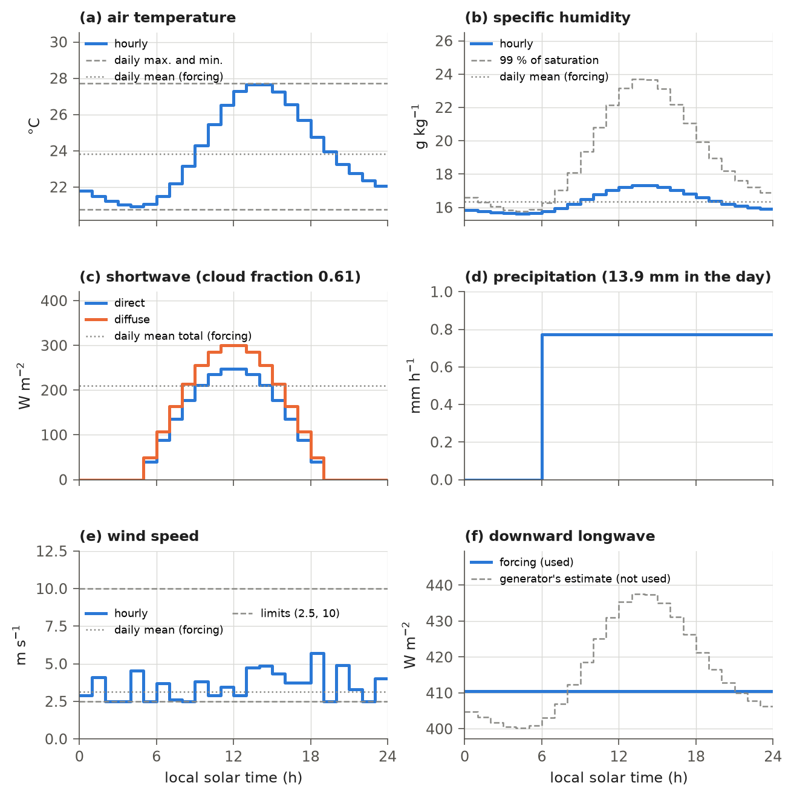

# 3. Atmospheric Forcing and the Diurnal Weather Generator

At every hourly step, the model needs sunlight, air temperature, humidity, wind, rain and snow, longwave radiation
and pressure. Global forcing data sets provide most of these as daily values. A weather generator inherited from
IBIS 2.6b4 converts each day's forcing into 24 hourly values, including a daily cycle of sunlight and temperature.
It generates hourly sunlight, air temperature, humidity, wind speed and precipitation. Downward longwave radiation
and surface pressure retain their daily means.

This chapter describes the forcing data, the hourly calculations, and atmospheric CO2 and O2. Section 3.12 explains
how tower runs can use measured hourly sunlight instead of the generated cycle.

## 3.1 Forcing data

The release is driven by the daily GSWP3 data set at 0.5° (Kim, 2017), in the version processed for ISIMIP2
(Table 3.1). The data follow the Gregorian calendar, with leap days, and each model day reads the forcing of the same
date. In the transient run and the hindcast the forcing year is the model year. During the spin-up the forcing cycles
over the years 1901-1930: in spin-up year $k$ ($k = 0, 1, \ldots, 199$; model year $1701 + k$) the forcing year is
$1901 + (k \bmod 30)$, and the model year takes that year's calendar. The model converts precipitation from
kg m⁻² s⁻¹ to mm d⁻¹. A missing value of any variable would be replaced by zero; none occurs at the land cells.

**Table 3.1** Forcing variables and their use.

| Variable | Description | Use |
|---|---|---|
| tasmax, tasmin | daily maximum and minimum air temperature (K) | hourly air temperature and humidity (sections 3.4, 3.5) |
| tas | daily mean air temperature (K) | the daily routines: phenology, the 10-day mean temperature, the lower-canopy growing-season gate for soil-water-driven leaf drop, and the acclimation and senescence states (Chapters 9, 10); the growing-season test of the soil-water stress sums of the water-limited tree cover (Chapters 10 and 11); the year's climate statistics, that is its lowest and highest 10-day mean temperature and its degree-days (Chapter 11); at a cold start, the first 10-day mean temperature and climate statistics, from the monthly means of the first forcing year |
| pr | precipitation (kg m⁻² s⁻¹) | hourly rain and snow (section 3.8) |
| rsds | downwelling shortwave radiation (W m⁻²) | cloud fraction, which sets the hourly shortwave radiation (section 3.3) |
| rlds | downwelling longwave radiation (W m⁻²) | downward longwave radiation of every time step (section 3.7) |
| huss | specific humidity (kg kg⁻¹) | hourly specific humidity (section 3.5) |
| wind | wind speed at 10 m (m s⁻¹) | hourly wind speed (section 3.6) |
| ps | surface pressure (Pa) | surface pressure of every time step (section 3.9) |

## 3.2 Time of day and solar geometry

Time of day determines the solar position used for hourly sunlight and the phase of the fixed daily temperature
cycle. The temperature cycle does not shift with sunrise. Each day has 24 steps of $\Delta t = 3600$ s. Step $n$
($n = 0, 1, \ldots, 23$) covers the local solar hour from $n$ to $n + 1$ h. By default, the model evaluates the sun
and weather generator at the middle of the step, $t = n + 0.5$ h, and holds those values throughout the step
(`weather.sun_midstep`, default true).

With the switch off, as in IBIS 2.6b4 and the release, evaluation occurs at the start of the step, $t = n$ h.
The hour from 12 to 13 h then receives the noon sun, placing the centre of the day's sunlight at 12:30 rather than noon.

The daily forcing is applied to the local solar day of each cell without a time shift. The days of GSWP3 are UTC days,
so the forcing day is offset from the local solar day by up to 12 hours, depending on the longitude. This matters most
when hourly values are compared with tower data far from 0° longitude.

The position of the sun follows the Fourier series given by Hartmann (1994, appendix A), as in IBIS 2.6b4. With the
orbital angle

$$
\theta = \frac{2\pi J}{365.2425},
\tag{3.1}
$$

where $J$ is the day of the year (1 on 1 January), the solar declination $\delta$ (rad) is

$$
\delta = 0.006918 - 0.399912\cos\theta + 0.070257\sin\theta - 0.006758\cos 2\theta + 0.000907\sin 2\theta
- 0.002697\cos 3\theta + 0.001480\sin 3\theta,
\tag{3.2}
$$

and the solar irradiance at the top of the atmosphere on a surface facing the sun, $S$ (W m⁻²), is

$$
S = S_{0}\left(1.000110 + 0.034221\cos\theta + 0.001280\sin\theta + 0.000719\cos 2\theta + 0.000077\sin 2\theta\right),
\tag{3.3}
$$

where $S_{0} = 1370$ W m⁻² is the solar constant. The cosine of the solar zenith angle is

$$
\mu = \max\left[0,\; \sin\phi\,\sin\delta + \cos\phi\,\cos\delta\,\cos h\right], \qquad h = \frac{2\pi\,(t - 12)}{24},
\tag{3.4}
$$

where $\phi$ (rad) is the latitude of the cell, $h$ (rad) is the hour angle and $t$ (h) is the local solar time at which
the step is evaluated. $\mu$ is zero while the sun is below the horizon.

## 3.3 Shortwave radiation

Sunlight drives photosynthesis and most of the surface energy balance. The generator calculates hourly sunlight from
solar position and a daily cloud fraction $c$, ranging from 0 for clear sky to 1 for overcast sky. Atmospheric
transmissivity is the fraction of sunlight that passes through the atmosphere (Friend, 1998):

$$
\tau = 0.251 + 0.509\,(1 - c),
\tag{3.5}
$$

and the share of it that arrives as diffuse light (Nikolov and Zeller, 1992) is

$$
f_{d} =
\begin{cases}
1.0045 + 0.0435\,\tau - 3.5227\,\tau^{2} + 2.6313\,\tau^{3} & \tau \le 0.75, \\
0.166 & \tau > 0.75.
\end{cases}
\tag{3.6}
$$

The direct and diffuse radiation incident on the surface in waveband $\Lambda$ are

$$
S^{\mu}_{\Lambda} = S\,\mu\,\nu_{\Lambda}\,\tau\,(1 - f_{d}), \qquad S_{\Lambda} = S\,\mu\,\nu_{\Lambda}\,\tau\,f_{d},
\tag{3.7}
$$

where $S^{\mu}_{\Lambda}$ and $S_{\Lambda}$ (W m⁻²) are the direct and the diffuse radiation and $\nu_{\Lambda}$ is the
share of the waveband: 0.46 for the visible and 0.54 for the near-infrared.

IBIS 2.6b4 read daily cloud cover directly from its input data. IBIS 3.0 derives cloud fraction from the forcing's
daily mean shortwave radiation, $R$ (W m⁻²), by inverting (3.5):

$$
c = \min\left[\max\left(1 - \frac{\tau_{obs} - 0.251}{0.509},\, 0\right),\, 1\right], \qquad
\tau_{obs} = \min\left[\max\left(\frac{R}{S\,\bar{\mu}},\, 0\right),\, 1\right],
\tag{3.8}
$$

where $\tau_{obs}$ is the transmissivity of the day and $\bar{\mu}$ is the mean of $\mu$ over the 24 hours,

$$
\bar{\mu} = \max\left[0,\; \frac{h_{s}\sin\phi\,\sin\delta + \cos\phi\,\cos\delta\,\sin h_{s}}{\pi}\right], \qquad
\cos h_{s} = \min\left[\max\left(-\tan\phi\,\tan\delta,\, -1\right),\, 1\right],
\tag{3.9}
$$

with $h_{s}$ (rad) the hour angle of sunset. Where $\bar{\mu} < 0.01$ (the polar night and the days next to it) the
cloud fraction is set to 0.5.

When daily transmissivity lies between 0.251 and 0.760 and $\bar{\mu} \ge 0.01$, generated radiation reproduces
the forcing's daily mean apart from the hourly sampling of solar position. The model evaluates $\mu$ at each hour's
midpoint rather than averaging it over the hour. Over land north of 60°S in 2001, the mean of the 24 hourly values
of $\mu$ was 0.04 % above the daily mean $\bar{\mu}$ in (3.9).

Outside this transmissivity range, cloud fraction is fixed at 1 or 0, and generated radiation departs from the forcing.
Over land north of 60°S in 2001, forcing transmissivity was below 0.251 on 5.0 % and above 0.760 on 0.9 % of
cell-days with $\bar{\mu} \ge 0.01$. The area-weighted annual mean generated radiation was 189.4 W m⁻², compared
with 188.3 W m⁻² in the forcing.

## 3.4 Air temperature

Hourly air temperature follows a fixed daily curve between the day's minimum and maximum. It is lowest in the early
morning and highest in the early afternoon. As in IBIS 2.6b4, the curve is a Fourier series fitted to the diurnal
temperature cycle (Campbell and Norman, 1998):

$$
T_{a} = \gamma\,T_{max} + (1 - \gamma)\,T_{min}, \qquad
\gamma = 0.44 - 0.46\sin\left(\frac{\pi t}{12} + 0.9\right) + 0.11\sin\left(\frac{2\pi t}{12} + 0.9\right),
\tag{3.10}
$$

where $T_{a}$ (K) is the step's air temperature; $T_{max}$ and $T_{min}$ (K) are the forcing's daily maximum and
minimum; $\gamma$ weights the maximum; and $t$ (h) is the step's local solar time. At the 24 hourly midpoints,
$\gamma$ ranges from 0.025 (at 04:30) to 0.992 (at 13:30). Its average over any 24 evenly spaced times is 0.44.
The mean hourly temperature is therefore $0.44\,T_{max} + 0.56\,T_{min}$, rather than the forcing's daily mean.
In 2001, this generated mean was on average 0.18 K below the forcing over land north of 60°S. The difference ranged
from −1.06 to +0.40 K for 90 % of cells.

## 3.5 Humidity

Hourly specific humidity follows the temperature cycle. The generator limits relative humidity to 99 % and
preserves the daily mean specific humidity where that limit allows:

$$
q_{min} = \min\left[\bar{q},\; 0.99\,q_{sat}(T_{min}, p)\right], \qquad
q_{max} = \frac{\bar{q} - 0.56\,q_{min}}{0.44}, \qquad
q_{a} = \min\left[0.99\,q_{sat}(T_{a}, p),\; \gamma\,q_{max} + (1 - \gamma)\,q_{min}\right],
\tag{3.11}
$$

where $q_{a}$ (kg kg⁻¹) is the specific humidity of the step, $\bar{q}$ (kg kg⁻¹) is the daily mean specific humidity
of the forcing, $q_{min}$ and $q_{max}$ (kg kg⁻¹) are the humidities that go with the daily minimum and maximum
temperature, $p$ (Pa) is the surface pressure and $q_{sat}(T, p)$ (kg kg⁻¹) is the saturation specific humidity,

$$
q_{sat} = \frac{0.622\,e_{sat}(T)}{\max\left[p - 0.378\,e_{sat}(T),\; 0.622\,e_{sat}(T)\right]},
\tag{3.12}
$$

with $e_{sat}(T)$ (Pa) the saturation vapour pressure over water or ice from the polynomials of Lowe (1977) (Chapter 5).
Because $\gamma$ averages 0.44 over the 24 steps, the daily mean of $\gamma\,q_{max} + (1 - \gamma)\,q_{min}$ equals
$\bar{q}$ whatever $q_{min}$ is. Only where the cap at the step's temperature binds does the daily mean of $q_{a}$ fall
below $\bar{q}$. In 2001, over the land north of 60°S, the area-weighted annual mean of the hourly specific humidity was
0.3 % below that of the forcing (8.40 against 8.43 g kg⁻¹); averaged over the cell-days, the relative deficit was 2.2 %.

On a dry day, when $\bar{q}$ is below 99 % of saturation at $T_{min}$, both $q_{min}$ and $q_{max}$ equal $\bar{q}$.
Specific humidity then remains at the daily mean throughout the day; only relative humidity changes with temperature.
This occurred on 55 % of the cell-days of 2001 (area-weighted, land north of 60°S). Night air therefore remains as dry
as the daily mean, allowing vapour pressure deficit to remain above the fire threshold through the night (Chapter 13).
The default fire rule counts every step above that threshold. The optional daylight-only rule excludes night-time
steps and changes the fire-season normalization (Chapter 13).

## 3.6 Wind speed

Wind speed controls the exchange of heat, water vapour and CO2 between the surface and the air (Chapter 5). At each
step, the generator draws a random hourly wind speed for each cell. As in IBIS 2.6b4, it follows the
EPIC weather generator (Sharpley and Williams, 1990):

$$
u_{a} = \min\left[\max\left(1.13989\,\bar{u}\,(-\ln \xi)^{0.30},\; 2.5\right),\; 10\right],
\tag{3.13}
$$

where $u_{a}$ (m s⁻¹) is the wind speed of the step, $\bar{u}$ (m s⁻¹) is the daily mean wind speed of the forcing and
$\xi$ is a random number uniform on $(0, 1)$. Without the limits, the expected value of $u_{a}$ would be
$1.13989\,\Gamma(1.3)\,\bar{u} \approx 1.02\,\bar{u}$, where $\Gamma$ is the gamma function. The limits of 2.5 and
10 m s⁻¹ raise the mean: in 2001, over the land north of 60°S (area-weighted, from the distribution of (3.13)), the
lower limit applied in 34 % of the steps and the upper limit in 3.3 %, and the expected hourly wind speed was
4.12 m s⁻¹ against 3.83 m s⁻¹ in the forcing (+7.6 %).

The optional switch `weather.wind_keep_mean` (default false) rescales the draws so their expected value equals the
daily mean wind. When enabled, each draw from (3.13) is multiplied by $\bar{u}/\langle u_a\rangle$, where
$\langle u_a\rangle$ is that day's expected value from (3.13),

$$
\langle u_a\rangle = 2.5\left(1 - e^{-x_{1}}\right) + 10\,e^{-x_{2}}
+ a\,\Gamma(1.3)\left[P_\Gamma(1.3, x_{2}) - P_\Gamma(1.3, x_{1})\right], \qquad
a = 1.13989\,\bar{u}, \quad x_{1} = \left(\frac{2.5}{a}\right)^{1/0.3}, \quad x_{2} = \left(\frac{10}{a}\right)^{1/0.3},
\tag{3.13a}
$$

and $P_\Gamma$ is the regularized lower incomplete gamma function. The rescaled wind keeps the daily mean of the forcing on
average, and it is no longer held between exactly 2.5 and 10 m s⁻¹. The switch is a variant for a test of the hourly
energy balance at flux towers (section 3.14).

## 3.7 Longwave radiation

Each time step uses the forcing's daily mean downward longwave radiation. The IBIS 2.6b4 generator also calculates
an hourly estimate from air temperature, humidity and cloud fraction, using the clear-sky emissivity of Idso (1981)
and a cloud emissivity of 0.95. IBIS 3.0 does not use that estimate.

## 3.8 Precipitation

The day's precipitation falls as one event at a constant rate. The event lasts $L$ time steps,

$$
L = \min\left[\max\left(L_{r},\; \left\lceil P/15 \right\rceil\right),\; L_{max}\right], \qquad
L_{min} = 1 + \left\lfloor \frac{4 \cdot 3600 - 1}{\Delta t} \right\rfloor, \qquad
L_{max} = \max\left(\left\lfloor \frac{86400}{\Delta t} \right\rfloor,\; L_{min}\right),
\tag{3.14}
$$

where $P$ (mm) is the daily precipitation and $L_{r}$ is a random whole number between $L_{min}$ and $L_{max}$ (4 and
24 for hourly steps). The event therefore lasts at least 4 hours, and it is lengthened, up to the whole day, when its
rate would exceed 15 mm per step. The event starts at step $n_{0}$, a random whole number between 0 and $24 - L$, and
during steps $n_{0}$ to $n_{0} + L - 1$ the precipitation rate is

$$
P_{a} = \frac{P}{L\,\Delta t},
\tag{3.15}
$$

where $P_{a}$ (mm s⁻¹, or kg m⁻² s⁻¹) falls as rain when $T_{a}$ of the step exceeds 2.5 °C and as snow otherwise
(Auer, 1974). The event always covers whole steps, so the timing of the sun (section 3.2) does not change which steps
are wet or the daily total; it changes only the temperature that decides between rain and snow. The event length and
start are drawn for each cell; IBIS 2.6b4 drew one length and one start for the whole grid each day, lengthened for all
cells when one cell needed it.

## 3.9 Surface pressure

Each time step uses the forcing's daily mean surface pressure. Pressure enters the humidity calculation in (3.11)
and the canopy and soil physics.

## 3.10 Atmospheric CO2 and O2

Photosynthesis depends on atmospheric CO2 and O2 (Chapter 9). The CO2 mole fraction is constant within each year.
During spin-up it is 296 ppm (`physics.co2init`). In the transient run and hindcast (`physics.transient_co2`), it
follows the model year, using linear interpolation between the annual means in Table 3.2. These values are entered
in the code (`ibis/io/co2.py`) and applied to every cell. They use Law Dome and firn-air values before 1959 and Mauna
Loa from 1959 as a stand-in for the CMIP6 historical record (Meinshausen et al., 2017). Years outside the table's
range use its end values. The O2 mole fraction is 0.209 (`physics.o2init`).

**Table 3.2** Atmospheric CO2 (ppm) of the transient runs: the annual means between which the model interpolates.

| Year | CO2 | Year | CO2 | Year | CO2 | Year | CO2 |
|---|---|---|---|---|---|---|---|
| 1850 | 285.2 | 1920 | 303.0 | 1965 | 320.04 | 2000 | 369.55 |
| 1860 | 286.1 | 1930 | 306.3 | 1970 | 325.68 | 2005 | 379.80 |
| 1870 | 287.4 | 1940 | 310.5 | 1975 | 331.13 | 2010 | 389.85 |
| 1880 | 289.0 | 1950 | 311.3 | 1980 | 338.76 | 2015 | 400.83 |
| 1890 | 293.4 | 1959 | 315.98 | 1985 | 346.12 | 2020 | 414.24 |
| 1900 | 295.7 | 1960 | 316.91 | 1990 | 354.39 | | |
| 1910 | 299.2 | | | 1995 | 360.82 | | |

The table in the code continues to 2024 for tower runs that extend past 2020.

## 3.11 One day of the generator

Figure 3.1 shows the hourly weather that the generator makes from one summer day of forcing at one cell.

**Figure 3.1** The hourly weather of 22 July 2001 in the cell at 43.25°N, 89.25°W, made from that day's GSWP3 forcing by
the model's conversion of the forcing and its generator. Each value is evaluated at the middle of its hour (section
3.2) and holds over that hour. (a) Air temperature, (3.10). (b) Specific humidity, (3.11). (c) Direct and diffuse
shortwave radiation, each summed over the visible and near-infrared bands, (3.7), from a cloud fraction of 0.61 derived by (3.8); their daily mean total, 209.2 W m⁻², is
within 0.2 W m⁻² of the forcing's 209.4 W m⁻². (d) The day's 13.9 mm of precipitation as one event, (3.14)-(3.15).
(e) Wind speed, (3.13). (f) The downward longwave radiation of the forcing, used in every step, and the hourly estimate
of the generator (section 3.7), which is not used. The wind speed and the timing of the precipitation event are one
draw of the random numbers.

## 3.12 Observed shortwave radiation at tower sites

Measured sunlight at a flux tower captures hourly cloud changes that a smooth cycle with one daily cloud fraction
cannot represent. Tower runs (Chapter 16) can therefore replace the generated shortwave radiation at each step with
the measured hourly shortwave radiation $R_{h}$ (W m⁻²), using `--hourly-sw`. The model divides $R_{h}$ into direct
and diffuse light using the hourly relation of Spitters et al. (1986) and the clearness index
$k_{t} = \min[\max(R_{h}/\max(S\mu, 1), 0), 1]$, the share of the top-of-atmosphere sunlight that reaches the ground:

$$
f_{d} =
\begin{cases}
1 & k_{t} \le 0.22, \\
1 - 6.4\,(k_{t} - 0.22)^{2} & 0.22 < k_{t} \le 0.35, \\
1.47 - 1.66\,k_{t} & 0.35 < k_{t} \le K, \\
r & k_{t} > K,
\end{cases}
\qquad r = 0.847 - 1.61\,\mu + 1.04\,\mu^{2}, \qquad K = \frac{1.47 - r}{1.66},
\tag{3.16}
$$

with $f_{d}$ limited to $[0, 1]$ and set to 1 when the sun is below the horizon. The two parts are then divided into the
two wavebands with the shares of (3.7). The hourly values are used on the days on which all 24 hours are present; on
other days the model uses the generator.

Tower records use local standard time; the model uses local apparent solar time (section 3.2). The tower reader
(`verify/calibration/tower_forcing.py`) converts each half-hourly or hourly record value to solar time,

$$
t_{sol} = t_{std} + \frac{\lambda - 15\,u}{15} + E_t, \qquad
E_t = \frac{229.18}{60}\left(0.000075 + 0.001868\cos\theta - 0.032077\sin\theta - 0.014615\cos 2\theta
- 0.040849\sin 2\theta\right),
\tag{3.17}
$$

where $t_{sol}$ and $t_{std}$ (h) are the solar time and the time on the tower's clock, $\lambda$ (degrees east) is the
tower's longitude, $u$ (h) is the offset of the tower's clock from UTC, and $E_t$ (h) is the equation of time (Spencer,
1971), with $\theta$ the orbital angle of (3.1) for the fractional day of the year $J + (t_{std} - 12)/24$.
Step $n$ receives the record's mean over the solar hour from $n$ to $n + 1$ h. Each half-hour is weighted by its
overlap with that hour; if the hour touches a gap, its value is missing. The clock offset $u$ comes from the site
metadata. The reader checks that offset against the potential, or top-of-atmosphere, radiation calculated by FLUXNET
on the record's own clock. If they disagree, it chooses the offset that places measured sunlight closer to solar noon.

The reader also calculates the tower's daily temperature range over the solar day. Other daily values remain on the
tower's original days. Their offset from solar days depends on the site's distance in longitude from the time-zone
meridian and on the equation of time; it is usually less than an hour.

When the sun is below the horizon at a step's midpoint ($\mu = 0$), the radiation code sets absorbed shortwave
energy and albedos to zero. The diffuse-light coefficients used for photosynthesis do not receive the same mask.
Observed shortwave can therefore still supply photosynthetically active radiation during that step (section 4.11).
Even with solar-time alignment, this occurs during sunrise and sunset hours when the sun is above the horizon for
part of the hour but below it at the midpoint, and when the sensor reports small night-time values. Global runs use
generated radiation, which is zero whenever $\mu$ is zero.

## 3.13 The daily weather generator of IBIS 2.6b4

IBIS 2.6b4 can also generate daily weather from monthly climate means with a stochastic generator based on
Richardson (1981). The port retains this generator in `ibis/physics/weather.py`, function `daily`, and the older
driver `scripts/run_ibis.py` uses it. The release driver (`scripts/run_global.py`) accepts daily forcing only, so
the monthly-to-daily generator is not described here.

## 3.14 Notes for developers

Changes after the release (code `e54e342`), from the review of this note (decision numbers of `docs/CALIBRATION.md`
section 87 and `docs/DEFECTS_FOR_REVIEW.md`):

1. **The sun at mid-step (D33).** The model evaluates the sun and the generator at $t = n + 0.5$ h
   (`weather.sun_midstep`, default true; `ibis/timestepping/loops.py`, `step_time`). The release and IBIS 2.6b4
   (`main.f:421`) used the step start, which put each hour's value at the start of the hour it stands for and centred
   the day's sunlight on 12:30. The rain windows still start on step boundaries, so the wet steps and the daily totals
   are unchanged. Recomputed for mid-step from the GSWP3 forcing of 2001 (land north of 60°S, cos-latitude weights;
   the hour-start values in brackets): generated shortwave 189.4 W m⁻² (189.2) against 188.3 in the forcing; the mean
   hourly $\mu$ 0.04 % above $\bar{\mu}$ (0.05 % below); $\gamma$ from 0.025 at 04:30 to 0.992 at 13:30 (0.028 at
   04:00 to 0.997 at 14:00). The temperature and humidity statistics of sections 3.4 and 3.5 do not change at the
   digits given. Figure 3.1 is redrawn for mid-step; its daily shortwave was 209.7 W m⁻² at the step start. The GSWP3
   day stays a UTC day, as decided (section 3.2).
2. **Tower clock (D34).** The tower reader moves the record to local apparent solar time, (3.17), and gives step $n$
   the record's mean over the solar hour $[n, n+1)$ (`solar_hour_means`, `tower_clock`; tests in
   `tests/test_tower_solar_time.py`). Until 2026-11-01 it gave each step the instant at the hour on the tower's clock,
   local standard time, and took the daily temperature range over the tower's own days; the tower fits of the release
   calibration used that reader, with `--hourly-sw` except for the three Mead sites, which used generated shortwave
   (Chapter 16). At 12 of the 410 campaign towers with site metadata, the
   metadata and the record's clock differ by one hour: at 9 Australian towers of the FLUXNET v1.3 release the night
   flag runs one hour ahead of the data, and at 3 Swedish towers the metadata give UTC+2 for data on UTC+1. The reader
   takes the offset that better centres the measured shortwave on solar noon.
3. **Wind variant (D7).** The floor and cap of (3.13) are inherited from IBIS 2.6b4 (`weather.f:1186-1190`) and raise
   the mean wind by 7.6 %; the release calibration was made with them. `weather.wind_keep_mean` (default false;
   `ibis.physics.weather.expected_hourly_wind`) is one of the variants of the hourly energy-balance test at the towers,
   with the canopy variants of Chapter 5. It is adopted only if it improves the hourly sensible and latent heat
   without worsening the monthly GPP and ET.
4. **Fire-weather counting (D30).** The dry-day behaviour of (3.11) is inherited from IBIS 2.6b4
   (`weather.f:1163-1173`). The default again counts every step (`fire.daylight_only: false`), as in the release.
   Restricting the counter to daylight remains an optional experiment, with a different season-length normalization
   (Chapter 13).
5. **Daily climate statistics (D9).** The year's climate statistics come from the daily `tas`, as in IBIS 2.6b4
   (`pheno.climate_stats_daily`, default true; Chapter 11). The release took them from the monthly means of `tas`.
6. The parameter file accepts a `weather` section with the two switches above; any other key in it is an error.

## References

Auer, A. H., 1974: The rain versus snow threshold temperatures. *Weatherwise*, 27, 67.

Campbell, G. S., and J. M. Norman, 1998: *An Introduction to Environmental Biophysics*, 2nd ed. Springer, New York.

Friend, A. D., 1998: Parameterisation of a global daily weather generator for terrestrial ecosystem modelling.
*Ecological Modelling*, 109, 121-140.

Hartmann, D. L., 1994: *Global Physical Climatology*. Academic Press, San Diego.

Idso, S. B., 1981: A set of equations for full spectrum and 8- to 14-µm and 10.5- to 12.5-µm thermal radiation from
cloudless skies. *Water Resources Research*, 17, 295-304.

Kim, H., 2017: Global Soil Wetness Project Phase 3 Atmospheric Boundary Conditions (Experiment 1). Data Integration
and Analysis System (DIAS), doi:10.20783/DIAS.501.

Lowe, P. R., 1977: An approximating polynomial for the computation of saturation vapor pressure. *Journal of Applied
Meteorology*, 16, 100-103.

Meinshausen, M., et al., 2017: Historical greenhouse gas concentrations for climate modelling (CMIP6). *Geoscientific
Model Development*, 10, 2057-2116.

Nikolov, N. T., and K. F. Zeller, 1992: A solar radiation algorithm for ecosystem dynamic models. *Ecological
Modelling*, 61, 149-168.

Richardson, C. W., 1981: Stochastic simulation of daily precipitation, temperature, and solar radiation. *Water
Resources Research*, 17, 182-190.

Sharpley, A. N., and J. R. Williams (Eds.), 1990: EPIC—Erosion/Productivity Impact Calculator: 1. Model
documentation. U.S. Department of Agriculture Technical Bulletin 1768.

Spencer, J. W., 1971: Fourier series representation of the position of the sun. *Search*, 2, 172.

Spitters, C. J. T., H. A. J. M. Toussaint, and J. Goudriaan, 1986: Separating the diffuse and direct component of
global radiation and its implications for modeling canopy photosynthesis. Part I. Components of incoming radiation.
*Agricultural and Forest Meteorology*, 38, 217-229.
