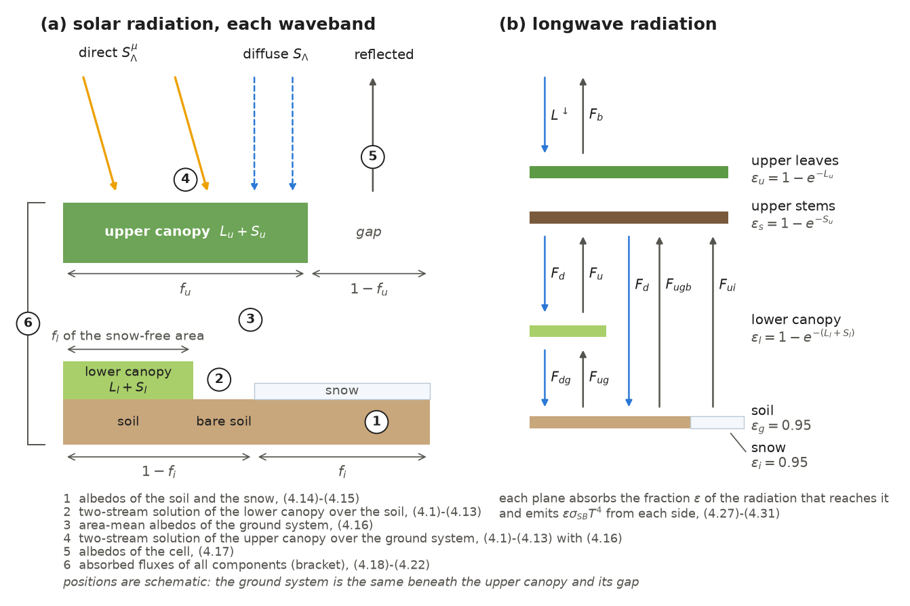
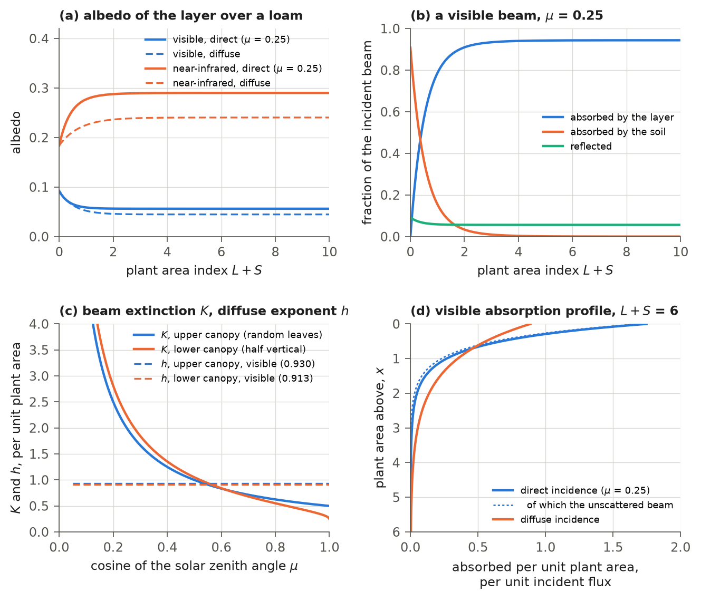
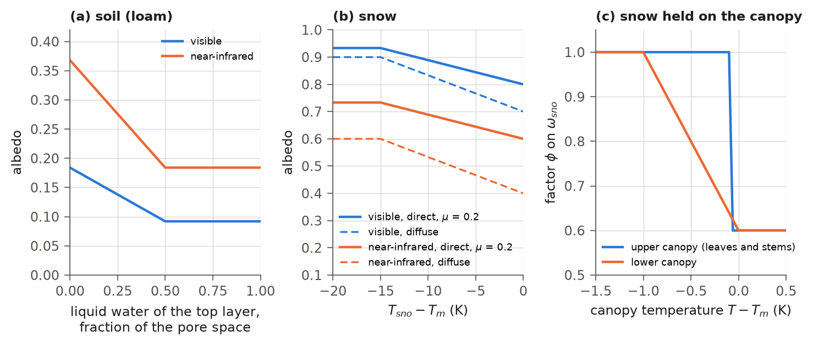
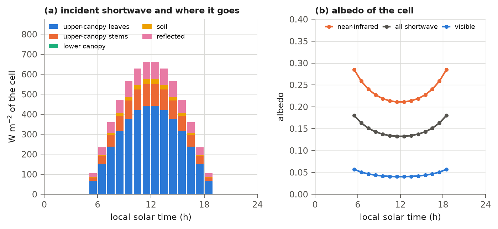

# 4. Canopy Radiative Transfer

Sunlight is the main source of energy at the land surface. This chapter describes how IBIS 3.0 distributes the sunlight
that reaches a grid cell among the upper canopy, the lower canopy, the soil and the snow, and calculates how much the
cell reflects. It also describes the longwave (thermal) radiation that each surface absorbs and emits. The absorbed
radiation drives the surface energy balance (Chapter 5) and warms the soil and the snow (Chapters 6 and 8). The visible
part supports photosynthesis (Chapter 9). The photosynthesis calculation uses the visible radiation absorbed at each
depth of each canopy, calculated here.

The scheme comes from IBIS 2.6b4, which adopted it from LSX (Pollard and Thompson, 1995). It treats each of the two
canopy layers with a two-stream approximation (Sellers, 1985), solved in the notation of Bonan (1996), and treats
longwave radiation with a model of semi-transparent planes. The model computes radiation once per time step, after
calculating the wetted fractions of the canopy and before interception (step 3 of Table 1.3). It uses the temperatures and the
intercepted water at the start of the step and, by default, the position of the sun at the middle of the step (section
3.2). The code is `ibis/physics/radiation.py`, a port of `radiation.f` of IBIS 2.6b4; its entry point is
`compute_radiation`.

## 4.1 The radiative column

The model treats each cell as a column through which sunlight passes: the upper canopy, then the lower canopy, the soil
and the snow beneath it. This section describes the column and the order of the calculations.

Solar radiation is treated in two wavebands $`\Lambda`$, the visible and the near-infrared. Each waveband is divided into a direct
beam $`S^{\mu}_{\Lambda}`$ and a diffuse flux $`S_{\Lambda}`$ (W m⁻²) incident on a horizontal surface (equation (3.7)).
The visible band is the photosynthetically active radiation of Chapter 9.

Each canopy layer is horizontally uniform within the part of the cell it covers (Figure 4.1a). The upper canopy covers
the fraction $`f_{u}`$ of the cell (`vegetation.fu`). The same ground system lies beneath it and in its gaps: snow covers the
fraction $`f_{i}`$ of the cell (`snow.fi`; Chapter 8) and, on the snow-free part, the lower canopy covers the fraction
$`f_{l}`$ (`vegetation.fl`), with bare soil on the rest. Where there is snow, it covers the lower canopy and the soil alike.
The two-stream solution for each canopy uses its plant area: the sum of its leaf area index $`L`$ and stem area index $`S`$
(m² m⁻²; `vegetation.lai`, `vegetation.sai`), with the subscripts $`l`$ for the lower and $`u`$ for the upper canopy.
Two quantities use $`L_{u}`$ and $`S_{u}`$ separately: the leaves' share of the plant area of the upper canopy, (4.4), and
the longwave emissivities of its leaves and stems, (4.27). $`L`$ is the leaf area per unit area of the canopy's own cover.
$`S`$ is set once a year to 0.05 (lower) and 0.25 (upper) times the leaf area of the canopy's positions summed per unit
area of the cell (Chapter 11), as in IBIS 2.6b4.

For each waveband, the model calculates the quantities in the order shown in Figure 4.1a: the albedos of the soil and
snow (section 4.5); the two-stream solution for the lower canopy over the soil; the area-mean albedos of the ground
system; the two-stream solution for the upper canopy over the ground system; the albedos of the cell (section 4.6);
and the fluxes absorbed by each component (section 4.7).

When the sun is below the horizon at the middle of the step ($`\mu = 0`$, where $`\mu`$ is the cosine of the solar zenith
angle of (3.4)), the albedos and the absorbed solar fluxes are set to zero. The generated incident radiation (3.7) is
zero then as well, so the coefficients $`A`$, $`B`$, $`C`$, $`P_{top}`$ and $`Q_{beam}`$ of section 4.8 are zero too, and the
extinction coefficient $`K`$ of the beam and the exponent $`h`$ of the diffuse solution handed to Chapter 9 are 0 and 1.
This zero-coefficient statement applies to generated radiation. In tower runs, observed shortwave radiation at such a
step is neither absorbed nor reflected, but its visible part can still enter the diffuse coefficient $`B`$ and
$`P_{top}`$ passed to photosynthesis (section 4.11). The model computes the longwave fluxes (section 4.9)
every step, day and night, from the downward longwave radiation in the forcing (Chapter 3) and the temperatures of the
canopies, soil and snow.



**Figure 4.1** (a) The column of the solar radiation calculation in each waveband: the upper canopy on the fraction
$`f_{u}`$ of the cell; beneath it and in its gaps, the same ground system of the lower canopy on the fraction $`f_{l}`$ of
the snow-free area, bare soil, and snow on the fraction $`f_{i}`$ of the cell (the positions in the drawing are
schematic). The numbers show the order of the calculations listed below the drawing. Step 6, the absorbed fluxes,
applies to all components (bracket). (b) The planes of the longwave calculation (section 4.9): the leaves and the stems
of the upper canopy, the lower canopy, and the soil and the snow. $`L^{\downarrow}`$ is the downward longwave radiation of
the forcing; $`F_{d}`$ and $`F_{u}`$ are the downward and upward fluxes beneath the upper canopy, $`F_{dg}`$ and $`F_{ug}`$
those beneath the lower canopy, and $`F_{ugb}`$ and $`F_{ui}`$ the upward fluxes above the bare soil and snow, which
$`F_{d}`$ reaches directly. $`F_u`$ is the area mean of the upward fluxes above the lower canopy, bare soil and snow,
not the flux of the lower canopy alone. $`F_b`$ is the upward longwave radiation above the cell, emitted and reflected.
The upper planes are drawn for the part beneath the upper canopy; in its gaps, $`L^{\downarrow}`$ and $`F_u`$ pass
unchanged, as in (4.28) and (4.30).

## 4.2 Optical properties of leaves and stems

Leaves and stems reflect, transmit and absorb light differently in the visible and the near-infrared. Their orientation
also determines how strongly they intercept the direct beam. This section describes the optical properties used by the
two-stream solution.

Leaves and stems of a canopy layer share one reflectance $`\rho_{\Lambda}`$ and one transmittance $`\tau_{\Lambda}`$ per
waveband (Table 4.1). An element's single-scattering albedo is the fraction of incident light that it scatters
rather than absorbs:

```math
\omega_{0} = \rho_{\Lambda} + \tau_{\Lambda}.
\qquad\text{(4.1)}
```

The fractions of the scattered radiation that go into the upward hemisphere, for diffuse ($`\beta`$) and for direct
($`\beta_{0}`$) incident radiation, are weighted combinations of their values for vertical, horizontal and randomly
(spherically) oriented elements,

```math
\omega_{0}\,\beta = o_{v}\,\frac{\rho_{\Lambda} + \tau_{\Lambda}}{2} + o_{h}\,\rho_{\Lambda}
+ o_{r}\left(\frac{2}{3}\rho_{\Lambda} + \frac{1}{3}\tau_{\Lambda}\right), \qquad
\omega_{0}\,\beta_{0} = o_{v}\,\frac{\rho_{\Lambda} + \tau_{\Lambda}}{2} + o_{h}\,\rho_{\Lambda}
+ o_{r}\left[(1 - \zeta)\,\rho_{\Lambda} + \zeta\,\tau_{\Lambda}\right], \qquad \zeta = \frac{1}{2} - \frac{\mu}{3},
\qquad\text{(4.2)}
```

where $`o_{v}`$ and $`o_{h}`$ are the fractions of the elements oriented vertically and horizontally and
$`o_{r} = 1 - o_{v} - o_{h}`$ the fraction oriented at random; at $`\mu = 0.5`$, $`\zeta = 1/3`$ and $`\beta_{0} = \beta`$.
The projected area of the elements in the direction of the sun per unit plant area, $`G`$, and the extinction
coefficient of the direct beam (its optical depth per unit plant area), $`K`$, are

```math
G = o_{v}\,\frac{2}{\pi}\sqrt{\max\left(0,\,1 - \mu^{2}\right)} + o_{h}\,\mu + \frac{o_{r}}{2}, \qquad
K = \frac{G}{\max(\mu,\, 0.01)},
\qquad\text{(4.3)}
```

and the average inverse diffuse optical depth per unit plant area, $`\bar{\mu}`$, is 1. IBIS 2.6b4 takes $`\zeta`$ of
(4.2) from a table of 101 values of $`1/2 - \mu/3`$ rounded to four decimals, indexed by $`\mu`$ rounded to 0.01; IBIS 3.0
evaluates $`1/2 - \mu/3`$ directly. Over $`0 < \mu \le 1`$ the two differ by at most $`1.7 \times 10^{-3}`$ in $`\zeta`$, and
by at most $`5.7 \times 10^{-4}`$ in $`\beta_{0}`$ for the parameters of Table 4.1 (`make_ch04.py checks`).

**Table 4.1** Optical parameters of the canopy elements (section `veg_rad` of the parameter file; the release values
are those of the IBIS 2.6b4 file `params.can`). The orientation fractions correspond to the leaf orientation index
$`\chi`$ of IBIS 2.6b4 (−1 vertical, 0 random, +1 horizontal) by $`o_{v} = \max(-\chi, 0)`$ and $`o_{h} = \max(\chi, 0)`$,
with $`\chi = -0.5`$ for the lower and 0 for the upper canopy. The last three columns are derived from (4.1)-(4.3).

| Canopy | Waveband | $`\rho_{\Lambda}`$ (`rhoveg`) | $`\tau_{\Lambda}`$ (`tauveg`) | $`o_{v}`$ (`oriev`) | $`o_{h}`$ (`orieh`) | $`\omega_{0}`$ | $`\beta`$ | $`G`$ at $`\mu = 0.5`$ |
|---|---|---|---|---|---|---|---|---|
| lower | visible | 0.10 | 0.07 | 0.5 | 0.0 | 0.17 | 0.515 | 0.526 |
| lower | near-infrared | 0.60 | 0.25 | 0.5 | 0.0 | 0.85 | 0.534 | 0.526 |
| upper | visible | 0.10 | 0.05 | 0.0 | 0.0 | 0.15 | 0.556 | 0.500 |
| upper | near-infrared | 0.40 | 0.20 | 0.0 | 0.0 | 0.60 | 0.556 | 0.500 |

## 4.3 Snow held on the canopy

Snow intercepted by a canopy (Chapter 5) makes it brighter. The model mixes the optical properties of leaves and stems
with those of snow in proportion to the fraction of plant area that holds snow. This fraction is

```math
y_{l} = f_{wet,l}\,(1 - r_{liq,l}), \qquad
y_{u} = \lambda_{u}\,f_{wet,u}\,(1 - r_{liq,u}) + (1 - \lambda_{u})\,f_{wet,s}\,(1 - r_{liq,s}), \qquad
\lambda_{u} = \frac{L_{u}}{\max(L_{u} + S_{u},\,\epsilon)},
\qquad\text{(4.4)}
```

where $`f_{wet}`$ is the wetted fraction of the leaves of the lower canopy ($`l`$), the leaves of the upper canopy ($`u`$) or
the stems of the upper canopy ($`s`$), at most 0.25 (`interception.fmax`); $`\lambda_{u}`$ is the leaves' share of the
plant area of the upper canopy; and $`\epsilon = 10^{-7}`$. $`r_{liq}`$ is the liquid share of the element's intercepted-water store
when each phase is expressed relative to its own capacity: $`r_{liq} = x_{liq}/\max(x_{tot}, \epsilon)`$,
with $`x_{liq} = w_{liq}/w^{max}_{liq}`$ and $`x_{tot} = x_{liq} + w_{sno}/w^{max}_{sno}`$, where $`w_{liq}`$ and $`w_{sno}`$
are the liquid water and the snow held by the element and $`w^{max}_{liq}`$, $`w^{max}_{sno}`$ their capacities
(Chapter 5). When the store is empty, $`r_{liq}`$ is 1, or 0 below the melting point. The snow capacities of the release
are ten times the liquid ones (section `interception` of the parameter file), so equal masses of liquid water and snow
give $`r_{liq} = 10/11`$. $`f_{wet}(1 - r_{liq})`$ is thus the part of the wetted fraction attributed to snow, not a share
by mass.

The single-scattering albedo of snow, $`\omega_{sno}`$ (0.9 in the visible, 0.7 in the near-infrared), is lowered near
the melting point $`T_{m} = 273.16`$ K by the factor

```math
\phi_{l} = 0.6 + 0.4\,\min\left[1,\, \max\left(0,\, \frac{T_{m} - T_{l}}{1\ \mathrm{K}}\right)\right], \qquad
\phi_{u} = \lambda_{u}\,\min\left[1,\, \max\left(0.6,\, \frac{T_{m} - T_{u}}{0.1\ \mathrm{K}}\right)\right]
+ (1 - \lambda_{u})\,\min\left[1,\, \max\left(0.6,\, \frac{T_{m} - T_{s}}{0.1\ \mathrm{K}}\right)\right],
\qquad\text{(4.5)}
```

where $`T_{l}`$, $`T_{u}`$ and $`T_{s}`$ (K) are the temperatures of the lower canopy, the upper leaves and the upper stems
(Chapter 5). The lower- and upper-canopy forms differ in both IBIS 2.6b4 and IBIS 3.0 (Figure 4.3c). In the lower canopy the factor falls
linearly from 1 at 1 K below the melting point to 0.6 at the melting point. In the upper canopy it is 1 at 0.1 K or more
below the melting point, falls linearly to 0.6 at 0.06 K below it, and remains at 0.6 at higher temperatures. The optical parameters
of the layer are then

```math
\omega = (1 - y)\,\omega_{0} + y\,\phi\,\omega_{sno}, \qquad
\beta_{0} \leftarrow \frac{(1 - y)\,\omega_{0}\,\beta_{0} + y\,\phi\,\omega_{sno}\,\beta_{sno}}{\omega}, \qquad
\beta \leftarrow \frac{(1 - y)\,\omega_{0}\,\beta + y\,\phi\,\omega_{sno}\,\beta_{sno}}{\omega},
\qquad\text{(4.6)}
```

with $`y`$ and $`\phi`$ of the layer and $`\beta_{sno} = 0.5`$ for direct and diffuse radiation. Snow does not change $`G`$ or
$`K`$.

## 4.4 The two-stream solution for one canopy layer

Inside a canopy layer, light is absorbed and scattered many times by leaves and stems. The two-stream approximation
follows the unscattered direct beam and two diffuse fluxes, one going up and one going down. Its closed-form solution gives the light reflected by
the layer and the surface beneath it, the light transmitted through the layer, and the light absorbed by the layer.

Within a canopy layer, let $`x`$ be the plant area (leaves and stems) above a level, from 0 at the top to
$`X = \max(L + S, \epsilon)`$ at the bottom. For a unit flux incident at the top, the upward and downward diffuse fluxes
$`I^{\uparrow}`$ and $`I^{\downarrow}`$ (per unit incident flux) satisfy the two-stream equations

```math
-\bar{\mu}\,\frac{dI^{\uparrow}}{dx} + b\,I^{\uparrow} - c\,I^{\downarrow} = \omega\,\bar{\mu}\,K\,\beta_{0}\,e^{-Kx}, \qquad
\bar{\mu}\,\frac{dI^{\downarrow}}{dx} + b\,I^{\downarrow} - c\,I^{\uparrow} = \omega\,\bar{\mu}\,K\,(1 - \beta_{0})\,e^{-Kx},
\qquad\text{(4.7)}
```

with $`b = 1 - \omega(1 - \beta)`$ and $`c = \omega\beta`$, for a unit direct beam, whose unscattered part $`e^{-Kx}`$ is
the source on the right-hand side; for a unit diffuse flux the right-hand sides are zero. The layer lies on a surface
of direct albedo $`\alpha^{\mu}`$ and diffuse albedo $`\alpha`$, and the model solves (4.7) with the boundary conditions

```math
\text{direct:}\quad I^{\downarrow}(0) = 0, \quad I^{\uparrow}(X) = \alpha^{\mu}\left[e^{-KX} + I^{\downarrow}(X)\right];
\qquad
\text{diffuse:}\quad I^{\downarrow}(0) = 1, \quad I^{\uparrow}(X) = \alpha\,I^{\downarrow}(X).
\qquad\text{(4.8)}
```

In the solution for a direct beam, the diffuse radiation scattered out of the beam is therefore reflected at the
surface with the direct albedo $`\alpha^{\mu}`$, as in IBIS 2.6b4. The solutions are

```math
\text{direct:}\quad I^{\uparrow} = \frac{h_{1}}{\sigma}e^{-Kx} + h_{2}e^{-hx} + h_{3}e^{hx}, \quad
I^{\downarrow} = \frac{h_{4}}{\sigma}e^{-Kx} + h_{5}e^{-hx} + h_{6}e^{hx};
\qquad
\text{diffuse:}\quad I^{\uparrow} = h_{7}e^{-hx} + h_{8}e^{hx}, \quad I^{\downarrow} = h_{9}e^{-hx} + h_{10}e^{hx},
\qquad\text{(4.9)}
```

with the coefficients used in the code,

```math
\begin{gathered}
q = \sqrt{\max(0,\, b^{2} - c^{2})}, \quad h = \frac{q}{\bar{\mu}}, \quad p = \bar{\mu}K, \quad
\sigma = p^{2} - (b^{2} - c^{2}), \quad d = \omega p \beta_{0}, \quad f = \omega p (1 - \beta_{0}), \\
u_{1} = b - \frac{c}{\alpha^{*}}, \quad u_{2} = b - c\,\alpha^{*}, \quad u_{3} = f + c\,\alpha^{\mu}, \quad
s_{1} = e^{-hX}, \quad s_{2} = e^{-KX}, \\
p_{1} = b + q, \quad p_{2} = b - q, \quad p_{3} = b + p, \quad p_{4} = b - p, \quad
D_{1} = \frac{p_{1}(u_{1} - q)}{s_{1}} - p_{2}(u_{1} + q)\,s_{1}, \quad D_{2} = \frac{u_{2} + q}{s_{1}} - (u_{2} - q)\,s_{1},
\end{gathered}
\qquad\text{(4.10)}
```

where $`\alpha^{*}`$ is $`\alpha^{\mu}`$ in the coefficients $`h_{1}`$-$`h_{6}`$ of the direct solution and $`\alpha`$ in the
coefficients $`h_{7}`$-$`h_{10}`$ of the diffuse solution, and

```math
\begin{gathered}
h_{1} = -d\,p_{4} - c\,f, \qquad h_{4} = -f\,p_{3} - c\,d, \qquad
r_{1} = s_{2}\left(d - c - \frac{h_{1}(u_{1} + p)}{\sigma}\right), \qquad
r_{2} = s_{2}\left(u_{3} - \frac{h_{4}(u_{2} - p)}{\sigma}\right), \\
h_{2} = \frac{1}{D_{1}}\left[\left(d - \frac{h_{1}p_{3}}{\sigma}\right)\frac{u_{1} - q}{s_{1}} - p_{2}\,r_{1}\right], \qquad
h_{3} = -\frac{1}{D_{1}}\left[\left(d - \frac{h_{1}p_{3}}{\sigma}\right)(u_{1} + q)\,s_{1} - p_{1}\,r_{1}\right], \\
h_{5} = -\frac{1}{D_{2}}\left[\frac{h_{4}(u_{2} + q)}{\sigma s_{1}} + r_{2}\right], \qquad
h_{6} = \frac{1}{D_{2}}\left[\frac{h_{4}\,s_{1}(u_{2} - q)}{\sigma} + r_{2}\right], \\
h_{7} = \frac{c\,(u_{1} - q)}{D_{1}\,s_{1}}, \qquad h_{8} = -\frac{c\,s_{1}(u_{1} + q)}{D_{1}}, \qquad
h_{9} = \frac{u_{2} + q}{D_{2}\,s_{1}}, \qquad h_{10} = -\frac{s_{1}(u_{2} - q)}{D_{2}}.
\end{gathered}
\qquad\text{(4.11)}
```

The direct solution divides by $`\sigma`$, which vanishes where $`p = q`$: the point at which the beam extinction coefficient
$`K`$ equals the exponent $`h`$ of the diffuse solution. Where $`|p - q| < 0.001\,p`$, the model therefore multiplies $`p`$
by 1.001 if $`p \ge q`$ and by 0.999 otherwise, and changes $`K`$ with it ($`K = p/\bar{\mu}`$). The layer is then solved
exactly for a beam whose extinction coefficient is 0.1 % larger or smaller than the true one, and this perturbed $`K`$ is
used throughout: in $`s_{2}`$, in $`t_{1}`$ of (4.25) and in the $`K`$ handed to Chapter 9.

For the elements of Table 4.1
without snow, these windows lie at $`\mu`$ = 0.5373-0.5384 (upper canopy) and 0.5615-0.5625 (lower canopy) in the
visible, where $`K`$ crosses $`h`$ in Figure 4.2c, and at 0.7647-0.7662 and 0.9267-0.9273 in the near-infrared. Inside the
windows the model's solution agrees with an exact solution of (4.7)-(4.8) for the perturbed beam to
$`2.4 \times 10^{-13}`$. It differs from the exact solution for the true beam by at most $`1.0 \times 10^{-4}`$ in
$`T^{\mu}`$ and $`3.2 \times 10^{-4}`$ in $`a^{\mu}`$ of (4.12)-(4.13) per unit direct flux (both canopies and wavebands;
plant areas 0.5-12 over soil albedos 0.07-0.46 for the lower canopy and over ground albedos 0.05-0.8 for the upper
canopy). Just outside the windows the model and the exact solution agree to $`10^{-13}`$. Over a year, the $`\mu`$ of
0.32 % of the sunlit hourly steps at the land cells falls in one of the four windows (`make_ch04.py checks`).

The rest of the scheme uses the reflectances of the layer and its surface for a unit direct and a unit diffuse flux, $`\rho^{\mu}`$ and $`\rho`$, and the downward fluxes beneath the layer: the unscattered beam
$`T^{\mu\mu}`$, the diffuse flux from a unit direct beam $`T^{\mu}`$, and the diffuse flux from a unit diffuse flux $`T`$,

```math
\rho^{\mu} = \frac{h_{1}}{\sigma} + h_{2} + h_{3}, \quad \rho = h_{7} + h_{8}, \quad
T^{\mu\mu} = s_{2}, \quad T^{\mu} = \frac{h_{4}}{\sigma}s_{2} + h_{5}s_{1} + \frac{h_{6}}{s_{1}}, \quad
T = h_{9}s_{1} + \frac{h_{10}}{s_{1}},
\qquad\text{(4.12)}
```

and the fractions of a unit direct and a unit diffuse flux absorbed by the layer,

```math
a^{\mu} = \max\left[0,\; 1 - \rho^{\mu} - (1 - \alpha^{\mu})\,T^{\mu\mu} - (1 - \alpha)\,T^{\mu}\right], \qquad
a = \max\left[0,\; 1 - \rho - (1 - \alpha)\,T\right].
\qquad\text{(4.13)}
```

Absorption is calculated as a residual: the layer absorbs the radiation that is neither reflected back to the sky nor
absorbed by the surface beneath it. In (4.13) the diffuse radiation that reaches the surface from the beam, $`T^{\mu}`$, is absorbed by
the surface with the diffuse albedo, while the solution (4.8) reflected it with the direct albedo; IBIS 2.6b4 does the
same. These treatments agree when $`\alpha^{\mu} = \alpha`$, as for the lower canopy over the soil (section 4.6). For the upper
canopy over the ground system, the absorption $`a^{\mu}`$ of (4.13) exceeds that of the two-stream solution by
$`(\alpha - \alpha^{\mu})\,T^{\mu}`$ per unit direct flux, and the absorption of the ground falls short of it by the same
amount (section 4.7).

The model protects the divisions in (4.10)-(4.11) against zero denominators; IBIS 2.6b4 does not. These guards act only at night,
when the albedos and $`\omega`$ are zero. Absorbed fluxes are masked then, but the coefficients passed to photosynthesis
are not; this matters for observed tower radiation (section 4.11). In daylight none of the guards binds (section 4.12).

For this chapter, the model's solution (4.9)-(4.12) was compared in double precision with an exact matrix-exponential
solution of (4.7)-(4.8). The comparison covered both canopies and both wavebands at 36 combinations each of $`\mu`$ (0.05, 0.2,
0.5, 0.9), $`X`$ (0.3, 2, 6) and surface albedos (0.1-0.8), 144 in all, none of them inside the windows. The reflectances
and transmittances agree to $`5 \times 10^{-15}`$ and the absorption profile (4.24) to $`1.2 \times 10^{-14}`$ per unit
incident flux (`make_ch04.py checks`). Figure 4.2 shows the solution for one layer.



**Figure 4.2** The two-stream solution of the model for one canopy layer with the optical parameters of the upper
canopy (Table 4.1), over a saturated loam (40 % sand, 20 % clay; albedo 0.092 in the visible and 0.184 in the
near-infrared, (2.10)). (a) Reflectance of the layer and the soil, $`\rho^{\mu}`$ for a beam at $`\mu = 0.25`$ and $`\rho`$
for diffuse radiation, against the plant area, with the stems one sixth of it. (b) The fate of a unit visible beam at
$`\mu = 0.25`$: absorbed by the layer, $`a^{\mu}`$; absorbed by the soil, $`(1 - \alpha^{\mu})T^{\mu\mu} + (1 - \alpha)T^{\mu}`$;
reflected, $`\rho^{\mu}`$. (c) The extinction coefficient of the beam, $`K`$, for the upper canopy (random orientation) and
the lower canopy (half vertical), and the exponent of the diffuse solution, $`h`$, in the visible; near the crossings of
$`K`$ and $`h`$ ($`\mu \approx 0.54`$ and 0.56) the model perturbs $`p`$ and $`K`$ by 0.1 % (section 4.4), too little to show in
the drawing. (d) The visible radiation absorbed per unit plant area at the plant area $`x`$ above, (4.24), per unit
incident flux, through a layer of $`L = 5`$, $`S = 1`$: for a beam at $`\mu = 0.25`$, with its unscattered part
$`(1 - \omega)Ke^{-Kx}`$, and for diffuse radiation. No point drawn lies inside a window of section 4.4.

A deep upper canopy over the loam reflects 0.056 of a visible and 0.290 of a near-infrared beam at $`\mu = 0.25`$, and
0.045 and 0.240 of diffuse radiation (plant area 6, Figure 4.2a). In the visible, $`h`$ is 0.930 for the upper and
0.913 for the lower canopy and does not depend on $`\mu`$; $`K`$ is $`0.5/\mu`$ for the random leaves of the upper canopy
and falls from about 1.05 at $`\mu = 0.5`$ to 0.25 at $`\mu = 1`$ for the lower canopy (Figure 4.2c).

## 4.5 Albedos of the soil and the snow

Solving the canopy radiation requires the albedos of the surfaces beneath the canopies. Wet soil is darker than dry
soil, and cold snow is brighter than snow near melting.

The albedo of the soil, for direct and diffuse radiation alike, rises from its value when wet to twice that value as
the top soil layer dries,

```math
\alpha_{soil,\Lambda} = \min\left\{\alpha_{sat,\Lambda}\left[1 + \min\left(1,\, \max\left(0,\,
1 - \frac{\theta_{1}}{0.5}\right)\right)\right],\; 0.80\right\}, \qquad \theta_{1} = w_{1}\,(1 - w_{i,1}),
\qquad\text{(4.14)}
```

where $`\alpha_{sat,\Lambda}`$ is the albedo of the saturated soil from the texture of the top layer (`soil.albsav`,
`soil.albsan`; equation (2.10)); $`w_{1}`$ is the liquid water of the top soil layer as a fraction of its ice-free pore
space and $`w_{i,1}`$ its ice as a fraction of the pore space (`soil.wsoi`, `soil.wisoi`; Chapter 7), so that
$`\theta_{1}`$ is its liquid water as a fraction of the pore space. The albedo is that of the saturated soil for
$`\theta_{1} \ge 0.5`$ (Figure 4.3a). At the 95,333 land cells $`\alpha_{sat}`$ ranges from 0.070 to 0.116 in the visible
and is twice that in the near-infrared (release run, restart at the end of 2000), so the dry soil reaches at most 0.46
and the cap of 0.80 does not bind.

The albedo of the snow depends on the temperature of the top snow layer $`T_{sno}`$ (K; Chapter 8) and, for the direct
beam, on the solar zenith angle:

```math
x_{\Lambda} = \min\left\{\max\left[\frac{\alpha_{w,\Lambda}(T_{sno} - T_{m} + 15) + \alpha_{c,\Lambda}(T_{m} - T_{sno})}{15},\;
\alpha_{w,\Lambda}\right],\; \alpha_{c,\Lambda}\right\}, \qquad
\alpha^{\mu}_{sno,\Lambda} = \min\left[0.99,\; x_{\Lambda} + (1 - x_{\Lambda})\,g(\mu)\right], \qquad
\alpha_{sno,\Lambda} = x_{\Lambda},
\qquad\text{(4.15)}
```

with $`g(\mu) = \max[0,\, 1.5/(1 + 4\mu) - 0.5]`$, where $`x_{\Lambda}`$ is the diffuse albedo of the snow,
$`\alpha_{c,\Lambda}`$ the albedo of cold snow (0.90 in the visible, 0.60 in the near-infrared), reached at 15 K below
the melting point, and $`\alpha_{w,\Lambda}`$ that of snow at the melting point (0.70 and 0.40); the temperatures are in
K. The direct albedo exceeds the diffuse one only for $`\mu < 0.5`$ (Figure 4.3b).



**Figure 4.3** (a) The albedo of a loam (40 % sand, 20 % clay) against the liquid water of the top soil layer,
(4.14). (b) The albedo of snow against the temperature of the top snow layer, (4.15), for diffuse radiation and for a
beam at $`\mu = 0.2`$ (for $`\mu \ge 0.5`$ the direct albedo equals the diffuse). (c) The factor $`\phi`$ of (4.5) on the
single-scattering albedo of the snow held on the canopy, against the canopy temperature, for the upper canopy (leaves
and stems at the same temperature) and the lower canopy, computed with the model's two-stream solution for a layer covered by
snow ($`y = 1`$).

## 4.6 Albedos of the surface system

The model combines the component albedos to calculate the albedo of the whole cell. For each waveband it applies the
two-stream solution of section 4.4 twice. The lower canopy is solved over the soil, with
$`\alpha^{\mu} = \alpha = \alpha_{soil}`$ of (4.14), giving its reflectances $`\rho^{\mu}_{l}`$ and $`\rho_{l}`$. The
area-mean albedos of the ground system beneath the upper canopy are

```math
\alpha^{\mu}_{g} = f_{l}(1 - f_{i})\,\rho^{\mu}_{l} + (1 - f_{l})(1 - f_{i})\,\alpha_{soil} + f_{i}\,\alpha^{\mu}_{sno}, \qquad
\alpha_{g} = f_{l}(1 - f_{i})\,\rho_{l} + (1 - f_{l})(1 - f_{i})\,\alpha_{soil} + f_{i}\,\alpha_{sno},
\qquad\text{(4.16)}
```

and the upper canopy is solved over a surface with $`\alpha^{\mu} = \alpha^{\mu}_{g}`$ and $`\alpha = \alpha_{g}`$, giving
$`\rho^{\mu}_{u}`$ and $`\rho_{u}`$. The albedos of the cell for direct and diffuse radiation are

```math
\alpha^{\mu}_{\Lambda} = f_{u}\,\rho^{\mu}_{u} + (1 - f_{u})\,\alpha^{\mu}_{g}, \qquad
\alpha_{\Lambda} = f_{u}\,\rho_{u} + (1 - f_{u})\,\alpha_{g}.
\qquad\text{(4.17)}
```

## 4.7 Absorbed solar radiation

This step calculates the energy absorbed by each component for use in the energy balances of Chapters 5, 6 and
8. Absorbed solar radiation is summed over the two wavebands. The upper canopy's absorption is expressed per unit area
of its cover and divided between leaves and stems in proportion to their shares of the plant area:

```math
A_{u,\Lambda} = S^{\mu}_{\Lambda}\,a^{\mu}_{u} + S_{\Lambda}\,a_{u}, \qquad
\mathrm{SW}_{u} = \sum_{\Lambda} \lambda_{u}\,A_{u,\Lambda}, \qquad
\mathrm{SW}_{s} = \sum_{\Lambda} (1 - \lambda_{u})\,A_{u,\Lambda}
\qquad\text{(4.18)}
```

(W m⁻²), with $`\lambda_{u}`$ of (4.4). The direct and diffuse fluxes incident on the ground system, averaged over the
canopy and its gaps, are

```math
S^{\mu}_{3,\Lambda} = f_{u}\,S^{\mu}_{\Lambda}\,T^{\mu\mu}_{u} + (1 - f_{u})\,S^{\mu}_{\Lambda}, \qquad
S_{3,\Lambda} = f_{u}\left(S^{\mu}_{\Lambda}\,T^{\mu}_{u} + S_{\Lambda}\,T_{u}\right) + (1 - f_{u})\,S_{\Lambda},
\qquad\text{(4.19)}
```

and the lower canopy absorbs, per unit area of its cover,

```math
\mathrm{SW}_{l} = \sum_{\Lambda}\left(S^{\mu}_{3,\Lambda}\,a^{\mu}_{l} + S_{3,\Lambda}\,a_{l}\right).
\qquad\text{(4.20)}
```

The soil absorbs, per unit snow-free area,

```math
\mathrm{SW}_{g} = \sum_{\Lambda}(1 - \alpha_{soil,\Lambda})\left[\left(f_{l}\,T^{\mu\mu}_{l} + 1 - f_{l}\right)S^{\mu}_{3,\Lambda}
+ f_{l}\left(S^{\mu}_{3,\Lambda}\,T^{\mu}_{l} + S_{3,\Lambda}\,T_{l}\right) + (1 - f_{l})\,S_{3,\Lambda}\right],
\qquad\text{(4.21)}
```

and the snow, per unit area of snow,

```math
\mathrm{SW}_{i} = \sum_{\Lambda}\left[(1 - \alpha^{\mu}_{sno,\Lambda})\,S^{\mu}_{3,\Lambda} + (1 - \alpha_{sno,\Lambda})\,S_{3,\Lambda}\right].
\qquad\text{(4.22)}
```

Because the absorptions (4.13) are residuals, the components and the reflected radiation add up to the incident
radiation,

```math
f_{u}(\mathrm{SW}_{u} + \mathrm{SW}_{s}) + (1 - f_{i})\,f_{l}\,\mathrm{SW}_{l} + (1 - f_{i})\,\mathrm{SW}_{g} + f_{i}\,\mathrm{SW}_{i}
+ \sum_{\Lambda}\left(\alpha^{\mu}_{\Lambda}S^{\mu}_{\Lambda} + \alpha_{\Lambda}S_{\Lambda}\right)
= \sum_{\Lambda}\left(S^{\mu}_{\Lambda} + S_{\Lambda}\right),
\qquad\text{(4.23)}
```

wherever the bounds at zero in (4.13) do not bind. At 4,000 random states of the column (computed in double
precision, with incident radiation up to 1,210 W m⁻², snow on half of the states and intercepted snow up to
$`f_{wet} = 0.25`$) the largest residual of (4.23) was $`3.4 \times 10^{-13}`$ W m⁻² (`make_ch04.py checks`).

The difference between the two-stream solution and the absorption accounting, noted after (4.13), redistributes radiation
between the upper canopy and the ground. The ground absorbs the diffuse radiation that reaches it from the beam with its diffuse albedo, and the
upper canopy absorbs $`f_{u}(\alpha_{g} - \alpha^{\mu}_{g})\,T^{\mu}_{u}\,S^{\mu}_{\Lambda}`$ more than its two-stream
solution. Per unit incident direct flux, $`(\alpha_{g} - \alpha^{\mu}_{g})\,T^{\mu}_{u}`$ is below $`10^{-4}`$ in both
wavebands for the snow-free forest of section 4.10 at $`\mu = 0.3`$ and 0.9. Over snow at low sun, where
$`\alpha^{\mu}_{sno}`$ exceeds $`\alpha_{sno}`$, it is negative. Over a full snow cover ($`f_{i} = 1`$) it is, in the
near-infrared, −0.003 for an upper canopy of $`L_{u} = 4`$, $`S_{u} = 1`$ with the top snow layer at −5 °C and $`\mu = 0.2`$
(against an absorption $`a^{\mu}_{u}`$ of 0.687), −0.005 for the same canopy with the snow at −0.5 °C and $`\mu = 0.1`$
(0.657), and −0.037 for a sparse canopy of $`L_{u} = 1`$, $`S_{u} = 0.3`$ with the snow at −0.5 °C and $`\mu = 0.2`$
(0.535). In the visible its magnitude is at most 0.003 in these cases (`make_ch04.py checks`; canopies without
intercepted snow). Energy is conserved either way.

## 4.8 Absorbed visible radiation through the canopy

Photosynthesis (Chapter 9) requires the visible light absorbed by leaves at each canopy depth, because sunlit leaves near
the top receive much more light than shaded leaves below. Differentiating the net downward
flux $`e^{-Kx} + I^{\downarrow} - I^{\uparrow}`$ of (4.9), the visible radiation absorbed per unit plant area at the plant
area $`x`$ above, $`P(x)`$ (W m⁻²), is

```math
P(x) = A\,e^{-Kx} + B\,e^{-hx} + C\,e^{hx},
\qquad\text{(4.24)}
```

```math
A = t_{1}\,S^{\mu}_{top}, \quad B = t_{2}\,S^{\mu}_{top} + t_{3}\,S_{top}, \quad C = t_{4}\,S^{\mu}_{top} + t_{5}\,S_{top}, \qquad
t_{1} = K\left(1 + \frac{h_{4} - h_{1}}{\sigma}\right), \; t_{2} = h(h_{5} - h_{2}), \; t_{3} = h(h_{9} - h_{7}), \;
t_{4} = h(h_{3} - h_{6}), \; t_{5} = h(h_{8} - h_{10}),
\qquad\text{(4.25)}
```

where $`S^{\mu}_{top}`$ and $`S_{top}`$ are the visible fluxes incident on the canopy: $`S^{\mu}_{vis}`$ and $`S_{vis}`$ for
the upper canopy, and $`S^{\mu}_{3,vis}`$ and $`S_{3,vis}`$ of (4.19) for the lower canopy, and the coefficients are those
of the visible solution of that canopy. The integral of $`P`$ over the plant area $`X`$ gives the visible radiation absorbed
by the layer according to its two-stream solution (4.8). It equals $`S^{\mu}_{top}a^{\mu} + S_{top}a`$ of (4.13) when
$`\alpha^{\mu} = \alpha`$. The radiation code passes to photosynthesis, for each canopy, the coefficients $`A`$, $`B`$, $`C`$
and their sum, the extinction coefficient $`K`$ of the beam and the exponent $`h`$ of the diffuse solution in the visible,
and

```math
P_{top} = (A + B + C)\,\frac{L}{\max(L + S,\, \epsilon)}, \qquad Q_{beam} = (1 - \omega)\,K\,S^{\mu}_{top},
\qquad\text{(4.26)}
```

where $`P_{top}`$ (W m⁻²) is the visible radiation absorbed per unit plant area at the top of the canopy times the
leaves' share of the plant area, and $`Q_{beam}`$ (W m⁻²) is the unscattered beam absorbed per unit sunlit plant area,
with $`\omega`$ of (4.6) in the visible. The sunlit plant area at depth $`x`$ is the fraction $`e^{-Kx}`$ of the plant area,
on which the unscattered beam contributes $`Q_{beam}e^{-Kx}`$ per unit plant area to $`P(x)`$ (Figure 4.2d). Table 4.3
gives the names of these terms in the code. $`A`$, $`B`$, $`C`$, $`K`$, $`h`$ and $`P_{top}`$ follow IBIS 2.6b4 except in two
cases. Inside the windows of section 4.4, IBIS 3.0 perturbs $`K`$ together with $`p`$, which also changes the absorption
coefficients. At night it returns $`K = 0`$ and $`h = 1`$, whereas IBIS 2.6b4 keeps their last daytime values. With
generated radiation the coefficients are zero at night, so this second difference has no effect; observed tower
radiation is an exception (section 4.11). $`Q_{beam}`$ is new in IBIS 3.0 and is used by the sunlit/shaded canopy of
Chapter 9 (`stomata.sunshade_u`, `stomata.sunshade_l`; default false, true in the release parameter file).

## 4.9 Longwave radiation

Every surface emits thermal (longwave) radiation according to its temperature and absorbs part of the radiation from the
sky and other surfaces. This exchange cools the surfaces at night and couples the temperatures of the canopies, soil
and snow. The model represents the upper leaves, upper stems and lower canopy as three semi-transparent planes above
the soil and snow, with the upper leaf plane just above the upper stem plane (Figure 4.1b).
With $`\bar{\mu} = 1`$ their emissivities are

```math
\varepsilon_{u} = 1 - e^{-L_{u}}, \qquad \varepsilon_{s} = 1 - e^{-S_{u}}, \qquad \varepsilon_{l} = 1 - e^{-(L_{l} + S_{l})},
\qquad\text{(4.27)}
```

and those of the soil and the snow are $`\varepsilon_{g} = \varepsilon_{i} = 0.95`$. With $`L^{\downarrow}`$ (W m⁻²) the
downward longwave radiation of the forcing (Chapter 3), $`\sigma_{SB} = 5.67 \times 10^{-8}`$ W m⁻² K⁻⁴ the
Stefan-Boltzmann constant, and $`T_{u}`$, $`T_{s}`$, $`T_{l}`$, $`T_{g}`$ and $`T_{i}`$ (K) the temperatures of the upper leaves,
the upper stems, the lower canopy, the soil surface and the snow surface at the start of the step, the downward fluxes
beneath the upper and the lower canopy are

```math
F_{d} = (1 - f_{u})\,L^{\downarrow} + f_{u}\left[(1 - \varepsilon_{u})(1 - \varepsilon_{s})\,L^{\downarrow}
+ \varepsilon_{u}(1 - \varepsilon_{s})\,\sigma_{SB}T_{u}^{4} + \varepsilon_{s}\,\sigma_{SB}T_{s}^{4}\right], \qquad
F_{dg} = (1 - \varepsilon_{l})\,F_{d} + \varepsilon_{l}\,\sigma_{SB}T_{l}^{4},
\qquad\text{(4.28)}
```

the upward fluxes above the soil beneath the lower canopy, above the bare soil, above the snow, and beneath the upper
canopy are

```math
\begin{gathered}
F_{ug} = (1 - \varepsilon_{g})\,F_{dg} + \varepsilon_{g}\,\sigma_{SB}T_{g}^{4}, \qquad
F_{ugb} = (1 - \varepsilon_{g})\,F_{d} + \varepsilon_{g}\,\sigma_{SB}T_{g}^{4}, \qquad
F_{ui} = (1 - \varepsilon_{i})\,F_{d} + \varepsilon_{i}\,\sigma_{SB}T_{i}^{4}, \\
F_{u} = (1 - f_{i})\left\{f_{l}\left[\varepsilon_{l}\,\sigma_{SB}T_{l}^{4} + (1 - \varepsilon_{l})\,F_{ug}\right]
+ (1 - f_{l})\,F_{ugb}\right\} + f_{i}\,F_{ui},
\end{gathered}
\qquad\text{(4.29)}
```

and the upward longwave radiation above the cell, emitted and reflected, is

```math
F_{b} = (1 - f_{u})\,F_{u} + f_{u}\left[(1 - \varepsilon_{u})(1 - \varepsilon_{s})\,F_{u} + \varepsilon_{u}\,\sigma_{SB}T_{u}^{4}
+ \varepsilon_{s}(1 - \varepsilon_{u})\,\sigma_{SB}T_{s}^{4}\right].
\qquad\text{(4.30)}
```

Each plane absorbs the fraction $`\varepsilon`$ of the radiation that reaches it from either side and emits
$`\varepsilon\sigma_{SB}T^{4}`$ from each side. The net longwave radiation absorbed by the upper leaves and stems (per
unit area of the upper canopy), by the lower canopy (per unit area of its cover), by the soil (per unit snow-free area)
and by the snow (per unit area of snow) is

```math
\begin{gathered}
\mathrm{LW}_{u} = \varepsilon_{u}\left[L^{\downarrow} + (1 - \varepsilon_{s})\,F_{u} + \varepsilon_{s}\,\sigma_{SB}T_{s}^{4}\right]
- 2\,\varepsilon_{u}\,\sigma_{SB}T_{u}^{4}, \qquad
\mathrm{LW}_{s} = \varepsilon_{s}\left[(1 - \varepsilon_{u})\,L^{\downarrow} + F_{u} + \varepsilon_{u}\,\sigma_{SB}T_{u}^{4}\right]
- 2\,\varepsilon_{s}\,\sigma_{SB}T_{s}^{4}, \\
\mathrm{LW}_{l} = \varepsilon_{l}\left(F_{d} + F_{ug}\right) - 2\,\varepsilon_{l}\,\sigma_{SB}T_{l}^{4}, \qquad
\mathrm{LW}_{g} = f_{l}\,(F_{dg} - F_{ug}) + (1 - f_{l})\,(F_{d} - F_{ugb}), \qquad
\mathrm{LW}_{i} = F_{d} - F_{ui}.
\end{gathered}
\qquad\text{(4.31)}
```

By construction, these terms sum to the net longwave radiation of the cell,
$`f_{u}(\mathrm{LW}_{u} + \mathrm{LW}_{s}) + (1 - f_{i})f_{l}\,\mathrm{LW}_{l} + (1 - f_{i})\,\mathrm{LW}_{g} + f_{i}\,\mathrm{LW}_{i} = L^{\downarrow} - F_{b}`$ (largest residual $`3.6 \times 10^{-13}`$ W m⁻² at the random states of
section 4.7). The energy balance of Chapter 5 subtracts from $`\mathrm{LW}_{g}`$ and $`\mathrm{LW}_{i}`$, and adds to
$`F_{b}`$ (weighted by $`1 - f_{i}`$ and $`f_{i}`$), the linearised change of the soil and snow emission over the step,
$`4 \times 0.95\,\sigma_{SB}T^{3}\,\Delta T`$ with $`T`$ the temperature at the start of the step, weighted by the implicit
fractions of Chapter 5; the canopy terms are used as computed here.

## 4.10 One day at a forest cell

Figure 4.4 illustrates the scheme by following solar radiation through one summer day at a forest cell. The model uses
hourly radiation produced by the weather generator
(Chapter 3) from the GSWP3 forcing of 22 July 2001 (day 203) at 42.75°N, 72.25°W, with the sun of each step at
the middle of the step. The vegetation and the soil water are those of the release run: the upper canopy covers
$`f_{u} = 0.975`$ of the cell with $`L_{u} = 5.85`$ and $`S_{u} = 1.43`$ m² m⁻², the lower canopy $`f_{l} = 0.05`$ with
$`L_{l} = 0.53`$ (leaf area at the end of July 2001; stem area and cover of 2001). In the release run the upper canopy of
this cell consists of temperate conifer evergreen trees (position 4 of Table 2.1), and its leaf area is between 5.84
and 5.85 in every month of 2001. The saturated soil albedo is 0.100 in the visible, and the top soil layer holds liquid
water on 0.459 of its pore space (the July mean), so that the soil albedo is 1.08 times its saturated value (4.14). The
cell is free of snow, and the canopy is assumed dry. These vegetation and soil-water inputs come from the release
run and will be updated after the final run of the revised model.

Of the 21.8 MJ m⁻² incident in the day (equivalent to the forcing's daily mean of 252.4 W m⁻²), the upper
canopy absorbs 82.8 %, of which the stems take the share $`1 - \lambda_{u} = 0.20`$ (4.18). The soil absorbs 3.0 %, the
lower canopy 0.03 %, and 14.2 % is reflected. The sun is up in 14 steps, from the step 05-06 h to the step 18-19 h,
and the day is symmetric about solar noon. The albedo of the cell is 0.132 in the two steps on either side of noon (sun
at 11:30 and 12:30, $`\mu = 0.918`$), 0.040 in the visible and 0.211 in the near-infrared. It rises to 0.180 in the
first and the last sunlit step (sun at 05:30 and 18:30, $`\mu = 0.145`$), mainly because of the canopy's near-infrared albedo
for a direct beam at low sun (Figure 4.4b). In the steps around noon, the terms passed to photosynthesis for the upper
canopy are $`K = 0.545`$, $`h = 0.930`$, $`P_{top} = 160.3`$ W m⁻² and $`Q_{beam} = 83.4`$ W m⁻², with a diffuse fraction of
the visible radiation of 0.41 (`make_ch04.py 4.4`).



**Figure 4.4** The solar radiation of 22 July 2001 at the cell at 42.75°N, 72.25°W, computed by the model for each
hourly step of the weather generator, with no snow and a dry canopy. Vegetation and top-layer soil water come from the
release run and will be updated after the final run of the revised model. The radiation of each step is computed for the solar time at the middle of
the step (the default, `weather.sun_midstep`) and held over the hour. (a) The incident shortwave radiation, stacked by
where it goes: absorbed by the leaves and the stems of the upper canopy, by the lower canopy (0.03 % of the day, too
small to see) and by the soil, and reflected (W m⁻² of the cell; bars span the hour of each step). (b) The albedo of
the cell in the visible, in the near-infrared and for all shortwave radiation, plotted at the middle of each step,
where the sun is evaluated.

## 4.11 Configuration and differences from IBIS 2.6b4

The radiation scheme has no switches of its own. It uses the parameters in Table 4.1, read from the section
`veg_rad` of the parameter file (`ibis/io/physics_params.py`), and the fixed code constants in Table 4.2.
The time of day at which the sun is placed for each step is set by `weather.sun_midstep` in the parameter file
(Chapter 3): true (the default) evaluates it at the middle of the step; false at its start, as IBIS 2.6b4 and the
release did. The terms of section 4.8 serve both canopy-integration options of Chapter 9; $`Q_{beam}`$ is used only with
`stomata.sunshade_u` or `stomata.sunshade_l` (default false; true in the release parameter file).

For tower runs the incident shortwave radiation can come from the tower's observations (section 3.12); the scheme is the
same. The tower reader converts the record from the tower's clock to local apparent solar time and assigns each step the
mean over its hour, aligning the observed radiation with the model's sun. At a step whose $`\mu`$
at the middle of the hour is zero, the observed radiation is neither absorbed nor reflected, and (4.23) does not hold.
Its visible part nevertheless enters the diffuse coefficient $`B`$ and $`P_{top}`$ used by photosynthesis: the diffuse
solution gives $`t_3 = 1`$ at $`\mu = 0`$. The energy and photosynthesis calculations therefore treat this light differently.
This happens when the sun rises after the middle of the hour or sets before it, and when the tower records light while
the model's sun is below the horizon. At the Harvard Forest tower (US-Ha1) in 2001-2010 it affects 12,491 of 87,648
hours, with 3.7 W m⁻² on average and 0.34 % of the observed shortwave radiation in all. About two thirds of that
radiation (69 %) falls in the 3,352 hours in which the sun is up for part of the hour (up to 59 W m⁻²); the rest
falls in hours that are dark throughout for the model's sun (1.6 W m⁻² on average). The hours between 21 and 03 h
carry 13 % of the lost radiation, at most 5.2 W m⁻² (`make_ch04.py checks`). The global runs are not affected,
because the generated radiation is zero where $`\mu`$ is zero.

**Table 4.2** Constants of the radiation code (the same in IBIS 2.6b4).

| Symbol | Value | Meaning | Equation |
|---|---|---|---|
| $`\bar{\mu}`$ | 1 | average inverse diffuse optical depth per unit plant area (solar and longwave) | (4.3), (4.27) |
| — | 0.01 | lower bound of $`\mu`$ in the optical depth of the beam | (4.3) |
| $`\omega_{sno}`$ | 0.9, 0.7 | single-scattering albedo of intercepted snow, visible and near-infrared | (4.6) |
| $`\beta_{sno}`$ | 0.5 | upscatter fraction of intercepted snow, direct and diffuse | (4.6) |
| — | 0.6; 1 K and 0.1 K | lowest snow factor; its temperature ranges in the lower and the upper canopy | (4.5) |
| — | 0.001 | relative perturbation of $`p`$ near $`q`$; IBIS 3.0 also perturbs $`K`$ (section 4.4) | (4.10) |
| — | 0.5, 2, 0.80 | liquid water (fraction of the pore space) below which the soil brightens; largest factor; upper limit of the soil albedo | (4.14) |
| $`\alpha_{c}`$, $`\alpha_{w}`$ | 0.90, 0.70 (visible); 0.60, 0.40 (near-infrared) | albedo of cold snow and of snow at the melting point | (4.15) |
| — | 15 K | temperature range of the snow albedo | (4.15) |
| — | 0.99 | upper limit of the direct snow albedo | (4.15) |
| $`\varepsilon_{g}`$, $`\varepsilon_{i}`$ | 0.95 | longwave emissivity of the soil and the snow | (4.29) |
| $`\sigma_{SB}`$ | 5.67 × 10⁻⁸ W m⁻² K⁻⁴ | Stefan-Boltzmann constant | (4.28)-(4.31) |
| $`T_{m}`$ | 273.16 K | melting point | (4.5), (4.15) |
| $`\epsilon`$ | 10⁻⁷ | lower bound of the plant area | (4.4), (4.18), (4.26) |

IBIS 3.0 solves the same equations as IBIS 2.6b4 with the same constants, except for the following differences:

1. $`\zeta`$ of (4.2) is computed from $`\mu`$ instead of being looked up in a table (section 4.2).
2. The unscattered-beam term $`Q_{beam}`$ of (4.26) is new.
3. The divisions of the two-stream solution are guarded against zero (sections 4.4 and 4.12); the guards bind only at
   night, when absorbed fluxes and albedos are zeroed but the photosynthesis coefficients are not.
4. The optical parameters are read from the parameter file as the orientation fractions $`o_{v}`$ and $`o_{h}`$ instead of
   the index $`\chi`$; the release values reproduce those of IBIS 2.6b4.
5. All points are computed and the night-time absorbed fluxes and albedos are set to zero by masks, instead of
   computing only points with the sun above the horizon. At night IBIS 3.0 returns $`K = 0`$ and $`h = 1`$, where
   IBIS 2.6b4 keeps the last daytime values. Generated radiation gives zero photosynthesis coefficients then;
   observed tower radiation can give nonzero coefficients (sections 4.8 and 4.11).
6. Near $`K = h`$ the extinction coefficient $`K`$ is perturbed together with $`p`$ (section 4.4); IBIS 2.6b4 perturbs $`p`$
   alone. The two differ only at the steps whose $`\mu`$ falls inside a window.
7. By default the sun of each step is placed at the middle of the step, not at its start (`weather.sun_midstep`;
   section 3.2).

**Table 4.3** Outputs of the radiation code and their use.

| Variable | Quantity | Basis | Used in |
|---|---|---|---|
| `solu`, `sols` | solar radiation absorbed by the upper leaves and stems, (4.18) | per unit area of the upper canopy | Chapter 5 |
| `soll` | solar radiation absorbed by the lower canopy, (4.20) | per unit area of the lower canopy | Chapter 5 |
| `solg`, `soli` | solar radiation absorbed by the soil and the snow, (4.21)-(4.22) | per unit area of snow-free ground, of snow | Chapters 5, 6, 8 |
| `firu`, `firs`, `firl`, `firg`, `firi` | net longwave radiation, (4.31) | as the solar terms | Chapters 5, 6, 8 |
| `firb` | upward longwave radiation above the cell, emitted and reflected, (4.30) | per unit area of the cell | Chapter 5 |
| `asurd`, `asuri` | albedos of the cell by waveband, (4.17) | — | kept in the model state (`canopy.asurd`, `canopy.asuri`) and the restart files; read by tower hourly energy output to calculate net radiation; not written to gridded output files |
| `scalcoefu`, `scalcoefl` | $`A`$, $`B`$, $`C`$ and $`A + B + C`$, (4.25) | W m⁻² per unit plant area | Chapter 9 |
| `termu6`, `termu7`, `terml6`, `terml7` | extinction coefficient $`K`$ of the beam and exponent $`h`$ of the diffuse solution, visible, (4.3), (4.10) | per unit plant area | Chapter 9 |
| `topparu`, `topparl` | $`P_{top}`$, (4.26) | W m⁻² | Chapter 9 |
| `dbeamu`, `dbeaml` | $`Q_{beam}`$, (4.26) | W m⁻² per unit sunlit plant area | Chapter 9 |

## 4.12 Notes for developers

**Code.** `compute_radiation` calls `solsur` (4.14)-(4.15), `solalb` (4.16)-(4.17), which calls `twoset` (4.1)-(4.6)
and `twostr` (4.7)-(4.13) for each canopy, `solarf` (4.18)-(4.26) and `irrad` (4.27)-(4.31). The two-stream quantities
of (4.12)-(4.13) are `refld` ($`\rho^{\mu}`$), `refli` ($`\rho`$), `fbeldd` ($`T^{\mu\mu}`$), `fbelid` ($`T^{\mu}`$), `fbelii`
($`T`$), `abvegd` ($`a^{\mu}`$) and `abvegi` ($`a`$). The routines were verified against those of `radiation.f` at machine
precision, with the table of $`\zeta`$ of IBIS 2.6b4 substituted in the verification (`verify/STATUS.md`, finding 1).
This agreement holds for the release code. The window change described below makes the implementations differ inside
the windows of section 4.4.

**Guards.** The model bounds the albedos in the divisions of (4.10) below by $`10^{-12}`$, $`s_{1}`$ below by $`10^{-30}`$,
and $`D_{1}`$, $`D_{2}`$ and $`\sigma`$ in magnitude by $`10^{-30}`$; it bounds $`\omega_{0}`$ in the divisions of (4.2) and
$`\omega`$ in those of (4.6) below by $`10^{-12}`$, which never binds since $`\omega_{0} \ge 0.15`$. At night, where the
albedos and $`\omega`$ are zero, $`D_{1}`$ is zero as well, and the bounds on the albedos and on $`D_{1}`$ bind. In daylight
none binds: the albedos are then at least 0.02 (the visible reflectance of a dense lower canopy over the darkest soil);
at $`10^{6}`$ random daylight states the smallest $`|D_{1}|`$, $`|D_{2}|`$ and $`|\sigma|`$ were 0.10, 0.43 and
$`2.4 \times 10^{-4}`$; and $`s_{1}`$ would reach $`10^{-30}`$ only for $`hX > 69`$, while $`h \le 1`$, $`L \le 12`$ by (10.3) and
$`S`$ is at most 2.5 m² m⁻² at the land cells (release run, restart at the end of 2000; `make_ch04.py checks`). IBIS
2.6b4 sets the absorptions of a layer to zero where $`X < \epsilon`$; since $`X`$ is bounded below by $`\epsilon`$, that test
never applies, in IBIS 2.6b4 as in IBIS 3.0.

**Changes after the release** (release code: commit `e54e342`, run `final_rel30`; decisions of the technote review,
`docs/CALIBRATION.md` section 87 and `docs/DEFECTS_FOR_REVIEW.md`):

1. *The two-stream window (D26; commit 8416c20; no switch).* Inside the window $`|p - q| < 0.001\,p`$ the model now
   perturbs $`K`$ with $`p`$ ($`K = p/\bar{\mu}`$ in `twostr`), so that $`s_{2}`$, $`t_{1}`$ and the $`K`$ handed to Chapter 9
   belong to the same beam. The release code, like IBIS 2.6b4 (`radiation.f`), perturbed $`p`$ alone, and inside the
   windows its coefficients did not solve the equations for any single beam: $`T^{\mu}`$ was off by up to 0.27 and $`a^{\mu}`$ by up to 0.18 per unit
   direct flux for the lower canopy in the near-infrared, by up to 0.14 and 0.11 for the upper canopy in the
   near-infrared, and by at most 0.03 in the visible (technote at commit 7012f02, `make_ch04.py checks`). Energy was
   conserved, since $`a^{\mu}`$ is a residual. Outside the windows the results are bit-identical; the test is
   `tests/test_review_radiation_fixes.py`, and `make_ch04.py checks` compares the solution with the exact one for the
   true and for the perturbed beam.
2. *The sun at the middle of the step (D33; commit 8416c20; `weather.sun_midstep`, default true).* The release code,
   like IBIS 2.6b4, placed the sun of each step at its start and held it over the hour, so the day's absorbed radiation
   was centred on 12:30 solar time. For the day of Figure 4.4 the release code gave 21.8 MJ m⁻² incident, an albedo of
   0.132 at noon ($`\mu = 0.924`$) rising to 0.192 at the first and last sunlit steps (05 and 19 h), and $`K = 0.541`$,
   $`P_{top} = 160.9`$ W m⁻² and $`Q_{beam} = 83.4`$ W m⁻² at noon. The share of sunlit steps whose $`\mu`$ falls in a
   window of section 4.4 is 0.32 % at mid-step and was 0.27 % at the step start.
3. *Tower radiation in solar time (D34; commit 63fd7c0, `verify/calibration/tower_forcing.py`; no switch).* The reader
   moves the half-hourly record to local apparent solar time. `tower_clock` takes the UTC offset from site metadata
   where available, checks it against the record's potential radiation, and infers it from the record otherwise.
   US-Ha1 has no site metadata; the inferred offset is −5 h. `solar_hour_means` gives step $`k`$ the record's mean
   over the solar hour $`[k, k+1)`$. The release code took the instant at each hour of the tower's clock (local standard
   time) as the hour's value, with $`\mu`$ at the start of the step. At US-Ha1 in 2001-2010 the radiation lost at
   steps with $`\mu = 0`$ fell from 0.45 % of the observed shortwave (12,417 hours, at most 77 W m⁻², 5.0 W m⁻² on
   average) to 0.34 % (12,491 hours, at most 59 W m⁻², 3.7 W m⁻² on average); the remaining loss is set out in
   section 4.11.
4. *Precision of the optical parameters (D85; commit 8416c20).* The values in the section `veg_rad` are now stored in
   the run's floating-point type. The release code stored them in single precision, so a double-precision run read
   0.1 as 0.10000000149 (a relative difference of $`1.5 \times 10^{-8}`$).
5. *Kept as in IBIS 2.6b4 after the review.* The different temperature ranges of the snow factor (4.5) in the upper
   (0.1 K) and the lower canopy (1 K), although the comment of `radiation.f` gives 1 K for both (D42; up to about
   +0.02 in the albedo of a snow-laden upper canopy within 1 K of melting); the diffuse radiation from the beam
   reflected with the direct albedo in the solution and absorbed with the diffuse albedo in the bookkeeping (D43;
   section 4.7); the zeroing of the absorptions where $`X < \epsilon`$, which never applies (D86). A misleading comment
   in `twoset` about the snow product of the upper canopy was corrected (D96); the code computes the product of the
   $`\lambda_{u}`$-weighted snow fraction and snow factor, as `radiation.f`.

**Remaining inconsistency.** `solarf` masks the absorbed shortwave fluxes at $`\mu = 0`$ but does not mask
`scalcoefu`, `scalcoefl`, `topparu` or `topparl`. Observed tower light can therefore drive photosynthesis without
entering the surface shortwave energy balance. Section 4.11 documents this behavior; changing it requires a separate
model decision and is not part of this documentation update. Figure 4.2 is unaffected by the D26 window correction
because none of its sampled points lies in a correction window.

## References

Bonan, G. B., 1996: A Land Surface Model (LSM version 1.0) for ecological, hydrological, and atmospheric studies:
Technical description and user's guide. NCAR Technical Note NCAR/TN-417+STR, National Center for Atmospheric
Research, Boulder, CO.

Pollard, D., and S. L. Thompson, 1995: Use of a land-surface-transfer scheme (LSX) in a global climate model: the
response to doubling stomatal resistance. *Global and Planetary Change*, 10, 129-161.

Sellers, P. J., 1985: Canopy reflectance, photosynthesis and transpiration. *International Journal of Remote Sensing*,
6, 1335-1372.
