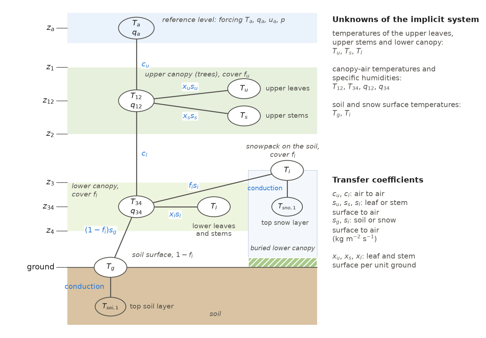
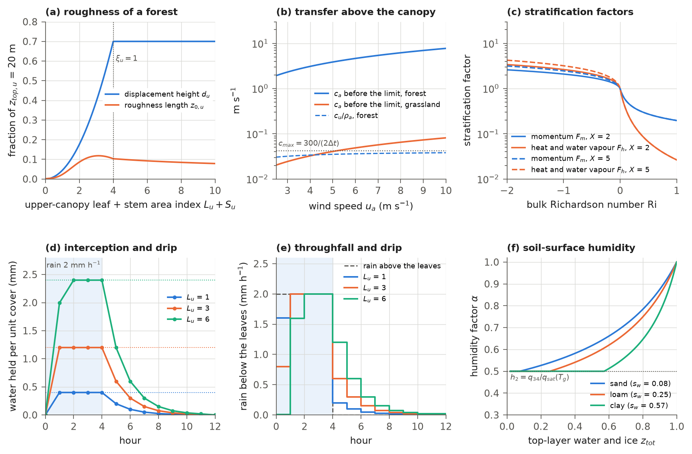

# 5. Surface Energy, Momentum and Water Vapour Fluxes; Canopy Interception

<!-- reading-nav:start -->
[Chapter index](README.md) · **Chapter 5, Part 1:** surface exchange and interception · [Continue to Part 2](05_surface_fluxes_part2.md)
<!-- reading-nav:end -->

This chapter describes how IBIS 3.0 exchanges heat, water vapour and momentum between the land surface and the air
above it, and how leaves and stems intercept rain and snow. These exchanges determine how the radiation absorbed by a
cell (Chapter 4) is divided among warming the air (the sensible heat flux), evaporating water (the latent heat flux)
and warming the soil and snow. They also determine how much precipitation reaches the ground.

The scheme comes from IBIS 2.6b4, which adopted it from LSX (Pollard and Thompson, 1995). A grid cell can contain two
canopies: an upper canopy of trees and a lower canopy of shrubs and grasses. The model represents the air inside each
canopy by a single point, or node, with one temperature and one humidity. The air node of the upper canopy exchanges heat and
water vapour with the upper leaves and stems, with the air node below it and with the atmosphere at a reference level.
The air node of the lower canopy exchanges with the lower leaves and stems, with the air node above it and with the soil
and snow surfaces. The model solves for all surface temperatures and both air nodes' temperatures and humidities together. It solves a
linearized, implicit balance of energy and water vapour three times in every time step.

These calculations run in steps 2 and 4–8 of the time step (Table 1.3). Chapter 4 supplies the radiation absorbed by
each surface, and Chapter 9 supplies the stomatal conductance.
The snow, soil heat and soil water models that use the fluxes calculated here are described in
Chapters 6–8. Section 5.12 maps the calculations to the code and records the changes after the release.

## 5.1 Structure and order of the calculations

The model treats each grid cell as one vertical column of surfaces and air layers. It calculates the exchanges between
them in a fixed order every time step. The column in Figure 5.1 has three air levels above the soil and snow surfaces:
the reference
level $`z_{a}`$, where the weather for the step is specified (Chapter 3); the air of the upper canopy at $`z_{12}`$, midway
between the canopy's top $`z_{1}`$ and its bottom $`z_{2}`$; and the air of the lower canopy at $`z_{34}`$, midway between
its top $`z_{3}`$ and its bottom $`z_{4}`$. The upper canopy covers the fraction $`f_{u}`$ of the cell and the lower canopy
the fraction $`f_{l}`$. Snow covers the fraction $`f_{i}`$; there the snowpack lies on the soil and buries the lower canopy
(Chapter 8).

The model has three canopy surfaces, each with its own temperature: the upper leaves ($`T_{u}`$), the upper stems
($`T_{s}`$), and the leaves and stems of the lower canopy taken together ($`T_{l}`$). The soil surface ($`T_{g}`$) and the
snow surface ($`T_{i}`$) are thin skins without heat capacity. The fluxes of a leaf or stem surface are expressed per unit
of its two-sided area. Per unit area of the cell, the three canopy surfaces have the areas

```math
x_{u} = 2\,L_{u}\,f_{u}, \qquad x_{s} = 2\,S_{u}\,f_{u}, \qquad x_{l} = 2\,(L_{l} + S_{l})\,f_{l}\,(1 - f_{i}),
\qquad\text{(5.1)}
```

where $`x_{u}`$, $`x_{s}`$ and $`x_{l}`$ (m² m⁻²) are the surface areas of the upper leaves, the upper stems and the lower
canopy per unit area of the cell; $`L_{u}`$ and $`L_{l}`$ (m² m⁻²) are the leaf area indices of the upper and the lower
canopy per unit area of their cover (`vegetation.lai`; Chapter 10); and $`S_{u}`$ and $`S_{l}`$ (m² m⁻²) are their stem
area indices (`vegetation.sai`; equation 11.27). The factor $`1 - f_{i}`$ excludes the part of the lower canopy buried by
snow; Chapter 8 uses $`x_{l}`$ for $`2(L_{l} + S_{l})f_{l}`$, without this factor. Soil fluxes are per unit area of the
snow-free part of the cell and snow fluxes per unit area of snow. Unless stated otherwise, $`f_{i}`$ is the snow cover at
the start of the step.



**Figure 5.1** The canopy-exchange column. Each node is an unknown in the balance of section 5.6, except for the
reference level, whose temperature and humidity come from the weather for the step, and the top soil and snow layers,
whose temperatures at the start of the step determine conduction from the surfaces. The air-exchange lines represent
transfer coefficients for heat. For water vapour, the leaf and stem coefficients combine
the wet and transpiring parts of each surface (section 5.6.3). The ground uses $`s'_g`$ of (5.38), which is zero over
empty stores when `soil.evap_needs_store` is enabled; its sensible heat still uses $`s_g`$. The two conduction lines
are the soil and snow conductances $`k_g`$ and $`k_i`$ of (5.43), in W m⁻² K⁻¹. Over the fraction $`f_{i}`$ of the cell the snowpack lies on the soil and buries the lower canopy, so the
lower canopy exchanges only over the fraction $`1 - f_{i}`$ of its cover, (5.1). The heights are not to scale.

The calculations follow the order of the IBIS 2.6b4 routine `lsxmain` (Table 5.1). Each step starts from the
temperatures, intercepted water and canopy-air state at the end of the previous step. Table 5.2 lists the main
symbols.

**Table 5.1** The calculations of this chapter within one time step.

| Order | Calculation | Routine | Section |
|---|---|---|---|
| 1 | wetted fractions of the canopy surfaces with the intercepted water at the start of the step, used by the radiation (Chapter 4) | `fwetcal` | 5.5 |
| 2 | interception of rain and snow by the upper leaves, the upper stems and the lower canopy, drip and blow-off, and the precipitation below each | `cascade`, `steph2o` | 5.4 |
| 3 | wetted fractions after interception | `fwetcal` | 5.5 |
| 4 | air properties at the reference level, heights and density of the two canopies | `canini` | 5.2, 5.3 |
| 5 | three iterations of: stability factors, wind profile and transfer coefficients; stomatal conductance and photosynthesis (Chapter 9); implicit fractions; the implicit energy and water vapour balance | `fstrat`, `turcof`, `stomata`, `impexp`, `impexp2`, `turvap` | 5.3, 5.6 |
| 6 | snow-surface temperature limited to the melting point | `timestep_body` | 5.6.7 |
| 7 | evaporation of the intercepted water and final phase adjustment of the canopy water | `cascad2`, `steph2o2` | 5.7 |
| 8 | nominal temperatures and empty stores where a canopy surface is absent | `noveg` | 5.7 |

**Table 5.2** Main symbols of this chapter.

| Symbol | Code | Meaning | Units |
|---|---|---|---|
| $`T_{a}`$, $`q_{a}`$, $`u_{a}`$, $`p`$ | `atm.ta`, `qa`, `ua`, `psurf` | air temperature, specific humidity and wind speed of the step, surface pressure (Chapter 3) | K, kg kg⁻¹, m s⁻¹, Pa |
| $`T_{u}`$, $`T_{s}`$, $`T_{l}`$ | `canopy.tu`, `ts`, `tl` | temperature of the upper leaves, the upper stems and the lower canopy | K |
| $`T_{12}`$, $`T_{34}`$ | `canopy.t12`, `t34` | temperature of the canopy air of the upper and the lower canopy | K |
| $`q_{12}`$, $`q_{34}`$ | `canopy.q12`, `q34` | specific humidity of the canopy air of the upper and the lower canopy | kg kg⁻¹ |
| $`T_{g}`$, $`T_{i}`$ | `soil.tg`, `snow.ti` | temperature of the soil surface and of the snow surface | K |
| $`T_{soi,1}`$, $`T_{sno,1}`$ | `soil.tsoi[:, 0]`, `snow.tsno[:, 0]` | temperature of the top soil layer and of the top snow layer at the start of the step | K |
| $`f_{u}`$, $`f_{l}`$, $`f_{i}`$ | `vegetation.fu`, `fl`, `snow.fi` | fractions of the cell covered by the upper canopy, the lower canopy and snow | – |
| $`c_{u}`$, $`c_{l}`$ | `cu`, `cl` | transfer coefficients between the reference level and $`z_{12}`$, and between $`z_{12}`$ and $`z_{34}`$ | kg m⁻² s⁻¹ |
| $`s_{u}`$, $`s_{s}`$, $`s_{l}`$ | `su`, `ss`, `sl` | transfer coefficients between the surfaces of the upper leaves, upper stems and lower canopy and their canopy air | kg m⁻² s⁻¹ |
| $`s_{g}`$, $`s_{i}`$ | `sg`, `si` | transfer coefficients between the soil surface and the snow surface and the lower canopy air | kg m⁻² s⁻¹ |
| $`w_{liq}`$, $`w_{sno}`$ | `canopy.wliqu`, ... `wsnol` | liquid water and snow held on a canopy surface, per unit of its two-sided area | kg m⁻² |
| $`f_{wet}`$, $`r_{liq}`$ | `fwetu`, ... `rliql` | wetted fraction of a canopy surface and the liquid part of it | – |
| $`\Delta t`$ | `dtime` | time step, 3600 s | s |

## 5.2 Thermodynamic functions and the air at the reference level

### 5.2.1 Saturation humidity and latent heats

Saturation humidity and the energy required for evaporation enter every flux calculation in this chapter. The model
calculates saturation vapour pressure over water and ice from the polynomials of Lowe (1977), as in IBIS 2.6b4
(`thermo.esat`, the statement function `esat` of `comsat.h`):

```math
e_{sat}(T) = 100 \times
\begin{cases}
\sum_{k=0}^{6} a_{k}\,t_{l}^{\,k}, & T \ge T_{f}, \\[2pt]
\sum_{k=0}^{6} b_{k}\,t_{i}^{\,k}, & T < T_{f},
\end{cases}
\qquad t_{l} = \min(T - T_{f},\, 100), \qquad t_{i} = \max(T - T_{f},\, -60),
\qquad\text{(5.2)}
```

where $`e_{sat}`$ (Pa) is the saturation vapour pressure at the temperature $`T`$ (K), $`T_{f} = 273.16`$ K is the melting
point, $`t_{l}`$ and $`t_{i}`$ (K) are the departures from the melting point, limited to the ranges of the polynomials,
and $`a_{k}`$ and $`b_{k}`$ (hPa K⁻ᵏ) are the coefficients over water and over ice (Table 5.3). Above 373.16 K and below
213.16 K the vapour pressure stays at its value at those limits. Its temperature derivative is not the derivative of
(5.2) but a second pair of polynomials of Lowe (1977),

```math
\frac{de_{sat}}{dT} = 100 \times
\begin{cases}
\sum_{k=0}^{6} c_{k}\,t_{l}^{\,k}, & T \ge T_{f}, \\[2pt]
\sum_{k=0}^{6} d_{k}\,t_{i}^{\,k}, & T < T_{f},
\end{cases}
\qquad\text{(5.3)}
```

with the coefficients $`c_{k}`$ and $`d_{k}`$ of Table 5.3. The saturation specific humidity $`q_{sat}(T, p)`$ is (3.12), and
its derivative with respect to temperature is

```math
q'_{sat}(T, p) = \frac{de_{sat}}{dT}\,\frac{q_{sat}\left[1 + q_{sat}\left(1/0.622 - 1\right)\right]}{e_{sat}},
\qquad\text{(5.4)}
```

where $`q'_{sat}`$ (K⁻¹) is computed with $`e_{sat}`$ and $`q_{sat}`$ at $`T`$ and the pressure $`p`$ (Pa).

**Table 5.3** Coefficients of the saturation vapour pressure (5.2) and its derivative (5.3) (Lowe, 1977; `thermo.py`,
as `comsat.h` of IBIS 2.6b4).

| $`k`$ | $`a_{k}`$ (water) | $`b_{k}`$ (ice) | $`c_{k}`$ (water) | $`d_{k}`$ (ice) |
|---|---|---|---|---|
| 0 | 6.1078000 | 6.1091780 | 4.4381000 × 10⁻¹ | 5.0303052 × 10⁻¹ |
| 1 | 4.4365185 × 10⁻¹ | 5.0346990 × 10⁻¹ | 2.8570026 × 10⁻² | 3.7732550 × 10⁻² |
| 2 | 1.4289458 × 10⁻² | 1.8860134 × 10⁻² | 7.9380540 × 10⁻⁴ | 1.2679954 × 10⁻³ |
| 3 | 2.6506485 × 10⁻⁴ | 4.1762237 × 10⁻⁴ | 1.2152151 × 10⁻⁵ | 2.4775631 × 10⁻⁵ |
| 4 | 3.0312404 × 10⁻⁶ | 5.8247203 × 10⁻⁶ | 1.0365614 × 10⁻⁷ | 3.0056931 × 10⁻⁷ |
| 5 | 2.0340809 × 10⁻⁸ | 4.8388032 × 10⁻⁸ | 3.5324218 × 10⁻¹⁰ | 2.1585425 × 10⁻⁹ |
| 6 | 6.1368209 × 10⁻¹¹ | 1.8388269 × 10⁻¹⁰ | −7.0902448 × 10⁻¹³ | 7.1310977 × 10⁻¹² |

The latent heats of vaporization and sublimation are corrected for the water and vapour temperatures,
assuming that the phase change occurs at $`T_{f}`$ (comment of `comsat.h`):

```math
\lambda_{v}(T, T_{a}) = h_{v} + c_{vap}\,(T_{a} - T_{f}) - c_{w}\,(T - T_{f}), \qquad
\lambda_{s}(T, T_{a}) = h_{s} + c_{vap}\,(T_{a} - T_{f}) - c_{i}\,(T - T_{f}),
\qquad\text{(5.5)}
```

where $`\lambda_{v}`$ and $`\lambda_{s}`$ (J kg⁻¹) are the latent heats of vaporization and of sublimation, $`T`$ (K) is the
temperature of the liquid or the ice and $`T_{a}`$ (K) that of the air that receives or gives the vapour; $`h_{v}`$,
$`h_{s}`$, $`c_{vap}`$, $`c_{w}`$ and $`c_{i}`$ are the constants of Table 5.7.

### 5.2.2 The reference level

The model assigns the weather for the step to the air at the reference level $`z_{a}`$, at the top of the column.
It defines this level by its pressure, $`\sigma = 0.999`$ times the surface pressure, which
IBIS 2.6b4 chose as roughly 10 m above the ground, the height of the wind data it used (comment of `canini`). The air
there has the density, specific heat and potential-temperature factor

```math
\rho_{a} = \frac{\sigma\,p}{R_{d}\,T_{a}\left[1 + \left(R_{v}/R_{d} - 1\right)q_{a}\right]}, \qquad
c_{p} = c_{pd}\left[1 + \left(c_{vap}/c_{pd} - 1\right)q_{a}\right], \qquad
\theta = \sigma^{-\kappa},
\qquad\text{(5.6)}
```

where $`\rho_{a}`$ (kg m⁻³) is the air density, $`c_{p}`$ (J kg⁻¹ K⁻¹) the specific heat of the moist air, $`R_{d}`$ and
$`R_{v}`$ (J kg⁻¹ K⁻¹) the gas constants of dry air and water vapour, $`c_{pd}`$ (J kg⁻¹ K⁻¹) the specific heat of dry
air, and $`\theta`$ the factor that converts $`T_{a}`$ to the potential temperature referred to the surface pressure, with
$`\kappa = R_{d}/c_{pd}`$ (Table 5.7). The height of the reference level is

```math
z_{a} = \max\left[\frac{(1 - \sigma)\,p}{\rho_{a}\,g},\; z_{top,u} + \Delta z_{a}\right],
\qquad\text{(5.7)}
```

where $`z_{a}`$ (m) is the reference height, $`g`$ (m s⁻²) the acceleration of gravity, $`z_{top,u}`$ (m) the height of the
top of the upper canopy (11.26), and $`\Delta z_{a}`$ (m) the minimum height of the reference level above the canopy top
(`canopy.za_above_top`; 1 m, as in IBIS 2.6b4). The first term does not depend on the pressure. For dry air it is
8.00 m at 0 °C, 8.44 m at 15 °C and 8.88 m at 30 °C, and it rises by 2.9 cm per kelvin. With the default
$`\Delta z_{a}`$ of 1 m, the reference level is therefore 1 m above the canopy top wherever the canopy is taller than about
7-8 m.

In the release state at the end of 2000 the top of the upper canopy was at its lower bound of 4 m ($`z_{bot,u} + 1`$,
(11.26)) in 57,242 of the 95,333 land cells, at or below 26.5 m in 95 % of them and above 50 m in 70 cells. The
tallest reached 154.5 m, well above the tallest trees measured, about 116 m. $`z_{top,u} + 1`$ m exceeded the first term
of (5.7) at 15 °C in 35,920 cells, 57.5 % of the land area north of 60°S, among them 20,739 of the 20,939 cells with
$`f_{u} > 0.5`$ (`make_ch05.py checks`). The forcing's near-surface air temperature and humidity and its 10 m wind speed
(Table 1.5) are used at $`z_{a}`$ without any adjustment for height.

## 5.3 Aerodynamics of the canopy

Wind and turbulence carry heat and water vapour between the surfaces, canopy air and atmosphere. The rate of exchange
depends on canopy height, density and roughness. The scheme follows LSX (Pollard and Thompson, 1995).
Within each canopy layer, the momentum flux and squared wind speed obey a diffusion equation that includes drag on
leaves and stems. Its solution is a sum of two exponentials in height. Between the layers and above the upper canopy
the wind follows logarithmic profiles. Matching the solutions at the layer boundaries gives each layer an effective
roughness length as seen from the air above it.

### 5.3.1 Density and heights of the canopy layers

A dense canopy slows the wind more than a sparse canopy and absorbs its momentum higher above the ground. Each layer's
density (`canini`) is its two-sided leaf and stem area per unit area of the cell, divided by a normalization constant:

```math
\xi_{l} = \min\left[\frac{2\,f_{l}\,(1 - f_{i})\,(L_{l} + S_{l})}{\Lambda_{l}},\; 3\right], \qquad
\xi_{u} = \min\left[\frac{2\,f_{u}\,(L_{u} + S_{u})}{\Lambda_{u}},\; 3\right], \qquad
\xi'_{l} = \min(\xi_{l}, 1), \quad \xi'_{u} = \min(\xi_{u}, 1),
\qquad\text{(5.8)}
```

where $`\xi_{l}`$ and $`\xi_{u}`$ are the densities of the lower and the upper canopy and $`\Lambda_{l} = \Lambda_{u} = 8`$
(`canopy.alaiml`, `canopy.alaimu`) is the two-sided leaf and stem area at which a layer counts as dense ($`\xi' = 1`$).
This $`\Lambda`$ is not the leaf area per unit cover that Chapters 10 and 11 call $`\Lambda`$. For each layer $`v`$
($`v = l, u`$) the drag coefficient per unit height, the mixing length and the parameters of the exponential solution are

```math
h_{v} = \max\left(z_{top,v} - z_{bot,v},\, 0.01\right), \quad
a_{v} = \frac{0.4}{h_{v}}\max\left(10^{-5}, \xi_{v}\right), \quad
m_{v} = \frac{0.1\,h_{v}}{\max\left(10^{-5}, \xi_{v}, \xi_{v}^{2}\right)}, \quad
b_{v} = \sqrt{\frac{2\,a_{v}}{m_{v}}}, \quad \beta_{v} = \tfrac{1}{2}\,b_{v}\,m_{v},
\qquad\text{(5.9)}
```

where $`h_{v}`$ (m) is the depth of the layer between its bottom $`z_{bot,v}`$ and its top $`z_{top,v}`$ (equations 10.13
and 11.26), $`a_{v}`$ (m⁻¹) the drag coefficient per unit height, $`m_{v}`$ (m) the mixing length, which multiplies the
wind speed to give the diffusivity, $`b_{v}`$ (m⁻¹) the inverse e-folding depth of the squared wind speed in the layer,
and $`\beta_{v}`$ the ratio of the momentum flux to the squared wind speed in a layer of infinite depth. Above
$`\xi_{v} = 1`$ the mixing length falls as $`\xi_{v}^{-2}`$, so the roughness length decreases as the density grows
towards its cap of 3 (comment of `canopy.f`). The heights of the layers in the aerodynamic calculation are

```math
\begin{gathered}
z_{3} = \xi'_{l}\,z_{top,l} + (1 - \xi'_{l})\,z_{g}, \qquad z_{4} = \xi'_{l}\,z_{bot,l} + (1 - \xi'_{l})\,z_{g}, \qquad
z_{g} = \max\left(z_{0,g}, z_{0,i}\right) + 0.01, \qquad d_{l} = 0.7\,\xi'_{l}\,z_{3}, \\
z_{1} = \xi'_{u}\,z_{top,u} + (1 - \xi'_{u})\,(z_{3} + 0.01), \qquad
z_{2} = \xi'_{u}\,z_{bot,u} + (1 - \xi'_{u})\,(z_{3} + 0.01), \qquad
d_{u} = 0.7\,\xi'_{u}\,z_{1} + (1 - \xi'_{u})\,d_{l}, \\
z_{12} = \tfrac{1}{2}(z_{1} + z_{2}), \qquad z_{34} = \tfrac{1}{2}(z_{3} + z_{4}), \qquad
E_{l} = e^{\,b_{l}(z_{3} - z_{4})}, \qquad E_{u} = e^{\,b_{u}(z_{1} - z_{2})},
\end{gathered}
\qquad\text{(5.10)}
```

where $`z_{1}`$, $`z_{2}`$, $`z_{3}`$ and $`z_{4}`$ (m) are the top and the bottom of the upper and of the lower canopy,
$`z_{12}`$ and $`z_{34}`$ (m) the heights of their air nodes, $`d_{l}`$ and $`d_{u}`$ (m) the displacement heights of the
logarithmic profiles above the lower and the upper canopy, $`z_{0,g} = 0.005`$ m and $`z_{0,i} = 0.0005`$ m the roughness
lengths of the soil (`soil.z0soi`, set for every cell in `ibis/io/soil_init.py`) and of the snow (`SnowState.z0sno`;
$`z_{0,s}`$ in Chapter 8), and $`E_{l}`$ and $`E_{u}`$ the ratios of the squared wind speed across a layer of infinite
depth. As its density falls to zero, each layer shrinks to zero depth. The lower canopy collapses to a level 1 cm above the
larger of the two ground roughness lengths, and the upper canopy to a level 1 cm above the top of the lower canopy. Its displacement
height then becomes that of the layer below (zero for the lower canopy). The logarithms of the profiles are

```math
\ell_{0,g} = (1 - f_{i})\ln z_{0,g} + f_{i}\ln z_{0,i}, \quad
\ell_{4} = \ln\max\left(z_{4}, 1.1\,z_{0,g}, 1.1\,z_{0,i}\right), \quad
\ell_{3} = \ln(z_{3} - d_{l}), \quad \ell_{2} = \ln(z_{2} - d_{l}), \quad
\ell_{1} = \ln(z_{1} - d_{u}), \quad \ell_{a} = \ln(z_{a} - d_{u}),
\qquad\text{(5.11)}
```

with heights in metres; $`\ell_{0,g}`$ is the logarithm of the roughness length of the ground beneath the lower canopy.

### 5.3.2 Stability

Buoyancy strengthens or weakens turbulent mixing. Air that is warmer near the surface than above it rises and mixes
more (unstable air); air that is colder near the surface mixes less (stable air). For two air layers, the model represents
this effect with bulk Richardson numbers and the stratification factors of Louis (1979), in the form of Louis et al.
(1982) (`fstrat`). For a layer of air between a bottom level $`z_{b}`$ and a top level $`z_{t}`$,

```math
\mathrm{Ri} = \min\left\{\max\left[\frac{g\,\max(z_{t} - z_{b},\, 0)\,(\Theta_{t} - \Theta_{b})}
{\tfrac{1}{2}(\Theta_{t} + \Theta_{b})\,u^{2}},\; -2\right],\; 1\right\}, \qquad
\Theta_{t} = T_{t}\,\theta_{t}\,(1 + 0.622\,q_{t}), \quad \Theta_{b} = T_{b}\,(1 + 0.622\,q_{b}),
\qquad\text{(5.12)}
```

where Ri is the bulk Richardson number, limited to $`[-2, 1]`$ (negative in unstable air, positive in stable air);
$`T_{b}`$, $`q_{b}`$, $`T_{t}`$ and $`q_{t}`$ are the temperatures (K) and specific humidities (kg kg⁻¹) at the bottom and the
top; $`\theta_{t}`$ is the potential-temperature factor of the top level; and $`u`$ (m s⁻¹) is the wind speed at the top.
The stratification factors for momentum and for heat and water vapour are

```math
\begin{aligned}
F_{m} &= 1 - \frac{10\,\mathrm{Ri}}{1 + 75\,Y_{m}}, \quad
F_{h} = 1 - \frac{15\,\mathrm{Ri}}{1 + 75\,Y_{h}}, \quad
Y_{m,h} = \left(\frac{k}{X_{m,h}}\right)^{2} e^{X_{m,h}/2}\sqrt{-\mathrm{Ri}}, \quad
X_{m,h} = \max\left(\ell_{t} - \ell_{0},\, 0.5\right) & (\mathrm{Ri} \le 0), \\
F_{m} &= \left[1 + \frac{10\,\mathrm{Ri}}{\sqrt{1 + 5\,\mathrm{Ri}}}\right]^{-1}, \quad
F_{h} = \left[1 + 15\,\mathrm{Ri}\,\sqrt{1 + 5\,\mathrm{Ri}}\right]^{-1} & (\mathrm{Ri} > 0),
\end{aligned}
\qquad\text{(5.13)}
```

where $`F_{m}`$ and $`F_{h}`$ multiply the transfer coefficients of neutral air for momentum and for heat; $`k = 0.4`$ is the
von Kármán constant; $`\ell_{t}`$ is the logarithm of the height of the top level above the displacement height; and
$`\ell_{0}`$ is the logarithm of the roughness length of the bottom (the same for momentum and heat). The two layers of air
are:

* the lower region, from $`z_{3}`$ (bottom: $`T_{34}`$, $`q_{34}`$) to $`z_{2}`$ (top: $`T_{12}`$, $`q_{12}`$, $`\theta_{t} = 1`$),
  with $`\ell_{t} = \ell_{2}`$, $`\ell_{0} = \ell_{0,l}`$ and the wind $`u_{2}`$ at $`z_{2}`$, giving $`F_{m,l}`$ and $`F_{h,l}`$;
* the upper region, from $`z_{1}`$ (bottom: $`T_{12}`$, $`q_{12}`$) to $`z_{a}`$ (top: $`T_{a}`$, $`q_{a}`$, $`\theta_{t} = \theta`$),
  with $`\ell_{t} = \ell_{a}`$, $`\ell_{0} = \ell_{0,u}`$ and the wind $`u_{a}`$, giving $`F_{m,u}`$ and $`F_{h,u}`$,

where $`\ell_{0,l}`$ and $`\ell_{0,u}`$ are the logarithms of the effective roughness lengths of section 5.3.3. Each region
uses the canopy-air state, $`u_{2}`$, $`\ell_{0,l}`$ and $`\ell_{0,u}`$ from the previous iteration. At the first iteration of a
step the canopy-air state is that of the end of the previous step, $`u_{2} = u_{a}/E_{u}^{1/2}`$,
$`\ell_{0,u} = \ln\max[0.01, 0.1(z_{1} - z_{2})]`$ and $`\ell_{0,l} = \ln\max[0.01, 0.1(z_{3} - z_{4})]`$. From the second
iteration on, each factor is the mean of its new value and its value from the previous iteration,

```math
F^{(i)} = \tfrac{1}{2}\left(F^{(i)}_{new} + F^{(i-1)}\right) \qquad (i = 2, 3),
\qquad\text{(5.14)}
```

This averaging damps oscillations between stable and unstable stratification (comment of `canopy.f`). For $`X = 2`$ the factors
$`F_{m}`$ and $`F_{h}`$ are 2.60 and 3.39 at Ri = −2 (3.16 and 4.24 for $`X = 5`$) and 0.197 and 0.026 at Ri = 1
(Figure 5.2c). Stable air thus damps the exchange of heat and water vapour more than that of momentum, and unstable air
enhances it more.

### 5.3.3 Wind profile and roughness

A canopy's roughness length, as seen from the air above it, determines how strongly it slows the wind and stirs the
air. The effective roughness of the lower canopy and the ground, seen from the layer of air above them, and that of
the whole canopy, seen from the reference level, are (`turcof`)

```math
N_{l} = \left(\frac{\ell_{4} - \ell_{0,g}}{k}\right)^{2}\beta_{l}, \quad
y_{l} = \frac{(N_{l} + 1)E_{l} + (N_{l} - 1)E_{l}^{-1}}{(N_{l} + 1)E_{l} - (N_{l} - 1)E_{l}^{-1}}, \quad
\ell_{0,l} = \ell_{3} - k\sqrt{\frac{y_{l}}{\beta_{l}}},
\qquad\text{(5.15)}
```

```math
N_{u} = \left(\frac{\ell_{2} - \ell_{0,l}}{k}\right)^{2}\frac{\beta_{u}}{F_{m,l}}, \quad
y_{u} = \frac{(N_{u} + 1)E_{u} + (N_{u} - 1)E_{u}^{-1}}{(N_{u} + 1)E_{u} - (N_{u} - 1)E_{u}^{-1}}, \quad
\ell_{0,u} = \ell_{1} - k\sqrt{\frac{y_{u}}{\beta_{u}}},
\qquad\text{(5.16)}
```

where $`N_{l}`$ and $`N_{u}`$ compare $`\beta_{v}`$ of each canopy with the drag coefficient $`[k/(\ell - \ell_{0})]^{2}`$ of the
logarithmic layer beneath it: $`[k/(\ell_{4} - \ell_{0,g})]^{2}`$ for the lower canopy and
$`[k/(\ell_{2} - \ell_{0,l})]^{2}F_{m,l}`$ for the upper canopy. This calculation matches the momentum flux at the bottom of each
canopy to the flux in the layer beneath it. $`\ell_{0,l} = \ln z_{0,l}`$ and $`\ell_{0,u} = \ln z_{0,u}`$ are the logarithms of
the roughness lengths (m) of the logarithmic profiles above the lower and the upper canopy, and $`y_{v}/\beta_{v}`$ is the
ratio of the squared wind speed at the top of layer $`v`$ to the momentum flux there ($`u_{1}^{2}/\tau_{u}`$ and
$`u_{3}^{2}/\tau_{l}`$ in (5.17)). With these roughness lengths, the neutral logarithmic profile above a layer, using the friction velocity
$`\tau^{1/2}`$, matches the wind speed at the layer top. The momentum flux above the canopy, the coefficients of
the profiles of the squared wind speed within the two layers and the wind speeds are

```math
\begin{gathered}
\tau_{u} = \left(\frac{u_{a}\,k}{\ell_{a} - \ell_{0,u}}\right)^{2} F_{m,u}, \quad
A_{u} = \frac{\tau_{u}\,(y_{u} + 1)}{2\,\beta_{u}}, \quad B_{u} = \frac{\tau_{u}\,(y_{u} - 1)}{2\,\beta_{u}}, \quad
\tau_{l} = \beta_{u}\left(\frac{A_{u}}{E_{u}} - B_{u}\,E_{u}\right), \quad
A_{l} = \frac{\tau_{l}\,(y_{l} + 1)}{2\,\beta_{l}}, \quad B_{l} = \frac{\tau_{l}\,(y_{l} - 1)}{2\,\beta_{l}}, \\
u_{1} = U(A_{u} + B_{u}), \quad u_{12} = U\!\left(\frac{A_{u}}{E_{u}^{1/2}} + B_{u}E_{u}^{1/2}\right), \quad
u_{2} = U\!\left(\frac{A_{u}}{E_{u}} + B_{u}E_{u}\right), \quad
u_{3} = U(A_{l} + B_{l}), \quad u_{34} = U\!\left(\frac{A_{l}}{E_{l}^{1/2}} + B_{l}E_{l}^{1/2}\right), \quad
u_{4} = U\!\left(\frac{A_{l}}{E_{l}} + B_{l}E_{l}\right), \\
U(x) = \max\left[0.01,\; \sqrt{\max(0, x)}\right],
\end{gathered}
\qquad\text{(5.17)}
```

where $`\tau_{u}`$ and $`\tau_{l}`$ (m² s⁻²) are the kinematic momentum fluxes at the top of the upper and of the lower
canopy; $`A`$ and $`B`$ (m² s⁻²) are the coefficients of the squared wind speed within a layer, which decreases as
$`A\,e^{-b(z_{top} - z)}`$ and increases as $`B\,e^{\,b(z_{top} - z)}`$ with depth below the layer top; and $`u_{1}`$,
$`u_{12}`$, $`u_{2}`$, $`u_{3}`$, $`u_{34}`$ and $`u_{4}`$ (m s⁻¹) are the wind speeds at the heights of (5.10), at least
0.01 m s⁻¹. Figure 5.2a shows the roughness length and the displacement height of a forest. For a canopy 20 m high the
roughness length is largest, 2.37 m (0.118 of the height), at a leaf and stem area index of 3.1. At the density
$`\xi_{u} = 1`$ ($`L_{u} + S_{u} = 4`$ with $`f_{u} = 1`$) the displacement height reaches 0.7 of the height, 14.0 m, and the
roughness length is 2.06 m; it falls to 1.58 m at $`L_{u} + S_{u} = 10`$.

### 5.3.4 Transfer coefficients

The transfer coefficients convert wind and turbulence into exchange rates. For exchanges between air levels, the model
combines the resistances of the logarithmic layers and the two halves of each canopy:

```math
c_{a} = \min\left[c_{max},\; \frac{u_{a}\,F_{h,u}\,k^{2}}{(\ell_{a} - \ell_{0,u})(\ell_{a} - \ell_{1})}\right],
\qquad c_{max} = \frac{300}{2\,\Delta t} \;\;\text{(limit on, the default)}, \qquad c_{max} = \infty \;\;\text{(limit lifted)},
\qquad\text{(5.18)}
```

```math
\begin{gathered}
r_{a} = \frac{1}{\rho_{a}\,c_{a}}, \quad
r_{b} = \frac{z_{1} - z_{12}}{\rho_{a}\,m_{u}\,\tfrac{1}{2}(u_{1} + u_{12})}, \quad
r_{c} = \frac{z_{12} - z_{2}}{\rho_{a}\,m_{u}\,\tfrac{1}{2}(u_{12} + u_{2})}, \quad
r_{d} = \frac{(\ell_{2} - \ell_{0,l})(\ell_{2} - \ell_{3})}{\rho_{a}\,u_{2}\,F_{h,l}\,k^{2}}, \\
r_{e} = \frac{z_{3} - z_{34}}{\rho_{a}\,m_{l}\,\tfrac{1}{2}(u_{3} + u_{34})}, \quad
r_{f} = \frac{z_{34} - z_{4}}{\rho_{a}\,m_{l}\,\tfrac{1}{2}(u_{34} + u_{4})}, \qquad
c_{u} = \frac{1}{r_{a} + r_{b}}, \quad c_{l} = \frac{1}{r_{c} + r_{d} + r_{e}},
\end{gathered}
\qquad\text{(5.19)}
```

where $`c_{a}`$ (m s⁻¹) is the transfer velocity of the logarithmic layer between $`z_{1}`$ and $`z_{a}`$, and $`c_{max}`$
(m s⁻¹) its upper limit: 0.0417 m s⁻¹ for the time step of 3600 s. The limit can be lifted for tests
(`canopy.ca_cap = 0`; Table 5.8). $`r_{a}`$ to $`r_{f}`$ (m² s kg⁻¹) are the resistances of the logarithmic layer above
the upper canopy, of the upper and the lower half of the upper canopy, of the logarithmic layer between the canopies,
and of the upper and the lower half of the lower canopy; within a canopy the diffusivity is the mixing length times the
mean wind speed of the half-layer. $`c_{u}`$ and $`c_{l}`$ (kg m⁻² s⁻¹) are the coefficients between the reference level
and $`z_{12}`$ and between $`z_{12}`$ and $`z_{34}`$. Between the leaves and stems and their canopy air, the coefficients are
those of the leaf boundary layer (Pollard and Thompson, 1995),

```math
s_{u} = \rho_{a}\,C_{leaf}\sqrt{\frac{u_{12}}{D_{leaf,u}}}, \qquad
s_{s} = \rho_{a}\,C_{stem}\sqrt{\frac{u_{12}}{D_{stem,u}}}, \qquad
s_{l} = \rho_{a}\,C_{grass}\sqrt{\frac{u_{34}}{D_{leaf,l}}},
\qquad\text{(5.20)}
```

where $`C_{leaf}`$, $`C_{stem}`$ and $`C_{grass}`$ (m s⁻¹ᐟ²) are empirical coefficients and $`D_{leaf}`$ and $`D_{stem}`$ (m) the
sizes of the leaves and stems (Table 5.5). Between the soil and the snow surfaces and the lower canopy air the
coefficients are

```math
s_{g} = \left[r_{f} + \frac{1}{\rho_{a}\,(0.004 + 0.012\,u_{4})}\right]^{-1}, \qquad
s_{i} = \left[r_{f} + \frac{1}{\rho_{a}\,(0.003 + 0.010\,u_{4})}\right]^{-1},
\qquad\text{(5.21)}
```

an empirical form that IBIS 2.6b4 uses instead of the logarithmic profile of LSX. For the soil, this form is the soil-surface
resistance of Norman et al. (1995); the Fortran routine's comment names that paper's first author as its source.
The comment notes that this form is inconsistent with the logarithmic profile used to compute $`u_{4}`$. It cites the
simulated sensible heat flux at the HAPEX-MOBILHY and FIFE sites as the reason for using the form. The
logarithmic-profile coefficients of LSX for the soil and the snow, and a calculation for cells without vegetation,
remain in the Fortran as comments.

**The limit on the transfer above forests.** The time step sets the limit $`c_{max}`$ of (5.18), regardless of the
surface, and the limit applies nearly always over forests. Where $`z_{a} = z_{top,u} + 1`$ m, the logarithmic layer between
$`z_{1}`$ and $`z_{a}`$ is only 1 m deep, so the unlimited $`c_{a}`$ is large. For a forest 20 m high with $`L_{u} = 5`$ and
$`S_{u} = 1.25`$ ($`z_{0,u} = 1.83`$ m, $`d_{u} = 14.0`$ m, $`z_{a} = 21`$ m), in neutral air at 20 °C with 10 g kg⁻¹ of water
vapour at 1000 hPa (Figure 5.2b), it is 1.93 m s⁻¹ at a wind speed of 2.5 m s⁻¹ and 7.73 m s⁻¹ at 10 m s⁻¹. These are
the lowest and the highest hourly wind speeds of the weather generator in its default form (3.13). So $`c_{a} = c_{max}`$
at every wind speed the model uses, and $`c_{u}/\rho_{a}`$ lies between 0.030 m s⁻¹ (at 2.5 m s⁻¹) and 0.038 m s⁻¹ (at
10 m s⁻¹). Over a forest the exchange between the canopy air and the atmosphere is therefore set by the time step rather
than by the roughness or the wind; halving the step would double $`c_{max}`$. Over a grassland with $`L_{l} = 2`$
($`z_{0,u} = 0.052`$ m, $`d_{u} = 0.10`$ m, $`z_{a} = 8.64`$ m) in the same air, $`c_{a}`$ reaches $`c_{max}`$ at 5.1 m s⁻¹.

With the vegetation of the release run, the limit applied over nearly all forests. This assessment used the leaf area at
the end of July 2001; the cover, stem area and upper-canopy heights from the state at the end of 2000; and the top of the
lower canopy calculated from the July leaf area through (10.13), without snow and in neutral air ($`T_{a}`$ = 15 °C,
$`q_{a}`$ = 8 g kg⁻¹, $`p`$ = 1000 hPa). The unlimited $`c_{a}`$ was then at or above $`c_{max}`$ on 50.6 % of the land area
north of 60°S at a wind speed of 2.5 m s⁻¹ (the lowest of the generator, (3.13)), on 59.8 % at 4.12 m s⁻¹ (the mean
hourly wind speed of section 3.6) and on 84.0 % at 10 m s⁻¹. On the area with $`f_{u} > 0.5`$ (31.2 % of it) the shares
were 97.2 %, 98.7 % and 100 %, and on the area with $`f_{u} < 0.1`$ (44.2 %) 1.8 %, 14.2 % and 63.9 %
(`make_ch05.py checks`).

The release calibration used this limit. Two parameter-file options change transfer above tall canopies for tests against
hourly tower fluxes; both default to the behaviour of IBIS 2.6b4 (Table 5.8, section 5.12).
`canopy.ca_cap = 0` lifts the limit, and a larger $`\Delta z_{a}`$ (`canopy.za_above_top`) in (5.7) deepens the
logarithmic layer above the canopy. For the forest above, lifting the limit raises $`c_{u}/\rho_{a}`$ from
0.030-0.038 m s⁻¹ to 0.107-0.429 m s⁻¹ over the wind range 2.5-10 m s⁻¹; with the reference level also placed 10 m
above the canopy top (an example value), it is 0.051-0.204 m s⁻¹. Over the grassland the limit acts only above
5.1 m s⁻¹, and lifting it raises $`c_{u}/\rho_{a}`$ at 10 m s⁻¹ from 0.042 to 0.081 m s⁻¹ (`make_ch05.py variants`).



**Figure 5.2** Response of the parameterizations of this chapter, computed with the model's functions (`canini`,
`turcof`, `fstrat`, `steph2o`, `esat`, `qsat`, `dqsat`) and, in (f), the expressions of `turvap`, with the default
settings of Table 5.8. In (a) and (b) the air is at 20 °C with 10 g kg⁻¹ of water vapour and a pressure of 1000 hPa, the
stratification is neutral and the values are those of the first iteration. (a) Roughness length and displacement height
of an upper canopy with its top at $`z_{top,u}`$ = 20 m (bottom at 3 m, $`f_{u} = 1`$, $`S_{u} = 0.25\,L_{u}`$) against its
leaf and stem area, (5.10) and (5.15)-(5.16), at a wind speed of 3 m s⁻¹ (lower canopy $`L_{l} = 1`$, $`S_{l} = 0.05`$,
$`f_{l} = 0.5`$, top at 0.25 m). (b) The transfer velocity $`c_{a}`$ of (5.18) before its limit, for the forest of (a) with
$`L_{u} = 5`$ and for a grassland ($`L_l = 2`$, $`S_l = 0.1`$, $`f_l = 1`$, $`z_{top,l} = 0.5`$ m, no upper canopy), and the coefficient $`c_{u}`$ per
unit air density for the forest, over the range of the hourly wind speed of the generator, 2.5-10 m s⁻¹ (3.13); for the
grassland, which has no upper canopy, $`c_{u}/\rho_{a} = \min(c_{a}, c_{max})`$. (c) The stratification factors (5.13)
against the Richardson number for $`X = \ell_{t} - \ell_{0} = 2`$ and 5. (d) The water held on the upper leaves per unit
area of the canopy cover, $`2L_{u}w_{liq}`$, during and after four hours of rain at 2 mm h⁻¹, without evaporation, (5.25);
the dotted lines are the capacities $`2L_{u}w^{max}_{liq}`$. (e) The rain below the upper leaves (throughfall and drip,
(5.27)) in the same case. (f) The humidity factor of the soil surface (5.35)-(5.37) against the water and ice of the top
layer as a fraction of its pore space, $`z_{tot}`$ (no puddle), for sand, loam and clay (Table 2.6), at soil-surface and
lower-canopy-air temperatures of 20 °C, $`s_{g} = 0.016\,\rho_{a}`$ and $`h_{2} = 0.5`$, with $`c_{p}`$ and $`\rho_{a}`$ of
(5.6) for air of the humidity $`q_{34}`$ at 1000 hPa; $`s_{w}`$ is the wilting point as a fraction of the pore space.

## 5.4 Interception of precipitation

Leaves and stems intercept part of the rain and snow that falls on them. This water either drips or blows off to the
ground, or evaporates back into the air, often within hours. Water that evaporates never reaches the soil. In the release
run the evaporation of intercepted water was about a third of the evapotranspiration (section 5.8).

### 5.4.1 Temperature of the precipitation

Warming or cooling intercepted rain and snow changes the canopy's heat balance, so the model needs their temperatures.
Rain above the canopy is assigned the air's wet-bulb temperature and snow the air temperature, with both limited at the
melting point
(`cascade`):

```math
T_{r,u} = \max\left(T_{w}, T_{f}\right) \;\; (T_{a} > T_{f}), \qquad T_{r,u} = T_{f} \;\; (T_{a} \le T_{f}), \qquad
T_{s,u} = \min\left(T_{a}, T_{f}\right),
\qquad\text{(5.22)}
```

where $`T_{r,u}`$ and $`T_{s,u}`$ (K) are the temperatures of the rain and the snow above the upper canopy and $`T_{w}`$ (K)
is the wet-bulb temperature. IBIS 2.6b4 finds $`T_{w}`$ by a fixed-point iteration (`twet3`). According to its comment,
the result agrees with the Smithsonian Meteorological Tables at moderate humidities and departs from them by up to 1 K
in very dry or very moist air:

```math
T_{w}^{(0)} = T_{f} + (T_{a} - T_{f})\,\frac{q_{a}}{q_{sat}(T_{a}, p)}, \qquad
T_{w}^{(n)} = T_{w}^{(n-1)} + 0.2\left\{ T_{a} - T_{f} - \frac{\lambda_{v}(T_{w}^{(n-1)}, T_{a})}{c_{pd}}
\left[q_{sat}(T_{w}^{(n-1)}, p) - q_{a}\right] - \left(T_{w}^{(n-1)} - T_{f}\right)\right\},
\qquad\text{(5.23)}
```

for $`n = 1, \ldots, 20`$, stopping at the first $`n`$ for which $`|T_{w}^{(n)} - T_{w}^{(n-1)}| < 0.02`$ K. If the iteration does not meet this criterion
within 20 passes, it uses the last iterate. The Fortran then prints a warning saying that it uses the air temperature,
but it also returns the last iterate. The rain and snow rates above the canopy are those of the weather generator,
(3.15).

### 5.4.2 One canopy surface

Each of the three canopy surfaces (the upper leaves, the upper stems and the lower canopy) intercepts some of the rain
and snow that reaches it. It loses liquid water by drip and snow by blow-off, and changes the temperature and phase of
the water it holds (`steph2o`). Let $`\chi`$ (m² m⁻²) be the two-sided area of the surface per unit area of its canopy's cover
($`2L_{u}`$, $`2S_{u}`$ or $`2(L_{l} + S_{l})`$). The fraction of the precipitation caught per unit surface area is

```math
f_{int} = \frac{1 - e^{-\chi/2}}{\chi} \quad (\chi \ge \epsilon), \qquad f_{int} = 0.5 \quad (\chi < \epsilon),
\qquad\text{(5.24)}
```

so the surface catches the fraction $`\chi f_{int} = 1 - e^{-\chi/2}`$ of the precipitation falling on its cover;
$`\epsilon = 10^{-7}`$. The liquid store and the rain below the surface are then

```math
\begin{gathered}
D = \frac{\chi\,w^{o}_{liq}}{\tau_{drip}}, \qquad
\tilde{w}_{liq} = w^{o}_{liq}\left(1 - \frac{\Delta t}{\tau_{drip}}\right) + \Delta t\,P_{r}\,f_{int}, \qquad
P'_{r} = P_{r}\left(1 - \chi f_{int}\right), \\
w_{liq} = \begin{cases} \min\left(\tilde{w}_{liq},\, w^{max}_{liq}\right) & \tilde{w}_{liq} \ge w^{min}_{liq} \\
0 & \tilde{w}_{liq} < w^{min}_{liq} \end{cases}, \qquad
D \leftarrow D + \frac{\chi\,(\tilde{w}_{liq} - w_{liq})}{\Delta t},
\end{gathered}
\qquad\text{(5.25)}
```

where $`w^{o}_{liq}`$ (kg m⁻²) is the liquid water held at the start of the step, $`\tau_{drip}`$ (s) the time scale of
drip, $`P_{r}`$ and $`P'_{r}`$ (kg m⁻² s⁻¹, per unit area of the canopy's cover) the rain above the surface and the part
that passes through it, $`w^{max}_{liq}`$ the capacity of the store and $`w^{min}_{liq}`$ the smallest store that is kept
(Table 5.6), and $`D`$ (kg m⁻² s⁻¹) the drip, which includes any water above the capacity. The snow store follows the
same equations with the blow-off $`B`$, the time scale $`\tau_{blow}`$, the snowfall $`P_{s}`$ and the limits
$`w^{max}_{sno}`$ and $`w^{min}_{sno}`$. The heat needed to bring the caught rain and snow to the temperature of the
surface, and to freeze or melt the whole store when the surface is below or above the melting point, is

```math
\Pi = P_{r}\,f_{int}\,c_{w}\,(T^{o}_{v} - T_{r}) + P_{s}\,f_{int}\,c_{i}\,(T^{o}_{v} - T_{s})
+ \frac{w_{liq}}{\Delta t}\left[(c_{w} - c_{i})(T_{f} - T^{o}_{v}) - h_{f}\right]_{T^{o}_{v} < T_{f}}
+ \frac{w_{sno}}{\Delta t}\left[(c_{w} - c_{i})(T^{o}_{v} - T_{f}) + h_{f}\right]_{T^{o}_{v} > T_{f}},
\qquad\text{(5.26)}
```

where $`\Pi`$ (W m⁻², per unit surface area; `pfluxu`, `pfluxs`, `pfluxl`) is the heat taken from the surface, negative
when freezing releases heat; $`T^{o}_{v}`$ (K) is the temperature of the surface at the start of the step; $`T_{r}`$ and
$`T_{s}`$ (K) are the temperatures of the rain and snow reaching it; and $`h_{f}`$ (J kg⁻¹) is the latent heat of fusion.
A bracketed term applies only under its condition (with a band of $`10^{-9}`$ K at the melting point); the whole liquid
store then moves to the snow store, or the reverse. This heat enters the surface energy balance, (5.41), allowing a
surface to remain near the melting point while snow falling on it melts (comment of `canopy.f`). The precipitation below
the surface mixes what passes through with the drip and blow-off at the surface temperature:

```math
P''_{r} = P'_{r} + D, \qquad T''_{r} = \frac{P'_{r}\,T_{r} + D\,T^{o}_{v}}{P''_{r}}, \qquad
P''_{s} = P'_{s} + B, \qquad T''_{s} = \frac{P'_{s}\,T_{s} + B\,T^{o}_{v}}{P''_{s}},
\qquad\text{(5.27)}
```

where a rate below $`\epsilon`$ (kg m⁻² s⁻¹) is set to zero together with its temperature (`mix`).

### 5.4.3 The cascade

Precipitation passes successively through the upper leaves, the upper stems and the lower canopy:

```math
P_{r,l} = f_{u}\,P''_{r,us} + (1 - f_{u})\,P_{r,u}, \qquad P_{r,g} = f_{l}\,P''_{r,ll} + (1 - f_{l})\,P_{r,l},
\qquad\text{(5.28)}
```

where $`P_{r,u}`$ (kg m⁻² s⁻¹) is the rain above the canopy (the rain of the generator), $`P''_{r,us}`$ the rain below the
upper stems, which received the rain below the upper leaves, $`P_{r,l}`$ the rain below the upper canopy averaged over
the cell, $`P''_{r,ll}`$ the rain below the lower canopy, which received $`P_{r,l}`$, and $`P_{r,g}`$ the rain that reaches
the soil level. The temperatures are mixed by mass as in (5.27), and the snow follows the same equations. The rain and
snow below the upper canopy, $`P_{r,l}`$ and $`P_{s,l}`$ with their temperatures, fall on the snowpack (8.4)-(8.5); the rain
reaching the soil level, $`P_{r,g}`$, enters the soil on the snow-free part (7.2), (8.22); and the snow reaching the soil
level extends the snow cover (8.10). The lower canopy intercepts precipitation over its whole cover $`f_{l}`$, but its store
is counted only over the snow-free part of that cover, $`x_{l}(w_{liq} + w_{sno})`$ per unit area of the cell with $`x_{l}`$ of
(5.1), in keeping with the rain that reaches the soil there, $`(1 - f_{i})P_{r,g}`$. The snow model moves or rescales the
store when the cover changes (8.19)-(8.20).

Figure 5.2d and e show the upper leaves under four hours of rain at 2 mm h⁻¹. With $`\Delta t/\tau_{drip} = 0.5`$, half
the store drips in every step. The store reaches capacity within one or two steps and, after the rain stops, halves every
hour. All 8 mm therefore reach the level below the leaves within 12 hours. A leaf area index of 6 holds 1.995 mm of the
2 mm of the first hour.

**Table 5.4** Parameters of interception (section `interception` of the parameter file; the release values equal those
of IBIS 2.6b4, in `params.can` and, for $`f_{max}`$, in `fwetcal`). The capacities and the stores are per unit two-sided
leaf or stem area.

| Parameter | Symbol | Upper leaves | Upper stems | Lower canopy | Units |
|---|---|---|---|---|---|
| `wliqumax`, `wliqsmax`, `wliqlmax` | $`w^{max}_{liq}`$ | 0.20 | 0.40 | 0.20 | kg m⁻² |
| `wsnoumax`, `wsnosmax`, `wsnolmax` | $`w^{max}_{sno}`$ | 2.00 | 4.00 | 2.00 | kg m⁻² |
| `tdripu`, `tdrips`, `tdripl` | $`\tau_{drip}`$ | 7200 | 7200 | 7200 | s |
| `tblowu`, `tblows`, `tblowl` | $`\tau_{blow}`$ | 43,200 | 43,200 | 43,200 | s |
| `fmax` | $`f_{max}`$ | 0.25 | 0.25 | 0.25 | – |


<!-- reading-nav:start -->
[Chapter index](README.md) · **Chapter 5, Part 1:** surface exchange and interception · [Continue to Part 2](05_surface_fluxes_part2.md)
<!-- reading-nav:end -->
