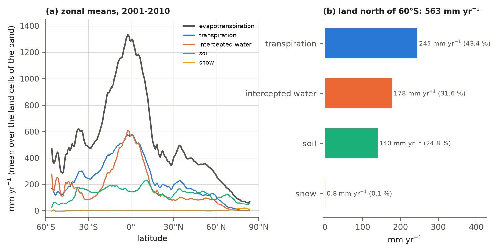
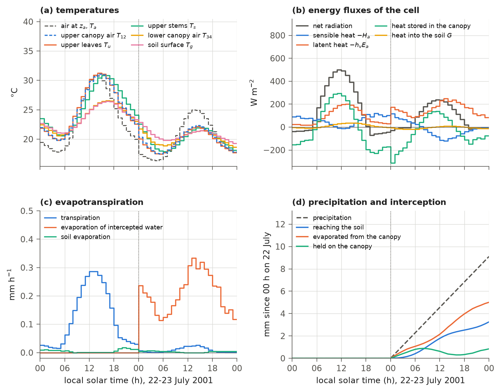

# 5. Surface Energy, Momentum and Water Vapour Fluxes; Canopy Interception (continued)

<!-- reading-nav:start -->
[Chapter index](README.md) · [Back to Part 1](05_surface_fluxes.md) · **Chapter 5, Part 2:** energy balance and evapotranspiration
<!-- reading-nav:end -->

## 5.5 Wetted fractions

Water held on a leaf wets part of its surface. The wet part evaporates freely, while the dry part transpires through its
stomata. The wetted fraction of a canopy surface and the liquid part of it are (`fwetcal`)

```math
x_{liq} = \frac{w_{liq}}{\max\left(w^{max}_{liq}, 0.01\right)}, \quad
x_{tot} = x_{liq} + \frac{w_{sno}}{\max\left(w^{max}_{sno}, 0.01\right)}, \quad
f_{wet} = \min\left(f_{max}, x_{tot}\right), \quad
r_{liq} = \frac{x_{liq}}{\max\left(x_{tot}, \epsilon\right)},
\tag{5.29}
```

where $`f_{wet}`$ is the wetted fraction, at most $`f_{max} = 0.25`$ (`interception.fmax`), so that a soaked canopy still
transpires, and $`r_{liq}`$ is the liquid part of the wetted fraction; where $`f_{wet} = 0`$, $`r_{liq}`$ is 1 if the surface
is at or above the melting point and 0 otherwise. The linear relation makes the store associated with a given wetted area
constant, so evaporation during one step is unlikely to empty it (comment of `canopy.f`). The fractions are computed
twice: before the radiation (Chapter 4), with the stores at the start of the step, and again after interception
(Table 5.1). The second set is used in this chapter and in the photosynthesis (9.23).

## 5.6 The energy and water vapour balance

The energy and water vapour balance is the core of the scheme. The model solves for the nine unknowns in Figure 5.1:
the temperatures of the three canopy surfaces, the two canopy-air nodes and the soil and snow surfaces, and the
humidities of the two air nodes. These values balance energy and water vapour at every surface and air node during
the step (`turvap`). The model solves the linearized balances three times per step. Each iteration first evaluates
the transfer coefficients of section 5.3 and the stomatal conductances of Chapter 9 using the previous iteration's state.

### 5.6.1 Heat capacities and implicit fractions

Leaves and stems store heat, and so does the water they hold. The heat capacities of the canopy surfaces include the
water held after interception,

```math
C_{u} = c_{h,u} + c_{w}\,w_{liq,u} + c_{i}\,w_{sno,u}, \qquad
C_{s} = c_{h,s} + c_{w}\,w_{liq,s} + c_{i}\,w_{sno,s}, \qquad
C_{l} = c_{h,l} + c_{w}\,w_{liq,l} + c_{i}\,w_{sno,l},
\tag{5.30}
```

where $`C_{u}`$, $`C_{s}`$ and $`C_{l}`$ (J m⁻² K⁻¹, per unit surface area) are the heat capacities of the upper leaves,
the upper stems and the lower canopy, and $`c_{h,u}`$, $`c_{h,s}`$ and $`c_{h,l}`$ those of the dry surfaces (Table 5.5).
These equal the heat capacities of 2 kg (leaves) and 50 kg (stems) of liquid water per square metre of surface; the
comment of `params.can` derives them from the specific heat of water.

Water held on a surface near the melting point creates a numerical difficulty (comment of `canopy.f`). A fully implicit
solution would bring the surface close to the temperature at which it exchanges no heat with the air, melting or
freezing too little water. A fully explicit solution could melt or freeze a small store completely and cause an abrupt
change in surface temperature. Each surface temperature is therefore a weighted mean of the implicit solution and the temperature at
the start of the step. For the canopy surfaces and the soil surface the weight, the implicit fraction, is (`impexp`)

```math
\omega^{(1)} = 1, \qquad
\omega^{(i)} = \tfrac{1}{2}\left(\omega^{(i-1)} + \omega_{new}\right), \qquad
\omega_{new} =
\begin{cases}
1 - \min\left(1,\, h_{f}\,W_{sno}/|H|\right) & H > \epsilon', \\
1 - \min\left(1,\, h_{f}\,W_{liq}/|H|\right) & H < -\epsilon', \\
1 & \text{otherwise},
\end{cases}
\qquad H = C\,(T^{(i-1)} - T_{f}),
\tag{5.31}
```

where $`\omega^{(i)}`$ is the implicit fraction of iteration $`i`$, $`T^{(i-1)}`$ (K) the temperature of the previous
iteration, $`H`$ (J m⁻²) the heat in excess of the melting point, $`\epsilon' = \epsilon + 10^{-8}`$, and $`C`$, $`W_{liq}`$
and $`W_{sno}`$ the heat capacity and the liquid and frozen water of the surface. For the canopy surfaces these are (5.30)
and the stores. For the soil surface they are $`C = c_{w}P_{l} + c_{i}P_{i} + [(1 - \phi_{1})\,c_{soil}\,\rho_{soil} + \rho_{w}\phi_{1}(1 - w^{i}_{1})\,w_{1}\,c_{w} + \rho_{w}\phi_{1}\,w^{i}_{1}\,c_{i}]\,\Delta z_{1}`$,
$`W_{liq} = P_{l} + \rho_{w}\phi_{1}(1 - w^{i}_{1})\,w_{1}\,\Delta z_{1}`$ and $`W_{sno} = P_{i} + \rho_{w}\phi_{1}\,w^{i}_{1}\,\Delta z_{1}`$, with the puddle liquid and ice $`P_{l}`$ and $`P_{i}`$ (kg m⁻²), the porosity
$`\phi_{1}`$, the liquid and ice contents $`w_{1}`$ and $`w^{i}_{1}`$ (fractions of the pore space; Chapter 7), the density
and specific heat of the soil solids $`\rho_{soil}`$ and $`c_{soil}`$ (2.9) and the thickness $`\Delta z_{1} = 0.1`$ m of
the top layer.

For the snow surface (`impexp2`)

```math
\omega^{(1)}_{i} = 1, \qquad
\omega^{(i)}_{i} = \min\left[1,\, \max\left(0,\, \frac{T_{f} - T^{o}_{i}}{T^{(i-1)}_{i} - T^{o}_{i}}\right)\right]
\;\; \text{if } T^{(i-1)}_{i} - T^{o}_{i} > \epsilon', \qquad
\omega^{(i)}_{i} = \omega^{(i-1)}_{i} \;\; \text{otherwise},
\tag{5.32}
```

which makes the warming of a snow surface past the melting point explicit. The temperature about which each balance is
linearized is

```math
T^{*}_{v} = \omega_{v}\,T^{(i-1)}_{v} + (1 - \omega_{v})\,T^{o}_{v}, \qquad
q^{*}_{v} = q_{sat}(T^{*}_{v}, p), \qquad
q'_{v} = \min\left[q'_{sat}(T^{*}_{v}, p),\; 0.1\,q^{*}_{v}\right] \qquad (v = u, s, l, g, i),
\tag{5.33}
```

where $`T^{o}_{v}`$ is the temperature at the start of the step, $`T^{(0)}_{v} = T^{o}_{v}`$, and $`q^{*}_{v}`$ and $`q'_{v}`$
(kg kg⁻¹, K⁻¹) are the saturation humidity and its derivative, the latter limited so that a temperature change of up
to 10 K in one iteration cannot give a negative humidity (comment of `canopy.f`). The surface temperature and humidity
that enter the fluxes are

```math
\hat{T}_{v} = \omega_{v}\,T_{v} + (1 - \omega_{v})\,T^{*}_{v}, \qquad
\hat{q}_{v} = q^{*}_{v} + \omega_{v}\,q'_{v}\,(T_{v} - T^{*}_{v}),
\tag{5.34}
```

with $`T_{v}`$ the unknown temperature of the iteration.

### 5.6.2 Humidity of the soil surface

Evaporation from bare soil slows as the top layer dries. The model represents this effect through the soil-surface
specific humidity, calculated as the factor $`\alpha`$ times the saturation humidity at the surface temperature. This
form comes from the "beta" form of soil evaporation (Mahfouf and Noilhan, 1991), converted to the scheme's "alpha" form
(comment of `canopy.f`). The water of the top layer and the puddle, the relative humidity in the soil pores and
the relative humidity of the lower canopy air with respect to the surface are

```math
z_{tot} = a_{p} + (1 - a_{p})\left[(1 - w^{i}_{1})\,w_{1} + w^{i}_{1}\right], \quad
a_{p} = \min\left[\max\left(\frac{a_{max}\,(P_{l} + P_{i})}{P_{max}},\, 0\right),\, a_{max}\right], \quad
h_{1} = \exp\left(\frac{-g\,\psi_{s,1}\,z_{tot}^{-b_{1}}}{R_{v}\,T^{*}_{g}}\right), \quad
h_{2} = \frac{q_{34}}{\max(q^{*}_{g}, \epsilon)},
\tag{5.35}
```

where $`z_{tot}`$ is the water and ice of the top layer and the puddle as a fraction of the pore space and $`a_{p}`$ the
fraction of the surface covered by the puddle, as (7.6), with the puddle capacity $`P_{max}`$ = 10 kg m⁻²
(`soil.wpudmax`) and the cover of a full puddle $`a_{max}`$ = 0.5 (`soil.zwpmax`; Table 7.5). $`h_{1}`$ is the relative
humidity of air in equilibrium with the matric potential of the top layer (Campbell and Norman, 1998), with the
saturated suction $`\psi_{s,1}`$ (m) and the exponent $`b_{1}`$ of the top layer (Table 2.6); $`h_{2}`$ is the relative
humidity of the lower canopy air of the previous iteration with respect to saturation at the surface. With the wetness
factor of the top layer and its correction for the surface energy balance (Milly, 1992),

```math
\beta_{w} = \left\{\min\left[\max\left(\frac{z_{tot} - s_{w,1}}{\max(1 - s_{w,1}, \epsilon)},\, 0\right),\, 1\right]\right\}^{p_{\beta}},
\qquad
\beta_{s} = \frac{\beta_{w}}{1 + \gamma\,(1 - \beta_{w})}, \qquad
\gamma = \frac{h_{v}\,q'_{sat}(T_{34}, p)}{c_{p} + 4\times0.95\,\sigma_{SB}\,T_{34}^{3}/s_{g}},
\tag{5.36}
```

the humidity factor is

```math
\alpha = \beta_{s}\,h_{1} + (1 - \beta_{s})\,h_{2} \;\; (\beta_{s} > 0), \qquad \alpha = h_{2} \;\; (\beta_{s} = 0),
\tag{5.37}
```

where $`s_{w,1}`$ is the wilting point of the top layer as a fraction of its pore space; $`p_{\beta}`$ is the exponent
`canopy.soil_beta_power` (1, as in IBIS 2.6b4); $`\beta_{w}`$ and $`\beta_{s}`$ are the wetness factors before and after
the correction; $`\gamma`$ is the ratio of the latent to the sensible and radiative sensitivity of the surface, with
$`T_{34}`$ of the previous iteration and $`q'_{sat}`$ without the limit of (5.33); and $`\sigma_{SB}`$ is the
Stefan-Boltzmann constant. At the point about which the balance is linearized (using the saturation humidity $`q^{*}_{g}`$ and
the previous iteration's $`q_{34}`$ used to form $`h_{2}`$), the flux $`s_{g}(\alpha\,q^{*}_{g} - q_{34})`$ equals
$`\beta_{s}\,s_{g}(h_{1}\,q^{*}_{g} - q_{34})`$ (comment of `canopy.f`). The evaporation is therefore roughly
proportional to $`\beta_{s}`$, which falls to zero at the wilting point. (The flux of the solution, (5.45), is formed with
$`\hat{q}_{g}`$ and the new $`q_{34}`$, so it is not exactly zero there; and where condensation is expected, $`\alpha = 1`$
by (5.38), the relation does not apply.)

At the wilting point $`h_{1}`$ is still close to 1 (0.996 to 1.000 for sand,
loam and clay at 20 °C), so the control acts through $`\beta_{s}`$. In Figure 5.2f, at $`z_{tot} = 0.5`$, $`\alpha`$ is 0.62
for sand, 0.58 for loam and 0.50 (that is, $`h_{2}`$) for clay, whose wilting point is at 0.57 of the pore space;
$`\gamma = 1.77`$ there. The soils of IBIS have a positive saturated suction, so $`h_{1}`$ lies between 0 and 1, and the
second branch of (5.37) gives the same value as the first. It guards against an overflow of $`h_{1}`$ that cannot occur
with these soils (section 17.4).

**Condensation.** Where canopy-air humidity exceeds the saturation humidity at a surface, the model expects
condensation. It sets the canopy surface's wetted fraction, or the soil's humidity factor, to 1. This calculation also
determines whether the ground can exchange water vapour at all:

```math
\begin{gathered}
f'_{wet,u} = 1 \;\; (q_{12} > q^{*}_{u} + 10^{-10}), \quad
f'_{wet,s} = 1 \;\; (q_{12} > q^{*}_{s} + 10^{-10}), \quad
f'_{wet,l} = 1 \;\; (q_{34} > q^{*}_{l} + 10^{-10}), \quad
\alpha = 1 \;\; (q_{34} > q^{*}_{g} + 10^{-10}), \\
s'_{g} = 0 \;\; (\text{store rule on},\; \tilde{w}_{1} < \epsilon,\; a_{p} < \epsilon,\; q_{34} \le q^{*}_{g} + 10^{-10}), \qquad
s'_{g} = s_{g} \;\; \text{otherwise},
\end{gathered}
\tag{5.38}
```

and otherwise $`f'_{wet} = f_{wet}`$ of (5.29), with $`q_{12}`$ and $`q_{34}`$ of the previous iteration. A wetted fraction of
1 removes the transpiration of the surface in (5.39), so that no water condenses through the stomata. $`\alpha = 1`$ makes
the dew on a dry soil that of a saturated surface rather than the larger amount that $`\alpha < 1`$ would give (comment of
`canopy.f`). Whether a leaf or stem takes up dew depends on the water it holds (section 5.6.3).

**A dry ground with no water to give.** $`s'_{g}`$ (kg m⁻² s⁻¹) is the transfer coefficient of the ground for water
vapour; the sensible heat of the ground always uses $`s_{g}`$. In IBIS 2.6b4, $`s'_{g} = s_{g}`$ everywhere, so the ground
can evaporate even when the top soil layer and the puddle hold no water at all: the humidity factor then falls to
$`h_{2}`$, a surface that warms during the step still raises its humidity $`\alpha\,\hat{q}_{g}`$ above $`q_{34}`$, and the
evaporation is assigned to an empty puddle. IBIS 2.6b4 lets the puddle become negative; IBIS 3.0 resets it to zero,
thereby adding water (sections 7.4 and 7.11). The store rule (`soil.evap_needs_store`) stops evaporation from empty
stores. It does not remove every numerical source of water: the bounds in Chapter 7 can still add water when a step
uses more soil water than is available. In the 2001 diagnostic comparison, total water added in the hyperarid box fell
from 1.64 to 0.80 mm yr⁻¹ with the rule, rather than disappearing (section 7.11; source runs in section 5.12).

With it, $`s'_{g}`$ is zero while the top layer holds no water or ice
($`\tilde{w}_{1} = (1 - w^{i}_{1})\,w_{1} + w^{i}_{1}`$, a fraction of the pore space, below $`\epsilon`$), there is no
puddle ($`a_{p}`$ below $`\epsilon`$) and no condensation is expected. Dew still forms on the same dry ground. The rule is
off by default, which keeps this part of the IBIS 2.6b4 behavior, and on in `params_32a_base.yaml` (Table 5.8).
This review parameter file contains the release values with the changes adopted during the technote review. It is a
starting point for recalibration, not a completed new calibration.

### 5.6.3 Water vapour coefficients of the canopy

Leaves lose water by evaporation from their wet part and by transpiration through the stomata of their dry part.
Stems lose only the water they hold. The coefficients for these pathways, per unit surface area, are

```math
\begin{gathered}
s_{uw} = \min\left[f'_{wet,u}\,s_{u},\; \frac{0.8\,(w_{liq,u} + w_{sno,u})}{\max\left[\Delta t\,(q^{*}_{u} - q_{12}),\, \epsilon\right]}\right], \qquad
s_{ut} = \max\left[0,\; (1 - f'_{wet,u})\,\tfrac{1}{2}\sum_{j=1}^{8}\phi_{j}\,G_{b(j)}\right], \\
s_{sw} = \min\left[f'_{wet,s}\,s_{s},\; \frac{0.8\,(w_{liq,s} + w_{sno,s})}{\max\left[\Delta t\,(q^{*}_{s} - q_{12}),\, \epsilon\right]}\right], \qquad
s_{lw} = \min\left[f'_{wet,l}\,s_{l},\; \frac{0.8\,(w_{liq,l} + w_{sno,l})}{\max\left[\Delta t\,(q^{*}_{l} - q_{34}),\, \epsilon\right]}\right], \\
s^{0}_{lt} = \max\left[0,\; (1 - f'_{wet,l})\,\tfrac{1}{2}\left(G_{ls}\,(\phi_{9} + \phi_{10}) + G_{l4}\,\phi_{11} + G_{l3}\,\phi_{12}\right)\right], \qquad
s_{lt} = \frac{L_{l}}{\max(L_{l} + S_{l},\, \epsilon)}\,s^{0}_{lt},
\end{gathered}
\tag{5.39}
```

where $`s_{uw}`$, $`s_{sw}`$ and $`s_{lw}`$ (kg m⁻² s⁻¹) are the coefficients of the wet parts of the upper leaves, the upper
stems and the lower canopy. They are limited so that one step would evaporate at most 0.8 of the water held, at the
saturation humidity of the iteration and the canopy-air humidity of the previous iteration. $`s_{ut}`$ and $`s_{lt}`$ are
the transpiration coefficients of the dry parts of the upper leaves and of the lower canopy, $`s^{0}_{lt}`$ being that of
the lower leaves alone. $`G_{b}`$ (kg m⁻² s⁻¹) is the conductance of big leaf $`b`$ for water vapour, stomata and leaf
boundary layer in series (9.22): $`G_{b(j)}`$ is that of the broadleaf big leaf for positions $`j`$ = 1, 2, 3, 5 and 7 and
that of the conifer big leaf for positions 4, 6 and 8, and $`G_{ls}`$, $`G_{l3}`$ and $`G_{l4}`$ are those of the shrub,
C3 grass and C4 grass big leaves. $`\phi_{j}`$ is the share of position $`j`$ in the displayed leaf area of its canopy
(`vegetation.frac`; (9.8)). The factor ½ converts the conductance per unit leaf area of Chapter 9 into one per unit
two-sided leaf surface. Position 8, the boreal conifer cold-deciduous trees (larch), transpires with the conifer
conductance, the big leaf in which IBIS 3.0 also computes its photosynthesis (section 9.11, item 7). The stems do not
transpire.

**Dew on leaves and stems.** When the surface is colder than the dew point of its canopy air ($`q^{*}_{v}`$ below the
canopy-air humidity), the denominator of the limit in (5.39) is $`\epsilon`$, so the limit is
$`0.8\,(w_{liq} + w_{sno})/\epsilon`$. It does not restrict a surface that holds water (a nonempty store holds
at least $`w^{min}`$ after (5.25)), but it is zero on a surface that holds none. Dew therefore forms on a leaf or stem only
where the surface already holds intercepted water. A dry surface below the dew point exchanges no water vapour at all,
since $`f'_{wet} = 1`$ of (5.38) also removes its transpiration; the vapour goes to the soil instead, or stays in the
canopy air. This behavior follows IBIS 2.6b4. A test option, `canopy.dew_on_dry` (Table 5.8), applies the limit to evaporation
only, so that dew also forms on dry leaves and stems and enters their stores; its default, 0, keeps the rule of IBIS
2.6b4. The dew on the soil and on the snow surface is not limited.

The latent heat coefficients of the canopy surfaces are

```math
\eta_{u} = s_{uw}\left[r_{liq,u}\,\lambda_{v}(T^{*}_{u}, T_{a}) + (1 - r_{liq,u})\,\lambda_{s}(T^{*}_{u}, T_{a})\right]
+ s_{ut}\,\lambda_{v}(T^{*}_{u}, T_{a}), \qquad
\eta_{s} = s_{sw}\left[r_{liq,s}\,\lambda_{v} + (1 - r_{liq,s})\,\lambda_{s}\right], \qquad
\eta_{l} = s_{lw}\left[r_{liq,l}\,\lambda_{v} + (1 - r_{liq,l})\,\lambda_{s}\right] + s_{lt}\,\lambda_{v},
\tag{5.40}
```

where $`\eta_{u}`$, $`\eta_{s}`$ and $`\eta_{l}`$ (W m⁻² per kg kg⁻¹) multiply the humidity difference between the surface and
its canopy air, the latent heats (5.5) being evaluated at $`T^{*}`$ of the surface and $`T_{a}`$.

### 5.6.4 The balance equations

Each canopy surface gains heat by absorbing radiation and loses heat to its canopy air as sensible and latent heat.
The remaining energy warms or cools the surface. The energy balances of the canopy surfaces, per unit surface area, are

```math
\begin{aligned}
\frac{C_{u}}{\Delta t}\left(T_{u} - T^{o}_{u}\right) &= R_{u} - \Pi_{u} - c_{p}\,s_{u}\left(\hat{T}_{u} - T_{12}\right) - \eta_{u}\left(\hat{q}_{u} - q_{12}\right), \\
\frac{C_{s}}{\Delta t}\left(T_{s} - T^{o}_{s}\right) &= R_{s} - \Pi_{s} - c_{p}\,s_{s}\left(\hat{T}_{s} - T_{12}\right) - \eta_{s}\left(\hat{q}_{s} - q_{12}\right), \\
\frac{C_{l}}{\Delta t}\left(T_{l} - T^{o}_{l}\right) &= R_{l} - \Pi_{l} - c_{p}\,s_{l}\left(\hat{T}_{l} - T_{34}\right) - \eta_{l}\left(\hat{q}_{l} - q_{34}\right),
\end{aligned}
\qquad
R_{u} = \frac{\mathrm{SW}_{u} + \mathrm{LW}_{u}}{2L_{u}}, \;
R_{s} = \frac{\mathrm{SW}_{s} + \mathrm{LW}_{s}}{2S_{u}}, \;
R_{l} = \frac{\mathrm{SW}_{l} + \mathrm{LW}_{l}}{2(L_{l} + S_{l})},
\tag{5.41}
```

where $`R_{u}`$, $`R_{s}`$ and $`R_{l}`$ (W m⁻²) are the solar and net longwave radiation absorbed per unit surface area
((4.18), (4.20), (4.31); zero where the leaf or stem area is below $`\epsilon`$), computed with the temperatures at the
start of the step, and $`\Pi_{u}`$, $`\Pi_{s}`$ and $`\Pi_{l}`$ (W m⁻²) are the heat of the intercepted precipitation
(5.26). The canopy air stores no heat or water, so the fluxes from surfaces and neighbouring air must balance:

```math
\begin{aligned}
0 &= c_{u}\left(\theta T_{a} - T_{12}\right) + c_{l}\left(T_{34} - T_{12}\right) + x_{u}\,s_{u}\left(\hat{T}_{u} - T_{12}\right) + x_{s}\,s_{s}\left(\hat{T}_{s} - T_{12}\right), \\
0 &= c_{l}\left(T_{12} - T_{34}\right) + x_{l}\,s_{l}\left(\hat{T}_{l} - T_{34}\right) + (1 - f_{i})\,s_{g}\left(\hat{T}_{g} - T_{34}\right) + f_{i}\,s_{i}\left(\hat{T}_{i} - T_{34}\right), \\
0 &= c_{u}\left(q_{a} - q_{12}\right) + c_{l}\left(q_{34} - q_{12}\right) + x_{u}\left(s_{uw} + s_{ut}\right)\left(\hat{q}_{u} - q_{12}\right) + x_{s}\,s_{sw}\left(\hat{q}_{s} - q_{12}\right), \\
0 &= c_{l}\left(q_{12} - q_{34}\right) + x_{l}\left(s_{lw} + s_{lt}\right)\left(\hat{q}_{l} - q_{34}\right) + (1 - f_{i})\,s'_{g}\left(\alpha\,\hat{q}_{g} - q_{34}\right) + f_{i}\,s_{i}\left(\hat{q}_{i} - q_{34}\right).
\end{aligned}
\tag{5.42}
```

The soil and snow surfaces have no heat capacity and conduct heat to the top soil and snow layers:

```math
\begin{aligned}
\mathrm{SW}_{g} + \mathrm{LW}_{g} - \zeta_{g}\left(T_{g} - T^{o}_{g}\right) &= c_{p}\,s_{g}\left(T_{g} - T_{34}\right)
+ \lambda_{g}\,s'_{g}\left[\alpha\left(q^{*}_{g} + q'_{g}(T_{g} - T^{*}_{g})\right) - q_{34}\right] + k_{g}\left(T_{g} - T_{soi,1}\right), \\
\mathrm{SW}_{i} + \mathrm{LW}_{i} - \zeta_{i}\left(T_{i} - T^{o}_{i}\right) &= c_{p}\,s_{i}\left(T_{i} - T_{34}\right)
+ \lambda_{i}\,s_{i}\left[q^{*}_{i} + q'_{i}(T_{i} - T^{*}_{i}) - q_{34}\right] + k_{i}\left(T_{i} - T_{sno,1}\right),
\end{aligned}
\tag{5.43}
```

where $`\mathrm{SW}_{g}`$, $`\mathrm{LW}_{g}`$, $`\mathrm{SW}_{i}`$ and $`\mathrm{LW}_{i}`$ (W m⁻²) are the absorbed solar and net
longwave radiation of the soil and the snow ((4.21), (4.22), (4.31)), computed with the surface temperatures at the start
of the step; $`\zeta_{g} = 4 \times 0.95\,\sigma_{SB}(T^{o}_{g})^{3}`$ and $`\zeta_{i} = 4 \times 0.95\,\sigma_{SB}(T^{o}_{i})^{3}`$
(W m⁻² K⁻¹) linearize the change of their emission over the step; $`\lambda_{g}`$ (J kg⁻¹) is the latent heat of the
ground evaporation, (5.5) at the top-layer temperature, with the latent heats of vaporization and sublimation weighted by
the shares of the liquid and frozen stores from which the ground evaporation is drawn (section 7.4; `setsoi`,
`hvasug`); and $`\lambda_{i} = \lambda_{s}(T_{sno,1}, T_{a})`$ is that of the snow (8.3). $`k_{g} = 2\lambda_{1}/\Delta z_{1}`$
(W m⁻² K⁻¹) is the conductance between the soil surface and the middle of the top layer, with the conductivity
$`\lambda_{1}`$ of (6.1), and $`k_{i}`$ is that of the snow (8.2). These two equations are fully implicit in $`T_{g}`$ and
$`T_{i}`$; the implicit fractions $`\omega_{g}`$ and $`\omega_{i}`$ enter through the lower canopy air (5.42) and the fluxes
(5.44)-(5.47), the implicit fraction being regarded as the part of the surface solved implicitly (comment of
`canopy.f`).

Equations (5.41)-(5.43) are nine linear equations in $`T_{u}`$, $`T_{s}`$, $`T_{l}`$, $`T_{12}`$, $`T_{34}`$, $`q_{12}`$, $`q_{34}`$,
$`T_{g}`$ and $`T_{i}`$ (17.2). For every cell, the model solves them by Gaussian elimination without pivoting, following the Fortran loop
order (17.3). Where the canopy surfaces vanish ($`x_{u} + x_{s} + x_{l} < \epsilon`$), the seven equations
of the canopy and the canopy air are replaced by $`T_{u} = T_{s} = T_{l} = T_{12} = T_{34} = \theta T_{a}`$ and
$`q_{12} = q_{34} = q_{a}`$, so that (5.43) is solved against the air of the reference level (section 17.4). In the
release state at the end of 2000 this held in 38,958 land cells, 25,525 of them south of 60°S and 38,747 fully covered
by snow; with the leaf area at the end of July 2001 and no snow it held in 28,709 cells, 25,525 of them south of 60°S
(`make_ch05.py checks`).

### 5.6.5 Fluxes

After the third iteration, the model calculates the step's fluxes from the solution. The sensible heat fluxes are

```math
H_{a} = c_{p}\,c_{u}\left(\theta T_{a} - T_{12}\right), \quad
H_{u} = c_{p}\,s_{u}\left(\hat{T}_{u} - T_{12}\right), \quad
H_{s} = c_{p}\,s_{s}\left(\hat{T}_{s} - T_{12}\right), \quad
H_{l} = c_{p}\,s_{l}\left(\hat{T}_{l} - T_{34}\right), \quad
H_{g} = c_{p}\,s_{g}\left(\hat{T}_{g} - T_{34}\right), \quad
H_{i} = c_{p}\,s_{i}\left(\hat{T}_{i} - T_{34}\right),
\tag{5.44}
```

where $`H_{a}`$ (W m⁻², per unit area of the cell, positive downward; `fsena`) is the flux from the reference level into
the canopy air, and $`H_{u}`$, $`H_{s}`$, $`H_{l}`$, $`H_{g}`$ and $`H_{i}`$ (W m⁻², per unit surface area, positive upward) are
those of the upper leaves, the upper stems, the lower canopy, the soil and the snow. Because the canopy air holds no
heat, $`-H_{a}`$ equals $`x_{u}H_{u} + x_{s}H_{s} + x_{l}H_{l} + (1 - f_{i})H_{g} + f_{i}H_{i}`$, except in the cells whose
canopy rows are replaced (section 5.6.4). $`H_{l}`$ is a diagnostic that no other part of the model reads
(`canopy.fsenl`). The water vapour fluxes are

```math
\begin{gathered}
E_{a} = c_{u}\left(q_{a} - q_{12}\right), \quad
e_{uw} = s_{uw}\left(\hat{q}_{u} - q_{12}\right), \quad
e_{ut} = \max\left[0,\; s_{ut}\left(\hat{q}_{u} - q_{12}\right)\right], \quad
e_{sw} = s_{sw}\left(\hat{q}_{s} - q_{12}\right), \\
e_{lw} = s_{lw}\left(\hat{q}_{l} - q_{34}\right), \quad
e_{lt} = \max\left[0,\; s^{0}_{lt}\left(\hat{q}_{l} - q_{34}\right)\right], \quad
E_{g} = s'_{g}\left(\alpha\,\hat{q}_{g} - q_{34}\right), \quad
E_{i} = s_{i}\left(\hat{q}_{i} - q_{34}\right),
\end{gathered}
\tag{5.45}
```

where $`E_{a}`$ (kg m⁻² s⁻¹, per unit area of the cell, positive downward; `fvapa`) is the flux from the reference level;
$`e_{uw}`$, $`e_{sw}`$ and $`e_{lw}`$ (kg m⁻² s⁻¹, per unit surface area) are the evaporation of the water held on the upper
leaves, the upper stems and the lower canopy (negative for dew); $`e_{ut}`$ and $`e_{lt}`$ are the transpiration per unit
two-sided leaf area of the upper and the lower canopy; and $`E_{g}`$ and $`E_{i}`$ are the evaporation of the soil and of
the snow surface per unit of their areas. Per unit area of the cell, the evaporation of intercepted water, the
evaporation of the soil and the snow surfaces and the transpiration are

```math
E_{w} = x_{u}\,e_{uw} + x_{s}\,e_{sw} + x_{l}\,e_{lw}, \qquad
E_{gs} = (1 - f_{i})\,E_{g} + f_{i}\,E_{i}, \qquad
E_{t,u} = x_{u}\,e_{ut}, \qquad E_{t,l} = 2\,L_{l}\,f_{l}\,(1 - f_{i})\,e_{lt},
\tag{5.46}
```

(kg m⁻² s⁻¹; the energy solver's `ginvap`, `gsuvap`, `gtransu` and `gtransl`). The values retained in
`hydrology` under the same names include the corrections in (5.52): `ginvap` excludes $`D_c`$, and `gsuvap` uses the
bounded ground rate. Because the canopy air holds no water, $`-E_{a}`$ equals
$`E_{w} + E_{gs} + E_{t,u} + E_{t,l}`$, except where a limit at zero of the transpiration acts and in the cells whose
canopy rows are replaced (section 5.6.4), where $`E_{a} = 0`$. The longwave radiation of the soil and the snow and the
upward longwave radiation above the cell (4.30) are corrected for the change of the surface temperatures over the step,

```math
\mathrm{LW}'_{g} = \mathrm{LW}_{g} - \omega_{g}\,\zeta_{g}\left(T_{g} - T^{o}_{g}\right), \qquad
\mathrm{LW}'_{i} = \mathrm{LW}_{i} - \omega_{i}\,\zeta_{i}\left(T_{i} - T^{o}_{i}\right), \qquad
F'_{b} = F_{b} + (1 - f_{i})\,\omega_{g}\,\zeta_{g}\left(T_{g} - T^{o}_{g}\right) + f_{i}\,\omega_{i}\,\zeta_{i}\left(T_{i} - T^{o}_{i}\right).
\tag{5.47}
```

The heat fluxes into the soil surface and into the snow surface are

```math
G_{g} = \mathrm{SW}_{g} + \mathrm{LW}'_{g} - H_{g} - \lambda_{g}\,E'_{g}, \qquad
G_{i} = \mathrm{SW}_{i} + \mathrm{LW}'_{i} - H_{i} - \lambda_{i}\,E_{i}, \qquad
E'_{g} =
\begin{cases}
E_{g} & (1 - f_{i})\,|E_{g}| \le E_{max}, \\
\operatorname{sign}(E_{g})\,E_{max}/\max(1 - f_{i},\, \epsilon) & \text{otherwise},
\end{cases}
\tag{5.48}
```

where $`G_{g}`$ and $`G_{i}`$ (W m⁻²) enter the soil (8.21) and the snowpack (8.4), with $`\mathrm{LW}'`$ and $`H`$ each limited
to ±2000 W m⁻² (section 17.4). $`E'_{g}`$ (kg m⁻² s⁻¹) is the ground evaporation with a bound on its rate per unit area of
the cell, $`E_{max} = 10^{-3}`$ kg m⁻² s⁻¹ (3.6 mm h⁻¹), which IBIS 2.6b4 does not have. The same bounded rate is drawn
from the soil and the puddle (section 7.4), enters the latent heat of (5.48) and is written out as evapotranspiration
(section 5.8), so that water and energy agree wherever the bound acts. It is applied after the solution of
(5.41)-(5.43), so in a step where it acts the canopy-air humidity and $`E_{a}`$ still carry the unbounded rate. This bound
safeguards against runaway values and rarely acts (section 5.12). The roots draw transpired water from the soil layers
(section 7.6), and the heat required to bring it to leaf temperature is drawn from the soil (6.10). Sublimation $`E_{i}`$
changes the top snow layer (8.5).

### 5.6.6 The three iterations

The model repeats the calculation of (5.12)-(5.43) three times in each step (Table 1.3, step 6), as in IBIS 2.6b4,
without testing convergence, and the fluxes (5.44)-(5.48) are those of the third iteration. The stability factors and the
implicit fractions are averaged with those of the previous iteration ((5.14), (5.31)). The stomatal conductance and the
photosynthesis of Chapter 9 are evaluated with the leaf and canopy-air temperatures and humidities of the previous
iteration (of the end of the previous step at the first) and with the leaf boundary-layer coefficients $`s_{u}`$ and
$`s_{l}`$ of the iteration; their values in the third iteration are those of the step. The stomatal conductances that
enter (5.39) are those computed in the same iteration. The solution of the third iteration is the state of the step:
the temperatures and humidities of the canopy air are kept for the first iteration of the next step.

### 5.6.7 The snow surface after the iterations

After the third iteration the snow-surface temperature is limited to the melting point, $`T_{i} \leftarrow \min(T_{i}, T_{f})`$, after the fluxes (5.44)-(5.48) have been evaluated with the unlimited value, as in IBIS 2.6b4.

## 5.7 Evaporation of intercepted water, phase adjustment and absent canopies

Once the fluxes are known, the model updates the water held on the canopy by subtracting the evaporation in (5.45) from
each canopy surface's stores (`cascad2`, `steph2o2`):

```math
w_{liq} \leftarrow w_{liq} - \Delta t\,r_{liq}\,e_{w}, \qquad
w_{sno} \leftarrow w_{sno} - \Delta t\,(1 - r_{liq})\,e_{w}, \qquad
D_{c} = \frac{1}{\Delta t}\sum_{v = u, s, l} x_{v}\left[\max\left(0, -w_{liq,v}\right) + \max\left(0, -w_{sno,v}\right)\right],
\tag{5.49}
```

where $`e_{w}`$ is $`e_{uw}`$, $`e_{sw}`$ or $`e_{lw}`$, $`r_{liq}`$ the liquid part of the wetted fraction after interception,
and $`D_{c}`$ (kg m⁻² s⁻¹, per unit area of the cell) the water that the evaporation took beyond what the stores held,
summed over the three surfaces with their areas $`x_{v}`$ of (5.1) and the stores after the update. This overshoot
can occur because the limit in (5.39) uses the previous iteration's canopy-air humidity and the temperature about which
the balance is linearized. If the solution makes the canopy air drier or the surface warmer, calculated evaporation can
exceed the water in the store. A negative store is set to zero. The evaporation that the stores could
not supply, $`D_c`$, is subtracted from the vapour flux to the atmosphere and from the reported evaporation of
intercepted water (section 5.8). Both IBIS 2.6b4 and IBIS 3.0 correct the total fluxes this way: the upward vapour flux
$`-E_a`$ falls by $`D_c`$, while the upward sensible heat flux $`-H_a`$ rises by its latent heat, (5.5). IBIS 3.0 uses these
corrected totals for hourly tower heat-flux output. The measured overshoot is small (section 5.12).

Liquid on a surface below the melting point then freezes, and snow on a surface above it melts, to the extent allowed by the heat of
the surface and its water:

```math
\begin{aligned}
&T_{v} < T_{f},\; w_{liq} > 0: \quad \delta w = \min\left[w_{liq},\, \max\left(0, \frac{\bar{C}(T_{f} - T_{v})}{h_{f}}\right)\right], \quad
w_{liq} \leftarrow w_{liq} - \delta w, \quad w_{sno} \leftarrow w_{sno} + \delta w, \quad
T_{v} \leftarrow T_{f} - \frac{\bar{C}(T_{f} - T_{v}) - h_{f}\,\delta w}{\bar{C}'}, \\
&T_{v} > T_{f},\; w_{sno} > 0: \quad \delta w = \min\left[w_{sno},\, \max\left(0, \frac{\bar{C}(T_{v} - T_{f})}{h_{f}}\right)\right], \quad
w_{sno} \leftarrow w_{sno} - \delta w, \quad w_{liq} \leftarrow w_{liq} + \delta w, \quad
T_{v} \leftarrow T_{f} + \frac{\bar{C}(T_{v} - T_{f}) - h_{f}\,\delta w}{\bar{C}'},
\end{aligned}
\tag{5.50}
```

where $`T_{v}`$ (K) is the temperature of the surface, $`\bar{C} = c_{h,v} + c_{w}w_{liq} + c_{i}w_{sno}`$ (J m⁻² K⁻¹) its
heat capacity with the stores before the change and $`\bar{C}'`$ with the stores after it; the bands at the melting point
are $`10^{-9}`$ K. An absent surface is assigned a nominal temperature and holds no water (`noveg`):

```math
T_{u} = (1 - f_{i})\,T_{g} + f_{i}\,T_{i}, \quad w_{liq,u} = w_{sno,u} = 0 \qquad \text{where } L_{u} = 0 \text{ or } f_{u} = 0,
\tag{5.51}
```

and likewise the upper stems where $`S_{u} = 0`$ or $`f_{u} = 0`$ and the lower canopy where $`L_{l} + S_{l} = 0`$ or
$`f_{l}(1 - f_{i}) = 0`$. After the soil calculation of the step the temperatures $`T_{u}`$, $`T_{s}`$, $`T_{l}`$ and $`T_{g}`$
are limited to $`T_{a} \pm 40`$ K (section 17.4).

## 5.8 Evapotranspiration and its components

Evapotranspiration is the water the land returns to the air: transpiration, evaporation of intercepted water,
evaporation from the soil and sublimation from the snow. It is one of the model's main outputs for comparison with
observations. The evapotranspiration of a step that IBIS 3.0 adds to its output (`adaet`, `amaet`, `ayaet`) is

```math
ET = \left(E_{w} - D_{c} + E'_{gs} + E_{t,u} + E_{t,l}\right)\Delta t, \qquad E'_{gs} = (1 - f_{i})\,E'_{g} + f_{i}\,E_{i},
\tag{5.52}
```

where $`ET`$ (kg m⁻², or mm) is the water evaporated, sublimated and transpired in the step (`loops_gswp3.py`, the
accumulation after `timestep_body`), $`D_{c}`$ is the overshoot of the canopy stores of (5.49), and $`E'_{gs}`$ the
evaporation of the soil and snow surfaces with the bounded ground rate of (5.48). It excludes evaporation that the
canopy stores could not supply and uses the same ground rate as the soil-water calculation. It can still include
water supplied by numerical safeguards rather than by a physical store; section 7.11 accounts for those amounts.
IBIS 2.6b4 accumulates $`-E_{a}\,\Delta t`$ after the correction of section 5.7 (`stats.f`). The two agree
except where the transpiration is limited at zero in (5.45), in the cells whose canopy rows are replaced, where
$`E_{a} = 0`$, and in a step where the bound of (5.48) acts. With `physics.et_components` on (as in the hindcast of the
release run), the model also accumulates the components (`ibis/state/et_parts.py`; yearly outputs `aytrans`,
`ayinterc`, `aysoilev`, `aysnowsub`):

```math
ET_{t} = (E_{t,u} + E_{t,l})\,\Delta t, \qquad ET_{w} = (E_{w} - D_{c})\,\Delta t, \qquad
ET_{snow} = f_{i}\,E_{i}\,\Delta t, \qquad ET_{soil} = (1 - f_{i})\,E'_{g}\,\Delta t,
\tag{5.53}
```

with the snow cover $`f_{i}`$ at the start of the step, the cover with which the fluxes of the step are computed. The four
components add up to (5.52).

Figure 5.3 shows the components in the hindcast of the release run (to be updated after the final run of
the revised model). Over the land north of 60°S in 2001-2010 the evapotranspiration was 563 mm yr⁻¹, 0.62 of the
precipitation: transpiration 245 mm yr⁻¹ (43.4 %), evaporation of intercepted water 178 mm yr⁻¹ (31.6 %), soil
evaporation 140 mm yr⁻¹ (24.8 %) and net sublimation from snow 0.8 mm yr⁻¹ (0.1 %). The evaporation of intercepted water
was 40.0 % of the 1,090 mm yr⁻¹ between 15°S and 15°N, and the soil evaporation 56.2 % of the 179 mm yr⁻¹ north of
60°N. This division between transpiration and evaporation of intercepted water came from earlier calibration stages and was
not re-evaluated for the release. The hourly energy test discussed in Chapter 16 reports the division for each variant. In every cell the evapotranspiration written out equals the sum of the four components to within
0.004 mm yr⁻¹ (10-year means).

The snow term is net of the water vapour deposited on the snow ($`E_i < 0`$ in (5.45)). The following values are from
the release run, which calculated this term with end-of-step snow cover; they will be updated after the revised model's
final run. Its 10-year mean was negative
in 22,683 of the 69,766 land cells north of 60°S and below −5 mm yr⁻¹ in 5,627 of them. The 25 lowest cells, between
−104 and −74 mm yr⁻¹, are in the wet mountains of Iceland, of southern Alaska and British Columbia and of western
Norway, with 1,180-4,380 mm yr⁻¹ of precipitation. Over the land north of 60°S the positive and the negative cell values
average 1.85 and −1.03 mm yr⁻¹ (`make_ch05.py 5.3`). The soil term can be negative too, where more water vapour is
deposited on the snow-free ground than evaporates from it: in 2001 the release run had a negative yearly soil
evaporation in 71 land cells, 52 of them north of 60°N and 16 south of 60°S, the lowest −28.7 mm yr⁻¹ at 78.75°N,
79.25°W on Ellesmere Island (`make_ch05.py wbal`).



**Figure 5.3** Evapotranspiration and its components in the hindcast of the release run (`final_rel30`, yearly output
2001-2010, `physics.et_components`), (5.52)-(5.53) as recorded by the release code. That code did not subtract the
canopy-store overshoot $`D_{c}`$ from evaporation of intercepted water and calculated snow sublimation with the snow
cover at the end of the step. It also wrote ground evaporation without the bound $`E_{max}`$ of (5.48) (section 5.12).
These release results will be updated after the final run of the revised model. (a) Means over the land cells of each 0.5° band of latitude (bands with at
least five land cells; running mean over three neighbouring bands, of those that hold land). (b) Area-weighted means over
the land north of 60°S, with the share of each component in the evapotranspiration.

## 5.9 Two days at a forest cell

Figure 5.4 follows the canopy exchange hour by hour through a dry and a rainy summer day at a temperate forest: 22 and
23 July 2001 at the cell at 42.75°N, 72.25°W, the same cell as in Figure 4.4. The model, as revised after the release, was run
with the review parameter file (`params_32a_base.yaml`) at this cell from the release state at the end of 2000 to the
end of 21 July 2001, and then through the two days hour by hour (`make_ch05.py 5.4`). With the default `weather.sun_midstep`, the
sun and generated weather are evaluated at the middle of each hour (Chapter 3). The release run used the start of
the hour; setting the switch to false restores that timing. The random numbers
of 22 July are those of Figure 4.4 (those of 23 July are another draw), and the daily routines of the two days
(phenology, decomposition) were not called.

The upper canopy covers $`f_{u} = 0.975`$ of the cell with $`L_{u} = 5.85`$ and $`S_{u} = 1.43`$, almost all of it
temperate conifer evergreen trees (position 4), with its top at 19.92 m and its bottom at 3 m. The lower canopy covers
$`f_{l} = 0.05`$ with $`L_{l} = 0.60`$ in this run, against 0.53 in the release output for June and July 2001 (the value of
section 4.10): this single-cell run uses different random numbers to generate weather, so its weather
and vegetation differ in detail from those of the release. The reference level is at 20.92 m, the displacement
height 13.95 m and the roughness length 1.75 m. The unlimited $`c_{a}`$ was between 2.0 and 7.5 m s⁻¹, so
$`c_{a} = c_{max}`$ in all 48 hours, and $`c_{u}/\rho_{a}`$ was between 0.028 and 0.037 m s⁻¹.

On 22 July (no precipitation, cloud fraction 0.42) the canopy transpired 2.91 mm and the soil evaporated 0.14 mm. The
day-mean net radiation, 157 W m⁻², went to the sensible heat flux (61 W m⁻²; here and below upward positive, as in
Figure 5.4b), the latent heat flux (89 W m⁻²) and the soil (11 W m⁻²). The heat stored in the canopy changed by
−2 W m⁻² over the day, but from hour to hour it ranged from −230 to 296 W m⁻². Most of the heat capacity of the canopy
is in the stems: with (5.30) and Table 5.5 the dry stems hold 5.9 × 10⁵ J m⁻² K⁻¹ per unit area of the cell, the heat
capacity of 139 kg of water, and the leaves 9.6 × 10⁴ J m⁻² K⁻¹ (23 kg). In the step from 12 to 13 h the canopy stored
273 of the 490 W m⁻² of net radiation, and the sensible heat flux was −11 W m⁻² (downward). Between 00 and 06 h the
canopy gave up 113 W m⁻² on average, the stems were 3.4 K warmer than the air, and the sensible heat flux was 80 W m⁻²
upward. In the step from 20 to 21 h the stems were warmest relative to the air, 4.71 K, and the upward sensible heat
flux was largest, 119 W m⁻². The stems, with the heat capacity of IBIS 2.6b4 (`canopy.chs`), store heat by day and
release it at night, so in this run the sensible heat flux of the forest is near zero or downward around midday and
upward through the night. Chapter 16 compares the model's hourly heat fluxes with tower observations.

On 23 July 9.11 mm of rain fell at a constant rate through all 24 hours (one draw of the event length, (3.14)). Of it,
3.26 mm reached the soil, 5.01 mm evaporated from the canopy and 0.84 mm was still held on the canopy at the end of the
day. The wetted fraction of the upper leaves was between 0.16 and $`f_{max}`$ in every hour, and the transpiration fell to
0.22 mm. The evaporation, 154 W m⁻² as latent heat over the day against a net radiation of 82 W m⁻², drew on the heat
of the canopy (−46 W m⁻²) and on the air: the sensible heat flux was −18 W m⁻² over the day and −114 W m⁻² from 12 to
13 h.

Over the two days $`-E_{a}`$ equalled the evapotranspiration of (5.52) to within 0.001 mm a day; no canopy store
overshot its water and the bound of (5.48) did not act. The energy balance of the cell, net radiation less the four
terms of Figure 5.4b, left a residual of −2.4 and −2.1 W m⁻² as day means and at most 5.9 W m⁻² in one hour. The
residual comes from the heat of intercepted precipitation and the difference between the latent heats (5.5) used in the
balances and the constant $`h_{v}`$ used in the figure.



**Figure 5.4** The canopy exchange of 22 and 23 July 2001 at the cell at 42.75°N, 72.25°W, in a run of the revised
model with the review parameter file (`params_32a_base.yaml`, before recalibration) at this cell from the release state at the end of 2000
(`make_ch05.py 5.4`), recorded inside the model's time step. In (a)–(c), each value is drawn over the hour of its
step; (d) shows running totals and the canopy store at the end of each step. The sun and generated weather use the
middle of the hour. (a) The weather generator's hourly air temperature at the reference level, $`T_a`$ (grey dashed),
and the temperatures of the third iteration, (5.41)-(5.43), of the upper and lower canopy air, $`T_{12}`$ (blue dashed; it
differs from $`T_{u}`$ by at most 0.43 K) and $`T_{34}`$, of the upper leaves $`T_{u}`$, of the upper stems $`T_{s}`$ and of the
soil surface $`T_{g}`$; $`T_{l}`$ is not shown. (b) The net radiation of the cell, the sensible and latent heat fluxes at
the reference level, $`-H_{a}`$ and $`-h_{v}E_{a}`$ (upward positive), the heat stored in the canopy
($`\sum_{v} x_{v}C_{v}(T_{v} - T^{o}_{v})/\Delta t`$ over the three canopy surfaces) and the heat flux into the soil. (c)
The components of evapotranspiration as recorded by the model, (5.46) and (5.52). (d) The precipitation since 00 h on
22 July, the part that reached the soil level, the part that evaporated from the canopy, and the water held on the
canopy, per unit area of the cell.

## 5.10 Parameters and switches

**Table 5.5** Parameters of the canopy exchange (section `canopy` of the parameter file; the release values equal those
of `params.can` of IBIS 2.6b4). The interception parameters are in Table 5.4; the test options `canopy.za_above_top`,
`canopy.ca_cap` and `canopy.dew_on_dry` of the same section are in Table 5.8.

| Parameter | Symbol | Value | Units | Meaning |
|---|---|---|---|---|
| `cleaf` | $`C_{leaf}`$ | 0.01 | m s⁻¹ᐟ² | transfer coefficient of the upper leaves (5.20) |
| `cstem` | $`C_{stem}`$ | 0.01 | m s⁻¹ᐟ² | transfer coefficient of the upper stems (5.20) |
| `cgrass` | $`C_{grass}`$ | 0.01 | m s⁻¹ᐟ² | transfer coefficient of the lower canopy (5.20) |
| `dleaf` | $`D_{leaf,l}`$, $`D_{leaf,u}`$ | 0.10, 0.10 | m | linear dimension of the leaves (lower, upper) |
| `dstem` | $`D_{stem,l}`$, $`D_{stem,u}`$ | 0.10, 0.10 | m | linear dimension of the stems (lower, upper; the lower value is not used) |
| `alaiml`, `alaimu` | $`\Lambda_{l}`$, $`\Lambda_{u}`$ | 8.0, 8.0 | m² m⁻² | two-sided leaf and stem area of a dense layer (5.8) |
| `chu` | $`c_{h,u}`$ | 8436 | J m⁻² K⁻¹ | heat capacity of the upper leaves per unit surface area (5.30) |
| `chs` | $`c_{h,s}`$ | 2.109 × 10⁵ | J m⁻² K⁻¹ | heat capacity of the upper stems per unit surface area |
| `chl` | $`c_{h,l}`$ | 8436 | J m⁻² K⁻¹ | heat capacity of the lower canopy per unit surface area |
| `soil_beta_power` | $`p_{\beta}`$ | 1 (code default; not in the file) | – | exponent of the soil wetness factor (5.36) |

**Table 5.6** Constants of the code. They are those of IBIS 2.6b4, except the bound on the ground evaporation and the
bands of the tests, which IBIS 2.6b4 does not have (section 5.11).

| Value | Meaning | Equation |
|---|---|---|
| $`\sigma`$ = 0.999 | pressure at the reference level relative to the surface pressure | (5.6), (5.7) |
| 0.4, 0.1 | drag and mixing-length factors | (5.9) |
| 0.7 | displacement height relative to the layer top | (5.10) |
| $`z_{0,g}`$ = 0.005 m, $`z_{0,i}`$ = 0.0005 m | roughness lengths of soil and snow | (5.10), (5.11) |
| −2, 1 | limits of the Richardson number | (5.12) |
| 10, 15, 75, 5 | constants of the stratification factors | (5.13) |
| ½ | weight of the new stratification factors and implicit fractions | (5.14), (5.31) |
| 0.01 m s⁻¹ | least wind speed in the canopy | (5.17) |
| $`c_{max} = 300/(2\Delta t)`$ m s⁻¹ | upper limit of $`c_{a}`$ (unless lifted, Table 5.8) | (5.18) |
| 0.004 + 0.012 $`u_{4}`$, 0.003 + 0.010 $`u_{4}`$ m s⁻¹ | soil and snow surface transfer velocities | (5.21) |
| 0.2, 20, 0.02 K | relaxation, passes and tolerance of the wet-bulb iteration | (5.23) |
| $`w^{min}_{liq} = 0.001\,(\Delta t/3600\ \mathrm{s})(w^{max}_{liq,u}/0.2)`$, $`w^{min}_{sno} = 0.001\,(\Delta t/3600\ \mathrm{s})(w^{max}_{sno,u}/2)`$ kg m⁻² | smallest stores kept, the same for all surfaces (0.001 kg m⁻² in the release) | (5.25) |
| 0.1 $`q^{*}`$ | upper limit of the humidity derivative | (5.33) |
| 0.95 | emissivity of soil and snow | (5.36), (5.43) |
| 0.8 | largest part of a canopy store evaporated in one step | (5.39) |
| $`E_{max}`$ = 10⁻³ kg m⁻² s⁻¹ | bound on the ground evaporation per unit area of the cell | (5.48) |
| $`10^{-10}`$ kg kg⁻¹, $`10^{-9}`$ K, $`10^{-8}`$ | bands of the humidity, melting-point and implicit-fraction tests | (5.26), (5.31), (5.38) |
| $`\epsilon = 10^{-7}`$ | small number of the code | throughout |

**Table 5.7** Physical constants (`ibis/constants.py`, from `inisurf` in `initial.f` of IBIS 2.6b4).

| Symbol | Value | Meaning |
|---|---|---|
| $`T_{f}`$ | 273.16 K | melting point |
| $`h_{v}`$, $`h_{f}`$, $`h_{s}`$ | 2.5104 × 10⁶, 0.3336 × 10⁶, 2.844 × 10⁶ J kg⁻¹ | latent heats of vaporization, fusion and sublimation |
| $`c_{w}`$, $`c_{i}`$ | 4218, 2106 J kg⁻¹ K⁻¹ | specific heats of liquid water and ice |
| $`c_{pd}`$, $`c_{vap}`$ | 1004.64, 1810 J kg⁻¹ K⁻¹ | specific heats of dry air and water vapour |
| $`R_{d}`$, $`R_{v}`$ | 287.04, 461.0 J kg⁻¹ K⁻¹ | gas constants of dry air and water vapour |
| $`\kappa`$ | $`R_{d}/c_{pd}`$ = 0.2857 | |
| $`g`$ | 9.80616 m s⁻² | acceleration of gravity |
| $`k`$ | 0.4 | von Kármán constant |
| $`\sigma_{SB}`$ | 5.67 × 10⁻⁸ W m⁻² K⁻⁴ | Stefan-Boltzmann constant |
| $`\rho_{w}`$ | 1000 kg m⁻³ | density of water |

**Table 5.8** Switches and options that act on the calculations of this chapter. Default: the value used by the code when
the parameter file (or, for the `physics` switches, the run configuration) does not set it. Release run: the setting of
the release run. An asterisk marks a switch added after the release; its Release column gives the setting that
reproduces that part of the release code. The defaults leave these options in their IBIS 2.6b4 form, except for
`weather.sun_midstep`; other model differences remain (section 5.11). The review parameter file
(`params_32a_base.yaml`) sets `soil.evap_needs_store` to true and leaves the others at their defaults. The test options
exist for the hourly energy test at flux towers (section 5.12) and are not meant for production runs until that test
adopts them.

| Switch | Default | Release run | Meaning |
|---|---|---|---|
| `physics.et_components` | false | true in the hindcast | accumulate the components of evapotranspiration, (5.53); outputs only (run configuration, Table 1.7) |
| `physics.water_balance`* | false | false | yearly water-conservation output, with counts of the steps on which the bound of (5.48) acts and on which a canopy store overshoots, (5.49) (section 7.11); outputs only (run configuration) |
| `canopy.soil_beta_power` | 1 | 1 | exponent $`p_{\beta}`$ of the soil wetness factor, (5.36); 1 is IBIS 2.6b4 |
| `soil.evap_needs_store`* | false | false | the store rule: no ground evaporation when neither the top soil layer nor the puddle holds water, (5.38) |
| `canopy.za_above_top`* | 1 m | 1 m | least height $`\Delta z_{a}`$ of the reference level above the canopy top, (5.7); test option |
| `canopy.ca_cap`* | 1 | 1 | 0 lifts the limit $`c_{max}`$ of (5.18); test option |
| `canopy.dew_on_dry`* | 0 | 0 | above 0, dew also forms on dry leaves and stems, (5.39); test option |
| `weather.wind_keep_mean`* | false | false | hourly wind draws rescaled to keep the day's mean wind, which lets the hourly wind leave the range 2.5-10 m s⁻¹ (Chapter 3); test option |
| `weather.sun_midstep`* | true | false | sun and generated weather at the middle of each step (Chapter 3); false is IBIS 2.6b4 |

The limits of section 17.4 that act on the fluxes and temperatures of this chapter take their values from the
environment variables `IBIS_FLUX_MAX` (default 2000 W m⁻²) and `IBIS_T_MAX_DEV` (default 40 K) when these are set. No
launch script of the repository sets them. The global driver (`scripts/run_global.py`) writes both values to the run
log at start-up; the release run did not yet do so and is assumed to have used the defaults (section 17.4).

## 5.11 Differences from IBIS 2.6b4

The routines of this chapter were checked against `canopy.f`, `comsat.h`, `main.f` (`lsxmain`) and `stats.f` of IBIS
2.6b4 and against `params.can`. The equations, constants and order of the calculations are those of IBIS 2.6b4. The time
step that contains them was verified against the Fortran in double precision (section 17.9); one difference inside the
canopy calculation is still unexplained (section 5.12). The differences are:

1. **Guards shared with the reference Fortran.** The replacement of the canopy rows where the canopy surfaces vanish
   (section 5.6.4), the humidity factor $`\alpha = h_{2}`$ at $`\beta_{s} = 0`$ (5.37) and the bands of $`10^{-10}`$ kg kg⁻¹,
   $`10^{-9}`$ K and $`10^{-8}`$ in the tests of (5.26), (5.29), (5.31), (5.32), (5.38) and (5.50) were made in the port
   and in the copy of the Fortran used for the verification alike (section 17.4); the distributed IBIS 2.6b4 does not
   have them.
2. **Limits that IBIS 2.6b4 does not have** (Table 17.4): ±2000 W m⁻² on $`\mathrm{LW}'_{g}`$, $`H_{g}`$,
   $`\mathrm{LW}'_{i}`$ and $`H_{i}`$ in (5.48); the bound $`E_{max}`$ on the ground evaporation of (5.48), which applies alike
   to the soil water, the latent heat of the ground and the evapotranspiration written out; and $`T_{a} \pm 40`$ K on
   $`T_{u}`$, $`T_{s}`$, $`T_{l}`$ and $`T_{g}`$ at the end of the step.
3. **Exponent of the soil wetness factor**, $`p_{\beta}`$ in (5.36) (`canopy.soil_beta_power`), which IBIS 2.6b4 does not
   have; at its value of 1 the factor is that of IBIS 2.6b4.
4. **The largest wetted fraction** $`f_{max}`$ is a file parameter (`interception.fmax`); it is a constant in `fwetcal`
   in IBIS 2.6b4; the release value is the same, 0.25.
5. **The puddle cover of the soil-surface humidity**, $`a_{max}`$ in (5.35), is the parameter `soil.zwpmax`, which also
   sets the evaporation shares of section 7.4. IBIS 2.6b4 reads `zwpmax` for the shares only and writes 0.5 into the
   humidity; with the value of 0.5 the two agree.
6. **Position 8 (larch)** transpires and assimilates in the conifer big leaf, (5.39) and section 9.11 item 7; IBIS
   2.6b4 uses the broadleaf leaf for both.
7. **The store rule** (`soil.evap_needs_store`, (5.38)) and the **test options** `canopy.za_above_top`, `canopy.ca_cap`
   and `canopy.dew_on_dry` (Table 5.8) do not exist in IBIS 2.6b4. At their defaults these options leave the corresponding
   calculations unchanged from IBIS 2.6b4.
8. **Evapotranspiration written out**: the sum of the components, (5.52), net of the canopy-store overshoot $`D_{c}`$,
   instead of $`-E_{a}`$ with the same correction (`stats.f`). The two agree except where the transpiration is limited at
   zero, in the cells whose canopy rows are replaced and where the bound of (5.48) acts. IBIS 3.0 writes no sensible or
   latent heat flux in its global output. In the two days of section 5.9 the two definitions agreed.
9. **Components of the evapotranspiration**, (5.53), which IBIS 2.6b4 does not accumulate apart from the transpiration.
10. **The lower-canopy sensible heat** $`H_{l}`$ of (5.44) is evaluated against $`T_{34}`$, the air the lower canopy
    exchanges with; IBIS 2.6b4 evaluates it against $`T_{12}`$. No part of either model reads it.
11. **A dry top layer beneath a puddle.** The evaporation shares of section 7.4 now sum to one, so the latent heat
    $`\lambda_g`$ in (5.43) is the weighted mean for the puddle's liquid and ice. IBIS 2.6b4 scales it by the puddle
    cover $`a_p \le 0.5`$ (section 7.13). The puddle capacity $`P_{max}`$ in (5.35) is 10 kg m⁻² in the release parameter
    set, compared with 4.5 kg m⁻² in IBIS 2.6b4.

## 5.12 Notes for developers

The following implementation notes are for readers working on the code. The routines are in `ibis/physics/canopy_exchange.py`
(`canini`, `fstrat`, `turcof`, `impexp`, `impexp2`, `turvap`), `ibis/physics/interception.py` (`fwetcal`, `cascade`,
`steph2o`, `twet3`, `mix`, `cascad2`, `steph2o2`, `noveg`) and `ibis/physics/thermo.py` (saturation vapour pressure
and latent heats). These port `canopy.f` and `comsat.h` of IBIS 2.6b4; `timestep_body` in `ibis/timestepping/loops.py`
calls them in the order of Table 5.1.

The notes below record changes to this chapter's code after the release
(code `e54e342`, run `final_rel30`). The current documentation is aligned with `c6698fd`, which includes the
`review-d25` changes. Sources are the review's `decisions_taken.md`, `docs/CALIBRATION.md` section 87 and
`docs/DEFECTS_FOR_REVIEW.md`. Recalibration is still pending. A preliminary 310-year protocol run finished on
2 November 2026 (`verify_outputs/prelim_d25`); it is not the final run, which follows recalibration. The test year
cited below is one global year, 2001, of the revised code with the review parameters
and `physics.water_balance` on, started from a copy of the release hindcast's state at the end of 2000
(`verify_outputs/step2_wbal_2001_d25b`; `make_ch05.py wbal`).

- **The store rule (D25; commit b2d2cca).** `turvap` sets the ground's vapour coefficient `sgq` to zero in `setsoi`'s
  fourth case (no soil water, no puddle) unless condensation is expected; the sensible heat keeps `sg`. Switch
  `soil.evap_needs_store` (a static `SimParams` field): code default false (IBIS 2.6b4), true in `params_32a_base.yaml`.
  Reason: IBIS 2.6b4 let the surface humidity follow the ground's warming and assigned evaporation to the empty puddle,
  which IBIS 3.0's puddle floor then refilled, adding water. Without and with the rule (`verify_outputs/step2_wbal_2001`
  and `step2_wbal_2001_d25b`), the water added by the puddle floor fell from 0.81 to 0.00 mm yr⁻¹ and ET from
  30.5 to 29.7 mm yr⁻¹. These are unweighted means over the 598 cells in the hyperarid box of section 7.11
  (16.25–27.75°N, 28.75–42.25°E). The water added by `wadjust` (0.84 to 0.80 mm yr⁻¹) remains, as decided.
- **One bounded ground evaporation (D28; e6c70cb).** `loops.bounded_ground_evaporation` applies the bound of finding 27
  ($`E_{max}`$ of (5.48)) to the latent heat in `heatg`, to the soil water and to the recorded `gsuvap`; bit-identical where
  it does not act. In the release code only the soil water was bounded, so the latent heat and the ET output carried
  water that never left the soil wherever the bound acted. In the test year the bound acted on no step in any of the
  95,333 land cells.
- **Evapotranspiration bookings (D44; e6c70cb).** `hydrology.ginvap` is now `turvap`'s value less the overshoot $`D_{c}`$
  that `steph2o2` subtracts from the upward vapour flux (as IBIS 2.6b4's `-fvapa`, `stats.f:406`), and `et_parts_step`
  (`loops_gswp3.py`) records snow sublimation using the snow cover at the start of the step, with which `gsuvap` is
  formed. The release code discarded the correction and used the cover at the end of the step. Diagnostics only. In the
  test year the overshoot occurred in 59,028 land cells on a median of 28 steps a year, 0.0009 mm yr⁻¹ over the land
  north of 60°S and at most 0.47 mm yr⁻¹ in one cell. The sublimation of 150 cells north of 30°N in 2001 is 1.80 mm yr⁻¹
  with the start-of-step cover against 1.82 mm yr⁻¹ with the end-of-step cover (largest cell difference 0.15 mm yr⁻¹;
  `make_ch05.py snowsub`; the release code gave 1.81 against 1.84 in the same comparison). The negative yearly soil
  evaporation of section 5.8 is not an effect of the booking: the same 71 cells have it in the test year.
- **Larch transpiration (D47; 307d0f8).** `turvap` weights `frac[:, 7]` with the conifer conductance `totconduc`, as the
  GPP and NPP of position 8 already used the conifer leaf; no switch. Reason: water use and carbon gain of one position
  came from two different big leaves. The conifer assignment (CALIBRATION 17) remains a departure from IBIS 2.6b4, which
  puts position 8 in the broadleaf leaf for both. Position 8 held 0.05 % of the upper-canopy leaf area at the end of 2010
  in the release run (D47 review evidence), suggesting a small contribution to global totals. This does not imply
  a small effect where larch dominates: at eight deciduous needleleaf towers, the revised code's median ET/tower
  ratio is 0.13 higher than the release's (`diag_work/step2/cmp_abl_all.txt`). The non-switchable fixes include this
  change, so the comparison does not isolate D47 alone. Chapter 16 discusses the attribution.
- **Puddle cover of the soil-surface humidity (D89; e6c70cb).** `turvap` takes `zwpmax` from `soil.zwpmax`, as `setsoi`
  does; `canopy.f:816` writes 0.5. Bit-identical at 0.5.
- **Lower-canopy sensible heat (D90; e6c70cb).** `fsenl` is evaluated against `t34`; `canopy.f:1279` used `t12`. No part of the model
  reads this diagnostic. With this correction, the surface fluxes add up to $`-H_{a}`$ (section 5.6.5).
- **Energy-test options (D5, D7, D14, D24; 8416c20).** `canopy.za_above_top` (1.0), `canopy.ca_cap` (1.0),
  `canopy.dew_on_dry` (0.0) and `weather.wind_keep_mean` (false), all off by default and bit-identical when off
  (`tests/test_review_energy_variants.py`); D14's smaller stem heat capacity is the existing `canopy.chs`. They serve the
  hourly energy-balance test at forest and grassland towers (FLUXNET half-hourly sensible and latent heat, net radiation
  and ground heat flux): a variant is adopted only if it improves hourly H and LE without worsening monthly GPP and ET
  (model/observation ratios by plant type and month), and the transpiration share of evapotranspiration is reported for
  each (D6). Tower runs write the hourly H, LE and net radiation for it (`loops_gswp3.surface_energy_fluxes`:
  H = −`fsena`, LE = −2.45 × 10⁶ `fvapa` after the correction of section 5.7).
  All 624 energy-test runs finished on 2 November 2026; Chapter 16 reports the comparison and its limitations.
- **Mid-step sun (D33; 8416c20).** `weather.sun_midstep`, default true: a step's sun and generated weather are evaluated
  at the middle of the step, not at its start as in the release, which moves the hourly fluxes of this chapter half an
  hour earlier. Figure 5.4 is drawn with it.
- **Case-3 evaporation shares (D52; e6c70cb).** With a dry top layer and a puddle, `setsoi`'s shares now sum to 1, so
  $`\lambda_{g}`$ in (5.43) is a weighted mean of the latent heats in every case; IBIS 2.6b4 scaled it by $`a_{p} \le 0.5`$
  there (section 7.4).
- **Bound limits logged (D69; e6c70cb).** `run_global.py` logs `IBIS_FLUX_MAX` and `IBIS_T_MAX_DEV` at start-up; they
  are still environment variables, and their activations are not counted. The water-balance module
  (`physics.water_balance`, D70) counts the steps of the ground-evaporation bound (`n_bound`, `ay_w_bound`), of the
  excess ground snowfall (`n_snow`) and of the canopy-store overshoot (`n_cdef`, `ay_w_cdef`).
- **Verification harness (D62; bed0ae7).** Both codes now run with IBIS 2.6b4's own soils, solids, snow constants and
  existence flags (`verify/STATUS.md`, Harness settings). The guard $`\alpha = h_{2}`$ of (5.37) stays; the overflow it
  prevents (finding 26) came from the harness's negative saturated suction, not from IBIS 2.6b4. One difference remains unresolved: at 55°N 40°E on
  23 March 1951, 09 h (full snow cover, upper leaves at 273.16 K holding snow and liquid), the codes agree to
  1.4 × 10⁻¹¹ before the step and differ by 1.5 × 10⁻² K in the canopy air after it. Radiation and the cascade agree;
  the difference arises in the canopy stage (`canini`, `turcof`, the stomata and three passes of `turvap`) from
  identical inputs and is not rounding. Locating its source requires the per-iteration drill
  `verify/timestepping/pipeline/drill_canopy_iters.py`, which first needs updating to the current loop.
- **Comments (D97; 8416c20).** `constants.py` and the port's `fortran/src/modules/mod_constants.f90` now name
  `inisurf` (`initial.f`) as the source of the constants. The reference IBIS 2.6b4 sources are unchanged.
- **Kept as they are (D46).** Upper-canopy tops reach 154.5 m in the release state, and the reference level follows
  (section 5.2.2); a bound on the tree height is left to a later revision of the vegetation structure.
- **Figures.** Figure 5.4 is regenerated from `c6698fd` with `params_32a_base.yaml`; its inherited rendering used
  `75d8935`. Figure 5.3 shows the release run. Figure 5.2 uses the code defaults, which retain the IBIS 2.6b4 behavior
  of the routines and parameter choices plotted there. This does not assert that the complete models are identical.

## References

Campbell, G. S., and J. M. Norman, 1998: *An Introduction to Environmental Biophysics*, 2nd ed. Springer, New York.

Louis, J.-F., 1979: A parametric model of vertical eddy fluxes in the atmosphere. *Boundary-Layer Meteorology*, 17,
187-202.

Louis, J.-F., M. Tiedtke, and J.-F. Geleyn, 1982: A short history of the PBL parameterization at ECMWF. *Proceedings of
the ECMWF Workshop on Planetary Boundary Layer Parameterization*, Reading, 25-27 November 1981, 59-79.

Lowe, P. R., 1977: An approximating polynomial for the computation of saturation vapor pressure. *Journal of Applied
Meteorology*, 16, 100-103.

Mahfouf, J.-F., and J. Noilhan, 1991: Comparative study of various formulations of evaporation from bare soil using in
situ data. *Journal of Applied Meteorology*, 30, 1354-1365.

Milly, P. C. D., 1992: Potential evaporation and soil moisture in general circulation models. *Journal of Climate*, 5,
209-226.

Norman, J. M., W. P. Kustas, and K. S. Humes, 1995: Source approach for estimating soil and vegetation energy fluxes in
observations of directional radiometric surface temperature. *Agricultural and Forest Meteorology*, 77, 263-293.

Pollard, D., and S. L. Thompson, 1995: Use of a land-surface-transfer scheme (LSX) in a global climate model: the
response to doubling stomatal resistance. *Global and Planetary Change*, 10, 129-161.

<!-- reading-nav:start -->
[Chapter index](README.md) · [Back to Part 1](05_surface_fluxes.md) · **Chapter 5, Part 2:** energy balance and evapotranspiration
<!-- reading-nav:end -->
