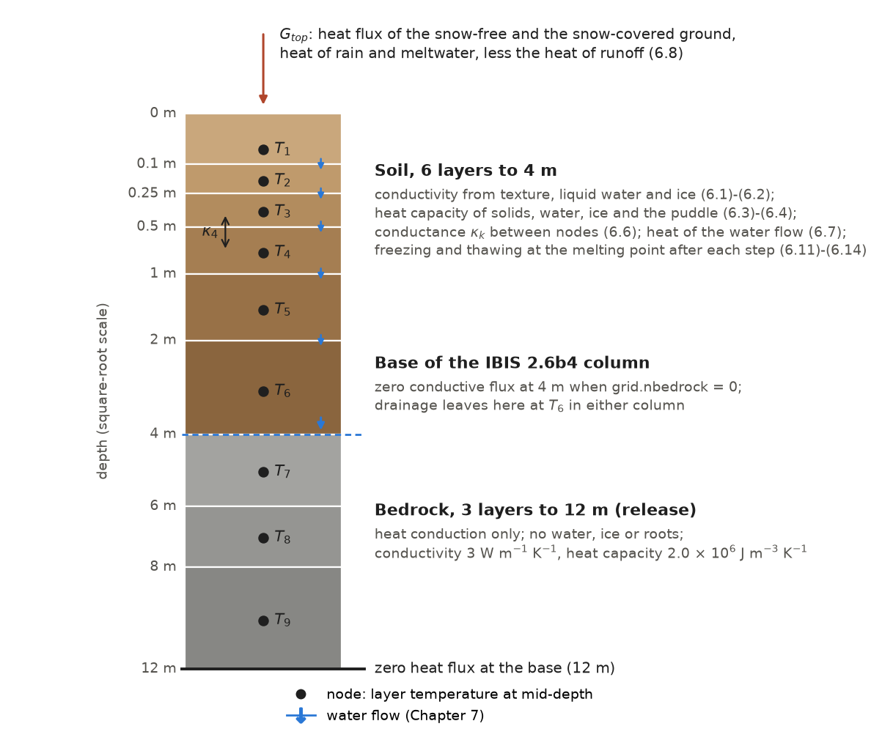
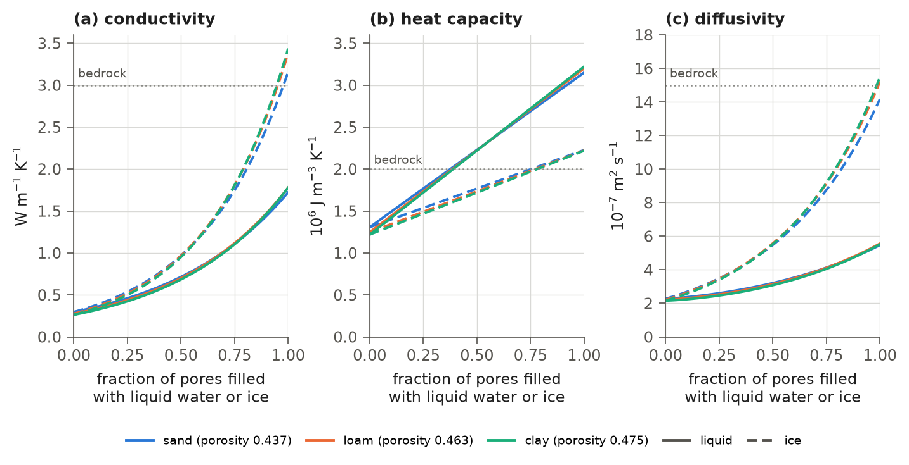
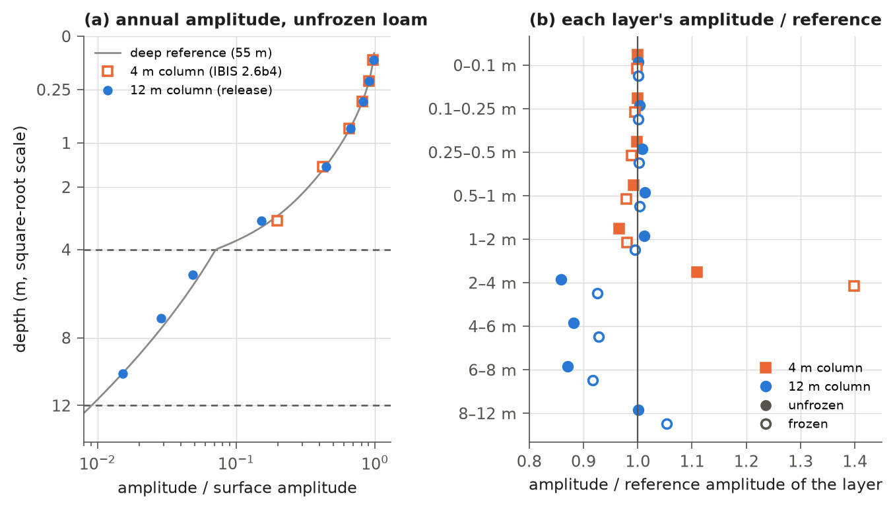
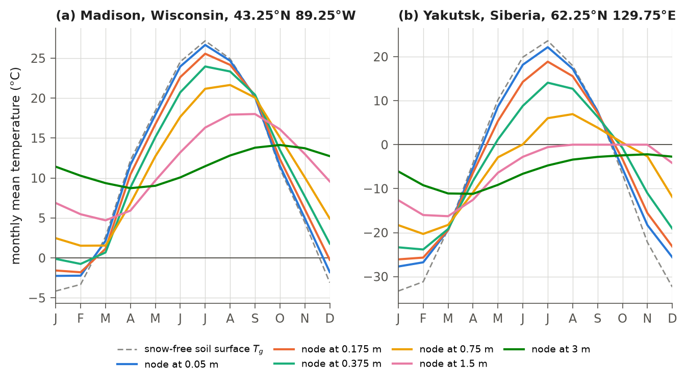

# 6. Soil and Bedrock Temperature

Soil temperature controls whether soil water is liquid or frozen, how fast soil organic matter decomposes (Chapter 12)
and how much methane wetlands produce (Chapter 14). The soil also stores heat in summer and releases it in winter.
This chapter describes how IBIS 3.0 calculates each soil layer's temperature from the heat entering the top of the column,
conduction between layers, heat carried by water flowing between layers, and the latent heat of freezing and thawing. In the release, the soil column of IBIS 2.6b4 (six layers to 4 m)
rests on three bedrock layers that conduct heat and hold no water. The base of the column, through which no heat is
conducted, therefore lies at 12 m instead of 4 m.

The chapter covers the thermal properties of the layers, the heat equation and its boundary conditions, the freezing
and thawing of soil water and of the puddle, and the bedrock layers. The soil water is described in Chapter 7, and the
snowpack, whose base exchanges heat with the top soil layer, in Chapter 8. Section 6.11 maps these calculations to
their implementation and records the changes after the release.

## 6.1 The soil and bedrock column

The model represents the ground as a stack of layers, each assigned one temperature. This section describes the layers.

The column has $`K`$ layers, numbered from 1 at the surface: the six soil layers of Table 1.2 ($`K = 6`$) and, when
`grid.nbedrock` is 3 (default 0; 3 in the release), three bedrock layers below them ($`K = 9`$; Figure 6.1). Each layer
has one temperature $`T_{k}`$ (K), represented in the heat equation at the layer's midpoint (the
node), at depths of 0.05, 0.175, 0.375, 0.75, 1.5 and 3.0 m in the soil and 5, 7 and 10 m in the bedrock. The soil
layers hold liquid water and ice, described by the liquid content $`w_{k}`$ and the ice content $`w^{i}_{k}`$ of Chapter 7
(Table 7.1). The top layer also carries the puddle, whose liquid $`P_{l}`$ and ice $`P_{i}`$ (kg m⁻²) share the
temperature of that layer. The bedrock layers hold no water, ice, roots or carbon. The variables of this chapter are
listed in Table 6.1.



**Figure 6.1** The column of the soil temperature calculation in the release: six soil layers to 4 m and three bedrock
layers to 12 m (Table 1.2), drawn on a square-root depth scale. Each layer has one temperature at its node (dots). Heat
enters the top as $`G_{top}`$ (6.8), moves between nodes by conduction with conductance $`\kappa_{k}`$ (6.6), is carried by
water flowing between soil layers (blue arrows, Chapter 7; equation 6.7), and is exchanged during freezing and thawing
after each step. With `grid.nbedrock` = 0 the column ends at 4 m with no conductive flux through its base, as in
IBIS 2.6b4; in either column the drainage leaves the soil at its base with the temperature $`T_{6}`$. The dashed line
marks the base of the IBIS 2.6b4 column, not a water pathway into the bedrock.

**Table 6.1** Variables of the soil temperature calculation.

| Symbol | Code | Description | Units |
|---|---|---|---|
| $`T_{k}`$, $`k \le 6`$ | `soil.tsoi` | temperature of soil layer $`k`$ | K |
| $`T_{k}`$, $`k = 7, 8, 9`$ | `soil.tsoi_deep` | temperature of bedrock layer $`k - 6`$ (present when `grid.nbedrock` = 3) | K |
| $`\lambda_{k}`$ | `soil.consoi` | thermal conductivity of soil layer $`k`$ | W m⁻¹ K⁻¹ |
| $`C_{k}`$ | `c0`, `c1` in `soilheat` | heat capacity of layer $`k`$ per unit area | J m⁻² K⁻¹ |
| $`F_{k}`$ | `soil.hflo` | heat flux deduced from storage above soil layer $`k`$, equation (6.9); $`k = 7`$ is the soil base | W m⁻² |
| $`T_{g}`$ | `soil.tg` | temperature of the snow-free soil surface (Chapter 5) | K |
| $`G`$ | `soil.heatg` | heat flux into the soil surface, averaged over the snow-free and the snow-covered parts of the cell (8.21) | W m⁻² |
| $`G_{top}`$ | `hydrology.fhtop_soil` | heat flux into the top of the column (6.8) | W m⁻² |

## 6.2 Thermal properties

A layer's texture and the water and ice in its pores determine how quickly heat moves through it and how much energy
is needed to warm it. Water conducts heat far better than air, and ice better still.

### 6.2.1 Thermal conductivity

The thermal conductivity of a soil layer depends on its texture and on the volume fractions of liquid water and ice,

```math
\lambda_{k} = \lambda_{dry,k}\; 56^{\,\phi_{k}(1 - w^{i}_{k})\,w_{k}}\; 224^{\,\phi_{k}\,w^{i}_{k}},
\qquad\text{(6.1)}
```

```math
\lambda_{dry,k} = 0.300\,f_{sand,k} + 0.265\,f_{silt,k} + 0.250\,f_{clay,k},
\qquad\text{(6.2)}
```

where $`\lambda_{k}`$ (W m⁻¹ K⁻¹) is the conductivity of layer $`k`$; $`\lambda_{dry,k}`$ (W m⁻¹ K⁻¹) is its dry
conductivity; $`\phi_{k}`$ (m³ m⁻³) is the porosity (Table 2.6); $`\phi_{k}(1 - w^{i}_{k})w_{k}`$ and $`\phi_{k}w^{i}_{k}`$
(m³ m⁻³) are the volume fractions of liquid water and ice (Chapter 7); and $`f_{sand,k}`$, $`f_{clay,k}`$ and
$`f_{silt,k} = 1 - f_{sand,k} - f_{clay,k}`$ are the sand, clay and silt fractions of the layer from the soil texture
file (Chapter 2). Equation (6.1) is a geometric-mean mixing rule in which liquid water (0.56 W m⁻¹ K⁻¹) and ice
(2.24 W m⁻¹ K⁻¹) take the place of air in the pores: each raises the ratio of its conductivity to that of the
air-filled pores to the power of its volume fraction, then multiplies the dry conductivity by that factor. The factors 56 and 224 imply an effective
conductivity of the air-filled pores of 0.01 W m⁻¹ K⁻¹. The Fortran code's comment gives 0.025 W m⁻¹ K⁻¹ for air.
It notes better agreement with tabulated values for wet unfrozen sand and clay when this value is decreased to about
0.005 W m⁻¹ K⁻¹, and refers to Lachenbruch et al. (1982) and the references therein. The dry conductivity ranges
from 0.250 W m⁻¹ K⁻¹ for pure clay to 0.300 W m⁻¹ K⁻¹ for pure sand and does not depend on the porosity. For the three
textures of Figure 6.2, a layer saturated with liquid water conducts 1.72-1.78 W m⁻¹ K⁻¹ and a layer whose pores are
filled with ice 3.16-3.44 W m⁻¹ K⁻¹.

The model computes conductivity once per time step, at the start (step 1 of Table 1.3), using the water and ice contents
at that time. This conductivity is used in three places: the conductance between the soil surface and the top node in the surface
energy balance (Chapter 5), the conductance between the snowpack and the top soil layer (equation 8.7), and the heat
equation of this chapter. With `physics.soil_organic` on (off in the release), the dry conductivity is mixed with that
of organic matter, $`(1 - f_{om,k})\,\lambda_{dry,k} + 0.05\,f_{om,k}`$, where $`f_{om,k}`$ is the organic fraction of the
solids of the layer (section 2.6; Lawrence and Slater, 2008).

### 6.2.2 Heat capacity

The heat capacity of a layer per unit area is

```math
C_{k} = \Delta z_{k}\left[(1 - \phi_{k})\,\rho_{s}\,c_{s} + \phi_{k}(1 - w^{i}_{k})\,w_{k}\,\rho_{w}\,c_{w}
+ \phi_{k}\,w^{i}_{k}\,\rho_{w}\,c_{i}\right] + \delta_{k1}\,C_{p},
\qquad\text{(6.3)}
```

```math
C_{p} = c_{w}\,P_{l} + c_{i}\,P_{i},
\qquad\text{(6.4)}
```

where $`C_{k}`$ (J m⁻² K⁻¹) is the heat capacity of layer $`k`$; $`\Delta z_{k}`$ (m) is its thickness (Table 1.2);
$`\rho_{s}`$ (kg m⁻³) and $`c_{s}`$ (J kg⁻¹ K⁻¹) are the density and specific heat of the soil solids, 2636.5 kg m⁻³ and
880.5 J kg⁻¹ K⁻¹ from equation (2.9); $`\rho_{w} = 1000`$ kg m⁻³ is the density of water, which the model uses for ice
as well (Chapter 7); $`c_{w} = 4218`$ J kg⁻¹ K⁻¹ and $`c_{i} = 2106`$ J kg⁻¹ K⁻¹ are the specific heats of liquid water and
ice; $`\delta_{k1}`$ is 1 for the top layer and 0 otherwise; and $`C_{p}`$ (J m⁻² K⁻¹) is the heat capacity of the puddle,
which the heat equation combines with the top layer. The solids contribute $`(1 - \phi_{k})\,2.32 \times 10^{6}`$
J m⁻³ K⁻¹. For the three textures of Figure 6.2, a dry layer holds 1.22-1.31 × 10⁶ J m⁻³ K⁻¹, a layer saturated with
liquid water 3.15-3.22 × 10⁶ J m⁻³ K⁻¹ and a layer whose pores are filled with ice 2.22-2.23 × 10⁶ J m⁻³ K⁻¹.

The model reads the solids' density and specific heat from its state. Soil initialization assigns the values of (2.9)
to every cell and layer; the release restart files contain 2636.5 kg m⁻³ and
880.5 J kg⁻¹ K⁻¹ throughout. The parameters `soil.rhosoi_val` and `soil.csoi_mineral_val` are used only where the state
carries no value, which occurs in no cell of the release. The values 2650 and 870 assigned in the release parameter file
therefore have no effect. With `physics.soil_organic` on (off in the release), the soil initialization evaluates (2.9)
with the organic fraction of each layer (equation 7.27) in place of 0.01, so that the solids are mixed between the
mineral values 2650 kg m⁻³ and 870 J kg⁻¹ K⁻¹ and the organic values 1300 kg m⁻³ and 1920 J kg⁻¹ K⁻¹.

### 6.2.3 Bedrock

A bedrock layer has the conductivity $`\lambda_{b} = 3.0`$ W m⁻¹ K⁻¹ and the volumetric heat capacity $`\rho_{b}\,c_{b} = 2.0 \times 10^{6}`$ J m⁻³ K⁻¹ (density 2700 kg m⁻³ and specific heat 740.74 J kg⁻¹ K⁻¹ in the code), the bedrock
values of CLM5 (Lawrence et al., 2018). These values are constants in `BedrockParams` (`ibis/physics/bedrock.py`) and are not read
from the parameter file. The bedrock enters (6.3) with zero porosity, so its heat capacity is
$`\Delta z_{k}\,\rho_{b}\,c_{b}`$, and (6.6) with $`\lambda_{b}`$. Its thermal diffusivity, $`1.5 \times 10^{-6}`$ m² s⁻¹, is
that of a frozen saturated soil and about three times that of a saturated unfrozen one (Figure 6.2c).



**Figure 6.2** Thermal properties of a soil layer against the fraction of its pore space filled with liquid water
(solid lines, $`w`$ with $`w^{i} = 0`$) or with ice (dashed lines, $`w^{i}`$ with $`w = 0`$), for three textures: a sand
(92 % sand, 3 % clay), a loam (40 %, 20 %) and a clay (20 %, 60 %), with the porosities of their texture classes
(Table 2.6). (a) Thermal conductivity, equations (6.1)-(6.2), from the model's soil-property calculation. (b) Volumetric heat capacity,
equation (6.3) divided by layer thickness, obtained by applying a known heat flux to one layer in the model's heat
equation. (c) Thermal diffusivity, calculated by dividing (a)
by (b). The dotted lines are the bedrock values.

## 6.3 Heat conduction

Heat flows from warm layers to cold layers, and water moving through the soil carries heat with it. Once per time step,
the model solves for all layer temperatures at the end of the step, accounting for both processes together.

### 6.3.1 Sequence of the calculations

The soil temperature is computed in step 10 of the time step (Table 1.3), interleaved with the soil water calculation
of Chapter 7 (Table 7.2), in the order of Table 6.2.

**Table 6.2** Order of the soil heat calculations within one time step.

| Step | Calculation | Equations |
|---|---|---|
| 1 | thermal conductivity from the water and ice at the start of the step (step 1 of Table 1.3) | (6.1)-(6.2) |
| 2 | heat flux into the snow-free ground, flux beneath the snowpack, heat left by the snow calculation (Chapters 5 and 8) | (8.21) |
| 3 | puddle overflow, runoff, ground evaporation and sublimation, infiltration rate (Chapter 7) | (7.3)-(7.9) |
| 4 | root uptake from each layer and the heat of the transpired water | (7.12), (6.10) |
| 5 | heat flux into the top of the column, with the top-layer temperature at the start of the step | (6.8) |
| 6 | vertical water flow and drainage (Chapter 7) | (7.21)-(7.24) |
| 7 | heat conduction and the heat of the water flow, implicit in time | (6.5)-(6.7) |
| 8 | bounds on the water contents (Chapter 7) | (7.25) |
| 9 | freezing and thawing of soil water | (6.11)-(6.13) |
| 10 | bounds on the water contents (Chapter 7) | (7.25) |
| 11 | freezing and thawing of the puddle | (6.14) |

### 6.3.2 The heat equation

The temperatures at the end of the step satisfy, for $`k = 1, \ldots, K`$,

```math
C_{k}^{n+1}\,T_{k}^{n+1} - C_{k}^{n}\,T_{k}^{*} = \Delta t\left[\kappa_{k}\left(T_{k-1}^{n+1} - T_{k}^{n+1}\right)
- \kappa_{k+1}\left(T_{k}^{n+1} - T_{k+1}^{n+1}\right) + H_{k} - H_{k+1} + \delta_{k1}\,G_{top}\right],
\qquad\text{(6.5)}
```

where the superscripts $`n`$ and $`n+1`$ mark the start and the end of the step; $`\Delta t = 3600`$ s; $`T_{k}^{*}`$ (K) is the
temperature at the start of the step after the adjustment for the transpired water (6.10); $`C_{k}^{n}`$ and
$`C_{k}^{n+1}`$ (J m⁻² K⁻¹) are the heat capacities (6.3) with the liquid content before and after the water flow of the
step (step 6 of Table 6.2) and, for the top layer, with the puddle liquid before and after it, the ice content being
that after the sublimation of step 3 in both; $`\kappa_{k}`$ (W m⁻² K⁻¹) is the conductance between layers $`k - 1`$ and
$`k`$, with $`\kappa_{1} = \kappa_{K+1} = 0`$; $`H_{k}`$ (W m⁻²) is the heat carried by the water flow across the top of
layer $`k`$; and $`G_{top}`$ (W m⁻²) is the heat flux into the top of the column. Conduction is fully implicit (the
implicit fraction is 1, as in IBIS 2.6b4), while heat carried by water flow is explicit. Using the heat capacities at
both ends of the step in the storage term makes the layer's heat-content change consistent with the heat and water
carried into or out of it. The system is tridiagonal and is solved by the
Thomas algorithm (equation 17.5). The conductance between two layers combines their half-layer resistances in series:

```math
\kappa_{k} = \left[\frac{1}{2}\left(\frac{\Delta z_{k-1}}{\lambda_{k-1}} + \frac{\Delta z_{k}}{\lambda_{k}}\right)\right]^{-1},
\qquad 2 \le k \le K,
\qquad\text{(6.6)}
```

with $`\lambda_{k} = \lambda_{b}`$ in the bedrock. The water flow carries heat at the temperature of the interface it
crosses, interpolated linearly between the two nodes:

```math
H_{k} = c_{w}\,Q_{k}\,\tilde{T}_{k}, \qquad
\tilde{T}_{1} = T_{1}^{*}, \qquad
\tilde{T}_{k} = \frac{\Delta z_{k}\,T_{k-1}^{*} + \Delta z_{k-1}\,T_{k}^{*}}{\Delta z_{k-1} + \Delta z_{k}}\;\;(2 \le k \le 6),
\qquad \tilde{T}_{7} = T_{6}^{*},
\qquad\text{(6.7)}
```

where $`Q_{k}`$ (kg m⁻² s⁻¹) is the downward flow of liquid water across the top of soil layer $`k`$ (equation 7.24).
$`Q_{1}`$ is the top layer's exchange with the atmosphere (evaporation of soil liquid, negative). Infiltration from the
puddle is internal to the combined top layer. $`Q_{7}`$ is the drainage at the base of the soil,
which leaves at the temperature of the bottom soil layer. In the bedrock, $`H_{k} = H_{7}`$ for $`k = 8, \ldots, 10`$, so
that the drainage heat leaves the domain at 4 m and no bedrock layer gains or loses heat with water.

### 6.3.3 Boundary conditions

The column receives heat at its top from the surface, snow and water reaching the soil. No heat is conducted through
its base. The heat flux into the top of the column is

```math
G_{top} = G + R\,c_{w}\left(T_{R} - T_{1}^{n}\right) - Q_{s}\,c_{w}\,\max\left(T_{f} - T_{1}^{n},\, 0\right),
\qquad\text{(6.8)}
```

where $`G`$ (W m⁻²) is the heat flux into the soil surface, averaged over the snow-free and the snow-covered parts of the
cell, with the heat left by the snow calculation (equation 8.21); $`R`$ (kg m⁻² s⁻¹) and $`T_{R}`$ (K) are the rate and
the temperature of the rain and meltwater that reach the soil surface (equations 7.2 and 8.22); $`Q_{s}`$
(kg m⁻² s⁻¹) is the surface runoff of the step (equation 7.5); $`T_{1}^{n}`$ (K) is the temperature of the top layer at
the start of the step, before the adjustment (6.10), as in IBIS 2.6b4; and $`T_{f} = 273.16`$ K is the melting point.
The second term accounts for bringing incoming water to the top-layer temperature. The third accounts for runoff
leaving at the melting point when the surface is below it.

On the snow-free part, $`G`$ is the net flux of the surface energy balance of Chapter 5, $`G_{g}`$, in which the surface
temperature $`T_{g}`$ is coupled to the top node through the conductance $`2\lambda_{1}/\Delta z_{1}`$ and to the
top-layer temperature at the start of the step. Its latent heat uses the ground evaporation after the bound of Table
17.4 (at most $`10^{-3}`$ kg m⁻² s⁻¹ in magnitude per unit area of the cell), the same rate at which the soil and the
puddle lose water (Chapter 7). On the snow-covered part, $`G`$ is the flux $`F_{s}`$ through the base of the snowpack and
the buried vegetation (equations 8.7-8.9), likewise computed with the top-layer temperature at the start of the step;
under a pack 10 m thick or more it is taken directly from the conductance between the buried vegetation and the top
soil layer (section 6.8.2). The soil is therefore coupled explicitly to the surface and snow. The model solves the snow and surface first, then
uses their flux as a known quantity in (6.5).

At the base of the column no heat is conducted: $`\kappa_{K+1} = 0`$, at 4 m with `grid.nbedrock` = 0 and at 12 m in the
release. There is no geothermal heat flux. Apart from $`G_{top}`$, the only heat that enters or leaves the column is that
of the water: the drainage carries $`H_{7}`$ out through the base of the soil, at 4 m in either column; in the release
column the heat conducted across 4 m into the bedrock stays within the column.

For diagnostics, the model infers a flux from the heat stored above each soil layer, as in IBIS 2.6b4,

```math
F_{1} = G_{top}, \qquad F_{k+1} = F_{k} - \frac{C_{k}^{n+1}\,T_{k}^{n+1} - C_{k}^{n}\,T_{k}^{*}}{\Delta t}
\quad (k = 1, \ldots, 6),
\qquad\text{(6.9)}
```

where $`F_k`$ (W m⁻²; `soil.hflo`) is the flux deduced from the heat stored above layer $`k`$, as in IBIS 2.6b4.
It starts from $`G_{top}`$, which excludes the heat $`H_1`$ carried by water through the top boundary. Consequently, for
$`k \ge 2`$, $`F_k`$ equals the conductive flux plus $`H_k-H_1`$, rather than conduction plus $`H_k`$ alone. At the soil base,
$`F_7 = H_7-H_1`$ when `grid.nbedrock` is 0; with bedrock it also includes conduction into the rock. The fluxes
between the bedrock layers are not stored.

## 6.4 Heat of the transpired water

Water that the roots take up leaves the soil at the soil temperature and leaves the plant at the leaf temperature. The
model draws the heat needed to bring this water to leaf temperature from the soil layer that supplied it. Before solving
the heat equation, it adjusts each soil layer's temperature for root uptake
(equation 7.12):

```math
T_{k}^{*} = T_{k}^{n} - \frac{\Delta t\,c_{w}\left[U_{u,k}\left(T_{u} - T_{k}^{n}\right) + U_{l,k}\left(T_{l} - T_{k}^{n}\right)\right]}{C_{k}},
\qquad\text{(6.10)}
```

where $`U_{u,k}`$ and $`U_{l,k}`$ (kg m⁻² s⁻¹) are the root uptake of the upper and the lower canopy from layer $`k`$
(Chapter 7); $`T_{u}`$ and $`T_{l}`$ (K) are the leaf temperatures of the two canopies from the surface energy balance of
the step (Chapter 5); and $`C_{k}`$ is the heat capacity (6.3) with the liquid content after the uptake (set to zero
where the uptake would make it negative; Table 17.4) and, for the top layer, with the puddle after the ground
evaporation. As in IBIS 2.6b4, this heat is drawn from the soil rather than the canopy. Its code comment notes that
the heat should physically be applied to the plant. The adjusted temperatures $`T_{k}^{*}`$ enter (6.5), (6.7) and (6.9);
the heat flux (6.8) uses the top-layer temperature before the adjustment.

## 6.5 Freezing and thawing

Soil water freezes when its layer cools below the melting point and the ice melts when the layer warms above it. The
latent heat involved holds a layer at the melting point until its water has frozen or its ice has melted, which slows
the freezing and thawing of the ground. After solving the heat equation and bounding the water contents (7.25),
the model makes each soil layer's temperature consistent with its phase. Liquid water below the melting point freezes
and ice above it melts, to the extent allowed by the sensible heat relative to the melting point and the available
water. The heat capacity of the layer per unit volume, divided by the density of water, is

```math
\bar{c}_{k} = \frac{\delta_{k1}\,C_{p}^{n+1}}{\rho_{w}\,\Delta z_{k}} + \frac{(1 - \phi'_{k})\,\rho_{s}\,c_{s}}{\rho_{w}}
+ \phi'_{k}\,(1 - w^{i}_{k})\,w_{k}\,c_{w} + \phi'_{k}\,w^{i}_{k}\,c_{i},
\qquad\text{(6.11)}
```

where $`\bar{c}_{k}`$ (J kg⁻¹ K⁻¹) is evaluated with the current contents and $`\phi'_{k} = \max(\phi_{k}, \epsilon)`$, with
$`\epsilon = 10^{-7}`$. First, where liquid water exists below the melting point, some or all of it freezes:

```math
\Delta h = \bar{c}_{k}\left(T_{f} - T_{k}\right), \quad
\Delta m = \min\left[\phi'_{k}(1 - w^{i}_{k})\min(w_{k}, 1),\; \max\left(0, \frac{\Delta h}{L_{f}}\right)\right],
```

```math
w^{i}_{k} \leftarrow w^{i}_{k} + \frac{\Delta m}{\phi'_{k}}, \quad
w_{k} \leftarrow w_{k} - \frac{\Delta m}{\phi'_{k}}\,\frac{1 - \min(w_{k}, 1)}{\max(\epsilon,\, 1 - w^{i}_{k})}, \quad
T_{k} \leftarrow T_{f} - \frac{\Delta h - L_{f}\,\Delta m}{\bar{c}_{k}},
\qquad\text{(6.12)}
```

where $`\Delta h`$ (J kg⁻¹) is the sensible heat, per unit volume of the layer divided by $`\rho_{w}`$, that the layer
would release on warming or cooling to the melting point; $`\Delta m`$ (m³ m⁻³) is the volume fraction of the layer that
freezes; $`L_{f} = 3.336 \times 10^{5}`$ J kg⁻¹ is the latent heat of fusion; the ice content in the update of $`w_{k}`$ is
the new one; and $`\bar{c}_{k}`$ in the update of $`T_{k}`$ is recomputed with the new contents. Then, where ice exists
above the melting point, some or all of it melts:

```math
\Delta h = \bar{c}_{k}\left(T_{k} - T_{f}\right), \quad
\Delta m = \min\left[\phi'_{k}\,w^{i}_{k},\; \max\left(0, \frac{\Delta h}{L_{f}}\right)\right],
```

```math
w^{i}_{k} \leftarrow w^{i}_{k} - \frac{\Delta m}{\phi'_{k}}, \quad
w_{k} \leftarrow w_{k} + \frac{\Delta m}{\phi'_{k}}\,\frac{1 - w_{k}}{\max(\epsilon,\, 1 - w^{i}_{k})}, \quad
T_{k} \leftarrow T_{f} + \frac{\Delta h - L_{f}\,\Delta m}{\bar{c}_{k}},
\qquad\text{(6.13)}
```

with the same conventions. The updates of $`w_{k}`$ preserve the layer's water, $`\phi_{k}[(1 - w^{i}_{k})w_{k} + w^{i}_{k}]`$, because $`w_{k}`$ measures liquid water as a fraction of the pore space not filled by ice. They also conserve the layer's heat,
measured relative to liquid water at the melting point. A layer that holds both liquid water and ice therefore
ends the step at the melting point, a layer below it holds no liquid water, and a layer above it holds no ice: the
model has no liquid water below the melting point. For the top layer the puddle heat capacity is part of
$`\bar{c}_{1}`$, so the soil water of the top layer freezes or melts with the heat of the puddle as well.

The model then bounds the soil water contents again (7.25) and calculates puddle freezing or melting in the same way,
using the top-layer temperature:

```math
c' = c_{w}\,P_{l} + c_{i}\,P_{i} + C'_{1}, \quad
\Delta h = c'\left(T_{f} - T_{1}\right), \quad
\Delta P = \min\left[P_{l},\, \max\left(0, \frac{\Delta h}{L_{f}}\right)\right], \quad
P_{i} \leftarrow P_{i} + \Delta P, \quad P_{l} \leftarrow P_{l} - \Delta P, \quad
T_{1} \leftarrow T_{f} - \frac{\Delta h - L_{f}\,\Delta P}{c'},
\qquad\text{(6.14)}
```

followed by the melting of puddle ice above the melting point with the signs reversed. Here $`c'`$ (J m⁻² K⁻¹) is the
heat capacity of the top layer and the puddle, recomputed after each change; $`C'_{1}`$ (J m⁻² K⁻¹) is the heat capacity
of the soil of the top layer, (6.3) without the puddle, with the contents after (6.12)-(6.13) and the second bounds;
and $`\Delta P`$ (kg m⁻²) is the puddle water that freezes. A negative puddle content left by rounding is then set to
zero. The ice of the puddle that does not melt accumulates in cells that stay frozen (section 7.3), and its heat
capacity is part of that of the top layer.

## 6.6 Bedrock layers

### 6.6.1 Purpose and construction

A column with no heat flux through its base reflects the annual temperature wave that reaches that boundary. Preventing
the wave from passing to greater depth distorts temperatures in the deepest layers. The wave decays with depth as
$`\exp(-z/d)`$ in a uniform half-space (Carslaw and Jaeger, 1959), with the damping depth

```math
d = \sqrt{\frac{2\,\lambda}{C_{v}\,\omega}},
\qquad\text{(6.15)}
```

where $`d`$ (m) is the depth over which the amplitude falls by the factor $`e`$; $`\lambda`$ (W m⁻¹ K⁻¹) and $`C_{v}`$
(J m⁻³ K⁻¹) are the conductivity and the volumetric heat capacity; and $`\omega = 2\pi/(365 \times 86400\ \text{s})`$ is
the angular frequency of the annual cycle. For the loam of Figure 6.2 with half of its pores filled with liquid water,
$`d = 1.78`$ m; with half of them filled with ice, $`d = 2.36`$ m. The base of the IBIS 2.6b4 column, at 4 m, lies 2.2
and 1.7 damping depths below the surface in these two states, where the wave of the half-space still has 11 and 18 %
of its surface amplitude (in the reference column of Figure 6.3, which has rock below 4 m, the amplitude of the
temperature averaged over the 2-4 m layer is 18 and 26 % of the surface amplitude).

IBIS 3.0 can therefore add three thermal layers of rock, 2, 2 and 4 m thick (Table 1.2), and move the base to 12 m
(`grid.nbedrock = 3`, as in the release; the default is 0)
(`docs/BEDROCK.md`). The layers are appended to the tridiagonal system of (6.5). They conduct heat with the properties in section 6.2.3,
but have no water flow, water, ice, roots, freezing or thawing. Soil water, roots and carbon remain in the six soil
layers. The bedrock temperatures are prognostic state
(`soil.tsoi_deep`); they are written to the restart files and to no other output. A restart written with one setting
of `grid.nbedrock` is incompatible with a run using the other. The restart reader (`ibis/io/restart.py`, `load_state`) checks
the number of arrays in each part of the saved state against the run's, and stops with an error naming the soil
state (`SoilState`) if the restart was written with the other setting. There is no converter between the two settings,
so a run must use the `grid.nbedrock` of the run that wrote its restart.

On a cold start the bedrock temperatures are set from the bottom soil layer,

```math
T_{6+j} = T_{6} + \gamma\,z'_{j}, \qquad j = 1, 2, 3,
\qquad\text{(6.16)}
```

where $`z'_{j}`$ (m) is the depth of node $`6 + j`$ below node 6 and $`\gamma`$ (K m⁻¹) is `BedrockParams.dtdz`, 0 in the code
and in the release, so that the bedrock starts at the temperature of the bottom soil layer. With no heat flux through
the base, the equilibrium profile of the column has no mean gradient, and the code does not seed a geothermal gradient.

### 6.6.2 The annual wave in the two columns

Figure 6.3 shows how the bedrock layers change the annual temperature wave. It compares the 4 m column of IBIS 2.6b4
and the 12 m release column with a reference column containing the same soil to 4 m and bedrock to 55 m. The reference
uses layers of 0.05 m in the soil, 0.1 m in the bedrock to 12 m, and layers growing by 25 % below. All three
columns are computed by the model's own heat equation (`soilheat` and `soilheat_with_bedrock`) for a loam with fixed
water and ice, without water flow or freezing. They are driven for twelve years by a surface temperature that varies as
a cosine over the year and is coupled to the top node through the conductance $`2\lambda_{1}/\Delta z_{1}`$, as the
surface temperature is in the model; the amplitudes are those of the twelfth year. When the same reference grid instead continues soil below
4 m and uses the same forcing, each layer's amplitude differs from the analytic half-space solution by at most 0.06 %
down to 4 m and 0.10 % down to 6 m.



**Figure 6.3** The annual temperature wave in the soil and bedrock column, from the model's heat equation, for a loam
(40 % sand, 20 % clay; porosity 0.463) driven by a surface temperature varying as a cosine over the year. (a) Amplitude
of each layer's temperature relative to the surface amplitude, unfrozen ($`w = 0.5`$, $`w^{i} = 0`$), in the reference
column of the same soil to 4 m on bedrock to 55 m (line; layers of 0.05 m in the soil, 0.1 m in the bedrock to 12 m,
thicker below), the 4 m column of IBIS 2.6b4 with no flux through its base (squares) and the 12 m column of the release
(circles), at the nodes; the dashed lines mark 4 and 12 m. (b) Amplitude of each layer of the two columns divided by
the amplitude of the reference temperature averaged over the same depths (the layer-mean temperature), for the
unfrozen loam (filled) and the frozen loam ($`w = 0`$, $`w^{i} = 0.5`$; open).

In the 4 m column the amplitude of the bottom soil layer (2-4 m) is 11 % above that of the reference in the unfrozen
loam and 40 % above it in the frozen loam; the layers above 2 m are within 3.4 % of the reference. In the 12 m column
the layers above 2 m are within 1.4 % of the reference, and the bottom soil layer is 14 % (unfrozen) and 7.5 % (frozen)
below it. The bedrock thus removes the reflection at 4 m, which in the 4 m column raises the amplitude of the bottom
layer. An error of the opposite sign remains because the layer's 2 m thickness is comparable to the
damping depth.

Additional tests using the same annual-wave calculation found that the error of the 2-4 m layer of the 12 m column changes by less than 0.6 percentage
points when the bedrock is divided into other layers (1, 2 and 5 m; 1, 1, 2 and 4 m; 0.5, 1, 2 and 4.5 m) or extended to
36 m, and falls to −4.3 % (unfrozen) and −1.5 % (frozen) when the 2-4 m soil layer is divided into two layers of 1 m.
When driven by a surface heat flux instead of a surface temperature, both columns differ more from the reference in
the layers above 2 m (by up to 6.4 % in the 4 m column and up to 5.4 % in the 12 m column), and in the bottom soil
layer by up to 34 % (4 m column, frozen) and −11 % (12 m column, unfrozen). These numbers depend on the test and on the
quantity compared; the comparison here is with the amplitude of the reference temperature averaged over each layer.
The main comparison can be reproduced with this chapter's figure script. The additional sensitivity calculations are
recorded in the technote review; their provenance and limits are described in section 6.11.

## 6.7 Initial state and spin-up

On a cold start, the model sets every soil layer and the soil surface to 278.13 K, as IBIS 2.6b4 does, with $`w = 0.5`$
and $`w^{i} = 0`$ (Chapter 7) and an empty puddle. It initializes the bedrock at the same temperature using (6.16).
A long spin-up then brings the deep layers into balance with the climate. In the release spin-up, which
cycles the forcing of 1901-1930 and started from 278.0 K (section 6.11), the temperature of the deepest bedrock layer
at the end of 1731 differed from that at the end of 1701 by a median of 15.8 K over the land cells, and from that at
the end of 1761 by a median of 0.10 K. Over the last 30 years of the spin-up (end of 1870 to end of 1900, both the end
of the forcing year 1920 of the cycle) it changed by a median of 0.014 K (99th percentile 0.24 K, at most 2.0 K) in the
68,907 cells whose snowpack was at most 10 m thick at the end of 2010, and by more than 1 K in 5,064 of the 26,426 cells
with a thicker pack (section 6.8.2). These numbers come from the restart files of the release run (`final_rel30`;
release run, to be updated after the final run of the revised model).

## 6.8 Soil temperature in the release run

This section shows the soil temperatures of the release run (code `e54e342`, run `final_rel30`). The model has changed
since then (section 6.11). The deep-snow correction is expected to have its largest effect beneath very thick packs, where
rounding errors affected the release temperatures (section 6.8.2). Its effect relative to other changes has not yet
been measured in the final run. The numbers of this section are to be updated after the final run
of the revised model.

### 6.8.1 Two cells

Figure 6.4 shows the release hindcast's mean seasonal cycle of soil temperature over 2001-2010 at the cells containing
Madison, Wisconsin, and Yakutsk, Siberia. Temperatures in °C in this section are the temperature less 273.16 K,
the melting point of the model, as in Figure 6.4. At Madison the annual mean of every layer lies between 11.3 and
11.5 °C. The half-range of the monthly means falls from 14.5 K in the top layer to 2.7 K in the bottom layer (2-4 m),
and the warmest month moves from July in the top three layers to October in the bottom layer. At Yakutsk the annual
means fall from −4.6 °C in the top layer to −6.0 °C in the bottom one, and the half-range from 24.9 to 4.5 K. The bottom
layer stays below the melting point in every month (−11.2 to −2.2 °C), and its ice content, 0.62 of the pore space,
changes by less than 0.002 over the year (monthly means of `wisoi_mean`). The 1-2 m layer stays at the melting point
from August to November while its ice content falls from 0.80 in June to 0.54 in October and returns to 0.80 by
January: in these months it holds both ice and liquid water, and the heat that reaches it melts or freezes water
instead of changing its temperature (section 6.5).



**Figure 6.4** Mean seasonal cycle of the soil temperature over 2001-2010 of the release run (hindcast, monthly means
over every time step, `tsoi_mean`) at the cells of (a) Madison, Wisconsin, and (b) Yakutsk, Siberia; one line per soil
layer, labelled by the depth of its node, and the temperature of the snow-free soil surface $`T_{g}`$ (dashed;
`tg_mean`). Where snow cover is nearly complete, $`T_g`$ describes only the small or absent snow-free part of the cell.
Temperatures are relative to the melting point of the model, 273.16 K. Release run; to be updated after the
final run of the revised model.

### 6.8.2 Under thick snowpacks

On the ice sheets the snowpack grows through the run without limit, as in IBIS 2.6b4 (section 8.14). At the end of 2010
of the release run, 26,426 land cells had a pack thicker than 10 m (25,173 south of 60°S and 1,253 north of 60°N),
12,053 of them thicker than 100 m. Under such packs, a bottom snow layer tens to hundreds of metres thick couples the soil to the snow. Its conductance is $`2\lambda_s/h_3`$ in (8.7), where $`\lambda_s`$ is snow conductivity and
$`h_3`$ is the bottom snow-layer thickness. This is of the order of 10⁻³ W m⁻² K⁻¹ for
$`h_{3}`$ of hundreds of metres. In the release code, the flux to the soil (8.9) was the difference between the surface
flux and the heat stored by the snow layers, and rounding dominated this difference in the release's single-precision calculation. For the 1,081 cells described below, a computation of the snow and soil heat equations alone (`snowheat`
and `soilheat_with_bedrock` of the release code), started from the state of the end of 2010 with no flux at the snow
surface and no water flow, gives over three years a mean flux to the soil of −0.017 W m⁻² at the median cell (10th to
90th percentile −0.074 to −0.005 W m⁻²) in double precision, and of −1.21 to +1.10 W m⁻² (10th to 90th percentile) in
single precision. Over the three years the bottom soil layer changes by −0.86 to +0.19 K (10th to 90th percentile) in
double precision and by −4.9 to +3.9 K in single precision. Rounding errors in the snow calculation therefore drove the soil and bedrock temperatures under these packs more than
the surface climate did.

In 2001 of the release hindcast, 1,081 cells (918 south of 60°S and 163 north of 60°N), all but one of them under a pack
more than 10 m thick at the end of 2010 (median 791 m), kept their bottom soil layer above the melting point in every
monthly mean (`tsoi_mean`), while the monthly mean temperature of the snow-free soil surface $`T_{g}`$ (`tg_mean`) stayed below
it in every month; at the end of 2010 the bottom snow layer of these cells was at a median −17.1 °C (restart file). The
annual mean temperature of the bottom soil layer reached 41.2 °C south of 60°S, where its median over the 25,567 land
cells was −42.0 °C. Of the 1,081 cells, 1,066 are in the climate zone E_ice, 9 in E_tundra and 6 have no zone
(Chapter 2), and none carried leaf area in 2001. The counts come from the release run's restart files and monthly output.
The column computation advances `snowheat` and `soilheat_with_bedrock` from the restart state at the end of
2010. Section 6.11 records the limits on reproducing these column computations.

Since the release, the model calculates the flux into soil beneath a pack 10 m thick or more directly from the
conductance between buried vegetation and the top soil layer, $`k_{bs}(T_b^{n+1}-T_1^n)`$ of (8.8). Here $`k_{bs}`$
is that conductance and $`T_b^{n+1}`$ is the buried-vegetation temperature at the end of the step. This equals the
subtraction form of (8.9), used for $`H < H_{deep}`$, in exact arithmetic but avoids subtracting large numbers (section 8.4), so that the soil and the
bedrock under the ice sheets follow the slow conduction through the pack rather than rounding errors. Thinner packs,
including every seasonal pack, are computed as before. The puddle ice is not capped either, as in IBIS 2.6b4 (section
7.3). At the end of 2010 of the release run, 6,505 cells held more than 100 kg m⁻² of puddle ice, whose heat capacity,
which the model adds to that of the top soil layer (6.3)-(6.4), was a median 27 times (up to about 1,600 times) that of
the layer itself. This heat capacity damps top-layer temperature changes in those cells; the size of the effect has not
been measured.

## 6.9 Parameters and switches

These values set the geometry, thermal properties and initial temperature of the column. Bedrock and organic-soil
properties are optional; their switches are listed below the table.

**Table 6.3** Parameters and constants of the soil temperature calculation. Code values are listed where the
parameter file does not set them.

| Symbol | Description | Value | Source |
|---|---|---|---|
| $`\Delta z_{k}`$ | soil layer thicknesses | 0.10, 0.15, 0.25, 0.50, 1.00, 2.00 m | `ibis/io/soil_init.py`, `HSOI_LAYERS` |
| $`\Delta z_{k}`$, $`k = 7, 8, 9`$ | bedrock layer thicknesses | 2.0, 2.0, 4.0 m | `BedrockParams.hsoi` |
| – | coefficients of the dry conductivity of sand, silt and clay | 0.300, 0.265, 0.250 W m⁻¹ K⁻¹ | `setsoi` |
| – | conductivity factors of liquid water and ice | 56, 224 | `setsoi` |
| – | organic end members of the dry conductivity and of the solids (`physics.soil_organic` only) | 0.05 W m⁻¹ K⁻¹; 1300 kg m⁻³, 1920 J kg⁻¹ K⁻¹ | `setsoi`; `ibis/io/soil_init.py`, `ORGANIC_RHO`, `ORGANIC_CSOI` |
| $`\rho_{s}`$, $`c_{s}`$ | density and specific heat of the soil solids | 2636.5 kg m⁻³, 880.5 J kg⁻¹ K⁻¹ | state, from (2.9); fallback `soil.rhosoi_val`, `soil.csoi_mineral_val` (2650 and 870 in the release parameter file, never read in the release) |
| $`\lambda_{b}`$ | bedrock conductivity | 3.0 W m⁻¹ K⁻¹ | `BedrockParams.consoi` |
| $`\rho_{b}\,c_{b}`$ | bedrock volumetric heat capacity | 2.0 × 10⁶ J m⁻³ K⁻¹ | `BedrockParams.rhosoi`, `.csoi` |
| $`\gamma`$ | gradient for seeding the bedrock | 0 K m⁻¹ | `BedrockParams.dtdz` |
| $`\rho_{w}`$ | density of water (and of ice) | 1000 kg m⁻³ | `PhysicalConstants.rhow` |
| $`c_{w}`$, $`c_{i}`$ | specific heats of water and ice | 4218, 2106 J kg⁻¹ K⁻¹ | `PhysicalConstants.ch2o`, `.cice` |
| $`L_{f}`$ | latent heat of fusion | 3.336 × 10⁵ J kg⁻¹ | `PhysicalConstants.hfus` |
| $`T_{f}`$ | melting point | 273.16 K | `PhysicalConstants.tmelt` |
| $`\epsilon`$ | small number of the phase-change limits | 10⁻⁷ | `PhysicalConstants.epsilon` |
| $`\Delta t`$ | time step | 3600 s | `time.dtime` |
| – | cold-start temperature of the soil, the soil surface and the bedrock | 278.13 K | `ibis/state/soil.py` |

Two switches act on this chapter: `grid.nbedrock` (default 0; 3 in the release), which adds the bedrock layers, and
`physics.soil_organic` (default false; false in the release), which mixes the dry conductivity and the heat capacity of
the solids with those of organic matter (section 2.6).

The heat fluxes $`G`$ and $`G_{top}`$ are also affected by bounds that IBIS 2.6b4 does not have (Table 17.4). The sensible
heat and the net longwave radiation of the soil and snow surfaces are bounded to ±2000 W m⁻², and the temperatures of
the canopies and of the soil surface $`T_{g}`$ to $`T_{a} \pm 40`$ K, where $`T_{a}`$ is the air temperature of the step; the
soil temperatures themselves have no bound. The two limits can be changed with the environment variables
`IBIS_FLUX_MAX` and `IBIS_T_MAX_DEV`, and the global driver (`scripts/run_global.py`) writes the values in use to its
log at start-up. The bound on the ground evaporation (±10⁻³ kg m⁻² s⁻¹ per unit area of the cell) applies to the
latent heat in $`G`$ as well as to the water taken from the puddle and the soil (Chapter 7), so that heat and water agree
where it acts.

## 6.10 Differences from IBIS 2.6b4

The routines of this chapter were compared with the Fortran (`soil.f`: `setsoi`, `soilctl`, `soilheat`; `initial.f`).
Without the bedrock layers, IBIS 3.0 solves the same equations with the same constants, except as listed here.

1. **Bedrock.** With `grid.nbedrock` = 3 the column has three thermal bedrock layers to 12 m (section 6.6). With 0 it
   is the 4 m column of IBIS 2.6b4.
2. **Texture in the dry conductivity.** IBIS 2.6b4 rounds the sand and clay percentages to whole percent before (6.2);
   IBIS 3.0 uses them unrounded. Over the 571,998 soil layers of the land cells the dry conductivity, and with it
   $`\lambda_{k}`$, differs by at most 0.09 % (median 0.018 %); the verification of Chapter 17 rounded the inputs of the
   port before comparing (Table 17.9).
3. **Flux beneath deep snowpacks.** Under a pack 10 m thick or more, the flux into the soil is taken from the
   conductance between the buried vegetation and the top soil layer instead of being deduced from the heat stored by the
   snow layers (section 6.8.2). The two are equal in exact arithmetic.
4. **Guards.** The conductivity in (6.6) is bounded below by 10⁻¹² W m⁻¹ K⁻¹ and the heat capacity in (6.10) below by
   $`\epsilon`$; IBIS 2.6b4 divides by both unbounded. The bounds of Table 17.4 act on the fluxes that form $`G`$ (section
   6.9), including the latent heat of the ground evaporation; the liquid content after the root uptake, which enters
   $`C_{k}`$ of (6.10), is set to zero where negative; and the puddle liquid and ice, which enter (6.4), are set to zero
   where negative after the ground evaporation (Chapter 7) and after (6.14).
5. **Solids.** The density and specific heat of the solids are those of IBIS 2.6b4 (2636.5 kg m⁻³ and
   880.5 J kg⁻¹ K⁻¹, with its constant organic fraction of 0.01). With `physics.soil_organic` they and the dry
   conductivity vary with the organic content (off in the release).

The top-layer temperature in (6.8), the order of the puddle phase change and the cold-start temperature follow IBIS
2.6b4 since the release; the release code differed in all three (section 6.11).

## 6.11 Notes for developers

**Code.** In `ibis/timestepping/loops.py`, `timestep_body` adjusts the layer temperatures for the transpired water
(6.10), forms $`G_{top}`$ (6.8; `fhtop_soil`) and calls `soilheat` (6.5)-(6.9), or `soilheat_with_bedrock` when the state
carries `soil.tsoi_deep`; then `wadjust` (7.25), `freeze_thaw` (6.11)-(6.13), `wadjust` again and `puddle_freeze_thaw`
(6.14). `setsoi` calculates the conductivity (6.1)-(6.2) at the start of the step. The cold-start values are set in
`create_soil_state` (`ibis/state/soil.py`), and `scripts/run_global.py` seeds the bedrock with
`initialize_bedrock_temperature` (6.16) on a cold start.

**Changes after the release** (release code: commit `e54e342`, run `final_rel30`; decisions of the technote review,
`docs/CALIBRATION.md` section 87 and `docs/DEFECTS_FOR_REVIEW.md`). None of these has a switch.

1. *Top-layer temperature in $`G_{top}`$ (D51; commit e6c70cb).* (6.8) now uses the top-layer temperature at the start of
   the step, as `soil.f`, which forms `fhtop` in its loop 100 before loop 120 applies the transpiration adjustment.
   The release code used the adjusted temperature $`T_{1}^{*}`$, an undocumented departure. The two differ by
   $`c_{w}(R - Q_{s})\,\Delta T_{1}`$ where the top layer is below the melting point and by $`c_{w}R\,\Delta T_{1}`$
   elsewhere, with $`\Delta T_{1}`$ the temperature change of (6.10): ordinarily below 0.01 W m⁻², and about 0.25 W m⁻²
   in a hand estimate for an extreme case. With this order, the single-step and 24-step comparisons of the
   verification harness and its 7-day heat-wave, monsoon, polar-night and freeze-thaw runs agree with IBIS 2.6b4 to
   $`2 \times 10^{-11}`$ or better (`verify/STATUS.md`, "Harness settings").
2. *Order of the puddle phase change (D84; commit e6c70cb).* (6.14) now runs after the second bounds (7.25) and with
   their water contents, as `soil.f`; the release code ran it before them. The results differ only where the water contents
   lie within $`10^{-7}`$ of 0 or 1 or where ice fills the pores, by an amount of order $`10^{-7}`$.
3. *Cold start at 278.13 K (D54; commit e6c70cb).* The soil, the soil surface and the bedrock start at 278.13 K, as
   `initial.f`; the release code used 278.0 K. A long spin-up is expected to reduce this initial difference, but the
   release's thick-pack cells still showed deep-temperature drift (section 6.7), so an effect cannot be ruled out.
4. *Flux beneath deep snowpacks (D10; commit 31a4f0c; `SNOW_DEEP` = 10 m in `ibis/physics/snow_physics.py`).*
   `snowheat` takes the flux into the soil beneath a pack at least 10 m thick from the conductance $`k_{bs}`$ of the
   buried layer to the soil, and `vadapt` re-divides the layers of such a pack only when its top layer differs from
   the target thickness of 0.05 m by more than 0.025 m (section 8.8). In the column of `tests/test_snow_deep_pack.py`, under a 1,500 m pack, the release
   code's single-precision subtraction gives +0.0044 W m⁻² where a double-precision computation gives −0.0043 W m⁻²;
   the conductance form gives −0.0043 W m⁻² in single precision (computed for this chapter). The packs and the puddle
   ice stay uncapped, as IBIS 2.6b4 (D10, D17).
5. *Ground evaporation bound in $`G`$ (D28; commit e6c70cb).* The latent heat of the ground uses the bounded evaporation
   rate (`bounded_ground_evaporation` in `loops.py`), as the soil water and the ET output do. The release code formed
   $`G`$ with the unbounded rate, so where the bound acted the latent heat taken from the ground did not match the water
   the soil lost. Where the bound does not act the results are bit-identical; the optional water-balance diagnostic
   (`physics.water_balance`) counts the steps on which it acts.
6. *Restart guard (D71; commit e6c70cb).* `load_state` compares the number of arrays of each core module of the state
   in the file's saved structure with the run's and raises a `ValueError` where they differ. The release code assigned
   saved arrays by position and accepted some differences in their number. A restart with the other
   `grid.nbedrock` setting could therefore load without an error, placing every array from `soil.tsoi_deep` onward in
   the wrong field. The release restart at the end of 2010 loaded this way into runs without bedrock. `scripts/convert_restart.py` has no
   bedrock handling.
7. *Bound limits in the log (D69; commit e6c70cb).* `run_global` logs `IBIS_FLUX_MAX` and `IBIS_T_MAX_DEV` (defaults
   2000 W m⁻² and 40 K) at start-up; the configuration and the log of the release run did not record them.
8. *Unread solid-phase keys (D80; commit 307d0f8).* The release file `params_31s_ch4h.yaml` sets `soil.rhosoi_val` and
   `soil.csoi_mineral_val` (2650 and 870), which the release never reads (section 6.2.2); the parameter file of the
   refits after the release, `params_32a_base.yaml`, drops them.
9. *Bedrock accuracy figures (D74; commit 8a4cd0b).* The accuracy tables of `docs/BEDROCK.md` come from a driver of
   `soilheat` that is not in the repository, against an undocumented 32 m reference; `docs/BEDROCK.md` now says so and
   points to section 6.6.2, where `make_ch06.py` reproduces the main comparison. The alternative bedrock layerings, 36 m
   column and split bottom soil layer in that section come from the D74 evidence in the review's `merged.json`; a
   later figure checker reproduced them with `annual_wave`, but those sensitivity runs are not commands in the
   repository script. The 1,081-cell release-column test of section 6.8.2 is likewise recorded in the original
   working notes, with no reproducible driver in the repository. The deep-pack regression test checks the numerical
   mechanism on a single column, not those 1,081 cells. The texture rounding comparison is verification finding 2.

## References

Carslaw, H. S., and J. C. Jaeger, 1959: *Conduction of Heat in Solids*, 2nd ed. Oxford University Press, Oxford.

Lachenbruch, A. H., J. H. Sass, B. V. Marshall, and T. H. Moses, Jr., 1982: Permafrost, heat flow, and the geothermal
regime at Prudhoe Bay, Alaska. *Journal of Geophysical Research*, 87, 9301-9316.

Lawrence, D. M., and A. G. Slater, 2008: Incorporating organic soil into a global climate model. *Climate Dynamics*,
30, 145-160.

Lawrence, D. M., et al., 2018: Technical Description of version 5.0 of the Community Land Model (CLM). National Center
for Atmospheric Research, Boulder, CO.
