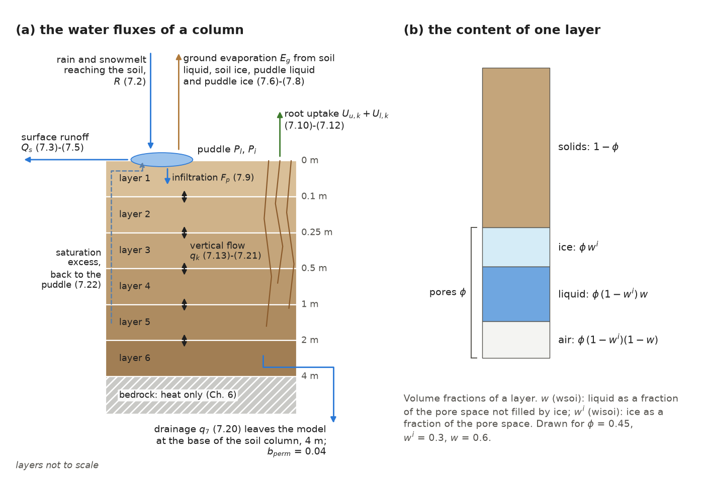
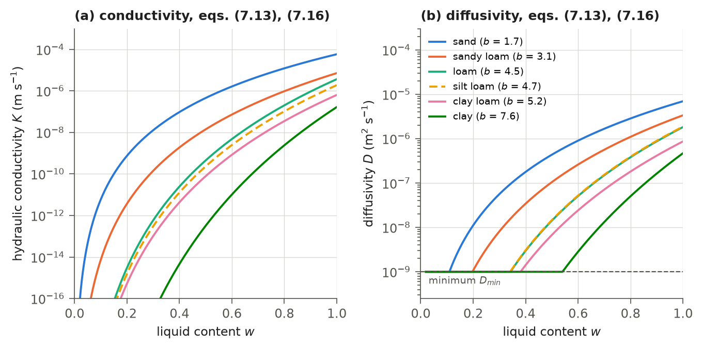
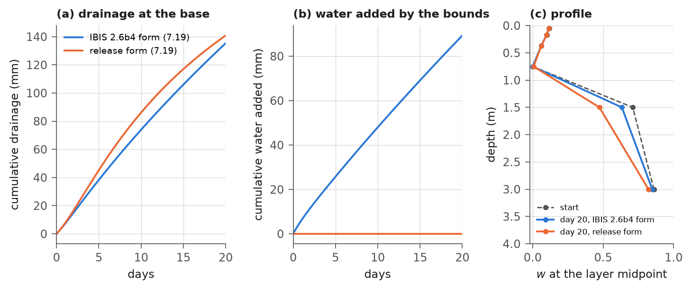
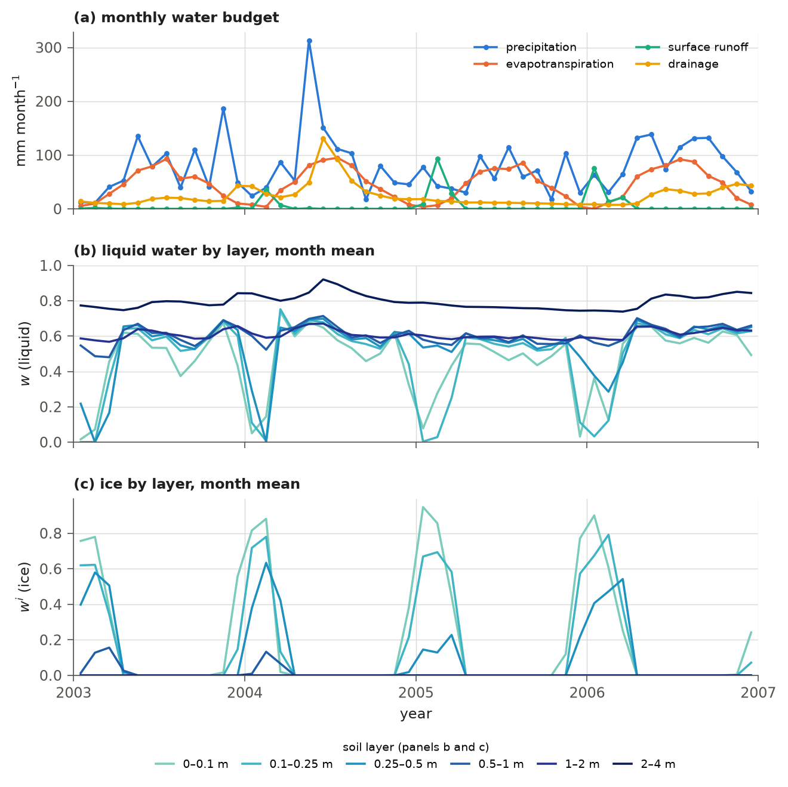

# 7. Soil Hydrology

Soil water controls how much water plants can take up, how much rain runs off or drains away, and how much water the
bare ground evaporates. IBIS 3.0 represents soil water in a six-layer column with a total depth of 4 m (Table 1.2),
and standing surface water in a store called the puddle. In each one-hour time step the model:

- splits the rain and snowmelt that reach the ground between the puddle and surface runoff;
- takes the evaporation of the ground from the soil and the puddle;
- lets water from the puddle soak into (infiltrate) the top layer;
- takes the water the plants transpire from the layers that hold their roots;
- moves water between the layers with the Richards equation and the hydraulic functions of Campbell (1974);
- sends the water that a saturated layer cannot hold back to the puddle, and lets water drain out of the bottom of the
  column.

These calculations follow IBIS 2.6b4, with the differences listed in section 7.13. Each layer's hydraulic properties
depend on its soil texture (Chapter 2). Chapter 6 describes soil heat flow, the freezing and thawing of soil water,
and the bedrock layers; Chapter 8 describes the snowpack. Water does not move between grid cells, and the column has no groundwater store and no water
table of its own (the wetland water table of Chapter 14 is diagnosed from the soil water). The three bedrock layers below
the soil carry heat but no water. An optional annual diagnostic records the terms needed to check water conservation in
each cell, including water added by the model's numerical safeguards (section 7.11).

## 7.1 Soil water variables

A soil layer consists of mineral grains and pore space, and the pores hold ice, liquid water and air. The model
describes the water of a layer with two fractions of its pore space (Table 7.1; Figure 7.1b): the ice content $`w^{i}`$,
the share of the pore space filled by ice, and the liquid content $`w`$, the share of the pore space *not filled by ice*
that holds liquid water. Liquid is counted against the ice-free pores because only they can conduct liquid water. The
volumetric liquid and ice contents of layer $`k`$ are therefore $`\phi_{k}(1 - w^{i}_{k})\,w_{k}`$ and
$`\phi_{k}\,w^{i}_{k}`$, and the water the layer holds is

```math
W_{k} = \rho_{w}\,\phi_{k}\,\Delta z_{k}\left[(1 - w^{i}_{k})\,w_{k} + w^{i}_{k}\right],
\qquad\text{(7.1)}
```

where $`W_{k}`$ (kg m⁻²) is the liquid and frozen water of layer $`k`$; $`\rho_{w} = 1000`$ kg m⁻³ is the density of water,
which the model also uses for ice; $`\phi_{k}`$ (m³ m⁻³) is the porosity of the layer (Table 2.6); and $`\Delta z_{k}`$ (m)
is its thickness (Table 1.2). Layers are numbered from 1 at the surface to 6 at the base. The puddle holds liquid water
$`P_{l}`$ and ice $`P_{i}`$ (kg m⁻²).

Each layer has the hydraulic properties of its texture class (Table 2.6; Rawls et al., 1992), constant in time: the
porosity, the saturated hydraulic conductivity $`K_{s}`$ (m s⁻¹), the saturated matric suction $`\psi_{s}`$ (m) and the
Campbell exponent $`b`$. The field capacity $`s_{f}`$ and the wilting point $`s_{w}`$ are given as fractions of the pore space
(section 2.6). A run that starts without a saved state (a cold start) sets $`w = 0.5`$ and $`w^{i} = 0`$ in every layer and
starts with an empty puddle, as IBIS 2.6b4 does. Several limits below use the small number $`\epsilon = 10^{-7}`$, the
value of IBIS 2.6b4.



**Figure 7.1** (a) The water fluxes of a soil column and the equations that set them. The drainage leaves the model at
the base of the soil column; the bedrock below carries heat but no water. (b) The content of one soil layer: the solids
and the pore space, which holds ice, liquid water and air; $`w`$ is the liquid as a fraction of the pore space not filled
by ice. The base permeability $`b_{perm}`$ (7.20) is set to its release value; these water pathways have not changed
since the release.

**Table 7.1** Water variables of the soil column, with their names in the model state.

| Symbol | Code | Description | Units |
|---|---|---|---|
| $`w_{k}`$ | `soil.wsoi` | liquid water, fraction of the ice-free pore space of layer $`k`$ | – |
| $`w^{i}_{k}`$ | `soil.wisoi` | ice, fraction of the pore space of layer $`k`$ | – |
| $`P_{l}`$ | `soil.wpud` | liquid water of the puddle | kg m⁻² |
| $`P_{i}`$ | `soil.wipud` | ice of the puddle | kg m⁻² |
| $`\phi^{f}_{k}`$ | `soil.porosflo` | pore space open to liquid flow, $`\max[\phi_{k}\max(1 - w^{i}_{k}, \epsilon), \epsilon]`$ | m³ m⁻³ |

## 7.2 Sequence of the calculations

The calculations must follow a specific order because each uses the state left by the preceding calculation. Soil
water is updated in step 10 of the time step (Table 1.3), after the canopy and snow calculations. Two inputs to this
update are computed earlier, from the state at the start of the step: the shares of ground evaporation drawn from each
store (step 1 of Table 1.3) and the water-stress factor of each layer (step 6). Table 7.2 lists the sequence.

**Table 7.2** Order of the soil water calculations within one time step.

| Step | Calculation | Section |
|---|---|---|
| 1 | puddle cover and the shares of the ground evaporation drawn from soil liquid, soil ice, puddle liquid and puddle ice (step 1 of Table 1.3) | 7.4 |
| 2 | stress factor of each layer, which weights the root uptake (step 6 of Table 1.3) | 7.6 |
| 3 | puddle water above the capacity leaves as runoff | 7.3 |
| 4 | rain and snowmelt reaching the soil divided between the puddle and runoff | 7.3 |
| 5 | ground evaporation or condensation taken from or added to the stores | 7.4 |
| 6 | infiltration rate from the puddle into the top layer | 7.5 |
| 7 | root uptake from each layer | 7.6 |
| 8 | vertical flow between the layers and drainage at the base, implicit in time | 7.7 |
| 9 | saturation excess returned to the puddle; puddle update | 7.8 |
| 10 | soil temperatures (Chapter 6) | – |
| 11 | bounds on the water contents | 7.9 |
| 12 | freezing and thawing of soil water (Chapter 6) | 7.10 |
| 13 | bounds on the water contents | 7.9 |
| 14 | freezing and thawing of the puddle (Chapter 6) | 7.10 |

## 7.3 Water reaching the soil and surface runoff

Rain and snowmelt that reach the ground either collect in the puddle, from which they can soak into the soil, or run
off the surface. How they are split depends on how full the puddle is and on whether the top of the soil is frozen.

The water that reaches the soil surface in a time step is the rain below the canopy on the snow-free part of the cell
(Chapter 5) plus the snowmelt (Chapter 8),

```math
R = (1 - f_{i})\,R_{g} + \frac{M}{\Delta t},
\qquad\text{(7.2)}
```

where $`R`$ (kg m⁻² s⁻¹) is the rate of water input; $`f_{i}`$ is the fractional snow cover at the start of the step;
$`R_{g}`$ (kg m⁻² s⁻¹) is the rain that falls through or drips from the canopies; $`M`$ (kg m⁻²) is the meltwater that
leaves the snowpack in the step; and $`\Delta t = 3600`$ s is the time step. As in IBIS 2.6b4, a rate $`R`$ below $`\epsilon`$
is set to zero; the water-balance diagnostic records this small loss (section 7.11). Before $`R`$ is added, puddle liquid in
excess of the puddle capacity leaves as runoff,

```math
Q_{o} = \frac{\min\left[P_{l},\, \max(0,\, P_{l} + P_{i} - P_{max})\right]}{\Delta t}, \qquad
P_{l} \leftarrow P_{l} - Q_{o}\,\Delta t,
\qquad\text{(7.3)}
```

where $`Q_{o}`$ (kg m⁻² s⁻¹) is this overflow and $`P_{max}`$ (kg m⁻²) is the puddle capacity (`soil.wpudmax`). $`R`$ is then
divided between the puddle and runoff according to how full the puddle is. This rule assumes that the capacities of
surface depressions are distributed evenly between 0 and $`P_{max}`$. As the puddle fills, fewer empty depressions remain
to collect incoming water. Over a frozen top layer the runoff share is reduced, and the water that stays in
the puddle freezes there (section 7.10):

```math
f_{frz} = \min\left[\max\left(2\,(T_{1} - T_{f} + 0.5),\, 0\right),\, 1\right], \qquad
f_{r} = f_{frz}\,\min\left[\max\left(\frac{P_{l} + P_{i}}{P_{max}},\, 0\right),\, 1\right],
\qquad\text{(7.4)}
```

```math
P_{l} \leftarrow P_{l} + (1 - f_{r})\,R\,\Delta t, \qquad Q_{s} = Q_{o} + f_{r}\,R,
\qquad\text{(7.5)}
```

where $`T_{1}`$ (K) is the temperature of the top soil layer at the start of the step; $`T_{f} = 273.16`$ K is the melting
point; $`f_{frz}`$ falls from 1 at $`T_{f}`$ to 0 at $`T_{f} - 0.5`$ K; $`f_{r}`$ is the runoff share of $`R`$; and $`Q_{s}`$
(kg m⁻² s⁻¹) is the surface runoff of the step. An empty puddle catches all of $`R`$. A full puddle sends all of it to
runoff when the top layer is not frozen ($`f_{frz} = 1`$); at $`T_{1} \le T_{f} - 0.5`$ K ($`f_{frz} = 0`$) all of $`R`$ stays
in the puddle, however full it is. Surface runoff is the only lateral loss at the surface; the puddle drains into the
soil by infiltration (section 7.5).

Only liquid water overflows (7.3) or infiltrates, so puddle ice is not limited by
$`P_{max}`$. It leaves the puddle only by melting or sublimation and accumulates in cells that remain frozen. IBIS 2.6b4
has the same overflow, and IBIS 3.0 keeps it. In the release run, at the end of 2010 (restart file of the hindcast),
8,411 cells held more than $`P_{max}`$ in their puddle, 6,267 of them south of 60°S and 2,057 north of 60°N; 6,505 cells
held more than 100 kg m⁻² of puddle ice, and the largest store of puddle ice was 1.4 × 10⁵ kg m⁻². Over 2001-2010 the
puddle ice grew in 5,964 of these 6,505 cells, by a median 12 kg m⁻² yr⁻¹ (at most 498). The puddle's heat capacity is added to the heat capacity of the top soil layer (Chapter 6). In these 6,505 cells,
the heat capacity of puddle ice at the end of 2010 was a median 27 times the heat capacity of the top soil layer
(at most about 1,600 times). The top layer therefore responds much more slowly to heating and cooling than the soil
alone would. These numbers come from the
figure script of this chapter, option `states` (release run; to be updated after the final run of the revised model).

## 7.4 Evaporation from the soil surface

Ground evaporation dries the topsoil and can also draw water from the puddle and from ice. The model divides
evaporation among four stores—soil liquid, soil ice, puddle liquid and puddle ice—in proportion to the area each is
assumed to cover.

The ground evaporation $`E_{g}`$ (kg m⁻² s⁻¹; negative when dew or frost forms) is computed with the surface energy
balance (Chapter 5) and applied here as a mean over the cell, $`(1 - f_{i})`$ times the evaporation of the snow-free
ground. IBIS 3.0 limits it to $`|E_{g}| \le 10^{-3}`$ kg m⁻² s⁻¹ (3.6 mm h⁻¹), a guard against a failure of the canopy
iteration in hot, dry cells (Chapter 5). The same limited value is used for the water taken from the stores, for the
latent heat in the heat flux into the soil surface (Chapter 5) and for the evaporation written out (section 7.13).

The puddle covers the fraction

```math
a_{p} = \min\left[\max\left(a_{max}\,\frac{P_{l} + P_{i}}{P_{max}},\, 0\right),\, a_{max}\right],
\qquad\text{(7.6)}
```

of the surface, where $`a_{max}`$ is the cover of a full puddle (`soil.zwpmax`, 0.5); the humidity of the soil surface in
the energy balance uses the same cover (Chapter 5). With the water of the top layer
$`\tilde{w}_{1} = (1 - w^{i}_{1})\,w_{1} + w^{i}_{1}`$ (a fraction of its pore space), the shares of $`E_{g}`$ drawn from
soil liquid, soil ice, puddle liquid and puddle ice are

```math
q_{1} = (1 - a_{p})\,\frac{(1 - w^{i}_{1})\,w_{1}}{\tilde{w}_{1}}, \qquad
q_{2} = (1 - a_{p})\,\frac{w^{i}_{1}}{\tilde{w}_{1}}, \qquad
q_{3} = a_{p}\,\frac{P_{l}}{P_{l} + P_{i}}, \qquad
q_{4} = a_{p}\,\frac{P_{i}}{P_{l} + P_{i}},
\qquad\text{(7.7)}
```

where $`a_{p}`$ is taken as zero when it is below $`\epsilon`$ (then $`q_{3} = q_{4} = 0`$). The shares sum to 1: the soil and
the puddle each supply evaporation in proportion to the area they cover, and each splits it between its liquid and its
ice. Two cases need a rule of their own:

- *The top layer holds no water ($`\tilde{w}_{1} < \epsilon`$) but there is a puddle.* The puddle supplies all of the
  ground evaporation: $`q_{1} = q_{2} = 0`$, $`q_{3} = P_{l}/(P_{l} + P_{i})`$ and $`q_{4} = P_{i}/(P_{l} + P_{i})`$. IBIS
  2.6b4, and the release of IBIS 3.0, kept the factor $`a_{p}`$ here, so that the shares summed to $`a_{p} \le a_{max}`$ and
  the rest of the evaporation came from no store (section 7.13). The release restart files showed this condition in
  only 12 cells at the end of 2000 and 16 at the end of 2010, all in Antarctica (release run; to be updated after the
  final run of the revised model); how often it occurs during a year was not counted (section 7.15).
- *The top layer holds no water and there is no puddle.* The whole of $`E_{g}`$ is assigned to the puddle liquid
  ($`q_{3} = 1`$) when $`T_{1} \ge T_{f}`$ and to the puddle ice ($`q_{4} = 1`$) otherwise, so that dew or frost forms a new
  puddle. Evaporation in this case would take water from an empty store. With the switch `soil.evap_needs_store` on,
  the surface energy balance gives the ground no conductance for water vapour in this case while the air above it is
  drier than saturation at the ground temperature (Chapter 5): dew can still form, but the ground does not evaporate.
  With the switch off, the default, the ground evaporates as in IBIS 2.6b4. IBIS 2.6b4 allows a negative puddle;
  IBIS 3.0 resets it to zero, supplying water from no store (section 7.11). The review parameter file,
  `params_32a_base.yaml`, turns the switch on. It is a starting point for recalibration; the release had no such switch.

The shares are computed from the state at the start of the step (step 1 of Table 7.2). The latent heat of the ground
evaporation in the surface energy balance (Chapter 5) is formed with them, as $`(q_{1} + q_{3})`$ times the latent heat
of vaporization plus $`(q_{2} + q_{4})`$ times that of sublimation. When $`E_{g} \ge 0`$ the stores change by

```math
F_{top} = -q_{1}\,E_{g}, \quad P_{l} \leftarrow P_{l} - q_{3}\,E_{g}\,\Delta t, \quad
P_{i} \leftarrow P_{i} - q_{4}\,E_{g}\,\Delta t, \quad
w^{i}_{1} \leftarrow \max\left(0,\; w^{i}_{1} - \frac{q_{2}\,E_{g}\,\Delta t}{\rho_{w}\,\phi_{1}\,\Delta z_{1}}\right),
\qquad\text{(7.8)}
```

where $`F_{top}`$ (kg m⁻² s⁻¹) is the flux of liquid water into the top layer, applied in the flow solution of section
7.7. IBIS 3.0 then sets a negative $`P_{l}`$ or $`P_{i}`$ to zero; the ice of the top layer is not taken below zero, as in
IBIS 2.6b4. Where these floors act, they supply the water needed for evaporation beyond what the stores held. The water-balance
diagnostic records that added water (section 7.11). When the ice of the top layer changes from $`w^{i,old}_{1}`$ to $`w^{i}_{1}`$, its liquid
content is rescaled, $`w_{1} \leftarrow w_{1}\,(1 - w^{i,old}_{1})/(1 - w^{i}_{1})`$ (if $`1 - w^{i}_{1} > \epsilon`$), so
that the liquid water of the layer is unchanged. Condensation ($`E_{g} < 0`$) is added to the puddle, so that $`w`$ and
$`w^{i}`$ cannot exceed 1: $`F_{top} = 0`$, $`P_{l} \leftarrow P_{l} - (q_{1} + q_{3})\,E_{g}\,\Delta t`$ and
$`P_{i} \leftarrow P_{i} - (q_{2} + q_{4})\,E_{g}\,\Delta t`$.

## 7.5 Infiltration

Puddle water infiltrates the top soil layer at a rate limited by the layer's saturated conductivity. Ice in the layer
reduces this rate. Liquid water infiltrates at the rate

```math
F_{p} = \frac{\max\left[0,\; \min\left(P_{l},\; \rho_{w}\,\Delta t\,\max(0, 1 - w^{i}_{1})^{2}\,K_{s,1}\right)\right]}{\Delta t},
\qquad\text{(7.9)}
```

where $`F_{p}`$ (kg m⁻² s⁻¹) is the infiltration and $`K_{s,1}`$ (m s⁻¹) is the saturated conductivity of the top layer.
The puddle drains at this conductivity, reduced by top-layer ice, until it is empty.
This capacity does not depend on how wet the top layer is; water that the layer cannot hold returns to the puddle as
saturation excess (section 7.8). Over one step of 3600 s the capacity ranges from 210 mm for sand to 0.6 mm for clay
(Table 2.6).

## 7.6 Root water uptake

Plants draw transpired water from the soil layers that contain their roots, with greater uptake from layers that
hold more plant-available water. The transpiration of the upper and the lower canopy, $`E_{t,u}`$ and $`E_{t,l}`$
(kg m⁻² s⁻¹ of the cell; that of the lower canopy from its snow-free part only, Chapter 5), is taken from the soil
layers in proportion to the root fraction of each layer (equation 2.8) weighted by its water-stress factor:

```math
U_{c,k} = E_{t,c}\,\omega_{c,k}, \qquad
\omega_{c,k} =
\begin{cases}
r_{c,k} & S_{c} \ge 1, \\[2pt]
\dfrac{r_{c,k}\,\beta_{k}}{\max(S_{c}, \epsilon)} & S_{c} < 1,
\end{cases}
\qquad S_{c} = \sum_{k=1}^{6} r_{c,k}\,\beta_{k},
\qquad\text{(7.10)}
```

where $`U_{c,k}`$ (kg m⁻² s⁻¹) is the uptake of canopy $`c`$ ($`u`$ upper, $`l`$ lower) from layer $`k`$; $`\omega_{c,k}`$ is the
weight of the layer; $`r_{c,k}`$ is the root fraction of the canopy in the layer; $`S_{c}`$ is the stress factor of the
canopy, $`\beta_{u}`$ or $`\beta_{l}`$ of (9.11) (not the stem area index $`S`$ of Chapters 4, 5 and 11); and $`\beta_{k}`$ is
the stress factor of the layer,

```math
\beta_{k} = \min\left[\max\left(\frac{1 - e^{\,c\,a_{k}}}{1 - e^{\,c}},\, 0\right),\, 1\right], \qquad
a_{k} = \min\left[\max\left(\frac{(1 - w^{i}_{k})\,w_{k} - s_{w,k}}{s_{f,k} - s_{w,k}},\, 0\right),\, 1\right],
\qquad\text{(7.11)}
```

with $`a_{k}`$ the plant-available water of the layer, $`s_{f,k}`$ and $`s_{w,k}`$ its field capacity and wilting point as
fractions of the pore space, and $`c`$ (< 0) the shape parameter of the water stress (`stomata.stressfac`; in the release
a per-cell value from the cell's plant types, equation (2.2), with the base value −3.339; section 9.4). $`\beta_{k}`$ and
$`S_{c}`$ are computed from the water at the start of the step. The two forms of (7.10) agree when no layer is stressed
($`\beta_{k} = 1`$, $`S_{c} = \sum_{k} r_{c,k} = 1`$); the first is used there so that the root fractions are applied
exactly. Where a layer dries below field capacity, uptake shifts to the wetter layers. When $`S_{c} < \epsilon`$ the
weights sum to $`S_{c}/\epsilon < 1`$, and the part of $`E_{t,c}`$ they leave out is taken from no layer, although the
canopy can still transpire through its minimum stomatal conductance (Chapter 9). The water-balance diagnostic records
this unsupplied water (section 7.11). The uptake is removed before the vertical flow is solved,

```math
w_{k} \leftarrow \max\left[w_{k} - \frac{\Delta t\,(U_{u,k} + U_{l,k})}{\rho_{w}\,\phi^{f}_{k}\,\Delta z_{k}},\; 0\right],
\qquad\text{(7.12)}
```

where IBIS 3.0 sets a negative result to zero and the water-balance diagnostic records the water added by this floor. The
temperature of the layer is adjusted for the difference between the soil temperature and the leaf temperature of the
transpired water, $`T_{k} \leftarrow T_{k} - \Delta t\,c_{w}\left[U_{u,k}(T_{u} - T_{k}) + U_{l,k}(T_{l} - T_{k})\right]/C_{k}`$,
where $`c_{w} = 4218`$ J kg⁻¹ K⁻¹ is the specific heat of water, $`T_{u}`$ and $`T_{l}`$ (K) are the leaf temperatures of
the two canopies and $`C_{k}`$ (J m⁻² K⁻¹) is the heat capacity of the layer, for the top layer including the puddle
(Chapter 6).

## 7.7 Vertical water flow

Water moves between layers under gravity and by capillary suction from wetter towards drier soil. The model solves
this flow implicitly in time. This keeps the solution stable with a one-hour step even though a layer's conductivity
varies by many orders of magnitude between wet and dry soil.

### 7.7.1 Hydraulic functions

The flow of liquid water between the layers follows Darcy's law with the hydraulic functions of Campbell (1974),
written in the liquid content $`w`$:

```math
K(w) = K_{s}\,w^{2b+3}, \qquad \psi(w) = -\psi_{s}\,w^{-b}, \qquad
D(w) = K(w)\,\frac{d\psi}{dw} = K_{s}\,\psi_{s}\,b\,w^{b+2},
\qquad\text{(7.13)}
```

where $`K`$ (m s⁻¹) is the hydraulic conductivity, $`\psi`$ (m) the matric potential and $`D`$ (m² s⁻¹) the hydraulic
diffusivity with respect to $`w`$. The downward flux of liquid water (m s⁻¹) across the interface at the top of layer
$`k`$ ($`k = 2, \ldots, 6`$) is

```math
q_{k} = \chi_{k}\left[K(\bar{w}_{k}) - D(\bar{w}_{k})\,\frac{w_{k} - w_{k-1}}{\bar{\Delta z}_{k}}\right], \qquad
\bar{\Delta z}_{k} = \frac{\Delta z_{k-1} + \Delta z_{k}}{2},
\qquad\text{(7.14)}
```

where $`\bar{w}_{k}`$ is the liquid content at the interface, $`\bar{\Delta z}_{k}`$ (m) the distance between the centres of
the two layers, and $`\chi_{k}`$ a reduction of the flow by ice,

```math
\chi_{k} = \left[\max\left(0,\; 1 - \max(w^{i}_{k-1}, w^{i}_{k})\right)\right]^{2},
\qquad\text{(7.15)}
```

so that a layer filled with ice blocks the flow of liquid water. With the interface properties defined below, the
solver evaluates (7.13) as

```math
K_{k} = \bar{K}_{s,k}\,\hat{w}_{k}^{\,m_{k}}, \qquad D_{k} = \max\left(\bar{B}_{k}\,\hat{w}_{k}^{\,n_{k}},\; D_{min}\right),
\qquad m_{k} = 2\,\mathrm{nint}(\bar{b}_{k}) + 3, \qquad n_{k} = \mathrm{nint}(\bar{b}_{k}) + 2,
\qquad\text{(7.16)}
```

where the exponents use the Campbell exponent of the interface rounded to the nearest integer (halves away from zero);
$`\bar{K}_{s,k}`$ (m s⁻¹), $`\bar{B}_{k}`$ (m² s⁻¹) and $`\bar{b}_{k}`$ are the saturated conductivity, the product
$`K_{s}\psi_{s}b`$ and the exponent $`b`$ averaged over the two layers as
$`\bar{X}_{k} = (1 - \lambda_{k})\,X_{k-1} + \lambda_{k}\,X_{k}`$ with
$`\lambda_{k} = \Delta z_{k}/(\Delta z_{k-1} + \Delta z_{k})`$; $`D_{min} = 10^{-9}`$ m² s⁻¹ is a minimum diffusivity for
dry soil; and $`\hat{w}_{k}`$ is the interface water at the start of the flow solution, after the evaporation of section
7.4 and the uptake of section 7.6, about which the fluxes are linearized (section 7.7.2). Figure 7.2 shows $`K`$ and $`D`$ of
six texture classes. Between a wet and a dry soil the conductivity changes by many orders of magnitude: with the
exponents of (7.16), at $`w = 0.2`$ it is below $`10^{-14}`$ m s⁻¹ in the loam, silt loam, clay loam and clay of the
figure.



**Figure 7.2** (a) The hydraulic conductivity and (b) the hydraulic diffusivity of six texture classes as functions of
the liquid content, with the integer exponents of (7.16) and the minimum diffusivity $`D_{min}`$; $`b`$ is the Campbell
exponent of the class (Table 2.6). The diffusivities of loam and silt loam nearly coincide (silt loam dashed). The
figure script checks the curves against the model's flow solver (section 7.15). The hydraulic functions and the
solver have not changed since the release.

### 7.7.2 Implicit solution

The solver evaluates fluxes at the end of the step using a linearization of $`K`$ and $`D`$, which depend strongly on
water content. It evaluates both functions once, at the start of the flow solution, after the evaporation of section 7.4
and the uptake of section 7.6. It then applies a first-order correction for the change in water content over the step. The interface
water at the end of the step is interpolated linearly to the interface position,

```math
\bar{w}^{+}_{k} = \lambda_{k}\,w^{+}_{k-1} + (1 - \lambda_{k})\,w^{+}_{k},
\qquad\text{(7.17)}
```

where the superscript $`+`$ marks the end of the step (each layer is weighted by the half-thickness of the other). The
flux across the interface is

```math
q_{k} = \chi_{k}\left[K_{k} + K'_{k}\,(\bar{w}^{+}_{k} - \hat{w}_{k})
- D'_{k}\,G_{k}\,(\bar{w}^{+}_{k} - \hat{w}_{k})
- D_{k}\,\frac{w^{+}_{k} - w^{+}_{k-1}}{\bar{\Delta z}_{k}}\right], \qquad
G_{k} = \frac{w_{k} - w_{k-1}}{\bar{\Delta z}_{k}},
\qquad\text{(7.18)}
```

where $`K'_{k} = m_{k}\,\bar{K}_{s,k}\,\hat{w}_{k}^{\,m_{k}-1}`$ and
$`D'_{k} = n_{k}\,\bar{B}_{k}\,\hat{w}_{k}^{\,n_{k}-1}`$ are the derivatives of $`K`$ and $`D`$ at the linearization point
($`D'_{k} = 0`$ where $`D_{k}`$ is held at $`D_{min}`$) and $`G_{k}`$ (m⁻¹) is the gradient at the start of the flow solution.
The linearization point is the interface water at the start of the flow solution, capped at 1,

```math
\hat{w}_{k} = \min\left[\lambda_{k}\,w_{k-1} + (1 - \lambda_{k})\,w_{k},\; 1\right]
\quad \text{(release)}, \qquad
\hat{w}_{k} = \min\left[(1 - \lambda_{k})\,w_{k-1} + \lambda_{k}\,w_{k},\; 1\right]
\quad \text{(IBIS 2.6b4)}.
\qquad\text{(7.19)}
```

The two forms differ in how they weight the two layers. The release form uses the same weights as (7.17), so that for a
column that does not change ($`w^{+} = w`$) the linearized flux equals the flux at its interface water, as it should. The
IBIS 2.6b4 form weights the layers the other way round. The two agree for layers of equal thickness, but the layers of
IBIS thicken with depth (doubling below 0.25 m), and then the IBIS 2.6b4 form gives an unchanged column a flux that
differs from the flux at its interface water. The direction of the error depends on the texture and on the wetness of
the two layers. With a dry layer ($`w = 0`$) above a wet one, at the interfaces at 0.5 m and below, it points downward
when the layer below is wet: in loam above $`w \approx 0.5`$, in sandy loam above $`w \approx 0.3`$ (except at 2 m) and in
clay above $`w \approx 0.8`$. The erroneous downward flux removes water that the dry layer does not have. The bounds of section 7.9 replace that
water, allowing the column to drain water created by the bounds. In the column of Figure 7.3 this happens at every one of its
480 steps. At intermediate wetness in every class, and at every wetness in sand and loamy sand, the error points upward
and creates no water.

The switch `soil.h2o_consistent_weights` selects the release form of (7.19) when true; its default, false, is the
IBIS 2.6b4 form, so a parameter file without the key runs the IBIS 2.6b4 form. The release file and the parameter file
of the revised model set it true. The interface properties of (7.16) keep the weights of IBIS 2.6b4 under both
settings, each layer weighted by its own half-thickness as a share of the distance between the centres; they matter
only where the texture changes between two adjacent layers, which it does in 37,035 of the 95,333 land cells (38.8 %;
texture classes of section 2.6 from the soil file, computed with the current classification by the figure script,
option `states`).

The top of the column carries no diffusive or gravitational flux ($`q_{1} = 0`$); the infiltration and the evaporation
from soil liquid enter the top layer as a source ($`F_{p} + F_{top}`$, in which $`F_{top} \le 0`$). At the base the column
drains freely, at a reduced rate:

```math
q_{7} = b_{perm}\,\max(0, 1 - w^{i}_{6})^{2}\,K_{s,6}\,\min(w_{6}, 1)^{\,2\,\mathrm{nint}(b_{6}) + 3},
\qquad\text{(7.20)}
```

where $`q_{7}`$ (m s⁻¹) is the drainage, evaluated with the water of the bottom layer at the start of the flow solution
(after uptake), and $`b_{perm}`$ is the permeability of the base relative to free gravity drainage (`soil.bperm`; 0 would
make the base impermeable and 1 would drain it at the conductivity of the bottom layer). The balance of layer $`k`$ over
the step is

```math
\phi^{f}_{k}\,\Delta z_{k}\,\frac{w^{+}_{k} - w_{k}}{\Delta t} = q_{k} - q_{k+1}
+ \delta_{k1}\,\frac{F_{top} + F_{p}}{\rho_{w}},
\qquad\text{(7.21)}
```

where $`\phi^{f}_{k}`$ (m³ m⁻³) is the pore space open to liquid flow (Table 7.1), $`w_{k}`$ is the liquid content after
the uptake of section 7.6, and $`\delta_{k1}`$ is 1 for the top layer and 0 otherwise. Since each $`q_{k}`$ is linear in
$`w^{+}_{k-1}`$ and $`w^{+}_{k}`$, equations (7.21) for the six layers form a tridiagonal system, which is solved for
$`w^{+}`$ by Gaussian elimination without pivoting (the Thomas algorithm), as in IBIS 2.6b4. The drainage is explicit
and the flow between the layers fully implicit (the implicit fraction of IBIS 2.6b4, `rimp`, is 1).



**Figure 7.3** A sandy-loam column with a dry fourth layer above wet fifth and sixth layers (from the top, $`w`$ = 0.12,
0.10, 0.06, 0, 0.71 and 0.86), stepped hourly for 20 days by the model's flow solver and bounds (section 7.9), with no
rain, evaporation or root uptake, in single precision as in the global runs, with the two linearization points of
(7.19) and the release's $`b_{perm}`$. (a) Drainage at the base. (b) Water added to the column by the bounds. (c) The
profile of the liquid content at the start and after 20 days. With the IBIS 2.6b4 form of (7.19) the column drained
135 mm, 89 mm of it water that the bounds added while the fourth layer stayed at zero; with the release form it drained
141 mm, all of it from the store, and the bounds added less than 0.01 mm. In both cases the change of the store, the
drainage and the added water balance to within 0.002 mm. The flow solver and the bounds have not changed since the
release.

## 7.8 Saturation excess and the puddle

The flow solution can leave a layer with more water than its pores can hold. Starting at the base, the model moves
this excess upward through successive layers. Excess water from the top layer returns to the puddle:

```math
w^{+}_{k} \leftarrow w^{+}_{k} + \frac{X_{k+1}\,\Delta t}{Z_{k}}, \qquad
X_{k} = \frac{\max(w^{+}_{k} - 1,\, 0)\,Z_{k}}{\Delta t}, \qquad w^{+}_{k} \leftarrow \min(w^{+}_{k}, 1), \qquad
Z_{k} = \rho_{w}\,\phi_{k}\,\max(\epsilon, 1 - w^{i}_{k})\,\Delta z_{k},
\qquad\text{(7.22)}
```

for $`k = 6, 5, \ldots, 1`$ with $`X_{7} = 0`$, where $`X_{k}`$ (kg m⁻² s⁻¹) is the excess that leaves layer $`k`$ upward and
$`Z_{k}`$ (kg m⁻²) the liquid water layer $`k`$ holds at saturation. The puddle gains the excess of the top layer and loses
the infiltration:

```math
P_{l} \leftarrow \max\left[P_{l} + (X_{1} - F_{p})\,\Delta t,\; 0\right].
\qquad\text{(7.23)}
```

IBIS 3.0 adds the floor at zero to guard against rounding; the water-balance diagnostic records any water it adds
(section 7.11). The returned water is not runoff: it stays in the puddle and leaves it by infiltration, by evaporation
or, in a later step, by overflow and the runoff share of (7.4). The downward flow of liquid water across the top of each
layer, which carries heat in the soil temperature solution (Chapter 6), follows from the change of each layer,

```math
Q_{7} = \rho_{w}\,q_{7}, \qquad Q_{k} = Q_{k+1} + \frac{(w^{+}_{k} - w_{k})\,Z_{k}}{\Delta t}\quad (k = 6, \ldots, 1),
\qquad Q_{1} \leftarrow Q_{1} + X_{1} - F_{p},
\qquad\text{(7.24)}
```

where $`Q_{k}`$ (kg m⁻² s⁻¹) is the flow at the top of layer $`k`$ and $`Q_{7}`$ the drainage at the base. The last correction
leaves in $`Q_{1}`$ only the exchange with the atmosphere ($`F_{top}`$), since the puddle and the top layer form one layer
for the heat solution.

## 7.9 Bounds on the water contents

The flow solution and the phase changes can leave a water content outside its range: below 0, or above 1 by rounding.
After solving soil temperatures, and again after freezing and thawing soil water (Chapter 6), the model restores
each layer's water contents to their allowed range, as the IBIS 2.6b4 routine `wadjust` does:

```math
w_{k} \leftarrow
\begin{cases}
0 & w_{k} < \epsilon \;\text{ or }\; w^{i}_{k} \ge 1 - \epsilon, \\
\min(w_{k}, 1) & \text{otherwise},
\end{cases}
\qquad
w^{i}_{k} \leftarrow
\begin{cases}
0 & w^{i}_{k} < \epsilon, \\
\min(w^{i}_{k}, 1) & \text{otherwise},
\end{cases}
\qquad\text{(7.25)}
```

where the condition on $`w^{i}_{k}`$ in the first case uses the bounded ice content. A negative liquid content left by
the solution of (7.21) is thus set to zero. The water added or removed by (7.25) is summed over the layers and the two
calls into an adjustment flux (`gadjust`, kg m⁻² s⁻¹). Nothing in the model reads it; the water-balance diagnostic sums
it over the year and writes it out (`ay_adj_wadjust`, Table 7.3).

## 7.10 Frozen soil

Soil ice blocks liquid water flow and stores water that roots cannot use. It affects six parts of the calculations
above:

- the liquid content is a fraction of the ice-free pore space, so the storage open to liquid flow in (7.21) is
  $`\phi^{f}_{k}`$;
- the flow across an interface is reduced by $`\chi_{k}`$ (7.15), and the drainage by $`(1 - w^{i}_{6})^{2}`$ (7.20);
- infiltration is reduced by $`(1 - w^{i}_{1})^{2}`$ (7.9);
- the runoff share of the water reaching a frozen surface is reduced by $`f_{frz}`$ (7.4), and the water that stays in the
  puddle freezes there while the top layer is below the melting point;
- the plant-available water of (7.11) counts only the liquid $`(1 - w^{i}_{k})\,w_{k}`$, so that root uptake (7.10)
  shifts away from frozen layers and a layer with no liquid above the wilting point supplies none;
- the ice of the top layer sublimates by (7.8).

The bounds of (7.25) also set the liquid content to zero where ice fills the pore space. The conversion between liquid
and ice is computed from the soil temperature after the heat solution, conserving water mass and energy (Chapter 6).
The puddle then freezes and thaws by the same method, using the top-layer temperature after the second application of
the water-content bounds (steps 12 to 14 of Table 7.2), as in IBIS 2.6b4.

## 7.11 Runoff, drainage and the water balance

Besides evaporation and transpiration, a soil column loses water in two ways: surface runoff and drainage from its
base. Both feed rivers in the real world; IBIS 3.0 does not route them. The surface runoff $`Q_{s}`$ of (7.5) and the
drainage $`Q_{7}`$ of (7.24) are summed over the year into `aytrunof` and `aytdrain` (mm yr⁻¹) and over the month into
`amtrunof` and `amtdrain` (mm).

Water conservation over a step or a year requires the following cell balance:

```math
\Delta W = P - E - Q_{s} - Q_{d} + A,
\qquad\text{(7.26)}
```

where every term is an amount over the period, in kg m⁻² (which is mm of water). $`\Delta W`$ is the change of the water
the cell stores: soil liquid and ice (7.1), the puddle, the snowpack (8.1) and the water and snow held on leaves and
stems (Chapter 5). $`P`$ is the precipitation; $`E`$ the evapotranspiration written out (transpiration, the evaporation of
water held on the canopy, ground evaporation and snow sublimation); $`Q_{s}`$ the surface runoff; and $`Q_{d}`$ the drainage
at the base. Each of these four is its rate times $`\Delta t`$, summed over the steps of the period; the rates of the
runoff and the drainage are $`Q_{s}`$ of (7.5) and $`Q_{7}`$ of (7.24). $`A`$ is the water the model adds or removes without
a physical flux. Without the model's safeguards $`A`$ would be zero. It is not zero where one of them acts: the bounds of
(7.25); the floors at zero of (7.8), (7.12) and (7.23), and the floors after the puddle's freezing and thawing (section
7.10); the transpiration that (7.10) takes from no layer; and the threshold of (7.2). A further term arises from water held on leaves and is not a safeguard. This water is stored per unit leaf area.
When daily phenology changes leaf area (Chapter 10), the stored amount therefore changes without a flux, as in
IBIS 2.6b4.

When every term is accounted for, the residual $`r = P - E - Q_{s} - Q_{d} + A - \Delta W`$ is zero. A positive $`r`$
indicates water that left the cell without a recorded term; a negative $`r`$ indicates water that appeared without one. For the soil column and
the puddle alone over one step, the same balance holds with $`W`$ the water of the soil and the puddle, $`P`$ replaced by
$`R\,\Delta t`$ (the input of (7.2)), $`E`$ by the ground evaporation and the root uptake of the step,
$`(E_{g} + \sum_{c,k} U_{c,k})\,\Delta t`$, and the runoff and the drainage by $`Q_{s}\,\Delta t`$ and $`Q_{7}\,\Delta t`$;
a test of the code checks it (section 7.15).

**The water-balance diagnostic.** IBIS 3.0 computes the water stored in each cell at every step, as IBIS 2.6b4 does.
With `physics.water_balance` set in the run configuration (off by default), it also sums every term of $`A`$ over the year,
counts three events (the limit on the ground evaporation acting, snowfall beyond what covers the cell, and a canopy
store evaporating more than it holds), and writes them to the yearly output together with the change of storage
(Table 7.3), allowing the residual $`r`$ to be computed for each cell. Accounting begins at the start of the year, after
any change in vegetation cover, and ends before the annual vegetation update (Chapter 11), which rescales canopy water
storage again. The diagnostic only reads the model state: a run gives the same results with it on or off.

**Table 7.3** Yearly outputs of the water-balance diagnostic (`physics.water_balance`). With them (7.26) can be
checked in every cell: the residual $`r`$ = `ayprcp` − `ayaet` − `aytrunof` − `aytdrain` − `aydwtot` + `ayadjust` should
be zero; a positive $`r`$ is water lost without a booked term.

| Output | Units | Meaning |
|---|---|---|
| `aydwtot` | mm yr⁻¹ | change of the water stored in the cell over the year, $`\Delta W`$ |
| `wtot` | kg m⁻² | water stored at the end of the year, before the yearly vegetation update |
| `ayadjust` | mm yr⁻¹ | $`A`$, the sum of the seven terms below |
| `ay_adj_wadjust` | mm yr⁻¹ | water added by the bounds on the water contents, (7.25) (IBIS 2.6b4) |
| `ay_adj_ice` | mm yr⁻¹ | sublimation beyond the ice of the top layer, supplied by its floor in (7.8) (IBIS 2.6b4) |
| `ay_adj_puddle` | mm yr⁻¹ | evaporation beyond the water of the puddle, supplied by the floors of (7.8) (IBIS 3.0) |
| `ay_adj_uptake` | mm yr⁻¹ | root uptake beyond the water of a layer, supplied by the floor of (7.12) (IBIS 3.0) |
| `ay_adj_untaken` | mm yr⁻¹ | transpiration written out but taken from no layer, where $`S_{c} < \epsilon`$ in (7.10) |
| `ay_adj_round` | mm yr⁻¹ | water added by the rounding floors of the puddle, (7.23) and its freezing and thawing (IBIS 3.0), less the rain and melt below $`\epsilon`$ that (7.2) drops and, since commit 6087ab5, less the water discarded while mixing canopy rain and snow |
| `ay_adj_canopy` | mm yr⁻¹ | change of the water held on leaves and stems when the daily phenology changes the leaf area |
| `n_bound`, `ay_w_bound` | steps yr⁻¹, mm yr⁻¹ | steps on which the limit on the ground evaporation (section 7.4) acted, and the evaporation it held back |
| `n_snow`, `ay_w_snow` | steps yr⁻¹, mm yr⁻¹ | steps with more snowfall on snow-free ground than covers it, and the excess added to the pack (section 8.5) |
| `n_cdef`, `ay_w_cdef` | steps yr⁻¹, mm yr⁻¹ | steps on which evaporation exceeded the water held on the canopy, and the unsupplied amount subtracted from the upward vapour flux (Chapter 5) |

Since the canopy-accounting correction of 4 November 2026 (commit 6087ab5, part of the source of the protocol runs),
the rounding adjustment in Table 7.3 also subtracts the water discarded while mixing canopy rain and snow. The check
described in section 7.15 explains this addition.

**The release run.** Because the release run predates the diagnostic, its water balance was reconstructed over the
hindcast, 2001-2010. Storage was read from the restart files at the end of 2000 and of 2010 for each cell's soil,
puddle, snow and canopy. Annual precipitation, evapotranspiration, surface runoff and drainage came from the output. The release did not write out $`A`$, so the residual of this balance is the storage change less the net
inflow, $`\Delta W - (P - E - Q_{s} - Q_{d})`$: positive where water appeared without a flux, the opposite sign of $`r`$.

Area-weighted over the land between 60°S and 60°N, precipitation was 969 mm yr⁻¹, evapotranspiration 621, surface
runoff 144 and drainage 203 mm yr⁻¹, so that drainage was 58 % of the water leaving the columns other than by
evapotranspiration; the change in storage closed this budget to within 0.07 mm yr⁻¹. In 51,437 of these 51,839 cells
(99.2 %) the residual was at most 1 mm yr⁻¹ in magnitude.

The 99 cells of the band with a residual above 5 mm yr⁻¹ (at
most 12.3 mm yr⁻¹, all of it water added) have their centres between 16.25°N and 27.75°N and between 28.75°E and
42.25°E, in the hyperarid east of the Sahara and the west of the Arabian Peninsula: 85 of them received less than
2 mm yr⁻¹ of precipitation, and their median evapotranspiration written out was 7.5 mm yr⁻¹. Their transpiration and
interception loss were negligible (medians 0.003 and 0.001 mm yr⁻¹), and the residual was a median 92 % (range
14-96 %) of the ground evaporation written out: most of the ground evaporation of these cells was supplied by no store.

Outside the band, residuals above 10 mm yr⁻¹ in magnitude, of either sign and up to 116 mm yr⁻¹, occur in 4,411 cells
south of 60°S (Antarctica) and in 578 cells north of 60°N, all of them between 75°W and 10°W (Greenland). All of these
cells held snow at the end of 2000 and of 2010; section 8.14 shows that the release did not conserve the water of deep
snowpacks in single precision.

Over all land the residual was −0.06 mm yr⁻¹, a small net loss, on a precipitation of
852 mm yr⁻¹. (The figure script of this chapter computes these numbers with the option `balance`.) These are the
release run's numbers; the code changes since the release alter the desert and ice-sheet residuals (release run; to be
updated after the final run of the revised model).

**A diagnostic year of the revised code.** One year, 2001, was run with the revised code, the parameter file
`params_32a_base.yaml` and the water-balance diagnostic on, starting from the release run's state at the end of 2000
(section 7.15). The run separated the sources that the release balance could not:

- In the hyperarid region found above (cell centres 16.25-27.75°N, 28.75-42.25°E; 598 land cells), with the ground
  evaporating from empty stores as in IBIS 2.6b4 (`soil.evap_needs_store` off), the safeguards added 1.64 mm yr⁻¹ on
  average (at most 15.4): 0.84 mm yr⁻¹ by the bounds on the water contents (7.25) and 0.81 mm yr⁻¹ by the floor on the
  puddle (7.8). With the switch on, the puddle floor added nothing, the bounds added 0.80 mm yr⁻¹ (at most 7.7), and the
  mean evapotranspiration of the region fell from 30.5 to 29.7 mm yr⁻¹. In the code, these bounds act when a step's
  soil evaporation exceeds the little water left in the top layer, since the switch does not cap a step's evaporation
  at that water. The diagnostic records all effects of the bounds as one term, so this source was not measured separately.
- With the switch on, the residual $`r`$ had a median of +0.09 mm yr⁻¹ over the 95,333 land cells, a small loss of water
  (1st to 99th percentile −0.31 to +0.41 mm yr⁻¹; land precipitation 845 mm yr⁻¹). The 518 cells with $`|r|`$ above
  1 mm yr⁻¹ (at most 5.8 mm yr⁻¹) all lie in Antarctica (300) or Greenland (218), 516 of them under a snowpack that was
  more than 10 m thick at the start of the year, where single precision still limits the bookkeeping (section 8.14). In
  the other cells $`r`$ is about +0.1 mm yr⁻¹. These results predate the canopy-accounting correction described below.
- The limit on the ground evaporation never acted, and no step had more snowfall on snow-free ground than covers it.
  The third event was common but small: a canopy store evaporated more than it held in 59,028 of the 95,333 land cells
  (62 %), on 31 steps a year averaged over the land cells (at most 463 in one cell), and the excess averaged
  0.0008 mm yr⁻¹ over the land area.

The figure script of this chapter prints these numbers (option `diagyear`). They come from a diagnostic run, not from
the final run of the revised model (to be updated after the final run of the revised model).

**The later bookkeeping check.** A separate replay of 2001 at four cells—the Amazon, the Nubian Desert, Madison and
a neighbouring cell—separated a missing adjustment from single-precision round-off. In double precision, the annual
residuals were 0.0335, 0.0000, 0.1135 and 0.1124 mm. Each matched the very small amounts discarded when canopy rain
and snow are mixed. Counting those amounts as an adjustment closed the annual budgets to the reported precision.
Patched double-precision monthly checks also close near numerical precision. The change in the storage weight of
the lower canopy as snow cover changes is already consistent with the counted fluxes; adding it as another missing
flux would count it twice.

The remaining single-precision residual in this controlled comparison comes from round-off. The correction changes
only the water accounts and is implemented on a separate development branch, awaiting integration after the current
NEE fits finish. These four cells establish the mechanism in the tested replay; they do not measure its contribution
to the earlier global residual or verify global closure after the correction. The historical global numbers above
remain snapshots until the final revised-model run provides updated global diagnostics.

Figure 7.4 shows the soil water of one cell through four years of the release run. Over 2003-2006 the cell received
937 mm yr⁻¹ of precipitation; evapotranspiration was 540 mm yr⁻¹, surface runoff 73 mm yr⁻¹ and drainage 299 mm yr⁻¹.
Of the surface runoff of the four years, 97 % occurred in the 16 of the 48 months in which the month-mean ice content of
the top layer exceeded 0.1, when the ice reduces the infiltration (7.9); the largest monthly runoff was 93 mm, in
February 2005. Drainage was largest, 131 mm, in June 2004, the month after the wettest month of the four years (313 mm
in May 2004). The ice reached the top three layers each winter (month means up to 0.95, 0.79 and 0.63) and, apart from
traces in February and March 2006 (at most 1.3 × 10⁻⁴), the fourth layer only in the winters of 2002/03 and 2003/04
(up to 0.16); the two lowest layers did not freeze, and their liquid content stayed between 0.57 and 0.92. The
month-mean liquid content of the top layer fell below 0.1 only in five winter months, in each of which its ice content
was between 0.76 and 0.95 (release run; to be updated after the final run of the revised model).



**Figure 7.4** The soil water of the cell at 43.25°N, 89.25°W (the cell of Figure 3.1) in the hindcast of the release
run, 2003-2006, from its monthly output; the figure shows the release code. (a) Precipitation, evapotranspiration,
surface runoff and drainage. (b) The liquid content $`w`$ and (c) the ice content $`w^{i}`$ of the six layers, month means
over every time step. The liquid content is a fraction of the pore space not filled by ice (section 7.1). These are
release results, to be updated after the revised model's final run.

## 7.12 Organic soils

Soils rich in organic matter, such as peat, hold more water and conduct it differently from mineral soils. With
`physics.soil_organic` on (off in the release), the hydraulic properties of each layer are mixed between the mineral
values of its texture class and those of an organic soil (Lawrence and Slater, 2008). The organic-matter fraction of the
solids is

```math
f_{om} = \min\left[\max\left(\frac{0.01\,C_{org} \times 1.724 \times 1000\,\rho_{b}}{\rho_{om,max}},\, 0\right),\, 1\right],
\qquad\text{(7.27)}
```

where $`C_{org}`$ (% by mass) is the organic carbon and $`\rho_{b}`$ (g cm⁻³) the bulk density of the layer from HWSD
version 2 (a cell without data is mineral; a missing bulk density is taken as 1.3 g cm⁻³), 1.724 is the ratio of
organic matter to organic carbon, and $`\rho_{om,max} = 130`$ kg m⁻³ is the bulk density of pure organic soil. The
porosity, the Campbell exponent and the saturated suction are mixed linearly,
$`X = (1 - f_{om})\,X_{min} + f_{om}\,X_{om}`$; the field capacity and the wilting point are mixed as volumetric contents
and then divided by the mixed porosity, with the organic values taken from the organic Campbell curve at suctions of
3.37 m and 153 m. The saturated conductivity follows the percolation treatment of Lawrence and Slater (2008):

```math
K_{s} = (1 - f_{perc})\,\frac{1 - f_{perc}}{\dfrac{1 - f_{om}}{K_{s,min}} + \dfrac{f_{om} - f_{perc}}{K_{s,om}}}
+ f_{perc}\,K_{s,om}, \qquad
f_{perc} =
\begin{cases}
\left(\dfrac{f_{om} - f_{c}}{1 - f_{c}}\right)^{\beta_{c}} f_{om} & f_{om} > f_{c}, \\
0 & \text{otherwise},
\end{cases}
\qquad\text{(7.28)}
```

where $`K_{s,min}`$ and $`K_{s,om}`$ (m s⁻¹) are the mineral and organic saturated conductivities, $`f_{perc}`$ is the
fraction of the soil in which organic matter forms a connected path, $`f_{c} = 0.5`$ is the percolation threshold and
$`\beta_{c} = 0.139`$. The organic end member is selected by `physics.soil_organic_end_member` (Table 7.4). The density,
heat capacity and dry thermal conductivity of the solids are mixed as well (Chapter 6).

**Table 7.4** Organic end members of `physics.soil_organic` (Lawrence and Slater, 2008; Letts et al., 2000).

| End member | Porosity (m³ m⁻³) | $`b`$ | $`\psi_{s}`$ (m) | $`K_{s}`$ (m s⁻¹) |
|---|---|---|---|---|
| `ls2008` (default) | 0.90 | 2.7 | 0.0103 | 1.0 × 10⁻⁴ |
| `fibric` | 0.93 | 2.7 | 0.0103 | 2.8 × 10⁻⁴ |
| `hemic` | 0.88 | 6.1 | 0.0102 | 2.0 × 10⁻⁶ |
| `sapric` | 0.83 | 12.0 | 0.0101 | 1.0 × 10⁻⁷ |

## 7.13 Differences from IBIS 2.6b4

The IBIS 3.0 soil water routines follow IBIS 2.6b4 (`soil.f`). They have been compared with the Fortran both routine
by routine and over many time steps in lockstep (Chapter 17). The 46-year lockstep run gave both codes a synthetic soil with a negative
saturated suction, which sets the diffusivity between the layers to $`D_{min}`$; that run therefore tested drainage by
gravity but not the capillary part of the flow (7.18), which only the routine-by-routine comparison covered. Since
November 2026 the comparisons give both codes the soils of the IBIS 2.6b4 texture classes, with positive suctions, and
the single-step and multi-day checks and one lockstep year were re-run with them (section 17.9.1). IBIS 3.0 differs from
IBIS 2.6b4 as follows:

1. **Linearization point of the flow solution** (`soil.h2o_consistent_weights`; on in the release, off by default).
   With the switch on, the interface water about which the fluxes are linearized has the interpolation weights of the
   solution, (7.19). With the IBIS 2.6b4 weights a dry layer above wet layers can let the column drain water that the
   bounds create (section 7.7.2; Figure 7.3). A parameter file without the key runs the IBIS 2.6b4 form.
2. **Floors at zero.** IBIS 3.0 sets a negative liquid content after root uptake (7.12) to zero before the flow
   solution, where IBIS 2.6b4 passes it to the solution, and it sets a negative puddle to zero after the evaporation of
   (7.8), after the update of (7.23) and after its freezing and thawing, where IBIS 2.6b4 lets the puddle become
   negative. A negative puddle is read in the next step as condensation, whose latent heat warms the top soil layer
   although no vapour condensed (section 7.15). The water-balance diagnostic books the water these floors add.
3. **Limit on the ground evaporation**, $`|E_{g}| \le 10^{-3}`$ kg m⁻² s⁻¹ (3.6 mm h⁻¹), a guard against a failure of
   the canopy iteration in hot, dry cells (Chapter 5); IBIS 2.6b4 has no such limit. The limited value is used for the
   water taken from the stores, for the latent heat of the heat flux into the soil surface and for the evaporation
   written out alike. (The release used it for the water only.) In the diagnostic year of section 7.11 the limit never
   acted.
4. **Water bookkeeping.** IBIS 3.0 computes the water stored in each cell at every step, as IBIS 2.6b4 does, and can
   write a yearly water-balance diagnostic that splits the water added by the safeguards by source (section 7.11; Table
   7.3), which IBIS 2.6b4 does not have. IBIS 2.6b4 writes the adjustment flux of (7.25) to its point diagnostics; IBIS
   3.0 writes its yearly sum with the water-balance diagnostic.
5. **Bedrock.** With the thermal bedrock layers (Chapter 6), the drainage leaves the model at the base of the 4 m
   column; the bedrock holds no water.
6. **Parameter values.** The puddle capacity $`P_{max}`$ and the base permeability $`b_{perm}`$ of IBIS 3.0, 10 kg m⁻² and
   0.04, are not those of the IBIS 2.6b4 parameter file `params.soi`, 4.5 kg m⁻² and 0.10 (Table 7.5). With the IBIS 3.0
   value the drainage of (7.20) is 0.4 times that of IBIS 2.6b4 for the same state of the bottom layer. Both values date
   from the first version of the port, and no record gives their origin; since the calibration of Chapter 16 was made
   with them, they stay as parameters of IBIS 3.0. The settings used to verify the port are recorded in section 7.15.
7. **Dry top layer under a puddle.** All of the ground evaporation comes from the puddle (section 7.4). In IBIS 2.6b4,
   and in the release, the shares sum to $`a_{p} \le a_{max}`$ in this case, so that the rest of the evaporation comes from
   no store and its latent heat is scaled down by $`a_{p}`$, although a comment in the IBIS 2.6b4 code says that all of it
   should come from the puddle. There is no switch.
8. **The ground evaporates only from a store** (`soil.evap_needs_store`, off by default; on in `params_32a_base.yaml`).
   With the switch on, a ground whose top layer holds no water and that has no puddle can take up dew but does not
   evaporate (section 7.4). Off, the model evaporates from the empty puddle as IBIS 2.6b4 does, and the floor of item 2
   supplies the water.
9. **Puddle cover in the soil-surface humidity.** The humidity of the soil surface (Chapter 5) takes the cover of a
   full puddle from `soil.zwpmax`, as the evaporation shares do; IBIS 2.6b4 fixes it at 0.5 there. At the value of the
   release, 0.5, the results are identical.

## 7.14 Parameters and switches

The parameters below set storage capacities and water movement. The switches select optional changes to the
calculations or add diagnostic output; each table states which settings the release used.

**Table 7.5** Parameters of the soil water calculations. Values not in the parameter file are constants of the code;
the IBIS 2.6b4 values are those of its parameter file `params.soi` or of its code.

| Symbol | Description | Parameter file | Release | IBIS 2.6b4 |
|---|---|---|---|---|
| $`P_{max}`$ | puddle capacity (kg m⁻²) | `soil.wpudmax` | 10.0 | 4.5 |
| $`a_{max}`$ | cover of a full puddle | `soil.zwpmax` | 0.5 | 0.5 |
| $`b_{perm}`$ | permeability of the base | `soil.bperm` | 0.04 | 0.10 |
| $`D_{min}`$ | minimum hydraulic diffusivity (m² s⁻¹) | – | 10⁻⁹ | 10⁻⁹ |
| $`\epsilon`$ | small number of the bounds and limits | – | 10⁻⁷ | 10⁻⁷ |
| – | limit on the ground evaporation (kg m⁻² s⁻¹) | – | 10⁻³ | none |
| $`\Delta z_{k}`$ | layer thicknesses (m) | – | Table 1.2 | Table 1.2 |
| $`\phi`$, $`K_{s}`$, $`\psi_{s}`$, $`b`$, $`s_{f}`$, $`s_{w}`$ | hydraulic properties | – | Table 2.6 | Table 2.6 |
| $`c`$ | shape parameter of the water stress | `stomata.stressfac` and the types | per cell; base −3.339 (section 9.4) | −5.0 |

The `soil.*` switches are keys of the parameter file; the `physics.*` switches are keys of the run configuration.

**Table 7.6** Switches of the soil water calculations.

| Switch | Default | Release run | Meaning |
|---|---|---|---|
| `soil.h2o_consistent_weights` | false | true | linearization point with the interpolation weights of the solution, (7.19) (false: IBIS 2.6b4); true in `params_32a_base.yaml` |
| `soil.evap_needs_store` | false | not present; equivalent to false for this option | no ground evaporation from a top layer without water and no puddle; dew still forms (section 7.4); true in `params_32a_base.yaml` |
| `physics.water_balance` | false | (not in the release) | yearly water-balance diagnostic (section 7.11, Table 7.3); outputs only |
| `physics.soil_organic` | false | false | organic-soil hydraulic and thermal properties (section 7.12) |
| `physics.soil_organic_end_member` | `ls2008` | (not used) | organic end member (Table 7.4) |

## 7.15 Notes for developers

These notes record changes after the release (code `e54e342`, run `final_rel30`), the earlier comparisons through
`c6698fd`, and the dated follow-up checks below. The primary decision record is the review's `decisions_taken.md`; `docs/CALIBRATION.md`
sections 87–87.1 and `docs/DEFECTS_FOR_REVIEW.md` record the decisions and their completion. The commits and diagnostic
runs below provide the chapter's implementation and result sources.

The calculations are ports of `setsoi`, `soilctl`, `soilh2o` and `wadjust` in IBIS 2.6b4's `soil.f`. The Python soil
physics and time-step code implement the sequence in Table 7.2.

- **Ground evaporation needs a store** (D25; commit b2d2cca). `soil.evap_needs_store` (`SimParams.evap_needs_store`,
  static; default false; true in `params_32a_base.yaml`). In `canopy_exchange.turvap` the ground's vapour conductance is
  zero in the fourth case of `setsoi` (no soil water, no puddle) while the lower canopy air is not more humid than
  saturation at the ground temperature ($`q_{34} \le q_{g}`$); the sensible heat is unchanged. Reason: in the release run
  most of the ground evaporation of the hyperarid cells was water no store supplied (section 7.11). As decided, a
  step's evaporation is not capped at the water the stores hold, so the water `wadjust` adds when a step evaporates
  more than the little water left in the top layer remains (0.80 mm yr⁻¹ in the hyperarid region in 2001). Test:
  `tests/test_review_outputs.py::test_d25_the_ground_evaporates_only_from_a_store`.
- **Water-balance diagnostic** (D70; commits e6c70cb, 75d8935). Reason: in the release the water added by the
  safeguards was not recorded and could be identified only offline from the restart files (section 7.11).
  `hydrology.wtot` is filled every step as `stats.f` (lines 1020-1035) forms it (the release kept it at zero).
  `physics.water_balance` (default false) attaches the module
  `ibis/state/water_balance.py` (`WaterBalance`, 14 arrays at the end of the restart chain); `scripts/run_global.py`
  starts accounting after any cover update and ends it before `dynaveg`. Since 75d8935 `adj_round` also carries,
  negative, the rain and melt below $`\epsilon`$ dropped before the soil (finding #24 of `verify/STATUS.md`); this moved
  the median closure residual of the 2001 diagnostic year from +0.099 to +0.088 mm yr⁻¹. Tests in
  `tests/test_review_outputs.py`: one-step closure in five scenarios, a month of real forcing at three cells, and no
  feedback on the state. The diagnostic years of section 7.11 are in `verify_outputs/step2_wbal_2001` (switch off),
  `step2_wbal_2001_d25` (switch on) and `step2_wbal_2001_d25b` (switch on, with the change of 75d8935) on the lab file
  system; `make_ch07.py diagyear` computes the numbers quoted in sections 7.11 and 8.14 from them (the box terms agree
  with `verify_outputs/diag_work/step2/wbal_analysis.py`).
- **Canopy cascade accounting (4 November 2026; commit 6087ab5).** The cascade's `mix` routine discards water below
  its small-number threshold. The patch records the discarded mass as a negative contribution to `adj_round`, then
  includes it in the existing water-balance diagnostic. It does not change the water passed between stores or the
  state trajectory. The float64 replay uses the four cells, forcing, parameters and end-of-2000 preliminary-run
  restart of `diag_work/step3_codex_20261102/water_closure/real_year_result.json`. Its 2001 residual equals the cascade
  loss to the printed precision at every cell; patched float64 monthly residuals are near numerical precision.
  The measured snow-cover storage-weight term is not an additional missing flux. The float32 comparison retains
  accumulation error; it does not justify attributing the full earlier global median to round-off from four cells.
  Evidence: `diag_work/step3_claude_review/water_x64/WATER_CLOSURE_F64_RESULT.md`, `gpu/real_year_result.json` and the
  `patched_f64` and `patched_f32` results beneath that directory. Measurement preserved all 290 checked core-state
  fields bit for bit. The patch (commit 6087ab5, on top of `9ef13c5`) is the source of the protocol runs of the
  revised model since 5 November 2026, and the full suite passed on it (942 tests); the tower refits ran on `9ef13c5`,
  which differs from it only by this accounting change.
- **The evaporation limit in the heat flux and the output** (D28; e6c70cb). `loops.bounded_ground_evaporation` gives the
  rate per unit of snow-free ground whose cell mean is limited; `heatg`, the stores and `gsuvap` all use it, where the
  release used the unlimited rate for `heatg` and `gsuvap`. Reason: where the limit acts, the latent heat, the water
  and the output must describe the same evaporation. No switch; counted by `n_bound` and `ay_w_bound`.
- **Dry top layer under a puddle** (D52; e6c70cb). Case 3 of `setsoi` (`soil_physics.py`); no switch. Reason: the
  shares summed to $`a_{p}`$, so the rest of the evaporation came from no store, against the intent of the `soil.f`
  comment. In the release restarts the case held in 12 cells at the end of 2000 and 16 at the end of 2010, all at
  77.25-77.75°S, 160.25-164.25°E, each with a puddle of 5 kg m⁻² or more (`make_ch07.py states`; release run; to be
  updated after the final run of the revised model). The diagnostic does not count the case, so its frequency within a
  year is not known.
- **Order of the puddle's freezing and thawing** (D84; e6c70cb). It now runs after the second `wadjust` and with its
  water contents, as `soil.f` does; the release ran it before, an unrecorded departure with an effect of order
  $`10^{-7}`$. No switch.
- **`soil.zwpmax` in the surface humidity** (D89; e6c70cb). `turvap` takes the puddle cover from `soil.zwpmax`, where
  `canopy.f` (line 816) and the release had 0.5, so that a changed `soil.zwpmax` acts on both uses of the puddle cover;
  identical results at 0.5.
- **Records.** $`P_{max}`$ and $`b_{perm}`$ are the port's defaults since its initial commit 4ca4481, of untraced origin, and
  stay (D68; CALIBRATION 87). The code default of `soil.h2o_consistent_weights` stays false, so parameter files without
  the key run the IBIS 2.6b4 form (D63; CALIBRATION 62). The harness soils and their re-run: D62, commit bed0ae7,
  `verify/STATUS.md` ("Harness settings").
- **Puddle ice** remains uncapped by $`P_{max}`$ (D17, kept as in IBIS 2.6b4; sections 7.3 and 8.17).
- **Verification settings.** The 46-year lockstep run of Chapter 17 gave both codes a puddle capacity of 4.5 kg m⁻²
  and a base permeability of 0.04. The November 2026 reruns used the IBIS 2.6b4 values, 4.5 kg m⁻² and 0.10:
  single-step and multi-day checks, plus 1951 at 20 of the 117 cells. The full 46-year run was not repeated.
- **Hydraulic-curve checks.** Figure 7.2 checks the curves against the flow solver. A uniform column drains
  $`b_{perm}\rho_w K(w)`$ at its base. Fed $`\rho_w K(w)`$ at the top over a fully permeable base ($`b_{perm}=1`$), it
  carries that flux across every interior interface. In three non-uniform columns of each class, the interior flows
  match (7.18), using the $`K`$ and $`D`$ of (7.16), to within 2 % plus $`5\times10^{-8}`$ kg m⁻² s⁻¹. The diffusive terms
  reach $`7\times10^{-4}`$ kg m⁻² s⁻¹.
- **History.** Before 16 October 2026 the runoff diagnostic of the port also counted the saturation excess of (7.22),
  which returns to the puddle and was counted again each step it re-infiltrated, and the drainage diagnostic was zero;
  the release run postdates the correction (`tests/test_water_balance.py`, which also checks the per-step balance of the
  soil and the puddle, to within 2 % of the fluxes plus 0.05 kg m⁻²). The puddle floors were added after a bone-dry cell on the Taymyr Peninsula (75.0°N, 91.0°E,
  5 August 1915) evaporated its empty puddle to about −3 × 10⁻³ kg m⁻², read it back as condensation and warmed its top
  layer by 8.7 K in one hour (`tests/test_puddle_conservation.py`). The limit on the ground evaporation was added after
  the canopy iteration diverged in hot, dry cells of the Yemen highlands (finding #27 of `verify/STATUS.md`).
- Deep snowpacks, which dominate the residuals of the ice-sheet cells in section 7.11, are treated in section 8.17.
- **Numbering.** Items 1-6 of section 7.13 keep the numbers of the release text, which `docs/DEFECTS_FOR_REVIEW.md`
  (D28, D68, D70) and `docs/CALIBRATION.md` section 87 (D68) cite; items 7-9 are new. The new Table 7.3 (outputs of
  the diagnostic) moved the release's Tables 7.3-7.5 to 7.4-7.6.
- **Figures.** Figures 7.1–7.4 were redrawn on 2 November 2026 from `c6698fd` and the release parameter file
  (`make_ch07.py`). Their calculations are unchanged from the first version of this note; 7.1 has a new path for the
  drainage arrow (out of the side of the column, beside the bedrock) and 7.3 new legend names (the "IBIS 2.6b4 form"
  and the "release form" of (7.19)), with the same numbers.
  The figure files are not under git.

## References

Campbell, G. S., 1974: A simple method for determining unsaturated conductivity from moisture retention data. *Soil
Science*, 117, 311-314.

Lawrence, D. M., and A. G. Slater, 2008: Incorporating organic soil into a global climate model. *Climate Dynamics*,
30, 145-160.

Letts, M. G., N. T. Roulet, N. T. Comer, M. R. Skarupa, and D. L. Verseghy, 2000: Parametrization of peatland
hydraulic properties for the Canadian Land Surface Scheme. *Atmosphere-Ocean*, 38, 141-160.

Rawls, W. J., L. R. Ahuja, D. L. Brakensiek, and A. Shirmohammadi, 1992: Infiltration and soil water movement. In
*Handbook of Hydrology*, D. R. Maidment, Ed., McGraw-Hill, New York, 5.1-5.51.
