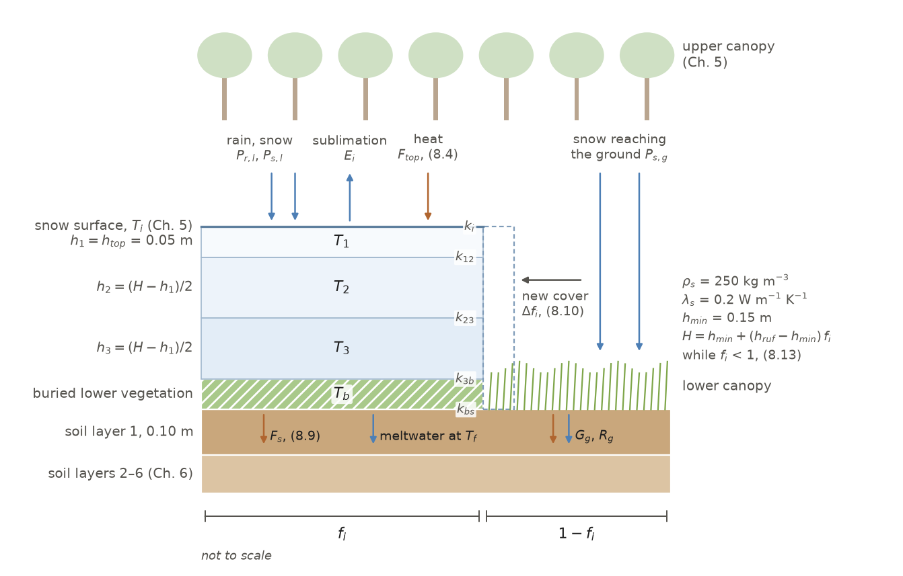
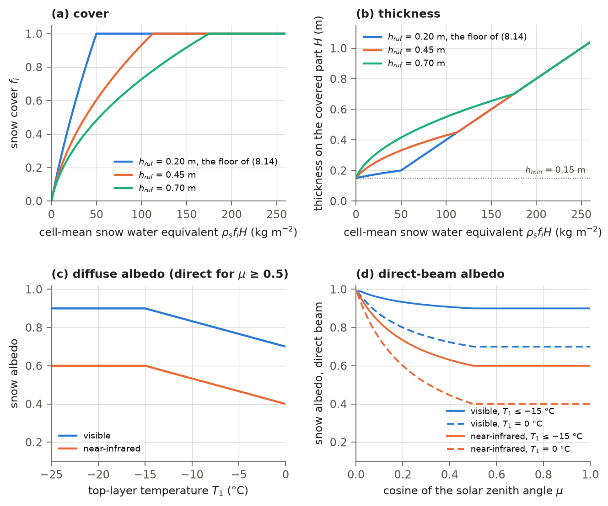
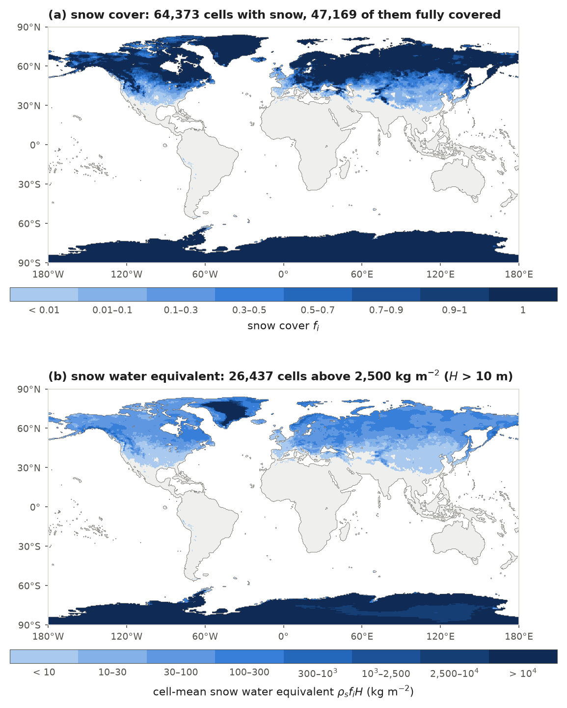
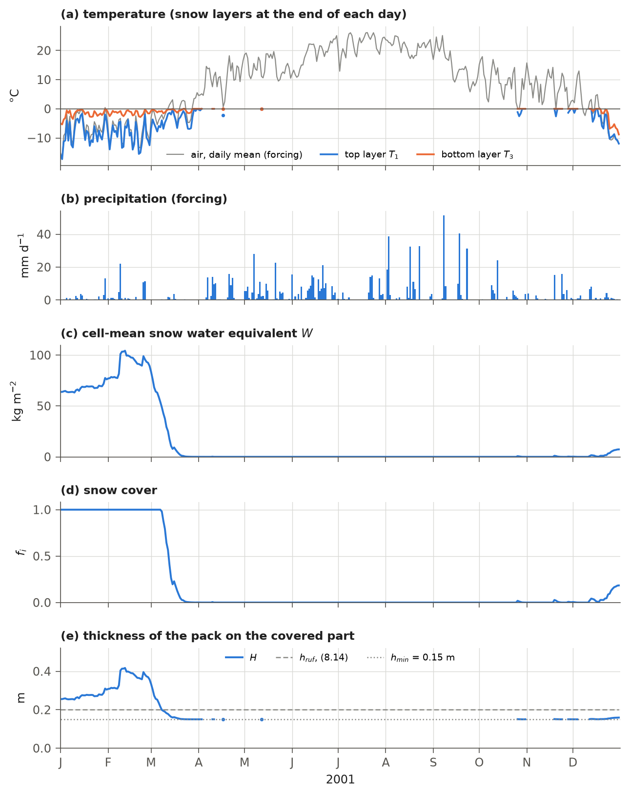

# 8. Snow

Ground snow reflects most incoming sunlight, insulates soil from cold air, stores winter precipitation and releases
it as spring meltwater, and buries low vegetation. IBIS 3.0 represents this snow as a three-layer pack covering a
fraction of the grid cell. The pack lies on the
soil beneath the upper canopy and buries the lower canopy on the part of the cell it covers. It gains mass from
snowfall, from rain that freezes into it, from the water held on newly buried vegetation and from the deposition of
vapour, and it loses mass by sublimation and melt. Heat is conducted through the layers and through a layer of buried
vegetation to the soil. The pack's cover and thickness are linked by a fixed relation between snow volume and covered area.
The scheme follows IBIS 2.6b4, which inherited it from the land surface transfer scheme LSX (Pollard and Thompson, 1995).

This chapter describes the snow step (step 9 of Table 1.3), snow albedo and the effects of snow cover on the rest of the
cell. Snow held on the canopy is described in Chapter 5, the split of
precipitation into rain and snow in Chapter 3, and the energy balance of the snow surface in Chapter 5.

## 8.1 State variables and parameters

The model describes the snow of a cell by its fractional cover $`f_i`$, the thickness $`h_k`$ (m) and temperature $`T_k`$
(K) of three layers, and the temperatures of the snow surface $`T_i`$ and buried lower vegetation $`T_b`$ (K). The layers
$`k = 1,2,3`$ are numbered from the top. The thicknesses and temperatures are those of the snow-covered part of the cell.
The pack has uniform density, so its water equivalent per unit cell area is

```math
W = \rho_{s}\,f_{i}\,H, \qquad H = \sum_{k=1}^{3} h_{k},
\qquad\text{(8.1)}
```

where $`W`$ (kg m⁻²) is the cell-mean snow water equivalent, $`\rho_{s}`$ (kg m⁻³) is the snow density and $`H`$ (m) is the
total thickness of the pack. The density and the thermal conductivity of the snow are constants. The pack holds no
liquid water, and it has no age, grain size or compaction.

The snow parameters in Table 8.1 are fixed in the code, except for the heat capacity of the buried vegetation $`c_l`$,
which comes from the parameter file. A restarted run also takes the fixed snow parameters from the code. All but two retain their IBIS 2.6b4 values.
The exceptions, $`H_{deep}`$ and the re-division slack, control the treatment of very thick packs added in IBIS 3.0
(sections 8.4 and 8.8). The state fields and parameter sources are listed in section 8.17.

**Table 8.1** Snow parameters. All but $`c_l`$ are constants of the code; $`c_l`$ is read from `canopy.chl` in the parameter
file. The two parameters marked IBIS 3.0 were added after the release; the other values are those used in the release.

| Symbol | Description | Value | Code name |
|---|---|---|---|
| $`\rho_{s}`$ | snow density | 250 kg m⁻³ | `SnowState.rhos` |
| $`\lambda_{s}`$ | thermal conductivity of snow | 0.20 W m⁻¹ K⁻¹ | `SnowState.consno` |
| $`h_{top}`$ | thickness of the top layer | 0.05 m | `SnowState.hsnotop` |
| $`h_{min}`$ | thickness of a pack at vanishing cover, and of a new pack | 0.15 m | `SnowState.hsnomin` |
| $`f_{min}`$ | smallest snow cover; a pack below it is melted | 4 × 10⁻⁵ | `SnowState.fimin` |
| $`f_{max}`$ | largest snow cover | 1.0 | `SnowState.fimax` |
| $`z_{0,s}`$ | roughness length of the snow surface | 0.0005 m | `SnowState.z0sno` |
| $`\varepsilon_{i}`$ | emissivity of the snow surface | 0.95 | `radiation._EMISNOW` |
| $`k_{b}`$ | conductance of the buried-vegetation layer for $`x_{l} = 1`$ | 2.0 W m⁻² K⁻¹ | `snowheat`, `CONBUR` |
| $`\tilde{h}`$ | smallest thickness used in the conduction equations | 0.01 m | `snowheat`, `HFAKE` |
| $`c_{l}`$ | heat capacity of the lower vegetation per unit of $`x_{l}`$ | 8436 J m⁻² K⁻¹ | `canopy.chl` |
| $`\alpha_{c,vis}`$, $`\alpha_{w,vis}`$ | visible snow albedo, cold and melting | 0.90, 0.70 | `solsur` |
| $`\alpha_{c,nir}`$, $`\alpha_{w,nir}`$ | near-infrared snow albedo, cold and melting | 0.60, 0.40 | `solsur` |
| $`H_{deep}`$ | thickness from which a pack is treated as deep (IBIS 3.0) | 10 m | `snow_physics.SNOW_DEEP` |
| – | share of $`h_{top}`$ by which the top layer of a deep pack may move before the pack is re-divided (IBIS 3.0) | 0.5 | `snow_physics.SNOW_DEEP_SLACK` |

In IBIS 2.6b4 the minimum cover is the expression $`f_{min} = 2 \times 10^{-5}\,(\Delta t/1800)\,(0.15/h_{min})`$, whose
value at the time step of 3600 s is held in the code. $`h_{min}`$ is $`\max(0.15, 3\,h_{top})`$ in IBIS 2.6b4 and equals
$`3\,h_{top}`$ with these values. The physical constants used below are the specific heats of ice $`c_{i} = 2106`$ and of
liquid water $`c_{w} = 4218`$ J kg⁻¹ K⁻¹, the latent heats of fusion $`h_{f} = 3.336 \times 10^{5}`$ and of sublimation
$`h_{s} = 2.8440 \times 10^{6}`$ J kg⁻¹, the specific heat of water vapour $`c_{v} = 1810`$ J kg⁻¹ K⁻¹ and the melting
point $`T_{f} = 273.16`$ K (`ibis/constants.py`). The snow scheme has no configuration switch. In this chapter
$`\rho_{s}`$ and $`\lambda_{s}`$ are the density and the thermal conductivity of snow; Chapter 6 writes $`\rho_{s}`$ for the
density of the soil solids, and Chapter 5 writes $`\lambda_{s}`$ for the latent heat of sublimation, which is
$`\lambda_{i}`$ here (8.3).

## 8.2 Sequence of the calculations

The snow step runs once per time step, after the energy balance of the canopy and the ground and before the soil
(Table 1.3). Its calculations follow the order of the IBIS 2.6b4 routine `snow` (Table 8.2; Figure 8.1). Each calculation uses the state left by the preceding one, so the order matters. $`f_{i}^{o}`$ denotes snow cover at
the start of the step; the step's radiation and surface fluxes are also computed with this cover.

**Table 8.2** Order of the snow calculations within a time step (`ibis/timestepping/loops.py`, section 10;
`ibis/physics/snow_physics.py`).

| Step | Calculation | Equations |
|---|---|---|
| 1 | heat flux into the top layer; precipitation and sublimation on the pack added to the top layer | (8.2)-(8.5) |
| 2 | implicit heat conduction through the three layers and the buried vegetation; the heat flux into the soil | (8.6)-(8.9) |
| 3 | snowfall on the snow-free part: new cover and mixed temperature; snowfall beyond what covers the cell thickens the top layer | (8.10)-(8.11) |
| 4 | melt in each layer | (8.12) |
| 5 | cover and thickness from the relation between cover and volume | (8.13)-(8.15) |
| 6 | re-division of the pack into layers (a deep pack only when its top layer has moved by more than 0.025 m) | (8.16)-(8.17) |
| 7 | removal of a pack whose cover is below $`f_{min}`$ | (8.18) |
| 8 | burial and exposure of the lower vegetation | (8.19)-(8.20) |
| 9 | fluxes of heat and water to the soil | (8.21)-(8.22) |



**Figure 8.1** The snow model of a grid cell. On the fraction $`f_i`$ of the cell a pack of three layers covers the soil
and buries the lower canopy, which becomes a layer of buried vegetation at the base of the pack; the top layer is
0.05 m thick and the other two share the rest of the total thickness $`H`$ (8.16), except that a pack of 10 m or more is
re-divided only when its top layer has moved by more than 0.025 m (section 8.8). Rain and snow from below the upper
canopy fall on the pack, sublimation removes mass from it, and the heat flux $`F_{top}`$ enters its top; heat is conducted
from the surface into the top layer (conductance $`k_{i}`$, (8.2)) and through the layers and the buried vegetation to
the soil (conductances (8.7)). Snow that reaches the ground on the snow-free part extends the cover (and, when there is
more than enough to cover the cell, thickens the pack; section 8.5). Meltwater leaves the pack at once and reaches the
soil at the melting point; on the snow-free part the soil receives the ground heat flux $`G_{g}`$ and the rain $`R_{g}`$
((8.21)-(8.22)). The layer of buried vegetation is drawn thicker than to scale. The constants the figure shows have not
changed since the release.

## 8.3 The snow surface

The snow surface is where the pack exchanges energy and water vapour with the air. The model treats it as a skin
without heat capacity. Its temperature $`T_{i}`$ is solved together with the canopy and ground temperatures (Chapter 5). At this temperature,
net radiation, sensible heat flux and the latent heat of sublimation at the surface balance conduction into the top
layer, $`k_{i}(T_{i} - T_{1})`$, with conductance

```math
k_{i} = \frac{\lambda_{s}}{0.5\,\max(h_{1},\, h_{top})},
\qquad\text{(8.2)}
```

where $`k_{i}`$ (W m⁻² K⁻¹) is computed with the top-layer thickness $`h_{1}`$ (m) at the start of the step; with
$`h_{1} = h_{top}`$, $`k_{i} = 8`$ W m⁻² K⁻¹. After the last iteration of the canopy solution $`T_{i}`$ is limited to
$`T_{f}`$. The fluxes at the surface are per unit area of the snow-covered part, and the latent heat of sublimation is
corrected for the temperatures of the air and the snow,

```math
\lambda_{i} = h_{s} + c_{v}\,(T_{a} - 273.16) - c_{i}\,(T_{1} - 273.16),
\qquad\text{(8.3)}
```

where $`\lambda_{i}`$ (J kg⁻¹) is the latent heat, $`T_{a}`$ (K) is the air temperature of the step and $`T_{1}`$ (K) is the
top-layer temperature at the start of the step. The heat flux into the top layer is

```math
F_{top} = S_{i} + L_{i} - H_{i} - \lambda_{i}E_{i}
+ P_{r,l}\left[c_{w}\,(T_{r,l} - T_{f}) + h_{f} + c_{i}\,(T_{f} - T_{1})\right]
+ P_{s,l}\,c_{i}\,(T_{s,l} - T_{1}),
\qquad\text{(8.4)}
```

where $`F_{top}`$ (W m⁻²) is the flux into the top layer; $`S_{i}`$ (W m⁻²) is the solar radiation absorbed by the snow
surface (Chapter 4); $`L_{i}`$ (W m⁻²) is the net longwave radiation absorbed by it; $`H_{i}`$ (W m⁻²) and $`E_{i}`$
(kg m⁻² s⁻¹, positive upward) are its sensible heat flux and its sublimation (Chapter 5), $`L_{i}`$ and $`H_{i}`$ each
limited to ±2000 W m⁻² (section 17.4); $`P_{r,l}`$ and $`P_{s,l}`$ (kg m⁻² s⁻¹) are the rain and the snow that reach the
level below the upper canopy, and $`T_{r,l}`$ and $`T_{s,l}`$ (K) their temperatures (Chapter 5). The second line accounts for heat brought by precipitation. Rain cools to the melting point, freezes, and reaches
the top-layer temperature; snow is brought to the same temperature. On the covered part the precipitation and the sublimation change
the thickness of the top layer,

```math
h_{1} \leftarrow h_{1} + \left(P_{r,l} + P_{s,l} - E_{i}\right)\frac{\Delta t}{\rho_{s}} \qquad (f_{i}^{o} > 0),
\qquad\text{(8.5)}
```

where $`\Delta t = 3600`$ s is the time step. Rain is thus added to the pack as ice at the snow density; the latent heat
its freezing releases is part of $`F_{top}`$, and it becomes liquid again only by melt (section 8.6).

## 8.4 Heat conduction

Heat conducts from warmer to colder snow layers and between the pack and the underlying soil. The temperatures of
all three snow layers and the buried vegetation are updated together in a fully implicit tridiagonal system
(`snowheat`, solved with the Thomas algorithm). The lower vegetation buried under the
pack forms a fourth layer whose heat capacity and thermal resistance grow with its leaf and stem area,

```math
x_{l} = 2\,f_{l}\,(L_{l} + S_{l}),
\qquad\text{(8.6)}
```

where $`x_{l}`$ (m² m⁻²) is the two-sided leaf and stem area of the lower vegetation per unit area of the cell,
$`f_{l}`$ is the cover of the lower canopy, and $`L_{l}`$ and $`S_{l}`$ (m² m⁻²) are its leaf and stem area indices per unit
of its cover ((10.3) and (11.27)). The conductances between the layers are

```math
k_{k-1,k} = \left(\frac{\tilde{h}_{k-1} + \tilde{h}_{k}}{2\,\lambda_{s}}\right)^{-1} (k = 2, 3), \qquad
k_{3b} = \left(\frac{\tilde{h}_{3}}{2\,\lambda_{s}} + \frac{x_{l}}{2\,k_{b}}\right)^{-1}, \qquad
k_{bs} = \left(\frac{x_{l}}{2\,k_{b}} + \frac{\Delta z_{1}}{2\,\lambda_{1}}\right)^{-1},
\qquad\text{(8.7)}
```

where $`k_{k-1,k}`$, $`k_{3b}`$ and $`k_{bs}`$ (W m⁻² K⁻¹) are the conductances between snow layers, between the bottom snow
layer and the buried vegetation, and between the buried vegetation and the first soil layer; $`\tilde{h}_{k} = \max(h_{k}, \tilde{h})`$; $`\Delta z_{1} = 0.10`$ m is the thickness of the first soil layer and $`\lambda_{1}`$
(W m⁻¹ K⁻¹) its thermal conductivity at the start of the step (Chapter 6). For $`x_{l} = 1`$ the buried vegetation
conducts like 0.1 m of snow ($`k_{b} = \lambda_{s}/0.1`$ m). The temperatures at the end of the step solve

```math
\rho_{s}\,c_{i}\,\tilde{h}_{k}\,\frac{T_{k}^{n+1} - T_{k}^{n}}{\Delta t} = F_{k-1/2} - F_{k+1/2} \quad (k = 1, 2, 3),
\qquad
x_{l}\,c_{l}\,\frac{T_{b}^{n+1} - T_{b}^{n}}{\Delta t} = F_{7/2} - k_{bs}\left(T_{b}^{n+1} - T_{s,1}^{n}\right),
\qquad\text{(8.8)}
```

with $`F_{1/2} = F_{top}`$, $`F_{k+1/2} = k_{k,k+1}\,(T_{k}^{n+1} - T_{k+1}^{n+1})`$ for $`k = 1, 2`$, and $`F_{7/2} = k_{3b}\,(T_{3}^{n+1} - T_{b}^{n+1})`$, where the superscripts $`n`$ and $`n+1`$ mark the start and the end of the step,
$`h_{k}`$ is the thickness after (8.5), and $`T_{s,1}^{n}`$ (K) is the temperature of the first soil layer at the start of
the step, so that the coupling to the soil is explicit in the soil temperature. With $`x_{l} = 0`$ the buried layer has
no heat capacity and (8.8) connects the snow to the soil through the two half-layers in series. The heat flux into the
soil beneath the pack is

```math
F_{s} = F_{top} - \sum_{k=1}^{3} \rho_{s}\,c_{i}\,h_{k}\,\frac{T_{k}^{n+1} - T_{k}^{n}}{\Delta t}
- x_{l}\,c_{l}\,\frac{T_{b}^{n+1} - T_{b}^{n}}{\Delta t} \quad (H < H_{deep}), \qquad
F_{s} = k_{bs}\left(T_{b}^{n+1} - T_{s,1}^{n}\right) \quad (H \ge H_{deep}),
\qquad\text{(8.9)}
```

where $`F_{s}`$ (W m⁻²) is the flux per unit area of the snow-covered part and $`H`$ the total thickness after (8.5). For a pack thinner than $`H_{deep}`$ = 10 m, including every seasonal pack, the flux is calculated from the heat gained
by the layers, as in IBIS 2.6b4. The two forms are equal in exact arithmetic when every layer is at least $`\tilde{h}`$ thick,
which section 8.8 ensures between steps.

In single precision, however, the first form subtracts the large heat contents of layers tens to hundreds of metres
thick. The release used this form for all packs. A test of the snow and soil heat equations alone at 1,081 cells,
almost all beneath thick ice-sheet packs (section 6.8.2), showed the resulting rounding noise: the three-year mean flux
into the soil ranged from −1.2 to +1.1 W m⁻² (10th to 90th percentile) in single precision, while double precision
gave a median of −0.02 W m⁻² (section 6.8.2).

IBIS 3.0 therefore takes the flux of a deep pack from the conductance of the buried layer to the
soil. The new temperatures are retained only where $`f_{i}^{o} > 0`$. Layers may exceed $`T_{f}`$ at this stage; the melt
calculation of section 8.6 then removes the excess heat.

## 8.5 Snowfall on snow-free ground

Snowfall reaching snow-free ground, through or beside the lower canopy, extends snow cover. The new snow is laid down
at the pack's current thickness, increasing its cover without changing its thickness:

```math
\Delta f_{i} = \min\left[\frac{(1 - f_{i})\,P_{s,g}\,\Delta t}{\rho_{s}\,H},\; 1 - f_{i}\right], \qquad
\Delta h_{x} = (1 - f_{i})\,\frac{P_{s,g}\,\Delta t}{\rho_{s}} - \Delta f_{i}\,H,
\qquad H = h_{min} \;\text{ where the cell has no snow},
\qquad\text{(8.10)}
```

where $`\Delta f_{i}`$ is the increase of the cover, $`P_{s,g}`$ (kg m⁻² s⁻¹) is the snowfall reaching the ground
(Chapter 5), $`H`$ (m) is the total thickness after (8.5), and $`\Delta h_{x}`$ (m) is the snow left over once the cover
reaches 1. The limit $`1 - f_{i}`$ takes effect only when the snow reaching the ground in one step, $`P_{s,g}\Delta t`$,
exceeds $`\rho_{s}H`$, which is at least 37.5 kg m⁻². The layer temperatures become the area-weighted mean of the old pack and the new snow,

```math
T_{k} \leftarrow \frac{f_{i}\,T_{k} + \Delta f_{i}\,T_{s,g}}{f_{i} + \Delta f_{i}}, \qquad f_{i} \leftarrow f_{i} + \Delta f_{i},
\qquad\text{(8.11)}
```

where $`T_{s,g}`$ (K) is the temperature of that snowfall. A new pack (where the cell had no snow) is given the layer
thicknesses $`h_{1} = h_{top}`$ and $`h_{2} = h_{3} = (h_{min} - h_{top})/2`$, three layers of 0.05 m. The left-over
snow $`\Delta h_{x}`$, which is zero unless the cover has reached 1, is then added to the top layer, now over the whole
cell, at the temperature of the snowfall: $`T_{1} \leftarrow (h_{1}T_{1} + \Delta h_{x}T_{s,g})/(h_{1} + \Delta h_{x})`$
and $`h_{1} \leftarrow h_{1} + \Delta h_{x}`$. This retains all snowfall. IBIS 2.6b4 discards the excess, which reaches neither the pack nor the soil and is therefore
lost from the water budget. In the 2001 diagnostic year of
the revised code, no cell had enough snowfall in one step to reach this limit (section 7.11).

## 8.6 Melt

Heat conduction can raise any layer above the melting point, including layers below the surface. In each layer,
heat above the melting point melts snow:

```math
Q_{k} = \rho_{s}\,h_{k}\,c_{i}\,\max(T_{k} - T_{f},\, 0), \qquad
M_{k} = \min\left(\rho_{s}\,h_{k},\; \frac{Q_{k}}{h_{f}}\right), \qquad
h_{k} \leftarrow h_{k} - \frac{M_{k}}{\rho_{s}}, \qquad T_{k} \leftarrow \min(T_{k},\, T_{f}),
\qquad\text{(8.12)}
```

where $`Q_{k}`$ (J m⁻²) is the heat of layer $`k`$ above the melting point and $`M_{k}`$ (kg m⁻²) the snow it melts, per
unit area of the covered part. The meltwater $`f_{i}\sum_{k} M_{k}`$ (kg m⁻² of cell) leaves the pack at once and goes
to the soil at $`T_{f}`$ (section 8.11); the heat left when a layer melts completely, $`f_{i}\sum_{k}(Q_{k} - h_{f}M_{k})`$, goes to the soil as well.

## 8.7 Fractional snow cover

Snow cover develops and melts in patches. The model represents this patchiness with a fixed relation between pack
cover and thickness. Below full cover, thickness increases linearly with cover,

```math
H = h_{min} + \left(h_{ruf} - h_{min}\right) f_{i} \qquad (f_{i} < f_{max}),
\qquad\text{(8.13)}
```

from $`h_{min}`$ at vanishing cover to $`h_{ruf}`$ at full cover, where $`h_{ruf}`$ (m) is the snow thickness that buries
the lower canopy,

```math
h_{ruf} = \min\left[0.70,\; \max\left(h_{min} + 0.05,\; f_{l}\,z_{top,l}\right)\right],
\qquad\text{(8.14)}
```

with $`z_{top,l}`$ (m) the height of the top of the lower canopy, set daily by the phenology (10.13). After melt, the model preserves snow volume per unit cell area, $`V = f_{i}H`$, and finds the cover and thickness that
satisfy (8.13) at that volume:

```math
f_{i}' = \min\left[\max\left(\frac{-\tfrac{1}{2}h_{min} + \sqrt{\tfrac{1}{4}h_{min}^{2} + (h_{ruf} - h_{min})\,V}}
{h_{ruf} - h_{min}},\; 0\right),\; f_{max}\right], \qquad
h_{k} \leftarrow h_{k}\,\frac{f_{i}}{f_{i}'}, \qquad f_{i} \leftarrow f_{i}',
\qquad\text{(8.15)}
```

where $`f_{i}'`$ is the new cover; the rescaling of the thicknesses keeps the volume (and so $`W`$) and the temperatures.
Above the volume $`h_{ruf}`$ the cover is limited to $`f_{max} = 1`$ and the thickness grows with the volume. Snow cover is therefore diagnosed from snow volume and lower-canopy height. A thin snowfall on bare ground is
represented by a small covered area with a pack at least 0.15 m thick (at least 37.5 kg m⁻² of water over that area).
A cell with a tall lower canopy needs more snow to reach full cover (Figure 8.2a, b). A pack whose thickness has vanished gets zero
cover from (8.15) and is removed (section 8.9), as in IBIS 2.6b4.

## 8.8 Re-division into layers

After melt and the cover update, the layers no longer have their prescribed thicknesses. The pack is re-divided so that
the top layer is $`h_{top}`$ thick and the two others share the rest (`vadapt`),

```math
h_{1}' = h_{top}, \quad h_{2}' = h_{3}' = \frac{H - h_{top}}{2} \qquad (H \ge 3\,h_{top}); \qquad
h_{k}' = \max\left(\frac{H}{3},\, 10^{-7}\right) \qquad (H < 3\,h_{top}),
\qquad\text{(8.16)}
```

and the temperatures are remapped to preserve the depth integral of temperature,

```math
T_{k}' = \frac{1}{h_{k}'} \sum_{m=1}^{3} T_{m}\, \max\left[0,\; \min(z_{m}, z_{k}') - \max(z_{m-1}, z_{k-1}')\right],
\qquad\text{(8.17)}
```

where $`z_{m}`$ and $`z_{k}'`$ (m) are the depths of the bottoms of the old layer $`m`$ and the new layer $`k`$ below the snow
surface ($`z_{0} = z_{0}' = 0`$). Since density and specific heat are uniform, (8.17) keeps the heat content of the pack.
Because (8.13) keeps the thickness of a pack at or above $`h_{min} = 3\,h_{top}`$, the first case of (8.16) is the one
that applies.

A deep pack, $`H \ge H_{deep}`$ = 10 m, is re-divided only when its top layer has moved away from $`h_{top}`$ by more than
half of $`h_{top}`$, that is when $`|h_{1} - h_{top}| > 0.025`$ m; otherwise its layers and temperatures are left as they
are. New snow then moves into the deep layers in steps of 2.5 cm or more instead of every hour. This change addresses single-precision rounding. In a pack hundreds of metres thick, one hour's snowfall is
comparable to the rounding error in total thickness; re-dividing the pack every step lost or created water
(section 8.14). Packs thinner than 10 m, which
include every seasonal pack, are re-divided every step as in IBIS 2.6b4. After the step, every layer of a pack thinner
than 10 m is 0.05 m thick or more, to rounding; in a deep pack the top layer is between 0.025 and 0.075 m thick and
the two others are much thicker. A top layer thicker than $`h_{top}`$ lowers the conductance $`k_{i}`$ of (8.2), to
5.3 W m⁻² K⁻¹ at 0.075 m against 8 W m⁻² K⁻¹ at 0.05 m; how much this changes the surface temperatures of the ice
sheets has not been measured.

## 8.9 Disappearance of the pack

A pack whose cover has fallen below $`f_{min}`$ is melted completely:

```math
M_{r} = \rho_{s}\,f_{i}\sum_{k} h_{k}, \qquad
Z_{r} = -\rho_{s}\,f_{i}\sum_{k} h_{k}\left[c_{i}\,(T_{f} - T_{k}) + h_{f}\right], \qquad
h_{k} \leftarrow 0, \quad T_{k} \leftarrow T_{f}, \quad f_{i} \leftarrow 0 \qquad (f_{i} < f_{min}),
\qquad\text{(8.18)}
```

where $`M_{r}`$ (kg m⁻²) is the water that goes to the soil and $`Z_{r}`$ (J m⁻²) the heat taken from the soil to warm
and melt it. With (8.13) the last remnant of a pack is a cover below $`4 \times 10^{-5}`$ of the cell at a thickness of
about 0.15 m, about 1.5 × 10⁻³ kg m⁻² of water per unit area of the cell or less.

## 8.10 Burial and exposure of the lower vegetation

Expanding snow cover buries lower vegetation; shrinking cover exposes it again. A change in cover during the step,
$`\Delta f = f_{i} - f_{i}^{o}`$, determines the area buried or exposed. Where cover expands, the buried-vegetation
temperature is adjusted to include newly buried vegetation at the lower-canopy temperature $`T_{l}`$ (K; Chapter 5).
Water and snow held on that vegetation join the bottom snow layer:

```math
T_{b} \leftarrow \frac{f_{i}^{o}\,T_{b} + \Delta f\,T_{l}}{f_{i}}, \qquad
h_{3} \leftarrow h_{3} + \frac{\Delta f\,x_{l}\,(w_{l} + s_{l})}{\rho_{s}\,f_{i}}, \qquad
Z_{b} = \Delta f\,x_{l}\left\{w_{l}\left[c_{w}(T_{l} - T_{f}) + h_{f} + c_{i}(T_{f} - T_{3})\right]
+ s_{l}\,c_{i}\,(T_{l} - T_{3})\right\} \quad (\Delta f > 0),
\qquad\text{(8.19)}
```

where $`w_{l}`$ and $`s_{l}`$ (kg m⁻² of leaf and stem area) are the liquid water and the snow held on the lower canopy
(Chapter 5) and $`Z_{b}`$ (J m⁻²) is the heat of bringing them into the pack, given to the soil. Where the cover has
shrunk, the exposed vegetation changes from $`T_{b}`$ to $`T_{l}`$, and the water held on the lower canopy is spread over
the larger exposed area:

```math
Z_{b} = -\Delta f\,x_{l}\,c_{l}\,(T_{b} - T_{l}), \qquad
w_{l} \leftarrow w_{l}\,\frac{1 - f_{i}^{o}}{1 - f_{i}}, \qquad s_{l} \leftarrow s_{l}\,\frac{1 - f_{i}^{o}}{1 - f_{i}}
\quad (\Delta f < 0).
\qquad\text{(8.20)}
```

The water held on the lower canopy is counted on its snow-free part only, $`x_{l}(1 - f_{i})(w_{l} + s_{l})`$ per unit
area of the cell (Chapter 5): (8.19) leaves $`w_{l}`$ and $`s_{l}`$ unchanged, so that the water of the newly buried area
leaves the canopy as it enters the pack, and (8.20) keeps the canopy total, so burial and exposure conserve water.
Where the cell has no snow at the end of the step, $`T_{b}`$ is set to $`T_{l}`$.

## 8.11 Fluxes to the soil

The soil (Chapters 6 and 7) receives heat and water from beneath the pack and from the snow-free ground, averaged over
the cell with the cover at the start of the step. The heat flux into the soil surface is

```math
G = (1 - f_{i}^{o})\,G_{g} + f_{i}^{o}\,F_{s} + \frac{Z}{\Delta t},
\qquad\text{(8.21)}
```

where $`G`$ (W m⁻²) is the flux into the soil; $`G_{g}`$ (W m⁻²) is the net flux at the snow-free ground surface
(absorbed solar and net longwave radiation less the sensible and latent heat fluxes, per unit area of the snow-free
part, with the net longwave and sensible heat fluxes limited to ±2000 W m⁻² as in (8.4) and the latent heat that of
the limited ground evaporation of section 7.4; Chapter 5); $`F_{s}`$ is the flux beneath the pack (8.9); and $`Z`$ (J m⁻²)
is the sum, per unit area of the cell, of the heat left by layers that melted completely (8.12), of $`Z_{r}`$ (8.18) and
of $`Z_{b}`$ (8.19)-(8.20). The evaporation from the soil is $`(1 - f_{i}^{o})`$ times its rate per unit of snow-free
ground, limited to ±10⁻³ kg m⁻² s⁻¹ (Chapter 7). The liquid water reaching the soil is the rain on the snow-free part
and the meltwater,

```math
R = (1 - f_{i}^{o})\,R_{g} + \frac{M}{\Delta t}, \qquad
T_{R} = \frac{(1 - f_{i}^{o})\,R_{g}\,T_{r,g} + (M/\Delta t)\,T_{f}}{R},
\qquad\text{(8.22)}
```

where $`R`$ (kg m⁻² s⁻¹) and $`T_{R}`$ (K) are the rate and the temperature of the water entering the soil surface; $`R_{g}`$
(kg m⁻² s⁻¹) and $`T_{r,g}`$ (K) are the rain reaching the ground and its temperature (Chapter 5); and $`M`$ (kg m⁻²) is
the meltwater of the step, $`f_{i}\sum_{k} M_{k}`$ (8.12) plus $`M_{r}`$ (8.18). A rate below 10⁻⁷ kg m⁻² s⁻¹ is set to
zero, as in IBIS 2.6b4; the water-balance diagnostic records this small loss (section 7.11). Snow reaching the ground never
enters the soil directly: on the snow-free part it becomes snow cover (8.10).

## 8.12 Snow albedo, emissivity and roughness

Cold snow reflects most sunlight, while melting snow reflects less. Snow reflects a low sun more strongly than a high sun.
Snow albedo therefore depends on top-layer temperature and, for the direct beam, on solar zenith angle. In each waveband $`\Lambda`$

```math
x_{\Lambda} = \min\left[\alpha_{c,\Lambda},\; \max\left(\alpha_{w,\Lambda},\;
\frac{\alpha_{w,\Lambda}\,(T_{1} - T_{f} + 15) + \alpha_{c,\Lambda}\,(T_{f} - T_{1})}{15}\right)\right],
\qquad\text{(8.23)}
```

so that the albedo falls linearly from its cold value $`\alpha_{c,\Lambda}`$ at $`T_{f} - 15`$ K to its melting value
$`\alpha_{w,\Lambda}`$ at $`T_{f}`$ (Table 8.1), where $`T_{1}`$ (K) is the top-layer temperature at the start of the step.
The albedos for diffuse and for direct radiation are

```math
\alpha^{dif}_{\Lambda} = \min(1,\, x_{\Lambda}), \qquad
\alpha^{dir}_{\Lambda} = \min\left[0.99,\; x_{\Lambda} + (1 - x_{\Lambda})\,g(\mu)\right], \qquad
g(\mu) = \max\left(0,\; \frac{1.5}{1 + 4\mu} - 0.5\right),
\qquad\text{(8.24)}
```

where $`\mu`$ is the cosine of the solar zenith angle, by default at the middle of the step (Chapter 3); $`g`$ raises the
direct-beam albedo at low sun and is zero for $`\mu \ge 0.5`$ (Figure 8.2c, d). Equations (8.23)-(8.24) are equation
(4.15) of Chapter 4, written with the symbols of this chapter. The albedo of the ground beneath the upper canopy is the area-weighted mean of the
snow, the lower canopy on the snow-free part and the snow-free soil (Chapter 4). The snow surface emits longwave
radiation with the emissivity $`\varepsilon_{i} = 0.95`$ at $`T_{i}`$ (Chapter 4). In the aerodynamic profile (Chapter 5)
the logarithm of the roughness length of the ground is the cover-weighted mean of $`\ln z_{0,soil}`$ and $`\ln z_{0,s}`$,
and the conductance of the snow surface to the air is $`\rho_{a}(0.003 + 0.010\,u_{4})`$ (kg m⁻² s⁻¹), against
$`\rho_{a}(0.004 + 0.012\,u_{4})`$ for the soil, each in series with the transfer through the lowest part of the lower
canopy, where $`\rho_{a}`$ (kg m⁻³) is the air density and $`u_{4}`$ (m s⁻¹) the wind speed at the bottom of the lower
canopy.



**Figure 8.2** Response curves of the snow parameterizations, computed with the model's functions. (a) The cover
$`f_{i}`$ and (b) the thickness of the pack on the covered part $`H`$ as functions of the cell-mean snow water equivalent,
equations (8.13)-(8.15), for three values of $`h_{ruf}`$ (8.14): 0.20 m, its floor, which holds wherever
$`f_{l}z_{top,l} \le 0.20`$ m, and 0.45 and 0.70 m. (c) The diffuse snow albedo, equal to the direct-beam albedo for
$`\mu \ge 0.5`$, as a function of the top-layer temperature, (8.23)-(8.24). (d) The direct-beam albedo as a function of
the cosine of the solar zenith angle, for a cold and a melting top layer. These functions have not changed since the
release in the range shown.

## 8.13 Effects of the snow cover on the rest of the cell

Where snow lies, the lower canopy is buried and stops exchanging heat and water with the air. The cell's lower-canopy
exchange therefore comes only from its snow-free part: the leaf and stem area of the lower
canopy in the energy balance of the canopy is $`x_{l}(1 - f_{i})`$ (Chapter 5), its transpiration is multiplied by
$`1 - f_{i}^{o}`$ (Chapter 5), its contribution to the photosynthesis of the cell by $`1 - f_{i}`$ with the cover at the end
of the step, as in IBIS 2.6b4 (Chapter 9), and its reflectance enters the albedo of the ground with the weight
$`f_{l}(1 - f_{i})`$ (Chapter 4). The evapotranspiration of the cell includes the sublimation $`f_{i}^{o}E_{i}`$. With
`physics.et_components` on in the run configuration (as in the hindcast of the release), the model writes the annual
snow sublimation (`aysnowsub`) as the sum of $`f_{i}^{o}E_{i}\Delta t`$ over the steps, with the cover at the start of
each step, the cover with which the pack loses the snow; the soil evaporation written beside it (`aysoilev`) is the
evaporation of the ground and the snow less that amount. The snow state is not in the monthly output; it is kept in the
yearly restart files.

## 8.14 The snowpack of the release run

This section first describes the snow of the release run (to be updated after the final run of the revised
model) and then what the revised code changes for the deepest packs. Figure 8.3 shows the snow of the release run on
31 December 2001, read from its restart file. Of the 95,333 land cells, 64,373 had
snow: 47,169 fully covered and 17,204 partly covered. In the partly covered cells the median cover was 0.29 and the
thickness on the covered part 0.15-0.20 m (5-95 %), as (8.13) prescribes. The top layer of every pack was 0.05 m thick.



**Figure 8.3** The snow of the release run on 31 December 2001 (restart file of the hindcast; release code). (a) The
cover $`f_{i}`$ of the cells with snow; the lightest class holds trace covers below 0.01 (2,852 cells). (b) The cell-mean
snow water equivalent $`W`$ (8.1); the two darkest classes, above 2,500 kg m⁻², are the cells whose pack is thicker than
10 m, all of them fully covered. Land cells without snow are grey. These release results will be updated after the
revised model's final run.

The pack has no maximum thickness. Where annual snowfall exceeds melt and sublimation, as on the ice sheets, it
continues to grow throughout the run. The release run starts in 1701 from a state without snow. On
31 December 2001, 26,437 cells had a pack thicker than 10 m (the two darkest classes of Figure 8.3b), 25,176 of them
south of 60°S and 1,261 north of 60°N; the median thickness over all 25,567 land cells south of 60°S was 87.9 m, and
the largest thickness was 1,771 m (at 75.25°S, 131.75°W). The heat conduction of (8.8) then acts across lower layers
tens to hundreds of metres thick. The model has no ice flow, so water gained by these packs remains in them. Over 2002-2010, the 26,437 cells with
more than 10 m of snow (14.1 million km², all fully covered at the end of 2001 and of 2010) gained 2,716 Gt yr⁻¹ of
water, calculated as precipitation less evapotranspiration, runoff and drainage. IBIS 3.0
keeps the packs uncapped, as IBIS 2.6b4 does.

**Single precision.** The global runs use single precision (Chapter 1), in which the total thickness of a pack tens to
hundreds of metres thick is resolved only to 10⁻⁶-10⁻⁴ m, comparable to the snowfall of one time step
(3.6 × 10⁻⁵ m for 78 kg m⁻² yr⁻¹). In the release, which re-divided every pack every step and deduced the flux into the
soil by subtraction, the snow water of the deepest packs was therefore not conserved. Over 2002-2010 of the release, in
the 45,074 cells that were fully covered on 31 December of both 2001 and 2010, the change of the water stored in the
snow, the soil and the puddles (from the restart files) differed from the sum of precipitation less evapotranspiration,
runoff and drainage (from the yearly output) by −0.5 to +0.1 kg m⁻² yr⁻¹ (5-95 %; storage change less that sum, per
year) where the pack was at most 10 m thick on 31 December 2001, but by a median of +1.5 kg m⁻² yr⁻¹ for 10-30 m, −6.1
for 30-100 m, −6.9 for 100-300 m and +22.3 for more than 300 m, against median accumulations of 21, 58, 130 and
398 kg m⁻² yr⁻¹ in these classes. Over the 26,437 cells with more than 10 m of snow these differences summed to
+1.2 Gt yr⁻¹, and their magnitudes to 174 Gt yr⁻¹ (release run; to be updated after the final run of the revised
model).

A simple test shows the mechanism and the effect of the deep-pack rule of section 8.8. A fully covered pack of
thickness $`H`$ receives a constant accumulation of 78 kg m⁻² yr⁻¹ in its top layer, as in (8.5), and passes through the
model's cover relation (8.15) and re-division (8.16)-(8.17) every step for a year. In double precision it keeps
78.000 kg m⁻² at every thickness. In single precision, with the re-division of every step of the release, the pack kept
77.3 and 79.4 kg m⁻² of the 78 kg m⁻² added for $`H`$ = 5 and 20 m, 83.5 kg m⁻² for 50 m, 66.8 kg m⁻² for 90 and 200 m,
133.7 kg m⁻² for 500 m (more than was added) and none of it for 1,500 m. With the deep-pack rule of IBIS 3.0 it keeps
between 77.70 and 78.07 kg m⁻² at every thickness from 20 to 1,500 m; the 5 m pack, below $`H_{deep}`$, keeps 77.3 kg m⁻²
as before. Both computations are in the figure script (`make_ch08.py numbers`), each precision in a process of its own;
the single-precision one runs with 64-bit types disabled, as the global runs do.

In the diagnostic year 2001 of the revised code (section 7.11), the cells whose pack was thicker than 10 m at the
start of the year had median water-balance residuals between −0.17 and +0.10 mm yr⁻¹ in the four thickness classes
(10–30, 30–100, 100–300 and more than 300 m). For packs over 300 m, the 5th–95th percentile range was −0.50 to
+2.71 mm yr⁻¹. The magnitudes of the residuals summed to 3.0 Gt yr⁻¹ over the 26,425 cells. The release's nine-year
mean was 174 Gt yr⁻¹. This comparison indicates a large improvement but does not isolate the deep-pack rule: the
period, code and parameters differ, and the diagnostic includes canopy storage and the safeguard term $`A`$.
The largest residual in a single cell was $`r`$ = +5.8 mm yr⁻¹, indicating water loss (the residual $`r`$ of section 7.11
is positive where water left the cell without a recorded term). This occurred under a pack of 1,244 m in southern Greenland (figure script of Chapter 7, `make_ch07.py diagyear`;
diagnostic year, to be updated after the final run of the revised model).

## 8.15 One year at one cell

Figure 8.4 follows the snow of one cell through 2001: the cell of Figure 3.1 (43.25°N, 89.25°W), in the zone
D_temperate, with a cropland share of 0.84 and a sparse lower canopy ($`f_{l}`$ = 0.05), so that $`h_{ruf}`$ (8.14) stays
at its floor of 0.20 m. The model was run at this cell with the revised code and the release parameters, from the
release run's state of 1 January 2001. The pack of the winter covered the cell completely until 7 March, holding 54 to
104 kg m⁻² of water (the most on 12 February, after 22 mm of precipitation on 9 February) at a thickness of
0.22-0.42 m. As it melted in March, the cover relation (8.13) turned the loss of water into a loss of cover: the cover
fell from 1 on 7 March to 0.05 on 20 March while the thickness fell from 0.22 to 0.15 m, and the pack was gone on
4 April. Snowfalls on 10 and 17 April and on 12 May left covers below 0.005 for one or two days. From 26 October three
snowfalls made covers of at most 0.03 that lasted up to a week; from 12 December the cover persisted, and on
31 December it was 0.18. In cold spells the bottom layer was up to 12.9 K warmer than the top layer (on 21 February).
The figure script prints the numbers of this section with the figure.



**Figure 8.4** The snow of 2001 in the cell at 43.25°N, 89.25°W, from a run of the revised code (section 8.17) at this
cell with the release parameters, starting from the release run's state of 1 January 2001 and forced with the GSWP3
data of 2001; the values are those at the end of each day. (a) The daily mean air temperature of the forcing and the
temperatures of the top and the bottom snow layers, where the cell has snow. (b) The daily precipitation of the
forcing. (c) The cell-mean snow water equivalent $`W`$ (8.1). (d) The snow cover $`f_{i}`$. (e) The thickness of the pack
on the covered part $`H`$, with $`h_{min}`$ and $`h_{ruf}`$ of (8.13)-(8.14). In (a) and (e) a single day with snow between
days without (17 April and 12 May) is drawn as a dot. The timing of the hourly precipitation and the wind are one draw
of the weather generator's random numbers (Chapter 3), so the run is not the release run's own 2001 at this cell.

## 8.16 Differences from IBIS 2.6b4

The equations of this chapter, their order and the values of Table 8.1 are those of the IBIS 2.6b4 routines `snow`,
`snowheat` and `vadapt` (`snow.f`), of the snow albedo in `solsur` (`radiation.f`), of the conductance (8.2)
(`canopy.f`) and of the constants in `initial.f` and `params.can`. The routines agree with the Fortran to machine
precision (`verify/STATUS.md`; Chapter 17) wherever the differences below do not act. IBIS 3.0 differs from IBIS 2.6b4
as follows:

1. **Deep packs.** A pack of 10 m or more is re-divided only when its top layer has moved by more than 0.025 m
   (section 8.8), and the heat flux into the soil beneath it is taken from the conductance of the buried layer to the
   soil (8.9). IBIS 2.6b4, and the release, re-divide every pack every step and deduce the flux from the heat the layers
   gained, which in single precision neither conserves the water of such packs nor gives a usable soil flux beneath
   them (section 8.14). Thinner packs are computed as in IBIS 2.6b4. There is no switch.
2. **Snowfall beyond what covers the cell** is added to the top layer (section 8.5); IBIS 2.6b4 discards it. There is
   no switch.
3. **Bounds.** The bounds of section 17.4 that act in the snow step have no counterpart in IBIS 2.6b4: the net
   longwave radiation and the sensible heat flux of the snow surface and of the snow-free ground are limited to
   ±2000 W m⁻² before $`F_{top}`$ (8.4) and $`G_{g}`$ (8.21) are formed, and the evaporation of the snow-free ground to
   ±10⁻³ kg m⁻² s⁻¹ after its weighting by $`1 - f_{i}^{o}`$ (section 8.11); the latent heat in $`G_{g}`$ is that of the
   limited evaporation.
4. **Calculations at cells without snow.** IBIS 2.6b4 skips most of the snow calculations when none of the cells it
   processes together has snow; IBIS 3.0 evaluates them at every cell and keeps the results where the cell has snow.
   The results are the same. This holds also for the zeroing of a rate of water entering the soil below
   10⁻⁷ kg m⁻² s⁻¹ (section 8.11), which IBIS 2.6b4 performs only when at least one cell has snow: where a cell has no
   snow the rate is the rain reaching the ground, which the canopy cascade of both models has already set to zero below
   10⁻⁷ kg m⁻² s⁻¹ (Chapter 5).
5. **Buried-vegetation temperature.** IBIS 3.0 sets $`T_{b}`$ to $`T_{l}`$ where a cell has no snow at the end of the step
   (section 8.10). $`T_{b}`$ is not used where the cell has no snow, and when a new pack forms (8.19) gives it the value
   $`T_{l}`$ in both models, so the results are the same.
6. **Sun at mid-step.** By default the cosine of the solar zenith angle $`\mu`$ of the direct-beam snow albedo (8.24) is
   that of the middle of the step (`weather.sun_midstep`, default true; section 3.2). IBIS 2.6b4 and the release take
   the sun at the start of the step.

## 8.17 Notes for developers

These notes record changes to the snow code after the release (code `e54e342`, run `final_rel30`), the technote-review
decisions behind them (`decisions_taken.md` of the review; `docs/CALIBRATION.md` section 87;
`docs/DEFECTS_FOR_REVIEW.md`), and implementation details.

- **Deep packs in single precision** (D10; commit 31a4f0c). Reason: in single precision the release lost or created the
  snowfall of packs hundreds of metres thick and produced a soil heat flux dominated by rounding noise (sections 8.4,
  8.14). `SNOW_DEEP` = 10 m and `SNOW_DEEP_SLACK` = 0.5 in `ibis/physics/snow_physics.py`; `vadapt(..., deep=...)`
  skips re-division for packs of `SNOW_DEEP` or more only while the top layer stays within
  `SNOW_DEEP_SLACK * hsnotop` (0.025 m) of `hsnotop`. For all packs of `SNOW_DEEP` or more, `snowheat(..., deep=...)`
  takes the soil flux from the conductance; `deep=None` restores the release rules. No switch. The
  packs and the puddle ice stay uncapped (D10 with D17, kept as in IBIS 2.6b4). Test: `tests/test_snow_deep_pack.py`
  (a 1,500 m pack keeps a year of hourly 10⁻⁴ m snowfall to 1 %, the seasonal pack is bit-identical, and the float32
  soil flux under a 1,500 m pack matches the float64 one to 10⁻³ W m⁻²). The precision test of section 8.14
  (`make_ch08.py precision32|precision64`) prints both rules.
- **Snowfall beyond what covers the cell** (D53; commit e6c70cb). Reason: IBIS 2.6b4 and the release discarded it, a
  loss of water. In `loops.timestep_body` the excess `dh_excess` is added to the top layer; no switch; zero and
  bit-identical unless one step's snowfall on the snow-free part exceeds $`\rho_{s}H`$. The water-balance diagnostic
  counts it (`n_snow`, `ay_w_snow`). Test:
  `tests/test_review_water_fixes.py::test_d53_heavy_snowfall_on_snow_free_ground_is_kept`.
- **No minimum thickness in the cover relation** (D87; e6c70cb). `snow_coverage` substituted $`h_{min}`$ for a total
  thickness below 10⁻¹⁰ m, which `snow.f` does only in its snowfall block, so a pack that had lost all its snow kept a
  cover; the substitution is dropped. No cell of the release state of 31 December 2001 had snow cover with a total
  thickness below 10⁻¹⁰ m.
- **Snow sublimation in the output** (D44; e6c70cb). `loops_gswp3.et_parts_step` records $`f_{i}^{o}E_{i}\Delta t`$ with
  start-of-step cover, the cover used to form `gsuvap`. The release used end-of-step cover, moving a little water
  between `aysnowsub` and `aysoilev` (one year at 150 cells north of 30°N:
  sublimation 1.84 against 1.81 mm yr⁻¹).
- **Sun at mid-step** (D33; commit 8416c20). `weather.sun_midstep` (parameter file; default true) places the sun of each
  step at its middle (`loops.step_time`), so $`\mu`$ in the direct-beam snow albedo (8.24) is that of the middle of the
  step; the release and IBIS 2.6b4 (`main.f:421`) used the step start. Reason: the start of the step put each hour's
  sun at the start of the hour it stands for and centred the day's sunlight on 12:30 (Chapter 3). The snow code itself
  did not change; Figure 8.4 runs with the default.
- **Verification settings** (D62; commit bed0ae7). Until 1 November 2026 the lockstep harness gave both codes snow
  constants that are not IBIS 2.6b4's ($`z_{0,s}`$ 0.005 m, $`h_{min}`$ 0.10 m, $`f_{min}`$ 0.02, $`f_{max}`$ 0.95); it now
  gives them IBIS 2.6b4's (`verify/STATUS.md`, "Harness settings").
- **History.** Versions of the port before 26 October 2026 used $`h_{min} = 0.01`$ m, $`f_{min} = 0.02`$ and
  $`z_{0,s} = 0.005`$ m in place of the IBIS 2.6b4 values; the release run uses the values of Table 8.1
  (`docs/CALIBRATION.md`, section 63).
- **State and parameter sources.** `ibis/state/snow.py` stores cover (`fi`), layer thicknesses and temperatures
  (`hsno`, `tsno`), surface temperature (`ti`) and buried-vegetation temperature (`tlsub`) in `SnowState`.
  Its fixed parameters follow IBIS 2.6b4's `initial.f`; the other sources in Table 8.1 are `snow.f`, `radiation.f`
  and `params.can`.
- **Figure 8.4** was regenerated on 2 November 2026 from `c6698fd` with the release parameter file
  `params_31s_ch4h.yaml`; its quoted results match the inherited rendering from `75d8935`. Switches that the release
  file does not set take the revised code's defaults. Figures 8.1–8.3 retain the images checked at `75d8935`: 8.1 is a
  diagram, 8.2 evaluates functions unchanged in the plotted range, and 8.3 maps the release state. All four images
  have been checked visually. The figure files are not under git and must accompany the documentation or be regenerated.

## References

Pollard, D., and S. L. Thompson, 1995: Use of a land-surface-transfer scheme (LSX) in a global climate model: the
response to doubling stomatal resistance. *Global and Planetary Change*, 10, 129-161.
