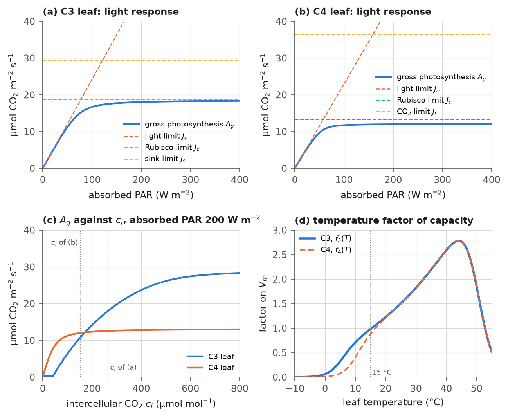
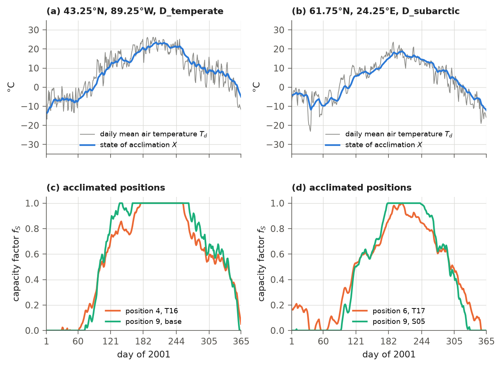
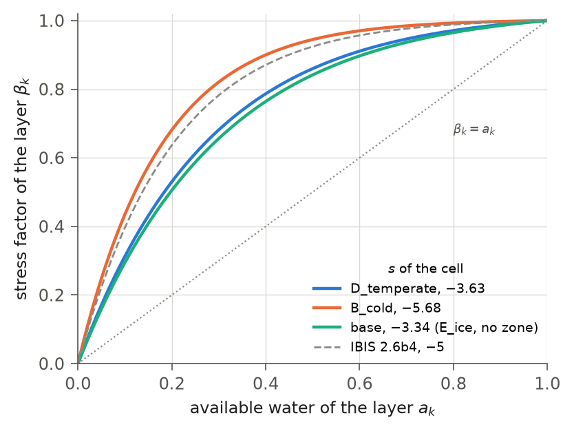
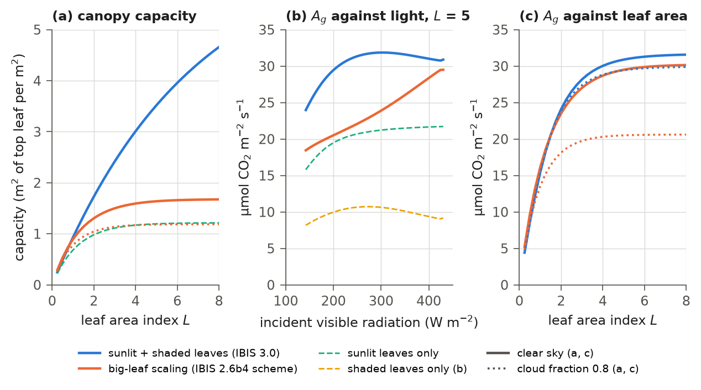

# 9. Photosynthesis and Stomatal Conductance

Leaves take up carbon dioxide and lose water through the same small pores, the stomata. This chapter describes how
IBIS 3.0 computes leaf gross and net photosynthesis, and the stomatal conductance that controls transpiration, in every
time step. Photosynthesis supplies the model's carbon input; stomatal conductance links that input to the water cycle.

The leaf model is that of IBIS 2.6b4 (Foley et al., 1996; Kucharik et al., 2000): the biochemical model of Farquhar et
al. (1980) for C3 plants and of Collatz et al. (1992) for C4 plants, with the co-limitation of Collatz et al. (1991),
coupled to the stomatal conductance model of Ball et al. (1987). As in IBIS 2.6b4, the leaves of a cell are grouped into
five big leaves. IBIS 3.0 adds four features, each controlled by parameter-file switches (Table 9.7) and enabled in
the release:

- each big leaf is divided into sunlit and shaded leaves, with a photosynthetic capacity that declines through the
  canopy (section 9.6);
- the capacity and the stomatal slope of a big leaf are averaged over the plant types it contains (sections 9.3.2 and
  9.5);
- the capacity of the evergreen conifers and the evergreen shrubs follows the season's temperature (section 9.3.3);
- the photosynthesis of a big leaf is divided among its plant types by leaf area and capacity (section 9.8).

With all of these switches off, the leaf and canopy calculation is that of IBIS 2.6b4, apart from the differences
listed in section 9.11. Chapter 4 describes the radiation the leaves absorb; Chapter 5 the transfer coefficients, the
canopy air and the transpiration; Chapters 10 and 11 how the phenology and the carbon balance use the photosynthesis.
Section 9.12 lists what changed in the code after the release.

## 9.1 Big leaves and the order of the calculation

IBIS groups a cell's foliage into five big leaves and computes photosynthesis for each group as a single leaf,
instead of computing it separately for every plant type.

The twelve plant functional type positions (Table 1.1) form the five big leaves of Table 9.1: two in the upper canopy
and three in the lower canopy. Each big leaf shares its canopy's leaf temperature and has a single capacity, stomatal slope and stomatal state.
That state consists of the CO2 mole fractions at the leaf surface and inside the leaf, and stomatal conductance.
Photosynthesis is computed per unit leaf area and shared by all positions in the big leaf.

**Table 9.1** The five big leaves. Group: the Ball-Berry parameter group of Table 9.3. Priority pick: the position whose
capacity the big leaf takes in IBIS 2.6b4 (and in IBIS 3.0 with `stomata.vmax_mix` off): the first listed position that
exists in the cell, or the last listed position if none of the others does.

| Big leaf | Canopy | Positions | Pathway | Group | Priority pick |
|---|---|---|---|---|---|
| broadleaf (ub) | upper | 1, 2, 3, 5, 7 | C3 | broadleaf | 1, else 3, else 5 |
| conifer (uc) | upper | 4, 6, 8 | C3 | conifer | 4, else 6 |
| shrub (ls) | lower | 9, 10 | C3 | shrub | 9 |
| C3 grass (l3) | lower | 12 | C3 | C3 grass | 12 |
| C4 grass (l4) | lower | 11 | C4 | C4 grass | 11 |

The calculation is step 6 of the time step (Table 1.3). It starts with the soil-water stress factors of the two canopies
(section 9.4), computed once per time step. The canopy exchange is then iterated three times. Each iteration computes
the transfer coefficients (Chapter 5), then the photosynthesis and stomatal conductance of the five big leaves (sections
9.2-9.7), and then the energy and water vapour balance of the canopy (Chapter 5). That balance updates the leaf
temperatures and the temperature and humidity of the canopy air for the next iteration. The third iteration supplies photosynthesis for the time step. Each canopy's temperature-dependent parameters use
its leaf temperature from the current iteration: $`T_u`$ for the upper and $`T_l`$ for the lower canopy (K).

## 9.2 Leaf photosynthesis

The leaf model computes CO2 fixation per square metre of leaf. Three processes limit this rate: light absorption;
the amount and activity of Rubisco, which determine photosynthetic capacity; and either sugar use in C3 plants or CO2
uptake at low concentrations in C4 plants. The model combines these limits smoothly instead of selecting their minimum.

### 9.2.1 Temperature dependence

Photosynthesis speeds up with temperature up to an optimum and slows down above it. The kinetic constants of the C3
model depend on the leaf temperature $`T`$ (K) as

```math
\tau = \tau_{15}\,e^{-4500\,r}, \qquad K_{c} = K_{c,15}\,e^{6000\,r}, \qquad K_{o} = K_{o,15}\,e^{1500\,r}, \qquad
\Gamma_{*} = \frac{o}{2\,\tau}, \qquad r = 3.47 \times 10^{-3} - \frac{1}{T},
\tag{9.1}
```

where $`\tau`$ is the CO2/O2 specificity ratio of Rubisco (how strongly the enzyme prefers CO2 to O2); $`K_{c}`$ and $`K_{o}`$
(mol mol⁻¹) are the Michaelis-Menten constants for CO2 and O2; $`\Gamma_{*}`$ (mol mol⁻¹) is the CO2 compensation point in
the absence of dark respiration; $`o`$ (mol mol⁻¹) is the O2 mole fraction (`stomata.o2conc`); $`\tau_{15}`$, $`K_{c,15}`$ and
$`K_{o,15}`$ are the values at 15 °C (Table 9.2); and $`r`$ (K⁻¹) is $`3.47 \times 10^{-3}`$ K⁻¹, the inverse of 288.2 K,
minus $`1/T`$, so that $`r`$ is positive above about 15 °C. At 25 °C, (9.1) gives $`\Gamma_{*} = 39.2`$ µmol mol⁻¹,
$`K_{c} = 301`$ µmol mol⁻¹ and $`K_{o} = 0.298`$ mol mol⁻¹. The photosynthetic capacity is multiplied by a temperature
factor,

```math
f_{3}(T) = \frac{e^{3500\,r}}{\left[1 + e^{0.4\,(5 - T_{c})}\right]\left[1 + e^{0.4\,(T_{c} - 50)}\right]}, \qquad
f_{4}(T) = \frac{e^{3500\,r}}{\left[1 + e^{0.4\,(10 - T_{c})}\right]\left[1 + e^{0.4\,(T_{c} - 50)}\right]},
\tag{9.2}
```

where $`f_{3}`$ applies to the C3 and $`f_{4}`$ to the C4 big leaf, and $`T_{c} = T - 273.16`$ (°C) is the leaf temperature in
degrees Celsius. The two factors differ only in their low-temperature term: $`f_{3}`$ is 0.98 at 15 °C,
$`f_{3}(5\ °\mathrm{C}) = 0.32`$ and $`f_{4}(10\ °\mathrm{C}) = 0.40`$; both are 1.50 at 25 °C and reach their maximum,
2.78, at 44.1 °C (Figure 9.1d).

The rates of a big leaf are computed from its capacity at 15 °C, $`V_{m}`$ (mol CO2 m⁻² s⁻¹; section 9.3), as

```math
V = V_{m}\,f(T)\,\beta, \qquad R_{d} = \gamma\,V_{m}\,f(T),
\tag{9.3}
```

where $`V`$ (mol CO2 m⁻² s⁻¹) is the maximum carboxylation rate under the current conditions; $`f`$ is $`f_{3}`$ or $`f_{4}`$;
$`\beta`$ is the soil-water stress factor of the canopy (section 9.4); $`R_{d}`$ (mol CO2 m⁻² s⁻¹) is the leaf dark
respiration; and $`\gamma`$ is the respiration coefficient of the big leaf's group (Table 9.3). Water stress lowers the
capacity but not the dark respiration.

### 9.2.2 C3 photosynthesis

A C3 leaf has three limiting rates,

```math
J_{e} = 4.59 \times 10^{-6}\,\alpha_{3}\,Q\,\frac{c_{i} - \Gamma_{*}}{c_{i} + 2\,\Gamma_{*}}, \qquad
J_{c} = V\,\frac{c_{i} - \Gamma_{*}}{c_{i} + K_{c}\,(1 + o/K_{o})}, \qquad
J_{s} = \frac{V}{2.2},
\tag{9.4}
```

where $`J_{e}`$, $`J_{c}`$ and $`J_{s}`$ (mol CO2 m⁻² s⁻¹) are the light-limited, the Rubisco-limited and the sink-limited
(sucrose synthesis) rates; $`Q`$ (W m⁻²) is the photosynthetically active radiation absorbed by the leaf, and
$`4.59 \times 10^{-6}`$ mol J⁻¹ converts it to photons; $`\alpha_{3}`$ is the intrinsic quantum efficiency; and $`c_{i}`$
(mol mol⁻¹) is the CO2 mole fraction inside the leaf (the intercellular CO2). The rates are combined in two steps, each
taking the smaller root of a quadratic,

```math
\theta_{3}\,J_{p}^{2} - (J_{e} + J_{c})\,J_{p} + J_{e}\,J_{c} = 0, \qquad
\beta_{3}\,A_{g}^{2} - (J_{p} + J_{s})\,A_{g} + J_{p}\,J_{s} = 0, \qquad A_{n} = A_{g} - R_{d},
\tag{9.5}
```

where $`J_{p}`$ (mol CO2 m⁻² s⁻¹) is the intermediate rate; $`A_{g}`$ and $`A_{n}`$ (mol CO2 m⁻² s⁻¹) are the gross and the
net photosynthesis; and $`\theta_{3}`$ and $`\beta_{3}`$ are curvature parameters (Table 9.2), which determine how sharply the rate shifts from one limiting process to another. As in IBIS 2.6b4, the smaller root is evaluated as $`\min(q/\theta,\, J_{1}J_{2}/q)`$ with
$`q = \tfrac{1}{2}\left[J_{1} + J_{2} + \sqrt{\max\left((J_{1} + J_{2})^{2} - 4\theta J_{1}J_{2},\, 0\right)}\right] + 10^{-15}`$, where $`J_{1}`$ and $`J_{2}`$ are the two rates and $`\theta`$ the curvature.

### 9.2.3 C4 photosynthesis

A C4 leaf has the limiting rates

```math
J_{e} = 4.59 \times 10^{-6}\,\alpha_{4}\,Q, \qquad J_{c} = V, \qquad J_{i} = 18 \times 10^{3}\,V\,c_{i},
\tag{9.6}
```

where $`J_{i}`$ (mol CO2 m⁻² s⁻¹) is the CO2-limited rate; $`18 \times 10^{3}`$ (mol mol⁻¹)⁻¹ is the initial slope of the
CO2 response per unit capacity; and $`\alpha_{4}`$ is the quantum efficiency of C4 photosynthesis. $`J_{e}`$ and $`J_{c}`$
are combined into $`J_{p}`$ by the first quadratic of (9.5) with $`\theta_{4}`$ in place of $`\theta_{3}`$, and $`J_{p}`$ and
$`J_{i}`$ into $`A_{g}`$ by the second with $`\beta_{4}`$ in place of $`\beta_{3}`$; $`A_{n} = A_{g} - R_{d}`$.

Figure 9.1 shows how the two leaf models respond to light, to intercellular CO2 and to temperature.



**Figure 9.1** The leaf model, equations (9.1)-(9.6), with the release parameters (Table 9.2), at a leaf temperature of
25 °C and without water stress. (a) Gross photosynthesis of a C3 leaf with the capacity of type T15 ($`V_{m}`$ = 43.2
µmol m⁻² s⁻¹) at $`c_{i}`$ = 266 µmol mol⁻¹ (0.7 of 380 µmol mol⁻¹), against the absorbed PAR, with its three limiting
rates. (b) The same for a C4 leaf with the capacity of type G01 ($`V_{m}`$ = 8.9 µmol m⁻² s⁻¹) at $`c_{i}`$ = 152 µmol
mol⁻¹ (0.4 of 380 µmol mol⁻¹). (c) Gross photosynthesis of the two leaves against $`c_{i}`$ at an absorbed PAR of 200
W m⁻²; as in the model, the C3 leaf's $`c_{i}`$ is held at or above $`1.05\,\Gamma_{*}`$. The dotted lines mark the
$`c_{i}`$ values of (a) and (b). (d) The temperature factors of
the capacity, (9.2); $`f_{3}`$ and $`f_{4}`$ differ by less than 1 % above about 21 °C, where the dashed $`f_{4}`$ overlies
$`f_{3}`$. The dotted line marks 15 °C, the reference temperature of $`V_{m}`$; $`f_{3}`$ is 0.98 there.
Drawn by `figures/make_ch09.py` from the model's leaf routines and the release parameter file; the code
changes after the release (section 9.12) do not alter it.

## 9.3 Photosynthetic capacity

The capacity $`V_{m}`$ determines how fast a leaf can photosynthesize when light is plentiful. In IBIS 3.0 it depends on
plant type and the cell's cropland share. For evergreen conifers and evergreen shrubs it also varies with the season.

### 9.3.1 Capacity of a position

The capacity at 15 °C of position $`j`$ in cell $`c`$ is

```math
V_{m,j} = V^{0}_{c,j}\,f_{S,j}\,g_{j},
\tag{9.7}
```

where $`V^{0}_{c,j}`$ (mol CO2 m⁻² s⁻¹) is the capacity given in the parameter file, gathered for the type that occupies
the position by (2.1) from the base values of Table 9.4 (`stomata.vmax`) and the type values of Table 9.5
(`types.<type>.vmax`); $`f_{S,j}`$ is the acclimation factor of section 9.3.3, which is 1 in the positions that do not
acclimate; and $`g_{j}`$ is the cropland factor of (2.11) in the grass positions 11 and 12 and 1 in the others
(Chapter 15).

### 9.3.2 Capacity of a big leaf

A big leaf may hold several positions with different capacities. With `stomata.vmax_mix` on (as in the release), its
capacity is the mean over its positions, weighted by their displayed leaf area,

```math
V_{m,b} = \frac{\sum_{j \in b} \phi_{j}\,V_{m,j}}{\sum_{j \in b} \phi_{j}},
\tag{9.8}
```

where $`\phi_{j}`$ is the share of position $`j`$ in the displayed leaf area of its canopy (`vegetation.frac`, set by the
phenology of Chapter 10), and the sums run over the positions of big leaf $`b`$ in Table 9.1. If a big leaf's positions display no leaves ($`\sum_{j \in b} \phi_{j} \le 10^{-6}`$), its capacity comes from the
priority pick (Table 9.1). The C3 and the C4 grass big leaves hold one position each and take its capacity.

With `stomata.vmax_mix` off, each big leaf uses its priority pick, as in IBIS 2.6b4 (`physiology.f`). The broadleaf
big leaf uses the capacity of position 1 if it exists in the cell, otherwise position 3 if it exists, and otherwise
position 5. The conifer big leaf uses position 4 if it exists, otherwise position 6; the shrub big leaf uses position
9. Photosynthesis then does not use the capacities of positions 2, 7, 8 and 10, although they still weight the division
(9.25) when `stomata.gpp_split_by_capacity` is on.

### 9.3.3 Temperature acclimation

Evergreen conifers retain their needles in winter, but their photosynthetic capacity falls and then recovers slowly
as spring warms. With `stomata.acclim_on` on (as in the release), the capacity of positions 4,
6 and 9 (`stomata.acclim_pfts`: the temperate and boreal evergreen conifers and the evergreen shrubs) follows an air-temperature acclimation state. This state is the first-order delayed response to daily mean air
temperature described by Mäkelä et al. (2004), in the discrete daily form used by PRELES (Peltoniemi et al., 2015),

```math
X_{d} = X_{d-1} + \frac{T_{d} - X_{d-1}}{\tau_{S}}, \qquad
f_{S,j} = \min\left[\max\left(\frac{X_{d} - S_{0,j}}{S_{max,j}},\, 0\right),\, 1\right],
\tag{9.9}
```

where $`X_{d}`$ (°C) is the state of acclimation of the cell on day $`d`$ (`seasonal.acclim_x`); $`T_{d}`$ (°C) is the daily
mean air temperature of the forcing (`tas`; Chapter 3); $`\tau_{S}`$ = 10.93 d is the time constant
(`stomata.acclim_tau`); $`f_{S,j}`$ is the factor on the capacity of position $`j`$; $`S_{0,j}`$ (°C) is the state below
which the position has no capacity; and $`S_{max,j}`$ (°C) is the range of the state over which its capacity rises to
full. The state is updated once a day, before the phenology and the time steps of the day. It starts at 0 °C in a cold
start and is carried in the restart file. Because the factor multiplies $`V_{m}`$, it also scales the dark respiration
(9.3).

With `stomata.acclim_per_pft` on (as in the release), $`S_{0}`$ and $`S_{max}`$ are set per position. The parameter file
gives base values for positions 4 and 6 (`stomata.acclim_s0_pft`, `stomata.acclim_smax_pft`; Table 9.4); the other
positions take the scalars `stomata.acclim_s0` = −3.063 °C and `stomata.acclim_smax` = 17.72 °C; and the six evergreen
conifer types of Table 9.5 set their own values, gathered by (2.1). The capacity is full ($`f_{S} = 1`$) only while $`X`$
is above $`S_{0} + S_{max}`$: 19.24 °C for type T16, 18.72 °C for type T17 and 14.66 °C for the evergreen shrub positions.
The factor is therefore below 1 in a cool summer as well (Figure 9.2). While $`X_{d}`$ lies between $`S_{0,j}`$ and
$`S_{0,j} + S_{max,j}`$, the capacity of the position is $`V^{0}_{c,j}(X_{d} - S_{0,j})/S_{max,j}`$. In this range, capacity depends on $`V^{0}_{c,j}`$ and $`S_{max,j}`$ only through their ratio. A fitted $`V^{0}_{c,j}`$ for
an acclimated type therefore need not represent a capacity that its leaves reach in the field. At the second cell of Figure 9.2, type T17 reaches its capacity
$`V^{0}_{c,j}`$ on one day of 2001.



**Figure 9.2** The state of acclimation and the capacity factor, (9.9), in 2001 at two cells, computed from the GSWP3
daily mean air temperature of 2000 and 2001 starting from 0 °C on 1 January 2000. (a, b) The daily mean temperature and
the state of acclimation at 43.25°N, 89.25°W (zone D_temperate in the Köppen map of 1991-2020) and at 61.75°N,
24.25°E (zone D_subarctic). (c) The factor of position 4, type T16 ($`S_{0}`$ = −6.36 °C, $`S_{max}`$ = 25.60 °C), and
of the evergreen shrub position 9 with its base values ($`S_{0}`$ = −3.06 °C, $`S_{max}`$ = 17.72 °C) at the first cell:
the mean factor in June-August is 0.96 and 0.99, in December-February 0.12 and 0.11. (d) The factor of position 6,
type T17 ($`S_{0}`$ = −8.62 °C, $`S_{max}`$ = 27.34 °C), and of position 9, type S05, which keeps the base values, at the
second cell: 0.86 and 0.93 in June-August, 0.09 and 0.00 in December-February; the factor of T17 reaches 1 on one day
of the year. Drawn by `figures/make_ch09.py` with the release parameter file; the code changes after the release do not
alter it.

Two additional acclimation options are disabled in the release.

- `stomata.acclim_light` also lowers the light-limited rate $`J_{e}`$ in the cold season. $`J_{e}`$ of a big leaf is
  multiplied by the factor by which the acclimation (and the frost ramp below, if on) lowers the big leaf's capacity:
  the ratio of its capacity (section 9.3.2) computed with the factors $`f_{S,j}`$ to its capacity computed without them.
  With `stomata.acclim_on` enabled, the cropland factor $`g_{j}`$ is excluded from this ratio. The option then acts
  only on the conifer and shrub big leaves, which hold the acclimated positions; the ratio is 1 for the broadleaf and
  two grass big leaves. With acclimation disabled, an implementation exception remains: the cropland factor also
  scales the grasses' light-limited rate (section 9.12).
- `stomata.frost_on` multiplies the factor $`f_{S,j}`$ of each acclimated position by a frost ramp of the day's mean air
  temperature $`T_{d}`$ (°C), $`\min\left[\max\left((T_{d} - T_{0})/(T_{1} - T_{0}),\, 0\right),\, 1\right]`$, which rises
  from 0 at $`T_{0}`$ = −5 °C (`stomata.frost_t0`) to 1 at $`T_{1}`$ = 5 °C (`stomata.frost_t1`). The model writes the
  day's mean air temperature of the forcing into the atmosphere state (`atm.td`) at the start of each day, and the ramp
  reads it there.

## 9.4 Soil-water stress

Drying soil causes plants to close their stomata and reduce photosynthesis. IBIS represents this response with a
stress factor calculated from water accessible to the roots, ranging from 0 (fully stressed) to 1 (no stress). The stress factor of a soil
layer depends on the plant-available water of the layer,

```math
a_{k} = \min\left[\max\left(\frac{w_{k}\,(1 - w_{i,k}) - w_{w,k}}{w_{f,k} - w_{w,k}},\, 0\right),\, 1\right], \qquad
\beta_{k} = \min\left[\max\left(\frac{1 - e^{s\,a_{k}}}{1 - e^{s}},\, 0\right),\, 1\right],
\tag{9.10}
```

where $`a_{k}`$ is the available water of layer $`k`$; $`w_{k}`$ is the liquid water content of the layer as a fraction of the
pore space not occupied by ice, and $`w_{i,k}`$ its ice content as a fraction of the pore space, so that
$`w_{k}(1 - w_{i,k})`$ is the liquid water as a fraction of the pore space (Chapter 7); $`w_{w,k}`$ and $`w_{f,k}`$ are the
wilting point and the field capacity as fractions of the pore space (section 2.6); $`\beta_{k}`$ is the stress factor of
the layer, 1 for no stress; and $`s`$ (dimensionless, negative) is the shape parameter `stomata.stressfac`. A more
negative $`s`$ makes $`\beta_{k}`$ rise faster with $`a_{k}`$, that is, applies less stress (Figure 9.3). Only liquid water
counts, so a frozen layer reads as dry. The stress factors of the two canopies are the root-weighted sums

```math
\beta_{u} = \sum_{k=1}^{6} r_{u,k}\,\beta_{k}, \qquad \beta_{l} = \sum_{k=1}^{6} r_{l,k}\,\beta_{k},
\tag{9.11}
```

where $`r_{u,k}`$ and $`r_{l,k}`$ are the root fractions of the upper and the lower canopy in layer $`k`$, (2.8). The layer
terms $`r_{u,k}\beta_{k}`$ and $`r_{l,k}\beta_{k}`$ also divide the transpiration of each canopy among the soil layers
(Chapter 7), and $`\beta_{u}`$ and $`\beta_{l}`$ enter the drought trigger of the phenology (Chapter 10). Chapter 7 writes
$`s`$ as $`c`$ and $`\beta_{u}`$, $`\beta_{l}`$ as $`S_{u}`$, $`S_{l}`$ ((7.10)-(7.11)).

With the climate-zone types on, $`s`$ is a value per cell given by (2.2): the median of the values of the zone's types
(Table 9.5). Cells in the zone E_ice, which holds no type, and cells without a zone keep the base value of the parameter
file, `stomata.stressfac` = −3.339. Table 9.6 (section 9.9) gives the values of each zone; over the zones with types
they range from −5.678 (B_cold) to −3.627 (D_temperate). IBIS 2.6b4 fixes $`s = -5`$ in the code (`physiology.f`).



**Figure 9.3** The stress factor of a soil layer against its available water, (9.10), for the largest and the
smallest value of $`s`$ among the zones with types in the release (D_temperate, −3.63, the most stress of these zones,
and B_cold, −5.68, the least), the base value of the release (−3.34; zone E_ice and cells without a zone) and the
value of IBIS 2.6b4 (−5). At $`a_{k}`$ = 0.3 the factor is 0.68, 0.82, 0.66 and 0.78. The dotted line is
$`\beta_{k} = a_{k}`$. Drawn by `figures/make_ch09.py` with the release parameter file; the code changes after the release
do not alter it.

## 9.5 Stomatal conductance

Stomata open wider during rapid photosynthesis in humid air and close as photosynthesis slows or the soil dries. The stomatal conductance follows Ball et al. (1987),

```math
g_{s} = m\,\frac{A_{n}\,h_{a}}{c_{s}} + b\,\beta,
\tag{9.12}
```

where $`g_{s}`$ (mol m⁻² s⁻¹) is the stomatal conductance to water vapour per unit leaf area; $`m`$ is the slope; $`h_{a}`$
is the relative humidity of the canopy air; $`c_{s}`$ (mol mol⁻¹) is the CO2 mole fraction at the leaf surface; and $`b`$
(mol m⁻² s⁻¹) is the conductance at zero net photosynthesis, which the water stress $`\beta`$ reduces.

Equation (9.12) is coupled to the diffusion of CO2 across the leaf boundary layer and through the stomata. The model solves these three coupled relationships by relaxation, advancing one relaxation step in each of the three
canopy-exchange iterations. The relaxation state carries over from one time step to the next. At a cold start $`c_{i}`$ and $`c_{s}`$ are 350 µmol mol⁻¹ and
$`g_{s}`$ is 0.01 mol m⁻² s⁻¹ for every big leaf; the state is part of the restart file. In each iteration, $`c_{i}`$ is
first held to $`[1.05\,\Gamma_{*},\, c_{i,max}]`$ (C4: $`[0,\, c_{i,max}]`$), the rates of section 9.2 are computed from
it, and then

```math
\begin{aligned}
c_{s} &\leftarrow \max\left[c_{s,min},\; \tfrac{1}{2}\left(c_{s} + c_{a} - \frac{A_{n}}{g_{b}}\right)\right], \\
g_{s} &\leftarrow \max\left[g_{s,min},\; b\,\beta,\; \tfrac{1}{2}\left(g_{s} + m\,\frac{A_{n}\,h_{a}}{c_{s}} + b\,\beta\right)\right], \\
c_{i} &\leftarrow \min\left\{\max\left[c_{i,min},\; \tfrac{1}{2}\left(c_{i} + c_{s} - 1.6\,\frac{A_{n}}{g_{s}}\right)\right],\; c_{i,max}\right\},
\end{aligned}
\tag{9.13}
```

where $`c_{a}`$ (mol mol⁻¹) is the atmospheric CO2 mole fraction (section 3.10); $`g_{s,min}`$ (mol m⁻² s⁻¹) is the minimum
conductance (Table 9.3); 1.6 is the ratio of the diffusivities of water vapour and CO2; $`c_{s,min} = c_{i,min} = 1.05\,\Gamma_{*}`$ for the C3 big leaves; and $`c_{s,min} = 10^{-8}`$ and $`c_{i,min} = 0`$ for the C4 big leaf. On the right of each line, $`c_{s}`$, $`g_{s}`$ and $`c_{i}`$ denote the values before the update, with two exceptions:
the update of $`g_{s}`$ uses the new $`c_{s}`$, and the update of $`c_{i}`$ uses the new $`c_{s}`$ and $`g_{s}`$. The factor ½ averages the new value with the old
one, which damps oscillations between iterations. The boundary-layer conductance for CO2 and the relative humidity are

```math
g_{b} = \min\left[\max\left(25.5\,s_{v},\; 0.1\right),\; 10\right], \qquad
h_{a} = \max\left[\frac{q_{c}}{q_{sat}(T_{c,a}, p)},\; 0.30\right],
\tag{9.14}
```

where $`g_{b}`$ (mol m⁻² s⁻¹) is the boundary-layer conductance for CO2; $`s_{v}`$ (kg m⁻² s⁻¹) is the transfer coefficient
between the leaves and the canopy air of the canopy, $`s_{u}`$ or $`s_{l}`$ (Chapter 5); 25.5 mol kg⁻¹, the constant of the
code, equals $`1/(0.029 \times 1.35)`$ to three digits, with 0.029 kg mol⁻¹ the molar mass of air; $`q_{c}`$ (kg kg⁻¹) and
$`T_{c,a}`$ (K) are the specific humidity and the temperature of the canopy air of the canopy (the air at $`z_{12}`$ for
the upper and at $`z_{34}`$ for the lower canopy; Chapter 5); $`p`$ (Pa) is the surface pressure; and $`q_{sat}`$ is the
saturation specific humidity (3.12). In the release the relaxation (9.13) uses the canopy-mean net photosynthesis of
section 9.6.1; with `stomata.sunshade_u` or `stomata.sunshade_l` off, it uses the net photosynthesis of the top leaf,
as in IBIS 2.6b4.

With `stomata.coefm_mix` on (as in the release), the slope of a big leaf is the displayed-leaf-area mean of the slopes
of its positions, as in (9.8),

```math
m_{b} = \frac{\sum_{j \in b} \phi_{j}\,m_{j}}{\sum_{j \in b} \phi_{j}},
\tag{9.15}
```

where $`m_{j}`$ is the slope of position $`j`$, gathered by (2.1) from the base values of Table 9.4 (`stomata.coefm_pft`)
and the type values of Table 9.5 (`types.<type>.coefm`). Where the big leaf displays no leaves, it takes the slope of
its group (Table 9.3). The C3 and C4 grass big leaves take the slopes of positions 12 and 11. With `stomata.coefm_mix`
off, every big leaf takes the slope of its group, as in IBIS 2.6b4. The remaining parameters, $`\gamma`$ of (9.3) and $`b`$ and $`g_{s,min}`$ of (9.12)-(9.13), retain their group values in
either case.

## 9.6 Canopy integration

The leaf model computes rates for a single leaf, while light varies greatly within a canopy: upper leaves receive
full sunlight and lower leaves are shaded. The model uses one of two methods to average each big leaf's rates over
the canopy, per unit leaf area.

### 9.6.1 Sunlit and shaded leaves

With `stomata.sunshade_u` and `stomata.sunshade_l` on (as in the release), each canopy is divided into sunlit and
shaded leaves, after de Pury and Farquhar (1997). The division uses the absorbed visible radiation of the two-stream
solution of Chapter 4 (section 4.8). The visible radiation absorbed per unit plant area (leaves and stems) at a depth of
cumulative plant area $`x`$ from the top of the canopy is, as (4.24),

```math
P(x) = A\,e^{-Kx} + B\,e^{-hx} + C\,e^{hx},
\tag{9.16}
```

where $`A`$, $`B`$ and $`C`$ (W m⁻²) are the coefficients (4.25) of the visible two-stream solution of the canopy
and $`K`$ and $`h`$ (per unit plant area) are the extinction coefficient of the
direct beam and the exponent of the diffuse part of that solution (section 4.8). The unscattered direct beam absorbed
per unit plant area at $`x`$ is $`Q_{beam}\,e^{-Kx}`$, with $`Q_{beam} = (1 - \omega)\,K\,S^{\mu}_{top}`$ of (4.26) (W m⁻²), where $`\omega`$ is the single-scattering albedo of the canopy elements in the visible band
and $`S^{\mu}_{top}`$ (W m⁻²) is the visible direct beam incident on the canopy. The direct beam reaches the fraction
$`e^{-Kx}`$ of the plant area at depth $`x`$. A sunlit element absorbs the unscattered beam plus the diffuse and scattered
radiation; a shaded element absorbs the diffuse and scattered radiation only. The leaves are the fraction
$`f_{L} = L/(L+S)`$ of the plant area at every depth and the only part of it that photosynthesizes, where $`L`$ and $`S`$
(m² m⁻²) are the leaf and stem area indices of the canopy (per unit area of the canopy's cover). With
$`E(a) = \int_{0}^{L+S} e^{-ax}\,dx = (1 - e^{-a(L+S)})/a`$, the visible radiation absorbed by all leaves and by the
sunlit leaves per unit area of the canopy is

```math
Q_{tot} = f_{L}\,\max\left[A\,E(K) + B\,E(h) + C\,E(-h),\; 0\right], \qquad
Q_{sun} = f_{L}\,\left[A\,E(2K) + B\,E(K + h) + C\,E(K - h) + Q_{beam}\,\bigl(E(K) - E(2K)\bigr)\right],
\tag{9.17}
```

with $`Q_{sun}`$ held to $`[0,\, Q_{tot}]`$; the shaded leaves absorb $`Q_{sha} = Q_{tot} - Q_{sun}`$ (W m⁻²). Leaves deeper in a canopy have less capacity than those at the top. Capacity per unit leaf area declines
exponentially with cumulative leaf area $`f_{L}x`$, at a rate set by $`K_{n}`$ (`stomata.cap_kn` = 0.15; Table 9.2).
The sunlit and shaded leaf areas and capacities are given below, with capacities expressed in units of the capacity
of a leaf at the top of the canopy ("top leaves"):

```math
L_{sun} = f_{L}\,E(K), \quad L_{sha} = \max(L - L_{sun},\, 0), \quad
v_{sun} = f_{L}\,E(K_{n}f_{L} + K), \quad v_{sha} = \max\left[f_{L}\,E(K_{n}f_{L}) - v_{sun},\, 0\right],
\tag{9.18}
```

where $`v_{sun} + v_{sha} = (1 - e^{-K_{n}L})/K_{n}`$ (m² m⁻²). The leaf model is applied once to the sunlit and once to
the shaded leaves, each time to their totals: (9.4)-(9.6) with $`Q = Q_{sun}`$, $`V v_{sun}`$ in place of $`V`$ and
$`R_{d} v_{sun}`$ in place of $`R_{d}`$ for the sunlit leaves, and likewise for the shaded ones. The rates of the leaf model
are proportional to $`Q`$, $`V`$ and $`R_{d}`$ when all three are scaled by the same factor, so this treats each class as one
leaf whose light and capacity are the class totals: the two-big-leaf approximation of de Pury and Farquhar (1997).

Within each class, light and photosynthetic capacity follow different profiles. The diffuse radiation decays with $`h`$ (0.93 per
unit plant area for the canopy of Figure 9.4) and the capacity with $`K_{n}f_{L}`$ (0.12), so the shaded leaves near the
top of the canopy receive far more light than those at the bottom while their capacities are nearly equal. Because the light response is concave, a single leaf receiving the class-mean light yields a higher rate than the
average of the individual leaves. The two-class total therefore exceeds the layer-by-layer integral of the leaf model
over the same profile. For the canopy of Figure 9.4 at $`L`$ = 5,
the excess is 0.6 % under a clear sky, 7.1 % at a cloud fraction of 0.8 and 8.6 % under an overcast sky: it grows with
the diffuse share of the light. The canopy-mean rates per unit leaf area are

```math
A_{g,c} = \frac{A_{g,sun} + A_{g,sha}}{L}, \qquad A_{n,c} = \frac{A_{n,sun} + A_{n,sha}}{L},
\tag{9.19}
```

and zero without leaves. Both use the $`c_{i}`$ of the big leaf at the start of the iteration, and the relaxation (9.13)
uses $`A_{n,c}`$. When absorbed PAR is zero, the canopy-mean net photosynthesis is the dark respiration of the
canopy's capacity, $`-R_{d}(1 - e^{-K_{n}L})/(K_{n}L)`$. Each big leaf uses its canopy's light profile: the two upper big leaves use the upper-canopy profile, and the three
lower big leaves use the lower-canopy profile. At a tower,
nonzero observed shortwave can still supply diffuse PAR when the model's mid-step sun angle is zero: the nighttime
mask on absorbed shortwave does not also mask these PAR coefficients (Chapter 4). The zero-light limit therefore
does not describe every step classified as night by that sun angle.

### 9.6.2 The big-leaf scaling of IBIS 2.6b4

With the switches off, the model computes the rates of a leaf at the top of the canopy and multiplies them by a canopy
scaling factor, as IBIS 2.6b4 does. The rates of the top leaf are computed with the absorbed radiation
$`P_{top} = (A + B + C)\,L/(L + S)`$ of (4.26) (W m⁻²): the radiation absorbed per unit
plant area at the top of the canopy times the leaves' share of the plant area. The profile (9.16) is approximated by one
exponential with the coefficient

```math
k_{e} = \min\left[\max\left(\frac{K\,A + h\,B - h\,C}{A + B + C},\; 0.1\right),\; 10\right],
\tag{9.20}
```

the slope of $`-\ln P`$ at the top of the canopy. During the day ($`P_{top} > 10`$ W m⁻²) and where the canopy has leaves,
the scaling factor and two running means are

```math
\Lambda = \frac{1 - e^{-k_{e}(L + S)}}{k_{e}\,L}, \qquad
\overline{\Lambda P} \leftarrow w\,\overline{\Lambda P} + (1 - w)\,\Lambda\,P_{top}, \qquad
\overline{P} \leftarrow w\,\overline{P} + (1 - w)\,P_{top}, \qquad w = e^{-\Delta t/(10 \cdot 86400\ \mathrm{s})},
\tag{9.21}
```

and otherwise $`\Lambda = \overline{\Lambda P}/\max(\overline{P},\, 10^{-7})`$ with the running means unchanged;
$`\Lambda = 0`$ without leaves. Here $`\Lambda`$ is the ratio of the canopy-mean rate per unit leaf area to the top leaf's
rate, and $`\Delta t`$ = 3600 s. As in IBIS 2.6b4, the running means $`\overline{\Lambda P}`$ and $`\overline{P}`$ are updated in each of the three
iterations per time step. Their weight per time step is therefore $`w^{3}`$, giving an e-folding memory of 80 daylight
time steps rather than the 240 implied by the nominal 10 days. The canopy-mean rates are $`A_{g,c} = \Lambda A_{g}(P_{top})`$ and
$`A_{n,c} = \Lambda A_{n}(P_{top})`$.

In this scheme the capacity of a canopy is that of $`\Lambda L = (1 - e^{-k_{e}(L+S)})/k_{e}`$ top leaves, which
approaches $`1/k_{e}`$ in a dense canopy. This is $`(L+S)/L`$ times the capacity $`(1 - e^{-k_{e}(L+S)})\,L/((L+S)\,k_{e})`$
that the leaves alone would have: the stems' area is counted in the capacity. The radiation that the stems absorb is
not credited to the leaves. Because $`P_{top}`$ carries the leaves' share $`L/(L+S)`$, the light-limited canopy rate
corresponds to an absorbed radiation $`P_{top}\Lambda L = (A + B + C)(1 - e^{-k_{e}(L+S)})\,L/(k_{e}(L+S))`$, close to
the leaves' share of the radiation that the canopy absorbs. For the canopy of Figure 9.4 at $`L`$ = 5 under a clear sky,
$`P_{top}\Lambda L`$ is 311.9 W m⁻², the leaves absorb $`Q_{tot}`$ = 322.1 W m⁻² of (9.17), and leaves and stems together
402.6 W m⁻². In the release the factor (9.21) and its running means are still computed but not used.

Three switches of the parameter file modify this scheme. They are off in the release and have no effect when the
sunlit/shaded canopy is on. With `stomata.scale_leaf_only` the denominator of $`\Lambda`$ is $`k_{e}(L + S)`$. This removes
the stems' area from the capacity (1.31 instead of 1.64 top leaves in the example above), but it also applies the
leaves' share $`L/(L+S)`$ to the light a second time ($`P_{top}\Lambda L`$ = 249.5 W m⁻²). With `stomata.cap_scale_u` and
`stomata.cap_scale_l` the Rubisco and sink (C4: CO2) limits and the dark respiration are scaled by
$`(1 - e^{-K_{n}L})/(K_{n}L)`$, and the light limit by $`\Lambda`$, before the co-limitation.

Figure 9.4 compares the two schemes for one broadleaf canopy. At $`L`$ = 5 the sunlit and shaded leaves have the capacity
of 3.52 top leaves and the big leaf, under a clear sky, that of 1.64. The dark respiration of a canopy is $`R_{d}`$ times
its capacity in top leaves in both schemes. At the same $`V_{m}`$ the canopy dark respiration of the release is therefore
2.15 times that of the IBIS 2.6b4 big leaf (3.42 against 1.59 µmol m⁻² s⁻¹ for type T15 at 25 °C), while its gross
photosynthesis under a clear sky is 5 % larger. The tower calibration (Chapter 16) used the sunlit/shaded canopy, so its fitted capacities incorporate this
respiration.

The curves also explain why canopy capacity and photosynthesis do not respond identically to cloudiness.
The sunlit-plus-shaded capacity does not depend on cloud fraction; its sunlit share depends on solar elevation.
The big-leaf capacity $`\Lambda L`$ changes with the sky through $`k_e`$, which is 0.60 under a clear sky and 0.84
at cloud fraction 0.8 when $`L=5`$. Above $`L`$ of about 3, the cloudy big-leaf curve nearly coincides with the sunlit
capacity by coincidence: their limits are $`1/k_e=1.19`$ and $`f_L/(K_n f_L+K)=1.22`$ top leaves, respectively
(1.18 and 1.20 at $`L=5`$).

In panel (b), incident visible radiation ranges from 142 W m⁻² under an overcast sky (transmissivity 0.251 in
equation 3.5) to 430 W m⁻² under a clear sky. As the sky clears, its diffuse fraction falls. Incident diffuse
radiation peaks at a total of 230 W m⁻² (cloud fraction about 0.7); shaded-leaf photosynthesis peaks later,
at about 272 W m⁻². Total sunlit-plus-shaded photosynthesis reaches 31.9 µmol m⁻² s⁻¹ at 303 W m⁻²
(cloud fraction 0.44), above its clear-sky value of 30.9. Big-leaf photosynthesis is largest under a clear sky.
The small kink at the right end comes from holding the diffuse fraction at 0.166 above transmissivity 0.75
(cloud fraction below 0.02), as in equation (3.6).

At $`L=5`$ the two schemes give 30.9 and 29.5 µmol m⁻² s⁻¹ under a clear sky, and 29.4 and 20.5 under cloud
fraction 0.8. Thus the release's cloudy-canopy result nearly coincides with the big-leaf clear-sky result.
These values are computed by `figures/make_ch09.py`.



**Figure 9.4** Two ways to integrate a broadleaf canopy. The example uses type T15 capacity
($`V_m=43.2`$ µmol m⁻² s⁻¹), stem area equal to one quarter of leaf area, a leaf temperature of 25 °C,
$`c_i=266`$ µmol mol⁻¹, no water stress or wet leaves, and the two-stream radiation solution over a surface with
albedo 0.1. Radiation comes from the weather generator at solar noon on 15 July at 43.25°N (cosine of the solar
zenith angle 0.929). Values are per unit area of canopy cover. Blue: the release's sunlit and shaded leaves,
(9.16)–(9.19). Orange: the IBIS 2.6b4 scaling, (9.20)–(9.21), selected by turning off `stomata.sunshade_u`.
(a) Canopy capacity in units of top leaves; the green dashed curve is the sunlit part. (b) Gross photosynthesis
at $`L=5`$ across the generator's range from overcast to clear sky, with the sunlit and shaded contributions.
(c) Gross photosynthesis against leaf area. Solid curves in (a) and (c) use a clear sky; dotted curves use a cloud
fraction of 0.8. Drawn by `figures/make_ch09.py` with release parameters; later code changes do not alter these curves.

## 9.7 Canopy conductance and the wet leaves

Stomatal and leaf boundary-layer conductances together control water vapour loss from dry canopy leaves. Water on wet
leaves blocks gas exchange, so the wet fraction does not photosynthesize. The model uses each big leaf's canopy-mean
net photosynthesis to compute its canopy-mean surface CO2, stomatal conductance and total water-vapour conductance:

```math
c_{s,c} = \max\left(c_{s,min},\; c_{a} - \frac{A_{n,c}}{g_{b}}\right), \qquad
g_{s,c} = \max\left(g_{s,min},\; b\,\beta,\; m\,\frac{A_{n,c}\,h_{a}}{c_{s,c}} + b\,\beta\right), \qquad
G = \left(\frac{1}{s_{v}} + \frac{1}{0.029\,g_{s,c}}\right)^{-1},
\tag{9.22}
```

where $`c_{s,c}`$ (mol mol⁻¹) and $`g_{s,c}`$ (mol m⁻² s⁻¹) are the canopy-mean surface CO2 and stomatal conductance, and
$`G`$ (kg m⁻² s⁻¹) is the conductance of the stomata and
the leaf boundary layer in series, the stomatal conductance being converted to kg m⁻² s⁻¹ with the molar mass of air.
The conductances of the big leaves, weighted by the displayed-leaf-area shares $`\phi_{j}`$ of the positions, give the
transpiration of the dry leaves of each canopy (Chapter 5). Each position transpires through the conductance of the big
leaf whose photosynthesis it shares (Table 9.1); this holds also for position 8, the boreal conifer cold-deciduous
trees, whose water use and carbon gain both belong to the conifer big leaf. The photosynthesis is then reduced by the
wetted fraction of the canopy's leaves,

```math
A_{g,b} = (1 - f_{wet})\,A_{g,c}, \qquad A_{n,b} = (1 - f_{wet})\,A_{n,c},
\tag{9.23}
```

where $`f_{wet}`$ is the wetted fraction of the upper or the lower canopy's leaves (Chapter 5), and $`A_{g,b}`$ and
$`A_{n,b}`$ (mol CO2 m⁻² s⁻¹, per unit leaf area) are the gross and net photosynthesis of big leaf $`b`$. As in IBIS 2.6b4, the reduction comes after (9.22), so the
conductance is that of the dry leaves.

## 9.8 Photosynthesis of the cell and of its positions

Summing photosynthesis over the five big leaves gives the cell's gross primary production (GPP). Each big leaf's net
photosynthesis is divided among its positions to support their growth (Chapter 11). The
gross photosynthesis of the cell per unit ground area is

```math
A_{g,cell} = f_{u}\,L_{u} \sum_{b \in \{ub,\,uc\}} A_{g,b}\,\Phi_{b} + (1 - f_{i})\,f_{l}\,L_{l} \sum_{b \in \{ls,\,l3,\,l4\}}
A_{g,b}\,\Phi_{b}, \qquad \Phi_{b} = \sum_{j \in b} \phi_{j},
\tag{9.24}
```

where $`A_{g,cell}`$ (mol CO2 m⁻² s⁻¹) is the gross primary production of the time step; $`f_{u}`$ and $`f_{l}`$ are the
fractional covers of the upper and the lower canopy; $`L_{u}`$ and $`L_{l}`$ (m² m⁻²) are their leaf area indices per unit
cover; $`f_{i}`$ is the snow-covered fraction of the cell, which buries the lower canopy (Chapter 8); and $`\Phi_{b}`$ is
the share of big leaf $`b`$ in the displayed leaf area of its canopy. The model accumulates it as carbon with 0.012 kg C
mol⁻¹. The net photosynthesis is divided among the positions; position $`j`$ of big leaf $`b`$ receives

```math
A_{n,j} = A_{n,b}\,\psi_{j}\,L\,f\;[\times (1 - f_{i})\ \text{in the lower canopy}], \qquad
\psi_{j} = \frac{\phi_{j}\,V_{m,j}}{\sum_{i \in b} \phi_{i}\,V_{m,i}}\;\Phi_{b},
\tag{9.25}
```

where $`A_{n,j}`$ (mol CO2 m⁻² s⁻¹, per unit ground area) is the net photosynthesis of position $`j`$; $`L`$ and $`f`$ are the
leaf area index and the cover of the position's canopy; and $`\psi_{j}`$ is the share of position $`j`$. The model subtracts sapwood and fine-root maintenance respiration from $`A_{n,j}`$. When the remainder is positive,
growth respiration consumes a fixed share, leaving the position's net primary production (Chapter 11).

With `stomata.gpp_split_by_capacity` on (as in the release), the share is weighted by the capacity at which the position
runs, $`V_{m,j}`$ of (9.7): the capacity of the parameter file times the acclimation factor (with the frost ramp of
section 9.3.3 when it is on) and the cropland factor. The cropland factor never changes a share, because each grass
position is alone in its big leaf. The shares of a big leaf sum to $`\Phi_{b}`$, so capacity weighting redistributes photosynthesis among positions while
preserving the total. In the big leaves that mix an acclimated position with one that is not (the
shrub big leaf, positions 9 with 10; the conifer big leaf, 6 with 8 in the zones D_subarctic and D_extreme), an
evergreen position whose capacity is still low in spring receives a correspondingly smaller share. Where
$`\sum_{i \in b} \phi_{i} V_{m,i} \le 10^{-12}`$, and with the switch off, $`\psi_{j} = \phi_{j}`$: the division of IBIS
2.6b4, by leaf area alone. Within a big leaf all positions have the same photosynthesis per unit leaf area, so without
the capacity weighting a position's capacity affects its own carbon gain only through the big leaf's mean (9.8).

Net photosynthesis $`A_{n,b}`$ of (9.23) is also accumulated into the 10-day means used by phenology for the broadleaf,
shrub and grass big leaves (Chapter 10).

## 9.9 Parameters

This section lists the parameters of the chapter with their values in the release parameter file
(`params_31s_ch4h.yaml`). The values fitted at flux towers (Tables 9.5 and 9.6) will be replaced by those of the refits
of the revised model (Chapter 16).

**Table 9.2** Parameters of the leaf model and the canopy integration (section `stomata` of the parameter file). The
release values equal those of IBIS 2.6b4 (`params.can`; the O2 mole fraction is the atmospheric value of
`ibis.infile`), except $`K_{n}`$ and $`\tau_{S}`$, which IBIS 2.6b4 does not have. In IBIS 3.0 the O2 mole fraction of the
leaf model is a parameter of its own, separate from `physics.o2init` (section 3.10); both are 0.209.

| Symbol | Description | Release value | Parameter |
|---|---|---|---|
| $`\tau_{15}`$ | CO2/O2 specificity ratio at 15 °C | 4500 | `tau15` |
| $`K_{c,15}`$ | Michaelis-Menten constant for CO2 at 15 °C | 1.5 × 10⁻⁴ mol mol⁻¹ | `kc15` |
| $`K_{o,15}`$ | Michaelis-Menten constant for O2 at 15 °C | 0.25 mol mol⁻¹ | `ko15` |
| $`c_{i,max}`$ | upper bound of $`c_{i}`$ | 2000 × 10⁻⁶ mol mol⁻¹ | `cimax` |
| $`o`$ | O2 mole fraction of the leaf model | 0.209 mol mol⁻¹ | `o2conc` |
| $`\alpha_{3}`$ | quantum efficiency, C3 | 0.080 | `alpha3` |
| $`\theta_{3}`$ | curvature of light-Rubisco co-limitation, C3 | 0.950 | `theta3` |
| $`\beta_{3}`$ | curvature of sink co-limitation, C3 | 0.990 | `beta3` |
| $`\alpha_{4}`$ | quantum efficiency, C4 | 0.050 | `alpha4` |
| $`\theta_{4}`$ | curvature of light-Rubisco co-limitation, C4 | 0.970 | `theta4` |
| $`\beta_{4}`$ | curvature of CO2 co-limitation, C4 | 0.800 | `beta4` |
| $`K_{n}`$ | decline of capacity per unit cumulative leaf area | 0.15 | `cap_kn` |
| $`\tau_{S}`$ | time constant of the state of acclimation | 10.93 d | `acclim_tau` |

$`K_{n}`$ = 0.15 lies in the range of within-canopy capacity gradients reported by Lloyd et al. (2010).

**Table 9.3** Parameters of the Ball-Berry groups (`stomata.ball_berry.<group>`). The release values equal those of
IBIS 2.6b4. The slope $`m`$ of a group is used where `stomata.coefm_mix` is off or, for the broadleaf, conifer and
shrub big leaves, where the big leaf displays no leaves.

| Group | $`\gamma`$ (`gamma`) | $`m`$ (`coefm`) | $`b`$ (mol m⁻² s⁻¹; `coefb`) | $`g_{s,min}`$ (mol m⁻² s⁻¹; `gsmin`) |
|---|---|---|---|---|
| broadleaf | 0.015 | 10.0 | 0.01 | 1 × 10⁻⁵ |
| conifer | 0.015 | 6.0 | 0.01 | 1 × 10⁻⁵ |
| shrub | 0.015 | 9.0 | 0.01 | 1 × 10⁻⁵ |
| C4 grass | 0.030 | 4.0 | 0.04 | 1 × 10⁻⁵ |
| C3 grass | 0.015 | 9.0 | 0.01 | 1 × 10⁻⁵ |

**Table 9.4** Base values of the per-position parameters: the capacity at 15 °C (`stomata.vmax.<name>`; IBIS 2.6b4 in
brackets, `params.can`), the stomatal slope (`stomata.coefm_pft.<short name>`; the two positions without an entry take
their group's slope) and the acclimation constants of the acclimated positions (`stomata.acclim_s0_pft`,
`stomata.acclim_smax_pft`; position 9 takes the scalars `stomata.acclim_s0` and `stomata.acclim_smax`). A position
holding a type takes the type's values where Table 9.5 gives them, (2.1).

| Position | $`V^{0}`$ (µmol m⁻² s⁻¹) | $`m`$ | $`S_{0}`$ (°C) | $`S_{max}`$ (°C) |
|---|---|---|---|---|
| 1 tropical broadleaf evergreen | 39.5 [65] | 4.86 | | |
| 2 tropical broadleaf drought-deciduous | 65.0 [65] | 10.0 (group) | | |
| 3 warm-temperate broadleaf evergreen | 28.9 [40] | 5.91 | | |
| 4 temperate conifer evergreen | 29.3 [30] | 7.63 | −8.59 | 24.20 |
| 5 temperate broadleaf cold-deciduous | 33.8 [30] | 7.61 | | |
| 6 boreal conifer evergreen | 25.5 [25] | 4.37 | −6.61 | 29.76 |
| 7 boreal broadleaf cold-deciduous | 35.0 [30] | 10.38 | | |
| 8 boreal conifer cold-deciduous | 30.0 [30] | 6.0 (group) | | |
| 9 evergreen shrubs | 25.3 [27.5] | 5.13 | −3.063 | 17.72 |
| 10 deciduous shrubs | 27.1 [27.5] | 8.99 | | |
| 11 warm (C4) grasses | 8.6 [15] | 3.16 | | |
| 12 cool (C3) grasses | 31.1 [25] | 7.68 | | |

**Table 9.5** Values set by the types (`types.<type>.vmax`, `coefm`, `stressfac`, `acclim_s0`, `acclim_smax`); "–":
not set (the position keeps its parent's base value, (2.1)). The stress parameter is a cell value, the median over the
zone's types (Table 9.6); the acclimation constants act only in positions 4, 6 and 9.

| Type | $`V^{0}`$ (µmol m⁻² s⁻¹) | $`m`$ | $`s`$ | $`S_{0}`$ (°C) | $`S_{max}`$ (°C) |
|---|---|---|---|---|---|
| T01 | 44.0 | 7.08 | −5.22 | – | – |
| T02 | 44.0 | 5.54 | −4.27 | – | – |
| T03 | 33.8 | 8.67 | −3.90 | – | – |
| T04 | 10.0 | 15.94 | −9.24 | – | – |
| T05 | 38.8 | 9.02 | −9.06 | – | – |
| T06 | 31.5 | 15.42 | −7.51 | – | – |
| T07 | 31.6 | 7.34 | −4.39 | −1.45 | 28.02 |
| T08 | 38.7 | 7.13 | −4.16 | – | – |
| T09 | 30.2 | 4.54 | −3.63 | – | – |
| T10 | 44.6 | 6.83 | −4.28 | −7.09 | 20.88 |
| T11 | 46.8 | 4.30 | −6.60 | – | – |
| T12 | 40.0 | 7.52 | −5.65 | – | – |
| T13 | 30.1 | 8.02 | −3.18 | −5.91 | 19.13 |
| T14 | 32.6 | 6.21 | −5.41 | – | – |
| T15 | 43.2 | 8.20 | −5.05 | – | – |
| T16 | 33.8 | 5.78 | −3.52 | −6.36 | 25.60 |
| T17 | 25.0 | 5.35 | −3.34 | −8.62 | 27.34 |
| T18 | 33.8 | 6.71 | −4.64 | – | – |
| T19 | 25.0 | 15.99 | −5.52 | – | – |
| T21 | 85.4 | 3.35 | −7.57 | −9.68 | 16.80 |
| S01 | 32.6 | 7.44 | −4.75 | – | – |
| S02 | 25.3 | 5.69 | −6.30 | – | – |
| S03 | 45.0 | 3.15 | −5.65 | – | – |
| S04 | 25.3 | 3.13 | −3.74 | – | – |
| S05 | 15.6 | 3.59 | −3.01 | – | – |
| S06 | 25.3 | 12.13 | −9.09 | – | – |
| S07 | 25.4 | 3.01 | −2.50 | – | – |
| G01 | 8.9 | 3.76 | −4.14 | – | – |
| G02 | 19.8 | 5.39 | −2.89 | – | – |
| G03 | 10.5 | 5.17 | −3.72 | – | – |
| G04 | 59.2 | 10.75 | −3.60 | – | – |
| G05 | 32.8 | 4.40 | −2.61 | – | – |
| G06 | 30.2 | 4.81 | −3.42 | – | – |
| G07 | 23.3 | 5.45 | −4.17 | – | – |
| G08 | 33.3 | 5.47 | −4.01 | – | – |

The capacities, slopes, stress and acclimation parameters of the types were fitted at flux towers (Chapter 16). The
tower fits ran with `stomata.vmax_mix` off and `stomata.coefm_mix` on. Each big leaf therefore took the capacity of its
priority pick (Table 9.1), and the capacities of positions 2, 7, 8 and 10 were not read (section 9.3.2): for the types
fitted in these positions (T02, T03, T18, T19, S02, S04 and S06) the fit did not constrain the capacity (Chapter 16,
section 16.6). Their capacities were reset to the value at which their leaves had run: 33.8 µmol m⁻² s⁻¹ for T03 and
T18, 25.0 for T19, 25.3 for S02, S04 and S06, and the capacity of T01 for T02. Their slopes in Table 9.5 are those the
fit returned.

Two capacities remain provisional. T21's capacity (85.4 µmol m⁻² s⁻¹) lies at the widened upper bound of its tower fit
and is 2.85 times its position's IBIS 2.6b4 value (30 µmol m⁻² s⁻¹). T04's capacity (10.0 µmol m⁻² s⁻¹) is based on
a single tower and lies below the TRY plant-trait database range for its position at 15 °C (17.6-39.6 µmol m⁻² s⁻¹). Both will be checked against
FLUXCOM GPP in the refits of the revised model (section 9.12).

The cropland factor on the capacity of the grass positions, (2.11), uses the parameters `crop.vmax_scale_c3` = 0.329,
`crop.vmax_scale_c4` = 1.158 and `crop.c4_share` = 0.2 of the release.

**Table 9.6** The soil-water stress shape parameter $`s`$ of each zone in the release, from (2.2) and Table 9.5.

| Zone | $`s`$ | Zone | $`s`$ |
|---|---|---|---|
| A_humid | −4.145 | C_oceanic | −3.739 |
| A_savanna | −4.024 | D_temperate | −3.627 |
| B_hot | −4.326 | D_subarctic | −4.173 |
| B_cold | −5.678 | D_extreme | −4.173 |
| C_med | −4.276 | E_tundra | −4.013 |
| C_subtrop | −4.157 | E_ice | −3.339 (base) |
| C_highland | −4.157 | no zone | −3.339 (base) |

## 9.10 Switches

**Table 9.7** Switches of the parameter file that act on this chapter's processes. All are static: they select the
equations that are compiled. "Default" is the value the code takes when the parameter file does not set the switch;
"Release" is the value of the release parameter file.

| Switch | Default | Release | Effect | Section |
|---|---|---|---|---|
| `stomata.sunshade_u`, `stomata.sunshade_l` | false | true | sunlit and shaded leaves in the upper and the lower canopy | 9.6.1 |
| `stomata.vmax_mix` | false | true | capacity of a big leaf mixed over its positions | 9.3.2 |
| `stomata.coefm_mix` | false | true | stomatal slope of a big leaf mixed over its positions | 9.5 |
| `stomata.gpp_split_by_capacity` | false | true | net photosynthesis of a big leaf divided by leaf area and capacity | 9.8 |
| `stomata.acclim_on` | false | true | temperature acclimation of the capacity of positions 4, 6 and 9 | 9.3.3 |
| `stomata.acclim_per_pft` | false | true | acclimation constants per position and type | 9.3.3 |
| `stomata.acclim_light` | false | false | with `acclim_on`, applies acclimation to the conifer and shrub light-limited rate; with it off, the crop factor can affect grasses (see text) | 9.3.3 |
| `stomata.frost_on` | false | false | frost ramp of the day's mean air temperature on the acclimation factor | 9.3.3 |
| `stomata.scale_leaf_only` | false | false | big-leaf scaling with the denominator $`k_{e}(L+S)`$ (no effect with the sunlit/shaded leaves) | 9.6.2 |
| `stomata.cap_scale_u`, `stomata.cap_scale_l` | false | false | big-leaf scaling with a separate capacity profile (no effect with the sunlit/shaded leaves) | 9.6.2 |

The per-position and per-cell parameter arrays of sections 9.3-9.5 are formed when `physics.koppen_types` is on
(Table 1.7; Chapter 2); without it every cell takes the base values of Table 9.4 and $`s`$ = `stomata.stressfac`.

## 9.11 Differences from IBIS 2.6b4

The following differences were checked against the Fortran code of IBIS 2.6b4 (`fortran/ibis_2.6b4/physiology.f`,
`canopy.f`, `stats.f` and `fortran/params.can`). With every switch of Table 9.7 off and the climate-zone types off, the
routine reproduces the photosynthesis and conductance of `physiology.f` (`verify/STATUS.md`), except where noted.

1. **Sunlit and shaded leaves** (section 9.6.1) replace the scaling of the top leaf's rates by the light profile
   (9.20)-(9.21); the stomatal relaxation (9.13) then uses the canopy-mean rate instead of the top leaf's.
2. **Capacity and slope of a big leaf** are means over its positions, (9.8) and (9.15), instead of the values of one
   position or group.
3. **Acclimation** of the capacity of positions 4, 6 and 9 to temperature, (9.9), which IBIS 2.6b4 does not have.
4. **Capacity per position and type**, and the cropland factor on the grass positions, (9.7).
5. **Soil-water stress parameter** $`s`$: a parameter of the file and a cell value under the types, (2.2), instead of
   the constant −5 in `drystress` (`physiology.f`).
6. **Division of the net photosynthesis among the positions** of a big leaf by leaf area and the capacity each position
   runs at, (9.25), instead of leaf area alone (`stats.f`).
7. **Position 8 in the conifer big leaf.** IBIS 2.6b4 assigns the boreal conifer cold-deciduous PFT (8) to the
   broadleaf big leaf, both in its carbon accounting (`stats.f`, with the comment that its physiology is assumed to be
   like that of a broadleaf tree) and in its transpiration (`canopy.f`). IBIS 3.0 counts position 8 in the conifer big
   leaf for the capacity mix (9.8), the slope mix (9.15), the gross photosynthesis (9.24), the division (9.25) and the
   transpiration (section 9.7 and Chapter 5). The conifer assignment for gross photosynthesis, its division among
   positions, and transpiration also holds with every switch off; the capacity and slope mixes require their switches. In the restart of the release run at the end
   of 2010, position 8 holds 0.05 % of the full-leaf leaf area of the upper canopy, area-weighted over the land cells
   (release run; to be updated after the final run of the revised model).
8. **Night-time scaling factor**: the ratio $`\overline{\Lambda P}/\overline{P}`$ of (9.21) is evaluated with
   $`\overline{P}`$ bounded below by $`10^{-7}`$; IBIS 2.6b4 divides without a bound.

## 9.12 Notes for developers

The code described in this chapter is that of branch `technote-review-fixes` after the technote review of 2026-11-01
(`docs/CALIBRATION.md` section 87; each defect with its evidence in `docs/DEFECTS_FOR_REVIEW.md`). The release run
`final_rel30` was made with commit `e54e342`. The following notes record changes after the release and retained
implementation details:

1. **Net photosynthesis split by the acclimated capacity (D27; commit 307d0f8).** With `stomata.gpp_split_by_capacity`
   on (default false; true in the release parameter file), the shares $`\psi_{j}`$ of (9.25) now weight
   each position by $`V_{m,j}`$, the capacity it runs at, from `loops.acclimation_vfac`, the one function the time step
   and the split now share. The release split by $`V^{0}_{c,j}`$ without the acclimation factor, so while $`f_{S}`$ of an
   evergreen position in a mixed big leaf was below 1 (spring, autumn and cool summers), that position received more of the big leaf's
   assimilation than its effective capacity warranted. NPP shifted from deciduous to evergreen shrubs, and from larch
   (8) to T17 (6). Of 15,266 cells with shrub leaf area above 0.05, 4,494 have both shrub positions above 10 % (review
   evidence); the size of the shift was not measured.
2. **Position 8 transpires with the conifer conductance (D47; commit 307d0f8; no switch).** `turvap` weights position 8
   with `totconduc`. The release, like IBIS 2.6b4 (`canopy.f` lines 942-950), used the broadleaf conductance while the
   position's carbon was already in the conifer big leaf (`docs/CALIBRATION.md` section 17), so its water use and its
   carbon gain came from different big leaves. The conifer assignment for carbon remains a departure from IBIS 2.6b4,
   which treats PFT 8 as broadleaf (`stats.f` lines 96-97, 109, 125). Position 8 holds 0.05 % of the upper-canopy
   leaf area globally in the release run, but the change can matter locally. In the step-2 comparison, the median
   ET-to-observation ratio at eight deciduous-needleleaf towers rose from 1.30 to 1.42, with worse agreement at seven.
   Most of that increase belongs to the combined block of fixes without switches, which the review attributes mainly
   to this conductance change; it was not isolated in its own ablation. The GPP/ET refit must check larch ET
   (`diag_work/step2/cmp_abl_all.txt` and `RESUME.md` on the lab NAS).
3. **`stomata.frost_on` now acts (D56; commit e6c70cb).** The day loops write the day's mean air temperature into
   `atm.td`, which the frost ramp reads. Before, `atm.td` kept its initial value of 283 K (9.84 °C) in every cell (it
   is 283 K in all 95,333 cells of the release run's restart at the end of 2010), so the ramp was 1 and the switch had
   no effect. Off in the release. The tower tests of `docs/CALIBRATION.md` section 53 that combined `frost_on` with
   `acclim_light` measured `acclim_light` alone, if they ran through these loops (not checked; note added there).
4. **Light acclimation excludes the crop factor when acclimation is on (D57; commit e6c70cb).** The light factor is built from the
   acclimation and frost factors only (`acclimation_vfac(..., with_crop=False)`, passed to `stomata` as `jfac`). Before,
   it was built from the capacity factor, which also carries the cropland factor $`g`$ (0.495 at full cropland), so on
   cropland the option would have lowered the grasses' light-limited rate although the grasses do not acclimate. No
   supplied configuration turns the option on. With `stomata.acclim_on` off, however, `jfac` is absent and the
   implementation falls back to the capacity factor: `acclim_light` can still apply $`g`$ to the grasses' light-limited
   rate. This exception remains a code issue; it is documented here without changing model behaviour.
5. **`stomata.scale_leaf_only` (D58; commit e6c70cb, comment only).** The switch is kept; its code comment now states
   the behaviour described in section 9.6.2. The original premise—that IBIS 2.6b4 credits stem-absorbed radiation to
   leaves (`docs/CALIBRATION.md` section 16, corrected there)—was incorrect for light.
6. **The two-stream solution near $`K = h`$ (D26; commit 8416c20; no switch).** Inside the window
   $`|p - q| < 0.001\,p`$ of the two-stream solution (section 4.4), $`K`$ is now perturbed together with $`p`$, so the
   coefficients $`A`$, $`B`$, $`C`$ and the $`K`$ of (9.16) (`termu6`, `terml6`) belong to the same beam. IBIS 2.6b4 and the
   release perturbed $`p`$ alone. Bit-identical outside the window; inside it (0.27 % of the sunlit hourly steps, all
   bands, in the review's count), the visible profile terms handed to photosynthesis were off by up to 0.03 per unit
   direct flux.
7. **Kept and documented.** D59 (inherited): the running means of (9.21) are updated in each of the three iterations,
   as `canopy.f` lines 52-66 do; unused with the sunlit/shaded canopy. D72 (design consequence): the release canopy
   carries 2.15 times the capacity of the IBIS 2.6b4 big leaf in the clear-sky example of Figure 9.4 at $`L = 5`$;
   the ratio varies with leaf area and sky conditions. Its dark respiration has the same ratio at equal $`V_{m}`$
   (section 9.6.2); the leaf-respiration share of GPP is to be reported from the final run (Chapter 11). D78:
   for the acclimated types the tower fits identify only the ratio $`V^{0}/S_{max}`$ where $`X`$ stays below
   $`S_{0} + S_{max}`$ (section 9.3.3); for T17, $`S_{0} + S_{max}`$ = 18.72 °C while $`X`$ peaks at 18.74 °C in 2001 at
   the D_subarctic cell of Figure 9.2. Constraining $`S_{max}`$ is left to a later calibration round.
8. **Capacities to be checked in the refits.** D20: T21's capacity sits at the widened upper bound of positions 4 and 6
   in the bound-relaxed refit (1.5 × 87.2/1.5298 = 85.50 µmol m⁻² s⁻¹ at 15 °C); D21: T04's comes from the one tower
   typed T04, and position 3's TRY range at 15 °C is 17.6-39.6 µmol m⁻² s⁻¹. Decision: compare B_cold and C_highland
   GPP with FLUXCOM and, where the zone is off, set T21's capacity to the TRY upper bound (57.0 µmol m⁻² s⁻¹ at 15 °C)
   and T04's to position 3's base value (28.9). D41: the tower tool converted the C4 capacity bounds with the C3
   temperature factor (6.5-49.0 instead of 5.9-44.1 µmol m⁻² s⁻¹ at 15 °C); `site_fit.vmax_bounds_15c` now uses the C4
   factor for the C4 position (commit 63fd7c0). The release C4 capacities would not change; the slopes and stress
   factors of the 12 C4 fits above 44.1 could.
9. **Positive-gain growth respiration (D1).** `bgc.rgrowth_positive_only`, default true, charges growth respiration
   only on a positive gain. The release also charged it on deficits; see sections 11.2.3 and 11.13.
10. **Provenance in `docs/CALIBRATION.md`.** Tower fits of the type values, sections 45-57; the reset capacities,
   sections 60 and 63; $`K_{n}`$, sections 22 and 27; the acclimation, sections 21-22 and 32; `acclim_light` and
   `frost_on`, section 53; the capacity-weighted split, sections 45.1 and 63; the stem credit of `scale_leaf_only`,
   section 16.
11. **Fortran references.** Priority picks: `physiology.f` lines 219-225, 316-320, 587, 671 and 755. Fixed $`s = -5`$:
    `physiology.f` line 989. Night-time division without a bound: `physiology.f` lines 474 and 885. Division by leaf
    area: `stats.f` lines 102-129. PFT 8 as broadleaf: `stats.f` lines 96-97, 109 and 125, and `canopy.f` line 950.

## References

Ball, J. T., I. E. Woodrow, and J. A. Berry, 1987: A model predicting stomatal conductance and its contribution to the
control of photosynthesis under different environmental conditions. In *Progress in Photosynthesis Research*, Vol. 4,
J. Biggins, Ed., Martinus Nijhoff, Dordrecht, 221-224.

Collatz, G. J., J. T. Ball, C. Grivet, and J. A. Berry, 1991: Physiological and environmental regulation of stomatal
conductance, photosynthesis and transpiration: a model that includes a laminar boundary layer. *Agricultural and Forest
Meteorology*, 54, 107-136.

Collatz, G. J., M. Ribas-Carbo, and J. A. Berry, 1992: Coupled photosynthesis-stomatal conductance model for leaves of
C4 plants. *Australian Journal of Plant Physiology*, 19, 519-538.

de Pury, D. G. G., and G. D. Farquhar, 1997: Simple scaling of photosynthesis from leaves to canopies without the
errors of big-leaf models. *Plant, Cell and Environment*, 20, 537-557.

Farquhar, G. D., S. von Caemmerer, and J. A. Berry, 1980: A biochemical model of photosynthetic CO2 assimilation in
leaves of C3 species. *Planta*, 149, 78-90.

Foley, J. A., I. C. Prentice, N. Ramankutty, S. Levis, D. Pollard, S. Sitch, and A. Haxeltine, 1996: An integrated
biosphere model of land surface processes, terrestrial carbon balance, and vegetation dynamics. *Global
Biogeochemical Cycles*, 10, 603-628.

Kucharik, C. J., et al., 2000: Testing the performance of a dynamic global ecosystem model: water balance, carbon
balance, and vegetation structure. *Global Biogeochemical Cycles*, 14, 795-825.

Lloyd, J., et al., 2010: Optimisation of photosynthetic carbon gain and within-canopy gradients of associated foliar
traits for Amazon forest trees. *Biogeosciences*, 7, 1833-1859.

Mäkelä, A., P. Hari, F. Berninger, H. Hänninen, and E. Nikinmaa, 2004: Acclimation of photosynthetic capacity in Scots
pine to the annual cycle of temperature. *Tree Physiology*, 24, 369-376.

Peltoniemi, M., et al., 2015: A semi-empirical model of boreal-forest gross primary production, evapotranspiration and
soil water — calibration and sensitivity analysis. *Boreal Environment Research*, 20, 151-171.
