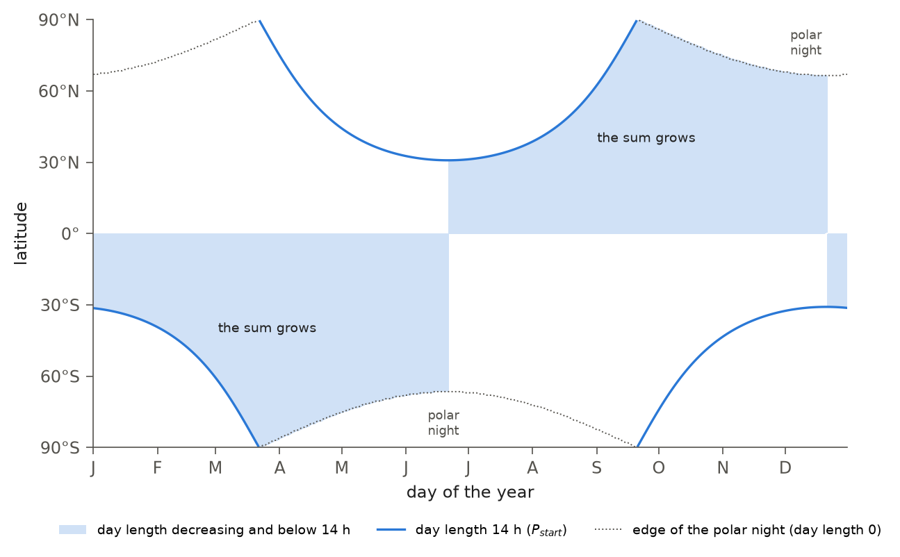
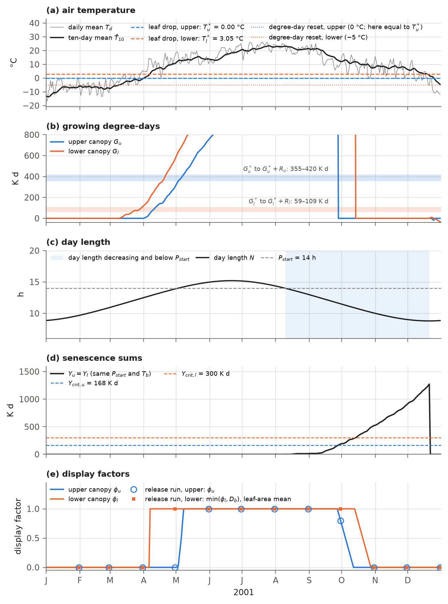

# 10. Phenology

Phenology describes the seasonal rhythm of leaves: when they emerge and fall, and how much leaf area a plant displays
throughout the year. These changes determine the leaves available to absorb light, intercept rain, transpire and
photosynthesize.

Once a day, IBIS 3.0 phenology sets the displayed fraction of leaf area for each plant functional type position. A
position's leaf area index is determined by its leaf carbon, which changes once a year (Chapter 11). Daily phenology
multiplies that index by a display factor between 0 and 1. Trees follow one of three leaf habits: evergreen,
drought-deciduous or cold-deciduous. The deciduous shrubs and the grasses of the lower canopy combine a cold factor with
a drought factor, and the evergreen shrubs keep their leaves.

- The **cold factors** increase leaf display once enough warmth has accumulated, measured as a sum of growing
  degree-days. They close the canopy when the ten-day mean air temperature falls below a threshold or, in IBIS 3.0,
  when enough cold has accumulated while days are shortening.
- The **drought factors** lower the display toward a floor when the ten-day mean net assimilation of a big leaf turns
  negative or, in IBIS 3.0, when the soil-water stress factor of its canopy falls below a threshold. For the lower
  canopy the soil-water test counts only on growing-season days, so that frozen soil in winter is not mistaken for
  drought.

Displayed leaf area determines each canopy's leaf area per unit cover and each position's share of that area. The
radiation, turbulence, interception and photosynthesis calculations use these quantities in every time step
(Chapters 4, 5 and 9).
This chapter describes the running means the phenology reads (section 10.2), the display factors (10.3-10.6), the leaf
area and lower-canopy height they set (10.1, 10.7), the parameters (10.8), the order of the daily calculations
(10.9), and the growing-season sums of the soil-water stress that the day loop keeps for the tree-cover limit of
Chapter 11 (10.10). Section 10.11 follows one cell through a year, and section 10.13 lists what changed in the code
after the release.

## 10.1 Leaf habit and displayed leaf area

Each position's display factor specifies the fraction of its leaves that is present. This factor depends on the
position's leaf habit.

Each tree position carries a leaf habit (Table 2.1). In IBIS 2.6b4 the habit belongs to the position. In IBIS 3.0, when climate-zone types are enabled (`physics.koppen_types`, on in the release), the habit belongs to
the type occupying the position and is inherited from its parent PFT (Table 2.3). In the release this changes one position: in the zones A_savanna
and B_hot, position 1 holds a drought-deciduous type (T03 and T05; Table 2.4) and is drought-deciduous there. The
positions of the lower canopy have fixed display rules. Table 10.1 gives the display factor $`\eta_{j}`$ of each
position $`j`$.

**Table 10.1** Display factor of each position. $`\phi_{u}`$ and $`\phi_{l}`$ are the cold-phenology factors of the
upper and the lower canopy (sections 10.3 and 10.4); $`D_{u}`$, $`D_{s}`$, $`D_{4}`$ and $`D_{3}`$ are the drought factors of
the upper broadleaf trees, the shrubs, the C4 grass and the C3 grass (section 10.6).

| Position | Habit | Display factor $`\eta_{j}`$ |
|---|---|---|
| tree position, evergreen (1, 3, 4, 6) | evergreen | 1 |
| tree position, drought-deciduous (2; 1 in A_savanna and B_hot) | drought-deciduous | $`D_{u}`$ |
| tree position, cold-deciduous (5, 7, 8) | cold-deciduous | $`\phi_{u}`$ |
| 9 evergreen shrubs | — | 1 |
| 10 deciduous shrubs | — | $`\min(\phi_{l}, D_{s})`$ |
| 11 C4 grasses | — | $`\min(\phi_{l}, D_{4})`$ |
| 12 C3 grasses | — | $`\min(\phi_{l}, D_{3})`$ |

The displayed leaf area of the upper and the lower canopy is

```math
L^{d}_{u} = \sum_{j=1}^{8} \eta_{j}\,L_{j}, \qquad L^{d}_{l} = \sum_{j=9}^{12} \eta_{j}\,L_{j},
\qquad\text{(10.1)}
```

where $`L_{j}`$ (m² m⁻²) is the leaf area index of position $`j`$ (`vegetation.plai`; Chapter 11), and $`L^{d}_{u}`$ and
$`L^{d}_{l}`$ (m² m⁻²) are the displayed leaf areas per unit area of the cell. The share of each position in the
displayed leaf area of its canopy is

```math
\omega_{j} = \frac{\eta_{j}\,L_{j}}{\max\left(L^{d}_{c(j)},\, \varepsilon\right)},
\qquad\text{(10.2)}
```

where $`\omega_{j}`$ (`vegetation.frac`; written $`\phi_{j}`$ in Chapter 9) is the share; $`c(j)`$ is the canopy of position
$`j`$; and $`\varepsilon = 10^{-7}`$ (`epsilon` of the physical constants). The shares of a canopy sum to 1 wherever it
displays leaves. They weight the photosynthetic capacity and stomatal slope of each big leaf and divide its
photosynthesis among its positions (Chapter 9). The leaf area of each canopy per unit of its own cover is

```math
\Lambda_{u} = \min\left[\frac{L^{d}_{u}}{\max(f_{u}, \varepsilon)},\; 12\right], \qquad
\Lambda_{l} = \min\left[\frac{L^{d}_{l}}{\max(f_{l}, \varepsilon)},\; 12\right],
\qquad\text{(10.3)}
```

where $`\Lambda_{u}`$ and $`\Lambda_{l}`$ (m² m⁻²; `vegetation.lai`) are the leaf area indices of the upper and the lower
canopy per unit of their cover (written $`L_{u}`$ and $`L_{l}`$ in Chapters 4, 5 and 9), and $`f_{u}`$ and $`f_{l}`$ are the
fractions of the cell they cover, which change once a year (Chapter 11). Phenology leaves leaf carbon, $`L_{j}`$ and stem area index unchanged. Leaf litterfall is computed once a year
(Chapter 11), independently of the display factors.

## 10.2 Ten-day running means

The phenology's leaf-drop and drought tests use running means with a memory of about ten days. This prevents a single
cold day or day of poor photosynthesis from triggering them. Means of daily air temperature and net assimilation for
each of four big leaves are updated at the end of each day,

```math
\bar{T}_{10}^{\,n} = w\,\bar{T}_{10}^{\,n-1} + (1 - w)\,T_{d}^{\,n}, \qquad
\bar{A}_{10,b}^{\,n} = w\,\bar{A}_{10,b}^{\,n-1} + (1 - w)\,\frac{1}{86400}\sum_{k=1}^{24} A_{b,k}\,\Delta t,
\qquad w = e^{-1/10},
\qquad\text{(10.4)}
```

where $`n`$ is the day; $`\bar{T}_{10}`$ (K; `summary.a10td`) is the ten-day mean air temperature; $`T_{d}`$ (K) is the daily
mean air temperature of the forcing (`tas`; Chapter 3); $`\bar{A}_{10,b}`$ (mol CO2 m⁻² s⁻¹; `summary.a10ancub`,
`a10ancls`, `a10ancl4`, `a10ancl3`) is the ten-day mean net assimilation per unit leaf area of big leaf $`b`$: the upper
broadleaf trees, the shrubs, the C4 grass and the C3 grass; $`A_{b,k}`$ is the net assimilation of the big leaf in time
step $`k`$ of the day, as the canopy model returns it (Chapter 9), negative at night; and $`\Delta t = 3600`$ s. The weight
$`w`$ gives a memory of ten days. The phenology of day $`n`$ reads the means of day $`n - 1`$.

## 10.3 Cold phenology of the upper canopy

Cold-deciduous trees (such as birch, aspen and larch) leaf out once spring has brought enough warmth and drop their
leaves in autumn. The model starts to drop their leaves when the ten-day mean temperature falls below

```math
T^{*}_{u} = \max\left(T_{f},\; T_{c} + \Delta T_{u} + T_{f},\; T_{abs} + T_{f}\right),
\qquad\text{(10.5)}
```

where $`T^{*}_{u}`$ (K) is the leaf-drop temperature of the upper canopy; $`T_{f} = 273.16`$ K; $`\Delta T_{u}`$ (K;
`pheno.tthresh_u_offset`) is the offset of the threshold above $`T_{c}`$; and $`T_{abs}`$ (°C; `pheno.tthresh_u_abs`) is
an absolute lower bound, −100 °C in the release, where it never binds. $`T_{c}`$ (°C; `vegetation.tc`) is the cell's
coldest-month temperature. Despite its name, in IBIS 2.6b4 and by default in IBIS 3.0, this statistic is a running mean with a 30-year memory ((11.9)) of the
year's lowest ten-day mean air temperature $`\bar{T}_{10}`$. The yearly minimum is taken from values read at the start
of each day (section 11.3). With `pheno.climate_stats_daily` off, the year's value is instead the year's coldest
monthly mean air temperature, the rule of the release run (section 10.13). The threshold is therefore 0 °C in cells
whose $`T_{c}`$ is below −5 °C, and $`T_{c} + 5`$ °C elsewhere.

Leaf-out is timed by a sum of growing degree-days,

```math
G^{\,n}_{u} =
\begin{cases}
0 & \bar{T}_{10}^{\,n-1} < T^{g}_{u} \;\text{ or }\; \sigma^{n}_{u}, \\
G^{\,n-1}_{u} + T^{\,n}_{d} - T^{g}_{u} & \text{otherwise,}
\end{cases}
\qquad T^{g}_{u} = \Theta^{g}_{u} + T_{f},
\qquad\text{(10.6)}
```

where $`G_{u}`$ (K d; `vegetation.agddu`) is the degree-day sum of the upper canopy; $`\Theta^{g}_{u}`$ (°C;
`pheno.gthresh_u_c`) is both the temperature below which the sum is reset and its base; and $`\sigma_{u}`$ is the
senescence flag of section 10.5 (false when the photoperiod-gated senescence is off). On a day whose mean temperature
is below the base while the ten-day mean is above it, the sum decreases, and it can become negative (Figure 10.2b, late
December). The display factor of the cold-deciduous trees is

```math
\phi^{\,n}_{u} =
\begin{cases}
\max\left(0,\; \phi^{\,n-1}_{u} - 1/\tau_{d}\right) & \bar{T}_{10}^{\,n-1} < T^{*}_{u} \;\text{ or }\; \sigma^{n}_{u}, \\[4pt]
\min\left[1,\; \max\left(0,\; G^{\,n}_{u} - G^{*}_{u}\right)/R_{u}\right] & \text{otherwise,}
\end{cases}
\qquad\text{(10.7)}
```

where $`\phi_{u}`$ (`vegetation.tempu`) is the cold-phenology factor of the upper canopy; $`\tau_{d}`$ (d; `pheno.ddays`)
is the number of days over which the leaves fall; $`G^{*}_{u}`$ (K d; `pheno.gdd_thresh_u`) is the degree-day sum at
which leaf-out starts; and $`R_{u}`$ (K d; `pheno.gdd_ramp_u`) is the further sum over which the canopy opens fully. Leaf display therefore declines in equal daily steps over $`\tau_{d}`$ days. On a warm day, the factor is instead set
directly from the degree-day sum.

## 10.4 Cold phenology of the lower canopy

Deciduous shrubs and grasses follow the same scheme, but use fixed temperature thresholds rather than thresholds
tied to the cell's winter climate,

```math
G^{\,n}_{l} =
\begin{cases}
0 & \bar{T}_{10}^{\,n-1} < T^{g}_{l} \;\text{ or }\; \sigma^{n}_{l}, \\
G^{\,n-1}_{l} + T^{\,n}_{d} - T^{g}_{l} & \text{otherwise,}
\end{cases}
\qquad
\phi^{\,n}_{l} =
\begin{cases}
\max\left(0,\; \phi^{\,n-1}_{l} - 1/\tau_{d}\right) & \bar{T}_{10}^{\,n-1} < T^{*}_{l} \;\text{ or }\; \sigma^{n}_{l}, \\[4pt]
\min\left[1,\; \max\left(0,\; G^{\,n}_{l} - G^{*}_{l}\right)/R_{l}\right] & \text{otherwise,}
\end{cases}
\qquad\text{(10.8)}
```

with $`T^{*}_{l} = \Theta_{l} + T_{f}`$ and $`T^{g}_{l} = \Theta^{g}_{l} + T_{f}`$, where $`G_{l}`$ (K d;
`vegetation.agddl`) is the degree-day sum and $`\phi_{l}`$ (`vegetation.templ`) the cold-phenology factor of the lower
canopy; $`\Theta_{l}`$ (°C; `pheno.tthresh_l_c`) is its leaf-drop temperature; $`\Theta^{g}_{l}`$ (°C;
`pheno.gthresh_l_c`) is the reset temperature and base of its degree-day sum; $`G^{*}_{l}`$ (K d; `pheno.gdd_thresh_l`)
and $`R_{l}`$ (K d; `pheno.gdd_ramp_l`) are its leaf-out sum and ramp; and $`\sigma_{l}`$ is its senescence flag (section
10.5). The evergreen shrubs (position 9) do not read $`\phi_{l}`$. When $`\Theta_{l}`$ lies well above the degree-day base
$`\Theta^{g}_{l}`$, the sum can pass $`G^{*}_{l} + R_{l}`$ before the ten-day mean rises above $`\Theta_{l}`$, and the
lower canopy then opens fully in a single day (section 10.11).

## 10.5 Photoperiod-gated senescence

In autumn, many deciduous plants start to drop their leaves in response to shortening days and cooler temperatures.
With `pheno.sen_photoperiod_u` and `pheno.sen_photoperiod_l` (off by default; on in the release),
leaf fall in each canopy also starts when a sum of cold degree-days, accumulated while the days are shortening, reaches
a critical value. The form follows Delpierre et al. (2009) with the exponents $`x = 1`$ and $`y = 0`$ (as restated by
Vitasse et al., 2011). The day length is

```math
N(J) = \frac{24}{\pi}\arccos\left\{\min\left[\max\left(-\tan\vartheta\,\tan\delta_{p},\; -1\right),\; 1\right]\right\},
\qquad \delta_{p} = 0.40910518\,\sin\left[\frac{2\pi\,(J - 81)}{365}\right],
\qquad\text{(10.9)}
```

where $`N`$ (h) is the astronomical day length on day of the year $`J`$; $`\vartheta`$ (rad) is the latitude of the cell
(written $`\phi`$ in Chapter 3); and $`\delta_{p}`$ (rad) is a solar declination with an amplitude of 23.44°. This
declination is a single sinusoid; the weather generator uses the Fourier series of equation (3.2). The senescence sum for canopy $`c`$ ($`u`$ or $`l`$) is updated from the day's mean air temperature before that day's
phenology calculation,

```math
Y^{\,n}_{c} =
\begin{cases}
Y^{\,n-1}_{c} + \max\left(T_{b,c} - T^{\,n}_{d,C},\; 0\right) & N(J) < N(J - 1) \;\text{ and }\; N(J) < P_{start,c}, \\
0 & \text{otherwise,}
\end{cases}
\qquad\text{(10.10)}
```

where $`Y_{c}`$ (K d; `seasonal.ssen_u`, `seasonal.ssen_l`) is the senescence sum; $`T_{d,C}`$ (°C) is the daily mean air
temperature; $`T_{b,c}`$ (°C; `pheno.sen_tb_u`, `pheno.sen_tb_l`) is the base temperature; and $`P_{start,c}`$ (h;
`pheno.sen_pstart_u`, `pheno.sen_pstart_l`) is the day length below which the sum grows. The flag

```math
\sigma^{n}_{c} = \left(Y^{\,n}_{c} \ge Y_{crit,c}\right),
\qquad\text{(10.11)}
```

with $`Y_{crit,c}`$ (K d; `pheno.sen_ycrit_u`, `pheno.sen_ycrit_l`) the critical sum, acts in (10.6)-(10.8) like a cold
day: while it is set, the display factor falls by $`1/\tau_{d}`$ a day and the degree-day sum is held at zero.

The sum is zero whenever the day length is not decreasing, that is from the winter solstice to the summer solstice of
the cell's hemisphere, and while the day length is still above $`P_{start}`$. The code (`ibis/state/seasonal.py`) explains why this reset was chosen instead of resetting only when day length rises
above $`P_{start}`$ again. Where day length never exceeds $`P_{start}`$ (within about 31° of the equator for 14 h), the
latter rule would never reset the sum, leaving cold-deciduous positions permanently leafless. With the solstice reset the flag clears at the
winter solstice. The degree-day sum, held at zero while the flag was set, then grows again whenever the ten-day mean is
above its base, and leaf-out follows the degree-day rule of (10.6)-(10.8). Figure 10.1 shows when the sum can grow at
each latitude.



**Figure 10.1** The days of the year (shaded) on which the senescence sum (10.10) can grow, by latitude, from the day
length of equation (10.9): the day length is decreasing and below $`P_{start}`$ = 14 h. On all other days the sum is zero.
The blue line is the 14 h day length; the dotted line bounds the polar night, where the day length is constant at zero.
Drawn by `figures/make_ch10.py` with the release parameter file; the code changes after the release do not alter it.

Within about 31° of the equator the longest day is shorter than 14 h, and the sum can grow from the summer solstice to
the winter solstice (days 173 to 355 in the northern hemisphere). Farther from the equator the window opens when the
day length falls below 14 h: on day 217 (5 August) at 40.25°N, day 232 at 50.25°N and day 243 at 60.25°N. At 70.25°N it
closes on day 322, when the polar night begins. How much the sum grows in the window depends on the temperature: days
warmer than $`T_{b}`$ = 20 °C add nothing.

## 10.6 Drought phenology

Drought-deciduous plants shed leaves during the dry season to conserve water. The model uses four drought factors,
for upper broadleaf trees, shrubs, C4 grass and C3 grass. Each factor declines toward a floor while its big leaf loses
carbon or its canopy's soil is dry, and recovers otherwise:

```math
D^{\,n}_{b} =
\begin{cases}
\max\left(D_{min},\; D^{\,n-1}_{b} - 1/\tau_{d}\right) & \bar{A}^{\,n-1}_{10,b} < A^{*} \;\text{ or }\; \left(\beta_{c(b)} < \beta^{*} \;\text{ and }\; g^{n}_{b}\right), \\[4pt]
\min\left(1,\; D^{\,n-1}_{b} + 1/\tau_{d}\right) & \text{otherwise,}
\end{cases}
\qquad\text{(10.12)}
```

where $`D_{b}`$ (`vegetation.dropu`, `dropls`, `dropl4`, `dropl3`) is the drought factor of big leaf $`b`$; $`D_{min}`$
(`pheno.drop_floor`) is its lower limit, so that the drought factor alone never closes a canopy completely; $`A^{*}`$
(mol CO2 m⁻² s⁻¹; `pheno.drop_thresh`) is the net-assimilation threshold, 0 in the release; $`\beta_{c(b)}`$ is the
soil-water stress factor of the canopy of the big leaf (`soil.stresstu` for the trees, `soil.stresstl` for the shrubs
and grasses; 1 unstressed, 0 fully stressed; (9.11)), as computed in the last time step of the previous day; $`\beta^{*}`$
(`pheno.drop_stress_thresh`) is the stress threshold; and $`g^{n}_{b}`$ is the growing-season gate. For the three lower-canopy factors, enabling `pheno.drop_stress_gate` (the default) makes $`g^{n}_{b}`$ true only on
growing-season days, defined by a mean air temperature above $`T_{f} + T_{g}`$, where $`T_{g}`$ (°C; `pheno.stress_accum_tmin`, 5 °C in the
release) is the temperature of the growing-season test of section 10.10. For the upper-canopy factor $`D_{u}`$, and with
the switch off, $`g^{n}_{b}`$ is always true.

The first condition is that of IBIS 2.6b4: the ten-day mean net assimilation per unit leaf area of the big leaf, night
respiration included, has turned negative. Neither IBIS 2.6b4 nor IBIS 3.0 tests whether the big leaf displays leaves.
The second condition, the soil-water test, is added in IBIS 3.0 and has no switch of its own: the default
$`\beta^{*} = -1`$ can never be reached, so the test does nothing unless the parameter file sets $`\beta^{*}`$, as the
release does (Tables 10.3 and 10.4). $`T_{abs}`$ of (10.5) and $`T_{g}`$ of section 10.10 are turned on by their values in
the same way. The gate is a switch, on by default, but it has an effect only when $`T_{g}`$ is set above its default:
with $`T_{g}`$ = −100 °C every day counts as a growing-season day. A factor recovers by $`1/\tau_{d}`$ per day only when neither condition holds, rising from $`D_{min}`$ to 1 in 14 days.

The gate exists because the stress factor counts only liquid soil water (equation (9.10)), so frozen soil reads as dry. With the gate enabled, frozen soil does not trigger lower-canopy drought
on days at or below $`T_{g}`$. On warmer days, a root zone that remains frozen can still trigger the factors. The release run had no gate, and there the soil-water
test held through the winter wherever the root zone froze. At the cell of Figure 10.2, the three drought factors of the
lower canopy stood at $`D_{min}`$ at the end of 2000, with ice in the top three soil layers and $`\beta_{l}`$ = 0.08 below
$`\beta^{*}`$ = 0.231; its cold factor was already zero.

In the release state at the end of 2000
(`figures/make_ch10.py`, `drought`), among the cells with deciduous lower-canopy leaf area (positions 10-12) above
0.01 m² m⁻², at least one of the three lower-canopy drought factors was at $`D_{min}`$ on 52 % of the area in the zone
D_temperate, 97 % in D_subarctic, 100 % in D_extreme and 75 % in E_tundra (areas weighted by the cosine of latitude;
all three factors were at $`D_{min}`$ together on 52, 97, 100 and 74 % of the area, respectively). On 98 % or more of
that area, $`\beta_{l} < \beta^{*}`$ and the top soil layer held ice.

In A_humid, the C3 grass factor was at $`D_{min}`$ on 45 % of the area and the deciduous shrub factor on 35 %. Here the
other drought condition was responsible: over almost all of this area, the big leaf's ten-day mean net assimilation
was negative. These two positions hold 2 % and 1 % of the zone's deciduous lower-canopy
leaf area; the C4 grass G01, which holds 97 %, had its factor at $`D_{min}`$ on 1 % of the area. In the cold zones the
display of the lower canopy in spring, $`\min(\phi_{l}, D)`$, was then set by the drought factors rather than by the cold
factor, until $`\beta_{l}`$ rose above $`\beta^{*}`$ again and the factors had climbed back (release run; to be updated
after the final run of the revised model).

Table 10.2 quantifies the effect on displayed leaf area. The model's phenology was run for every land cell through
2001 from the release state, with drought factors held at 1. The table expresses the release hindcast's month-end
displayed lower-canopy leaf area as a fraction of that result (ratios of area-weighted sums over the cells above, the evergreen shrubs of position
9 included in both; both drought conditions together). In the zones D_temperate, D_subarctic and E_tundra the ratio is
0.97 or more in most months. The shortfalls of spring are 0.93 at the end of May in D_temperate, 0.94 and 0.93 at the
ends of April and May in D_subarctic, and 0.62, 0.88 and 0.76 at the ends of May, June and July in D_extreme. The lowest
value of D_temperate, 0.89 at the end of August, is a summer shortfall that frozen soil cannot explain. In B_hot, where
the root zone is dry, the hindcast has 0.32-0.63 of it in every month.

**Table 10.2** Month-end displayed lower-canopy leaf area of the release hindcast in 2001 as a share of that of the
cold phenology alone (the model's phenology run from the release state at the end of 2000 with the drought factors held
at 1), by zone: ratios of area-weighted sums over the cells with deciduous lower-canopy leaf area above 0.01 m² m⁻²
(E_ice and the cells without a zone left out). Printed by `figures/make_ch10.py` (`drought`). Release run, without the
growing-season gate of (10.12); to be updated after the final run of the revised model.

| Zone | J | F | M | A | M | J | J | A | S | O | N | D |
|---|---|---|---|---|---|---|---|---|---|---|---|---|
| A_humid | 0.95 | 0.89 | 0.92 | 0.92 | 0.98 | 0.97 | 0.96 | 0.92 | 0.95 | 0.96 | 0.97 | 0.96 |
| A_savanna | 0.71 | 0.66 | 0.77 | 0.81 | 0.86 | 0.76 | 0.65 | 0.56 | 0.63 | 0.79 | 0.81 | 0.79 |
| B_hot | 0.48 | 0.63 | 0.62 | 0.42 | 0.32 | 0.41 | 0.47 | 0.35 | 0.35 | 0.42 | 0.48 | 0.48 |
| B_cold | 0.88 | 0.89 | 0.98 | 0.96 | 0.96 | 0.91 | 0.90 | 0.83 | 0.89 | 0.95 | 0.95 | 0.85 |
| C_med | 0.98 | 0.98 | 0.99 | 0.98 | 0.98 | 0.87 | 0.84 | 0.83 | 0.89 | 0.94 | 0.99 | 0.98 |
| C_subtrop | 0.89 | 0.86 | 0.90 | 0.88 | 0.85 | 0.89 | 0.85 | 0.81 | 0.84 | 0.86 | 0.91 | 0.87 |
| C_highland | 0.93 | 0.92 | 0.82 | 0.75 | 0.91 | 0.92 | 0.80 | 0.73 | 0.81 | 0.89 | 0.88 | 0.94 |
| C_oceanic | 0.98 | 0.98 | 1.00 | 1.00 | 1.00 | 0.99 | 1.00 | 0.99 | 0.99 | 1.00 | 0.99 | 0.99 |
| D_temperate | 1.00 | 1.00 | 1.00 | 1.00 | 0.93 | 0.97 | 0.98 | 0.89 | 0.96 | 0.99 | 1.00 | 1.00 |
| D_subarctic | 1.00 | 1.00 | 1.00 | 0.94 | 0.93 | 0.97 | 0.98 | 0.99 | 1.00 | 1.00 | 1.00 | 1.00 |
| D_extreme | 1.00 | 1.00 | 1.00 | 1.00 | 0.62 | 0.88 | 0.76 | 0.99 | 1.00 | 1.00 | 1.00 | 1.00 |
| E_tundra | 0.98 | 0.99 | 1.00 | 0.98 | 0.99 | 1.00 | 1.00 | 1.00 | 1.00 | 1.00 | 1.00 | 0.99 |

## 10.7 Height of the lower canopy

The phenology also sets the height of the lower canopy, which grows with its leaf area,

```math
z_{bot,l} = 0.05, \qquad
z_{top,l} = \min\left[\max\left(0.25,\; 0.25\,\Lambda_{l}\right),\; z_{bot,u} - 0.5\right],
\qquad\text{(10.13)}
```

where $`z_{bot,l}`$ and $`z_{top,l}`$ (m) are the bottom and top heights of the lower canopy, and $`z_{bot,u}`$ (m) is the
bottom height of the upper canopy, 3 m after the first annual update ((11.26)). The heights of the upper canopy are set
once a year (section 11.9).

## 10.8 Parameters

Table 10.3 lists the phenology parameters. Eight can be specified by type and are combined into per-cell values when
climate-zone types are enabled (equation (2.2)):

- the upper-canopy leaf-out sum, ramp and critical senescence sum are the median over the zone's cold-deciduous tree
  types;
- the lower-canopy leaf-drop temperature, leaf-out sum, critical senescence sum and day-length threshold are the values
  of the zone's grass type (of its shrub type if the grass sets none);
- the stress threshold $`\beta^{*}`$ of (10.12) is the median over the zone's types whose positions read a drought factor:
  the drought-deciduous trees, the deciduous shrubs (position 10) and the grasses (positions 11 and 12).

If none of the relevant types in a zone specifies a value, the zone retains the base value. The release file supplies
type values for the first five parameters and the stress threshold (Table 10.4). It supplies none for the lower-canopy
critical sum or day-length threshold, so their base values apply everywhere. These rules have three consequences for
the release file:

- The values that the release file gives to tree types that are not cold-deciduous (T02, T03, T07, T09, T13, T16,
  T21) for the three upper-canopy parameters are not read, and neither are the shrub types' values of the lower-canopy
  leaf-drop temperature and leaf-out sum, because every zone's grass type sets them.
- The zones D_subarctic and D_extreme hold two cold-deciduous types, the birch-aspen T18 and the larch T19, and take
  the median of the two, their mean: $`G^{*}_{u}`$ = 104 K d from 154 and 54 K d, and $`Y_{crit,u}`$ = 402 K d from 72 and
  732 K d.
- The stress thresholds that the release file gives to evergreen types (the trees T09 and T21 and the shrubs S01, S03,
  S05 and S07) are not read. In C_med, D_subarctic and D_extreme no type in a drought-reading position sets a value,
  so these zones take the base value, 0.135. The release run took the median over all types of a zone instead
  (Table 10.4, last column), so in these three zones, and in A_humid, A_savanna, B_hot and B_cold, the current code
  gives a different threshold from the release run's: higher in A_humid, A_savanna, B_hot and B_cold, and lower in
  C_med, D_subarctic and D_extreme. The resulting global changes in leaf display still need evaluation.

Four switches of the parameter file select rules of this chapter:

- `pheno.sen_photoperiod_u` and `pheno.sen_photoperiod_l` (default false; true in the release file): the
  photoperiod-gated senescence of section 10.5.
- `pheno.climate_stats_daily` (default true; not set in the release file): the year's coldest temperature behind
  $`T_{c}`$ is formed from the ten-day mean, as in IBIS 2.6b4 (section 10.3). The switch also changes the other three
  climate statistics that determine where plant positions can exist (section 11.3.1). False gives the monthly rule
  of the release run.
- `pheno.drop_stress_gate` (default true; not set in the release file): the growing-season gate of the lower canopy's
  soil-water test (section 10.6). False gives the release run's rule, the test on every day.

**Table 10.3** Parameters of the phenology: the value in the code of IBIS 2.6b4 (a literal in `pheno`), the default
of IBIS 3.0 and the base value of the release parameter file, which applies where no zone value is given (Table 10.4).
"Zone" marks a parameter that the types can set per cell.

| Symbol | Parameter (`pheno.`) | Units | IBIS 2.6b4 | Default | Release | Zone |
|---|---|---|---|---|---|---|
| $`\Delta T_{u}`$ | `tthresh_u_offset` | K | 5 | 5 | 5 | |
| $`T_{abs}`$ | `tthresh_u_abs` | °C | – | −100 | −100 | |
| $`\Theta^{g}_{u}`$ | `gthresh_u_c` | °C | 0 | 0 | 0 | |
| $`G^{*}_{u}`$ | `gdd_thresh_u` | K d | 100 | 100 | 412.5 | yes |
| $`R_{u}`$ | `gdd_ramp_u` | K d | 50 | 50 | 75.8 | yes |
| $`\Theta_{l}`$ | `tthresh_l_c` | °C | 0 | 0 | 2.44 | yes |
| $`\Theta^{g}_{l}`$ | `gthresh_l_c` | °C | −5 | −5 | −5 | |
| $`G^{*}_{l}`$ | `gdd_thresh_l` | K d | 150 | 150 | 73.7 | yes |
| $`R_{l}`$ | `gdd_ramp_l` | K d | 50 | 50 | 50 | |
| $`\tau_{d}`$ | `ddays` | d | 15 | 15 | 15 | |
| $`A^{*}`$ | `drop_thresh` | mol m⁻² s⁻¹ | 0 | 0 | 0 | |
| $`D_{min}`$ | `drop_floor` | – | 0.1 | 0.1 | 0.1 | |
| $`\beta^{*}`$ | `drop_stress_thresh` | – | – | −1 | 0.135 | yes |
| $`P_{start,u}`$ | `sen_pstart_u` | h | – | 14 | 14 | |
| $`T_{b,u}`$ | `sen_tb_u` | °C | – | 20 | 20 | |
| $`Y_{crit,u}`$ | `sen_ycrit_u` | K d | – | 300 | 148.1 | yes |
| $`P_{start,l}`$ | `sen_pstart_l` | h | – | 14 | 14 | yes |
| $`T_{b,l}`$ | `sen_tb_l` | °C | – | 20 | 20 | |
| $`Y_{crit,l}`$ | `sen_ycrit_l` | K d | – | 300 | 300 | yes |
| $`T_{g}`$ | `stress_accum_tmin` | °C | – | −100 | 5 | |

The initial values of $`P_{start}`$, $`T_{b}`$ and $`Y_{crit}`$ (14 h, 20 °C, 300 K d) were selected for the model rather
than drawn from a published table. The type values of Table 10.4 ($`G^{*}_{u}`$, $`R_{u}`$, $`Y_{crit,u}`$, $`\Theta_{l}`$, $`G^{*}_{l}`$ and
$`\beta^{*}`$) come from the tower calibration of Chapter 16 (equation (16.10)). That calibration attributes the fitted
upper-canopy phenology of a tower to its tree types, the lower-canopy thresholds to its shrub and grass types and the
drought threshold to every type of the tower. The base values of these six parameters in Table 10.3 are the class
medians of an earlier set of fits at 62 towers (section 16.6; `params_s3_classmedian.yaml`). A later fit of the
temperate grass G06 to the timing of grassland towers ($`\Theta_{l}`$ = 2 °C, $`G^{*}_{l}`$ = 700 K d, $`Y_{crit,l}`$ = 200
K d, $`P_{start,l}`$ = 15 h) is not in the release file, which keeps the values of Table 10.4 for G06 and the base
$`Y_{crit,l}`$ and $`P_{start,l}`$ everywhere. It is in `params_32a_base.yaml`, the parameter file from which the refits of
the revised model start. Those GPP/ET refits are now complete (Chapter 16). The new type aggregate retains G06's
lower-canopy degree-day threshold of 700 on the separate onset-timing evidence; the final assembled parameters
still need evaluation. Tables 10.3 and 10.4 keep their stated release and historical sources.

**Table 10.4** Per-cell phenology parameters of each zone with the release parameter file (Köppen zones of Table 2.2;
type placement of Table 2.4), and the types that supply them by equation (2.2). "base": the base value of Table 10.3.
The stress threshold $`\beta^{*}`$ is given under the current rule and under the rule of the release run (the median over
all types of the zone). Printed by `figures/make_ch10.py` (`table`).

| Zone | Cold-deciduous types | $`G^{*}_{u}`$ (K d) | $`R_{u}`$ (K d) | $`Y_{crit,u}`$ (K d) | Grass type | $`\Theta_{l}`$ (°C) | $`G^{*}_{l}`$ (K d) | $`\beta^{*}`$ (types) | $`\beta^{*}`$, release run (types) |
|---|---|---|---|---|---|---|---|---|---|
| A_humid | none | – | – | – | G01 | 3.63 | 59.7 | 0.228 (G01) | 0.179 (S07, G01) |
| A_savanna | none | – | – | – | G01 | 3.63 | 59.7 | 0.424 (T03, G01) | 0.228 (T03, S07, G01) |
| B_hot | none | – | – | – | G02 | 0.61 | 87.9 | 0.427 (T03, G02) | 0.249 (T03, S01, G02) |
| B_cold | T15 | 354.9 | 65.0 | 168.0 | G04 | 0.76 | 79.3 | 0.342 (S02, G04) | 0.062 (T21, S02, G04) |
| C_med | T11 | 557.8 | 43.9 | 223.3 | G05 | 2.29 | 71.6 | 0.135 (base) | 0.527 (T09, S03) |
| C_subtrop, C_highland | T08 | 634.7 | 62.0 | 100.6 | G03 | −2.01 | 52.9 | 0.280 (S04, G03) | 0.280 (S04, G03) |
| C_oceanic | T12 | 575.9 | 89.9 | 170.3 | G06 | 3.05 | 58.7 | 0.231 (S04) | 0.231 (S04) |
| D_temperate | T15 | 354.9 | 65.0 | 168.0 | G06 | 3.05 | 58.7 | 0.231 (S04) | 0.231 (S04) |
| D_subarctic, D_extreme | T18, T19 | 104.0 | 72.1 | 401.9 | G07 | 5.38 | 62.9 | 0.135 (base) | 0.762 (S05) |
| E_tundra | none | – | – | – | G08 | 0.38 | 74.1 | 0.109 (S06) | 0.109 (S06) |
| E_ice | none | – | – | – | none | base | base | base | base |
| no zone | positions 5, 7, 8 | base | base | base | position 12 | base | base | base | base |

In the zones marked "–" no position is cold-deciduous; the base values apply but are not read. $`Y_{crit,l}`$ = 300 K d
and $`P_{start,l}`$ = 14 h in every zone.

## 10.9 The daily sequence and the initial state

The daily calculations of the phenology run in the order of Table 10.5, inside the day loop of the model
(`ibis/timestepping/loops_gswp3.py`).

**Table 10.5** Order of the daily calculations that involve the phenology.

| Step | Calculation | Section |
|---|---|---|
| 1 | store the day's mean air temperature in the atmosphere state (for the frost ramp of Chapter 9); keep the ten-day means of the previous day for the phenology; reset the daily sums of net assimilation | 10.2 |
| 2 | advance the senescence sums (10.10), and the acclimation state of Chapter 9, with the day's mean air temperature | 10.5 |
| 3 | phenology: degree-day sums, cold and drought factors, displayed shares, canopy leaf area, lower-canopy height | 10.1, 10.3-10.7 |
| 4 | the 24 time steps of the day (Table 1.3), each adding its net assimilation to the daily sums | 10.2 |
| 5 | update the ten-day means with the day's mean temperature and mean net assimilation; with `pheno.climate_stats_daily` on, add the day to the year's climate statistics (the ten-day mean as it stood at the start of the day, and the day's degree-days) | 10.2, 10.3 |
| 6 | litter and soil carbon decomposition | Chapter 12 |
| 7 | add the day to the growing-season stress sums (when the state carries them, as in the release) | 10.10 |

A cold-start run initializes phenology as shown in Table 10.6. The release's 200-year spin-up (section 1.5.3) removes
any memory of these initial values.

**Table 10.6** Initial values at a cold start.

| Variable | IBIS 3.0 | IBIS 2.6b4 |
|---|---|---|
| $`\bar{T}_{10}`$ | mean of the twelve monthly mean air temperatures of the first forcing year | 273.16 K |
| $`\bar{A}_{10,b}`$ | 0 | 10⁻⁵ mol m⁻² s⁻¹ |
| $`G_{u}`$, $`G_{l}`$ | 0 | 1000 K d |
| $`\phi_{u}`$, $`\phi_{l}`$ | 1 | 1 |
| $`D_{u}`$, $`D_{s}`$, $`D_{4}`$, $`D_{3}`$ | 1 | 1 |
| $`Y_{u}`$, $`Y_{l}`$ | 0 | – |
| $`\beta_{u}`$, $`\beta_{l}`$ as read on the first day | 0 | 1 (not read by `pheno`) |

With $`G = 0`$ instead of 1000 K d, a cell whose initial ten-day mean is above the leaf-drop temperature sets its cold
factors on the first day from a degree-day sum near zero, which gives a leafless deciduous canopy; with 1000 K d IBIS
2.6b4 gives full leaf in that case. With the stress factors at 0 and $`\beta^{*} > 0`$, as in the release, the
upper-canopy drought factor falls by $`1/\tau_{d}`$ on the first day, and so do the three lower-canopy factors if the
first day is a growing-season day (section 10.6).

## 10.10 Growing-season soil-water stress

The model also records growing-season soil dryness for each canopy over the year. Chapter 11 uses this record to
limit tree cover in dry climates. When the model state includes stress accumulators (`stress`), the day loop adds each
canopy's soil-water stress factor on growing-season days, after daily decomposition,

```math
U_{u} = \sum_{n} \beta^{\,n}_{u}\,g^{n}, \qquad U_{l} = \sum_{n} \beta^{\,n}_{l}\,g^{n}, \qquad N_{g} = \sum_{n} g^{n},
\qquad g^{n} = \left(T^{\,n}_{d} > T_{f} + T_{g}\right),
\qquad\text{(10.14)}
```

where $`U_{u}`$ and $`U_{l}`$ (d; `stress.aystressu`, `stress.aystressl`) are the sums; $`N_{g}`$ (d; `stress.nday`) is the
number of growing-season days; $`\beta^{n}`$ is the stress factor of the last time step of day $`n`$; and $`T_{g}`$ (°C;
`pheno.stress_accum_tmin`; not the soil surface temperature of Chapters 5 and 6) is the daily mean temperature above
which a day counts, 5 °C in the release. The default −100 °C counts every day. The release counts only days above 5 °C
because the stress factor reads frozen soil as dry. The same test $`g^{n}`$ gates the lower canopy's soil-water trigger of
section 10.6 when `pheno.drop_stress_gate` is on. The annual mean $`U_{u}/\max(1, N_{g})`$, smoothed over the years, sets
the maximum tree cover ((11.15)-(11.16)). The state includes these accumulators when the water-limited tree-cover limit (`pft.tree_cover_limit`) is enabled.
They are also included with the tree-establishment gate, evapotranspiration-component output, or a seasonal formulation
of section 10.5 or Chapter 9. The release therefore includes them.

## 10.11 One year at one cell

Figure 10.2 follows the cold phenology of one cell through 2001: the cell at 43.25°N, 89.25°W of Figure 3.1 (near
Madison, Wisconsin), in the zone D_temperate in the Köppen map of 1991-2020. Its cold-deciduous tree is T15 in position
5, next to the evergreen conifer T16 in position 4. Its lower canopy holds the deciduous shrub S04 (0.01 m² m⁻²), the C3
grass G06 (0.09 m² m⁻²) and 0.01 m² m⁻² of the base evergreen shrub of position 9, so that $`G^{*}_{u}`$ = 354.9 K d,
$`R_{u}`$ = 65.0 K d, $`Y_{crit,u}`$ = 168.0 K d, $`\Theta_{l}`$ = 3.05 °C and $`G^{*}_{l}`$ = 58.7 K d (Table 10.4). With
$`T_{c}`$ = −9.6 °C in the release state, the leaf-drop temperature of the upper canopy is $`T^{*}_{u}`$ = 0 °C; any
$`T_{c}`$ below −5 °C gives the same threshold, so the rule for $`T_{c}`$ (section 10.3) does not matter here.

The model's own phenology and day-length functions were run once a day on the GSWP3 daily mean temperature of 2001,
from the state of the release run at the end of 2000, with the drought factors left out. The resulting upper-canopy leaf area per unit cover matches the release hindcast exactly at every month end. This
agreement involves little leaf area: position 5 holds 0.01 m² m⁻² at this cell in the release, the minimum leaf area `pft.xminlai`, next
to 1.08 m² m⁻² in position 4, and the deciduous lower positions hold 0.10 m² m⁻². The comparison therefore tests the timing of the factors but gives little indication of their contribution to the
cell's leaf area. The display factor of the deciduous lower positions
that the hindcast's month-end leaf area implies, $`\min(\phi_{l}, D)`$, is 0 at the ends of January to March and October
to December, and 1 at the ends of April to September: in the release run, the lower-canopy drought factors, at
$`D_{min}`$ through the winter (section 10.6), had climbed back to 1 by the end of April.

In the upper canopy the degree-day sum starts when the ten-day mean rises above 0 °C on day 92 (2 April), and the
canopy opens between day 123 (3 May) and day 129 (9 May), as the sum crosses 355-420 K d. The day length falls below
14 h on day 222. The senescence sum grows from the next day, the first with a daily mean below 20 °C, and reaches
168 K d on day 271 (28 September). The cold-deciduous leaves are gone by day 286 (13 October), when the ten-day mean is
11.7 °C. The lower canopy's degree-day sum grows from −5 °C and stands at 182 K d, past $`G^{*}_{l} + R_{l}`$ = 109 K d,
on the day before the ten-day mean rises above $`\Theta_{l}`$ = 3.05 °C. Its cold factor therefore goes from 0 to 1 on a
single day, day 97 (7 April). Its senescence sum, with the same $`P_{start}`$ and $`T_{b}`$ but $`Y_{crit,l}`$ = 300 K d,
reaches the critical value on day 287 (14 October), and the deciduous lower positions are leafless by day 302
(29 October), seven weeks before the ten-day mean falls below $`\Theta_{l}`$ on day 350.



**Figure 10.2** The cold phenology of 2001 in the cell at 43.25°N, 89.25°W, computed with the model's phenology and
day-length functions from the release run's state at the end of 2000 and the GSWP3 daily mean temperature. (a) Daily
mean and ten-day mean air temperature, (10.4), with the leaf-drop temperatures (10.5) and (10.8) and the reset
temperatures of the degree-day sums. Thresholds are shown in °C ($`T^{*} - T_{f}`$); at this cell the upper-canopy reset temperature, 0 °C, equals $`T^{*}_{u} - T_{f}`$ and the
two lines coincide. (b) Degree-day sums (10.6) and (10.8), with the bands from $`G^{*}`$ to $`G^{*} + R`$ over which the
canopies open; the axis is cut at 800 K d (the sums reach 3081 and 4359 K d before the senescence flags reset them).
(c) Day length (10.9); shaded, the days on which the senescence sums can grow. (d) Senescence sums (10.10), equal in the
two canopies, and the critical sums. (e) Display factors: the cold-phenology factors (10.7) and (10.8) computed here
(lines); the circles are the factor of the
upper canopy implied by the release hindcast's month-end leaf area, $`(\Lambda_{u} f_{u} - L_{4}) / L_{5}`$, and the
squares the display factor of the deciduous lower positions implied in the same way,
$`(\Lambda_{l} f_{l} - L_{9}) / (L_{10} + L_{11} + L_{12})`$, the leaf-area-weighted mean of $`\min(\phi_{l}, D_{b})`$ over
positions 10-12. Where both factors are 0 or 1 the square sits inside the circle. Drawn by `figures/make_ch10.py`
(`10.2`) with the release parameter file. The code changes after the release do not alter the computed curves:
they leave out the drought factors, and the leaf-drop temperature at this cell is the same under either rule for
$`T_{c}`$. The circles and squares are release-run output; the squares include the release's drought factors.

## 10.12 Differences from IBIS 2.6b4

The phenology routine of IBIS 3.0 (`pheno` in `ibis/physics/phenology.py`) reproduces `pheno` of IBIS 2.6b4
(`vegetation.f`) at its default parameters, with the climate-zone types and the three IBIS 3.0 additions off, wherever
both canopy covers exceed $`\varepsilon`$ (item 6); the routine was verified against the Fortran (`verify/STATUS.md`;
Chapter 17). The differences, checked against the Fortran, are:

1. The thresholds, degree-day sums, ramps, floor and leaf-fall time that IBIS 2.6b4 writes as literals are parameters
   (Table 10.3), and several of them are per cell (Table 10.4).
2. Three triggers are added: the photoperiod-gated senescence (section 10.5; on in the release), the soil-water
   stress trigger of the drought factors with its growing-season gate for the lower canopy (section 10.6; active with
   the release parameter file through $`\beta^{*}`$ and $`T_{g}`$), and the absolute leaf-drop temperature $`T_{abs}`$ (inert
   in the release).
3. The leaf habit of a tree position is that of the type it holds (section 10.1).
4. The ten-day means are updated once a day, from the day's mean temperature and mean net assimilation (10.4). IBIS
   2.6b4 (`sumnow` in `stats.f`) updates them every time step with the weight
   $`e^{-\Delta t/(10 \cdot 86400\,\mathrm{s})}`$, which over a day decays the old mean by the same $`e^{-1/10}`$. For
   $`\bar{T}_{10}`$, whose input is constant over the day, the two are identical; for $`\bar{A}_{10,b}`$ the Fortran weights
   the last hour of a day $`e^{23/240} = 1.10`$ times the first, while IBIS 3.0 weights the hours equally.
5. With `pheno.climate_stats_daily` off, the coldest-month temperature $`T_{c}`$ of (10.5) comes from the year's coldest
   monthly mean, the rule of the release run (section 10.13). With the switch on (the default) it is formed from the
   year's lowest ten-day mean, as in IBIS 2.6b4.
6. The leaf area per unit cover (10.3) divides by $`\max(f, \varepsilon)`$; IBIS 2.6b4 divides by $`f`$.
7. The initial values of a cold start differ (Table 10.6).
8. IBIS 2.6b4 keeps annual means of $`\beta_{u}`$ and $`\beta_{l}`$ over every time step of the year (`aystresstu`,
   `aystresstl` in `sumyear` of `stats.f`), which nothing reads. The sums of IBIS 3.0 (10.14) take the value of the
   last time step of each growing-season day and set the tree-cover limit of Chapter 11.

## 10.13 Notes for developers

The code described in this chapter is that of branch `technote-review-fixes` after the technote review of 2026-11-01
(`docs/CALIBRATION.md` section 87; each defect with its evidence in `docs/DEFECTS_FOR_REVIEW.md`). The release run
`final_rel30` was made with commit `e54e342`. The following notes record changes after the release and remaining open
items:

1. **The year's climate statistics from daily values (D9; `pheno.climate_stats_daily`, default true; commit 307d0f8).**
   The day loop accumulates the year's coldest and warmest values of the start-of-day ten-day mean and the degree-days
   of the daily mean temperature, reset at the start of each year, as IBIS 2.6b4 (`weather.f` lines 905-915 and
   210-214; `reset_climate_stats`, `accumulate_climate_stats`, `year_end_climate_stats` in `loops_gswp3.py`, shared by
   `run_global.py` and the tower harness). The release took them from the monthly means (`climate_stats_from_monthly`,
   with the `climanl` interpolation for the degree-days). In this chapter the switch acts through $`T_{c}`$ in the
   leaf-drop temperature of (10.5). For the forcing year 2001, the coldest monthly mean is above the lowest ten-day mean
   by 1.60 K at the median land cell (5th to 95th percentile 0.16 to 5.28 K). On 12,874 (35 %) of the 36,418 land cells
   whose zone holds a cold-deciduous tree position, the yearly value of $`\max(0, T_{c} + 5\ \text{°C})`$ differs by more
   than 0.01 K between the two rules, higher under the release rule on all but 14 of them, by 1.21 K at the median of
   these cells (`figures/make_ch10.py`, `tc`; the ten-day mean started from the release state at the end of 2000 and
   read at the start of each day, as `daily` does; one year's values, not the 30-year running means). The threshold
   matters only where $`T_{c}`$ is above −5 °C, and there the photoperiod-gated senescence usually starts the leaf fall
   first (review evidence). The same statistics set the existence of the positions (section 11.3), where the switch
   affects the boreal tree line and C4 extent. Following the preliminary protocol run, the revised parameter file
   `params_32a_base.yaml` sets the degree-day floor to 975 °C d for the temperate conifer and 700 °C d for the boreal
   types, replacing the release's 900 and 600 °C d. These values were chosen by quantile mapping to preserve the
   release's tree-line threshold under daily statistics (D9 decision, commit `c6698fd`; section 11.3.3). The cold start still
   seeds the running means from the monthly means of the first forcing year, as IBIS 2.6b4 does.
2. **Growing-season gate on the lower canopy's soil-water trigger (D11; `pheno.drop_stress_gate`, default true; commit
   307d0f8).** In the release run the trigger acted on every day, so frozen soil, which the stress factor reads as dry,
   kept lower-canopy drought factors at their floor throughout winter wherever the root zone froze. Green-up then
   required both thawing and the 14-day recovery (section 10.6 and Table 10.2 give the release-run numbers). `docs/CALIBRATION.md` section 18 had
   fixed the same confusion for the tree-cover stress sums only. The gate uses the same test as those sums
   (`stress_accum_tmin`). The upper-canopy factor $`D_{u}`$ is not gated. The tower-fitted $`\beta^{*}`$ values were
   obtained with the ungated trigger; the GPP/ET refit stage is now complete (Chapter 16). The step-2
   ablations found median tower-score changes below 0.002 for both this gate and the daily climate statistics
   (`diag_work/step2/cmp_abl_all.txt`); this does not establish that their global effects are small.
3. **Zone stress threshold from the types that read it (D15; commit 307d0f8; no switch).** `pft_types.zone_scalar` takes
   the median of `drop_stress_thresh` with the rule `'drought'`: the types in drought-deciduous tree positions and in
   positions 10-12. The release used the rule `'all'`, which drew the threshold from types whose positions read no
   drought factor: C_med took 0.527 from T09 and S03, and D_subarctic and D_extreme 0.762 from S05, and these values
   acted on the C3 grass and on the deciduous shrub and C4 grass positions. In C_med the release hindcast's leaf area of
   the deciduous lower positions was 0.49, 0.35, 0.31 and 0.54 of their cold-phenology leaf area at the ends of June to
   September 2001 (`figures/make_ch10.py`, `drought`). Table 10.4 gives both sets of thresholds; `drought` reproduces
   the release-run numbers with the release rule. The new thresholds are higher in A_humid (0.179 to 0.228),
   A_savanna (0.228 to 0.424), B_hot (0.249 to 0.427) and B_cold (0.062 to 0.342), and lower in C_med,
   D_subarctic and D_extreme (to the base value 0.135). Their global effects remain to be assessed.
4. **The temperate-grass timing (D18; parameter file only).** The G06 fit of `params_31f.yaml` ($`\Theta_{l}`$ 2.0 °C,
   $`G^{*}_{l}`$ 700 K d, $`Y_{crit,l}`$ 200 K d, $`P_{start,l}`$ 15 h; `docs/CALIBRATION.md` section 54) did not reach the
   release file, although section 55 stated that it had been retained (corrected there). It is in `params_32a_base.yaml`, the base of the
   refits; the release file is unchanged. By the section 54 emulator, the release's G06 greens about 51 days early and
   senesces about 26 days late at the temperate grassland towers (not re-measured). At the cell of Figure 10.2, the
   refit-base values open the lower canopy over three days (from day 127 to day 130 of 2001) instead of on day 97, and
   its senescence sum reaches the critical value on day 275 instead of day 287 (Figure 10.2's computation with
   `params_32a_base.yaml`: cold phenology only, from the release state at the end of 2000). This timing is provisional:
   at the 35 G06 towers in the step-2 ablation, median monthly GPP correlation fell from 0.88 to 0.86 (worse at 26),
   the GPP-to-observation ratio fell from 1.03 to 0.97, and the respiration ratio from 1.17 to 1.08. Across the full
   356-tower comparison, mean October GPP fell by 6.5 % (`RESUME.md` and `diag_work/step2/cmp_abl_all.txt`).
   The natural-site GPP/ET refits are now complete. Their type aggregate retains the lower-canopy degree-day
   threshold of 700: a fit to monthly flux amounts does not by itself replace the separate onset-timing
   calibration. The other fitted G06 values enter the new aggregate. This is the chosen refit parameter set;
   a first protocol run with it has been evaluated and the production run is in progress (Chapter 16, section 16.14.5).
5. **One-day opening of the lower canopy (D50; kept).** Where $`\Theta_{l}`$ lies well above $`\Theta^{g}_{l}`$, the
   degree-day sum is complete before the leaf-drop condition clears, so $`\phi_{l}`$ jumps from 0 to 1 in one day and the
   ramp $`R_{l}`$ never acts (section 10.11). Documented; for G06 the timing of item 4 spreads the opening over three
   days at the Figure 10.2 cell. Starting the lower sum relative to $`\Theta_{l}`$ is an option for a later phenology
   revision.
6. **Lower-canopy and composition checks (D12, D19).** D12: the lower canopy is nearly absent on much of
   the D_temperate cropland, with sharply contrasting neighbouring states. In the release hindcast of July 2001, 60 % of the 2,709 D_temperate cells with a crop share
   above 0.5 have a lower-canopy leaf area below 0.2 (median 0.09); phenology is not the cause (at the Figure 10.2
   cell $`\phi_{l}`$ = 1 from day 97 to day 286). D19: the cold-deciduous tree T15 holds 0.011 m² m⁻² of leaf area or
   less, about its minimum, on 72.6 % of the D_temperate area at the end of 2000, so the fitted upper-canopy phenology
   of the zone acts on little leaf area. The later controlled tests separate initial-composition, allocation and
   climate-eligibility effects (Chapters 11 and 15). Raising leaf allocation has a lasting effect over the ten-year
   diagnostic, whereas the early benefit of adding initial grass leaves fades. The trajectories are still changing;
   they do not establish stable alternative equilibria. The release decision is to retain the existing allocation
   and document the limitation (D23), rather than adopt the trial value.
7. **Code comments corrected (D94; commit 8416c20).** `ddays` is a linear leaf-fall time, not an e-folding time; the
   ten-day means of IBIS 2.6b4 are updated in `sumnow` (`stats.f` line 11; weight line 68; updates lines 281-289); the
   routine is ported from `vegetation.f`.
8. **Parameter-gated additions (D63).** $`\beta^{*}`$, $`T_{abs}`$ and $`T_{g}`$ have no switch of their own: their defaults
   make them inert, and a parameter file turns them on by setting a value (the release file sets $`\beta^{*}`$ and
   $`T_{g}`$). The gate of item 2 is a switch, but it only acts when $`T_{g}`$ is set.
9. **Provenance in `docs/CALIBRATION.md`.** The soil-water trigger and $`T_{abs}`$, section 14; the growing-season test of
   the stress sums, section 18; the photoperiod-gated senescence and its chosen starting values, sections 21-22; the
   per-zone values of the types, section 45; the G06 timing, sections 54-55.
10. **Fortran references.** The year's statistics: `weather.f` lines 905-915, with the reset at lines 210-214 and the
    ten-day minimum at line 909; the running means: `climanl2` in `climate.f`; the yearly stress means: `sumyear` in
    `stats.f`; the phenology: `pheno` in `vegetation.f`.

## References

Delpierre, N., E. Dufrêne, K. Soudani, E. Ulrich, S. Cecchini, J. Boé, and C. François, 2009: Modelling interannual
and spatial variability of leaf senescence for three deciduous tree species in France. *Agricultural and Forest
Meteorology*, 149, 938-948.

Vitasse, Y., C. François, N. Delpierre, E. Dufrêne, A. Kremer, I. Chuine, and S. Delzon, 2011: Assessing the effects
of climate change on the phenology of European temperate trees. *Agricultural and Forest Meteorology*, 151, 969-980.
