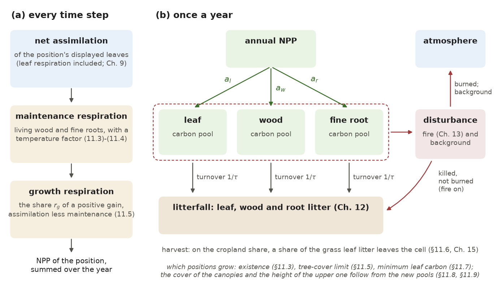
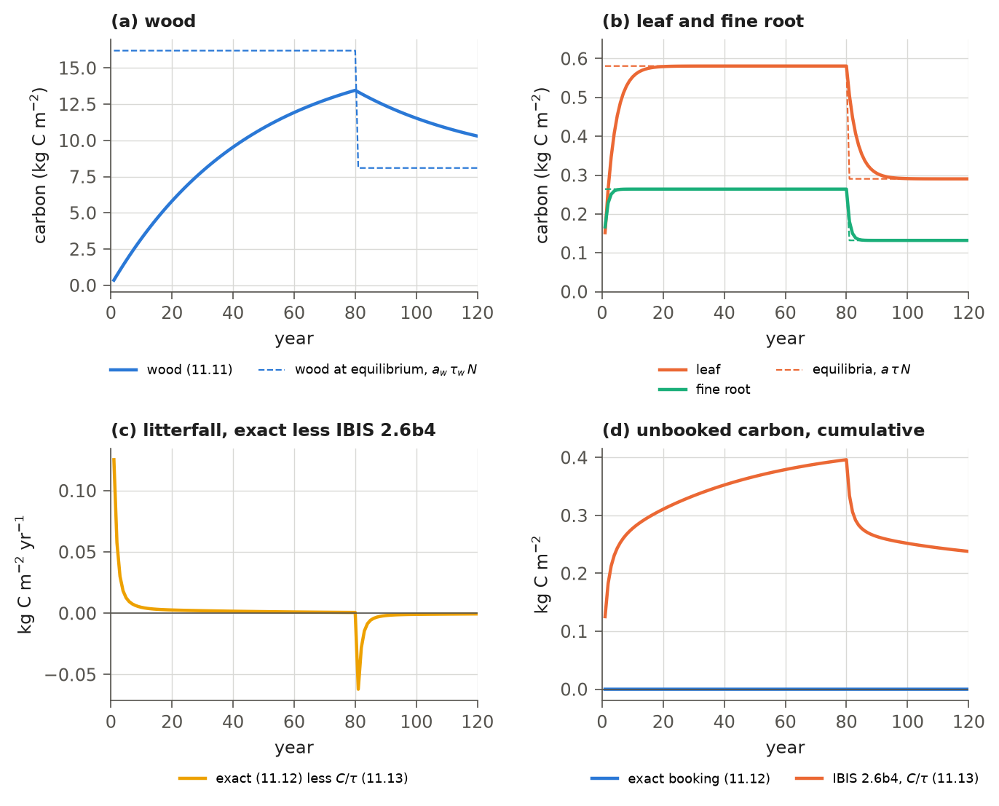
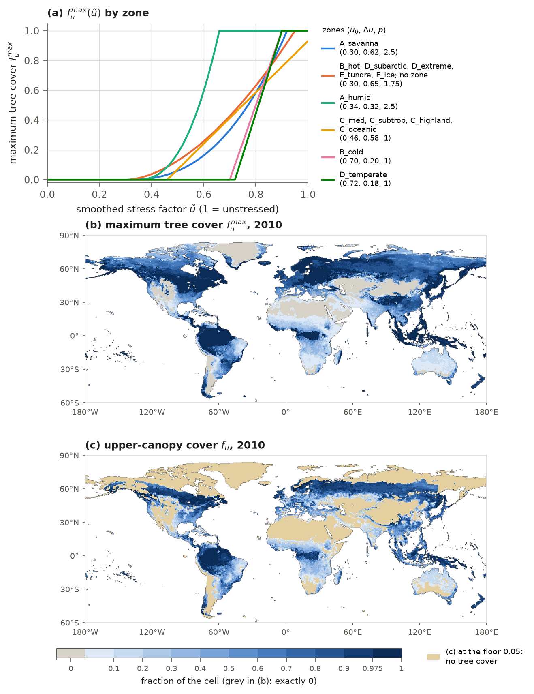
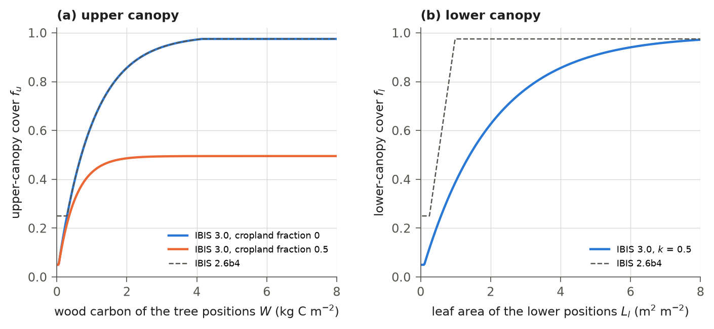

# 11. Autotrophic Respiration, Allocation and Vegetation Dynamics

Plants use part of the carbon they fix for maintenance and the construction of new tissue; the remainder becomes
leaves, wood and roots. This chapter follows that carbon and describes how a grid cell's vegetation changes from year
to year. The model works on two timescales. Every hourly time step, it converts the net photosynthesis of each plant
functional type (PFT) position to net primary production (NPP), subtracting the costs of maintaining living wood and
roots and of growth. It accumulates this NPP over the year.

Once a year, the model uses annual NPP and climate to decide which positions may grow in the cell. It allocates NPP
among leaves, wood and fine roots, sheds litter, applies fire, other disturbance and harvest, and sets leaf area,
the cover of both canopies and tree height for the next year.

A position is one of the twelve PFT slots of a cell (Chapter 2); with the climate-zone types of IBIS 3.0 a position can
hold a plant type with its own parameters. The photosynthesis that feeds the NPP is described in Chapter 9, the daily
display of the leaves (phenology) in Chapter 10, the decay of the litter in Chapter 12, the burned area in Chapter 13
and the cropland in Chapter 15.

## 11.1 Overview and order of the calculations

The model accumulates each position's NPP every time step, then uses the annual total to update growth, litterfall
and disturbance (Table 11.1). The hourly calculation follows the routine `sumnow` of IBIS 2.6b4 and runs inside the time step
(`ibis/timestepping/loops_gswp3.py`). The annual calculations follow the IBIS 2.6b4 routines `climanl2` and `existence` for climate and the plant types it
admits, and `dynaveg` with `vegmap` for growth, disturbance and the resulting canopy. In IBIS 3.0 these are in `ibis/physics/climate_analysis.py` and `ibis/physics/vegetation_dynamics.py`. The
driver `scripts/run_global.py` calls them after the last day of each year, in the order of Table 11.1. The scheme is
the carbon balance and vegetation dynamics of IBIS (Foley et al., 1996; Kucharik et al., 2000) as coded in IBIS 2.6b4,
with the additions listed in section 11.12.3. Figure 11.1 shows the path of carbon through one position.

**Table 11.1** Order of the annual calculations, after the last time step of the year, with dynamic vegetation on
(`physics.isimveg` = 1, as in the release).

| Step | Calculation | Section |
|---|---|---|
| 1 | the year's climate statistics, complete after the last day: the lowest and highest ten-day mean temperature and the growing degree-days (with `pheno.climate_stats_daily` off: the same statistics from the monthly means of the forcing) | 11.3.1 |
| 2 | the 30-year running means of these statistics | 11.3.2 |
| 3 | the existence of each position | 11.3.3 |
| 4 | the year's net ecosystem exchange before disturbance: NPP less heterotrophic respiration | 11.10 |
| 5 | allocation of NPP, turnover and litterfall of the leaf, wood and fine-root pools | 11.4 |
| 6 | removal of the trees where the maximum tree cover is zero | 11.5 |
| 7 | fire and background disturbance | 11.6 |
| 8 | harvest on the cropland share | 11.6 |
| 9 | the minimum leaf carbon of the positions that exist; leaf area and biomass | 11.7 |
| 10 | the net ecosystem exchange less the carbon removed by disturbance and harvest | 11.10 |
| 11 | fractional cover of the upper and lower canopy, with the water-limited maximum tree cover | 11.5, 11.8 |
| 12 | height of the upper canopy, stem area index, sapwood fraction | 11.9 |
| 13 | vegetation type of the cell (a diagnostic) | 11.11 |
| 14 | yearly output; the annual sums are set to zero; the smoothed soil-water stress is stored | 11.5 |

The updated pools, leaf area and cover take effect at the first time step of the next year. Daily phenology
(Chapter 10) determines the displayed fraction of full leaf area.

**Figure 11.1** The carbon of a PFT position. (a) Every time step, the net assimilation of the position's displayed
leaves less the maintenance respiration of its living wood (the sapwood of the trees, all the wood of the shrubs) and
fine roots is the position's carbon gain; when the gain is positive, growth respiration takes the share $r_{g}$ of it.
The remainder is added to the position's annual NPP. (b) Once a year, with dynamic vegetation on, NPP is allocated to
leaf, wood and fine-root pools. Turnover transfers carbon from each pool to litterfall, and disturbance removes a share
of every pool (dashed frame). Burned carbon and background disturbance go to the atmosphere; killed but unburned carbon
joins litterfall. This split needs fire on and the season-length fire scheme, as in the release; otherwise all the disturbed
carbon goes to the atmosphere (section 11.6). On the cropland share of a cell, harvest removes a share of the grass
leaf litterfall (11.20).

## 11.2 Autotrophic respiration and net primary production

Plants respire part of the carbon they fix. Maintenance respiration sustains living cells, and growth respiration
represents the cost of building new tissue. The remainder, NPP, is available for plant growth. The model computes NPP
for each position every time step and accumulates it over the year. Leaf net photosynthesis already includes leaf
respiration (Chapter 9); this section adds living-wood and fine-root maintenance respiration and growth respiration.

### 11.2.1 Net assimilation of a position

The canopy model of Chapter 9 computes photosynthesis for five big leaves, each standing for the leaves of one or more
positions. Each position receives a share of the net photosynthesis of its big leaf. The net assimilation of position
$j$ per unit area of the cell is

$$
A_{j} = A_{n,b(j)}\, \psi_{j}\, \Lambda_{u}\, f_{u} \quad (j \le 8), \qquad
A_{j} = A_{n,b(j)}\, \psi_{j}\, \Lambda_{l}\, f_{l}\, (1 - f_{i}) \quad (j \ge 9),
\tag{11.1}
$$

where $A_{j}$ (mol CO2 m⁻² s⁻¹) is the net assimilation of the position; $A_{n,b}$ (mol CO2 per m² of leaf per s) is
the net photosynthesis of big leaf $b$, gross photosynthesis less leaf respiration (equation 9.23); $b(j)$ is the big
leaf of the position: the upper broadleaf (positions 1, 2, 3, 5 and 7), the upper conifer (4, 6 and 8), the shrub
(9 and 10), the C4 grass (11) and the C3 grass (12); $\psi_{j}$ is the position's share of its big leaf;
$\Lambda_{u}$ and $\Lambda_{l}$ (m² m⁻²) are the leaf area indices of the upper and the lower canopy per unit of the
canopy's cover (Chapter 10); $f_{u}$ and $f_{l}$ are the fractions of the cell covered by the upper and the lower
canopy (section 11.8); and $f_{i}$ is the snow-covered fraction of the cell (Chapter 8), since snow buries the lower
canopy. Equation (11.1) is equation (9.25) of Chapter 9.

The division of a big leaf's photosynthesis matters when its positions have different capacities, as for evergreen
and deciduous shrubs. With `stomata.gpp_split_by_capacity` on (as in the release parameter file),
the share of a position in the broadleaf, conifer and shrub big leaves is weighted by its photosynthetic capacity,

$$
\psi_{j} = \frac{\phi_{j}\, V_{m,j}}{\sum_{i \in b(j)} \phi_{i}\, V_{m,i}} \sum_{i \in b(j)} \phi_{i},
\tag{11.2}
$$

where $\phi_{j}$ is the fraction of its canopy's displayed leaf area held by position $j$ (Chapter 10), and $V_{m,j}$
(mol CO2 m⁻² s⁻¹) is the capacity at 15 °C with which the position works (equation 9.7): the capacity of the parameter
file times the acclimation factor of the positions that acclimate to the season, with the frost ramp of section 9.3.3
when `stomata.frost_on` is on (off in the release); the factor is 1 in the other positions. The cropland factor of (9.7) applies only to grass positions, which are unaffected by this division. A big leaf's
shares still sum to $\sum_{i \in b(j)} \phi_{i}$, so (11.2) redistributes assimilation among positions while preserving
the total. The model uses $\psi_{j} = \phi_{j}$, the division of IBIS 2.6b4, in three cases:
with the switch off; for the two grass big leaves, which each hold one position; and when the denominator of (11.2)
is at most $10^{-12}$.

### 11.2.2 Maintenance respiration

Maintenance respiration sustains living sapwood and fine roots, and increases with temperature. The maintenance
respiration of the sapwood and the fine roots of position $j$ is

$$
R_{j} =
\begin{cases}
\kappa \left( r_{w,j}\, C_{w,j}\, \phi_{s}\, g_{a} + r_{r,j}\, C_{r,j}\, g_{b} \right) & j \le 8, \\
\kappa \left( r_{w,j}\, C_{w,j}\, g_{a} + r_{r,j}\, C_{r,j}\, g_{b} \right) & j = 9, 10, \\
\kappa\, r_{r,j}\, C_{r,j}\, g_{b} & j = 11, 12,
\end{cases}
\qquad \kappa = \frac{1000}{12\, n_{d}\, 86400},
\tag{11.3}
$$

where $R_{j}$ (mol C m⁻² s⁻¹) is the maintenance respiration; $r_{w,j}$ and $r_{r,j}$ (yr⁻¹) are the maintenance
coefficients of wood and fine roots at 15 °C, as fractions of the pool per year (`bgc.rwood`, `bgc.rroot`; Tables 11.3
to 11.5); $C_{w,j}$ and $C_{r,j}$ (kg C m⁻²) are the wood and fine-root carbon of the position; $\phi_{s}$ is the
sapwood fraction of the tree wood (section 11.9), one value for all tree positions of a cell; $\kappa$
(mol C yr kg C⁻¹ s⁻¹) converts a rate in kg C m⁻² yr⁻¹ to mol C m⁻² s⁻¹; and $n_{d}$ is the number of days of the year
(365 or 366). As in IBIS 2.6b4, only sapwood respires in trees, all shrub wood respires, and grasses have no wood. The temperature factors are

$$
g_{a} = \exp\left[3500 \left(\frac{1}{288.16} - \frac{1}{\max(T_{s}, 200)}\right)\right], \qquad
g_{b} = \exp\left[3500 \left(\frac{1}{288.16} - \frac{1}{\max(T_{r}, 200)}\right)\right], \qquad
T_{r} = \sum_{k=1}^{6} T_{k}\, \frac{r^{l}_{k} + r^{u}_{k}}{2},
\tag{11.4}
$$

where $g_{a}$ and $g_{b}$ are the factors of the stems and the roots; $T_{s}$ (K) is the stem temperature of the upper
canopy, from the canopy energy balance (Chapter 5); $T_{r}$ (K) is the root temperature; $T_{k}$ (K) is the
temperature of soil layer $k$; and $r^{l}_{k}$ and $r^{u}_{k}$ are the root fractions of the lower and the upper canopy
in layer $k$ (equation 2.8). The factor has the Arrhenius form, with an activation temperature of 3500 K and a
reference temperature of 15 °C (288.16 K); the IBIS 2.6b4 code attributes it to Lloyd and Taylor (1994). It rises by a
factor of 1.55 from 5 to 15 °C and of 1.50 from 15 to 25 °C. IBIS 3.0 adds a floor of 200 K on the temperature. The
floor can bind on the Antarctic ice sheet, where the daily mean forcing temperature falls below 200 K (in 3,722 land
cells in 2005, all south of 60°S) and the positions hold practically no carbon.

### 11.2.3 Growth respiration and NPP

Building new tissue costs carbon. The model charges this growth respiration as a fixed share of the carbon a position
gains in a time step, and only when there is a gain. The NPP of position $j$ in a time step is

$$
N_{j} =
\begin{cases}
(1 - r_{g,j}) \left(A_{j} - R_{j}\right) & A_{j} - R_{j} > 0, \\
A_{j} - R_{j} & \text{otherwise},
\end{cases}
\tag{11.5}
$$

where $N_{j}$ (mol C m⁻² s⁻¹) is the NPP and $r_{g,j}$ is the growth respiration coefficient, the share of the carbon
gain that is respired in building new tissue (`bgc.rgrowth`; Tables 11.4 and 11.5). When maintenance exceeds assimilation, as it does every night and through leafless seasons, the position builds no new
tissue and the entire deficit reduces its NPP. This follows IBIS 2.6b4 and is the IBIS 3.0 default
(`bgc.rgrowth_positive_only` = true). The release run used
another rule: it applied the factor $(1 - r_{g,j})$ whatever the sign of $A_{j} - R_{j}$, so that every deficit was
reduced by the share $r_{g,j}$. Setting the switch to false restores that rule.

The effect on NPP was measured by repeating 2010 of the release run from its state at the end of 2009, for 903 land
cells in three strips one degree of longitude wide (20-21°E, 61-60°W and 100-101°E, from 56°S to 72°N). The difference
was calculated by summing $r_{g,j} \min(0, A_{j} - R_{j})$ over every time step and position. The release's rule added 0.063 kg C m⁻² yr⁻¹ to the NPP averaged over the strips, 9.4 % of their NPP and
3.9 % of their gross primary production. With the rule of IBIS 2.6b4, in that year and from the same state, their NPP
is lower by this amount: by 10-14 % between 10°S and 10°N and by 3-5 % north of 55°N. This is a first-order estimate: over multiple years, carbon pools, leaf area and canopy cover would also respond. The growth and fine-root respiration
coefficients of the release (Tables 11.4 and 11.5) were fitted at flux towers under the release's rule; they will be
refitted for the current one (Chapter 16).

The NPP is summed over every time step of the year,

$$
N^{y}_{j} = \sum_{t} 0.012\, \Delta t\, N_{j}, \qquad N^{y} = \sum_{j=1}^{12} N^{y}_{j},
\tag{11.6}
$$

where $N^{y}_{j}$ (kg C m⁻² yr⁻¹) is the annual NPP of the position; $\Delta t$ = 3600 s is the time step;
0.012 kg C mol⁻¹ converts moles to mass; and $N^{y}$ is the NPP of the cell, written to the yearly output as
`aynpptot`. Cell NPP includes all positions, including positions that may not exist, and retains negative values. The yearly
output also gives the NPP of the upper and the lower canopy (`aynppu`, `aynppl`). The gross primary production of the
cell (`aygpptot`) is summed in the same way from (9.24). The model does not write the autotrophic respiration; it is
the gross less the net primary production of the cell.

## 11.3 Climate statistics and the existence of a position

Climate limits where each plant type can live. Once a year, the model compares each cell's climate with the cold,
warmth and growing-season limits of its plant types to determine which positions may hold vegetation. This comparison
uses four annual temperature statistics, smoothed over about 30 years.

### 11.3.1 Climate statistics of the year

During the year the model keeps four numbers for each cell: the lowest and the highest ten-day mean air temperature,
and the growing degree-days above 0 °C and above 5 °C. By default (`pheno.climate_stats_daily` = true) they are built
day by day, as in IBIS 2.6b4,

$$
T^{y}_{c} = \min_{n} \bar{T}^{\,n-1}_{10} - 273.16, \qquad T^{y}_{w} = \max_{n} \bar{T}^{\,n-1}_{10} - 273.16, \qquad
G^{y}_{0} = \sum_{n} \max\left(0,\; T^{\,n}_{d} - 273.16\right), \qquad
G^{y}_{5} = \sum_{n} \max\left(0,\; T^{\,n}_{d} - 278.16\right),
\tag{11.7}
$$

where the extremes and the sums run over the days $n$ of the year; $T^{y}_{c}$ and $T^{y}_{w}$ (°C) are the year's
coldest and warmest temperatures, which IBIS calls the coldest- and warmest-month temperatures; $\bar{T}^{\,n-1}_{10}$
(K) is the ten-day running mean of the daily mean air temperature as it stands at the start of day $n$, that is, after
day $n - 1$ (equation 10.4); $T^{\,n}_{d}$ (K) is the daily mean air temperature of day $n$ from the forcing (`tas`;
Chapter 3); and $G^{y}_{0}$ and $G^{y}_{5}$ (°C d) are the growing degree-days above 0 and 5 °C. The four numbers are
reset on 1 January ($T^{y}_{c}$ to 100 °C, $T^{y}_{w}$ to −100 °C, the degree-days to 0) and are complete after the last
day of the year. Because the extremes come from the ten-day mean, a single cold night or hot day does not set them.

With `pheno.climate_stats_daily` = false the model uses the method of the release run, which takes the statistics from
the monthly means of the forcing,

$$
\begin{gathered}
T^{y}_{c} = \min_{m} \bar{T}_{m}, \qquad T^{y}_{w} = \max_{m} \bar{T}_{m}, \qquad
G^{y}_{0} = \sum_{d} \max\left(0, T'_{d}\right), \qquad G^{y}_{5} = \sum_{d} \max\left(0, T'_{d} - 5\right), \\
T'_{d} = \bar{T}_{m'} + \omega_{d} \left(\bar{T}_{m''} - \bar{T}_{m'}\right), \qquad
(m', m'', \omega_{d}) =
\begin{cases}
\left(m - 1,\; m,\; \dfrac{d_{m} - 0.5}{n_{m}} + 0.5\right) & d_{m} < \dfrac{n_{m} + 1}{2}, \\[1ex]
\left(m,\; m + 1,\; \dfrac{d_{m} - 0.5}{n_{m}} - 0.5\right) & \text{otherwise},
\end{cases}
\end{gathered}
\tag{11.8}
$$

where $\bar{T}_{m}$ (°C) is the mean of `tas` over month $m$ less 273.16 K, taken to stand for the middle of the month;
$T'_{d}$ (°C) is the temperature of day $d$ of the year, interpolated linearly between the monthly means; $m$ is the
month in which day $d$ falls and $d_{m}$ the day of that month (1 to $n_{m}$); $n_{m}$ is the number of days of the
month; $m'$ and $m''$ are the two months between whose middles day $d$ lies (in the first half of a month, the month
before and the month itself; in the second half, the month itself and the month after); $\omega_{d}$ is the
interpolation weight, which rises from 0 at the middle of month $m'$ to 1 at the middle of month $m''$; and the months
are taken cyclically (December precedes January). This is the interpolation of the IBIS 2.6b4 routine `climanl` (`climate.f`), which IBIS 2.6b4 uses only to
start the statistics from a monthly climatology. IBIS 3.0 uses it for the same purpose at a cold start (section
11.3.2).

The effect of this choice was measured from the forcing data. Both sets of statistics were computed for every land
cell from GSWP3 daily mean temperatures for 1901-1910, the first ten years of the release's spin-up cycle, and then
averaged over those ten years. The daily rule (11.7) gives a coldest temperature lower by 2.3 K at the median land cell
(5th to 95th percentile 0.4 to 4.2 K) and a warmest temperature higher by 1.4 K (0.3 to 2.5 K). The degree-days of the
two methods agree where the temperature stays on one side of the threshold all year (median difference below 1 °C d).
In the 10,604 cells with 300-900 °C d above 5 °C, a range spanning the release's boreal and temperate-conifer limits, the daily rule gives a
median of 21 % (131 °C d) more. Applied to the two sets of ten-year means with the limits of the release and the zones
of 1901-1930 (section 11.3.3), the existence of at least one position differs in 6,398 of the 95,333 land cells
(6.7 %). In all but 24 of the differing cell-positions the daily statistics admit a position that the monthly
statistics exclude, mostly the boreal positions 6-8 (2,006 to 2,149 cells each, most of them in the D_subarctic and
D_extreme zones) and the C4 grass (2,685 cells). The release's degree-day limits were tuned against observed tree
cover with the monthly statistics (11.8). For the revised parameter set, quantile mapping on the preliminary run
raised the boreal limit from 600 to 700 °C d and the temperate-conifer limit from 900 to 975 °C d (Table 11.2).
These are the adopted settings; the final global run and its tree-cover evaluation are still pending.

### 11.3.2 Running means

A plant type's climatic suitability depends on recent decades. The model therefore smooths each annual statistic
with a 30-year exponential running mean, updated once a year,

$$
X \leftarrow e^{-1/30} X + \left(1 - e^{-1/30}\right) X^{y}, \qquad X \in \{T_{c}, T_{w}, G_{0}, G_{5}\}, \qquad
T_{c,min} = T_{c} + \Delta T,
\tag{11.9}
$$

where $X$ is the running mean of statistic $X^{y}$ of (11.7) or (11.8), so that each year moves the mean by 3.3 % of
the year's departure from it; and $T_{c,min}$ (°C) is the coldest temperature plus an offset $\Delta T$ toward the
absolute minimum temperature. IBIS 2.6b4 reads the offset from a map; in IBIS 3.0 $\Delta T = 0$ (section 2.3.5). The
weights are those of IBIS 2.6b4 (`climanl2`). At a cold start the running means are set from the monthly means of the
first forcing year (1901 in the release) with (11.8), as IBIS 2.6b4 does from its monthly climatology (`climanl`). On
a restart they are read from the restart file.

### 11.3.3 Existence

The existence flag $e_{j}$ of each position is 1 if the position may hold vegetation in the cell and 0 otherwise. The
model sets it once a year from the running means, before the allocation, with the rules of IBIS 2.6b4 (routine
`existence`, after the BIOME3 model of Haxeltine and Prentice (1996) according to the code's comments). Table 11.2
gives the rules with the limits of the revised parameter file, `params_32a_base.yaml`.

**Table 11.2** Bioclimatic limits of the twelve PFTs (`pft.<pft>.TminL`, `TminU`, `Twarm`, `GDD`); $T_{c,min}$,
$T_{w}$, $G_{0}$ and $G_{5}$ are the running means of section 11.3.2; $T_{L}$ and $T_{U}$ are the lower and upper
limits of $T_{c,min}$, $T_{W}$ the lower limit of $T_{w}$ and $G^{*}_{j}$ the degree-day limit of PFT $j$. Values are
from the revised parameter set, with IBIS 2.6b4 values in parentheses where they differ. For daily climate statistics,
position 4 now uses 975 °C d and positions 6-8 use 700 °C d. The release used 900 and 600 °C d, respectively, with
monthly statistics. The source and decision are recorded in section 11.13.

| Position | Condition for existence | Limits (revised parameter set) |
|---|---|---|
| 1, 2 | $T_{c,min} > T_{L}$ | $T_{L}$ = 0 °C |
| 3 | $T_{L} < T_{c,min} < T_{U}$ | $T_{L}$ = −10 °C, $T_{U}$ = 0 °C |
| 4 | $T_{L} < T_{c,min} < T_{U}$ and $G_{5} > G^{*}_{4}$ | $T_{L}$ = −45 °C, $T_{U}$ = 0 °C; $G^{*}_{4}$ = 975 (1200) °C d |
| 5 | $T_{L} < T_{c,min} < T_{U}$ and $G_{5} > G^{*}_{5}$ | $T_{L}$ = −45 °C, $T_{U}$ = 0 °C; $G^{*}_{5}$ = 1200 °C d |
| 6 | ($T_{c,min} < T_{U}$ or $G_{5} < G^{*}_{4}$) and $T_{c,min} > T_{L}$ and $G_{5} > G^{*}_{6}$ | $T_{L}$ = −57.5 °C, $T_{U}$ = −45 °C; $G^{*}_{6}$ = 700 (350) °C d |
| 7 | ($T_{c,min} < T_{U}$ or $G_{5} < G^{*}_{5}$) and $T_{c,min} > T_{L}$ and $G_{5} > G^{*}_{7}$ | $T_{L}$ = −57.5 °C, $T_{U}$ = −45 °C; $G^{*}_{7}$ = 700 (350) °C d |
| 8 | ($T_{c,min} < T_{U}$ or $G_{5} < T_{L,4}$) and $G_{5} > G^{*}_{8}$ | $T_{U}$ = −45 °C; $G^{*}_{8}$ = 700 (350) °C d |
| 9, 10, 12 | $G_{0} > G^{*}_{j}$ | $G^{*}_{j}$ = 100 °C d |
| 11 | $T_{w} > T_{W}$ and $G_{0} > G^{*}_{11}$ | $T_{W}$ = 22 °C, $G^{*}_{11}$ = 100 °C d |

In the rule of position 8 (boreal conifer cold-deciduous, the larch), IBIS 2.6b4 compares the degree-days with the
lower temperature limit of position 4 ($T_{L,4}$ = −45), while the comment in its code describes a comparison with
$G^{*}_{4}$. Degree-days are never below −45, so the rule reduces to
$T_{c,min} < -45$ °C and $G_{5} > G^{*}_{8}$. IBIS 3.0 keeps the rule as coded; `physics.larch_gdd_fix` = true
(default false, false in the release) makes the comparison the comment describes.

With the climate-zone types on (`physics.koppen_types`, on in the release) the rules apply by position as described in
section 2.3.5. A position that is off in the cell's zone (Table 2.4) has $e_{j} = 0$. A position that holds a type
exists wherever its zone places it, subject only to the degree-day limit of its parent PFT ($G_{5} > G^{*}$ of the
parent for the tree positions with parents 4-8, $G_{0} > 100$ °C d for the shrubs and grasses) and, for the C4 grass,
to $T_{w} > 22$ °C; types descended from PFTs 1-3 have no limit. A position that keeps its base parameters takes the
full rule of its PFT in Table 11.2. Position 8 holds a type (T19) in the D_subarctic and D_extreme zones and is off in
the other zones, so its rule as coded acts only in the cells without a zone.

A position with $e_{j} = 0$ retains its pools, but they decay. It receives no allocation (section 11.4), its wood
turnover time is halved, and it receives no minimum leaf carbon (section 11.7). Its remaining leaves continue to
photosynthesize and respire until they disappear, and its NPP still contributes to cell NPP (11.6).

## 11.4 Allocation, turnover and litterfall

Each year, allocation divides a position's NPP among leaf, wood and fine-root pools, while turnover transfers part of
each pool to litter. Together these processes determine vegetation biomass and the litter supplied to the soil. The NPP available to position $j$ is

$$
N'_{j} = e_{j}\, N^{y}_{j}\, (1 - c\,\delta_{j}),
\tag{11.10}
$$

where $N'_{j}$ (kg C m⁻² yr⁻¹) is the NPP the position may grow with; $c$ is the cropland fraction of the cell
(section 2.7; 0 without a cropland map); and $\delta_{j}$ is 1 for the shrub positions 9 and 10 and 0 otherwise. The
shrubs grow on the natural share of the cell only, and the share $c \max(0, e_{j} N^{y}_{j})$ of their NPP leaves the
cell with the harvest (section 11.6; Chapter 15). Each pool $C_{x,j}$ ($x$ = leaf $l$, wood $w$, root $r$) is updated
with the exact solution over one year of $dC/dt = a_{x,j} N'_{j} - C/\tau_{x,j}$ for constant NPP,

$$
C_{x,j} \leftarrow C_{x,j}\, e^{-1/\tau_{x,j}} + a_{x,j}\, \tau_{x,j} \max\left(0, N'_{j}\right) \left(1 - e^{-1/\tau_{x,j}}\right),
\qquad \tau_{w,j} = \frac{\tau^{0}_{w,j}}{2} \left(1 + e_{j}\right),
\tag{11.11}
$$

where $C_{x,j}$ (kg C m⁻²) is the carbon of pool $x$ of position $j$; $a_{x,j}$ is the fraction of NPP allocated to the
pool (`pft.<pft>.aleaf`, `aroot`, `awood`); $\tau_{x,j}$ (yr) is the turnover time of the pool (`tauleaf`, `tauroot`);
and $\tau_{w,j}$ is the turnover time of the wood: the normal time $\tau^{0}_{w,j}$ (`tauwood0`) where the position
exists, and half of it where it does not. Negative NPP is not allocated. The allocation fractions of every position and
every type of the release sum to 1 (Tables 11.4 and 11.5). Under constant NPP the pool tends to
$a_{x,j} \tau_{x,j} N'_{j}$ (Figure 11.2a, b). On a cell with cropland, the allocation of the two grass positions can be
blended toward a crop allocation (`crop.aleaf`, not set in the release; section 15.6). The above-ground NPP of the
yearly output (`ayanpptot`) is the leaf and wood share of the NPP the positions grow with,
$\sum_{j} (a_{l,j} + a_{w,j}) N'_{j}$.

Litterfall from each pool enters the litter pools of Chapter 12. The model accounts for it in one of two ways. With
`pft.exact_litterfall` on (as in the release), litterfall includes carbon lost from the initial pool during the update
(11.11), plus newly allocated carbon that turned over within the year,

$$
F_{x,j} = C_{x,j} \left(1 - e^{-1/\tau_{x,j}}\right) + a_{x,j} \max\left(0, N'_{j}\right) \left[1 - \tau_{x,j}\left(1 - e^{-1/\tau_{x,j}}\right)\right],
\tag{11.12}
$$

where $F_{x,j}$ (kg C m⁻² yr⁻¹) is the litterfall and $C_{x,j}$ is the pool before the update, so that the pool changes
by exactly $a_{x,j} \max(0, N'_{j}) - F_{x,j}$. IBIS 2.6b4 instead records

$$
F_{x,j} = C_{x,j} / \tau_{x,j},
\tag{11.13}
$$

which equals (11.12) only at equilibrium, $C_{x,j} = a_{x,j} \tau_{x,j} N'_{j}$. While a pool grows, (11.13) records less litterfall than the pool loses, leaving the difference unaccounted for in
the carbon budget (Figure 11.2c, d). With `pft.exact_litterfall` on, the model also accounts for two parts of cell NPP (11.6) that the pools do not receive.
Positive NPP from a position with $e_{j} = 0$ joins leaf litterfall, while negative annual NPP is deducted from the
position's own pools,

$$
F_{l} \mathrel{+}= \max\left(0, N^{y}_{j}\right) (1 - e_{j}), \qquad
d_{j} = \max\left(0, -N^{y}_{j}\right) \;\text{taken from}\; C_{w,j},\; \text{then}\; C_{r,j},\; \text{then}\; C_{l,j},
\tag{11.14}
$$

where $F_{l}$ (kg C m⁻² yr⁻¹) is cell leaf litterfall and $d_{j}$ (kg C m⁻² yr⁻¹) is the deficit. Each pool supplies
at most the carbon it holds after the update (11.11); any deficit beyond the combined pools remains unaccounted for.
IBIS 2.6b4 omits both terms. The litterfall of the cell is summed over the positions into a leaf, a wood and a root flux.

**Figure 11.2** The annual update of one position, computed year by year with the model's fixed-vegetation update
(section 11.12.1), which allocates and books the litterfall as (11.11)-(11.13) without disturbance: position 4
(temperate conifer evergreen) with its base parameters of the release (Table 11.4), an NPP of 0.8 kg C m⁻² yr⁻¹ for
80 years and 0.4 kg C m⁻² yr⁻¹ after. (a) The wood (11.11); after 80 years it holds 13.5 kg C m⁻², against
16.2 kg C m⁻² at equilibrium ($a_{w} \tau_{w} N$). (b) The leaf and fine-root carbon, which reach their equilibria
(0.58 and 0.26 kg C m⁻² for the first 80 years) within about 15 and 5 years. The pools are the same under both
bookings. (c) The litterfall of the three pools booked by (11.12) less that booked by (11.13): 0.125 kg C m⁻² yr⁻¹ in
year 1, less than 0.01 in absolute value in years 6-80, and −0.062 in the year after the step. (d) The NPP less the
litterfall and the change of the pools, summed over the years: at most $1.2 \times 10^{-5}$ kg C m⁻² with (11.12), the
round-off of the model's single precision; with (11.13) it reaches 0.40 kg C m⁻² while the pools grow and falls back to
0.24 kg C m⁻² by year 120 as they shrink.

### 11.4.1 Parameters

The scalar parameters of the annual update are given in Table 11.3, the per-position parameters of allocation,
turnover and respiration in Table 11.4, and their values for the plant types of Chapter 2 in Table 11.5. A position
that holds a type takes the type's values, with the base value of the type's parent PFT for each parameter the type
does not set (equation 2.1); a position that keeps its base parameters takes the values of Table 11.4. When a year
enters a new period of the Köppen map (1931, 1961, 1991; section 2.3.1), the types are applied again at the start of the
year. A cell whose zone changes adopts the new zone's parameters, including the existence rule, turnover times, allocation, $r_{g}$, $r_{r}$ and
tree-cover parameters (Table 11.6). Its carbon pools are retained, so the new specific leaf area changes its leaf area
(11.22) at that year's annual update.

**Table 11.3** Scalar parameters of this chapter: release values and those of IBIS 2.6b4. Values that are not in the
release parameter file are the code defaults.

| Symbol | Parameter (file name) | Release | IBIS 2.6b4 | Equation |
|---|---|---|---|---|
| $r_{w}$ | wood maintenance coefficient at 15 °C (`bgc.rwood`; default), every position and type | 0.0125 yr⁻¹ | 0.0125 yr⁻¹ | (11.3) |
| $\tau_{r}$ | fine-root turnover time (`pft.<pft>.tauroot`), every position and type | 1.0 yr | 1.0 yr | (11.11) |
| $L_{min}$ | minimum leaf area index of a position that exists (`pft.xminlai`) | 0.01 | 0.01 | (11.21) |
| $W_{n}$ | wood carbon of a closed canopy (`pft.woodnorm`) | 7.5 kg C m⁻² | 7.5 kg C m⁻² | (11.23) |
| $k_{w}$ | wood scale of the upper cover (`pft.fu_k`; default) | 1.0 kg C m⁻² | 1.0 kg C m⁻² (implicit) | (11.23) |
| $f^{min}_{u}$, $f^{min}_{l}$ | floors of the upper and lower cover (`pft.fu_min`, `pft.fl_min`) | 0.05, 0.05 | 0.25, 0.25 | (11.23), (11.25) |
| $k$ | extinction of the lower cover with leaf area (`pft.cover_k`) | 0.5 | 0 (linear) | (11.25) |
| $u_{0}$, $\Delta u$, $p$ | maximum tree cover, base values (`pft.tree_cover_min`, `tree_cover_ramp`, `tree_cover_power`); by zone in Table 11.6 | 0.30, 0.65, 1.75 | none | (11.17) |
| $Y$ | smoothing time of the stress factor (`pft.tree_cover_years`) | 5 yr | none | (11.16) |
| $T_{g}$ | threshold of a growing-season day (`pheno.stress_accum_tmin`); with `pheno.drop_stress_gate` (default true; the release ran without the gate) it also gates the lower canopy's drought trigger (Chapter 10) | 5 °C | none | (11.15) |
| $d_{o}$ | background disturbance (code constant) | 0.005 yr⁻¹ | 0.005 yr⁻¹ | (11.18) |
| $d_{f}$ | disturbed share with fire off (code constant) | 0.005 yr⁻¹ | 0.005 yr⁻¹ | (11.18) |
| $\varepsilon_{l}$, $\varepsilon_{w}$ | combustion completeness of leaves and wood (`fire.cc_leaf`, `fire.cc_wood`; defaults) | 0.90, 0.20 | none | (11.19) |
| $h$ | harvest index (`crop.harvest_index`) | 0.45 | none | (11.20) |

**Table 11.4** Base parameters of the twelve positions in the release parameter file (`pft.<pft>.specla`, `tauleaf`,
`tauwood0`, `aleaf`, `aroot`, `awood`; `bgc.rgrowth`, `bgc.rroot`), with the values of IBIS 2.6b4 (`params.can`;
`stats.f` for $r_{g}$ and $r_{r}$) in parentheses where they differ. $\sigma$: specific leaf area (m² kg C⁻¹);
$\tau_{l}$, $\tau^{0}_{w}$: leaf and wood turnover times (yr); $a_{l}$, $a_{r}$, $a_{w}$: allocation fractions;
$r_{g}$: growth respiration coefficient; $r_{r}$: fine-root maintenance coefficient (yr⁻¹). The release values of
$r_{g}$ and $r_{r}$ were fitted under the growth respiration rule of the release run (section 11.2.3) and will be
refitted.

| Position | $\sigma$ | $\tau_{l}$ | $\tau^{0}_{w}$ | $a_{l}$ | $a_{r}$ | $a_{w}$ | $r_{g}$ | $r_{r}$ |
|---|---|---|---|---|---|---|---|---|
| 1 tropical broadleaf evergreen | 12.8 (25) | 1.4 (1.01) | 50 (25) | 0.35 (0.3) | 0.27 (0.2) | 0.38 (0.5) | 0.201 (0.3) | 1.64 (1.25) |
| 2 tropical broadleaf drought-deciduous | 20.9 (25) | 1 | 40 (25) | 0.3 | 0.25 (0.2) | 0.45 (0.5) | 0.201 (0.3) | 1.64 (1.25) |
| 3 warm-temperate broadleaf evergreen | 12.8 (25) | 1.4 (1) | 40 (25) | 0.32 (0.3) | 0.33 (0.2) | 0.35 (0.5) | 0.201 (0.3) | 1.64 (1.25) |
| 4 temperate conifer evergreen | 6.8 (12.5) | 3.3 (2) | 45 (50) | 0.22 (0.3) | 0.33 (0.4) | 0.45 (0.3) | 0.157 (0.3) | 0.779 (1.25) |
| 5 temperate broadleaf cold-deciduous | 20.9 (25) | 1 | 45 (50) | 0.28 (0.3) | 0.27 (0.2) | 0.45 (0.5) | 0.147 (0.3) | 1.06 (1.25) |
| 6 boreal conifer evergreen | 6.8 (12.5) | 3.3 (2.5) | 100 | 0.28 (0.3) | 0.35 (0.4) | 0.37 (0.3) | 0.157 (0.3) | 0.779 (1.25) |
| 7 boreal broadleaf cold-deciduous | 20.9 (25) | 1 | 80 (100) | 0.3 | 0.2 | 0.5 | 0.147 (0.3) | 1.06 (1.25) |
| 8 boreal conifer cold-deciduous | 13.7 (25) | 1 | 80 (100) | 0.3 | 0.25 (0.2) | 0.45 (0.5) | 0.157 (0.3) | 0.779 (1.25) |
| 9 evergreen shrubs | 12.2 (12.5) | 1.3 (1.5) | 10 (5) | 0.4 (0.45) | 0.35 (0.4) | 0.25 (0.15) | 0.374 (0.3) | 0.667 (1.25) |
| 10 deciduous shrubs | 20.8 (25) | 1 | 10 (5) | 0.3 (0.45) | 0.55 (0.35) | 0.15 (0.2) | 0.374 (0.3) | 0.667 (1.25) |
| 11 warm (C4) grasses | 26.1 (20) | 1 (1.25) | 999 | 0.3 (0.45) | 0.7 (0.55) | 0 | 0.206 (0.3) | 1.69 (1.25) |
| 12 cool (C3) grasses | 27.2 (20) | 1 (1.5) | 999 | 0.3 (0.45) | 0.7 (0.55) | 0 | 0.206 (0.3) | 1.69 (1.25) |

**Table 11.5** Parameters of the plant types of the release (Table 2.3), as the model gathers them into the positions
(section 2.3.4; `types.<type>.<parameter>` in the parameter file). Bold: the type sets the value; otherwise the value
is the base value of the parent PFT (Table 11.4). Symbols and units as in Table 11.4. Every type has $\tau_{r}$ = 1 yr
and $r_{w}$ = 0.0125 yr⁻¹.

| Type | Parent | Positions | $\sigma$ | $\tau_{l}$ | $\tau^{0}_{w}$ | $a_{l}$ | $a_{r}$ | $a_{w}$ | $r_{g}$ | $r_{r}$ |
|---|---|---|---|---|---|---|---|---|---|---|
| T01 | 1 | 1 | 12.8 | **1.4** | 50 | **0.236** | **0.364** | **0.4** | **0.127** | **1.28** |
| T02 | 2 | 2 | 20.9 | **1** | 40 | **0.255** | **0.325** | **0.42** | **0.118** | **0.515** |
| T03 | 2 | 1, 2 | 20.9 | **1** | 40 | **0.225** | 0.25 | **0.525** | **0.138** | **0.636** |
| T04 | 3 | 3 | 12.8 | 1.4 | 40 | 0.32 | 0.33 | 0.35 | **0.143** | **0.636** |
| T05 | 2 | 1 | 20.9 | 1 | 40 | 0.3 | 0.25 | 0.45 | **0.109** | **3.18** |
| T06 | 3 | 3 | 12.8 | **1.4** | 40 | **0.224** | **0.426** | **0.35** | **0.231** | **1.2** |
| T07 | 4 | 4 | 6.8 | **3.3** | 45 | **0.154** | **0.496** | **0.35** | **0.153** | **0.553** |
| T08 | 5 | 5 | 20.9 | **1** | 45 | **0.196** | **0.454** | **0.35** | **0.181** | **0.605** |
| T09 | 3 | 3 | 12.8 | **1.4** | 40 | **0.272** | **0.378** | **0.35** | **0.119** | **0.93** |
| T10 | 4 | 4 | 6.8 | **3.3** | 45 | **0.187** | **0.463** | **0.35** | **0.129** | **0.49** |
| T11 | 5 | 5 | 20.9 | **1** | 45 | **0.238** | **0.412** | **0.35** | **0.114** | **0.485** |
| T12 | 5 | 5 | 20.9 | **1** | 45 | **0.196** | **0.454** | **0.35** | **0.102** | **1.38** |
| T13 | 4 | 4 | 6.8 | **3.3** | 45 | **0.154** | **0.496** | **0.35** | **0.103** | **0.776** |
| T14 | 3 | 3 | 12.8 | **1.4** | 40 | **0.224** | **0.426** | **0.35** | **0.202** | **0.593** |
| T15 | 5 | 5 | 20.9 | 1 | 45 | 0.28 | **0.37** | **0.35** | **0.137** | **0.86** |
| T16 | 4 | 4 | 6.8 | **3.3** | 45 | **0.253** | **0.397** | **0.35** | **0.139** | **0.805** |
| T17 | 6 | 6 | 6.8 | **3.3** | 100 | **0.308** | 0.35 | **0.342** | **0.153** | **0.931** |
| T18 | 7 | 7 | 20.9 | 1 | 80 | 0.3 | 0.2 | 0.5 | **0.209** | **3.06** |
| T19 | 8 | 8 | 13.7 | 1 | 80 | 0.3 | 0.25 | 0.45 | **0.118** | **0.348** |
| T21 | 4 | 4 | 6.8 | 3.3 | 45 | 0.22 | **0.43** | **0.35** | **0.1** | **0.775** |
| S01 | 9 | 9 | 12.2 | 1.3 | 10 | 0.4 | 0.35 | 0.25 | **0.216** | **0.854** |
| S02 | 10 | 10 | 20.8 | 1 | 10 | 0.3 | 0.55 | 0.15 | **0.127** | **1.39** |
| S03 | 9 | 9 | 12.2 | 1.3 | 10 | 0.4 | 0.35 | 0.25 | **0.181** | **0.941** |
| S04 | 10 | 10 | 20.8 | **1** | 10 | **0.32** | **0.45** | **0.23** | **0.182** | **0.703** |
| S05 | 9 | 9 | 12.2 | 1.3 | 10 | 0.4 | 0.35 | 0.25 | **0.337** | **1.16** |
| S06 | 10 | 10 | 20.8 | 1 | 10 | **0.3** | 0.55 | 0.15 | **0.137** | **0.684** |
| S07 | 9 | 9 | 12.2 | **1.3** | 10 | **0.24** | 0.35 | **0.41** | **0.276** | **0.312** |
| G01 | 11 | 11 | 26.1 | **0.7** | 999 | **0.25** | **0.75** | 0 | **0.19** | **0.545** |
| G02 | 11 | 11 | 26.1 | **0.7** | 999 | **0.25** | **0.75** | 0 | **0.172** | **0.72** |
| G03 | 11 | 11 | 26.1 | **0.7** | 999 | **0.25** | **0.75** | 0 | **0.165** | **0.578** |
| G04 | 12 | 12 | 27.2 | **0.7** | 999 | **0.25** | **0.75** | 0 | **0.155** | **0.738** |
| G05 | 12 | 12 | 27.2 | **0.7** | 999 | **0.25** | **0.75** | 0 | **0.132** | **0.626** |
| G06 | 12 | 12 | 27.2 | **0.6** | 999 | **0.3** | **0.7** | 0 | **0.164** | **1.02** |
| G07 | 12 | 12 | 27.2 | **0.8** | 999 | **0.28** | **0.72** | 0 | **0.206** | **1.56** |
| G08 | 12 | 12 | 27.2 | **0.7** | 999 | **0.28** | **0.72** | 0 | **0.142** | **1.02** |

The turnover time of 999 yr of the grass wood has no effect, since the grasses allocate no carbon to wood. Across the
twelve base positions and the 35 types, the growth respiration coefficient ranges from 0.100 to 0.374, against 0.30 for
every PFT in IBIS 2.6b4. Three types, T12, T13 and T21, are within 0.003 of 0.10, the lower bound of the tower fit
(Chapter 16).

## 11.5 Water-limited maximum tree cover

In dry climates, grasses and shrubs replace trees. IBIS 2.6b4 limits trees through the effect of drought on NPP,
without an explicit water limit on tree cover. IBIS 3.0 adds such a limit (`pft.tree_cover_limit`, on in the release
parameter file): tree soil-water stress over recent years sets the maximum fraction of the cell that trees may cover. The stress factor of the upper canopy, $u$ (1 when the root
zone is unstressed and 0 when it is fully stressed; Chapter 9), is averaged each year over the growing-season days,

$$
u^{y} = \frac{\sum_{d} \gamma_{d}\, u_{d}}{\max\left(1, \sum_{d} \gamma_{d}\right)}, \qquad
\gamma_{d} =
\begin{cases} 1 & T_{a,d} > 273.16 + T_{g} \\ 0 & \text{otherwise} \end{cases},
\tag{11.15}
$$

where $u^{y}$ is the year's mean stress factor (written to the yearly output as `aystressu`); $u_{d}$ is the factor at
the end of day $d$; $T_{a,d}$ (K) is the daily mean air temperature of the forcing; and $T_{g}$ (°C) is the threshold of
a growing-season day (`pheno.stress_accum_tmin`, 5 °C in the release; the default of −100 °C counts every day). Frozen
soil reads as fully stressed; the threshold keeps most frozen days out of the mean. The mean is smoothed over the years,

$$
\tilde{u} =
\begin{cases} \tilde{u}' + \left(u^{y} - \tilde{u}'\right) / Y & \tilde{u}' > 0, \\ u^{y} & \text{otherwise}, \end{cases}
\tag{11.16}
$$

where $\tilde{u}$ is the smoothed stress factor of the year, stored at the end of the year (`aystressu_smooth` in the
yearly output); $\tilde{u}'$ is the value stored the year before (0 at a cold start); and $Y$ = 5 yr
(`pft.tree_cover_years`), so that a single dry year moves the smoothed factor by a fifth of its departure from the
stored value. A stored value of 0 means "not yet set", so a cell whose stored value is exactly 0, such as an ice-sheet
cell, takes the next year's mean without smoothing. The maximum tree cover is

$$
f^{max}_{u} = \left[\min\left(\max\left(\frac{\tilde{u} - u_{0}}{\Delta u}, 0\right), 1\right)\right]^{p},
\tag{11.17}
$$

where $f^{max}_{u}$ is the maximum fraction of the cell covered by the upper canopy; $u_{0}$ is the stress factor below
which trees are excluded (`tree_cover_min`); $\Delta u$ is the range over which the limit rises to 1
(`tree_cover_ramp`); and $p$ is its shape (`tree_cover_power`). The three parameters are scalars of the cell: the
median over the tree types of the cell's zone that set them, or the base value where none does (equation 2.2;
Table 11.6, Figure 11.3a).

**Table 11.6** Parameters of the maximum tree cover (11.17) by climate zone in the release.

| Zones | Types that set them | $u_{0}$ | $\Delta u$ | $p$ |
|---|---|---|---|---|
| A_humid | T01 | 0.34 | 0.32 | 2.5 |
| A_savanna | T02 | 0.30 | 0.62 | 2.5 |
| C_med, C_subtrop, C_highland, C_oceanic | T04, T06-T14 | 0.46 | 0.58 | 1.0 |
| D_temperate | T16 | 0.72 | 0.18 | 1.0 |
| B_cold | T21 | 0.70 | 0.20 | 1.0 |
| B_hot, D_subarctic, D_extreme, E_tundra, E_ice, no zone | none (base values `pft.tree_cover_min`, `tree_cover_ramp`, `tree_cover_power`) | 0.30 | 0.65 | 1.75 |

The limit has two effects. Where $f^{max}_{u} > 0$, it caps upper-canopy cover (section 11.8) while retaining the tree
pools. Wood carbon then develops according to production, turnover and disturbance at that cover. Where $f^{max}_{u} = 0$ the trees are removed after the allocation of the year: the leaf, wood and root carbon
of positions 1-8 joins the litterfall of the year (with `pft.tree_kill_to_litter`, default true and true in the
release), the tree wood that sets the cover is zero, and the tree positions receive no minimum leaf carbon
(section 11.7), so that they cannot come back until $f^{max}_{u}$ rises above zero again.

In the release run the limit was zero in 2010 in 37,350 of the 95,333 land cells: 27,332 of them in the ice zone
(25,362 of these in Antarctica, south of the maps of Figure 11.3), 5,308 in the cold steppe and desert zone (B_cold,
98 % of its cells) and 3,443 in the hot one (B_hot, 31 %). The cover of the upper canopy equalled the limit, with the
limit between 0.05 and 0.975, in 20,195 cells, among them 5,203 of the 6,794 cells of the A_savanna zone and 5,303 of
the 13,738 cells of the D_subarctic zone (`figures/make_ch11.py`, `11.3`; release run, to be updated after the final
run of the revised model).

A high cover limit does not ensure that trees are present. Where no tree position exists (section 11.3.3),
upper-canopy cover remains at its floor. In 2010, 10,924 land cells had $f^{max}_{u} \ge 0.5$ and the upper cover at its floor; in 10,292 of them no
tree position existed, among them 6,623 of the 13,738 cells of the D_subarctic zone (48 %) and 3,415 cells of the
E_tundra zone. In 4,182 of these D_subarctic cells the running mean $G_{5}$ lay between the IBIS 2.6b4 limit of
350 °C d and the release limit of 600 °C d of positions 6-8, the only limit on the zone's tree types in that run
(the revised limit is 700 °C d; Table 11.2). At
62.25°N, for example, the running mean $G_{5}$ falls from 703 to 506 °C d between 136.75°E and 137.25°E, and the upper
cover from 0.80 to the floor (Figure 11.3c; release run, to be updated after the final run of the revised model).

When the cover limit is disabled, an older rule can apply. A survival factor
$\min(\max((u^{y} - u_{min})/\Delta u_{s}, 0), 1)$ based on the year's mean (11.15) multiplies the tree pools each year
(`pft.tree_stress_min` $u_{min}$, `pft.tree_stress_ramp` $\Delta u_{s}$). It acts only when $u_{min}$ is 0 or more; the
default $u_{min} = -1$ turns it off. In the release the cover limit replaces it, and the values of `tree_stress_min`
(0.5) and `tree_stress_ramp` (0.3) in the parameter file have no effect. IBIS 2.6b4 has neither limit.

**Figure 11.3** (a) The maximum tree cover (11.17) as a function of the smoothed stress factor, for the zone parameters
of Table 11.6, computed with the model's own function. (b) The maximum tree cover of 2010 in the release run, computed
with (11.17) and the zones of the Köppen map of 1991-2020 from the smoothed stress factor of the run's yearly output
(`aystressu_smooth`, the value the annual update of 2010 used); grey: exactly 0. (c) The upper-canopy cover set at the
end of 2010 in the release run (`fu`); tan: at the floor of 0.05, no tree cover. Where (c) is at the floor although (b)
is high, no tree position exists in most cells (degree-day limits, section 11.3.3): in 10,292 of the 10,924 cells with
$f^{max}_{u} \ge 0.5$ and the cover at the floor. The maps end at 60°S; Antarctica, in the E_ice
zone with $f^{max}_{u} = 0$, is not shown. Panels (b) and (c): release run; to be updated after the final run of the
revised model.

## 11.6 Disturbance and harvest

Fire removes vegetation each year, and a fixed background rate of 0.5 % per year represents other disturbances.
Storms, insects and disease are not modelled separately. The model applies disturbance losses to every pool of every
position. On cropland, part of grass leaf litterfall also leaves the cell as harvest. After the removal of the trees (section 11.5), every pool of every position loses the disturbed share of the
year,

$$
C_{x,j} \leftarrow \max\left[0,\; C_{x,j} \left(1 - D_{j}\right)\right], \qquad D_{j} = d_{f}\, m_{j} + d_{o},
\tag{11.18}
$$

where $D_{j}$ is the share of position $j$ disturbed in the year; $d_{f}$ is the fraction of the cell burned in the
year (Chapter 13); $m_{j}$ is the fire mortality of the position, the share of its carbon that a fire passing over the
whole cell kills (`fire.mort`; Chapter 13); and $d_{o}$ = 0.005 yr⁻¹ is the background disturbance of IBIS 2.6b4, a
constant of the code that stands for disturbances other than fire. With fire on (`physics.isimfire` = 1, as in the
release) and the fire scheme of IBIS 3.0 (`physics.fire_scheme` = `seasonlength`, the default), the mortality is set per
position (`fire.use_pft_mortality`, default true). Under the fire scheme of IBIS 2.6b4 (`legacy`), or with the
per-position mortality off, $m_{j} = 1$. With fire off (`physics.isimfire` = 0), $d_{f}$ is the constant 0.005 yr⁻¹ of
IBIS 2.6b4 and $m_{j} = 1$ under either scheme, so every position loses 0.010 of its carbon a year, as in IBIS 2.6b4.

With fire on, the season-length scheme divides the fire-killed carbon between the atmosphere and the litter
(`fire.use_combustion_completeness`, default true),

$$
E \mathrel{+}= \sum_{j} \left[ \varepsilon_{l}\, d_{f} m_{j} C_{l,j} + \varepsilon_{w}\, d_{f} m_{j} C_{w,j}
+ d_{o} \left(C_{l,j} + C_{w,j} + C_{r,j}\right) \right],
\tag{11.19}
$$

where $E$ (kg C m⁻² yr⁻¹) is the carbon removed from the cell to the atmosphere in the year (written to the yearly
output as `aycdisturb` in runs with a cropland file; otherwise it enters the output only through the net ecosystem
exchange `ayneetot`, section 11.10), the pools are those before (11.18), and $\varepsilon_{l}$ = 0.90 and $\varepsilon_{w}$ = 0.20 are the
combustion completeness of leaves and wood (`fire.cc_leaf`, `fire.cc_wood`; Chapter 13). The killed leaves and wood
that do not burn, $(1 - \varepsilon_{l}) d_{f} m_{j} C_{l,j}$ and $(1 - \varepsilon_{w}) d_{f} m_{j} C_{w,j}$, and the
killed fine roots, $d_{f} m_{j} C_{r,j}$, join the leaf, wood and root litterfall. All carbon removed by background disturbance goes to the atmosphere. Under the `legacy` scheme, with the combustion completeness off, and with fire off under either
scheme, all the disturbed carbon, $D_{j} (C_{l,j} + C_{w,j} + C_{r,j})$, goes to the atmosphere, as in IBIS 2.6b4.
With fire on, the carbon the fire burns (the $\varepsilon$ terms of (11.19), or, where all disturbed carbon goes to the
atmosphere, the whole fire share $d_{f} m_{j} (C_{l,j} + C_{w,j} + C_{r,j})$) is also the basis of the fire's
trace-gas emissions (Chapter 13).

On the cropland share of a cell (section 2.7; Chapter 15) a share of the grass leaf litterfall is removed as harvest,

$$
H = c\, h \left(F_{l,11} + F_{l,12}\right), \qquad F_{l} \leftarrow \max\left(0, F_{l} - H\right), \qquad
E \mathrel{+}= H + c \sum_{j=9}^{10} \max\left(0, e_{j} N^{y}_{j}\right),
\tag{11.20}
$$

where $H$ (kg C m⁻² yr⁻¹) is the harvest; $h$ = 0.45 is the harvest index (`crop.harvest_index`); $F_{l,11}$ and
$F_{l,12}$ are the leaf litterfall of the two grass positions by (11.12) or (11.13); and the last term is the shrub NPP
on the cropland share (11.10), which leaves the cell with the harvest. Annual output records harvest as `ayharvest` and removed shrub NPP as `aycropshrub`.

## 11.7 Minimum leaf carbon, leaf area and biomass

Every position permitted to exist retains a small amount of leaf carbon from which it can regrow when climate
allows,

$$
C_{l,j} \leftarrow \max\left(C_{l,j},\; e_{j}\, \lambda_{j}\, \frac{L_{min}}{\sigma_{j}}\right), \qquad
\lambda_{j} = \begin{cases} 1 & f^{max}_{u} > 0 \text{ or } j \ge 9, \\ 0 & \text{otherwise}, \end{cases}
\tag{11.21}
$$

where $C_{l,j}$ (kg C m⁻²) is the leaf carbon; $L_{min}$ = 0.01 m² m⁻² is the minimum leaf area index (`pft.xminlai`);
$\sigma_{j}$ (m² kg C⁻¹) is the specific leaf area of the position (`pft.<pft>.specla`; Tables 11.4 and 11.5); and
$\lambda_{j}$ keeps the trees out where the maximum tree cover is zero. Without the cover limit, $\lambda_{j} = 1$ for
every position, unless the survival factor of section 11.5 is on, in which case $\lambda_{j} = 0$ for the trees where
that factor is 0. As in IBIS 2.6b4, carbon added by this floor is excluded from NPP and is not accounted for in net ecosystem exchange. The leaf area index and the biomass of each position follow from the pools,

$$
L_{j} = \sigma_{j}\, C_{l,j}, \qquad B_{j} = C_{l,j} + C_{w,j} + C_{r,j},
\tag{11.22}
$$

where $L_{j}$ (m² m⁻²) is the leaf area index of the position at full leaf, per unit area of the cell, and $B_{j}$
(kg C m⁻²) its biomass. The phenology displays a fraction of $L_{j}$ day by day (Chapter 10). The code can also hold the
leaf area of each canopy below a per-type maximum (`pft.lai_max`); the release sets no maximum.

## 11.8 Fractional cover

Either canopy may cover only part of a cell. Upper-canopy cover increases with tree wood carbon, while lower-canopy
cover increases with its leaf area. These covers determine each canopy's contribution to the cell's light, water and
heat exchange (Chapters 4 and 5). The fraction of the cell covered by the upper canopy is

$$
f_{u} = \min\left\{0.975,\; \max\left[f^{min}_{u},\; \min\left(f^{max}_{u},\;
(1 - c)\, \frac{1 - \exp\left[-W / \left(\max(1 - c, 0.01)\, k_{w}\right)\right]}{1 - \exp\left(-W_{n} / k_{w}\right)}
\left(1 - \bar{D}\right)\right)\right]\right\},
\tag{11.23}
$$

where $f_{u}$ is the cover of the upper canopy; $W$ (kg C m⁻²) is 0.001 plus the wood carbon of the tree positions
after the allocation (11.11) and the payment of a negative NPP (11.14) and before the disturbance (11.18), zero where
the trees are removed; $c$ is the cropland fraction: the trees grow on the natural share $1 - c$ at the wood density
$W / (1 - c)$ of that share (Chapter 15); $k_{w}$ = 1.0 kg C m⁻² is the wood scale of the cover (`pft.fu_k`); $W_{n}$ =
7.5 kg C m⁻² is the wood of a closed canopy (`pft.woodnorm`); $f^{max}_{u}$ is the maximum tree cover (11.17), 1
without the cover limit; $f^{min}_{u}$ = 0.05 (`pft.fu_min`) is the floor of the cover; and $\bar{D}$ is the disturbed
share of the cell,

$$
\bar{D} = d_{f}\, \frac{\sum_{j} L^{0}_{j} m_{j}}{\sum_{j} L^{0}_{j}} + d_{o},
\tag{11.24}
$$

with $L^{0}_{j}$ the leaf area index of the positions before the update. With fire off, under the `legacy` scheme or
without the per-position mortality, $m_{j} = 1$ and $\bar{D} = d_{f} + d_{o}$. With fire and per-position mortality on,
the same $\bar{D}$ applies to both canopies. Grass leaf area therefore affects the disturbance applied to tree cover,
and tree leaf area affects the disturbance applied to lower-canopy cover.
The cover of the lower canopy follows from its leaf area,

$$
f_{l} = \min\left\{0.975,\; \max\left[f^{min}_{l},\; \left(1 - e^{-k L_{l}}\right)\left(1 - \bar{D}\right)\right]\right\},
\tag{11.25}
$$

where $f_{l}$ is the cover of the lower canopy; $L_{l} = \sum_{j=9}^{12} L_{j}$ (m² m⁻²) is the leaf area index of the
lower positions after the update; $k$ = 0.5 (`pft.cover_k`) is the extinction of the cover with leaf area; and
$f^{min}_{l}$ = 0.05 (`pft.fl_min`). With $k$ = 0 the cover is $L_{l} (1 - \bar{D})$, the rule of IBIS 2.6b4. IBIS 2.6b4
has no cropland term and no maximum tree cover in (11.23) and uses floors of 0.25 for both canopies; its wood scale is
1 kg C m⁻² (Figure 11.4). The floors maintain a nominal canopy in every cell. Even where no tree has leaves, upper-canopy cover is
$f^{min}_{u}$, with no leaf area. On a cell with cropland, the maximum tree cover and the floor
act on the cover of the whole cell, after the factor $1 - c$ (section 15.4). The leaf area per unit cover of each
canopy, $\Lambda_{u}$ and $\Lambda_{l}$ of (11.1), is the displayed leaf area divided by the cover, limited to
12 m² m⁻² (Chapter 10).

**Figure 11.4** The fractional cover of the two canopies, computed by the model's annual update on synthetic cells with
fire off ($m_{j} = 1$), so that $\bar{D} = d_{f} + d_{o}$ = 0.01, against the rules of IBIS 2.6b4 with the same
$\bar{D}$: (a) the upper canopy as a function of the tree wood, for a cell without cropland and a cell with half its
area in cropland, (11.23) with $f^{max}_{u} = 1$; without cropland the cover reaches 0.975 at $W$ = 4.2 kg C m⁻² and
equals the IBIS 2.6b4 curve above the floors; (b) the lower canopy as a function of its leaf area, (11.25): 0.39 at
$L_{l}$ = 1 m² m⁻², 0.63 at 2 m² m⁻² and 0.97 at 8 m² m⁻², where IBIS 2.6b4 reaches its cap of 0.975 below
$L_{l}$ = 1 m² m⁻².

## 11.9 Canopy height, stem area and sapwood

Tree height determines surface roughness and the height at which the model applies the forcing wind (Chapter 5).
Stems contribute to light interception alongside leaves (Chapter 4), while the sapwood fraction determines how much
tree wood respires (11.3). The model updates all three quantities once a year. The height of the upper canopy follows from the
tree biomass per unit of cover,

$$
z_{bot,u} = 3, \qquad z_{top,u} = \max\left(z_{bot,u} + 1,\; 0.75 \times 2.5\, \frac{B_{u}}{f_{u}}\right),
\tag{11.26}
$$

where $z_{bot,u}$ and $z_{top,u}$ (m) are the bottom and top heights of the upper canopy; $B_{u} = \sum_{j \le 8}
B_{j}$ (kg C m⁻²) is the biomass of the tree positions; and 2.5 (m m² kg C⁻¹) is the coefficient of IBIS 2.6b4. The
height has no upper bound. In the release state at the end of 2000 the canopy top was above 50 m in 70 cells and above
100 m in 6, with a maximum of 154.5 m, taller than the tallest measured trees (about 116 m) (release run; to be updated
after the final run of the revised model; Chapter 5 and `figures/make_ch05.py`). The heights of the lower canopy are set daily by the phenology (Chapter 10).
The stem area indices are

$$
S_{l} = 0.05\, L_{l}, \qquad S_{u} = 0.25\, L_{u},
\tag{11.27}
$$

where $S_{l}$ and $S_{u}$ (m² m⁻²) are the stem area indices of the lower and the upper canopy, computed from the leaf
area per unit area of the cell, $L_{l}$ of (11.25) and $L_{u} = \sum_{j \le 8} L_{j}$, as in IBIS 2.6b4; Chapter 4 adds
them to the leaf area per unit cover. In this chapter $L_{u}$ and $L_{l}$ are per unit area of the cell; Chapters 4, 5
and 9 write $L_{u}$ and $L_{l}$ for the leaf area per unit cover, $\Lambda_{u}$ and $\Lambda_{l}$ here. The sapwood
fraction of the tree wood, which enters the wood respiration (11.3) of the next year, is

$$
\phi_{s} = \min\left[0.50,\; \max\left(0.05,\; \frac{q}{v}\, 0.75\, z_{top,u}\, \frac{\rho_{w}}{W}\right)\right],
\tag{11.28}
$$

where $q$ = 0.0025 m d⁻¹ is a transpiration rate and $v$ = 25 m d⁻¹ a sap velocity, whose ratio is the sapwood area
per unit area of the cell; $\rho_{w}$ = 400 kg m⁻³ is the wood density; and $W$ (kg C m⁻²) is the tree wood of (11.23).
The constants are those of IBIS 2.6b4. On a cell with cropland, $W$ is the wood of the whole cell, not of the natural
share (section 15.4).

## 11.10 Net ecosystem exchange

Net ecosystem exchange (NEE) is a cell's annual net carbon uptake: carbon fixed by plants, less plant and soil
respiration, disturbance and harvest. As in IBIS 2.6b4, the model computes it in two steps. Before allocation, it
subtracts heterotrophic respiration from NPP; during the annual update, it then subtracts carbon removed by disturbance
and harvest,

$$
\mathrm{NEE} = N^{y} - R^{y}_{h} - E,
\tag{11.29}
$$

where NEE (kg C m⁻² yr⁻¹; `ayneetot` in the yearly output) is positive for a carbon sink; $N^{y}$ is the NPP of the
cell (11.6); $R^{y}_{h}$ (kg C m⁻² yr⁻¹, `ayco2mic`) is the heterotrophic respiration of the year released as CO2
(Chapter 12; less the methane carbon of Chapter 14 when `physics.methane_carbon_partition` is on); and $E$ is the carbon
removed by disturbance and harvest (11.19)-(11.20). With `pft.exact_litterfall` on, NPP not received by the pools is accounted for as litterfall or deducted from the
pools (11.14). NEE then accounts for changes in plant, litter and soil carbon, with several exceptions: partitioned
methane carbon; minimum leaf carbon (11.21); deficits exceeding a position's pools; carbon leached from soil
(Chapter 12); and changes in litterfall recorded at year end, which enters the litter pools daily during the following
year (Chapter 12). During accelerated spin-up (`physics.nsoilcall` > 1), each day supplies several days of litterfall to the litter
pools, while annual heterotrophic respiration and NEE include only one of that day's soil calls. The budget therefore
does not close. Yearly files written by the current code give the number of soil calls per day as `nsoilcall`; the release files predate that attribute (section 12.7).

## 11.11 Vegetation type of the cell

The annual update classifies each cell into one of the fifteen vegetation types of Table 2.5. It first uses the
dominant tree position and the leaf area, then applies the low-leaf-area and cold-climate rules below. The dominant
tree position has the largest $L_j$ among positions 1–8; there is none if all tree leaf areas are zero. Leaf areas
in these rules are per unit cell area (m² m⁻²), and $L_u$ is the total tree leaf area.

| Dominant tree position | Initial classification |
|---|---|
| 1, 2 or 3 | Matching forest type (1, 2 or 3) if $L_u>2.5$; otherwise savanna (9) if $L_u>0.5$; otherwise grassland or dense shrubland |
| 4 or 5 | Matching forest type (4 or 5) if $L_u>1.5$; savanna (9) for $1.0<L_u\le1.5$; otherwise grassland or dense shrubland |
| 6 | Boreal evergreen forest (6) |
| 7 or 8 | Boreal deciduous forest (7) |
| None | Grassland or dense shrubland; the code also allows savanna if the supplied total tree leaf area exceeds 1.0 |

Where the choice is between grassland (10) and dense shrubland (11), the larger leaf area wins; a tie gives dense
shrubland. With a dominant position 4–8 and $L_u>1.0$, mixed forest (8) replaces the initial type if positions
5, 7 and 8 hold strictly between 45 % and 55 % of the leaf area of positions 4–8.

The following rules then override that classification in order. A later applicable row takes precedence.

| Condition | Resulting vegetation type |
|---|---|
| Total leaf area $<1.0$ | Open shrubland (12) |
| Total leaf area $\le0.4$ | Desert (14) |
| $G_5<350$ °C d and total leaf area $\ge0.4$ | Tundra (13) |
| $G_5<350$ °C d and total leaf area $<0.4$ | Polar desert (15) |
| $G_0<100$ °C d | Polar desert (15), regardless of leaf area |

This classification follows `vegmap`, as in IBIS 2.6b4. It is a diagnostic: no other calculation reads it, and the
yearly output does not contain it.

## 11.12 Fixed vegetation, switches and differences from IBIS 2.6b4

### 11.12.1 Fixed vegetation

With `physics.isimveg` = 0, annual NPP still supports vegetation growth and litterfall, but disturbance, harvest and
the tree-cover limit are inactive. The annual update (`biomass_update`, a routine of IBIS 3.0; IBIS 2.6b4
makes no annual update in this case, section 11.12.3) allocates the NPP and books the litterfall as in section 11.4,
but without the cropland term of (11.10) and with the normal wood turnover time for every position. It then updates the
minimum leaf carbon (without the tree factor $\lambda_{j}$), the leaf area, the stem area indices and the covers. The
covers have no disturbance, cropland or maximum-tree-cover term, and the heights, the sapwood fraction and the
vegetation type are not updated. Existence is still updated each year (section 11.3.3), so a position that the climate
no longer admits receives no allocation and no minimum leaf carbon, and its pools decay. The tower runs of the
calibration use this update (Chapter 16).

With `physics.prescribe_lai` (off in the release) the leaf area of the positions is scaled once at the start and after
every annual update so that the cell's total full-leaf leaf area equals an observed annual maximum. The positions retain their relative shares, and leaf carbon is calculated from the rescaled leaf area. The lower-canopy cover is then
recomputed from the new leaf area with the rule of (11.25) without the disturbance factor, using the run's $k$ and
$f^{min}_{l}$. In cells where the model has no leaf area, the leaf area is left as it is. With `physics.seed_lai` (off)
this is done once at the start only.

### 11.12.2 Switches

**Table 11.7** Switches of this chapter. Release run: the setting of the release run; "as false" marks a switch added
after the release, whose false setting restores the release rule for that process. Other corrections remain active.

| Switch | Default | Release run | Meaning | Section |
|---|---|---|---|---|
| `physics.isimveg` | 0 | 1 | dynamic vegetation: the full annual update (`dynaveg`) instead of the fixed-vegetation update | 11.1, 11.12.1 |
| `bgc.rgrowth_positive_only` | true | as false | growth respiration only on a positive carbon gain, as IBIS 2.6b4; false: on every step, deficits included | 11.2.3 |
| `stomata.gpp_split_by_capacity` | false | true | big-leaf assimilation divided by leaf area and working capacity | 11.2.1 |
| `pheno.climate_stats_daily` | true | as false | the year's climate statistics from daily values, as IBIS 2.6b4; false: from monthly means | 11.3.1 |
| `physics.larch_gdd_fix` | false | false | existence of position 8 with the degree-day comparison of the code's comment | 11.3.3 |
| `pft.exact_litterfall` | false | true | litterfall booked as the carbon the pool update removes; NPP of positions that may not exist and negative NPP booked | 11.4 |
| `pft.tree_cover_limit` | false | true | water-limited maximum tree cover | 11.5 |
| `pft.tree_kill_to_litter` | true | true | carbon of removed trees to litterfall (false: not booked) | 11.5 |
| `pft.tree_stress_min`, `pft.tree_stress_ramp` | −1, 0.2 | 0.5, 0.3 | survival factor of the trees without the cover limit ($u_{min} < 0$: none); no effect while `pft.tree_cover_limit` is on | 11.5 |
| `physics.isimfire` | 0 | 1 | fire: $d_{f}$ of (11.18) from the fire scheme (0: the constant 0.005, $m_{j} = 1$, all to the atmosphere) | 11.6 |
| `physics.fire_scheme` | `seasonlength` | `seasonlength` | fire scheme; `legacy`: IBIS 2.6b4, $m_{j} = 1$ and all disturbed carbon to the atmosphere | 11.6 |
| `fire.use_pft_mortality`, `fire.use_combustion_completeness` | true | true | fire mortality per position; killed carbon divided between atmosphere and litter (fire on and scheme `seasonlength` only) | 11.6 |
| `forcing.cropfrac_file` | none | ESA CCI 2000 | cropland fraction $c$ of (11.10), (11.20) and (11.23) (none: $c = 0$) | 11.4, 11.6, 11.8 |
| `physics.koppen_types` | false | true | existence and parameters by climate zone (Tables 11.5 and 11.6) | 11.3.3, 11.4.1, 11.5 |
| `physics.prescribe_lai`, `physics.seed_lai` | false | false | full-leaf leaf area from an observed field, every year or once | 11.12.1 |

### 11.12.3 Differences from IBIS 2.6b4

The model of this chapter was checked against the Fortran code of IBIS 2.6b4 (`stats.f`, `climate.f`, `weather.f`,
`vegetation.f`, `params.can`, `params.veg`). It differs in the following ways.

1. Position 8 (the larch) belongs to the conifer big leaf, both for its carbon (11.1) and for its transpiration
   (Chapter 5). IBIS 2.6b4 treats it as a broadleaf tree for both.
2. The respiration coefficients, allocation fractions, turnover times and specific leaf areas are set per position and
   per type (Tables 11.4 and 11.5), with release values different from those of IBIS 2.6b4; the growth respiration
   coefficient, 0.30 in IBIS 2.6b4, is 0.100-0.374.
3. The degree-day limits of positions 4 and 6-8 (Table 11.2), the existence by climate zone (section 2.3.5;
   `physics.koppen_types`) and the offset $\Delta T = 0$ (section 11.3.2).
4. The following are additions of IBIS 3.0, each a switch or a parameter whose IBIS 2.6b4 setting restores the IBIS
   2.6b4 rule (Tables 11.3 and 11.7): the division of a big leaf's assimilation by capacity (11.2); exact litterfall
   (11.12) and the booking of the NPP of positions that may not exist and of negative NPP (11.14); the water-limited
   maximum tree cover (11.15)-(11.17); the cropland terms (11.10), (11.20), (11.23); the per-position fire mortality
   and the combustion completeness with fire on (11.18)-(11.19); the per-type maximum leaf area (`pft.lai_max`,
   section 11.7; not set in the release); and the cover floors and the saturating lower-canopy cover (11.23), (11.25).
   With the release parameter file, switching off `pft.tree_cover_limit` restores the IBIS 2.6b4 rule only together
   with `pft.tree_stress_min` at its default of −1; otherwise the survival factor of section 11.5 acts.
5. The floor of 200 K in the temperature factors (11.4).
6. With `physics.isimveg` = 0, IBIS 2.6b4 makes no annual update: the pools, the leaf area, the covers and the
   litterfall stay as they were at the start of the run. IBIS 3.0 runs the fixed-vegetation update of section 11.12.1
   every year, which grows the pools, the leaf area and the covers from the year's NPP and books the litterfall.

Differences 1, 5 and 6, and the offset $\Delta T = 0$, have no switch. The growth respiration (11.5) and the climate
statistics (11.7) follow IBIS 2.6b4 by default; their switches set to false give the rules of the release run, which
differ from IBIS 2.6b4 (sections 11.2.3 and 11.3.1).

## 11.13 Notes for developers

The release run (`final_rel30`) was made with the code of commit `e54e342`. The technote review of 2026-11-01
(`docs/CALIBRATION.md` section 87; each defect in `docs/DEFECTS_FOR_REVIEW.md`) changed the following in this chapter.
The global maps and totals in this chapter still describe the release run. A corrected-code tower baseline and a
preliminary protocol run have since finished; the parameter refits and final protocol run remain pending.

1. *Growth respiration on a positive gain only* (review D1; `bgc.rgrowth_positive_only`, default true). The release
   applied $(1 - r_{g})$ to every step (`loops_gswp3.py` since the port's first commit 4ca4481), against `stats.f`,
   line 253, and its comment at lines 198-199 ("growth respiration is only applied to positive carbon gains"); the
   night-time plant respiration represented at the towers was too small by the share $r_{g}$. Code:
   `npp_after_growth_respiration` (`loops_gswp3.py`); tests: `tests/test_growth_respiration.py` and
   `tests/test_review_vegetation_fixes.py`. The repeat of 2010 behind section 11.2.3 ran on the CPU with the release
   parameters, the release code with the restored soil texture border rule (section 2.6) and the climatological wetland
   area; its NPP differs from the release run's by a median of 0.002-0.005 kg C m⁻² yr⁻¹ per cell in the three strips
   (at most 0.14). $r_{g}$ and $r_{r}$ (NEE stage, `docs/CALIBRATION.md` section 36) will be refitted with the day and
   night NEE means of review D3; whether $r_{g}$ still piles up at its bound 0.10 is checked after that refit (D4).
2. *Daily climate statistics* (D9; `pheno.climate_stats_daily`, default true). Code: `reset_climate_stats`,
   `accumulate_climate_stats` and `year_end_climate_stats` (`loops_gswp3.py`), used by `scripts/run_global.py` and the
   tower harness (`verify/calibration/site_transient.py`); IBIS 2.6b4: `weather.f`, lines 210-214 (reset) and 909-915.
   The release used `climate_stats_from_monthly` (`docs/DEFECTS_FOR_REVIEW.md` 2.2 recorded the method, not its size).
   Following the preliminary run, the adopted floors in `params_32a_base.yaml` are 975 °C d for position 4 and
   700 °C d for positions 6-8 (commit `c6698fd`). Quantile mapping against the release's observed-forest thresholds
   suggested about 978 and 701 °C d; the chosen rounded values preserve the release's intended tree-line limit
   (`verify/calibration/diagnostics/d9_gdd_floors.py`; lab-NAS `diag_work/d9_floors/floors_2010.txt`).
   The release parameter file retains 900 and 600 °C d. The same $T_{c}$ sets the leaf-drop threshold of Chapter 10.
3. *Capacity split with the working capacity* (D27). The release split by the capacity of the parameter file, so in
   spring, autumn and cool summers the acclimated evergreen position of a mixed big leaf (shrubs 9 with 10; conifers 6 with 8 in
   D_subarctic and D_extreme) received a larger share of the big leaf's assimilation than its working (acclimated)
   capacity warrants, at the expense of the deciduous position. Code: `loops.acclimation_vfac`, now used by the time
   step and by the split. No switch.
4. *Larch transpiration* (D47): position 8 now transpires with the conifer conductance (`canopy_exchange.py`), as its
   carbon is assigned to the conifer big leaf. The release used the broadleaf conductance, following `canopy.f`, lines
   942-950. The conifer assignment
   of its carbon (`docs/CALIBRATION.md` section 17) remains a departure from `stats.f`, lines 96-97 and 109 ("we are
   assuming that it's physiological behavior is like a broadleaf tree"). No switch.
5. *Fire off* (D29): the per-position mortality and the combustion completeness now require `physics.isimfire` = 1.
   The release code applied them under `seasonlength` also with fire off (no effect on the release run, which had fire
   on). Test: `tests/test_review_fire_fixes.py` (season-length with fire off equals `legacy`).
6. *Fire emissions* (D36; `physics.enable_fire_emissions`, default false, on in the release run, and only with
   `physics.isimfire` = 1): `dynaveg` returns the carbon the fire combusts per position (`diag["fire_combusted"]`),
   from which `run_global.py` computes the emissions and writes the burned fraction and the emissions yearly
   (Chapter 13). The release's emissions diagnostic also included combustion of litter without removing it from any pool. Its
   carbon total was 58 % greater than the carbon removed by fire (2.17 against 1.38 Pg C yr⁻¹, 2001-2010).
7. *Prescribed leaf area* (D55): `apply_prescribed_lai` (`prescribed_lai.py`) now takes `pft.cover_k` and `pft.fl_min`;
   it used the IBIS 2.6b4 rule (linear, floor 0.25). Off in the release.
8. *Spin-up output* (D77): the yearly files carry the attribute `nsoilcall`; `ayco2mic` and `ayneetot` hold the last of
   the day's soil calls (`loops_gswp3.py`).

Kept and documented after the review: no bound on the canopy height (D46); one disturbed share $\bar{D}$ for both
canopies (D49); the smoothed-stress sentinel "0 = not set" (`stress_accum.py`; D60, to change at the next restart-format
change); the cropland cover cap, sapwood fraction and cover floor (D8, D22, D48; section 15.12).

The tower analysis is investigating the scarcity of cold-deciduous trees alongside the leafless D_temperate cropland
of section 15.9 (D19 with D12). In the release state at the end of 2000, T15 (position 5) holds 0.011 m² m⁻² of leaf
area or less, about its minimum, on 72.6 % of the D_temperate area (cos-latitude weighted). Over the zone it holds 10.9 % of the upper-canopy leaf area
(area-weighted mean leaf area 0.25 against 2.02 m² m⁻² for the conifer T16 in position 4), so the zone's fitted
upper-canopy phenology acts on little leaf area (Chapter 10; review evidence, `technote_review_2026-11-01/merged.json`,
D19, on the lab NAS). The stem temperature
$T_{s}$ of (11.4) depends on the stem heat capacity `canopy.chs`, one of the variants of the hourly energy test (D14;
Chapter 5). The share of leaf respiration in the gross primary production is to be reported from the final run (D72;
Chapter 9).

Other code notes. IBIS 2.6b4 sums cell fine-root respiration in `tco2root`. The port retains that field and its annual
sum `summary.ayco2root`, but neither is assigned a value, so both remain zero. The per-position NPP is `summary.aynpp`, the
smoothed stress `stress.u_smooth`, the running means `vegetation.tc`, `tw`, `gdd0`, `gdd5` and `tcmin`, the displayed
leaf shares `vegetation.frac`. Fortran references for the IBIS 2.6b4 rules quoted above: `main.f`, line 500 (no annual
update with `isimveg` = 0; the litterfall then keeps its start value, zero at a cold start, `initial.f`, lines
1233-1235); `climate.f`, lines 398-400 (rule of position 8); `vegetation.f`, lines 359 (wood turnover halved where a position may not exist), 433-436 (all
disturbed carbon to the atmosphere), 464 (minimum leaf carbon not booked), 481 (NEE less the disturbed carbon), 530 and
542 (cover floors 0.25). With `pft.tree_kill_to_litter` false, the carbon of removed trees leaves the model unbooked, as
in runs before 2026-10-26 (3-5 Pg C yr⁻¹ in the runs s31f and s31g; `docs/CALIBRATION.md` sections 60-61). Calibration
records: tree gate and cover limit `docs/CALIBRATION.md` sections 14 and 70-71; per-position respiration 36-37;
capacity split 45.1; per-type maximum leaf area 46; exact litterfall 61 and 63. Figures: `figures/make_ch11.py`; Figure
11.1 was redrawn for the growth respiration rule, with the maintenance box reading "living wood" and the litter share of
the disturbance marked "fire on"; Figures 11.2-11.4 do not depend on the changes above, and drawn on the current code
they reproduce the numbers quoted.

## References

Foley, J. A., I. C. Prentice, N. Ramankutty, S. Levis, D. Pollard, S. Sitch, and A. Haxeltine, 1996: An integrated
biosphere model of land surface processes, terrestrial carbon balance, and vegetation dynamics. *Global
Biogeochemical Cycles*, 10, 603-628.

Haxeltine, A., and I. C. Prentice, 1996: BIOME3: An equilibrium terrestrial biosphere model based on ecophysiological
constraints, resource availability, and competition among plant functional types. *Global Biogeochemical Cycles*,
10, 693-709.

Kucharik, C. J., et al., 2000: Testing the performance of a dynamic global ecosystem model: water balance, carbon
balance, and vegetation structure. *Global Biogeochemical Cycles*, 14, 795-825.

Lloyd, J., and J. A. Taylor, 1994: On the temperature dependence of soil respiration. *Functional Ecology*, 8, 315-323.
