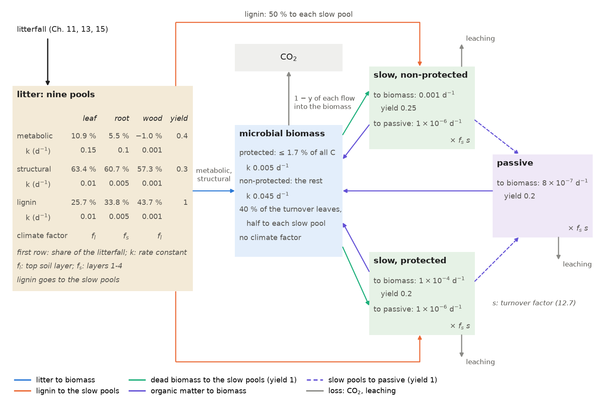
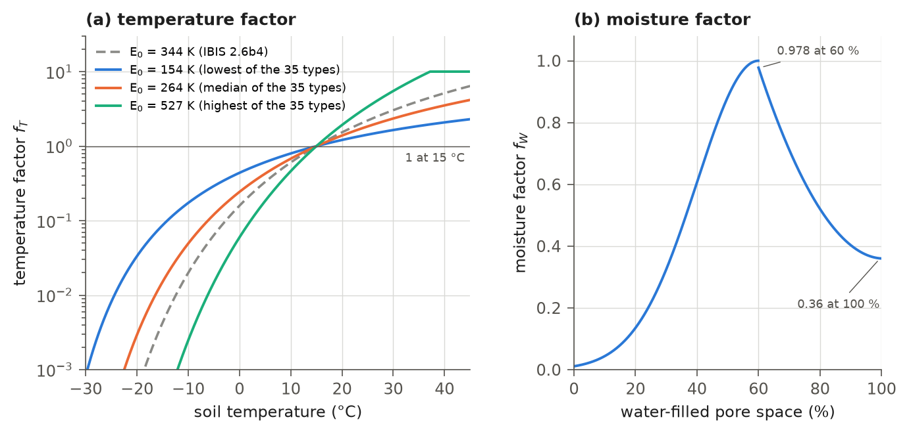
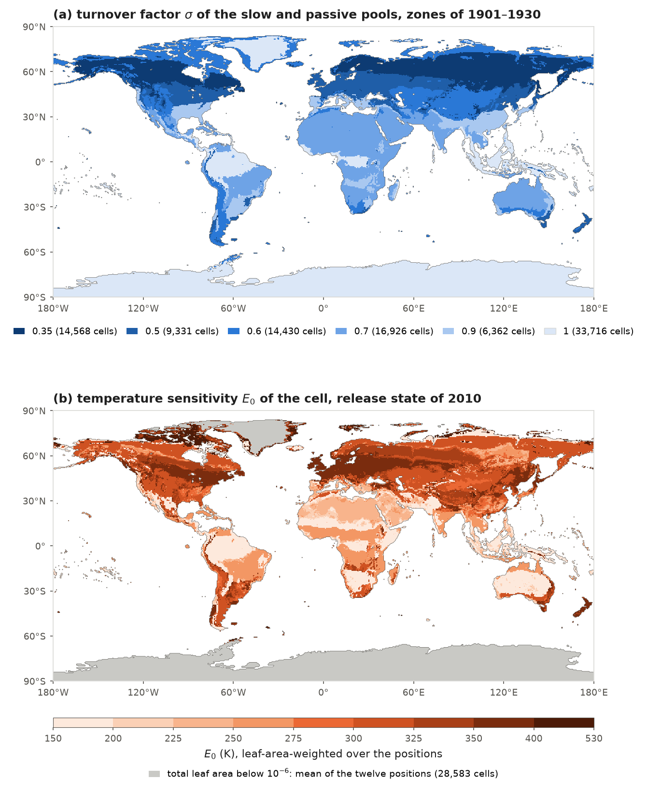
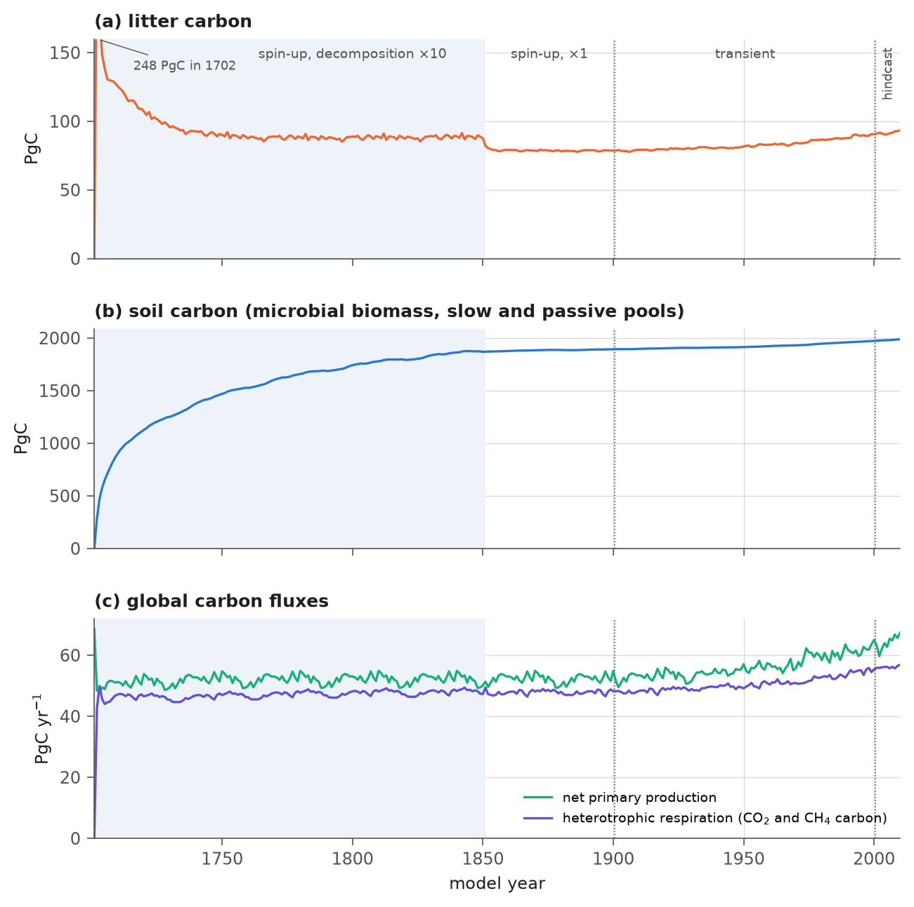

# 12. Soil Biogeochemistry and Spin-up

Dead plant material decomposes in the soil. As it decays, some of its carbon returns to the atmosphere as carbon
dioxide through heterotrophic respiration, and some becomes soil organic matter, which can retain carbon for centuries
to millennia. This chapter describes how IBIS 3.0 tracks this dead organic carbon and its decomposition.

The dead organic carbon of a grid cell is held in thirteen pools: nine litter pools (the metabolic, structural and
lignin fractions of leaf, root and wood litter), a microbial biomass pool, two slow pools of soil organic matter (one
physically protected and one not) and a passive pool. The scheme follows IBIS 2 (Kucharik et al., 2000), drawing on the
CENTURY model (Parton et al., 1987) and the model of Verberne et al. (1990). The model updates these pools through four daily processes.
First, a share of the annual litterfall, set at the end of the previous year (Chapter 11), enters the litter pools.
The litter and soil organic matter pools then decompose at rates determined by their rate constants, soil temperature
and moisture. Microbial biomass turns over at a fixed rate. Most decomposed litter enters the microbial biomass, with
some carbon respired during the transfer; lignin enters the slow pools directly. Dead microbial biomass also contributes
to the slow pools, which feed the passive pool. The carbon respired in all these steps constitutes the cell's
heterotrophic respiration.

The sections describe the pools (12.1), the climate factors controlling decomposition (12.2), transfers between pools
(12.3), heterotrophic respiration (12.4), the calculation's place in the model day (12.5), the routine's nitrogen
diagnostics (12.6) and accelerated decomposition during spin-up (12.7). Sections 12.8
and 12.9 list the switches and differences from IBIS 2.6b4, and section 12.10 records the changes
after the release for developers. Chapters 11, 13 and 15 describe litterfall, its division into leaf, root and wood
litter, and the disturbance fluxes that contribute to it. Chapter 14 uses heterotrophic respiration to compute wetland
methane.

## 12.1 Pools and litter inputs

Litter contains components that decompose at different rates. The metabolic fraction decays fastest; the structural
and lignin fractions decay more slowly, and lignin passes directly into soil organic matter (Table 12.6). The model
therefore divides litter from each source into these three pools and tracks the decomposition products through
microbial biomass into soil organic matter.

Table 12.1 lists the pools. All are expressed as carbon densities per square metre of the cell (kg C m⁻²), and the
litter and soil pools have no vertical structure. Nitrogen is not a state variable. Fixed C:N ratios, set under
`bgc.cnr` in the parameter file, determine the litter fractions (12.1) and enter the nitrogen diagnostics of section 12.6: 8 for the
microbial biomass (`microbial_biomass`), 15 for the passive pool (`passive_soc`), 10 for the protected and 15 for the
non-protected slow pool (`protected_slow_soc`, `nonprotected_slow_soc`), 100 for lignin (`resistant_litter`), 150 for
structural litter (`structural_litter`), 6 for metabolic litter (`metabolic_litter`) and 250 for woody material
(`woody_biomass`).

**Table 12.1** Litter and soil carbon pools. Code names are fields of `CarbonState` (`ibis/state/carbon.py`); the
climate factors are those of section 12.2.

| Pool | Code name | Climate factor of its decomposition |
|---|---|---|
| leaf litter: metabolic, structural, lignin | `clitlm`, `clitls`, `clitll` | $`f_{l}`$ |
| root litter: metabolic, structural, lignin | `clitrm`, `clitrs`, `clitrl` | $`f_{s}`$ |
| wood litter: metabolic, structural, lignin | `clitwm`, `clitws`, `clitwl` | $`f_{l}`$ |
| microbial biomass | `totcmic` | none |
| slow soil organic matter, non-protected | `csoislon` | $`f_{s}\,s`$ |
| slow soil organic matter, protected | `csoislop` | $`f_{s}\,s`$ |
| passive soil organic matter | `csoipas` | $`f_{s}\,s`$ |

Figure 12.1 shows the pools and transfers described in sections 12.1-12.3.



**Figure 12.1** The litter and soil carbon pools and the transfers between them, with the release values of the litter
fractions (12.1), rate constants $`k`$ and yields $`y`$ (Table 12.6). The litter factor $`f_{l}`$, soil factor
$`f_{s}`$ (12.6) and soil organic matter turnover factor $`s`$ (12.7) multiply the rates as marked; biomass
turnover has no climate factor. Grey arrows show losses: respiration, $`1 - y`$ of each flow into the biomass, and
leaching (12.12) from the two slow pools and the passive pool.

The model output reports the litter carbon `totlit`, the sum of the nine litter pools, and the soil carbon `totcsoi`,
the sum of the microbial biomass and the three pools of soil organic matter.

The annual litterfall of leaves, roots and wood, $`L_{l}`$, $`L_{r}`$ and $`L_{w}`$ (kg C m⁻² yr⁻¹; `carbon.falll`,
`fallr`, `fallw`), is set by the vegetation update at the end of each year (Chapter 11, which writes it $`F`$ because it
uses $`L`$ for leaf area). This litterfall enters the litter pools in equal daily increments during the following year.
Each source is divided into its three chemical fractions using the Verberne model equations given by Whitmore et al.
(1997), in the corrected form implemented in IBIS 2.6b4,

```math
f_{lig} = \frac{f_{max}\,c^{2}}{r + c^{2}}, \qquad
f_{str} = \frac{1/c - f_{lig}/c_{lig} - (1 - f_{lig})/c_{met}}{1/c_{str} - 1/c_{met}}, \qquad
f_{met} = 1 - f_{lig} - f_{str},
\qquad\text{(12.1)}
```

where $`f_{lig}`$, $`f_{str}`$ and $`f_{met}`$ are the lignin, structural and metabolic fractions of the litter; $`c`$ is the
C:N ratio of the litter (`bgc.cnleaf` 40, `bgc.cnroot` 60, `bgc.cnwood` 200); $`f_{max} = 0.45`$ (`bgc.fmax`) and
$`r = 1200`$ (`bgc.rconst`) are constants of the Verberne model; $`c_{lig} = 100`$ and $`c_{met} = 6`$ are the C:N ratios of
lignin and metabolic litter for all three sources; and $`c_{str}`$ is the C:N ratio of structural litter: 150 for leaf
and root litter, and the woody-material ratio, 250, for wood litter. Each day, and in each call of the routine during
accelerated spin-up (section 12.7), litter pool $`x`$ of source $`q`$ receives

```math
\Delta C_{x} = f_{x,q}\,\frac{L_{q}}{n_{d}},
\qquad\text{(12.2)}
```

where $`f_{x,q}`$ is the fraction (12.1) of pool $`x`$ in the litter of source $`q`$ and $`n_{d}`$ is the number of days of the
year (365 or 366). Table 12.2 gives the release fractions. With the wood C:N ratio of 200 and $`c_{str} = 250`$,
equation (12.1) assigns the metabolic wood pool a negative fraction, −1.0 %, as in IBIS 2.6b4. The structural and
lignin wood pools together receive 101.0 % of the wood litterfall. The metabolic wood pool receives a negative input
that is removed again on the same day (section 12.3), leaving the pool at zero. Carbon is conserved.
(A comment in the IBIS 2.6b4 routine states that wood litter is about 97 % structural; the equations as coded give the
fractions of Table 12.2.)

**Table 12.2** Fractions of the litterfall in the three litter pools of each source, equation (12.1), with the release
parameters.

| Source | C:N | Metabolic | Structural | Lignin |
|---|---|---|---|---|
| leaf | 40 | 10.9 % | 63.4 % | 25.7 % |
| root | 60 | 5.5 % | 60.7 % | 33.8 % |
| wood | 200 | −1.0 % | 57.3 % | 43.7 % |

## 12.2 Climate factors of decomposition

Decomposition is faster in warm soil than in cold soil, and fastest when the soil is moist but not waterlogged. The
model represents these effects with factors evaluated once a day that multiply the rates of all litter and soil
organic matter pools. The litter factor $`f_{l}`$ uses the top soil layer (0-0.1 m) and acts
on leaf and wood litter. The soil factor $`f_{s}`$ uses soil layers 1-4 (0-1 m) and acts on root litter and
soil organic matter (Table 12.1).

### 12.2.1 Temperature

The temperature factor follows Lloyd and Taylor (1994), with a base temperature of 15 °C,

```math
f_{T}(T) = \min\left\{\exp\left[E_{0}\left(\frac{1}{T_{b} - T_{0}} - \frac{1}{\max(T,\, T_{0} + 10) - T_{0}}\right)\right],\; 10\right\},
\qquad\text{(12.3)}
```

where $`T`$ (K) is the soil temperature; $`T_{b} = 288.16`$ K is the base temperature, at which $`f_{T} = 1`$;
$`T_{0} = 227.13`$ K is the temperature at which the Lloyd-Taylor function falls to zero (the model holds the factor at
its value for $`T_{0} + 10`$ K at colder temperatures, which keeps it away from the singularity at $`T_{0}`$); and
$`E_{0}`$ (K) is the temperature sensitivity (`bgc.lt_e0`). A larger $`E_{0}`$ makes decomposition slower below 15 °C and
faster above it, up to the cap of 10 (Figure 12.2a).

IBIS 2.6b4 uses $`E_{0} = 344`$ K everywhere. In IBIS 3.0, $`E_{0}`$ is specified for each plant functional type
position. The release parameter file gives a base value for each of the twelve positions (Table 12.3) and a value for
each of the 35 tree, shrub and grass types (Table 12.4). Equation (2.1) combines the type values into values for each
cell's positions. Each cell has a single temperature function for decomposition, whose sensitivity is the
leaf-area-weighted mean of the position values, evaluated each day:

```math
E_{0,c} =
\begin{cases}
\dfrac{\sum_{j} \Lambda_{c,j}\,E_{0,c,j}}{\sum_{j} \Lambda_{c,j}} & \sum_{j} \Lambda_{c,j} \ge 10^{-6}, \\[2ex]
\dfrac{1}{12}\sum_{j} E_{0,c,j} & \text{otherwise},
\end{cases}
\qquad\text{(12.4)}
```

where $`E_{0,c,j}`$ (K) is the value of position $`j`$ in cell $`c`$, and $`\Lambda_{c,j}`$ (m² m⁻²) is the leaf area index of
the position ($`L_{j}`$ of (11.22), `vegetation.plai`, with negative values counted as zero), which the vegetation update
sets once a year (Chapter 11). A cell whose total leaf area is below 10⁻⁶, in practice a cell without leaves, uses the
unweighted mean of its twelve positions.

The type values are medians of flux-tower fits to night-time and day-time net ecosystem exchange
(equation 16.10). The fits jointly estimated the growth respiration fraction, fine-root respiration
coefficient and a soil-pool scale that is not carried over. The bounds on the temperature sensitivity were 150-600 K
(Chapter 16), and the fitted type values range from 154 K to 527 K (Figure 12.2a). This calibration stage will be repeated for the revised model
(Chapter 16). In the state of the release run at the end of 2010 (types of the Köppen map of 1991-2020), the 66,750
cells with a total leaf area of at least 10⁻⁶ have values from 155 K to 526 K, with a median of 302 K, and 90 % of them
lie between 169 K and 365 K (Figure 12.3b). The other 28,583 cells, 27,481 of them in the zone E_ice, take the mean of
their twelve positions, 310-313 K. These values apply the current rule (12.4) to the release run's state; the release
run treated a few cells with a tiny leaf area differently (section 12.10). The distribution will be updated after
the planned parameter refits and final run of the revised model.

**Table 12.3** Base temperature sensitivity $`E_{0}`$ of the twelve positions (`bgc.lt_e0`, a table by plant functional
type in the release parameter file). These values apply to a position that is off or keeps its base parameters, and to
a type that sets no value of its own, which takes the value of its parent PFT (equation 2.1); in the release every
type sets its own value (Table 12.4).

| Positions | Plant functional types | $`E_{0}`$ (K) |
|---|---|---|
| 1, 2, 3 | tropical broadleaf evergreen and drought-deciduous, warm-temperate broadleaf evergreen trees | 311.73 |
| 4, 6, 8 | temperate and boreal conifer trees | 368.98 |
| 5, 7 | temperate and boreal broadleaf cold-deciduous trees | 222.22 |
| 9, 10 | evergreen and deciduous shrubs | 305.53 |
| 11, 12 | C4 and C3 grasses | 309.04 |

**Table 12.4** Temperature sensitivity $`E_{0}`$ (K) of the 35 types in the release parameter file
(`types.<type>.lt_e0`; types of Table 2.3).

| Type | $`E_{0}`$ | Type | $`E_{0}`$ | Type | $`E_{0}`$ | Type | $`E_{0}`$ | Type | $`E_{0}`$ |
|---|---|---|---|---|---|---|---|---|---|
| T01 | 173.9 | T08 | 209.4 | T15 | 316.4 | S02 | 264.4 | G02 | 160.7 |
| T02 | 254.9 | T09 | 154.1 | T16 | 360.1 | S03 | 161.8 | G03 | 367.8 |
| T03 | 207.8 | T10 | 237.3 | T17 | 340.7 | S04 | 251.5 | G04 | 309.3 |
| T04 | 363.2 | T11 | 239.7 | T18 | 230.1 | S05 | 281.1 | G05 | 169.3 |
| T05 | 361.6 | T12 | 279.7 | T19 | 315.0 | S06 | 160.3 | G06 | 381.7 |
| T06 | 255.7 | T13 | 353.4 | T21 | 199.9 | S07 | 276.3 | G07 | 322.6 |
| T07 | 338.1 | T14 | 365.7 | S01 | 204.1 | G01 | 258.1 | G08 | 527.3 |

### 12.2.2 Soil water

The moisture factor depends on water-filled pore space, following Linn and Doran (1984) in the form used by
Friend et al. (1997),

```math
f_{W}(\theta) =
\begin{cases}
\exp\left[-\dfrac{(\theta - 60)^{2}}{800}\right] & \theta < 60, \\[1.5ex]
0.000371\,\theta^{2} - 0.0748\,\theta + 4.13 & \theta \ge 60,
\end{cases}
\qquad
\theta = 100\,(1 - w_{i})\,w - (\theta_{opt} - 60),
\qquad\text{(12.5)}
```

where $`\theta`$ (%) is the water-filled pore space; $`w`$ is the liquid water content of the soil as a share of the pore
space not filled by ice (`soil.wsoi`), and $`w_{i}`$ is the ice content as a share of the pore space (`soil.wisoi`;
Chapter 7), so that $`(1 - w_{i})\,w`$ is the share of the pore space filled by liquid water; and $`\theta_{opt}`$ (%) is
the water-filled pore space at which decomposition is fastest (`bgc.wfps_opt`; 60, as in IBIS 2.6b4, which has no such
parameter). The factor rises to 1 at $`\theta = 60`$ % and falls to 0.36 in a saturated soil. The wet branch starts at
0.978, so the factor steps down by 0.022 at 60 % (Figure 12.2b).



**Figure 12.2** The climate factors of decomposition. (a) The temperature factor, equation (12.3), for the value of
IBIS 2.6b4 and for the lowest, the median and the highest value of the 35 types of the release (Table 12.4); a type
with a larger $`E_{0}`$ decomposes more slowly below 15 °C and faster above, up to the cap of 10. (b) The moisture
factor, equation (12.5), with $`\theta_{opt} = 60`$ %. The curves are checked against the model's own function of the
factor.

### 12.2.3 The litter and soil factors

Both climate factors combine temperature and moisture. The litter factor uses the top soil layer, where leaf
and wood litter lie. The soil factor uses the top metre, which contains the roots and most soil organic matter:

```math
f_{l} = \operatorname{clip}\left[f_{T}(T_{1})\,f_{W}(\theta_{1})\,\kappa,\; 0.001,\; 10\right], \qquad
f_{s} = \operatorname{clip}\left[f_{T}(\bar{T})\,f_{W}(\bar{\theta})\,\kappa,\; 0.001,\; 10\right],
\qquad\text{(12.6)}
```

where $`T_{1}`$ and $`\theta_{1}`$ are the temperature and the water-filled pore space of the top soil layer; $`\bar{T}`$
and $`\bar{\theta}`$ are formed from the temperature, liquid water and ice of soil layers 1-4, averaged with the layer
thicknesses as weights (0.10, 0.15, 0.25 and 0.50 m; Table 1.2), $`\bar{\theta}`$ by equation (12.5) from the averaged
$`w`$ and $`w_{i}`$; $`\kappa`$ is a multiplier on both factors (`bgc.k_scale`, 1 in the release); and clip limits the
product to the range from 0.001 to 10. The model stores the factors as `carbon.decompl` and `carbon.decomps`.

The model computes the factors once a day, after the day's 24 time steps, using the soil state at the end of the last
step. The day's decomposition follows immediately (Table 1.4). IBIS 2.6b4 instead evaluates the factor at every time
step, averages it over the day (routine `sumday` of `stats.f`) and uses that average for decomposition at the start
of the next day. The size of this difference has not been measured. The IBIS 2.6b4 soil factor also averages only
soil layers 1 and 2 (0-0.25 m). IBIS 3.0 deliberately retains the top-metre average because it was used in the
soil-carbon calibration (section 12.2.4). The factor formula itself, (12.3), (12.5) and (12.6)
for one layer, agrees with `stats.f` (section 12.9).

### 12.2.4 Turnover factor of the soil organic matter

The slow and passive pools hold most soil carbon, so their decomposition rates determine how much carbon the
soil stores. IBIS 3.0 adds a factor that slows or speeds their decomposition by climate zone. This cell-specific
factor multiplies the rates of the five outflows from the slow and passive pools (Table 12.6),

```math
s_{c} = \sigma_{c}\,\rho_{c}, \qquad
\rho_{c} =
\begin{cases}
\exp\left[E_{s}\left(\dfrac{1}{T_{r} - T_{0}} - \dfrac{1}{\max(\bar{T}, T_{0} + 10) - T_{0}}\right)\right]\dfrac{f_{T}(T_{r})}{\max\left[f_{T}(\bar{T}),\, 10^{-12}\right]} & E_{s} > 0, \\[2ex]
1 & E_{s} \le 0,
\end{cases}
\qquad\text{(12.7)}
```

where $`s_{c}`$ is the turnover factor of the soil organic matter in cell $`c`$; $`\sigma_{c}`$ is the turnover factor of
the cell's climate zone (`bgc.som_k_scale`); $`\rho_{c}`$ is an optional temperature sensitivity of the soil organic
matter of its own: a Lloyd-Taylor function with the sensitivity $`E_{s}`$ (K; `bgc.som_lt_e0`), taken relative to the
temperature factor (12.3) of the cell and equal to it at the reference temperature $`T_{r}`$ (K; `bgc.som_t_ref`,
298.16 K by default); and $`f_{T}`$ and $`\bar{T}`$ are those of equations (12.3) and (12.6). In the release $`E_{s} = 0`$,
so $`\rho_{c} = 1`$ and $`s_{c} = \sigma_{c}`$.

The zone factor $`\sigma_{c}`$ is specified on the zone's types and reduced to one value per zone using the median in
equation (2.2). A zone whose types set no value, or a cell with no zone or in E_ice, has $`\sigma_{c} = 1`$
(Table 12.5; Figure 12.3a). This factor slows decomposition in the slow and passive pools; it does not act on litter or
microbial biomass. A cell's factor changes when its zone changes with the Köppen map period
(section 2.3.1). The factor was set during the soil-carbon calibration stage. That stage compared soil carbon from two
candidate sets of factors with top-metre organic carbon in HWSD version 2, zone group by zone group
(Chapter 16). Neither factor exists in IBIS 2.6b4.

**Table 12.5** Turnover factor $`\sigma`$ of the slow and passive pools by climate zone in the release
(`types.<type>.som_k_scale`; the zones of Table 2.2). The cell counts are for the Köppen map of 1901-1930.

| Zone | Types that set a value | $`\sigma`$ | Cells, 1901-1930 |
|---|---|---|---|
| A_humid | none | 1 | 5,661 |
| A_savanna | T03 (0.7) | 0.7 | 6,294 |
| B_hot | T03, T05 (0.7) | 0.7 | 10,632 |
| B_cold | T21 (0.6) | 0.6 | 5,573 |
| C_med | T09 (0.9) | 0.9 | 1,561 |
| C_subtrop | T06 (0.9) | 0.9 | 4,129 |
| C_highland | T04 (0.9) | 0.9 | 672 |
| C_oceanic | T12 (0.5) | 0.5 | 1,886 |
| D_temperate | T16 (0.5) | 0.5 | 7,445 |
| D_subarctic | T17 (0.6), T18 (0.35), T19 (0.35) | 0.35 | 13,351 |
| D_extreme | T17 (0.6), T18 (0.35), T19 (0.35) | 0.35 | 1,217 |
| E_tundra | T17 (0.6) | 0.6 | 8,857 |
| E_ice, no zone | – | 1 | 27,769 + 286 |



**Figure 12.3** The parameters of decomposition that vary from cell to cell in the release. (a) The turnover factor
$`\sigma`$ of the slow and passive pools (Table 12.5) in the zones of the Köppen map of 1901-1930, which the release uses
from the start of the spin-up to 1930; the legend gives the number of cells with each value. (b) The temperature
sensitivity $`E_{0,c}`$ of equation (12.4), computed with the model's function for the current code, on the state of the
release run at the end of 2010 (after that year's vegetation update; types of the Köppen map of 1991-2020). Grey: cells
with a total leaf area below 10⁻⁶, which take the mean of their twelve positions. This distribution uses the
release state and parameters; it will be updated after the refits and final run of the revised model.

## 12.3 Decomposition and transfers

Each day, the model transfers carbon between pools. Most litter decomposes into microbial biomass, while lignin
enters the slow pools directly. Dead microbial biomass enters the slow pools, which feed the passive pool
and microbial biomass. These transfers respire some carbon, except for the transfer of lignin to the slow pools.
The equations below follow `soilbgc` in `ibis/physics/biogeochem.py`, ported from IBIS 2.6b4's `biogeochem.f`.
All rates are per day, and all transfers are expressed as carbon (kg C m⁻² d⁻¹). The pools first receive the
day's litter (12.2). Microbial biomass $`B`$ is then divided into a protected part, capped at a fixed share of
total carbon, and a non-protected remainder,

```math
B_{p} = \min\left(B,\; \phi\,C_{tot}\right), \qquad B_{n} = \max\left(0,\; B - \phi\,C_{tot}\right),
\qquad\text{(12.8)}
```

where $`C_{tot}`$ (kg C m⁻²) is the sum of the thirteen pools before the litter is added, and $`\phi = 0.017`$
(`bgc.fbsom`) is the largest share of the protected biomass (Verberne et al., 1990). The outflow of each litter pool
and each pool of soil organic matter $`x`$ is

```math
O_{x} = \min\left(k_{x}\,\gamma_{x}\,C_{x},\; C_{x}\right),
\qquad\text{(12.9)}
```

where $`C_{x}`$ (kg C m⁻²) is the carbon of the pool after the litter input; $`k_{x}`$ (d⁻¹) is its rate constant
(Table 12.6); and $`\gamma_{x}`$ is its climate factor: $`f_{l}`$ for the leaf and wood litter, $`f_{s}`$ for the root
litter, and $`f_{s}\,s_{c}`$ for outflows from the slow and passive pools. The non-protected slow pool $`N`$ has two
outflows, to biomass ($`O_{nb}`$) and to the passive pool ($`O_{ns}`$). The protected slow pool $`P`$ has the corresponding
outflows ($`O_{pb}`$, $`O_{ps}`$); the passive pool $`S`$ has one outflow, to biomass ($`O_{sb}`$). Each outflow is computed
by (12.9) from its source pool. Microbial biomass turnover has no climate factor,

```math
D_{p} = \varepsilon\,\min\left(k_{bp}\,B_{p},\; B_{p}\right), \qquad D_{n} = \varepsilon\,\min\left(k_{bn}\,B_{n},\; B_{n}\right),
\qquad\text{(12.10)}
```

where $`D_{p}`$ and $`D_{n}`$ (kg C m⁻² d⁻¹) are the dead biomass leaving the protected and non-protected biomass pools,
$`k_{bp}`$ and $`k_{bn}`$ (d⁻¹) are their rate constants, and $`\varepsilon = 0.40`$ (`bgc.effac`) is the fraction of
turnover that leaves the biomass; the rest is taken up again by the biomass (after NCSOIL; Molina et al., 1983). The
changes in biomass and soil organic matter are

```math
\begin{aligned}
\Delta B &= \sum_{x \in \mathcal{M}} y_{x}\,O_{x} + y_{nb}\,O_{nb} + y_{pb}\,O_{pb} + y_{sb}\,O_{sb} - D_{p} - D_{n}, \\
\Delta N &= \lambda \sum_{x \in \mathcal{L}} y_{x}\,O_{x} + (1 - \beta)\left(y_{bn}\,D_{n} + y_{bp}\,D_{p}\right) - O_{nb} - O_{ns} - \ell\,N, \\
\Delta P &= \lambda \sum_{x \in \mathcal{L}} y_{x}\,O_{x} + \beta\left(y_{bn}\,D_{n} + y_{bp}\,D_{p}\right) - O_{pb} - O_{ps} - \ell\,P, \\
\Delta S &= y_{ns}\,O_{ns} + y_{ps}\,O_{ps} - O_{sb} - \ell\,S,
\end{aligned}
\qquad\text{(12.11)}
```

where $`\mathcal{M}`$ is the set of six metabolic and structural litter pools and $`\mathcal{L}`$ is the set of three
lignin pools; $`y`$ is the transfer yield, the fraction of decomposed carbon gained by the receiving pool, with the
rest respired (Table 12.6); $`\lambda = 0.5`$ (`bgc.lig_frac`) is the fraction of decomposed lignin entering
each slow pool; and $`\beta = 0.5`$ is the fraction of dead biomass entering the protected slow pool, a code
constant (IBIS 2.6b4 includes a commented dependence on clay content between 0.3 and 0.7 that it does not use);
and $`\ell`$ (d⁻¹) is the leaching coefficient,

```math
\ell = \frac{h}{18}\,\left(0.01 + 0.04\,\chi\right),
\qquad\text{(12.12)}
```

with $`h = 0.30 \times 10^{-3}`$, a constant of the code that IBIS 2.6b4 describes as relating to the flow of water
through the top metre, and $`\chi`$ the sand fraction of soil layers 1-4, averaged with the layer thicknesses as weights.
Over the 95,333 land cells of the release run, $`\chi`$ ranges from 0.12 to 0.91, so $`\ell`$ ranges from
$`2.5 \times 10^{-7}`$ to $`7.7 \times 10^{-7}`$ d⁻¹ ($`0.9 \times 10^{-4}`$ to $`2.8 \times 10^{-4}`$ yr⁻¹). The pools are
then updated:

```math
C_{x} \leftarrow \max\left(0,\; C_{x} - O_{x}\right) \;\; (\text{litter}), \qquad
B \leftarrow \max\left(0,\; B + \Delta B\right), \quad N \leftarrow \max\left(0,\; N + \Delta N\right), \quad
P \leftarrow \max\left(0,\; P + \Delta P\right), \quad S \leftarrow \max\left(0,\; S + \Delta S\right).
\qquad\text{(12.13)}
```

Leached carbon, $`\ell\,(N + P + S)`$, leaves the cell. It does not enter respiration or any other model flux.
With the release-run pools, leaching amounts to 0.33 PgC yr⁻¹ at the end of 1900 and 0.34 PgC yr⁻¹ at the
end of 2010 (365 days of (12.12) applied to the pools of the restart files; release run, to be updated after the final
run of the revised model). In the release, the yields for lignin, transfers from biomass and
transfers to the passive pool are 1, so these transfers release no carbon through respiration.

The negative input to the metabolic wood pool (section 12.1) produces a negative outflow in (12.9), $`O_{x} = C_{x} < 0`$.
This empties the pool and enters the biomass with a yield of 0.4. The remaining 0.6 is negative respiration, equal to
0.6 % of the wood litterfall: 0.06 PgC yr⁻¹ for the litterfall set at the end of 1900 and 0.07 PgC yr⁻¹ for that set
at the end of 2010, when the total litterfall was 49.1 and 60.5 PgC yr⁻¹ (Table 12.7; release run). These values
will be updated after the final run of the revised model.

**Table 12.6** Rate constants and yields of the transfers (release values, all equal to those of IBIS 2.6b4). The
residence time is $`1/k`$ at a climate factor of 1; a pool with two outflows has the residence time
$`1/(k_{1} + k_{2})`$.

| Transfer | Rate constant (parameter, d⁻¹) | Yield (parameter) | Residence time at factor 1 |
|---|---|---|---|
| leaf litter, metabolic → biomass | `bgc.klm` 0.15 | `bgc.ylm` 0.4 | 6.7 d |
| leaf litter, structural → biomass | `bgc.kls` 0.01 | `bgc.yls` 0.3 | 100 d |
| leaf litter, lignin → slow pools | `bgc.kll` 0.01 | `bgc.yll` 1.0 | 100 d |
| root litter, metabolic → biomass | `bgc.krm` 0.10 | `bgc.yrm` 0.4 | 10 d |
| root litter, structural → biomass | `bgc.krs` 0.005 | `bgc.yrs` 0.3 | 200 d |
| root litter, lignin → slow pools | `bgc.krl` 0.005 | `bgc.yrl` 1.0 | 200 d |
| wood litter, metabolic → biomass | `bgc.kwm` 0.001 | `bgc.ywm` 0.4 | 2.7 yr |
| wood litter, structural → biomass | `bgc.kws` 0.001 | `bgc.yws` 0.3 | 2.7 yr |
| wood litter, lignin → slow pools | `bgc.kwl` 0.001 | `bgc.ywl` 1.0 | 2.7 yr |
| biomass, non-protected → slow pools | `bgc.kbn` 0.045 (× $`\varepsilon`$) | `bgc.ybn` 1.0 | 56 d |
| biomass, protected → slow pools | `bgc.kbp` 0.005 (× $`\varepsilon`$) | `bgc.ybp` 1.0 | 1.4 yr |
| slow, non-protected → biomass | `bgc.knb` 0.001 | `bgc.ynb` 0.25 | 2.7 yr (both outflows) |
| slow, non-protected → passive | `bgc.kns` 1.0 × 10⁻⁶ | `bgc.yns` 1.0 | |
| slow, protected → biomass | `bgc.kpb` 1.0 × 10⁻⁴ | `bgc.ypb` 0.2 | 27 yr (both outflows) |
| slow, protected → passive | `bgc.kps` 1.0 × 10⁻⁶ | `bgc.yps` 1.0 | |
| passive → biomass | `bgc.ksb` 8.0 × 10⁻⁷ | `bgc.ysb` 0.2 | 3,400 yr |


## 12.4 Heterotrophic respiration

Heterotrophic respiration is the carbon dioxide released by decomposition. The model computes it as the residual
of the pools' daily carbon budget: their initial carbon plus the litter received, minus their final carbon
and the carbon leached,

```math
R_{h} = \frac{C_{tot} + (L_{l} + L_{r} + L_{w})/n_{d} - C_{tot}' - \ell\,(N + P + S)}{86400 \times 0.012},
\qquad\text{(12.14)}
```

where $`R_{h}`$ (mol CO₂ m⁻² s⁻¹; `vegetation.tco2mic`) is the day's mean rate; $`C_{tot}`$ and $`C_{tot}'`$ (kg C m⁻²) are
the sums of the thirteen pools before and after the day's step; $`\ell\,(N + P + S)`$ is the carbon leached, from the
pools before the step; 86400 s d⁻¹ converts the daily amount to a rate; and 0.012 kg mol⁻¹ is the molar mass of
carbon. As the residual of the step's carbon budget, respiration includes the negative respiration
of the metabolic wood pool and absorbs any carbon created by the floors in (12.13) when a pool would otherwise become
negative.

The rate applies to the whole day and has three uses. It is added, as $`R_{h} \times 0.012 \times 86400`$ kg C m⁻², to
annual heterotrophic respiration (`ayco2mic`). In tower runs, it is spread evenly over the following day's time steps
in the night-time and day-time net ecosystem exchange. The runs average those values over the night and
day steps for comparison with the towers' half-hour means (Chapter 16). The rate also supplies the substrate for
wetland methane flux at each time step of the following day (Chapter 14). With `physics.methane_carbon_partition`
(on in the transient and hindcast), the carbon emitted as methane is subtracted at the end of each month from the
annual and monthly respiration reported as CO₂ and written to the yearly output as `ayrh_ch4c`; the pools do not change
(Chapter 14). In 2001-2010 the heterotrophic respiration (12.14) of the release run is 56.10 PgC yr⁻¹, of which
0.11 PgC yr⁻¹ is recorded as methane carbon (yearly output, area convention of Figure 12.4; release run, to be updated
after the final run of the revised model). The annual net ecosystem exchange of the output (`ayneetot`) is the net
primary production less the heterotrophic respiration as CO₂ and the carbon removed by disturbance (`cdisturb`;
Chapters 11, 13, 15).

## 12.5 Order within the day

Decomposition is the day's last process calculation. It is followed only by accumulation of the annual respiration
sum and the growing-season soil-water stress sum used by the tree cover limit (Chapter 11; Table 17.2). The daily
sequence is: phenology (Chapter 10); the 24 time steps (Table 1.3); the update of the 10-day running means
and annual climate statistics (Chapter 11); the climate factors (12.4)-(12.7), evaluated from the
end-of-day soil state; and $`n`$ calls of `soilbgc`, where $`n`$ is 1 except during the accelerated part of spin-up
(section 12.7). With `pheno.climate_stats_daily` on (the current default), the year's extremes are accumulated from
the ten-day running means and its degree-days from daily means. With the switch off, as in the release, those
statistics are formed from the forcing's monthly means at year end.

Each decomposition call applies one day's litter input (12.2) and one day's decomposition using the same climate
factors. The respiration (12.14) from the last call is stored, reported and added to the annual sum. In IBIS
2.6b4 the routine is called at the start of the day, before the time steps, with the factors averaged over the previous
day (section 12.2.3).

## 12.6 Nitrogen diagnostics

The routine also computes how much nitrogen the carbon transfers would release (mineralize) or take up (immobilize)
under the fixed C:N ratios in section 12.1 (Parton et al., 1987). These quantities are unused: vegetation is not
limited by nitrogen in either IBIS 3.0 or IBIS 2.6b4. For each transfer $`x`$ into biomass, net
mineralization is

```math
m_{x} = \left(\frac{1}{c_{x}} - \frac{y_{x}}{c_{B}}\right) O_{x},
\qquad\text{(12.15)}
```

where $`m_{x}`$ (kg N m⁻² d⁻¹) counts as mineralization when $`y_{x}/c_{B} \le 1/c_{x}`$ and as immobilization otherwise;
$`c_{x}`$ is the C:N ratio of the source pool (6 for metabolic and 150 for structural leaf and root litter, 250 for
metabolic and structural wood litter, and those of the three pools of soil organic matter); and $`c_{B} = 8`$ is that of
the biomass. Additional terms account for the nitrogen budget of transfers between pools with different C:N ratios: lignin, at
100 from all three sources, to the slow pools; biomass to the slow pools; and slow pools to the passive pool. If the
day's net mineralization is positive, it is stored as `tnmin` (mol N m⁻² s⁻¹, after division by $`86400 \times 0.014`$,
where 0.014 kg mol⁻¹ is the molar mass of nitrogen); otherwise `tnmin` is zero. The routine also accumulates the
leached carbon and nitrogen (`summary.yrleach`, `ynleach`) and the mineralized nitrogen (`storedn`).

No other process reads these quantities. The model does not compute the pools' nitrogen contents or write any of these
diagnostics to the output (IBIS 2.6b4 writes soil nitrogen and net mineralization to its yearly output). The three sums
are never reset: they accumulate from the cold start and continue through restarts. The model stores them in
restart files and adds to them on every decomposition call. IBIS 2.6b4 resets the two leaching sums on 1 January and
mineralized nitrogen at the start of the run. It adds leached carbon and mineralized nitrogen only in the last call
of an accelerated day, but adds leached nitrogen in every call. In that last call, IBIS 2.6b4 also computes nitrogen
deposition and fixation from the day's precipitation. No other routine reads those quantities, and IBIS 3.0 does not
compute them.

## 12.7 Spin-up

A historical simulation needs soil carbon pools close to balance with climate and
vegetation; otherwise the soil would continue gaining or losing carbon for centuries. Spin-up provides that state. A
run without a restart file starts with empty litter and soil pools (section 1.5.3; Chapter 2). The slow and passive
pools fill over decades to millennia (Table 12.6), so spin-up accelerates decomposition by calling the
routine $`n`$ times a day. Each call represents a full day of the soil model, including litter input, and all $`n`$ calls
use that day's climate factors. One model year of spin-up thus applies $`n`$ years' worth of litter input and
decomposition, using each day's climate factors $`n`$ times in succession rather than across $`n`$ successive seasonal cycles.
The number of calls in year $`i`$ of a run of $`N_{run}`$ years ($`i = 0, 1, \ldots, N_{run} - 1`$) is

```math
n_{i} =
\begin{cases}
n_{acc} & \text{if } \sigma_{spin} \ne 0,\; n_{acc} > 1 \text{ and } i < N_{run} - \tau, \\
1 & \text{otherwise},
\end{cases}
\qquad
\tau =
\begin{cases}
n_{tail} & N_{run} > n_{tail}, \\
0 & \text{otherwise},
\end{cases}
\qquad\text{(12.16)}
```

where $`\sigma_{spin}`$ is `physics.soilcspin` (1 = accelerate), $`n_{acc}`$ is `physics.nsoilcall` (default 1) and
$`n_{tail}`$ is `physics.soilcspin_tail_years` (default 50), the number of final years run at the normal rate so that
the fast pools settle before the transient. A run no longer than $`n_{tail}`$ years keeps its acceleration throughout.
The release spin-up (model years 1701-1900, 200 years, cycling the forcing of 1901-1930 at 296 ppm CO₂; section 1.5.3)
sets $`\sigma_{spin} = 1`$ and $`n_{acc} = 10`$: the soil runs ten times faster from 1701 to 1850 and at the normal rate
from 1851 to 1900, 1,550 years of decomposition in all. The transient and the hindcast set $`\sigma_{spin} = 0`$ and
$`n_{acc} = 1`$.

During accelerated years, the reported heterotrophic respiration comes from one call, representing one day's
decomposition of the accelerated state, while the pools receive $`n`$ days of litter each day. Annual respiration and
net ecosystem exchange therefore do not close the pools' carbon budget in those years. Yearly files written by the current code record the
number of calls per day in the global attribute `nsoilcall`; accelerated years also carry `nsoilcall_note`. The
release files predate these attributes. Their years 1701–1850 used ten calls per day.

IBIS 2.6b4 reads `soilcspin` from its input file but hard-codes the schedule (`main.f`). With `soilcspin` = 1 and $`i`$
the year of the run counted from 0 as in (12.16), it calls the routine 40 times a day for $`i \le 75`$, then

```math
n_{i} = \max\left[\operatorname{int}\left(40 - 1.6\,(i - 75)\right),\; 1\right] \quad (75 < i < 100),
\qquad\text{(12.17)}
```

and once a day from $`i = 100`$ on, whatever the length of the run. The first 150 years of such a run hold about 3,560
years of decomposition.

Figure 12.4 shows global litter and soil carbon in the release run from the cold start to 2010. Table 12.7 lists the
pools at the end of spin-up and hindcast. All numbers in the rest of this section describe the release
run. Changes made after the release will alter them, including the growth respiration rule in Chapter 11, which
lowers net primary production and therefore litterfall. The numbers will be updated after the final revised-model run.

Litterfall is first set at the end of 1701, leaving the pools empty throughout the first year. The litterfall set for
the cold-start vegetation at that time (Chapter 11), 95 PgC yr⁻¹ compared with 49 PgC yr⁻¹ at the end of spin-up, enters
ten times a day and raises litter carbon to 248 PgC at the end of 1702. It then falls to 87.6 PgC by 1850. Year-end
litter carbon is lower at the normal rate than under acceleration: 82.1 PgC in 1851, the first year at
the normal rate, and 78.6 PgC in 1900. The final 50 years at the normal rate keep this discontinuity out of the
transient. Soil carbon reaches 1,469 PgC in 1750, 1,741 PgC in 1800 and 1,867 PgC in 1850. Over the last ten accelerated years
(100 years of decomposition) it still gains 0.43 PgC per model year, the passive pool gaining 1.10 PgC while the two
slow pools lose 0.65 PgC. Over the last ten years of the spin-up, at the normal rate, it gains 0.50 PgC yr⁻¹, 0.03 % of
the stock a year: 0.34 PgC yr⁻¹ in the protected slow pool, 0.10 PgC yr⁻¹ (0.05 % a year) in the passive pool and
0.05 PgC yr⁻¹ in the non-protected slow pool. This drift is small relative to the stock but remains nonzero.

A regression of the
yearly increments on the stock over the 50 years at the normal rate (script
`verify/calibration/diagnostics/soil_2026-10-28/spinup_soil_traj.py`, applied to the release run) puts the steady
state within 1 % of the stock of 1900 in every zone group, and globally at 1,902 PgC against 1,893 PgC. Releasing the
acceleration in 1851 changes soil carbon by +2.9 PgC.

Over 1891-1900 net primary production is 52.7 PgC
yr⁻¹, the heterotrophic respiration 48.0 PgC yr⁻¹, the carbon removed by disturbance 3.7 PgC yr⁻¹ and the leaching
about 0.33 PgC yr⁻¹; the vegetation carbon (leaves, wood and fine roots) gains 0.33 PgC yr⁻¹. Over 2001-2010 the same
terms are 64.2, 56.1, 4.5 and about 0.34 PgC yr⁻¹, and the vegetation, litter and soil carbon gain 1.32, 0.27 and
1.56 PgC yr⁻¹ (yearly output and restart files of the release run, area convention of Figure 12.4).



**Figure 12.4** Global litter carbon (a), soil carbon (b), and net primary production and heterotrophic respiration (c)
of the release run, 1701-2010 (to be updated after the final run of the revised model): the spin-up with
ten calls a day (shaded, 1701-1850) and at the normal rate (1851-1900), the transient (1901-2000) and the hindcast
(2001-2010). The pools are those at the end of each year; the litter of 1702, 248 PgC, is off the scale of (a). The
respiration is that of (12.14), the respiration booked as CO₂ plus the methane carbon of Chapter 14 (0.11 PgC yr⁻¹ in
2001-2010); in the accelerated years it is that of one call a day. Global totals weight each cell by its area times its
land fraction in the ESA CCI land cover of 1992, the convention of the release's evaluation; the model itself treats
each cell as entirely land (Chapter 2).

**Table 12.7** Global litter and soil carbon of the release run by pool (PgC), at the end of the spin-up and of the
hindcast (restart states; area convention of Figure 12.4; release run, to be updated after the final run of the
revised model). The litterfall is the annual litterfall set at the end of the year, which enters the pools during the
following year.

| Pool | 1900 | 2010 |
|---|---|---|
| leaf litter (metabolic, structural, lignin) | 5.7 (0.1, 4.0, 1.6) | 7.1 (0.1, 5.0, 2.0) |
| root litter (metabolic, structural, lignin) | 23.9 (0.1, 15.3, 8.5) | 29.5 (0.1, 18.9, 10.5) |
| wood litter (metabolic, structural, lignin) | 49.0 (0.0, 27.8, 21.2) | 56.7 (0.0, 32.2, 24.5) |
| **litter** | **78.6** | **93.3** |
| microbial biomass | 17.9 | 20.8 |
| slow, non-protected | 167.0 | 181.6 |
| slow, protected | 1,508.0 | 1,572.9 |
| passive | 200.3 | 212.4 |
| **soil** | **1,893.2** | **1,987.7** |
| litterfall of the year (leaf, root, wood), PgC yr⁻¹ | 49.1 (12.5, 26.6, 9.9) | 60.5 (15.6, 32.6, 12.3) |

**Tower-pool update, 4 November 2026.** The new natural-site GPP/ET fits have been followed by 358 per-site pool
preparations for the NEE stage (Chapter 16). All preparation runs completed, but six final states retain large
drift flags. A completed run is not proof that its soil carbon has reached equilibrium; those flags remain part
of the NEE review. These states initialize tower calibration and do not replace the global totals of Table 12.7.

## 12.8 Switches and parameters

Table 12.8 lists the adjustable soil biogeochemistry settings: the spin-up schedule and climate-factor parameters.
The rate constants and yields in Table 12.6 and C:N ratios in section 12.1 are also set in the `bgc`
section of the parameter file.

**Table 12.8** Switches and adjustable parameters of the soil biogeochemistry.

| Name | Default | Release | Meaning |
|---|---|---|---|
| `physics.soilcspin` | 1 | 1 in the spin-up, 0 in the transient and hindcast | accelerated decomposition (with `nsoilcall` > 1) |
| `physics.nsoilcall` | 1 | 10 in the spin-up, 1 in the transient and hindcast | calls of the routine per day while accelerated |
| `physics.soilcspin_tail_years` | 50 | 50 | final spin-up years at the normal rate |
| `bgc.lt_e0` | 344 K | per position (Table 12.3) and per type (Table 12.4) | temperature sensitivity $`E_{0}`$ of (12.3) |
| `bgc.wfps_opt` | 60 % | 60 % | water-filled pore space of the optimum, (12.5) |
| `bgc.k_scale` | 1 | 1 | multiplier $`\kappa`$ on both climate factors, (12.6) |
| `bgc.som_k_scale` | 1 | per zone (Table 12.5) | turnover factor $`\sigma`$ of the slow and passive pools, (12.7) |
| `bgc.som_lt_e0` | 0 (off) | 0 | temperature sensitivity $`E_{s}`$ of the slow and passive pools, (12.7) |
| `bgc.som_t_ref` | 298.16 K | 298.16 K (unused) | reference temperature $`T_{r}`$ of (12.7) |

## 12.9 Differences from IBIS 2.6b4

The routine `soilbgc` was verified against the Fortran routine using shared inputs, including prescribed climate
factors. The routines agree to 3 × 10⁻⁸ (absolute) in 23 variables in two cases, and in 20 variables in a year-start case that
leaves out the three sums that IBIS 3.0 does not reset (`verify/STATUS.md`; Chapter 17). The climate factor of one
layer, (12.3), (12.5) and (12.6) with $`E_{0} = 344`$ K, agrees with the litter and soil blocks of `stats.f`, compiled
from the IBIS 2.6b4 source, to 2.3 × 10⁻⁶ of the factor (the rounding of the model's single-precision constants) over a
grid of soil temperatures from 220 to 335 K and of water and ice contents (`tests/test_review_decomposition_factor.py`).
The mixing of $`E_{0}`$ by leaf area (12.4), the turnover factor (12.7), the average over the top metre and the end-of-day
evaluation have no Fortran counterpart. The IBIS 3.0 differences, checked against `biogeochem.f`, `stats.f`,
`main.f` and `io.f` of IBIS 2.6b4, are:

1. The temperature sensitivity $`E_{0}`$ is a parameter of each position and type, mixed per cell by leaf area (12.4);
   a cell with a total leaf area below 10⁻⁶ takes the mean of its positions. IBIS 2.6b4 uses 344 K everywhere.
2. The slow and passive pools have a turnover factor of the climate zone and an optional temperature sensitivity of
   their own (12.7); IBIS 2.6b4 has neither.
3. The routine runs after the day's time steps, with climate factors evaluated from the soil state at the end of the
   day. IBIS 2.6b4 runs it before the time steps, with the factor of every time step averaged over the previous day.
   The size of this difference has not been measured.
4. The soil factor $`f_{s}`$ averages soil layers 1-4 (0-1 m); IBIS 2.6b4 averages layers 1-2 (0-0.25 m). IBIS 3.0 keeps
   this deliberately because the turnover factors in its soil-carbon calibration (section 12.2.4) were set using the 0-1 m
   average.
5. The spin-up accelerates by a factor of 10 for all but the last 50 years (12.16); IBIS 2.6b4 by 40, ramped down
   between years 75 and 100 of the run (12.17).
6. The sand fraction of the leaching coefficient (12.12) is not rounded. IBIS 2.6b4 rounds sand to whole percent,
   which changes $`\ell`$ by at most 0.9 % (median 0.1 %) over the land cells.
7. The leaching and nitrogen sums are never reset and are added to in every call; the nitrogen deposition and fixation
   of IBIS 2.6b4 are not computed (section 12.6). No process reads any of these quantities.
8. The nitrogen content of the pools is not computed, and the soil nitrogen and the net mineralization, which
   IBIS 2.6b4 writes to its yearly output, are not written (section 12.6).
9. With `physics.methane_carbon_partition`, methane carbon is subtracted from reported respiration
   (section 12.4); IBIS 2.6b4 has no methane flux.
10. The multiplier `bgc.k_scale` and the optimum `bgc.wfps_opt` exist (inert at their release values).

## 12.10 Notes for developers

The release run (`final_rel30`) was made with the code of commit `e54e342`. The technote review of 2026-11-01
(`docs/CALIBRATION.md` section 87; each defect in `docs/DEFECTS_FOR_REVIEW.md`) made the changes described below;
the 358-tower baseline and a preliminary 310-year protocol run finished on 2026-11-02. The planned refits and
final run remain to be done; their results are not available here. The code of the climate factors is in
`ibis/timestepping/loops_gswp3.py` (`decomposition_factor`, `cell_lt_e0`, and the end-of-day block of
`_run_month_scan`); the routine `soilbgc` and `som_climate_ratio` are in `ibis/physics/biogeochem.py`, which the review
did not change.

1. *Cells with a tiny leaf area take the mean* $`E_{0}`$ (review D45; commit `307d0f8`; no switch). `cell_lt_e0` now
   weights by leaf area only where the total leaf area is at least 10⁻⁶. The release divided the leaf-area-weighted sum
   by $`\max(\sum_{j}\Lambda_{c,j}, 10^{-6})`$ wherever the total was above zero, so a total between 0 and 10⁻⁶ scaled
   $`E_{0,c}`$ down towards zero and made $`f_{T} = 1`$, the 15 °C rate, at every temperature. The source is subnormal
   single-precision leaf carbon left by decaying positions. The review counted 136 such cells in the release state of
   2010 (122 in E_tundra, 14 in E_ice, 61.75-82.75°N; 88 % of them below 10⁻⁴⁰ m² m⁻²), whose soil factor on the last
   day of 2010 had a median of 0.011 against 0.001 in the other cells of the two zones (0.015 PgC of soil carbon).
   That count kept the subnormal values. JAX on the CPU reads subnormal single-precision numbers as zero, and on the CPU
   the release rule leaves 16 of these cells (14 in E_tundra, 2 in E_ice, 65.75-80.75°N) with $`E_{0,c}`$ of at most
   2.4 × 10⁻⁷ K (`figures/make_ch12.py`, Figure 12.3); how the GPU of the release run treated the subnormal values was
   not checked. Test: `tests/test_review_vegetation_fixes.py::test_d45_tiny_leaf_area_takes_the_mean_e0`.
2. *The 0-1 m soil factor retained and tested* (D2; commit `8416c20`). The factor is implemented in one function,
   `decomposition_factor`, tested against the litter and soil blocks of `stats.f` (lines 540-568 and 584-618) taken
   verbatim and compiled with gfortran (`tests/test_review_decomposition_factor.py`; it skips without gfortran or the
   Fortran source). The comment that called the 0-1 m mean "root-profile weighted" now states it as the deliberate
   difference. IBIS 2.6b4 averages layers 1-2 (`stats.f`, lines 444-456). From the 120 monthly
   states of 2001-2010, the review estimated that the 0-0.25 m factor is 1.126 times the 0-1 m factor (area-weighted; cells 5-95 %:
   0.75-2.25), which would put the slow pools at 0.876 times their size globally (boreal 0.73), where the release
   already holds less soil carbon than HWSD2 (`/shared/nas2/Hangkai/ibis/technote_review_2026-11-01/merged.json` D2; `docs/CALIBRATION.md` section 77). The zone factors
   `som_k_scale` (section 72) were set on the 0-1 m average. The end-of-day evaluation is recorded in sections 60 and
   63.
3. *Spin-up output marked* (D77; commit `e6c70cb`). `run_global.py` passes `nsoilcall` to
   `DiagnosticWriter.write_yearly`, which writes it as a global attribute of every yearly file and adds `nsoilcall_note`
   when it exceeds 1: `ayco2mic` and `ayneetot` hold the last of the day's calls (`loops_gswp3.py`, after the
   `fori_loop` over the calls). Test: `tests/test_review_outputs.py`.
4. *Growth respiration and the day-night NEE of the towers* (D1, D3; Chapters 11 and 16). With
   `bgc.rgrowth_positive_only` (default true) the net primary production at the release parameters is about 9 % lower
   than in the release run (`docs/RELEASE_3.0.md`), so the litterfall and the pools of section 12.7 change. The tower
   runs now count the night and day steps (`NEEParts.n_night`, `n_day`), so the day and night NEE are means; the
   respiration enters them as before. $`E_{0}`$ is being refitted with the growth respiration fraction and the fine-root
   respiration coefficient in the current NEE stage.
5. *Docstrings* (D95; commit `8416c20`): `tnmin` is in mol N m⁻² s⁻¹ (`state/vegetation.py`), and `yrleach` and
   `ynleach` are run-long sums (`state/summary.py`). No change of behaviour.

The daily climate statistics (`pheno.climate_stats_daily`; review D9) change the annual climate update described
in section 12.5; Chapter 11 explains the revised growing-degree-day floors.

Kept and documented after the review: the negative metabolic fraction of the wood litter (D37; inherited, `biogeochem.f`
lines 355-372 (wood split at 369-372) and the comment at 325-334; about 0.1 % of the heterotrophic respiration).

Other notes. `soilbgc` is verified in `verify/biogeochem/verify_soilbgc.py`, which passes `decompl` and
`decomps` as random inputs; before the D2 test, the factor had not been compared with the Fortran. Calibration records:
per-position $`E_{0}`$ `docs/CALIBRATION.md` sections 36-37; zone turnover factor 72; the spin-up tail and the end-of-day
factors 60 and 63; the steady-state regression 77. Figures: `figures/make_ch12.py`. Figure 12.3 was redrawn with the
current rule of (12.4) (`cell_lt_e0` on the release state of 2010); Figure 12.2 was redrawn with a check of its curves
against `decomposition_factor` and is unchanged; Figures 12.1 and 12.4 do not depend on the changes above (Figure 12.4
shows the release run).

## References

Friend, A. D., A. K. Stevens, R. G. Knox, and M. G. R. Cannell, 1997: A process-based, terrestrial biosphere model of
ecosystem dynamics (Hybrid v3.0). *Ecological Modelling*, 95, 249-287.

Kucharik, C. J., et al., 2000: Testing the performance of a dynamic global ecosystem model: water balance, carbon
balance, and vegetation structure. *Global Biogeochemical Cycles*, 14, 795-825.

Linn, D. M., and J. W. Doran, 1984: Effect of water-filled pore space on carbon dioxide and nitrous oxide production in
tilled and nontilled soils. *Soil Science Society of America Journal*, 48, 1267-1272.

Lloyd, J., and J. A. Taylor, 1994: On the temperature dependence of soil respiration. *Functional Ecology*, 8,
315-323.

Molina, J. A. E., C. E. Clapp, M. J. Shaffer, F. W. Chichester, and W. E. Larson, 1983: NCSOIL, a model of nitrogen
and carbon transformations in soils: description, calibration, and behavior. *Soil Science Society of America
Journal*, 47, 85-91.

Parton, W. J., D. S. Schimel, C. V. Cole, and D. S. Ojima, 1987: Analysis of factors controlling soil organic matter
levels in Great Plains grasslands. *Soil Science Society of America Journal*, 51, 1173-1179.

Verberne, E. L. J., J. Hassink, P. de Willigen, J. J. R. Groot, and J. A. van Veen, 1990: Modelling organic matter
dynamics in different soils. *Netherlands Journal of Agricultural Science*, 38, 221-238.

Whitmore, A. P., H. Klein-Gunnewiek, G. J. Crocker, J. Klír, M. Körschens, and P. R. Poulton, 1997: Modelling the
turnover of carbon in soil using the Verberne/MOTOR model. *Geoderma*, 81, 137-151.
