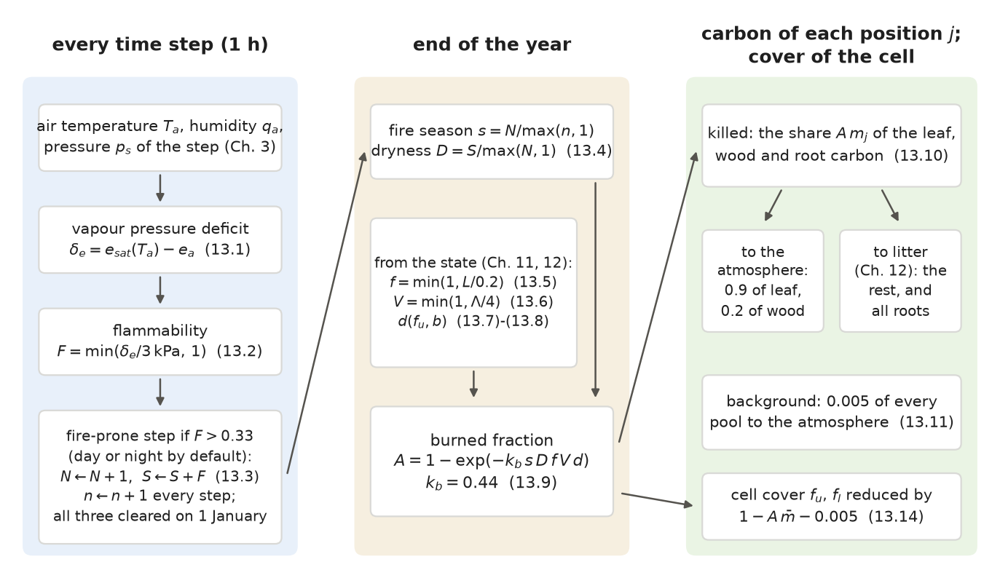
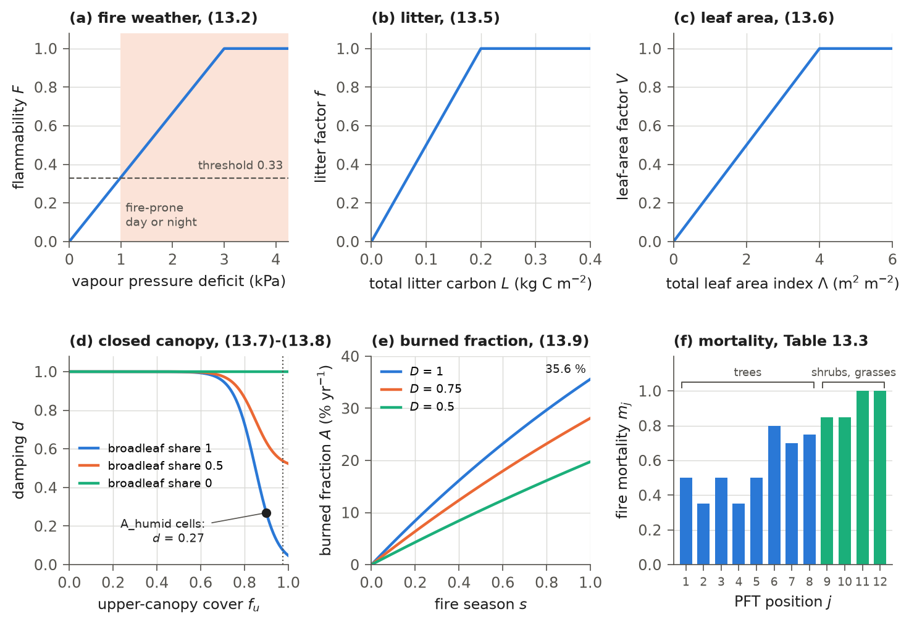
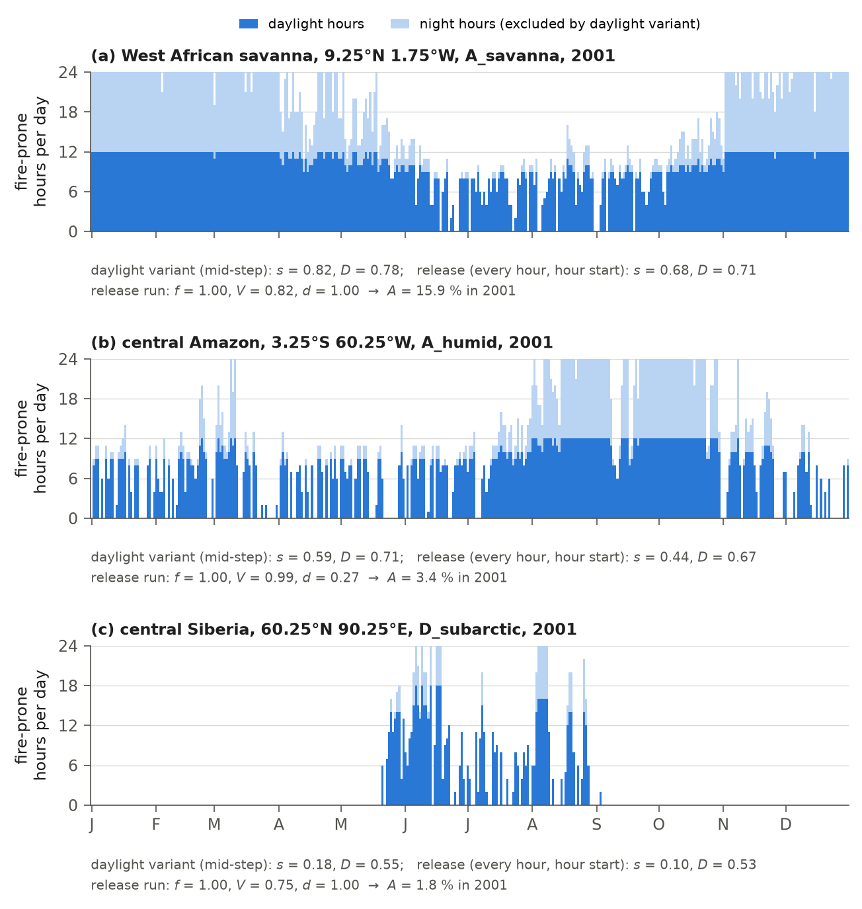
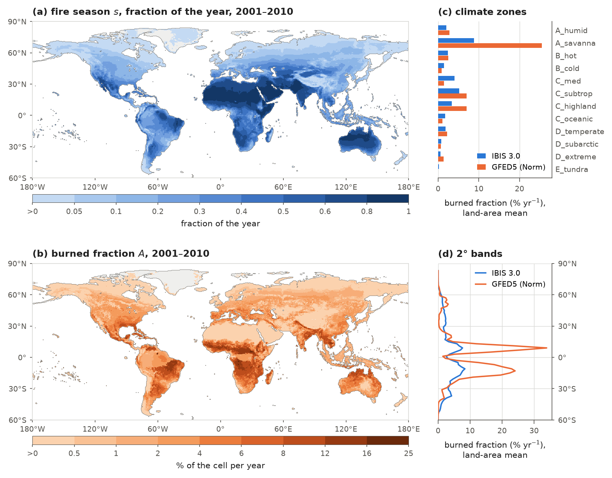

# 13. Fire

Fire removes vegetation and returns its carbon to the atmosphere. In IBIS 3.0, fire acts once a year during the annual
vegetation update. Throughout the year, the model counts hours when the air is dry enough for burning, by day or night.
At year end, it combines the fire season's length and dryness with litter, leaf area and broadleaf-canopy closure to
calculate the fraction of the grid cell that burned. Fire kills a share of each plant functional type (PFT) position's
leaf, wood and root carbon; this share depends on the position. Some of the killed leaf and wood carbon burns and
leaves the ecosystem, while the rest becomes litter. A small, constant background disturbance acts alongside fire.
When enabled (`physics.enable_fire_emissions`), the model also converts burned carbon into trace-gas emissions. This
scheme replaces the fire routine of IBIS 2.6b4, which remains available as an option (section 13.6).

## 13.1 Overview

Fire acts only when the vegetation is dynamic (`physics.isimveg` > 0, Chapter 11) and fire is on
(`physics.isimfire` = 1). The release enables both settings. The calculation operates on two time scales (Figure 13.1):

- Every time step, after the soil physics (step 11 of Table 1.3), the model adds the fire weather of the step to three
  yearly counters (section 13.2).
- Once a year, in the annual vegetation update (Table 1.4), the model uses the counters, litter and vegetation to calculate the
  burned fraction of the cell (section 13.3). The burned fraction removes carbon from the live pools and reduces the canopy
  cover (section 13.4).

Within the annual update, fire follows allocation of the year's net primary production, pool turnover and removal of
trees where the maximum tree cover is zero (Chapter 11). It precedes harvest on the cropland share (Chapter 15) and
the update of canopy cover and height (Chapter 11). The counters are
cleared at the first time step of each year.

Table 13.1 lists the switches of the fire scheme. Switches named `fire.*` are fields of the `fire` section of the
parameter file. That section can set any fire parameter except the per-cell closed-canopy-zone flag, which is set by the
climate-zone types (Chapter 2).



**Figure 13.1** How the model calculates fire, with the release parameters. At every time step, the model adds the step's fire
weather to three counters. By default, any step above the dryness threshold counts as fire-prone. At year end, the
counters determine the fire season and dryness, while the state determines the litter, leaf-area and damping factors.
Together these factors determine the burned fraction $`A`$, which kills a share of each position's carbon and reduces
the cell's cover. Equation numbers
refer to this chapter.

**Table 13.1** Switches of the fire scheme. "Release" is the setting of the release run.

| Switch | Default | Release | Meaning |
|---|---|---|---|
| `physics.isimfire` | 0 | 1 | fire on; off, the burned fraction is the constant 0.005 yr⁻¹ of IBIS 2.6b4 (see below the table) |
| `physics.fire_scheme` | `seasonlength` | `seasonlength` | the scheme of this chapter; `legacy`: the IBIS 2.6b4 routine (section 13.6) |
| `physics.fire_annual_reset` | true | true | clear the counters at the first step of each year; false lets them accumulate over the whole run (section 13.10) |
| `physics.enable_fire_emissions` | false | true | write the burned fraction, the burned carbon and the trace-gas emissions of section 13.5 to the yearly output (with fire on) |
| `fire.use_vpd_danger` | true | true | fire weather from the vapour pressure deficit (section 13.2); false: from the water of the top soil layer (section 13.6) |
| `fire.daylight_only` | false | false (every step) | optionally restrict fire-prone steps to daylight and normalize their count by half the year (sections 13.2–13.3) |
| `fire.use_canopy_damping` | false | true | damping of fire under a closed broadleaf canopy, equations (13.7)-(13.8) |
| `fire.damp_broadleaf_only` | true | true | the damping acts on the broadleaf share of the upper canopy only |
| `fire.use_pft_mortality` | true | true | mortality per position, $`m_j`$ of Table 13.3; false: every position loses the burned fraction |
| `fire.use_combustion_completeness` | true | true | part of the killed carbon becomes litter (section 13.4); false: all of it leaves the ecosystem |
| `fire.use_fine_fuel` | false | false | litter factor from above-ground litter and live leaves (section 13.7) |
| `fire.use_human` | false | false | ignition and suppression by people (section 13.7); not available in the global driver |

With fire off (`physics.isimfire` = 0), both schemes use the IBIS 2.6b4 disturbance in the annual update. The model
uses IBIS 2.6b4's constant burned fraction of 0.005 yr⁻¹. Every position loses this fraction plus the background
disturbance of section 13.4, a total of 0.010 of its pools each year. All of this carbon leaves the ecosystem, and the
covers shrink by the same share. The mortality per position and the combustion completeness act only when fire is on. The `fire.*`
switches and parameters act only under the `seasonlength` scheme.

## 13.2 Fire weather

Fire requires dry fuel, and fuel dries in dry air. The model therefore measures each step's fire weather with the air's
vapour pressure deficit: the difference between saturation vapour pressure at the air temperature and the actual
vapour pressure:

```math
e_{a} = \frac{q_{a}\,p_{s}}{0.622 + 0.378\,q_{a}}, \qquad
\delta_{e} = \max\left[e_{sat}(T_{a}) - e_{a},\; 0\right],
\qquad\text{(13.1)}
```

where $`e_{a}`$ (Pa) is the vapour pressure of the air; $`q_{a}`$ (kg kg⁻¹), $`T_{a}`$ (K) and $`p_{s}`$ (Pa) are the specific
humidity, the air temperature and the surface pressure of the step, as supplied by the weather generator (equations
(3.10)-(3.11); the pressure is the daily mean of the forcing); $`e_{sat}(T)`$ (Pa) is the saturation vapour pressure over
water or ice of IBIS 2.6b4 (Lowe, 1977; Chapter 5), the same function as in (3.12); and $`\delta_{e}`$ (Pa) is the vapour
pressure deficit. The model converts this deficit to a flammability between 0 and 1:

```math
F = \min\left(\frac{\delta_{e}}{\delta_{ref}},\; 1\right),
\qquad\text{(13.2)}
```

where $`F`$ is the flammability of the step and $`\delta_{ref} = 3`$ kPa (`fire.vpd_ref`) is the deficit at which it reaches 1.
A step is fire-prone when its flammability exceeds $`F_{c} = 0.33`$ (`fire.d_crit_vpd`), that is when the deficit exceeds
0.99 kPa (Figure 13.2a). By default the rule applies day and night. Three counters accumulate over the year:

```math
N \leftarrow N + H(F - F_{c})\,\chi, \qquad S \leftarrow S + F\,H(F - F_{c})\,\chi, \qquad n \leftarrow n + 1,
\qquad\text{(13.3)}
```

where $`N`$ is the number of fire-prone steps, $`S`$ the sum of their flammability and $`n`$ the number of steps since the
start of the year (8760, or 8784 in a leap year, at the end of the year; one value for all cells). $`H`$ is the step
function ($`H(x) = 1`$ for $`x > 0`$, else 0), and $`\mu`$ is the cosine of the solar zenith angle of the step (Chapter 3),
so that $`H(\mu) = 1`$ when the sun is above the horizon. The counting factor $`\chi`$ is 1 by default; with
`fire.daylight_only: true`, it is $`H(\mu)`$ instead. The model evaluates the sun and the weather of a step at the
middle of the step (`weather.sun_midstep`, Chapter 3), or at its start when that switch is off.

The weather generator holds humidity at its daily mean throughout the night on a dry day (equation (3.11), as in
IBIS 2.6b4). The deficit can therefore remain above the threshold all night. On such days, all 24 hours count as
fire-prone under the default rule, as they did in the release run (section 13.9). The optional daylight rule
removes those night-time counts, but also changes the normalization of the fire season below.

With `physics.fire_annual_reset` on, the three counters are set to zero at the first step of each year, before any is
incremented, as IBIS 2.6b4 clears its annual step counter (`stats.f`, routine `sumyear`). The counters record only
weather; vegetation enters the calculation at year end. Every step the model also accumulates the soil-water counters
and the annual mean dryness of section 13.6, which the release configuration does not use. Using vapour pressure deficit to measure fire weather
follows Drüke et al. (2019). Counting fire-prone time, rather than averaging danger over the year, follows the
fire-season idea of Thonicke et al. (2001). The form of (13.2)-(13.3) and its
constants were set for IBIS 3.0; neither paper gives those equations or constants.

## 13.3 Burned fraction

At year end, the model uses the counters to calculate the burned fraction of the cell. Five factors enter the
calculation: fire-season length, dryness within the season, litter available to burn, leaf area, and suppression of
fire by a closed broadleaf canopy. The counters determine the fire season and its dryness:

```math
s =
\begin{cases}
N / \max(n, 1) & \text{by default (every step),} \\
\min[1, N / \max(n/2, 1)] & \text{with the daylight-only option,}
\end{cases}
\qquad D = \frac{S}{\max(N, 1)},
\qquad\text{(13.4)}
```

where $`s`$ is the fire season, the fraction of all the year's steps that were fire-prone under the default rule, and
$`D`$ is the mean flammability of the counted steps ($`D = 0`$ where none was fire-prone). The optional daylight rule
approximates the number of daylight steps by half the year and caps $`s`$ at 1. With the model's solar geometry,
daylight covers 49.5 to 50.5 % of the steps between 60°S and 60°N and 48.8 to 51.2 % at all latitudes (sun at
mid-step; `figures/make_ch13.py`). Excluding night-time steps therefore need not shorten $`s`$, because its denominator is
also halved.

Litter represents the fuel supply:

```math
f = \min\left(1,\; \frac{L}{L_{ref}}\right),
\qquad\text{(13.5)}
```

where $`f`$ is the litter factor; $`L`$ (kg C m⁻²) is the total litter carbon at the end of the year, the sum of the
metabolic, structural and lignified litter of leaves, wood and roots (Chapter 12); and $`L_{ref} = 0.2`$ kg C m⁻² is the
litter of IBIS 2.6b4 at which the factor saturates (a constant of the code). The amount of vegetation enters through

```math
V = \min\left(1,\; \frac{\Lambda}{\Lambda_{ref}}\right), \qquad \Lambda = \sum_{j=1}^{12} \max(\Lambda_{j}, 0),
\qquad\text{(13.6)}
```

where $`V`$ is the leaf-area factor; $`\Lambda_{j}`$ (m² m⁻²) is the leaf area index of position $`j`$ per unit area of the
cell, as the previous annual update set it (Chapter 11); and $`\Lambda_{ref} = 4`$ m² m⁻² (`fire.lai_ref_vd`).

A closed broadleaf canopy keeps its fuel moist and suppresses surface fire. With `fire.use_canopy_damping` on, the
model represents this suppression with a logistic function of upper-canopy cover:

```math
\ell = \left\{1 + \exp\left[\frac{\min(\max(x, 0), 1) - x_{h}}{w}\right]\right\}^{-1}, \qquad
x =
\begin{cases}
x_{c} & \text{in the cells of the closed-canopy zones,} \\
f_{u} & \text{elsewhere,}
\end{cases}
\qquad\text{(13.7)}
```

where $`\ell`$ is the logistic factor; $`f_{u}`$ is the fractional cover of the upper canopy as the previous annual update
set it (Chapter 11); $`x_{h} = 0.85`$ (`fire.fu_half`) is the cover at which $`\ell = 0.5`$; $`w = 0.05`$ (`fire.fu_width`)
is the width of the logistic function; and $`x_{c} = 0.90`$ (`fire.closed_canopy_fu`) is the cover at which the damping is
evaluated in the cells whose climate zone (Chapter 2) is listed in `fire.closed_canopy_zones`. In the release this is the
zone A_humid (Köppen Af and Am; 5,576 land cells in the Köppen map of 1991-2020, 5,661 to 5,699 in the three earlier
maps). In these cells, damping does not depend on the cell's own cover. A humid tropical cell with an open canopy, whether at
the cold start or after fire, is therefore damped as though its canopy were closed. The damping acts on the broadleaf share of the
upper canopy,

```math
d = 1 - b\,(1 - \ell), \qquad
b =
\begin{cases}
\dfrac{\sum_{j \in \mathcal{B}} \max(\Lambda_{j}, 0)}{\sum_{j=1}^{8} \max(\Lambda_{j}, 0)} & \text{if } \sum_{j=1}^{8} \max(\Lambda_{j}, 0) > 10^{-9}, \\
0 & \text{otherwise,}
\end{cases}
\qquad\text{(13.8)}
```

where $`d`$ is the damping factor; $`b`$ is the broadleaf share of the leaf area of the upper canopy; and $`\mathcal{B} = \{1, 2, 3, 5, 7\}`$ are the broadleaf tree positions (Table 2.1; the climate-zone types keep the leaf form of their
position). A closed conifer canopy is not damped, and neither is a tree canopy without leaves (Figure 13.2d). In an
A_humid cell whose tree leaves are all broadleaf, $`d = 0.27`$; at the largest cover the model allows, 0.975, $`\ell`$ is
0.08. With `fire.damp_broadleaf_only` off, $`d = \ell`$; with `fire.use_canopy_damping` off, $`d = 1`$.

The burned fraction of the year is

```math
A = \min\left[\max\left(1 - e^{-B},\; 0\right),\; 1\right], \qquad B = k_{b}\,s^{p}\,D\,f\,V\,d,
\qquad\text{(13.9)}
```

where $`A`$ is the fraction of the cell burned in the year (the variable `disturbf`); $`B`$ is the burn index; $`k_{b} = 0.44`$ (`fire.k_b`) is its scale; and $`p = 1`$ (`fire.p`) is the exponent on the fire season. The exponential form is
that of IBIS 2.6b4 (section 13.6). With every factor at 1 the burned fraction is $`1 - e^{-0.44} = 35.6`$ % a year, the
largest the release parameters can produce (Figure 13.2e). The factors multiply to form the burn index, so a cell burns only
if the air is dry for part of the year and both litter and leaf area are present. Table 13.2 lists the parameters, and
Figure 13.2 shows how each factor responds.

**Table 13.2** Parameters of the burned fraction and of the fate of the killed carbon.

| Symbol | Meaning | Release | Code default | Parameter-file name |
|---|---|---|---|---|
| $`\delta_{ref}`$ | vapour pressure deficit at which the flammability saturates | 3.0 kPa | 3.0 kPa | `fire.vpd_ref` |
| $`F_{c}`$ | flammability above which a step is fire-prone | 0.33 | 0.33 | `fire.d_crit_vpd` |
| $`L_{ref}`$ | litter at which the litter factor saturates | 0.2 kg C m⁻² | 0.2 kg C m⁻² | (constant) |
| $`\Lambda_{ref}`$ | leaf area at which the leaf-area factor saturates | 4 m² m⁻² | 4 m² m⁻² | `fire.lai_ref_vd` |
| $`x_{h}`$ | upper-canopy cover at which the damping logistic is 0.5 | 0.85 | 0.6 | `fire.fu_half` |
| $`w`$ | width of the damping logistic | 0.05 | 0.08 | `fire.fu_width` |
| $`x_{c}`$ | cover at which the damping is evaluated in the closed-canopy zones | 0.90 | 0.975 | `fire.closed_canopy_fu` |
| | closed-canopy zones | A_humid | none | `fire.closed_canopy_zones` |
| $`k_{b}`$ | scale of the burn index | 0.44 | 0.5 | `fire.k_b` |
| $`p`$ | exponent on the fire season | 1 | 1 | `fire.p` |
| $`m_{j}`$ | fire mortality of position $`j`$ | Table 13.3 | Table 13.3 | `fire.mort`; per type `fire_mort` |
| $`c_{l}`$ | combusted share of the killed leaf carbon | 0.9 | 0.9 | `fire.cc_leaf` |
| $`c_{w}`$ | combusted share of the killed wood carbon | 0.2 | 0.2 | `fire.cc_wood` |
| $`\beta`$ | background disturbance | 0.005 yr⁻¹ | 0.005 yr⁻¹ | (constant) |

The release values of $`k_{b}`$ and $`x_{h}`$ come from a fit of the zone means of the burned fraction to GFED5 (Chen et
al., 2023). The width $`w`$ was then narrowed to 0.05, which left the fit's objective unchanged, and $`x_{c}`$ was chosen
from a sweep against GFED5 in the humid tropics (Chapter 16, section 16.9). The fit minimizes the root mean
square of the logarithm of the modelled-to-GFED5 burned-fraction ratio, calculated from the means of the eleven
climate zones other than D_extreme and E_ice. It excludes cells without a zone and covers 2003-2005.

A later check of the same objective, with $`k_{b}`$ refitted for each alternative,
found $`\Lambda_{ref}`$ = 3 or 3.5 m² m⁻² worse, and $`x_{c}`$ = 0.88 slightly better on the objective but farther from
GFED5 in the Amazon and in Southeast Asia, so the existing values were retained. The other values are the code defaults.

The three fitted values were determined with every step of the year eligible to be fire-prone, which is again the default. A diagnostic fit
for the optional daylight rule does not replace these values. The revised model still needs a final global evaluation
(Chapter 16).



**Figure 13.2** The factors of the burned fraction with the release parameters, evaluated with the model's own
functions. (a) Flammability against the vapour pressure deficit, (13.1)-(13.2), from saturated to dry air at 30 °C (the
flammability depends on the deficit alone); steps above the threshold (shaded) are fire-prone. (b) Litter
factor, (13.5). (c) Leaf-area factor, (13.6). (d) Damping against the cover of the upper canopy for three broadleaf
shares of its leaf area, (13.7)-(13.8); the dot is the damping of a wholly broadleaf canopy in an A_humid cell, whatever
its cover, and the dotted line the largest cover the model allows, 0.975. (e) Burned fraction against the fire season
for three values of the dryness within the season, with $`f = V = d = 1`$, (13.4) and (13.9). (f) Fire mortality of each
position (Table 13.3).

## 13.4 Mortality and the fate of the killed carbon

Fire does not kill all vegetation in its path: thick-barked trees often survive, while grasses burn to the ground. The
model therefore applies a different mortality share to each position's carbon, alongside a constant background
disturbance that acts on every position. The leaf, wood and root carbon of position $`j`$ after the disturbance are

```math
C_{x,j}' = \max\left[0,\; C_{x,j}\,(1 - A\,m_{j} - \beta)\right], \qquad x \in \{\text{leaf}, \text{wood}, \text{root}\},
\qquad\text{(13.10)}
```

where $`C_{x,j}`$ (kg C m⁻²) is the carbon of pool $`x`$ of position $`j`$ after the year's allocation and turnover
(Chapter 11); $`m_{j}`$ is the fire mortality of the position, the share of its carbon that a fire passing over the whole
cell kills (Table 13.3); and $`\beta = 0.005`$ yr⁻¹ is the background disturbance of IBIS 2.6b4, a constant mortality that
stands for disturbances other than fire. The model then raises the leaf carbon of a position allowed to grow in the cell
to the amount required for its minimum leaf area, as IBIS 2.6b4 does (Chapter 11). The killed carbon is divided between the atmosphere and the
litter:

```math
\Phi_{f} = \sum_{j=1}^{12} A\,m_{j}\left(c_{l}\,C_{leaf,j} + c_{w}\,C_{wood,j}\right), \qquad
\Phi_{b} = \beta \sum_{j=1}^{12}\left(C_{leaf,j} + C_{wood,j} + C_{root,j}\right),
```

```math
\Delta F_{leaf} = \sum_{j=1}^{12} A\,m_{j}\,(1 - c_{l})\,C_{leaf,j}, \qquad
\Delta F_{wood} = \sum_{j=1}^{12} A\,m_{j}\,(1 - c_{w})\,C_{wood,j}, \qquad
\Delta F_{root} = \sum_{j=1}^{12} A\,m_{j}\,C_{root,j},
\qquad\text{(13.11)}
```

where $`\Phi_{f}`$ (kg C m⁻² yr⁻¹) is the carbon that the fire burns (combusts); $`\Phi_{b}`$ (kg C m⁻² yr⁻¹) is the carbon
that the background disturbance removes; $`c_{l} = 0.9`$ and $`c_{w} = 0.2`$ are the shares of the killed leaf and wood carbon
that burn (`fire.cc_leaf`, `fire.cc_wood`); and $`\Delta F_{leaf}`$, $`\Delta F_{wood}`$ and $`\Delta F_{root}`$ (kg C m⁻²
yr⁻¹) are added to the year's leaf, wood and root litterfall, which enter the litter pools during the following year
(Chapter 12). Killed roots do not burn. Chapter 11 writes $`A`$ as $`d_{f}`$, $`\beta`$ as $`d_{o}`$ and $`c_{l}`$, $`c_{w}`$ as
$`\varepsilon_{l}`$, $`\varepsilon_{w}`$ ((11.18)-(11.19)). Only the fire's share is divided between atmosphere and
litter; all of the background disturbance leaves the ecosystem.

The burned fraction applies to the whole cell. The grass positions 11 and 12 carry the crops of the cropland share of
the cell (Chapter 15), so the crops burn with the grasses ($`m_{j} = 1`$), and the subsequent harvest is a share
of the grass leaf litterfall calculated before the fire. GFED5 Norm, the burned area with which section 13.9 compares the
model, leaves out the fire of cropland. The carbon removed from the ecosystem in the year is

```math
C_{dist} = \Phi_{f} + \Phi_{b} + H_{c}, \qquad N_{yr} = P_{n} - R_{h} - C_{dist},
\qquad\text{(13.12)}
```

where $`C_{dist}`$ (kg C m⁻² yr⁻¹; the variable `cdisturb`, written as `aycdisturb` in runs with a cropland map) is the carbon removed from the
ecosystem; $`H_{c}`$ (kg C m⁻² yr⁻¹) is the harvest of the cropland share plus the shrub production of that share
(Chapter 15); $`N_{yr}`$ (kg C m⁻² yr⁻¹; `ayneetot`, positive for uptake) is the annual net ecosystem exchange; $`P_{n}`$
is the year's net primary production; and $`R_{h}`$ is the heterotrophic respiration recorded as CO2 (Chapters 11, 12 and
14).

**Table 13.3** Fire mortality $`m_{j}`$ of the twelve positions (the code defaults; the release sets no other values).

| Position | Plant functional type | $`m_{j}`$ |
|---|---|---|
| 1 | tropical broadleaf evergreen trees | 0.50 |
| 2 | tropical broadleaf drought-deciduous trees | 0.35 |
| 3 | warm-temperate broadleaf evergreen trees | 0.50 |
| 4 | temperate conifer evergreen trees | 0.35 |
| 5 | temperate broadleaf cold-deciduous trees | 0.50 |
| 6 | boreal conifer evergreen trees | 0.80 |
| 7 | boreal broadleaf cold-deciduous trees | 0.70 |
| 8 | boreal conifer cold-deciduous trees | 0.75 |
| 9 | evergreen shrubs | 0.85 |
| 10 | deciduous shrubs | 0.85 |
| 11 | warm (C4) grasses | 1.00 |
| 12 | cool (C3) grasses | 1.00 |

The mortality values are priors assigned in the code according to each PFT's adaptation to fire: 0.35 for the thick-barked tropical
drought-deciduous and temperate conifer trees, 0.7 to 0.8 for the boreal trees (the boreal conifers being thin-barked
and burning in crown fires), and 1 for the grasses, which a passing fire kills above ground. They were not calibrated.
Fire mortality is one of the parameters assembled per cell from the climate-zone types (equation (2.1)). A position
uses its type's value or the value of that type's parent PFT. No type sets its own value in the release, so a
position differs from Table 13.3 only where its type descends from another PFT: position 1 in the zones A_savanna and
B_hot holds types descended from PFT 2 (T03 and T05; Table 2.4) and takes $`m_{1} = 0.35`$.

Fire also reduces both canopies' cover. The model first calculates each canopy's cover from its wood or leaf area
(Chapter 11), then multiplies it by the following factor before applying the upper and lower limits:

```math
1 - A\,\bar{m} - \beta, \qquad
\bar{m} = \frac{\sum_{j=1}^{12} \max(\Lambda_{j}, 0)\,m_{j}}{\max\left[\sum_{j=1}^{12} \max(\Lambda_{j}, 0),\; 10^{-12}\right]},
\qquad\text{(13.13)}
```

where $`\bar{m}`$ is the mortality of the cell, weighted by the leaf area of the positions as the previous annual update
set it. The same factor applies to the upper and the lower canopy:

```math
f_{u} \leftarrow f_{u}\,(1 - A\,\bar{m} - \beta), \qquad f_{l} \leftarrow f_{l}\,(1 - A\,\bar{m} - \beta),
\qquad\text{(13.14)}
```

where $`f_{l}`$ is the fractional cover of the lower canopy.

In the release hindcast, averaged over 2001-2010, the fire burned 1.38 Pg C yr⁻¹ ($`\Phi_{f}`$ of (13.11)), and the
carbon it killed but did not burn, 5.01 Pg C yr⁻¹, went to litter. The background disturbance removed 2.24 Pg C yr⁻¹
(release run; to be updated after the final run of the revised model). These totals, and the areas and means of this
chapter, are weighted by the land area of each cell: the cell area times the land fraction of the cell in the ESA CCI
land cover of 1992 (`verify/calibration/landmask.py`), the weighting of the release's totals (Chapter 16). This land
area is 143.7 Mkm² in all, while the whole area of the 95,333 cells of the land mask is 165.0 Mkm². The totals are
reconstructed by inverting (13.10) using the run's year-end pools. Together with harvest and cropland shrub production,
they reproduce the run's `aycdisturb`, 4.47 Pg C yr⁻¹, to 0.002 Pg C yr⁻¹ (`figures/make_ch13.py`, function `fig_13_4`).

## 13.5 Trace-gas emissions

A fire releases the burned carbon as CO2 and smaller amounts of other gases. With `physics.enable_fire_emissions` on
(and fire on), the model converts the carbon that each position loses to the fire into emissions of CO2, CO, CH4, N2O
and NOx. The carbon burned from position $`j`$ is its contribution to $`\Phi_{f}`$ in (13.11):

```math
\Phi_{j} = A\,m_{j}\left(c_{l}\,C_{leaf,j} + c_{w}\,C_{wood,j}\right), \qquad \Phi_{f} = \sum_{j=1}^{12} \Phi_{j},
\qquad\text{(13.15)}
```

where $`\Phi_{j}`$ (kg C m⁻² yr⁻¹) is the carbon that the fire burns from position $`j`$. The emission of species $`x`$ is

```math
E_{x} = \sum_{j=1}^{12} \frac{\Phi_{j}}{0.45}\,\epsilon_{x,k(j)},
\qquad\text{(13.16)}
```

where $`E_{x}`$ (g m⁻² yr⁻¹) is the emission of the species (NOx counted as NO); 0.45 kg C (kg dry matter)⁻¹ is the carbon
fraction of the dry matter, so that $`\Phi_{j} / 0.45`$ is the dry matter burned; $`\epsilon_{x,k}`$ (g per kg of dry
matter) is the emission factor of the species for the fire category $`k`$ (Andreae, 2019; Table 13.4); and $`k(j)`$ is the
category of position $`j`$. The emissions use the same burned-carbon input as (13.11), including the parameter-file values of $`c_{l}`$ and
$`c_{w}`$ and the mortality of each cell. The resulting species totals do not form an exact carbon balance, as discussed below. Where fire removes all killed
carbon, including roots (the `legacy` scheme of section
13.6, or `fire.use_combustion_completeness` off), $`\Phi_{j}`$ is all the killed carbon of the position and the emissions
are computed from all of it.

**Table 13.4** Emission factors (g per kg of dry matter burned; Andreae, 2019, Table 1) and the positions to which they
apply.

| Category | Positions | CO2 | CO | CH4 | N2O | NOx (as NO) |
|---|---|---|---|---|---|---|
| savanna and grassland | 9-12 | 1660 | 69 | 2.7 | 0.17 | 2.50 |
| tropical forest | 1, 2 | 1620 | 104 | 6.5 | 0.20 | 2.80 |
| temperate forest | 3-5 | 1570 | 113 | 5.2 | 0.25 | 3.00 |
| boreal forest | 6-8 | 1530 | 121 | 5.5 | 0.24 | 1.18 |

The emission factors are constants of the code. Their source table is kept with the model's input data, and a test
checks the constants against it when the table is present. The emissions do not feed back on the model. With `physics.enable_fire_emissions` on, fire on and dynamic vegetation, the yearly
output file holds the burned fraction $`A`$ (`ayburnfrac`), the burned carbon $`\Phi_{f}`$ (`aycfire`, part of
`aycdisturb`) and the five emissions (`ayfire_co2`, `ayfire_co`, `ayfire_ch4`, `ayfire_n2o` and `ayfire_nox`). The run
log reports unweighted means over land cells of the burned fraction, the burned carbon and the CH4
and CO emissions.

The carbon in the CO2, CO and CH4 factors of Table 13.4 is 473 to 491 g per kg of dry matter, 5 to 9 % more than the
450 g of carbon from which (13.16) derives the dry matter, so the emitted CO2, CO and CH4 carry somewhat more carbon than
the fire burns. Applied to the carbon the release hindcast burned, 1.38 Pg C yr⁻¹ over 2001-2010 (section 13.4),
(13.16) gives 4,902 Tg CO2, 316 Tg CO, 16.5 Tg CH4, 0.66 Tg N2O and 7.9 Tg NO a year, and the carbon in the CO2, CO and
CH4 is 7.7 % more than the carbon burned (release run's carbon; to be updated after the final run of the revised model;
`figures/make_ch13.py numbers`). The release run itself computed its emissions with an earlier diagnostic
(section 13.10).

## 13.6 The IBIS 2.6b4 scheme and the soil-water fire weather

With `physics.fire_scheme: legacy` the model uses the fire routine of IBIS 2.6b4 (`vegetation.f`, routine `fire`, and
`stats.f`, routine `sumyear`). In that scheme, top-soil-layer dryness represents fire weather. The model computes it at every time step as

```math
\phi = \min\left[\max\left(-2\left(\frac{\theta - \theta_{w}}{1 - \theta_{w}} - 0.5\right),\; 0\right),\; 1\right], \qquad
\theta = \theta_{i} + (1 - \theta_{i})\,\theta_{l},
\qquad\text{(13.17)}
```

where $`\phi`$ is the fuel dryness; $`\theta_{l}`$ is the liquid water of the top soil layer as a fraction of its ice-free
pore space, $`\theta_{i}`$ its ice as a fraction of the pore space and $`\theta_{w}`$ its wilting point as a fraction of
the pore space (Chapters 2 and 7); and $`\theta`$ is the total water of the layer as a fraction of its pore space. The
dryness is 1 at or below the wilting point, falls linearly to 0 at the midpoint between the wilting point and
saturation, and is 0 in wetter soil. Its mean over the steps of the year is kept as a running mean,

```math
\Phi_{n} = \frac{(n - 1)\,\Phi_{n-1} + \phi}{n},
\qquad\text{(13.18)}
```

where $`\Phi_{n}`$ is the mean after step $`n`$ of the year (the variable `firefac`), which restarts at $`\Phi_{1} = \phi`$ each
year and includes every step, day and night, as in IBIS 2.6b4. At the end of the year the burned fraction is

```math
A = \min\left[\max\left(1 - \exp\left(-0.5\,\Phi\,f\right),\; 0\right),\; 1\right],
\qquad\text{(13.19)}
```

with $`f`$ from (13.5) and $`\Phi`$ the year's mean dryness. Under the `legacy` scheme every position loses the same share
$`A + \beta`$ of its pools; all the killed carbon, roots included, leaves the ecosystem and is subtracted from the net
ecosystem exchange; and the covers are multiplied by $`1 - A - \beta`$ (`vegetation.f`, routine `dynaveg`). With fire off,
IBIS 2.6b4 sets $`A`$ = 0.005 yr⁻¹ in every cell, and the model does the same under either scheme (section 13.1). The
annual vegetation update of the model, the routine of (13.19) included, was verified against the compiled IBIS 2.6b4
(Chapter 17); the accumulation (13.17)-(13.18) is tested against a transcription of the Fortran statements.

The season-length scheme of section 13.3 can also calculate fire weather from soil dryness (`fire.use_vpd_danger` off). A
step is then fire-prone when $`\phi > 0.5`$ (`fire.d_crit`), that is when the water of the top layer lies below a quarter
of the way from the wilting point to saturation, and, with `fire.daylight_only`, when the sun is up. $`S`$ then sums
$`\phi`$ over those steps, $`n`$ is the same step counter, and (13.9) has no leaf-area factor ($`V = 1`$; the damping $`d`$
still applies when it is on).

## 13.7 Options not used in the release

Two additional terms are implemented but disabled in the release. With `fire.use_fine_fuel` the litter factor (13.5) is replaced by
a ramp in the fine fuel,

```math
f = \min\left[\max\left(\frac{L_{a} + w_{t}\sum_{j=1}^{10} C_{leaf,j} + w_{g}\sum_{j=11}^{12} C_{leaf,j} - L_{lo}}{L_{hi} - L_{lo}},\; 0\right),\; 1\right],
\qquad\text{(13.20)}
```

where $`L_{a}`$ (kg C m⁻²) is the above-ground (leaf and wood) litter; $`w_{t} = 0.3`$ and $`w_{g} = 1`$ are the weights of
the live leaf carbon of the woody positions and of the grasses (`fire.w_leaf_woody`, `fire.w_leaf_grass`); and $`L_{lo} = 0.075`$ and $`L_{hi} = 0.65`$ kg C m⁻² (`fire.lfuel`, `fire.ufuel`) are the fuel thresholds of the CLM5 implementation
(Lawrence et al., 2018; the CTSM module `CNFireBaseMod`) of the fire scheme of Li et al. (2012), converted from g C m⁻².
With `fire.use_human`, the model multiplies the burn index by ignition and suppression factors that depend on population
density $`P_{d}`$ (persons km⁻²):

```math
I = I_{0} + (I_{max} - I_{0})\left(1 - e^{-a\,P_{d}}\right), \qquad
U = 0.2 + 0.8\,\exp\left[-\pi\left(\frac{P_{d}}{450}\right)^{1/2}\right],
\qquad\text{(13.21)}
```

where $`I`$ is the ignition factor, with $`I_{0} = 1`$, $`I_{max} = 3`$ and $`a = 0.01`$ km² person⁻¹ (`fire.ig0`,
`fire.ign_max`, `fire.a_ig`), and $`U`$ is the suppression factor of the same CLM implementation (CTSM module
`CNFireLi2014Mod`), constants included. The global driver does not read population density and stops with an error if `fire.use_human`
is on.

## 13.8 Differences from IBIS 2.6b4

The current model's fire scheme differs from IBIS 2.6b4 (`vegetation.f`, routines `dynaveg` and `fire`, and
`stats.f`, routine `sumyear`) as follows:

1. The fire weather is the vapour pressure deficit of each time step, counted as a fire season and a dryness within
   it ((13.1)-(13.4)), instead of the annual mean dryness of the top soil layer over every step ((13.17)-(13.18)).
2. The burn index includes a leaf-area factor and closed-canopy damping ((13.6)-(13.8)) that IBIS 2.6b4 does not
   have, and its scale is 0.44 instead of 0.5. The litter factor (13.5) and the exponential form of (13.9) are those of
   IBIS 2.6b4.
3. The fire kills a share $`m_{j}`$ of the burned fraction that depends on the position, instead of the whole burned
   fraction (Table 13.3).
4. Of the killed carbon only the burned share of the leaves and the wood leaves the ecosystem; the rest, and all the
   killed roots, become litter. IBIS 2.6b4 removes all the killed carbon from the ecosystem, roots included, and
   subtracts it from the net ecosystem exchange. The background disturbance $`\beta`$ is treated as in IBIS 2.6b4.
5. The covers are reduced with the leaf-area-weighted mortality of the cell, (13.13)-(13.14), instead of with the burned
   fraction itself.
6. The trace-gas emissions of section 13.5 are new.

With fire off, the disturbance within the annual update is that of IBIS 2.6b4 under either scheme (section 13.1).

## 13.9 Fire in the release run

This section presents fire results from the release run (`final_rel30`). The release code counted every hour as possibly
fire-prone, as does the current default. The current model evaluates the sun and weather at mid-step, however,
whereas the release used the step start (Chapter 3). The daylight-only alternative below is a diagnostic comparison. The results of the release below will be updated after the final run of the revised model.

Figure 13.3 follows the fire weather of 2001 through the year at three cells. Under the release's rule, in the West
African savanna cell 93 to 100 % of the hours of each month from November to March were fire-prone, and 28 to 34 % of
the hours from June to September; the fire season was 0.68 of the year and the cell burned 15.9 % of its area. In the
central Amazon cell 85 to 91 % of the hours from August to October were fire-prone, and 16 to 41 % of those of the
other months, a fire season of 0.44 of the year; the damping of its broadleaf canopy as a closed canopy, $`d = 0.27`$,
held the burned fraction to 3.4 %. In central Siberia the fire-prone hours fell between late May and early September,
0.10 of the year, and the cell burned 1.8 %. Because the weather generator holds the humidity of a dry day through the
night ((3.11), as in IBIS 2.6b4), the deficit could stay above 0.99 kPa all night: all 24 hours were fire-prone on 64
days from August to October at the Amazon cell, on 11 days of June and August at the Siberian cell, and on 145 days,
nearly all from November to April, at the savanna cell. Replayed from the forcing with the model's forcing conversion,
weather generator and (13.1)-(13.3) under the release's rule, the counters $`N`$ and $`S`$ of the three cells equal those
that the release run stored for 2001, and at every land cell the replayed $`N`$ is within one step of the stored one.

The optional daylight rule excludes night hours, shown by the light parts of the bars in Figure 13.3: 40 % of the fire-prone hours of
2001 at the savanna cell, 32 % at the Amazon cell and 16 % at the Siberian cell. Daylight hours are more often
fire-prone than night hours, so the normalized fire season becomes longer under the daylight rule: from 0.68 to 0.82
at the savanna cell, from 0.44 to 0.59 at the Amazon cell and from 0.10 to 0.18 at the Siberian cell. Replayed at every
land cell for 2001, with the sun and the weather at the middle of each step as the current code evaluates them, the
land-mean fire season rises from 0.33 to 0.45 (land-area weights of section 13.4). It rises
from 0.32 to 0.50 in the humid tropics (A_humid) and from 0.47 to 0.65 in the tropical savannas (A_savanna), so the
fire season of the humid tropics goes from 0.67 to 0.77 of that of the savannas (`figures/make_ch13.py`, function
`fig_13_3`).



**Figure 13.3** The fire weather of 2001 at three cells: the number of fire-prone hours of each day ($`F > 0.33`$,
(13.2)), from the GSWP3 forcing of 2001 through the model's weather generator (Chapter 3), with the sun and the weather
at the middle of each step. Dark: daylight hours; light: night hours. The current default counts both; the optional
daylight rule counts only the dark part. Under each panel: the fire season $`s`$ and dryness $`D`$, (13.4), for the
daylight variant at mid-step and for the release rule (every hour, sun and weather at the step start). Thus the
comparison includes the timing change as well as the daylight restriction; the stacked bars and release counters
use slightly different evaluation times. The remaining values are the litter, leaf-area and damping factors calculated from
the release run's state for fire in 2001, (13.5)-(13.8), and the
burned fraction that the release run computed for the cell in 2001, (13.9).

Over 2001-2010 the release hindcast burned 3.89 Mkm² of land a year (3.68 to 4.24 Mkm² in single years), 2.71 % of the
land area of the cells (Figure 13.4; weights of section 13.4). The burned fraction of each of the ten years is
reproduced by (13.4)-(13.9), under the release's rule, from the run's own counters and state to 1.2 × 10⁻⁷. Of the
95,333 land cells, 66,902 had at least one fire-prone step in the ten years, and 2,745 cells burned more than 10 % a
year on average; the largest decade mean of a cell is 20.0 % a year. The tropical savannas (zone A_savanna) account for 41 %
of the burned area, the hot deserts and steppes (B_hot) 18 % and the humid subtropics (C_subtrop) 14 % (Table 13.5).

The GFED5 (Chen et al., 2023) component for fire outside cropland, deforestation and peatland
("Norm") has a mean burned fraction of 4.95 % a year over the same cells and years, using the same weighting. Weighted by the whole area of
each cell instead, the weighting of the release fire score (`verify/fire/evaluate_gfed5.py`), the two are 2.53 % and
4.46 %. Chapter 16 scores the state of 2010 against GFED5 2001-2005 in that weighting, 2.42 % against 4.62 %. The
largest difference is in the tropical savannas, where the model burns 8.9 % a year against 25.5 % in GFED5 (Table 13.5,
Figure 13.4c). In the humid tropics (A_humid) the fire season, 0.31 of the year, is two-thirds of that of the savannas,
0.47; with the damping $`d`$ = 0.27, the burned fraction there is 2.1 % a year against 2.8 % in GFED5. The comparison by
climate zone is part of the calibration of Chapter 16.

**Table 13.5** The factors of the burned fraction by climate zone in the release hindcast, 2001-2010 (release run; to be
updated after the final run of the revised model): means over the years and over the zone's land cells weighted by the
land area of the cell (section 13.4; a cell without a fire-prone step has $`D = 0`$), the burned fraction, GFED5 Norm over
the same cells (burned area as a fraction of the burnable area) and the zone's share of the model's burned area. The fire
season $`s`$ is the release's, the fraction of all the year's steps. Zones on the 1991-2020 Köppen map; E_ice and the
cells without a zone are left out (less than 0.001 % of the burned area).

| Zone | Cells | $`s`$ | $`D`$ | $`f`$ | $`V`$ | $`d`$ | $`A`$ (% yr⁻¹) | GFED5 (% yr⁻¹) | share (%) |
|---|---|---|---|---|---|---|---|---|---|
| A_humid | 5,576 | 0.31 | 0.57 | 1.00 | 0.97 | 0.27 | 2.05 | 2.77 | 6.1 |
| A_savanna | 6,794 | 0.47 | 0.65 | 0.94 | 0.80 | 0.96 | 8.85 | 25.52 | 40.7 |
| B_hot | 11,279 | 0.75 | 0.75 | 0.45 | 0.15 | 1.00 | 2.37 | 2.51 | 18.4 |
| B_cold | 5,395 | 0.36 | 0.63 | 0.62 | 0.20 | 1.00 | 1.47 | 0.85 | 4.6 |
| C_med | 1,470 | 0.31 | 0.60 | 0.97 | 0.60 | 0.99 | 3.99 | 1.42 | 2.6 |
| C_subtrop | 4,283 | 0.30 | 0.58 | 0.96 | 0.82 | 0.96 | 5.17 | 7.02 | 13.6 |
| C_highland | 524 | 0.20 | 0.52 | 0.98 | 0.83 | 0.93 | 3.39 | 7.02 | 1.3 |
| C_oceanic | 1,995 | 0.11 | 0.48 | 1.00 | 0.92 | 0.73 | 1.79 | 1.04 | 1.4 |
| D_temperate | 8,441 | 0.17 | 0.54 | 0.95 | 0.62 | 0.96 | 1.85 | 2.25 | 7.4 |
| D_subarctic | 13,738 | 0.06 | 0.48 | 0.90 | 0.52 | 0.95 | 0.77 | 0.66 | 3.5 |
| D_extreme | 286 | 0.07 | 0.53 | 0.84 | 0.25 | 0.99 | 0.58 | 1.40 | 0.1 |
| E_tundra | 7,702 | 0.03 | 0.33 | 0.61 | 0.28 | 1.00 | 0.19 | 0.06 | 0.3 |



**Figure 13.4** The fire of the release hindcast, 2001-2010 means (release run; to be updated after the final run of the
revised model): (a) the fire season $`s`$ of the release, the fraction of all the year's steps that were fire-prone; (b)
the burned fraction $`A`$, (13.9); the burned fraction averaged (c) over the climate zones of Table 13.5 and (d) over the
land cells of 2° latitude bands, weighted by the land area of the cells (section 13.4), with GFED5 Norm over the same
cells (burned area as a fraction of the burnable area). Grey indicates no fire-prone step or no burning. Nothing burns south of 60°S,
where the maps end.

## 13.10 Notes for developers

The fire code is in `ibis/physics/fire.py` (fire weather, burned fraction, `FireParams`),
`ibis/physics/vegetation_dynamics.py` (`dynaveg`: mortality, the fate of the carbon, covers), `ibis/bgc/fire_emissions.py`
(emissions) and `ibis/timestepping/loops.py` (the counters). `docs/FIRE.md` records the design of the season-length
scheme, and `docs/CALIBRATION.md` sections 59, 63, 65, 66 and 71 record the release fire calibration. The figures and the
numbers of this chapter come from `figures/make_ch13.py`.

Changes after the release (commit `e54e342`), decided in the technote review of 2026-11-01 (`docs/CALIBRATION.md`
section 87, `docs/DEFECTS_FOR_REVIEW.md`):

- *Fire-weather counting (D30).* The default was restored to `fire.daylight_only: false` in commit `c6698fd`.
  In the controlled comparison starting from the same preliminary vegetation state, separate diagnostic refits gave zone log-RMS errors of 0.632 for
  every-step counting and 0.674 for daylight-only counting against GFED5 Norm in 2003–2005. The daylight rule did
  not improve that score or the savanna–rainforest contrast (`diag_work/d30_fire/refit_allsteps.txt` and
  `diag_work/d30_fire/refit_prelim.txt`; also the `FireParams.daylight_only` source comment). These candidate fits were not adopted
  as new parameter values. Every step can again be fire-prone. The optional daylight variant counts only steps with $`\mu > 0`$ and normalizes
  their count by half the year's steps, capped at 1. To reproduce the release's counters also set
  `weather.sun_midstep: false`; changing the fire switch alone does not restore the release's timing.
  The 2001 replay in section 13.9 found a longer normalized fire season in every reported zone under the daylight
  variant, with the humid-tropical season closer to the savanna season (0.77 instead of 0.67 of its length). Applied
  to the release run's litter, leaf area and damping with the release parameters, the variant at mid-step gives
  6.27 Mkm² burned in 2001 against 4.12 Mkm² for the release replay at the step start (A_humid: 3.50 against 2.14 %;
  A_savanna: 13.45 against 9.19 %; `fig_13_3`). These are diagnostic reconstructions, not a new global run.
  They do not prescribe a new $`k_b`$, `fu_half` or `closed_canopy_fu`. Test: `tests/test_review_fire_fixes.py`.
- *Fire off (D29).* Before, with `physics.isimfire` = 0 the default `seasonlength` scheme still applied its per-position
  mortality and combustion completeness to the constant 0.005 and the leaf-area-weighted mortality to the covers, so a
  fire-off run was not the IBIS 2.6b4 update (`check_fireoff.py`: `cdisturb` 0.0867 against 0.1498 kg C m⁻² yr⁻¹ under
  `legacy`, −42 %). Both now apply only when fire is on; a test checks that `seasonlength` with fire off equals
  `legacy`. No effect on the release (fire on).
- *Emissions (D36).* The emissions now come from the carbon `dynaveg` burns, per position
  (`emissions_from_combusted`, fed by `diag["fire_combusted"]`), and are written yearly (`ayburnfrac`, `aycfire`,
  `ayfire_*`). The release's diagnostic (`fire_emissions_from_state`, still in the package but no longer called by
  `scripts/run_global.py`) burned half of the above-ground litter on the burned fraction, which no litter pool lost,
  and evaluated the live pools after the update with the default mortality and the code's own combustion shares, not
  the parameter file's. In the release hindcast, 2001-2010, it gave 2.17 Pg C yr⁻¹ (0.83 of it litter) against the 1.38
  that the fire removed (+58 %), and 7,767 Tg CO2, 472 Tg CO, 23.8 Tg CH4, 1.00 Tg N2O and 12.4 Tg NO a year; the
  release logged only the unweighted land means and wrote no emission field. `fire.cc_litter` is read by no
  calculation of a run.
- *Comments (D92).* The docstrings of `fueldry_from_soil`, `d_crit`, the `legacy` scheme (no longer called the
  default) and `physics.enable_fire_emissions`, and the comments on fire off in `config.py`, `docs/FIRE.md` and
  `loops_gswp3.py`, now state what the code does.
- *Kept (D49).* A single leaf-area-weighted mortality across all twelve positions reduces both covers, (13.13)-(13.14).
  Grass leaf area therefore changes the disturbance of tree cover, and tree leaf area changes the disturbance of lower-canopy cover. Its effect was not measured.
- *Verification record (D82).* The lockstep check of `dynaveg` and the fire against the compiled IBIS 2.6b4 was rerun
  on the release code during the review (scenarios without and with fire): all pass, largest difference 1.1 × 10⁻¹³
  (`verify/STATUS.md`). It covers the `legacy` path only; the season-length scheme has no Fortran counterpart, and the
  soil-water accumulation (13.17)-(13.18) is covered by `tests/test_fire_firefac.py`.

Earlier history is retained here for reference. The global driver began clearing fire counters on 2026-10-25; before
then, each year's fire calculation used counters accumulated since the first spin-up year (`physics.fire_annual_reset` false
reproduces those runs; `docs/CALIBRATION.md` section 59).

**Fire during accelerated spin-up (7 November 2026).** The production spin-up of the revised model runs the soil
routine up to 50 times a day (Chapter 12, section 12.7.2), which inflates the litter by roughly 1-1.4 PgC per extra
call a day. Because the litter factor saturates at $`L_{ref}`$ = 0.2 kg C m⁻² ((13.5), Table 13.2; `legacy_fuel_fraction`
in `ibis/physics/fire.py`), the inflation reaches the burned fraction only where the litter lies below that level at the
normal rate, 30 % of the land. In a five-year test (three years at 100 calls a day, then two at the normal rate),
compared with the same forcing years of the first protocol run at the normal rate, the burned fraction of the land rose
from 2.39 to 2.49 % a year; the fuel-limited cells burn 1.05 against 0.86 % and carry about 60 % of the increase
(tundra and cold dry group 0.75 to 0.85 %, savanna and hot dry 4.57 to 4.77 %), and the forest groups differ by 2-4 %
(boreal 0.34 to 0.35 %), differences the test cannot attribute to the litter. The vegetation of the fuel-limited cells,
however, follows their fire regime: when the production spin-up's calls fell from 50 to 5 a day, the boreal group's
deciduous shrubs died back from 1.2 to 0.05 PgC and its lower-canopy production from 0.68 to 0.14 PgC yr⁻¹, with the
group's burned fraction unchanged at 0.5 % a year (section 12.7.2). The litter factor is the only path from the soil
carbon to the vegetation in the code, so the composition of fuel-limited cells in an accelerated stage is that of a
higher fire frequency, and such cells need a stage at a low number of calls to settle before the transient
(`verify_outputs/final_eq20261107/diag/fire_accel_cmp.py`, `veg_by_stage.py`, `pft_biomass_trend.py`).

## References

Andreae, M. O., 2019: Emission of trace gases and aerosols from biomass burning – an updated assessment. *Atmospheric
Chemistry and Physics*, 19, 8523-8546.

Chen, Y., J. Hall, D. van Wees, N. Andela, S. Hantson, L. Giglio, G. R. van der Werf, D. C. Morton, and J. T.
Randerson, 2023: Multi-decadal trends and variability in burned area from the fifth version of the Global Fire
Emissions Database (GFED5). *Earth System Science Data*, 15, 5227-5259.

Drüke, M., M. Forkel, W. von Bloh, B. Sakschewski, M. Cardoso, M. Bustamante, J. Kurths, and K. Thonicke, 2019:
Improving the LPJmL4-SPITFIRE vegetation-fire model for South America using satellite data. *Geoscientific Model
Development*, 12, 5029-5054.

Lawrence, D. M., et al., 2018: Technical Description of version 5.0 of the Community Land Model (CLM). National Center
for Atmospheric Research, Boulder, CO.

Li, F., X. D. Zeng, and S. Levis, 2012: A process-based fire parameterization of intermediate complexity in a Dynamic
Global Vegetation Model. *Biogeosciences*, 9, 2761-2780.

Lowe, P. R., 1977: An approximating polynomial for the computation of saturation vapor pressure. *Journal of Applied
Meteorology*, 16, 100-103.

Thonicke, K., S. Venevsky, S. Sitch, and W. Cramer, 2001: The role of fire disturbance for global vegetation dynamics:
coupling fire into a Dynamic Global Vegetation Model. *Global Ecology and Biogeography*, 10, 661-677.
