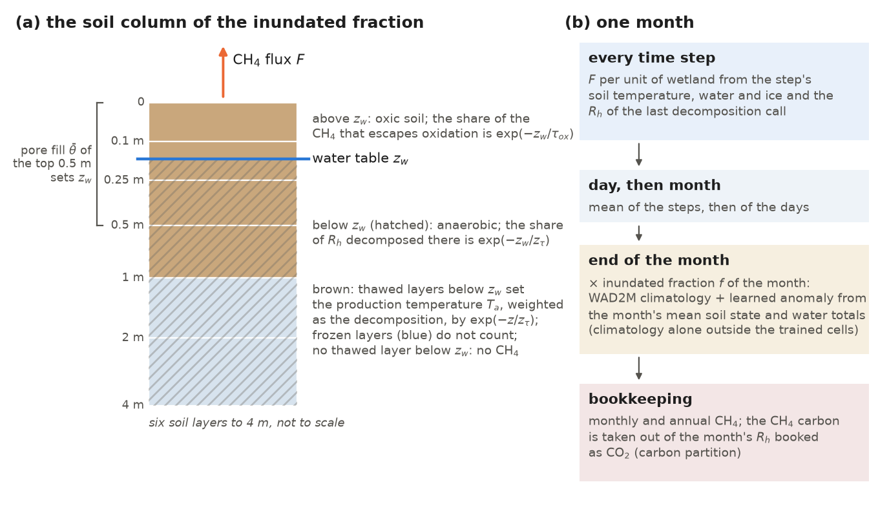
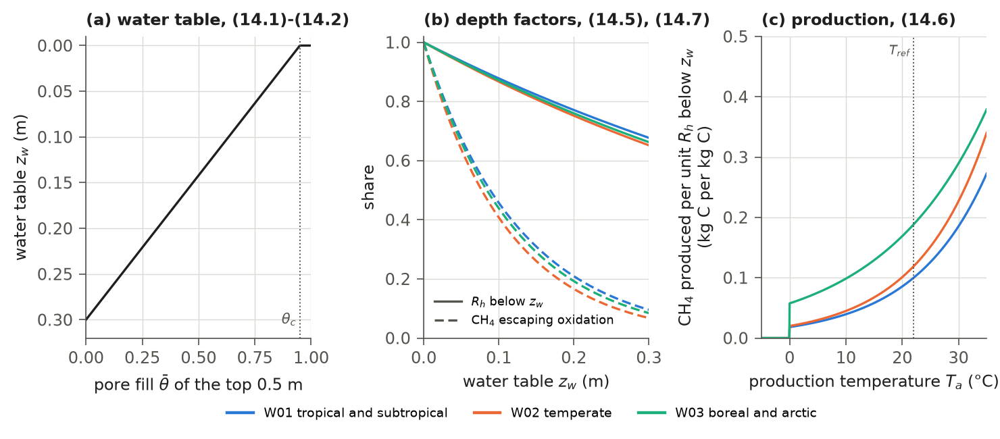
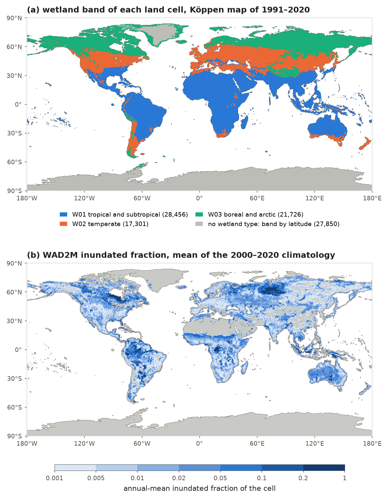
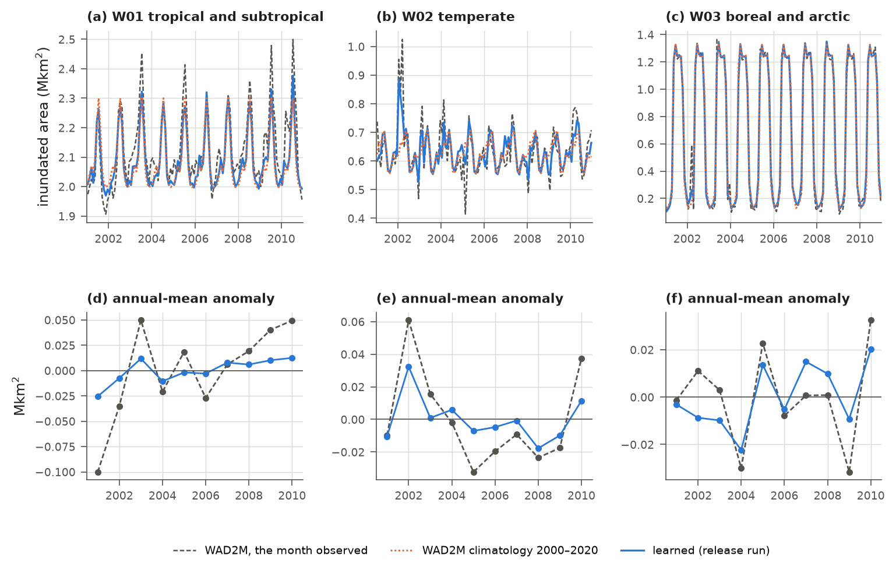
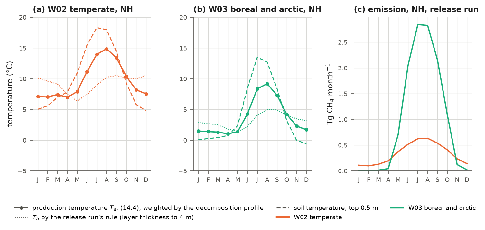
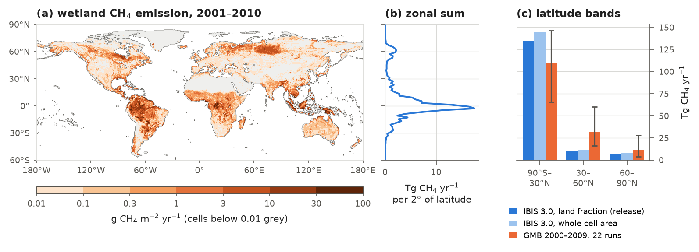

# 14. Wetland Methane

IBIS 3.0 computes wetland methane (CH4) emissions. Wetlands are the largest natural source of methane (Saunois et
al., 2025), and their emissions depend on processes already simulated by the model: soil carbon decomposition,
soil temperature and soil water. IBIS 2.6b4 has no methane module: its Fortran source contains no methane variable or
routine. The methane module of IBIS 3.0 is in `ibis/bgc/methane.py`.

Emissions are computed for each grid cell's inundated fraction, the part of the cell that is wetland in a given
month. The module starts from the soil carbon model's heterotrophic respiration (Chapter 12) and selects the share
occurring below the water table, where the soil lacks oxygen. It converts part of this respiration to methane at a
rate determined by the soil temperature there, then removes the methane oxidized during passage
through the soil above the water table. Four parameters control these steps, with a separate set for each of three
wetland bands (tropical, temperate and boreal). The inundated fraction varies monthly. In the release, it
equals the seasonal climatology of the WAD2M wetland product (Zhang et al., 2021a) plus a monthly anomaly predicted by a
learned model from simulated soil water, ice and temperature and the month's water fluxes.

This chapter describes the emission calculation (sections 14.1-14.4), its timing and outputs (14.5), the
parameters and wetland bands (14.6), the inundated fraction (14.7), methane carbon accounting (14.8), the
switches (14.9) and release-run emissions (14.10). Section 14.12 records the changes after the
release for developers. Methane emitted by fires is included in the fire emissions of Chapter 13.

## 14.1 Overview

The module follows Gedney et al. (2004), expressing wetland emissions as the product of a substrate, a temperature
factor and the wetland fraction. Gedney et al. use soil carbon as the substrate. IBIS 3.0 instead uses heterotrophic
respiration below the water table, because methane forms only where the soil lacks oxygen. A constant ratio converts
this respiration into gross methane production. A Q10 factor adjusts the ratio for the soil temperature below the
water table. An exponential function of water-table depth then determines the fraction of methane that escapes
oxidation in the soil above the water table, following the oxidation formulation in WETMETH (Nzotungicimpaye et al., 2021).

Several processes are omitted. The module does not resolve ebullition (bubbles), transport through plants, vertical
diffusion or the kinetics of oxidation, which process models such as CLM represent (Riley et al., 2011). It does not
compute the uptake of methane by upland soils or the emission from lakes.

The model has no separate wetland column. The wetland water table is derived from grid-cell soil water
(section 14.2), and heterotrophic respiration and soil temperature also come from the grid cell. Methane
emissions provide no feedback: they change no pool, flux or state read by the rest of the model. Methane carbon is
part of heterotrophic respiration and has already been removed from the pools by the soil carbon model. With carbon
partitioning (section 14.8), the model records that carbon as methane instead of carbon dioxide. Figure 14.1 shows the
calculation within the soil column and over one month.



**Figure 14.1** (a) Quantities controlling emissions within the inundated soil column: the water table
$`z_w`$, determined by pore fill in the top 0.5 m (section 14.2); the anaerobic share of heterotrophic respiration $`R_h`$
below it (section 14.3); the thawed layers below it, whose temperatures determine production temperature, weighted
by decomposition at each depth (14.4); and the oxic soil above it, where some methane is oxidized
(section 14.4). The thawed and frozen layers are an example. (b) The steps of one month in the release configuration
(sections 14.5, 14.7 and 14.8). Drawn for the current code.

## 14.2 Water table inside the inundated fraction

Methane forms only below the water table, whose depth also determines how much methane is oxidized on its way to the
surface. The module therefore first locates the water table within the wetland part of the cell.

The model's soil water represents the whole grid cell, of which the wetland occupies only a fraction. Its profile
therefore mostly describes the drier remainder. Because wetlands are wet by definition, the module does not derive
the wetland water table directly from that profile. Instead, it places the water table between the surface and
0.30 m depth according to the wetness of the top 0.5 m of soil, counting ice as water. The pore fill of soil layer $`k`$ and its mean over the top
0.5 m are

```math
\theta_{k} = \min\left[\max\left(s_{k}\,(1 - i_{k}) + i_{k},\; 0\right),\; 1\right], \qquad
\bar{\theta} = \frac{\sum_{k} \omega_{k}\,\theta_{k}}{\sum_{k} \omega_{k}}, \qquad
\omega_{k} = \min\left[\max\left(z_{ref} - d_{k-1},\; 0\right),\; \Delta z_{k}\right],
\qquad\text{(14.1)}
```

where $`\theta_{k}`$ is the share of the pore space of layer $`k`$ that holds liquid water or ice; $`s_{k}`$ is the liquid
water of the layer as a share of the pore space not filled with ice, and $`i_{k}`$ is the ice as a share of the pore
space (`soil.wsoi` and `soil.wisoi`; Chapter 7); $`\bar{\theta}`$ is the thickness-weighted pore fill of the top
$`z_{ref} = 0.50`$ m; $`\omega_{k}`$ (m) is the thickness of layer $`k`$ that lies above $`z_{ref}`$; $`d_{k}`$ (m) is the depth
of the bottom of layer $`k`$, with $`d_{0} = 0`$; and $`\Delta z_{k}`$ (m) is the thickness of layer $`k`$ (Table 1.2). With
the layers of IBIS 3.0, $`\bar{\theta}`$ is the thickness-weighted mean of the top three layers (0.10, 0.15 and 0.25 m
thick). The depth of the water table is

```math
z_{w} = z_{w,max}\left[1 - \min\left(\max\left(\frac{\bar{\theta}}{\theta_{c}},\; 0\right),\; 1\right)\right],
\qquad\text{(14.2)}
```

where $`z_{w}`$ (m) is the depth of the water table below the surface, $`z_{w,max} = 0.30`$ m is its largest depth, and
$`\theta_{c} = 0.95`$ is the pore fill at and above which the water table is at the surface (Figure 14.2a). A frozen,
saturated soil therefore has its water table at the surface. Frozen soil itself produces no methane: production
requires thawed soil below the water table (section 14.3). Where thawed soil lies beneath a frozen, saturated surface
layer, the surface water table allows all methane produced there to escape without oxidation.

Tower runs can instead prescribe the water table from observations (`zwt_obs`). Where an observed depth is
available, it replaces (14.2), bounded between 0 and $`z_{max} = 4.0`$ m. Global runs do not use this option.

## 14.3 Methane production

Microbes produce methane by decomposing organic matter in oxygen-free soil below the water table. The module
selects the fraction of soil decomposition occurring there and converts part of it to methane at a rate
determined by the local soil temperature.

The IBIS soil carbon model has no vertical profile (Chapter 12): it provides one respiration rate for the whole soil
column. The methane module therefore assumes that decomposition decreases with depth $`z`$ as $`e^{-z/z_{\tau}}`$, where
$`z_{\tau}`$ (m) is the depth over which decomposition falls to $`1/e`$ (about 37 %) of its surface value.
This e-folding depth is fitted at wetland towers (section 14.6). The water table determines two quantities:
the fraction of decomposition below it, which supplies methane production (equation 14.5 below), and the
soil temperature there, which determines the methane yield. The fraction of layer $`k`$ that
lies below the water table is

```math
a_{k} = \min\left[\max\left(\frac{d_{k} - \max(z_{w},\, d_{k-1})}{\Delta z_{k}},\; 0\right),\; 1\right],
\qquad\text{(14.3)}
```

so the part of layer $`k`$ below the water table runs from the depth $`\max(z_{w}, d_{k-1})`$ to the depth
$`\max(z_{w}, d_{k})`$ and is $`a_{k}\,\Delta z_{k}`$ thick. The production temperature is the mean temperature of the
thawed parts of the layers below the water table, each part weighted by its share of the decomposition there:

```math
T_{a} = \frac{\sum_{k} \delta_{k}\,w_{k}\,T_{k}}{\sum_{k} \delta_{k}\,w_{k}}, \qquad
w_{k} =
\begin{cases}
\displaystyle\int_{\max(z_{w},\, d_{k-1})}^{\max(z_{w},\, d_{k})} e^{-z/z_{\tau}}\,dz & \text{(default)}, \\[2ex]
a_{k}\,\Delta z_{k} & \text{(switch off: the release run)},
\end{cases}
\qquad
\delta_{k} =
\begin{cases}
1 & T_{k} \ge T_{f}, \\
0 & T_{k} < T_{f},
\end{cases}
\qquad\text{(14.4)}
```

where $`T_{a}`$ (K) is the production temperature (not the air temperature, which Chapters 3 and 5 also write $`T_{a}`$);
$`w_{k}`$ (m) is the weight of layer $`k`$; $`T_{k}`$ (K) is the temperature of soil layer $`k`$ (`soil.tsoi`); $`\delta_{k}`$
marks the thawed layers; and $`T_{f} = 273.15`$ K is the freezing point used by the module (the soil physics melts at
273.16 K, as in IBIS 2.6b4). The sums run over the six soil layers, down to the bottom of the soil column at 4 m; the
bedrock layers (Chapter 6) do not enter. Methane is produced only if some soil below the water table is thawed: where
the thawed thickness below the water table, $`\sum_{k} a_{k}\,\Delta z_{k}\,\delta_{k}`$, is $`10^{-12}`$ m or less, the
production is zero.

By default, each thawed portion is weighted by its share of decomposition. The production temperature therefore
represents the soil in which the methane substrate decomposes. In a fully thawed column with
$`z_{w} = 0.13`$ m and the $`z_{\tau}`$ of Table 14.1, 68-71 % of the weight lies in the top metre, the same share as that
of decomposition below the water table. The switch `methane.t_anaer_substrate` (in the `methane` section of the
parameter file; default true) selects this rule. False restores the release-run rule, which weights each
thawed portion by thickness: in the same column, 78 % of the weight then lies below 1 m, although most
decomposition occurs above that depth.

The two rules produce different seasonal temperature cycles (Figure 14.5a, b in section 14.10). The following numbers
apply both rules to monthly mean soil states in the Northern-Hemisphere cells of the release hindcast (2001-2010).
They come from `figures/make_ch14.py`, which evaluates the model's own functions on release-run monthly output. The current
rule puts 29 % (temperate band) and 28 % (boreal band) of the weight below 1 m, against 77 % and 72 % under the
thickness rule. In the temperate band the production temperature then ranges from 7.0 °C in April to 14.9 °C in
August, while the top 0.5 m of the same cells ranges from 4.8 °C (December) to 18.3 °C (July). In the boreal band it
ranges from 1.0 °C (April) to 9.2 °C (August), against −0.6 °C (December) to 13.5 °C (July) in the top 0.5 m. The
thickness rule of the release run gave a flatter cycle that was lowest in May: from 6.4 °C (May) to 10.5 °C (December)
in the temperate band, and from 1.4 °C (May) to 5.0 °C (August) in the boreal band.

These values are means over cells with nonzero inundation and thawed soil below the water table, weighted by
each cell's inundated fraction, area, land fraction and heterotrophic respiration (section 14.10). The included cells
vary by month. A fixed subset has nonzero inundation and thawed soil below the water table in all 120 months
(4,221 cells accounting for 61 % of the temperate band's Northern-Hemisphere emissions, and 1,230 cells accounting for
9 % of the boreal band's). Over that subset, the current rule gives the lowest temperature in February (temperate
band) or March (boreal band) and the highest in August; the thickness rule gave the lowest in May and the highest in
September.

The heterotrophic respiration below the water table and the gross methane production are

```math
R_{an} = \max(R_{h},\, 0)\; e^{-z_{w}/z_{\tau}},
\qquad\text{(14.5)}
```

```math
P = r\; R_{an}\; Q_{10}^{(T_{a} - T_{ref})/10}\; \delta_{a}, \qquad
\delta_{a} =
\begin{cases}
1 & T_{a} \ge T_{f}\ \text{and thawed thickness below the water table} > 10^{-12}\ {\rm m}, \\
0 & \text{otherwise},
\end{cases}
\qquad\text{(14.6)}
```

where $`R_{h}`$ (kg C m⁻² d⁻¹) is the heterotrophic respiration of the cell (section 14.5); $`R_{an}`$ (kg C m⁻² d⁻¹) is
its share below the water table, which is anaerobic; $`P`$ (kg C m⁻² d⁻¹) is the gross methane production; $`r`$ is the
molar ratio of methane to carbon dioxide produced in anaerobic decomposition, which applies unchanged to carbon masses
because both gases carry one carbon atom; $`Q_{10}`$ is the factor by which this ratio changes for a warming of 10 K; and
$`T_{ref} = 295.15`$ K is the reference temperature. The gate $`\delta_{a}`$ keeps production at zero below freezing
or when no appreciable thawed soil lies below the water table. Where soil below the water table is thawed, the gate
is 1 because $`T_{a}`$ is then a mean of thawed-layer temperatures.
The heterotrophic respiration already depends on the soil temperature and water (Chapter 12), so $`Q_{10}`$ acts on the
methane-to-carbon-dioxide ratio, not on the decomposition itself (Figure 14.2c).

## 14.4 Oxidation and the emission

On its way to the surface, methane produced below the water table crosses the oxygenated soil above it.
Microbes in that soil oxidize some methane to carbon dioxide; the rest escapes to the atmosphere. The fraction that
escapes is $`e^{-z_{w}/\tau_{ox}}`$, and the emission of the cell is

```math
F = \min\left[\max(f,\, 0),\; 1\right]\; P\; e^{-z_{w}/\tau_{ox}},
\qquad\text{(14.7)}
```

where $`F`$ (kg C m⁻² d⁻¹) is the methane emission per square metre of the grid cell, counted as carbon; $`f`$ is the
inundated fraction of the cell (section 14.7); and $`\tau_{ox}`$ (m) is the depth of oxygenated soil that reduces the
escaping fraction to $`1/e`$ (about 37 %). Together, (14.5)-(14.7) make emissions proportional to the inundated fraction
and the (non-negative)
heterotrophic respiration. Apart from the effect of $`z_{w}`$ on $`T_{a}`$, the emission falls with the depth of the water
table as $`e^{-z_{w}\,(1/z_{\tau} + 1/\tau_{ox})}`$. With the release parameters (Table 14.1) the oxidation factor falls
faster with depth than the anaerobic share (Figure 14.2b). The module converts $`F`$ to mg CH4 m⁻² d⁻¹ with the factor
$`10^{6} \times 16.04/12.011`$; the totals of section 14.10 use 16.043 g of methane per 12.011 g of carbon.



**Figure 14.2** Emission factors computed with the model's functions and the release parameter file's values for the
three wetland bands. (a) Water-table depth (14.2) as a function of pore fill $`\bar{\theta}`$ in the top
0.5 m. All three bands use the black curve. (b) The fraction of heterotrophic respiration below the water table,
(14.5), and the fraction of produced methane escaping oxidation, (14.7), as functions of water-table depth. (c) Gross methane production per
unit of heterotrophic respiration below the water table, $`r\,Q_{10}^{(T_a - T_{ref})/10}`$ of (14.6), zero below 0 °C,
with $`T_{ref} = 22`$ °C. The band parameters are those of the release; they will be refitted for the current production
temperature (section 14.6).

## 14.5 Evaluation in time and output

Soil temperature and water vary within a month, and methane emissions respond to both. The release therefore
computes emissions at every time step and averages them over the month.

With `physics.methane_hourly` on (as in the release), the emission (14.7) is evaluated at the end of every time step,
inside the time-step loop, from the soil temperature, water and ice of that step (step 12 of Table 1.3). The
heterotrophic respiration of (14.5) is the rate of the most recent call of the decomposition routine,

```math
R_{h} = 0.012 \times 86400\; C_{mic},
\qquad\text{(14.8)}
```

where $`C_{mic}`$ (mol C m⁻² s⁻¹) is the carbon released by decomposition (`vegetation.tco2mic`; Chapter 12), 0.012 kg
mol⁻¹ is the molar mass of carbon and 86400 s d⁻¹ converts the rate to a daily amount. The decomposition routine runs
once a day, after the day's time steps (Chapter 12), so every step of a day uses the respiration rate computed at the
end of the previous day. Time-step emissions are averaged over each day, and the daily means over the month. The
monthly amount is then accumulated:

```math
\bar{F} = \frac{1}{N_{d}} \sum_{d=1}^{N_{d}} \frac{\Delta t}{86400} \sum_{n=1}^{86400/\Delta t} F_{d,n}, \qquad
A \leftarrow A + N_{d}\,\bar{F},
\qquad\text{(14.9)}
```

where $`\bar{F}`$ (kg C m⁻² d⁻¹) is the mean emission of the month; $`N_{d}`$ is the number of days in the month;
$`F_{d,n}`$ is the emission of step $`n`$ of day $`d`$; $`\Delta t = 3600`$ s is the time step; and $`A`$ (kg C m⁻² yr⁻¹) is
the emission accumulated over the year, which is set to zero after the yearly output is written. The water table (14.2)
of the last time step of the month is kept as a diagnostic.

With `physics.methane_hourly` off (the default), emissions are evaluated once at the end of each month, using the
last time step's soil state and the last decomposition call's respiration rate, then multiplied by the number of
days. Hourly evaluation was introduced because the month-end state does not represent the full month
in spring and autumn (`docs/METHANE.md`). The release methane parameters were fitted with hourly
evaluation (section 14.6).

Monthly output contains the mean emission (`amch4`, kg C m⁻² d⁻¹). It also includes the inundated
fraction (`finund`) in every month using a learned, observed or dynamic fraction in place of the unmodified WAD2M
climatology. Thus, an observed source outside its record does not produce `finund`, whereas a climatology
modified by the dynamic option does. Yearly output contains annual emissions (`aych4`,
kg C m⁻² yr⁻¹), the water table of the last month (`zwt`, m) and, with the carbon partition, the methane carbon taken
out of the heterotrophic respiration (`ayrh_ch4c`, kg C m⁻² yr⁻¹; section 14.8). All are per square metre of the grid
cell. The methane state (the month's mean emission, the annual sum and the water table) is written to and read from
the restart files; the annual sum is set to zero when a run starts from a restart.

## 14.6 Parameters and wetland bands

Four parameters control emissions: the production ratio $`r`$, its temperature factor $`Q_{10}`$, the e-folding depth
of decomposition $`z_{\tau}`$ and the e-folding depth of oxidation $`\tau_{ox}`$. To represent climatic differences among
wetlands, each parameter has a value for each of three wetland bands. The other parameters retain their code defaults,
which the release parameter file does not override, and $`T_{f}`$ is a module constant. Table 14.1 lists all the parameters.

**Table 14.1** Parameters of the wetland methane module (`MethaneParams`). Each parameter-file name can be set in the
`methane` section of the parameter file and, except the switch, in its `methane_bands` section. The first four values
are those of the `methane_bands` section of the release parameter file (rounded to four significant digits); they will
be refitted for the current production temperature. The other values are the code defaults, which the release file
does not change.

| Symbol | Parameter-file name | Description | Tropical (W01) | Temperate (W02) | Boreal (W03) | Units |
|---|---|---|---|---|---|---|
| $`r`$ | `r_ch4` | molar CH4:CO2 ratio of anaerobic decomposition | 0.09974 | 0.1186 | 0.1881 | – |
| $`Q_{10}`$ | `q10p` | temperature factor of the ratio per 10 K | 2.167 | 2.248 | 1.714 | – |
| $`z_{\tau}`$ | `z_tau` | e-folding depth of decomposition | 0.7696 | 0.7012 | 0.7287 | m |
| $`\tau_{ox}`$ | `tau_oxid` | e-folding depth of the oxic zone | 0.1278 | 0.1114 | 0.1214 | m |
| $`T_{ref}`$ | `t_ref` | reference temperature of $`Q_{10}`$ | 295.15 | 295.15 | 295.15 | K |
| $`z_{w,max}`$ | `z_wt_max` | largest water table depth in the wetland | 0.30 | 0.30 | 0.30 | m |
| $`z_{ref}`$ | `z_wt_ref` | depth over which the pore fill sets the water table | 0.50 | 0.50 | 0.50 | m |
| $`\theta_{c}`$ | `sat_crit` | pore fill at which the water table reaches the surface | 0.95 | 0.95 | 0.95 | – |
| $`z_{max}`$ | `z_max` | limit of a prescribed (observed) water table | 4.0 | 4.0 | 4.0 | m |
| $`T_{f}`$ | – (module constant) | temperature below which no methane is produced | 273.15 | 273.15 | 273.15 | K |
| – | `t_anaer_substrate` | switch: weights of the production temperature (14.4), decomposition profile (true) or thickness (false); one value for all bands | true | true | true | – |

The parameter file also has a `methane` section with one value of each of the four parameters (`r_ch4` 0.1355, `q10p`
2.101, `z_tau` 0.7168, `tau_oxid` 0.1201). Band values override this section. Every band in the release file specifies
all four parameters, so no cell in a global run uses the four values from the `methane` section. $`T_{ref}`$,
which no section specifies, retains its code default. The switch `t_anaer_substrate` applies to the whole run and can be set
only in the `methane` section.

The four release band parameters were fitted at the 48 wetland towers in the Fluxnet-Methane_V2.0 data set,
using hourly evaluation (section 14.5), an inundated fraction of 1 and the release-run production temperature
(the thickness rule of (14.4)). Each band value is the parameter-wise median of fits at towers whose
Köppen zone has that band's wetland type (12, 24 and 12 towers); the `methane` section contains medians over all 48
(Chapter 16). The revised model's band parameters will be refitted with the current production temperature. The
new band medians will exclude towers with negative mean flux over the fitted years, indicating net methane
uptake. The module cannot match these towers' annual budgets because it never produces a negative flux.
Their monthly errors still respond to the parameters and pull the fitted production ratio downward. In the release's
temperate band, the median ratio is 0.119 with the two net-uptake towers and 0.136 without them.

Each cell's band follows the wetland type of its climate zone (Chapter 2, Table 2.3), as listed in Table 14.2.
Cells without a zone or a wetland type, including E_ice, are assigned a band from the
latitude $`\varphi`$ of the cell centre: tropical for $`-30° < \varphi < 30°`$, boreal for $`\varphi \ge 60°`$ and temperate otherwise.
Each run fixes the cells' bands from the Köppen period of its first year. In the release, the transient (1901-2000)
uses the map of 1901-1930 and the hindcast (2001-2010) uses the map of 1991-2020; 3,132 land cells change band between
the two maps. With learned inundated area (section 14.7.2, as in the release), cells covered by the
learned-model file are an exception. Every run uses their band stored in the file, from the
map of 1991-2020, ensuring that a cell's methane parameters and learned model always use the same band. In a
run that starts in 1901, 2,703 of these cells are then in a different band than their zone of 1901-1930 would give; in
a run that starts in 2001, none are. Figure 14.3a shows the bands of the hindcast.

**Table 14.2** Wetland bands, their climate zones and the land cells in each band in the Köppen maps of 1901-1930 (the
transient of the release) and 1991-2020 (the hindcast). With the learned inundated area, the cells of the learned
model's file take their 1991-2020 band in both periods (section 14.7.2).

| Band | Wetland type | Zones | Cells, 1901-1930 | Cells, 1991-2020 |
|---|---|---|---|---|
| tropical | W01 | A_humid, A_savanna, B_hot, C_subtrop, C_highland | 27,388 | 28,456 |
| temperate | W02 | C_med, C_oceanic, D_temperate, B_cold | 16,465 | 17,301 |
| boreal | W03 | D_subarctic, D_extreme, E_tundra | 23,425 | 21,726 |
| by latitude | – | E_ice, no zone | 28,055 (76 tropical, 25,493 temperate, 2,486 boreal) | 27,850 (76 tropical, 25,490 temperate, 2,284 boreal) |

Without the climate-zone types (`physics.koppen_types` off), every cell takes its band by latitude, except that, with
the learned inundated area, the cells of the learned model's file take the band stored in the file.

The parameter source depends on which sections the parameter file contains. A `methane_bands` section supplies each
band's values, overriding the `methane` section or, if that section is absent, the code defaults. With a
`methane` section alone, every cell uses its specified values. Only a file with neither section falls back to an
older configuration, with $`r`$ of 0.15, 0.32 and 0.18 and $`T_{ref}`$ of 299.6, 283.0 and 277.9 K in the tropical,
temperate and boreal bands. The release file has both sections.

## 14.7 Inundated fraction

Emissions scale with the inundated fraction $`f`$ in (14.7), the share of the cell that is wetland in a given month. The
model sets this fraction once a month and holds it constant within the month. `physics.wetland_source` selects its source.

### 14.7.1 WAD2M and its climatology

WAD2M (Zhang et al., 2021a), in its version 2.0 (Zhang et al., 2021b), gives the monthly wetland fraction of each 0.5°
cell from 2000 to 2020. Each land cell reads the WAD2M cell that contains its centre (`ibis.io.wad2m`); the reader
checks that the file is on a 0.5° grid of 360 × 720 cells that runs from south to north. Of the 95,333 land cells,
43,943 have no WAD2M value in any month (25,567 of them south of 60°S and 6,913 north of 60°N), and 27,634 have no value
in some months. The model reads a missing value as zero. At the 49,545 cells whose largest WAD2M fraction exceeds 0.005
(section 14.7.2), 18 % of the months of 2000-2020 have no value, and 91 % of these are months from November to April
north of 30°N. North of 60°N, 98 % of the November-April months have no value. The climatology is the mean of the 21
years for each calendar month,

```math
f_{clim,m} = \min\left[\max\left(\frac{1}{21}\sum_{y=2000}^{2020} f^{obs}_{y,m},\; 0\right),\; 1\right],
\qquad\text{(14.10)}
```

where $`f_{clim,m}`$ is the climatological inundated fraction of calendar month $`m`$ and $`f^{obs}_{y,m}`$ is the WAD2M
fraction of month $`m`$ of year $`y`$, with missing values counted as zero. With `wetland_source` set to `climatology` (the
default), $`f = f_{clim,m}`$ in every year. Figure 14.3b shows the annual mean of $`f_{clim,m}`$; its mean over the land
cells is 0.0169. 50,994 land cells have a WAD2M fraction above zero in at least one month.



**Figure 14.3** (a) The wetland band of each land cell for the Köppen map of 1991-2020, which the hindcast of the
release uses: the band of the wetland type of the cell's zone or, in the zone E_ice and the cells without a zone
(grey), the band by latitude. The legend gives the number of cells. (b) The annual mean of the WAD2M climatology
(14.10) of each land cell; cells below 0.001 are grey.

### 14.7.2 The learned anomaly

The WAD2M climatology repeats the same seasonal cycle every year. To represent differences between wet and dry years,
the release adds a monthly anomaly predicted by a learned model from simulated soil water, ice and temperature and
the month's water fluxes. With `wetland_source` set to `learned` (as in the release), cells covered by the
trained file use the WAD2M climatology plus this anomaly (`ibis/bgc/wetland_learned.py`):

```math
f = \min\left[\max\left(f_{clim,m} + \lambda_{b}\,\left(\hat{f} - \bar{\hat{f}}_{m}\right),\; 0\right),\; f_{max}\right],
\qquad\text{(14.11)}
```

where $`\hat{f}`$ is the fraction that the learned model of the cell's band $`b`$ predicts from the month's predictors,
limited to $`[0, 1]`$; $`\bar{\hat{f}}_{m}`$ is the mean of the model's predictions for calendar month $`m`$ over the training
years; $`\lambda_{b}`$ is a factor per band (1 in each band of the release file); and $`f_{max}`$ is the largest WAD2M
fraction of the cell in 2000-2020, counting missing values as zero. The anomaly is therefore the prediction's departure
from the learned model's own climatology. For each covered cell, the trained file stores $`f_{clim,m}`$,
$`\bar{\hat{f}}_{m}`$, $`f_{max}`$, the band and the static predictors. Its cells are the 49,545 land cells whose
$`f_{max}`$ exceeds 0.005 (19,540, 14,049 and 15,956 in the tropical, temperate and boreal bands); every other land cell
takes $`f = f_{clim,m}`$. The result is limited to $`[0, 1]`$.

The learned model has one ensemble of gradient-boosted regression trees per band (XGBoost; Chen and Guestrin, 2016).
Its predictors (Table 14.3) combine monthly model quantities, derived from the month's mean soil state and
water totals, with static cell fields. Neither calendar month nor climatology is included, so the
anomaly arises from the model's own hydrology. The prediction is constrained not to decrease when any of the 25 water
predictors marked in Table 14.3 increases. Predictors are constructed identically for training and simulation, month by month in calendar order
(`FeatureBuilder` in the code). Where a lag reaches back before the first month of a run, it takes
the current month's value; a 3-month mean with fewer months available averages those that exist. Predictor history is
not written to restart files, so it begins again with each run (the transient in 1901, the
hindcast in 2001). Neighbourhood means include every land cell within the surrounding 5 × 5 cells. The learned area
therefore runs only on the full global 0.5° grid and is the model's sole lateral dependence (Chapter 1).

**Table 14.3** Predictors of the learned inundated fraction, as the current code computes them. Monthly quantities are
means over every time step of the month (soil state) or totals of the month (water fluxes); $`\phi_{k}`$ is the
porosity, $`s_{k}`$ and $`i_{k}`$ the liquid water and ice, and $`T_{k}`$ the temperature of soil layer $`k`$. The prediction
is constrained not to decrease in the predictors marked †.

| Predictor | Definition |
|---|---|
| `W` †, `Wice` | liquid water $`\sum_{k=1}^{4}\phi_{k}\,(1 - i_{k})\,s_{k}\,\Delta z_{k}`$ and ice $`\sum_{k=1}^{4}\phi_{k}\,i_{k}\,\Delta z_{k}`$ of the four layers of the top metre (m); the release's learned model was trained with `W` $`= \sum_{k=1}^{4}\phi_{k}\,s_{k}\,\Delta z_{k}`$, which counts more than the liquid water in a layer that holds ice |
| `ws1`-`ws6` † | liquid water $`s_{k}`$ of each soil layer |
| `wi1`, `wi2` | ice $`i_{k}`$ of the top two layers |
| `t1`, `t14`, `tg` | temperature of the top layer, thickness-weighted mean temperature of the top metre, soil surface temperature (K) |
| `frz1` | frozen share of the top layer's water, $`i_{1}/\max(s_{1} + i_{1},\, 10^{-6})`$ |
| `prcp` †, `aet`, `runoff` † | precipitation, evapotranspiration, and surface runoff plus drainage of the month (mm) |
| `W_l1`-`W_l3` †, `W_3mo` † | `W` one to three months earlier; mean of `W` over the last three months |
| `prcp_3mo` †, `prcp_3mo_l1` †, `prcp_3mo_l3` † | mean monthly precipitation of the last three months; the same one and three months earlier |
| `runoff_3mo` †, `runoff_3mo_l1` †, `runoff_3mo_l3` † | mean monthly runoff plus drainage of the last three months; the same one and three months earlier |
| `nb_prcp_3mo` †, `_l1` †, `_l2` † | `prcp_3mo` averaged over the land cells of the 5 × 5 cells around the cell; the same one and two months earlier |
| `nb_runoff_3mo` †, `_l1` †, `_l2` † | the same for `runoff_3mo` |
| `FMAX_clm`, `SLOPE`, `STD_ELEV`, `TOPO`, `PCT_WETLAND`, `PCT_LAKE`, `binfl` | static: maximum saturated fraction, slope, standard deviation and mean of elevation, percent wetland and lake, and the infiltration shape parameter, from a CLM surface data set at 0.5° |
| `sand`, `clay` | static: sand and clay of the top layer of the soil file (%) |
| `lat`, `fmin_w`, `fmax_w` | static: latitude; smallest and largest WAD2M fraction of 2000-2020 |

The release file (`wetland_learned_v2_s31t.npz`) was trained (`verify/methane/wetland_learned_train.py`) on the WAD2M
fraction of the 120 months of 2001-2010 at its 49,545 cells, with the predictors of a 2001-2010 hindcast of the model
made before the release run, with the release parameters, the hourly methane and the climatological area
(`docs/METHANE.md`). Each band's model has 400 trees of depth up to 8, a learning rate of 0.08, at least 200
cell-months in each terminal node and a penalty of 1 on node-value magnitudes (XGBoost's L2 regularisation). It uses
a squared-error objective and draws four-fifths of both samples and predictors for each tree. Each cell's stored band
comes from the Köppen map of 1991-2020; the
methane parameters of these cells come from the same band in every run (section 14.6).

The current code defines the water predictor `W` as top-metre liquid water (Table 14.3). The release file
was trained with an earlier definition that also counts the ice-filled portion of a partly frozen layer. Using that
file with current code therefore supplies the learned model with a smaller `W` than it saw during training in months
with ice in the top metre. The effect on inundated area has not been measured. The model logs a warning when it reads
a file trained with the earlier definition. The learned model will be retrained on the final revised-model hindcast;
files trained since the change carry a marker
(`w_liquid`) and produce no warning.

In a learned month, the time steps evaluate emissions with $`f = 1`$ in every land cell, making the monthly mean
(14.9) an emission per unit inundated area. The steps also accumulate monthly means of
each layer's soil temperature, liquid water and ice, and of soil surface temperature (as with
`output.soil_means`, enabled by the learned source; monthly output then contains `tsoi_mean`,
`wsoi_mean`, `wisoi_mean` and `tg_mean`). At month end, the model constructs the predictors from these means and the
month's water totals, computes the inundated fraction using (14.11) and scales the month's emission accordingly:

```math
\bar{F} \leftarrow f\,\bar{F}^{(1)}, \qquad A \leftarrow A_{0} + f\,\left(A - A_{0}\right),
\qquad\text{(14.12)}
```

where $`\bar{F}^{(1)}`$ is the month's mean emission at $`f = 1`$ and $`A_{0}`$ is the annual emission accumulated before the
month. Because (14.7) is linear in $`f`$ and $`f`$ remains constant within the month, (14.12) gives the same emission as
time steps evaluated with fraction $`f`$. Monthly output records this fraction as `finund`.

Figure 14.4 compares the release hindcast's inundated area with the climatology and WAD2M, month by month.
Because 2001-2010 are the learned model's training years, this comparison does not use independent data.
Over 2001-2010 the learned area follows the seasonal cycle of the climatology. Its annual mean is 2.091, 0.633 and 0.711
Mkm² in the tropical, temperate and boreal bands (climatology 2.087, 0.628 and 0.705; WAD2M 2.123, 0.633 and 0.706).
The annual means vary from year to year with a standard deviation (population form, over the ten years) of 0.012, 0.013
and 0.013 Mkm², against 0.044, 0.028 and 0.019 Mkm² in WAD2M, and they correlate with those of WAD2M at 0.95, 0.91 and
0.75. These are in-sample values: the run uses models trained on all ten years. The training also included an
out-of-year test, with models trained on odd years predicting even years and vice versa, using predictors from the
training hindcast. In that test, annual band areas correlate with WAD2M at 0.90, 0.48 and 0.58, and the standard
deviations of the annual anomalies are 0.23, 0.28 and 0.77 times those of WAD2M (`docs/METHANE.md`). Outside its
training years the learned area thus follows the timing of the observed year-to-year changes in the tropical band, at
about a quarter of their magnitude; in the temperate and boreal bands it captures them only partly. The factor
$`\lambda_{b}`$ in (14.11) could amplify the anomalies, but the training record found that doing so reduces tropical
monthly skill, so the release retains $`\lambda_{b} = 1`$ (`docs/METHANE.md`).



**Figure 14.4** Inundated area by wetland band (Figure 14.3a), 2001-2010: learned area from the release hindcast
(`finund`), the WAD2M climatology (14.10) and the WAD2M fraction of each month. (a)-(c) Monthly area; the climatology
(dotted) lies close to the learned area in most months. (d)-(f) Each year's annual mean area minus the ten-year mean
(the climatology has no annual anomaly). Areas are calculated by multiplying fractions by cell area and land fraction
in the ESA CCI land cover of 1992. Release run, made with the earlier water predictor `W` (to be updated after the
final run of the revised model).

### 14.7.3 Other sources

With `wetland_source` set to `observed`, the inundated fraction of a month inside the WAD2M record (2000-2020) is the
WAD2M fraction of that month, and the climatology is used outside the record. `observed_learned` uses the observed
month inside the record and the learned fraction outside.

With `physics.wetland_dynamic` on (off in the release), the climatology is scaled by an anomaly of the soil water in
the top metre, $`f = \min[\max(f_{clim,m}(1 + \beta_{b}a_{W}),\, f_{min}),\, f_{max}]`$ (`ibis/bgc/wetland_area.py`). Here
$`a_{W}`$ is the standardized anomaly of the liquid water in the four layers of the top metre, $`\sum_{k=1}^{4}\phi_{k}\,(1 - i_{k})\,s_{k}\,\Delta z_{k}`$ with layers at or below 273.16 K counted as zero, computed from the soil state at the start
of the month and measured against a monthly climatology of a reference run (`forcing.wetland_clim_file`); $`a_{W}`$ is set
to zero where the top layer is at or below 273.16 K. $`\beta_{b}`$ comes from the `wetland_area` section of the parameter
file (0 where the section is absent), and $`f_{min}`$ and $`f_{max}`$ are the smallest and largest WAD2M fractions of the
cell in 2000-2020. The dynamic fraction applies only in months that use the climatology. The release parameter file has
no `wetland_area` section. A climatology file made before the liquid-water definition was adopted (section 14.12)
holds the earlier definition of the water.

## 14.8 Carbon partition of the methane

The soil carbon model records all decomposed carbon as heterotrophic carbon dioxide respiration (Chapter 12),
and methane is computed from part of that respiration. Reporting both fluxes in full would count methane carbon
twice. With `physics.methane_carbon_partition` on (as in the release), the model therefore subtracts the month's net
methane emission from its heterotrophic respiration recorded as carbon dioxide, once emissions are finalized
after (14.12):

```math
\Delta C = \min\left[\max\left(A - A_{0},\, 0\right),\; \max\left(R_{h,y} - R_{h,y,0},\, 0\right)\right], \qquad
R_{h,y} \leftarrow R_{h,y} - \Delta C,
\qquad\text{(14.13)}
```

where $`\Delta C`$ (kg C m⁻²) is the methane carbon of the month; $`R_{h,y}`$ (kg C m⁻²) is the heterotrophic respiration
accumulated over the year (`summary.ayco2mic`); and $`R_{h,y,0}`$ is its value at the start of the month. This change
affects only the accumulated diagnostic. The decomposition routine has already removed this carbon from the pools,
and no quantity read by the physics changes. Monthly heterotrophic respiration in the output (`amco2mic`) then
represents carbon dioxide alone. Monthly and yearly net ecosystem exchange (`amneetot`, `ayneetot`), calculated from
accumulated respiration, exclude wetland methane carbon. Yearly output contains the sum of $`\Delta C`$
(`ayrh_ch4c`), so carbon dioxide respiration plus `ayrh_ch4c` equals the carbon decomposed. Respiration for
the month in (14.13) comes from the decomposition calls at the end of each day of the month, whereas the emission of the
month's first day uses the respiration of the previous month's last call (section 14.5); the two are therefore offset
by one day. Only the global driver (`scripts/run_global.py`) makes the partition.

## 14.9 Configuration switches

The switches in Table 14.4 enable the module, select the emission calculation's frequency and the source of the
inundated fraction, and control methane carbon accounting.

**Table 14.4** Switches and files of the wetland methane module. All but the last row belong to the run configuration;
Table 1.7 lists the first four. The last row is set in the parameter file (Table 1.8).

| Switch | Default | Release | Meaning |
|---|---|---|---|
| `physics.enable_methane` | false | true in the transient and the hindcast | wetland methane; reads the WAD2M file |
| `physics.methane_hourly` | false | true in the transient and the hindcast | emission evaluated every time step (false: from the month-end state) |
| `physics.wetland_source` | `climatology` | `learned` in the transient and the hindcast | source of the inundated fraction: `climatology`, `observed`, `learned` or `observed_learned` |
| `physics.methane_carbon_partition` | false | true in the transient and the hindcast | methane carbon taken out of the respiration booked as CO2 |
| `physics.wetland_dynamic` | false | false | climatology scaled by the anomaly of the top-metre water |
| `forcing.wad2m_file` | WAD2M version 2.0, 0.5° | the default | the WAD2M file |
| `forcing.wetland_learned_file` | none | `wetland_learned_v2_s31t.npz` | the trained file of the learned anomaly |
| `forcing.wetland_clim_file` | none | none | monthly climatology of the top-metre water of a reference run; required by `wetland_dynamic` |
| `output.soil_means` | false | false, but turned on by the `learned` source | monthly means of the soil temperature, liquid water and ice and of the surface temperature in the monthly output (`tsoi_mean`, `wsoi_mean`, `wisoi_mean`, `tg_mean`) |
| `methane.t_anaer_substrate` (parameter file) | true | the release run used the thickness rule (false) | weights of the production temperature (14.4): the decomposition profile (true) or the layer thickness (false) |

The `learned` and `observed_learned` sources require `methane_hourly`. The spin-up of the release has methane off.

## 14.10 The release run

This section reports release-run wetland methane emissions. Several subsequent changes will alter these numbers.
The most direct are the weighting of production temperature by the decomposition profile (section 14.3) and the
use of liquid water alone for learned inundated area (section 14.7.2). The revised growth-respiration rule (Chapter 11)
also changes NPP, litterfall and the heterotrophic respiration supplying methane production. Other physics corrections
affect soil temperature and water. The band parameters will be refitted and the learned model retrained. Every number
in this section therefore describes the release run and will be updated after the final revised-model run.

In the release hindcast (2001-2010), wetland methane emissions average 152.5 Tg CH4 yr⁻¹ (annual totals of
147.8-160.5 Tg CH4 yr⁻¹; population standard deviation of the ten annual totals 4.1 Tg CH4 yr⁻¹). Of this, 135.0, 10.7
and 6.8 Tg CH4 yr⁻¹ fall in the latitude bands 90°S-30°N, 30-60°N and 60-90°N, and 134.7, 5.5 and 12.3 Tg CH4 yr⁻¹ in
the tropical, temperate and boreal wetland bands (bands of the Köppen map of 1991-2020). Methane carbon subtracted from
heterotrophic respiration amounts to 0.114 PgC yr⁻¹. The totals follow the release-score convention (Table 16.11):
each cell's value is multiplied by its area and its land fraction in the ESA CCI land cover of 1992
(area-weighted mean 0.87 over the land cells), with 16.043 g of methane per 12.011 g of carbon. WAD2M gives the wetland
fraction of the whole cell (`docs/METHANE.md`). Weighted by the whole cell area instead, the total is 163.8 Tg CH4
yr⁻¹ (144.5, 11.8 and 7.6 Tg CH4 yr⁻¹ in the latitude bands), and the annual mean area of the WAD2M climatology is 3.69
instead of 3.42 Mkm².

Figure 14.6 shows emissions by cell and latitude. The three 2° latitude bands between 4°S and 2°N emit
47.0 Tg CH4 yr⁻¹, 31 % of the total. For 2000-2009 the 22 prognostic runs of the wetland models of the Global Methane
Budget (11 models with two climate forcings, each model computing its own wetland area; Saunois et al., 2025) give 153
(116-189) Tg CH4 yr⁻¹, mean (range), of which 109.5 (65.7-146.1), 32.1 (16.3-60.1) and 11.7 (3.6-28.1) Tg CH4 yr⁻¹
fall in the three latitude bands (Figure 14.6c). The emission of the release run lies inside the range of these runs in
the bands 90°S-30°N and 60-90°N, and below it in the band 30-60°N. Chapter 16 describes the evaluation of the module.

Northern emissions peak in July and August, together with near-surface soil temperature (Figure 14.5a–c). The
Northern-Hemisphere cells of the boreal band emit 11.9 Tg CH4 yr⁻¹: 2.8 Tg CH4 in each of July and August, and
0.05 Tg CH4 in December to March together. Those of the temperate band emit 4.0 Tg CH4 yr⁻¹: 0.6 Tg CH4 in each of
July and August, and 0.5 Tg CH4 in December to March. The seasonal cycles of the inundated area (Figure 14.4b, c) and of
the heterotrophic respiration, which depends on the temperature of the top metre (Chapter 12), enter (14.7) linearly.
The production temperature enters through the factor $`Q_{10}^{(T_{a} - T_{ref})/10}`$ of (14.6). Over the annual range
of the band means of the release run's production temperature (3.6 K in the boreal and 4.1 K in the temperate band),
this factor changes by 21 % and 40 %. Under the current rule the same soil states give annual ranges of 8.2 K and 7.9 K,
over which the factor, with the release's band values of $`Q_{10}`$, changes by 55 % and 90 % (Figure 14.5; computed by
`figures/make_ch14.py`). At the release parameters, before any refit, the current rule raises the emission by about
16 % in the temperate and boreal wetland bands and by about 1 % in the tropical band (an estimate from the month-mean
soil states; section 14.12).



**Figure 14.5** The production temperature on the soil states of the release hindcast, 2001-2010, in the
Northern-Hemisphere cells of the temperate (W02) and boreal (W03) wetland bands (Köppen map of 1991-2020). (a), (b) By
calendar month: the production temperature $`T_{a}`$ of (14.4) under the current rule (weights from the decomposition
profile, with each band's $`z_{\tau}`$), under the thickness rule of the release run, and the thickness-weighted soil
temperature of the top 0.5 m. All are computed from each month's mean soil state with the model's functions and
averaged over cells with nonzero inundation and thawed soil below the water table, weighted by the inundated
fraction, cell area, land fraction and heterotrophic respiration. The set of cells changes with the month: on average 4,900 cells in February
and 14,600 in September in W03, and 10,600 (July) to 12,000 (April) in W02. (c) The emission of the Northern-Hemisphere
cells of each band (`amch4`), mean of the ten years, computed with the thickness rule (release run; to be updated after the final run of the revised model).



**Figure 14.6** The wetland methane emission of the release hindcast, mean of 2001-2010 (release run; to be updated
after the final run of the revised model). (a) The annual emission of each land cell (`aych4`, per square metre of the
cell); cells below 0.01 g CH4 m⁻² yr⁻¹ are grey. (b) The sum over the land cells of each 2° band of latitude, with the
land-fraction weighting of the release totals. (c) The totals of the three latitude bands of the Global Methane
Budget: IBIS 3.0 with the land-fraction weighting (the release convention) and with the whole cell area, and the mean of
the 22 prognostic runs of 2000-2009 with their range.

## 14.11 Relation to IBIS 2.6b4

The module has no counterpart in IBIS 2.6b4: no Fortran source file or parameter file of IBIS 2.6b4 contains a methane
variable. The module reads variables that the Fortran also has: the temperature, liquid water and ice of the six soil
layers (`tsoi`, `wsoi`, `wisoi`) and the decomposition rate `tco2mic` (`biogeochem.f`), which (14.8) converts with the
factors of the Fortran (0.012 kg C per mole and 86400 s per day). The pore fill of (14.1) is the expression that the
Fortran uses for the water content of the top soil layer (`zwsoi`, `soil.f`), applied here to each layer. The module
changes no state of the routines ported from IBIS 2.6b4. With the carbon partition it lowers the annual respiration
accumulator `ayco2mic`, from which the annual net ecosystem exchange of the output is formed as in the Fortran
(`stats.f`; section 14.8). An earlier wetland module in the code base (`ibis/bgc/_legacy_unwired/wetlands.py`) is not
called by the model.

## 14.12 Notes for developers

The release run (`final_rel30`) was made with the code of commit `e54e342`. The technote review of 2026-11-01
(`docs/CALIBRATION.md` section 87; each defect in `docs/DEFECTS_FOR_REVIEW.md`; `docs/METHANE.md` section 11) made
the changes below in commit `13b23d5` (branch `review-methane`, merged into `technote-review-fixes`). The preliminary
protocol run completed on 2026-11-02 exercised the revised methane code and learned area,
including the warning about the older water predictor. No methane tower refit or final run has used these changes
yet; this chapter still reports release results. Tests: `tests/test_review_methane_fixes.py`.

1. *Production temperature from the decomposition profile* (review D13; `methane.t_anaer_substrate`, a static field of
   `MethaneParams`, default true, set in the parameter file's `methane` section and rejected in `methane_bands`). Each
   thawed part below the water table is weighted by the integral of $`e^{-z/z_{\tau}}`$ over it (`thawed_anaerobic_zone`
   with `z_tau`, written with `expm1` so that thin parts keep their accuracy in single precision). False gives the
   release's thickness weights, bit for bit. Reason: the module's substrate share (14.5) assumes decomposition
   decreases with $`z_{\tau}`$ of about 0.7 m, while thickness weights put 77 % (W02) and 72 % (W03) of the weight
   below 1 m in the Northern-Hemisphere cells of the release hindcast, so the fitted band $`Q_{10}`$ acted on the
   temperature of the deep soil, whose annual cycle is flatter and later than that of the soil near the surface. Size
   before any refit, at the release parameters: +1.3 %, +16 % and +16 % emission in the tropical, temperate and boreal
   bands (review estimate, `/shared/nas2/Hangkai/ibis/technote_review_2026-11-01/merged.json` D13); `make_ch14.py` reproduces +1.3 %, +16.1 % and +16.4 % by rescaling the
   release emission of each cell-month with the $`Q_{10}`$ factor of the change of $`T_{a}`$ on the month-mean soil states
   (+3.0 % over all bands). Parameters will be refitted at the 48 towers, and the band medians will exclude the
   net-uptake towers as described in item 6, following the work program
   (`docs/CALIBRATION.md` section 87).
2. *No production without thawed soil below the water table* (D61; no switch). `methane_flux` now gates the production
   with the thawed fraction of `thawed_anaerobic_zone` (thawed thickness above $`10^{-12}`$ m), which it does not
   otherwise use to scale production (respiration already collapses in frozen soil; `docs/METHANE.md`
   section 5j). Previously, the top-layer temperature substituted for $`T_{a}`$, allowing a thawed top layer above a
   water table at 0.10 m or deeper to produce methane while the entire anaerobic zone was frozen: under 0.1 % of each band's emission on
   the month-mean states of 2001-2010 (1e-5 of the W02 and 5e-4 of the W03 Northern-Hemisphere emission). The gate also
   applies with `t_anaer_substrate` false.
3. *A `methane` section alone is used as given* (D35; `methane_params_for_run`, `methane_params_source`). Before, a
   file with a `methane` section and no `methane_bands` had its `r_ch4` and `t_ref` replaced by the legacy per-biome
   tables (`_R_CH4_BIOME`, `_T_REF_BIOME`; `docs/METHANE.md` section 5q) while the log said "without band overrides".
   This has no effect on the release, whose file has both sections.
4. *Band of the learned cells from the file* (D38; `LearnedWetland.band_index`; `run_global.py` rebuilds the methane
   parameters after loading the file and logs the number of cells moved). Previously, the transient assigned every
   cell's band from the Köppen period of `time.iyear0`, while the learned model used the band in its file. 2,703 of the 49,545 file
   cells change band for a 1901 start, none for a 2001 start, so the release hindcast is unchanged.
5. *Liquid root-zone water* (D39). `FeatureBuilder` (`W`) and `wetland_area.root_zone_water` (now with `wisoi` as a
   required keyword) use $`\phi\,(1 - i)\,s\,\Delta z`$. The release's learned file was trained with the earlier `W`
   and will be retrained on the revised model's hindcast; `wetland_learned_train.py --save` marks new files with `w_liquid`, and
   `LearnedWetland` logs a warning for a file without the mark. Climatology files of `wetland_clim_prep.py` made before
   2026-11-01 hold the earlier `W` as well.
6. *Band tool for the tower medians* (D16; `verify/calibration/ch4_class_yaml.py --band-csv`, commits `13b23d5` and
   `d98bd07`). The tool excludes from both sections towers whose mean flux over the fitted years (`tower_gC_yr` in
   the fit report) is negative; `--min-budget X` also excludes towers with a gap-filled annual budget below X in
   magnitude (`docs/CALIBRATION.md` section 38.1; off unless given), and `--keep-all` reproduces the release's
   sections. Reason: `site_fit.py` sets the magnitude term to its cap whenever the target and model sums differ in sign,
   and the modelled flux is never negative, so a net-uptake tower informs only the monthly terms of its fit. The
   release band values remain in place until the methane band refit (`docs/CALIBRATION.md` sections 38.1 and 80). Band-level
   statements only: the tower data are unpublished.
7. *Docstrings* (D93): the docstrings and comments of `methane.py`, `wetland_area.py` (layer thicknesses) and
   `wetland_learned.py` now state what the code does.

Retained and documented after the review: $`\lambda_{b} = 1`$ (D40; increasing it reduced tropical monthly skill, $`R^{2}`$
−0.18 at $`\lambda`$ 4.4, `docs/METHANE.md` section 11); the one-day offset between the hourly substrate and the month's
respiration in the partition cap (D88; 27 cells clipped in 2001, `docs/METHANE.md` section 12). The final scores are to
use one area convention per quantity (D67; the review recommended the whole cell area, WAD2M's definition, for
wetland methane), and section 14.10 gives the release totals under both conventions. On the GPU, two launches of the
same year gave methane fields that differ in the last digits (Chapter 17). With the deterministic GPU reductions of
review D83 (`XLA_FLAGS=--xla_gpu_exclude_nondeterministic_ops=true`), two launches gave identical output at a few
percent more time (Chapter 17). It is now the default in `scripts/run_global.py`: before importing JAX, the driver
adds the flag to `XLA_FLAGS` unless that option is already present or `IBIS_NONDETERMINISTIC=1` is set. Other
user-supplied flags remain in effect; an explicit value for this option is respected.

Other code notes. Functions: water table `wetland_water_table` (the flux does not use the column diagnostic `water_table_depth`);
substrate share `anaerobic_substrate_fraction`, production `gross_production`, oxidation
`surviving_fraction`, the month `methane_step_from_mean` and `methane_step`, the learned month `scale_month`, the
partition `ch4_carbon_from_rh`, the hourly call in `loops_gswp3._run_day_inner`. Fortran references of section 14.11:
`biogeochem.f`, lines 1031-1036 (`tco2mic`); `soil.f`, line 109 (`zwsoi`); `stats.f`, line 1200 (annual NEE).
Documentation of the module's development: `docs/METHANE.md` sections 5a (WAD2M as a whole-cell fraction), 5j and 5q,
9 (hourly evaluation), 11 (learned area and its out-of-year test) and 12 (carbon partition); calibration
`docs/CALIBRATION.md` sections 38, 45 and 80. Figures: `figures/make_ch14.py`. Figures 14.1 and 14.5 were redrawn for
the current production temperature (Figure 14.5 evaluates both rules on the release hindcast's month-mean soil states
and prints the numbers quoted in sections 14.3 and 14.10); Figures 14.2 and 14.3 do not depend on the changes above;
Figures 14.4 and 14.6 show the release run.

## References

Chen, T., and C. Guestrin, 2016: XGBoost: a scalable tree boosting system. *Proceedings of the 22nd ACM SIGKDD
International Conference on Knowledge Discovery and Data Mining*, 785-794.

Gedney, N., P. M. Cox, and C. Huntingford, 2004: Climate feedback from wetland methane emissions. *Geophysical Research
Letters*, 31, L20503.

Nzotungicimpaye, C.-M., K. Zickfeld, A. H. MacDougall, J. R. Melton, C. C. Treat, M. Eby, and L. F. W. Lesack, 2021:
WETMETH 1.0: a new wetland methane model for implementation in Earth system models. *Geoscientific Model Development*,
14, 6215-6240.

Riley, W. J., Z. M. Subin, D. M. Lawrence, S. C. Swenson, M. S. Torn, L. Meng, N. M. Mahowald, and P. Hess, 2011:
Barriers to predicting changes in global terrestrial methane fluxes: analyses using CLM4Me, a methane biogeochemistry
model integrated in CESM. *Biogeosciences*, 8, 1925-1953.

Saunois, M., et al., 2025: Global Methane Budget 2000-2020. *Earth System Science Data*, 17, 1873-1958,
doi:10.5194/essd-17-1873-2025.

Zhang, Z., et al., 2021a: Development of the global dataset of Wetland Area and Dynamics for Methane Modeling (WAD2M).
*Earth System Science Data*, 13, 2001-2023.

Zhang, Z., E. Fluet-Chouinard, K. Jensen, K. McDonald, G. Hugelius, T. Gumbricht, M. Carroll, C. Prigent, A. Bartsch,
and B. Poulter, 2021b: Development of a global dataset of Wetland Area and Dynamics for Methane Modeling (WAD2M),
version 2.0 [data set]. Zenodo, doi:10.5281/zenodo.5553187.
