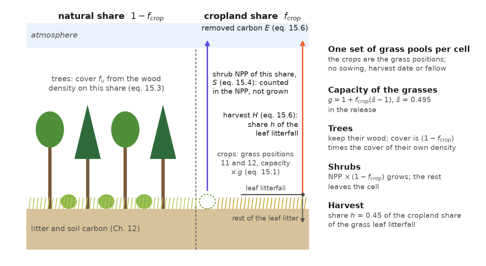
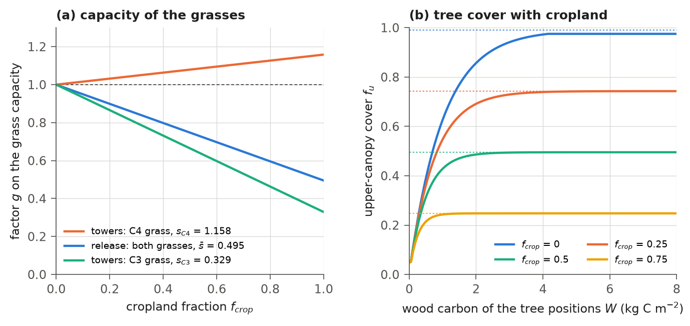
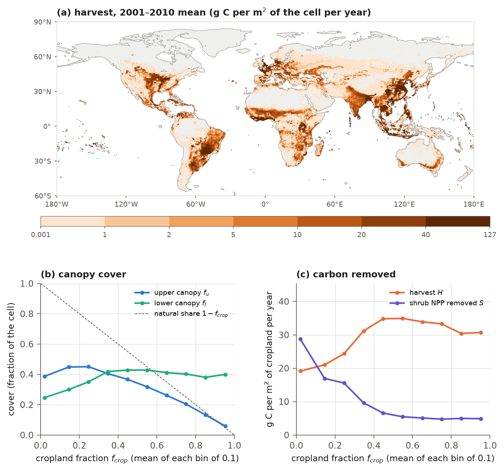

# 15. Cropland

Crops differ from natural grass because they are sown, fertilized and harvested, with the harvest removed from the
field. IBIS 3.0 represents cropland simply, as managed grass on an observed cropland share of each cell. The model reads
this share from a map and holds it fixed (section 2.7). It enters four calculations. Every time step, the model blends
the photosynthetic capacity of the two grass positions toward crop capacity in proportion to the cropland share
(Chapter 9). Once a year, in the annual update (Chapter 11), it restricts tree cover and shrub growth to the cell's
natural share and removes some grass leaf litterfall from the cropland share as harvest, rather than adding it to
litter. There is no crop phenology: no sowing or harvest date, no fallow, no irrigation, fertilization or
tillage, and no map of which crop grows where. The crop is the cell's own grass with a different photosynthetic capacity. It grows and sheds leaves according to the
phenology of Chapter 10, and the cell retains one set of carbon pools per position. IBIS
2.6b4 has no cropland (section 15.11). The treatment and its parameters were added during release calibration
(Chapter 16) and apply in all three stages of the release run (spin-up, transient and hindcast).

## 15.1 The cropland share

The model needs to know how much of each cell is cropland. The cropland fraction $`f_{crop}`$ of a cell ($`c`$ in
Chapter 11) is the share of the cell's 300 m land pixels (water and no-data pixels excluded) in the cropland classes of
the ESA CCI land cover map of 2000 (ESA, 2017), the two mosaic classes counted as half (section 2.7, Figure 2.5). The
run configuration names the file (`forcing.cropfrac_file`, `cropfrac_esacci_2000_05deg.npz`). The driver reads the file once
and uses the same values in the spin-up, transient and hindcast. Without this file, it skips every cropland term below
and runs without cropland. The annual update clips the fraction to $`[0, 1]`$; the
capacity factor used at every time step uses the fraction as read.

Of the 95,333 land cells, 47,304 have cropland, 8,338 on at least half of the cell and 34 entirely (Table 15.1). The
cropland area is 21.98 Mkm² when each cell's fraction is weighted by its land area, the cell area times its land
fraction in the ESA CCI land cover of 1992 (the weighting of the totals of this chapter and of Chapter 16), or
25.24 Mkm² on the whole area of the land cells. With the first weighting, 15 % of the land is cropland. 53 % of the
cropland area lies in the 6,483 cells that are more than 60 % cropland.

**Table 15.1** The cropland map by bin of the cropland fraction: cells, cropland area on the land fraction of the
cells, and the area-weighted mean fraction of the bin (`figures/make_ch15.py`, `T15.1`).

| Cropland fraction | Cells | Cropland area (Mkm²) | Mean fraction |
|---|---|---|---|
| 0 | 48,029 | 0 | 0 |
| 0 to 0.1 | 26,633 | 1.15 | 0.021 |
| 0.1 to 0.3 | 7,845 | 3.23 | 0.186 |
| 0.3 to 0.6 | 6,343 | 6.05 | 0.439 |
| 0.6 to 1 | 6,483 | 11.55 | 0.809 |
| all | 95,333 | 21.98 | 0.153 |

Two crop types, C01 (C3 crop) and C02 (C4 crop), complete the type list in Table 2.3. They occupy no cell position and
have no parameters of their own. Type placement skips the growth form `crop`, and the parameters named by these types
come from the `crop` section of the parameter file (Table 15.4). There is no map distinguishing the two crops; a single
global share $`q`$ of C4 crops applies everywhere (section 15.3).

## 15.2 The cell with cropland

A cell with cropland has the same structure as every other cell (Figure 1.1): one upper and one lower canopy, twelve
positions with one set of leaf, wood and root carbon each, and one litter and soil column. The cropland share has no
pools of its own. The grass positions 11 (C4) and 12 (C3) represent both crops on the cropland share and
natural grass on the rest of the cell. The model applies cropland terms as area-weighted terms at the cell level
(Figure 15.1). The grass capacity is the mean of the natural and the crop value over the two shares (15.1). Tree
cover is calculated from the trees' wood density and multiplied by the natural share (15.3). The shrubs receive the
natural share of their NPP (15.4). The harvest is the cropland share of the grass leaf litterfall times a harvest index
(15.6). The fire (Chapter 13) and the background disturbance have no cropland term: the fire share $`d_{f} m_{j}`$ and
the background share $`d_{o}`$ of (11.18) act on the grass pools, crops included, as on every other pool of the cell.
Table 15.2 lists the terms in the order of the calculations of Tables 1.3 and 1.4.



**Figure 15.1** A cell with cropland. The trees and shrubs live on the natural share $`1 - f_{crop}`$; the grass
positions 11 and 12 cover both shares with one set of pools, their capacity scaled by $`g`$ of (15.1). Grass leaf
litterfall on the cropland share is divided: a share $`h`$ leaves the cell as harvest $`H`$ (15.6), and the rest enters
litter with the other litterfall. The shrub NPP of the cropland share, $`S`$ (15.4; the dashed shrub), is
counted in the cell's NPP but no pool receives it. $`H`$ and $`S`$ are added to the carbon removed from the ecosystem, $`E`$, as a flux
to the atmosphere. The values are those of the release parameter file.

**Table 15.2** The cropland terms in the order of the calculations. Steps 2 to 8 are the annual update `dynaveg`
(Table 11.1), which runs with `physics.isimveg` = 1 (section 15.8).

| Step | Time scale | Operation | Equation | Section |
|---|---|---|---|---|
| 1 | time step | capacity of the grass positions times $`g`$ | (15.1), (15.2) | 15.3 |
| 2 | year | shrub NPP scaled to the natural share; the rest counted as removed, $`S`$ | (15.4) | 15.5 |
| 3 | year | allocation of the NPP and litterfall of every position; the grass allocation blended toward the crops' where `crop.aleaf` is set (not in the release) | (11.11)-(11.14), (15.7) | 11.4, 15.6 |
| 4 | year | removal of the trees where the maximum cover is zero; disturbance | (11.15)-(11.19) | 11.5, 11.6 |
| 5 | year | harvest from the grass leaf litterfall; $`H`$ and $`S`$ added to the removed carbon | (15.5), (15.6) | 15.6 |
| 6 | year | minimum leaf carbon, leaf-area limit (off in the release), leaf area and biomass | (15.8) | 11.7, 15.7 |
| 7 | year | net ecosystem exchange less the removed carbon | (15.6) | 11.10 |
| 8 | year | upper-canopy cover on the natural share; lower-canopy cover | (15.3), (11.25) | 15.4, 11.8 |

## 15.3 Photosynthetic capacity of the crops

Crops and natural grass differ in their leaves' photosynthetic rates. The model represents this difference with a factor
on the photosynthetic capacity of both grass positions. At every time step, it multiplies their capacity at 15 °C by
a cell-level factor (9.7):

```math
g = 1 + f_{crop}\left(\bar{s} - 1\right), \qquad \bar{s} = (1 - q)\, s_{C3} + q\, s_{C4}, \qquad 0 \le q \le 1,
\qquad\text{(15.1)}
```

where $`g`$ is the factor on the capacity of both grass positions (1 in the other positions); $`f_{crop}`$ is the cropland
fraction of the cell; $`s_{C3}`$ = 0.329 and $`s_{C4}`$ = 1.158 are the capacities of the C3 and the C4 crop relative to the
natural grass of the position (`crop.vmax_scale_c3`, `crop.vmax_scale_c4`); and $`q`$ = 0.2 is the share of C4 crops in
the cropland (`crop.c4_share`). In the release, therefore, $`\bar{s}`$ = 0.495: the grass of a fully cropland cell has
half the capacity of the natural grass, and that of a cell with 20 % cropland 0.899 of it (Figure 15.2a). The factor is
the area-weighted mean of the natural value 1 and crop value $`\bar{s}`$ across the cell's two shares. It is applied to
each position's single grass pool. The same mixed value acts on the C4 and the C3 position, because the model's
grass competition (the C4 grass requires a warmest-temperature statistic $`T_{w}`$ above 22 °C, section 11.3 and
Table 11.2) does not specify what crop is
sown there. With $`q < 0`$, each scale applies to its corresponding position:

```math
g_{11} = 1 + f_{crop}\left(s_{C4} - 1\right), \qquad g_{12} = 1 + f_{crop}\left(s_{C3} - 1\right),
\qquad\text{(15.2)}
```

where $`g_{11}`$ and $`g_{12}`$ are the factors of the C4 and the C3 position: a cell whose cropland is prescribed as C4
grass is then a maize field. This is the setting of the tower fits (section 15.8; the code default is $`q`$ = −1). A $`q`$
above 1 is clipped to 1 in (15.1).

The model combines the crop and acclimation factors of section 9.3.3 into one factor per position, then applies it to
the capacity $`V^{0}_{c,j}`$ in the parameter file. Grasses do not acclimate, so their factor
is $`g`$ alone. It multiplies $`V_{m}`$ of (9.3) and with it every rate proportional to it: the Rubisco- and the
sink-limited rates of the C3 grass (9.4), the capacity- and the CO2-limited rates of the C4 grass (9.6), and the leaf
dark respiration $`R_{d}`$ of both (9.3). The factor does not scale the light-limited rate. The option
`stomata.acclim_light` (off in the release) scales that rate by the acclimation factor alone, which is 1 for the
grasses. One exception remains: with `acclim_light` on and the acclimation off (`stomata.acclim_on` false; on in the
release), the grasses' light-limited rate takes $`g`$ (section 15.12).

By changing net assimilation, the factor also changes
stomatal conductance (section 9.5), and therefore transpiration. It also changes the ten-day mean net assimilation
(10.4) used by grass drought phenology (10.12).

Each grass position is a big leaf of its
own, so the factor does not change how photosynthesis is divided among positions (11.2). The specific leaf area, the
rules of the phenology, the maintenance coefficient of the fine roots (11.3), the growth respiration coefficient (11.5)
and, unless `crop.aleaf` is set (section 15.6), the allocation of the grasses are those of the natural grass of the
position. The factor applies at every time step whether or not the annual update is dynamic, including in tower runs (section 15.8).



**Figure 15.2** (a) The factor $`g`$ on the capacity of the grass positions against the cropland fraction, computed by
the model with the release crop parameters: the release setting, $`q`$ = 0.2, one factor for both grasses (15.1); and the
setting of the tower fits, $`q`$ = −1, the C4 scale on position 11 and the C3 scale on position 12 (15.2). (b) The cover
of the upper canopy against the wood $`W`$ of (15.3), the wood carbon of the tree positions before the disturbance,
computed by the model's annual update on synthetic cells with the release parameters, fire off so that $`\bar{D}`$ = 0.01,
and no maximum tree cover, for cells with 0, 25, 50 and 75 % cropland. The dotted lines are the limits
$`(1 - f_{crop})(1 - \bar{D})`$; without cropland the cap 0.975 holds the cover below its limit 0.99. At
$`W`$ = 1 kg C m⁻² the cover is 0.626, 0.547, 0.428 and 0.243; above $`W`$ = 3.7 kg C m⁻² every curve is within 1 % of its
final level, 0.975, 0.743, 0.495 and 0.248; as $`W`$ goes to zero every curve ends at the floor 0.05.

## 15.4 Trees on the natural share

A cell with cropland can hold a forest on its remaining natural area, outside the crop field. The model retains tree
wood and limits tree cover: it clears no trees and updates tree-position pools as in every other cell (11.11). It
assigns the tree positions' wood to the natural share, calculates cover from that wood, and applies the resulting cover
to the natural share of the cell, (11.23):

```math
f_{u} = \min\left\{0.975,\; \max\left[f^{min}_{u},\; \min\left(f^{max}_{u},\; (1 - f_{crop})\,
\frac{1 - \exp\left(-W' / k_{w}\right)}{1 - \exp\left(-W_{n} / k_{w}\right)} \left(1 - \bar{D}\right)\right)\right]\right\},
\qquad W' = \frac{W}{\max\left(1 - f_{crop},\, 0.01\right)},
\qquad\text{(15.3)}
```

where $`f_{u}`$ is the cover of the upper canopy, a fraction of the cell; $`W`$ (kg C m⁻²) is 0.001 plus the wood carbon of
the tree positions after the allocation and before the disturbance (11.18), as in (11.23); $`W'`$ (kg C m⁻²) is the wood
density of the natural share, with the denominator bounded below by 0.01; $`k_{w}`$ = 1.0 kg C m⁻² is the wood scale of the
cover (`pft.fu_k`, the code default; the parameter file does not set it); $`W_{n}`$ = 7.5 kg C m⁻² is the wood of a
closed canopy (`pft.woodnorm`); $`\bar{D}`$ is the disturbed share of the cell (11.24); $`f^{max}_{u}`$ is the
water-limited maximum tree cover (11.17); and $`f^{min}_{u}`$ = 0.05 is the floor of the cover (`pft.fu_min`). The cover
rule saturates: $`f_{u}`$ reaches 0.975 at $`W`$ = 4.2 kg C m⁻² without cropland (Figure 11.4a). A forest therefore reaches full cover on the natural
share once its wood exceeds a few kg C m⁻² of that share, and the cell's cover
is then $`(1 - f_{crop})(1 - \bar{D})`$ (Figure 15.2b). The gross photosynthesis of the upper canopy is the cover times
the photosynthesis per unit cover (9.24), so tree NPP, and consequently tree wood, adjusts to the trees' share of the
cell without removing carbon. The yearly output still carries a variable for cleared tree carbon
(`ayclearing`); it is always zero.

Three limits of (15.3) act on the cell cover after the factor $`1 - f_{crop}`$: the maximum tree cover $`f^{max}_{u}`$,
the floor $`f^{min}_{u}`$ and the cap 0.975. On a cell with cropland the maximum therefore bounds the cover of the cell,
not that of the natural share, which may reach $`f^{max}_{u} / (1 - f_{crop})`$. The floor can exceed the natural share:
in the release run of 2010, 940 of the 47,304 cells with cropland have an upper-canopy cover above $`1 - f_{crop}`$, all
of them cells with more than 95 % cropland, where the floor 0.05 is above the natural share. The floor maintains a
productive canopy in these cells: in 2010 their upper-canopy NPP is 0.108 Pg C yr⁻¹, about half of it on the cover
above the natural share when the NPP is divided in proportion to the cover, against a harvest of 0.072 Pg C yr⁻¹ on the
same cells (`figures/make_ch15.py`, `N15`; release run, to be updated after the final run of the revised model). There is no cropland term in
lower-canopy cover (11.25). Crops, natural grasses and shrubs share one lower canopy, whose total leaf area determines
its cover.

Where wood determines cover, upper-canopy height (11.26) is that of the stand on the natural share, because the height
calculation divides tree biomass by cell cover. The sapwood fraction (11.28), however, divides the sapwood volume by
the cell's wood $`W`$, not by $`W'`$. The trees of a cell with cropland therefore carry about $`1/(1 - f_{crop})`$ times the
sapwood fraction of the same stand without cropland, up to the cap 0.5, and their wood respiration (11.3) per unit of
wood rises with it. In the release state at the end of 2010, among the cells with more than 0.5 kg C m⁻² of tree wood,
the median sapwood fraction is 0.066 in the cells without cropland and 0.087, 0.128 and 0.326 in the bins 0.1-0.3,
0.3-0.6 and 0.6-1 of the cropland fraction, where 28 % of the cells of the last bin are at the cap. With $`W'`$ in
(11.28) the median over cells between the floor 0.05 and the cap 0.5 would be 0.063 to 0.065 in each of the three bins (`figures/make_ch15.py`,
`N15`; release run, to be updated after the final run of the revised model). These three properties of (15.3) and
(11.28) were reviewed and retained (section 15.12).

## 15.5 Shrubs on the natural share

Like trees, shrub positions 9 and 10 grow only on the natural share. The model scales their annual NPP before
allocation, (11.10):

```math
N'_{j} = e_{j}\, N^{y}_{j}\, (1 - f_{crop}), \qquad S = f_{crop} \sum_{j=9}^{10} \max\left(0,\, e_{j}\, N^{y}_{j}\right),
\qquad\text{(15.4)}
```

where $`N'_{j}`$ (kg C m⁻² yr⁻¹) is the NPP the shrub position is allocated; $`e_{j}`$ is its existence (section 11.3.3);
$`N^{y}_{j}`$ (kg C m⁻² yr⁻¹) is its annual NPP, per unit area of the cell (11.6); and $`S`$ (kg C m⁻² yr⁻¹) is the
positive part of the shrub NPP on the cropland share, which the cell's NPP total counts but no pool receives. $`S`$
leaves the cell with the harvest (15.6), so the net ecosystem exchange accounts for it; its yearly total is written as
`aycropshrub`. Negative shrub NPP is drawn from the pools without scaling (11.14), because this calculation uses NPP before scaling.
Only the above-ground NPP output (`ayanpptot`) uses the scaled value. Under constant NPP the shrub
pools tend to $`(1 - f_{crop})`$ times the density the natural share would carry (11.11), so shrubs remain on their
share, as trees do. The grasses, which are the crops, have no such term. Without the scaling, shrubs from the
natural competition would grow on the cropland share as well and fill much of the lower canopy of the cropland cells,
unaffected by the crop-capacity adjustment, which acts only on grasses (section 15.12).

## 15.6 Harvest and the crops' allocation

Harvest is crop carbon removed from the field. In IBIS 3.0, it is a share of the two grass positions' leaf litterfall.
The model calculates position $`j`$'s litterfall before disturbance from its leaf pool and the year's NPP, using (11.12)
with `pft.exact_litterfall` on, as in the release:

```math
F_{l,j} = C_{l,j}\left(1 - e^{-1/\tau_{l,j}}\right) + a_{l,j} \max\left(0,\, N'_{j}\right)
\left[1 - \tau_{l,j}\left(1 - e^{-1/\tau_{l,j}}\right)\right], \qquad j = 11, 12,
\qquad\text{(15.5)}
```

where $`F_{l,j}`$ (kg C m⁻² yr⁻¹) is the leaf litterfall of the grass position, per unit area of the cell; $`C_{l,j}`$
(kg C m⁻²) is its leaf carbon before the update; $`N'_{j}`$ is its NPP, which has no cropland term; $`a_{l,j}`$ is the leaf
allocation of the type in the position (0.25 to 0.30 for the eight grass types, Table 11.5, or the blended value of
(15.7) where `crop.aleaf` is set); and $`\tau_{l,j}`$ (yr) is the leaf turnover time (0.6 to 0.8 yr for the grass types;
1.0 yr for the base positions). With the switch off the litterfall is $`C_{l,j} / \tau_{l,j}`$ (11.13). The harvest is

```math
H = f_{crop}\, h \left(F_{l,11} + F_{l,12}\right), \qquad F_{l} \leftarrow \max\left(0,\, F_{l} - H\right), \qquad
E \mathrel{+}= H + S,
\qquad\text{(15.6)}
```

where $`H`$ (kg C m⁻² yr⁻¹) is the harvest, per unit area of the cell; $`h`$ = 0.45 is the harvest index
(`crop.harvest_index`); $`F_{l}`$ (kg C m⁻² yr⁻¹) is the leaf litterfall of the cell, the sum over the positions, from
which the harvest is taken before the litterfall enters the litter pools (Chapter 12); and $`E`$ (kg C m⁻² yr⁻¹) is the
carbon removed from the ecosystem in the year. Fire combustion and background disturbance also contribute to this total
(11.19), which is subtracted from annual net ecosystem exchange (section 11.10). The harvest and the shrub NPP of the
cropland share leave the cell as a flux to the atmosphere in the year they are recorded, like combusted carbon. $`E`$
is written as `aycdisturb` and the harvest as `ayharvest`. The harvest is bounded by the grass leaf litterfall, so the
second step of (15.6) never removes other litter.

Harvest leaves the plant intact: the grass retains its leaves, roots and NPP. It diverts only carbon that would have
entered litter. Under constant NPP, when the leaf pool is at its equilibrium
$`a_{l,j} \tau_{l,j} N'_{j}`$, (15.5) and (11.13) both give $`F_{l,j} = a_{l,j} N'_{j}`$, so the harvest is $`h\, a_{l,j}`$
of the grass NPP on the cropland share: 0.11 to 0.135 of it for the release values of $`h`$ and $`a_{l,j}`$. Grass root
turnover, 0.70 to 0.75 of NPP, enters litter in full. No residue beyond the share $`h`$ of leaf litterfall is removed,
and nothing is returned to the field.

Crops put more of their production above ground than the grass types of the release, which send 70-75 % of their NPP
to the roots. The model can therefore assign a crop-specific allocation to the cropland share (`crop.aleaf`). It blends both grass
positions' allocation fractions toward the crop values in proportion to the cropland fraction, as for capacity (15.1):

```math
a'_{l,j} = (1 - f_{crop})\, a_{l,j} + f_{crop}\, a_{crop}, \qquad
a'_{r,j} = (1 - f_{crop})\, a_{r,j} + f_{crop}\, (1 - a_{crop}), \qquad
a'_{w,j} = (1 - f_{crop})\, a_{w,j}, \qquad j = 11, 12,
\qquad\text{(15.7)}
```

where $`a'_{l,j}`$, $`a'_{r,j}`$ and $`a'_{w,j}`$ are the leaf, root and wood fractions the position uses in the allocation
(11.11), the litterfall (15.5) and the above-ground NPP; $`a_{l,j}`$, $`a_{r,j}`$ and $`a_{w,j}`$ are those of the type in
the position (Table 11.5; $`a_{w,j}`$ = 0 for the grasses); and $`a_{crop}`$ is the leaf share of the crops' allocation
(`crop.aleaf`), the rest going to the roots. The blended fractions still sum to 1. At equilibrium on a cell that is all
cropland, the harvest is then $`h\, a_{crop}`$ of the crop NPP. The harvest index keeps its value of 0.45, which, as for
real crops, is a share of the above-ground production. The release does not set this parameter, so grasses retain
their own allocation. Like the other annual cropland terms, it acts only with dynamic vegetation (section 15.8).

## 15.7 Leaf-area limit on the cropland share

The code can limit each canopy's leaf area per unit cover to a per-type maximum (`pft.lai_max`; section 11.7),
which the release does not set. When it is set, the maximum of the lower canopy on a cell with cropland is

```math
\Lambda^{max}_{l} = (1 - f_{crop})\, \bar{\Lambda}^{max}_{l} + f_{crop}\, \Lambda^{max}_{crop},
\qquad\text{(15.8)}
```

where $`\Lambda^{max}_{l}`$ (m² m⁻²) is the limit applied to the lower canopy; $`\bar{\Lambda}^{max}_{l}`$ is the
leaf-area-weighted mean of the maxima of the lower positions, shrubs and grasses; and $`\Lambda^{max}_{crop}`$ is the
maximum of the crops (`crop.lai_max`). The blend is applied only when both `pft.lai_max` and `crop.lai_max` are set; the
release sets neither, so the parameter has no effect.

## 15.8 Runs without dynamic vegetation

With `physics.isimveg` = 0 the annual update is the fixed-vegetation update of section 11.12.1, which has no cropland
term: shrub NPP is unscaled, no harvest is recorded, no carbon is removed, covers use no cropland factor, and crop
allocation (15.7) does not apply. The capacity factor (15.1) or (15.2) still applies at every time step,
regardless of the annual update. The tower runs of the calibration are of this kind (Chapter 16). Every
cropland tower (IGBP class CRO) runs as a fully cropland cell, $`f_{crop}`$ = 1, with the code default $`q`$ = −1. A tower
prescribed as C3 grass is then a C3 crop with $`s_{C3}`$ times the capacity of the natural grass, and the four maize
towers, prescribed as C4 grass, are C4 crops with $`s_{C4}`$ times it (section 16.12). The release scales are the medians
of the fits at the twelve C3 and the four C4 towers. Four of the twelve C3 fits lie at the lower bound 0.30 of the fit
and four more within 0.05 of it, indicating that the fit lowers capacity to reduce the annual sum of a grass without a
crop season to that of a crop (section 16.14). The towers ran with the leaf carbon held at the MODIS cell maximum, a
leaf area of 0.9 to 3.7 m² m⁻², and under the linear cover rule of IBIS 2.6b4, since their parameter file sets no
`pft.cover_k`: under that rule a lower canopy with a leaf area of 0.975 m² m⁻² or more covers 0.975 of the cell. In the
global run the crops' cover follows from the leaf area the grass grows, under the saturating rule (11.25); section 15.9
gives its values.

## 15.9 The release run

This section describes the cropland of the release hindcast (`final_rel30`), averaged over 2001-2010 unless stated
(release run; to be updated after the final run of the revised model). The harvest is 0.667 Pg C yr⁻¹ on the land
fraction of the cells, 30.4 g C per m² of cropland per year, rising from 0.637 Pg C yr⁻¹ in 2003 to 0.706 in 2010. The
shrub NPP of the cropland share removed with it is 0.185 Pg C yr⁻¹. Together with fire combustion (1.38 Pg C yr⁻¹)
and background disturbance (2.24 Pg C yr⁻¹; Chapter 13), these fluxes total 4.47 Pg C yr⁻¹ removed from the ecosystem
and subtracted from net ecosystem exchange (`aycdisturb`). Figure 15.3a maps the harvest; Table 15.3 and Figure 15.3b, c
give the cover and the removed carbon by bin of the cropland fraction.

The upper-canopy cover of the cells that are more than 60 % cropland is 0.159, against a natural share of 0.191; in
the cells with 30-60 % cropland it is 0.368 against 0.561. The lower-canopy cover is 0.38 to 0.43 in the bins of
Figure 15.3b above a cropland fraction of 0.3 (0.425 and 0.399 in those of Table 15.3): the crops, which have the cover
rule of the natural grass (11.25) with $`k`$ = 0.5, cover less than half of their own field. The harvest per unit of
cropland rises with the cropland fraction to 35 g C m⁻² in the bins 0.4-0.5 and 0.5-0.6 and falls slowly above them,
to 30-31 g C m⁻² in the bins above 0.8 (Figure 15.3c). The shrub NPP removed per unit of cropland, which is the shrub
NPP per unit area of the cell, falls from 28.7 g C m⁻² in the first bin to 5-7 g C m⁻² in the bins above 0.4; this decline
is not proportional to the natural share (section 15.5), and the bins represent different regions.

On much of the cropland of the D_temperate zone the lower canopy, which carries the crops, has almost no leaves. In
July 2001 the displayed leaf area of the lower canopy per unit area of the cell (the monthly output `lail` times `fl`,
with the zones of the Köppen map of 1991-2020) was below 0.2 m² m⁻² in 60 % of the 2,709 D_temperate cells that are
more than half cropland (median 0.09 m² m⁻²; 25th and 75th percentiles 0.03 and 0.83), against 4 % of such cells in
the C_oceanic zone (median 1.99 m² m⁻²), 12 % in the B_cold zone and 7 % in the C_subtrop zone; it was below 0.2 in
78 % of all 8,441 D_temperate cells. Neighbouring cells can differ sharply: at 43.25°N, 89.25°W (84 % cropland)
the value is 0.11 m² m⁻², at the cell east of it (86 % cropland) 2.85 m² m⁻². At the first of these cells the
cold-phenology factor of the lower canopy is 1 from day 97 to day 286, and the displayed fraction implied by the run's
month-end leaf area is 1 at the end of every month from April to September (section 10.11), so the leaf-area shortfall arises from
the grass's leaf carbon rather than its phenology. The cause is under investigation (section 15.12).
The review evidence for these cell and zone statistics is identified in the developer notes.



**Figure 15.3** The release hindcast, 2001-2010 means (release run; to be updated after the final run of the revised
model). (a) Harvest $`H`$ per unit area of the cell; grey cells have no cropland or a harvest of 0.001 g C m⁻² yr⁻¹ or
less (9,333 cells with cropland, none of them more than 11 % cropland). (b) The cover of the upper and the lower canopy
of the cells with cropland, by bins of 0.1 of the cropland fraction, weighted by the land area of the cells and drawn
at the mean cropland fraction of each bin, where the dashed line $`1 - f_{crop}`$ is the mean natural share of the bin.
(c) The harvest $`H`$ and the shrub NPP removed $`S`$ per unit area of cropland, by the same bins.

**Table 15.3** The release hindcast by bin of the cropland fraction, 2001-2010 means weighted by the land area of the
cells: the cover of the two canopies, the natural share, and the harvest and the shrub NPP removed per unit area of
cropland (`figures/make_ch15.py`, `T15.3`; release run, to be updated after the final run of the revised model).

| Cropland fraction | Cells | $`f_{u}`$ | $`f_{l}`$ | $`1 - f_{crop}`$ | $`H`$ (g C m⁻² of cropland yr⁻¹) | $`S`$ (g C m⁻² of cropland yr⁻¹) |
|---|---|---|---|---|---|---|
| 0 to 0.1 | 26,633 | 0.388 | 0.247 | 0.979 | 19.2 | 28.7 |
| 0.1 to 0.3 | 7,845 | 0.450 | 0.321 | 0.814 | 22.8 | 16.2 |
| 0.3 to 0.6 | 6,343 | 0.368 | 0.425 | 0.561 | 33.8 | 7.1 |
| 0.6 to 1 | 6,483 | 0.159 | 0.399 | 0.191 | 31.8 | 4.9 |
| all cells with cropland | 47,304 | 0.363 | 0.306 | 0.781 | 30.4 | 8.4 |

The release harvest of 0.67 Pg C yr⁻¹ is low compared with the reference of about 1-2 Pg C yr⁻¹ of harvested crop
carbon used in `docs/RELEASE_3.0.md`; that record provides no primary source for the range. Two release features keep
harvest low. First, the crops share the cover rule
of the natural grasses (11.25), so they cover less than half of their field. Second, the grass types of the release put
only 25-30 % of their NPP into leaves (Table 11.5), so at equilibrium the harvest takes 0.11 to 0.135 of the crop NPP
(section 15.6).

An earlier calibration stage of IBIS 3.0, the parameter set of 12 October 2026, had the same crop
parameters and the same map but the linear cover rule of IBIS 2.6b4 and the grass allocation, leaf turnover and
specific leaf area of IBIS 2.6b4 in both grass positions (Table 11.4), among them the leaf allocation 0.45, so that at
equilibrium its harvest was $`h\,a_{l}`$ = 0.20 of the grass NPP on the cropland share. It also ran without the
climate-zone types. Its harvest was 1.39 Pg C yr⁻¹. On the cells with more than 10 % cropland, in 2001-2010, the
lower-canopy cover fell from 0.94 in that set to 0.38 in the release (weighted by land area). Weighted by cropland
area, the harvest fell from 65.5 to 31.0 g C per m² of cropland per year, its ratio to the cell's NPP by 40 % (0.0925
to 0.0550), and the cell's NPP by 20 %, from 0.71 to 0.56 kg C m⁻² yr⁻¹ (`figures/make_ch15.py`, `N15`).

No run isolates the two
causes. A crop that covered its own share would change the lower-canopy cover, and through it the NPP of the grasses,
the water balance and the fire, of every cell with cropland, but not the share $`h\,a_{l}`$ of the grass NPP that the
harvest takes; the crops' allocation of section 15.6 changes that share. In the release the crops' cover was left for a
crop model with its own phenology and cover, and the low harvest is a recorded limitation of the release
(`docs/RELEASE_3.0.md`).

This treatment specifies cropland cells' land cover and carbon accounting, restricts trees to their share, and removes
harvest from the cell. It does not represent crop productivity or a crop season. The following omissions limit how the
results should be interpreted: a crop's sowing date, harvest date and bare fallow; its leaf
area, which here is that of a grass with no season and the cover of a natural grass; which crop grows where, and the
irrigation and fertilization of cropland; the land-use history, since the map of 2000 is applied to every year from
1701 on; residues, which enter the litter with the rest of the grass turnover; and the shrubs' and the trees' absence
from the field, which is represented through their NPP and cover, not through their pools.

## 15.10 Parameters and switches

**Table 15.4** Parameters of the `crop` section of the parameter file. The fitted values are the medians of the
per-tower fits of section 16.12.

| Parameter | Symbol | Release value | Meaning | Origin | Equation |
|---|---|---|---|---|---|
| `crop.harvest_index` | $`h`$ | 0.45 | share of the grass leaf litterfall of the cropland share removed as harvest | set | (15.6) |
| `crop.vmax_scale_c3` | $`s_{C3}`$ | 0.329 | capacity of the C3 crop relative to the natural C3 grass | fitted, 12 C3 towers | (15.1), (15.2) |
| `crop.vmax_scale_c4` | $`s_{C4}`$ | 1.158 | capacity of the C4 crop relative to the natural C4 grass | fitted, 4 maize towers | (15.1), (15.2) |
| `crop.c4_share` | $`q`$ | 0.2 | share of C4 crops in the cropland; negative: the scales act per position | set | (15.1), (15.2) |
| `crop.aleaf` | $`a_{crop}`$ | not set | leaf share of the crops' allocation on the cropland share, the rest to roots; not set: the grasses' own allocation | from the crop literature, at the next crop calibration | (15.7) |
| `crop.lai_max` | $`\Lambda^{max}_{crop}`$ | not set | maximum leaf area per unit cover of the crops, with `pft.lai_max` only | – | (15.8) |

**Table 15.5** Parameters of other sections that the cropland terms use, with their release values.

| Parameter | Symbol | Release value | Meaning | Equation |
|---|---|---|---|---|
| `pft.fu_k` | $`k_{w}`$ | 1.0 kg C m⁻² (code default) | wood scale of the upper-canopy cover | (15.3) |
| `pft.woodnorm` | $`W_{n}`$ | 7.5 kg C m⁻² | wood of a closed canopy | (15.3) |
| `pft.fu_min` | $`f^{min}_{u}`$ | 0.05 | floor of the upper-canopy cover | (15.3) |
| `pft.cover_k`, `pft.fl_min` | $`k`$, $`f^{min}_{l}`$ | 0.5, 0.05 | lower-canopy cover of the crops and the natural grasses alike | (11.25) |
| `types.G01-G08.aleaf` | $`a_{l,j}`$ | 0.25-0.30 | leaf allocation of the grass types | (15.5), (15.7) |
| `types.G01-G08.tauleaf` | $`\tau_{l,j}`$ | 0.6-0.8 yr | leaf turnover time of the grass types | (15.5) |
| `pft.exact_litterfall` | – | true | litterfall booked by (15.5); false: (11.13) | (15.5) |

**Table 15.6** Switches of the cropland treatment and their release state.

| Switch | Default | Release | Meaning | Section |
|---|---|---|---|---|
| `forcing.cropfrac_file` | none | ESA CCI 2000 | the cropland share; none: $`f_{crop}`$ = 0 and no cropland term | 15.1 |
| `physics.isimveg` | 0 | 1 | dynamic annual update: the shrub, cover, allocation and harvest terms (0: the capacity factor only) | 15.8 |
| `crop.c4_share` sign | −1 | 0.2 | negative: the C4 and C3 scales act per position (the tower setting); 0 to 1: one mixed scale on both grasses | 15.3 |
| `pft.exact_litterfall` | false | true | booking of the grass leaf litterfall that the harvest is a share of | 15.6 |
| `pft.tree_cover_limit` | false | true | the maximum tree cover, applied to the cell cover after the cropland factor | 15.4 |
| `pft.lai_max` with `crop.lai_max` | none | none | leaf-area limit of the lower canopy blended over the two shares | 15.7 |

## 15.11 Differences from IBIS 2.6b4

IBIS 2.6b4 has no cropland, no harvest and no land use. The word `crop` occurs in its source only in the comments of
the weather generator, which cite the EPIC crop model (`weather.f`), and in the comment table of the root-distribution
parameter of Jackson et al. (1996, 1997) in `initial.f` and `params.veg` (section 2.5); the word `harvest` does not
occur. Its dynamic vegetation allows each cell to grow whatever plants its climate permits, and the fifteen vegetation types of the
cold-start map (section 2.4, Table 2.5) include no cropland. Every treatment in this chapter was added in IBIS 3.0: the
cropland map (section 15.1); the capacity factor (15.1)-(15.2); the natural share in the cover rule (15.3), where IBIS
2.6b4 has $`f_{u} = \max[0.25, \min(0.975, \phi(W)(1 - \bar{D}))]`$ with the cover $`\phi`$ of the cell's wood; the shrub
term (15.4); the harvest (15.6) and its entry in the removed carbon, where IBIS 2.6b4 subtracts the disturbed carbon
alone from the net ecosystem exchange; the crops' allocation (15.7); and the leaf-area limit (15.8). Without a cropland
file every one of these terms is skipped. With dynamic vegetation on (`physics.isimveg` = 1), fire off, and the other
switches at their IBIS 2.6b4 settings, the annual update and daily capacity follow the port verified in Chapter 17.
At the default `physics.isimveg` = 0, IBIS 3.0 instead uses its own fixed-vegetation update (section 11.12.1).

## 15.12 Notes for developers

The release run (`final_rel30`) was made with the code of commit `e54e342`. The technote review of 2026-11-01
(`docs/CALIBRATION.md` section 87; `docs/DEFECTS_FOR_REVIEW.md`) changed or settled the following aspects of cropland treatment.
No result quoted in this chapter comes from a run with these changes.

1. *Crops' allocation* (review D23; `crop.aleaf`, default unset). The harvest takes $`h\,a_{l}`$ = 0.11-0.135 of the
   crop NPP, and `docs/CALIBRATION.md` section 76 had attributed the halving of the harvest to the saturating cover
   alone; its dated note now names the allocation as a second cause. Decision (c): the cropland share gets a crop
   allocation, blended by the crop share (`dynaveg`, `vegetation_dynamics.py`; test
   `tests/test_review_vegetation_fixes.py`); the harvest index stays 0.45. The value of `crop.aleaf` is to be selected
   from the crop literature during the analysis phase, before the crop towers are refitted in the GPP/ET stage of the
   refit. The tower fits cannot constrain this value: their runs use the fixed-vegetation update (section 11.12.1), which has no
   cropland terms, and the tower harness (`verify/calibration/site_transient.py`) passes no cropland fraction to the
   annual update. The choice depends on the investigation of the leafless D_temperate cropland (D12, section 15.9): if
   the grass allocation is not its cause, the parameter stays unset and the crops stay as in the release
   (`docs/CALIBRATION.md` section 83).
2. *The light-limited rate* (D57). With `stomata.acclim_light` on, the grasses' light factor now comes from the
   acclimation and frost factor without the cropland factor (`loops.acclimation_vfac(..., with_crop=False)`, passed to
   `stomata` as `jfac`); before, the cropland factor (0.495 at full cropland) would have scaled it. Off in every
   configuration. With `stomata.acclim_on` off, that call returns None and `stomata` falls back to the factor with the
   cropland part, so the earlier behaviour remains when `acclim_light` is on without acclimation.
3. *Docstrings and output* (D91). The docstrings of `CropParams`, `crop_vfac` and `SimParams.cropfrac`, the docstring of
   `tests/test_cropland.py`, the description of `ayclearing` and the log line of `run_global.py` no longer describe the
   clearing rule of the first cropland treatment; `ayclearing` is labelled "reserved, always 0". The review recommended
   dropping it at the next change of the output schema.
4. *Kept, documented* (D8, D22, D48; `_fu_of` and the sapwood fraction in `dynaveg`): the maximum tree cover caps the
   cell cover, not the natural-share cover to which its ramp was fitted (`docs/CALIBRATION.md` sections 70-71): in 2010
   of the release run, the natural-share cover exceeds the cap on 19,016 of the 47,304 cropland cells, and capping the natural share, with
   wood and stress held fixed, would lower their tree-cover area from 17.34 to 14.59 Mkm² (D8); the sapwood fraction
   divides by the cell's wood, which raises the wood maintenance respiration of the cropland cells at 15 °C from 0.338
   to 0.450 Pg C yr⁻¹ (release run, D22); the cover floor acts after the factor $`1 - f_{crop}`$ (D48).
5. *Tower fits* (D31, D81). The C4 scale is the median of four fits; the three Mead (Nebraska) fits ran without the
   towers' hourly shortwave radiation and will be rerun with it (`site_fit --hourly-sw`) in the refit. Four of the twelve
   C3 fits lie within 0.003 of the bound 0.30 and eight within 0.05 (`crop2/*/best.json`); `docs/CALIBRATION.md`
   section 41 counted eight at the bound and carries a dated correction.

History of the treatment (`docs/CALIBRATION.md` sections 41 and 43). The original cropland rule capped cell
cover at $`1 - f_{crop}`$ and reduced tree pools to the wood amount corresponding to that cover. Because the cover saturates,
that cut the wood of a forest of 10 kg C m⁻² on a cell with 5 % cropland to about 3 kg C m⁻² every year, and the first
global run with cropland had a clearing flux of 12.5 Pg C yr⁻¹; the rule was replaced before the release by (15.3). The
shrub scaling (15.4) and the mixed capacity of (15.1) were added when the second global run with cropland, the first
with the sub-grid tree cover, showed the lower canopy of the cropland cells filled with C4 grass and shrubs, so
very little grass received the C3 crop capacity fitted at the towers. Until the carbon-budget audit, harvest was calculated from the grass leaf pool
as $`C_{l,j} / \tau_{l,j}`$ (`docs/CALIBRATION.md` section 63). After a year of growth, this amount could exceed the
litterfall calculated by (15.5), causing the maximum in (15.6) to consume other positions' litter.
The parameter set of 12 October 2026 (section 15.9) is `params_s7_crop.yaml`; its hindcast is
`verify_outputs/final_s7_crop`.

The release-state cell and zone statistics of section 15.9 are recorded under D12 in
`/shared/nas2/Hangkai/ibis/technote_review_2026-11-01/merged.json`.

Code. The cropland fraction is `SimParams.cropfrac`, read by `run_global.py` on the model's north-to-south grid with
the land points' row and column indices and passed to `build_all_params`; the capacity factor is `crop_vfac`
(`loops.py`), the annual terms are in `dynaveg` (`vegetation_dynamics.py`), the leaf-area limit is `cap_leaf_area`, and
the crop types are skipped by `pft_types.zone_slots`. Without the file the code paths are those without cropland
(`tests/test_cropland.py`). IBIS 2.6b4 references: the cover rule `vegetation.f`, lines 525-530; the NEE less the
disturbed carbon, line 481. Figures: `figures/make_ch15.py`; none of its figures depends on the changes above. When run
with the current code, the script reproduces every number quoted from it.

## References

ESA, 2017: *Land Cover CCI Product User Guide*, Version 2. European Space Agency, Climate Change Initiative, Land Cover
project.

Jackson, R. B., J. Canadell, J. R. Ehleringer, H. A. Mooney, O. E. Sala, and E.-D. Schulze, 1996: A global analysis of
root distributions for terrestrial biomes. *Oecologia*, 108, 389-411.

Jackson, R. B., H. A. Mooney, and E.-D. Schulze, 1997: A global budget for fine root biomass, surface area, and nutrient
contents. *Proceedings of the National Academy of Sciences*, 94, 7362-7366.
