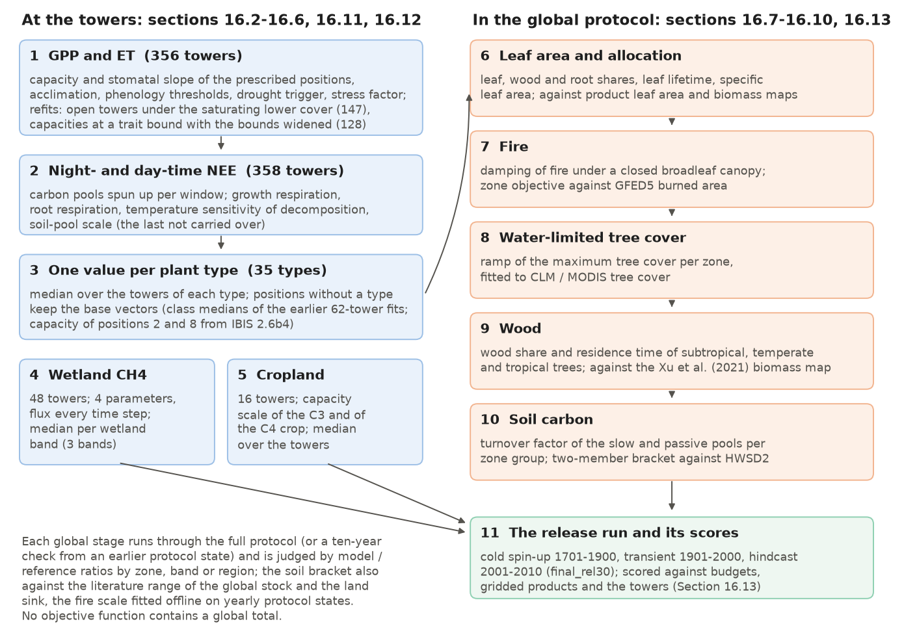
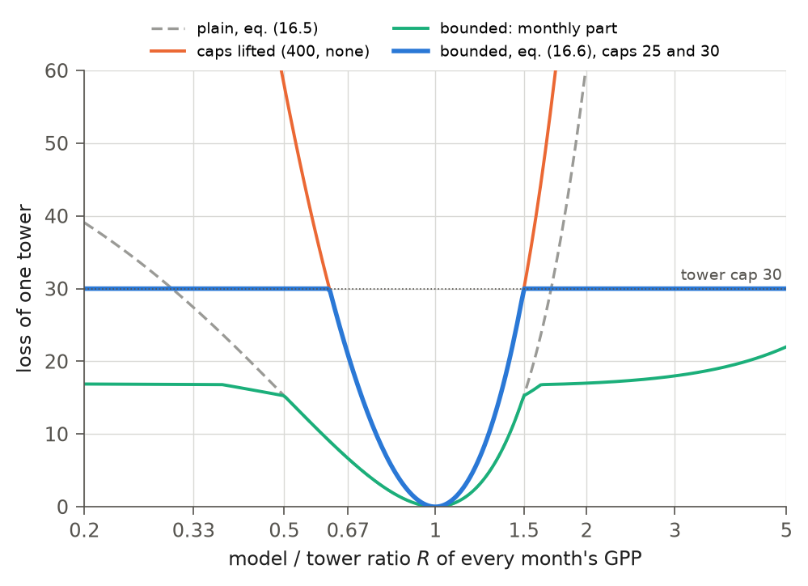
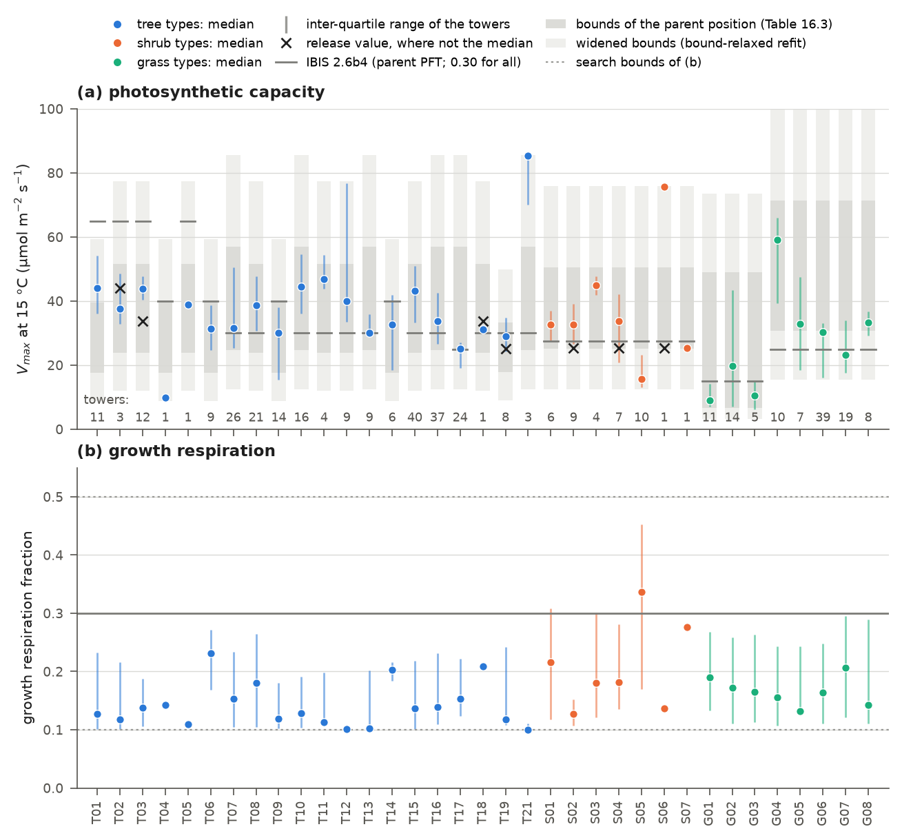
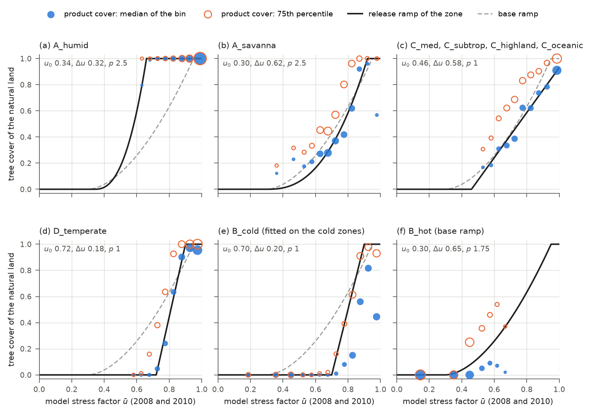

# 16. Calibration

This chapter explains how the release parameter values (Chapter 1, section 1.5.4) were chosen. Calibration
had two phases. First, each plant type's physiology, phenology and respiration were fitted at flux towers, one
tower at a time using its own weather. These fits were then reduced to one value per type. Wetland
methane and cropland parameters were fitted similarly at wetland and cropland towers. Second, parameters controlling
the model's own leaf area, tree cover, wood, fire and soil carbon were set against gridded products by zone or zone
group within the full protocol of section 1.5.3. Tower runs with prescribed vegetation cannot test these parameters.

The chapter describes tower simulations, targets and objective functions, the optimizer, reduction to plant
types, the global stages and release scores. Unless stated otherwise, all parameter values and scores
refer to the release. The model and several calibration tools have since changed, including the tower reader, NEE
targets and objective, capacity bounds, and methane-band reduction (section 16.15). The parameters therefore need
refitting. Section 16.14 presents the completed diagnostic comparisons and remaining work. The release calibration
used no gradients (section 1.7); an earlier gradient-based fit of fire parameters against GFED5
(`docs/FIRE.md`, step F6) was not carried into the release. The code is in `verify/calibration/`, and the per-tower fit
records are under `verify_outputs/site_fit/` on the lab file server. `docs/RELEASE_3.0.md` summarizes the release, and
the calibration log, `docs/CALIBRATION.md`, records every stage with its baselines, tests and decisions (section 16.15
lists the log sections behind each section of this chapter).

## 16.1 Strategy

Calibration proceeded from towers to the globe. Tower fits addressed carbon first, then water, then methane. Global
stages then set spatial patterns and carbon stocks while retaining the tower scores. None of these objective functions
contains a global total. Tower objectives score individual towers; global stages compare the model with a product by
zone, zone group, latitude band or region. The choice between the two soil-carbon bracket members also considered
the literature range of global soil carbon and the land sink (section 16.10). Table 16.1 lists the parameters and
their calibration data, and Figure 16.1 shows the sequence of stages.

**Table 16.1** The calibration stages, the parameters they set and the data they were set against.

| Stage | Parameters | Data | Method | Section |
|---|---|---|---|---|
| GPP and ET at flux towers | capacity $`V_{max}`$ and stomatal slope of the prescribed positions, acclimation of the evergreen conifers, phenology thresholds, drought trigger, soil-water stress factor | monthly GPP and ET of 356 flux towers | per-tower CMA-ES, last year held out | 16.2-16.6 |
| NEE at flux towers | growth and fine-root respiration, temperature sensitivity of decomposition (and a soil-pool scale not carried over) | monthly day-time and night-time NEE of 358 towers | per-tower CMA-ES on spun-up pools | 16.3-16.6 |
| plant types | one value per type and parameter | the per-tower fits | median over the type's towers | 16.6 |
| leaf area and allocation | leaf, wood and root allocation, leaf lifetime, specific leaf area, wood residence time | product leaf area by zone, biomass maps | trait-based values adjusted per type in protocol runs | 16.7 |
| water-limited tree cover | the ramp of the maximum tree cover per zone | CLM / MODIS tree cover on natural land | least squares on the median cover by stress bin (75th percentile for B_cold) | 16.8 |
| fire | closed-canopy damping and the scale $`k_{b}`$ of the burned fraction | GFED5 burned area 2003-2005 | zone objective, offline on yearly states | 16.9 |
| soil carbon | turnover factor of the slow and passive pools per zone group | HWSD2 organic carbon 0-1 m | two-member bracket through the protocol | 16.10 |
| wetland methane | production ratio, $`Q_{10}`$, decomposition and oxic-zone depth scales per wetland band | monthly CH4 flux of 48 wetland towers | per-tower CMA-ES, band medians | 16.11 |
| wetland area | the learned model of the anomaly of the inundated fraction, one per wetland band | WAD2M v2.0 monthly inundated fraction 2001-2010 | gradient-boosted trees on the predictors of a reference hindcast; judged on years held out of the training | 14.7.2 |
| cropland | capacity scales of the C3 and the C4 crop | monthly GPP of 16 cropland towers | per-tower CMA-ES, medians | 16.12 |



**Figure 16.1** The calibration chain of the release. Left: the stages at the towers, with the number of towers whose
fit records carry fitted parameters. Right: the stages inside the global protocol, roughly in the order they were made
(the leaf-area stage went on beside the fire stage, and stages 8 and 9 were adopted together), and the release run. The
learned wetland area (section 14.7.2) is not shown. The figure script counts the towers from the fit records (a record
without fitted parameters is not counted) and the release parameter file.

## 16.2 Simulations at a tower

A flux tower measures exchanges over a small area of land. The model therefore represents each tower as a single
column, driven by its weather and with vegetation prescribed to match its footprint. The column uses the containing
0.5° grid cell of the global model (`verify/calibration/site_fit.py`). Its initial state comes from a reference
global state for 2010 (the restart of `v11_transient`), with vegetation replaced by the following prescription:

1. *Composition.* The tower's IGBP class, latitude and mean annual temperature determine its PFT positions and upper-
   and lower-canopy cover (Table 16.2). Carbon in all other positions is removed. This composition is
   reimposed at the end of each year because the annual existence test in
   Chapter 11 recomputes it from the climate.
2. *Leaf area.* Leaf carbon in the prescribed positions is held at a prescribed leaf area index, divided equally
   among those positions. The tower's measured maximum leaf area is used where site attributes provide it. Otherwise,
   and at every savanna, shrubland, grassland, wetland and cropland tower (`--lai-mode attrs-modis`), it is the largest
   monthly mean leaf area of the tower's 0.5° cell in the MODIS leaf area of the CLM plant functional types, weighted by
   the cell's natural-vegetation PFT shares and multiplied by its natural-vegetation share (`fit_carbon.modis_at`). The
   open-vegetation refit of section 16.6 used the peak leaf area of the tower's 0.05° GLASS pixel instead (`--lai`).
   Phenology still determines the displayed leaf area (Chapter 10).
3. *Vegetation dynamics off.* The annual update is the fixed-vegetation update of section 11.12.1 (`isimveg` = 0).
   After this update, wood and root pools in the prescribed positions are set to their steady-state values for annual net
   primary production, $`a_{wood}\,\tau_{wood}\,N`$ and $`a_{root}\,\tau_{root}\,N`$, and the three litterfall fluxes to the
   allocated production $`a_{leaf}N`$, $`a_{root}N`$ and $`a_{wood}N`$ (`site_run.enforce_prescription`). Litterfall
   therefore equals annual production, as at steady state. Here $`N`$ (kgC m⁻² yr⁻¹) is annual net primary production of
   the position (its positive part), $`a_{leaf}`$, $`a_{root}`$ and $`a_{wood}`$ are the allocation fractions, and
   $`\tau_{wood}`$ and $`\tau_{root}`$ (yr) are the residence times of wood and fine roots (`tauwood0`, `tauroot`;
   Chapter 11).

Each tower is driven by its own daily meteorology in FLUXNET format (`tower_forcing.py`): air temperature and its
daily range from the half-hourly record, precipitation, shortwave and longwave radiation, humidity derived from vapour
pressure deficit, pressure and wind. Missing days or variables are filled from GSWP3 at the tower's
cell; years after 2010, beyond the GSWP3 record, use GSWP3 values from 2010 for those gaps. In every campaign fit
except the three Mead maize towers (section 16.12), measured hourly shortwave radiation replaces
generated radiation (`--hourly-sw`, section 3.12), and CO2 concentration follows the annual series in section 3.10
(`--co2 series`).

Tower records use local standard time, while the model uses local apparent solar time. Each hourly step
covers one solar hour with the sun evaluated at its middle (Chapter 3). The reader therefore shifts the half-hourly
record to solar time: step $`k`$ uses mean shortwave radiation over the solar hour from $`k`$ to $`k + 1`$, and
the daily temperature range is calculated over the solar day. The tower clock offset comes from site metadata (the
UTC offset in FLUXNET and ICOS site files), checked against the record's potential radiation.
Where these disagree, the reader chooses the offset closer to the timing of measured shortwave radiation. Other daily inputs,
including mean temperature, precipitation, humidity, wind and pressure, remain on the tower's local-standard-time
days; they are not all regrouped into solar days (section 3.12). Of the 410 campaign
towers with metadata, 398 agree with their record; at the 12 others the two differ by exactly one hour
(`tower_forcing.tower_clock`). The fits of the release were made before this reader: they took the shortwave at each
full hour of the tower's clock (the mean of the two half-hours around it), with the sun and the weather of the model at
the start of each step.

The tower window (three to five years in the campaign, section 16.6) is first run from the reference state as a
spin-up. Each parameter evaluation then reruns the window from that state. The first year
serves as a warm-up and is not scored; the last is held out of the fit and scored separately.

**Table 16.2** The prescribed composition of a tower (`site_run.prescribe`). Positions as in Table 1.1; "boreal" is
latitude ≥ 55° or a mean annual temperature below 3 °C, "tropical" is |latitude| < 23°.

| IGBP class | Positions | Upper cover | Lower cover |
|---|---|---|---|
| evergreen needleleaf forest (ENF) | 6 if boreal, else 4 | 0.9 | 0.1 |
| deciduous broadleaf forest (DBF) | 7 if boreal, else 5 | 0.9 | 0.1 |
| deciduous needleleaf forest (DNF) | 8 | 0.9 | 0.1 |
| evergreen broadleaf forest (EBF) | 1 if tropical, else 3 | 0.95 | 0.05 |
| mixed forest (MF) | 6 and 7 if boreal, else 4 and 5 | 0.9 | 0.1 |
| grassland (GRA) | 11 if the mean annual temperature exceeds 15 °C and \|latitude\| < 35°, else 12 | 0 | 1.0 |
| savanna (SAV), woody savanna (WSA) | 2 and 11 if tropical, else 5 and 11 | 0.3 (SAV), 0.55 (WSA) | 0.8 |
| open shrubland (OSH) | 9 and 12 if the mean annual temperature is below 10 °C, else 10 and 11 | 0 | 0.6 |
| closed shrubland (CSH) | 9 and 12 | 0 | 0.9 |
| cropland (CRO) | 12 (maize towers 11) | 0 | 1.0 |
| wetland (WET) | 10 and 12 if boreal; 11 if tropical with a mean annual temperature above 18 °C; else 12 | 0 | 0.9 if boreal, else 1.0 |

A tower's types are fitted at the positions in Table 16.2, generally those of their parent PFTs
(Table 2.3). Each type retains the big leaf and leaf habit of the position assigned by its zone (section 2.3.3).
Tower runs therefore do not need the type machinery; types enter only when per-tower values are reduced (section 16.6).

## 16.3 Targets

Targets are monthly tower measurements, each assigned an uncertainty that controls its weight in the fit.
GPP and ET targets are read from the tower's monthly FLUXNET file. GPP is scored in months with at least
half the NEE data measured or filled with good-quality estimates (`NEE_VUT_REF_QC` ≥ 0.5). ET uses the same criterion
for latent heat (`LE_F_MDS_QC` ≥ 0.5). The GPP target and uncertainty are

```math
G = \max\left(\tfrac{1}{2}\left(G_{NT} + G_{DT}\right),\, 0\right), \qquad
\sigma_{G} = \max\left(\tfrac{1}{2}\left|G_{NT} - G_{DT}\right|,\; 0.1\,|G|,\; 5\right),
\qquad\text{(16.1)}
```

where $`G`$ (gC m⁻² month⁻¹) is the target (the 10 % term uses the mean before it is floored at zero); $`G_{NT}`$ and
$`G_{DT}`$ (gC m⁻² month⁻¹) are the monthly GPP of the night-time and the day-time flux partitioning (`GPP_NT_VUT_REF`,
`GPP_DT_VUT_REF`, filled from their constant-u* twins where a record lacks them); and $`\sigma_{G}`$ (gC m⁻² month⁻¹) is
the uncertainty. Where one partition is missing, the other is the target and the spread term drops out. The ET target is
the latent heat flux corrected for the closure of the tower's energy balance,

```math
E = \frac{86400\, n_{d}\, Q_{c}}{\lambda}, \qquad
\sigma_{E} = \max\left(\tfrac{1}{2}\left|E - E_{MDS}\right|,\; 0.1\,|E|,\; 3\right),
\qquad\text{(16.2)}
```

where $`E`$ (mm month⁻¹) is the target; $`Q_{c}`$ (W m⁻²) is the monthly mean of the energy-balance-corrected latent heat
flux (`LE_CORR`); $`E_{MDS}`$ (mm month⁻¹) is the gap-filled latent heat flux (`LE_F_MDS`) converted in the same way;
$`\lambda = 2.45 \times 10^{6}`$ J kg⁻¹ is the latent heat of vaporisation; $`n_{d}`$ is the number of days in the month;
and $`\sigma_{E}`$ (mm month⁻¹) is the uncertainty. In the campaign the ET term is used only at towers that report
`LE_CORR` (`--et-corr-only`); elsewhere the ET weight is zero.

At night, measured NEE represents ecosystem respiration. Night-time NEE therefore isolates respiration,
while day-time NEE represents uptake net of respiration. Both targets are built from half-hourly records
(`tower_nee_daynight.py`). A half-hour (or an hour in hourly records) is classified as night when the sun is below the
horizon at its middle, using local apparent solar time on the tower's clock (section 16.2) and the tower grid cell's
latitude. The model uses the same night criterion. Half-hours with `NEE_VUT_REF_QC` ≤ 1, measured or filled with
good-quality estimates, are retained. For each month and each part,

```math
\bar{N}_{p} = \frac{1}{n_{p}} \sum_{h \in K_{p}} F_{h}, \qquad
\sigma_{N,p} = \max\left(0.15\,|\bar{N}_{p}|,\; \frac{5}{M_{C}\,\tau_{p}}\right), \qquad p \in \{\text{night}, \text{day}\},
\qquad\text{(16.3)}
```

where $`\bar{N}_{p}`$ (µmol m⁻² s⁻¹, positive for a release) is the target of part $`p`$, the mean NEE over the set $`K_{p}`$
of the part's kept half-hours in the month; $`n_{p}`$ is their number; $`F_{h}`$ (µmol m⁻² s⁻¹) is the NEE of half-hour
$`h`$; $`\tau_{p}`$ (s) is the length of the part in the month, kept or not: its share of the month's records times the
length of the calendar month; $`M_{C} = 12.011 \times 10^{-6}`$ gC µmol⁻¹; and $`\sigma_{N,p}`$ (µmol m⁻² s⁻¹) is the
uncertainty, whose floor is 5 gC m⁻² spread over the part's length in the month. The model's counterpart is the mean NEE
over the month's steps with the sun below the horizon at the middle of the step, and over the others. The NEE of a step
is the heterotrophic respiration, spread evenly over the day, minus the step's net primary production. Unlike a sum,
a mean does not shrink simply because fewer half-hours are available. This makes a comparison with the model's whole
month possible, although gaps can still bias the mean if the missing conditions differ from the observed ones. The fits of the
release used sums over the kept half-hours instead, split by FLUXNET's night flag (section 16.14, item 3).

The wetland methane target $`M`$ (gC m⁻² month⁻¹) is the monthly sum of the gap-filled CH4 flux of the
Fluxnet-Methane_V2.0 records, with $`\sigma_{M} = \max(\sigma_{gf}, 0.15|M|, 0.05)`$, where $`\sigma_{gf}`$ is the
gap-filling uncertainty summed in quadrature over the month.

## 16.4 Objective functions

An objective function combines monthly departures from the targets so that the optimizer can rank
parameter sets. The normalised residual for month $`m`$ of a scored year is

```math
r_{m} = \frac{X^{mod}_{m} - X^{obs}_{m}}{\sigma_{m}},
\qquad\text{(16.4)}
```

where $`X^{mod}_{m}`$ and $`X^{obs}_{m}`$ are the model and the target of a series and $`\sigma_{m}`$ is its uncertainty, the
plain objective of one tower is

```math
L_{0} = \left\langle r_{G}^{2} \right\rangle + w_{E} \left\langle r_{E}^{2} \right\rangle,
\qquad\text{(16.5)}
```

where $`\langle \cdot \rangle`$ denotes the mean over scored months in the fitted years and $`w_{E} = 0.5`$ is the ET
weight. The campaign objective is bounded to prevent any month or tower from dominating:

```math
L = \min\left\{ \left\langle \min(r_{G}^{2}, c_{m}) \right\rangle + w_{E} \left\langle \min(r_{E}^{2}, c_{m}) \right\rangle
+ w_{a} \sum_{s} \min\left[ \left( \frac{1}{\delta} \ln \frac{\sum_{m \in s} G^{mod}_{m}}{\sum_{m \in s} G_{m}} \right)^{2},
c_{m} \right],\; c_{t} \right\},
\qquad\text{(16.6)}
```

where the sum over $`s`$ covers two sets: all scored months and scored summer months (June to August
north of the equator, December to February south of it). A set contributes only if it contains at least three months
and has a positive target sum. Here $`c_{m} = 25`$ caps each monthly and magnitude term; $`c_{t} = 30`$ caps the
tower total; $`w_{a} = 1`$ weights the magnitude terms; and $`\delta = 0.15`$ is the tolerance of the logarithmic
ratio (`site_fit --robust 25,30,1,0.15`). The model sum in the ratio is floored at 10⁻³ gC m⁻². A starting
loss at the cap would leave the optimizer with a flat objective, so the campaign lifted the caps in those cases to $`c_{m} = 400`$ and
$`c_{t} = 10^{9}`$ before the fit (`--robust-auto`). This happened at 126 of the 356 towers of the GPP and ET stage and at
58 of the 275 refits of section 16.6 (counted in the fits' run logs by `figures/make_ch16.py numbers`). Figure 16.2
shows (16.5) and (16.6) for a tower whose model GPP is a fixed multiple of the target in every month.



**Figure 16.2** The loss of one tower, computed by the harness's own objective function (`site_fit.misfit`) for a
synthetic tower with a temperate seasonal cycle of GPP (three fitted years, the uncertainty at its floor of 10 % or
5 gC m⁻² month⁻¹), against the ratio $`R`$ of the model's to the tower's GPP in every month: the plain objective (16.5),
the bounded objective (16.6) and its capped monthly part, and the objective with the caps lifted. ET is not scored here.

The NEE objective uses the same form for night-time and day-time means:

```math
L_{N} = \min\left\{ \left\langle \min(r_{n}^{2}, c_{m}) \right\rangle + w_{d} \left\langle \min(r_{d}^{2}, c_{m})
\right\rangle + w_{a} \sum_{p \in \{n, d\}} \mu_{p},\; c_{t} \right\}, \qquad
\mu_{p} = \begin{cases} \min\left[\left(\frac{1}{\delta} \ln \left|\frac{\sum_{m} \bar{N}^{mod}_{p,m}\,\tau_{p,m}}{\sum_{m} \bar{N}_{p,m}\,\tau_{p,m}}\right|\right)^{2}, c_{m}\right]
& \text{same sign,} \\ c_{m} & \text{opposite sign,} \end{cases}
\qquad\text{(16.7)}
```

where $`r_{n}`$ and $`r_{d}`$ are the residuals (16.4) of the night-time and the day-time means; $`w_{d} = 0.5`$ is the weight
of the day-time part; and the sums in $`\mu_{p}`$ run over the scored months of the fitted years (at least three), each
month's mean weighted by the duration $`\tau_{p,m}`$ of that part, making the sums its totals over those years.
A month is not scored for a part with no model steps (polar day or polar night). The campaign used
$`c_{m} = 25`$ and no tower cap ($`c_{t} = 10^{9}`$). A month whose half-hours were all kept weighs in (16.7) as it did in
the release's objective on sums. The methane objective has the same form with the one series $`M`$ of monthly totals
(each month weighted equally in its magnitude term), $`c_{m} = 400`$ and no tower cap; the cropland objective is (16.6)
with the same lifted caps.

## 16.5 Optimizer and parameter coding

The optimizer searches for parameter values that bring simulated fluxes closer to tower measurements.
Parameters are bounded and rescaled so that quantities with different units can be fitted together.

Each fit minimises its objective using the covariance matrix adaptation evolution strategy, CMA-ES (Hansen and
Ostermeier, 2001), implemented in the `cma` package. CMA-ES requires no gradients: it samples parameter sets
around a mean, then adapts the mean and spread using the best samples. The search operates within a unit box,

```math
\theta_{i} = g_{i}^{-1}\!\left( \ell_{i} + z_{i} \left( u_{i} - \ell_{i} \right) \right), \qquad z_{i} \in [0, 1],
\qquad\text{(16.8)}
```

where $`\theta_{i}`$ is parameter $`i`$ in its own units, $`z_{i}`$ its coordinate in the search, $`\ell_{i} = g_{i}(\theta_{i}^{lo})`$
and $`u_{i} = g_{i}(\theta_{i}^{hi})`$ the coded bounds, and $`g_{i}`$ is the natural logarithm for parameters coded
logarithmically and the identity otherwise (Table 16.3). The search starts from each parameter's base value, clipped
to the nearer bound if necessary, and retains the best evaluation. For a per-position parameter, the base value is
that position's value. For a parameter fitted as a scalar but specified per position in the base file, as the three
respiration parameters are, it is the mean over the tower's positions. The soil-pool scale starts at 1.
When an earlier fit for the same tower is supplied (`--start`), its values first replace the base
values. The two refits in section 16.6 therefore start from the tower's GPP and ET fit, called stage S2; the NEE stage
also uses those values.

The capacity bounds for $`V_{max}`$ are the mean ± one standard deviation of leaf capacity at 25 °C for the
position's plant functional type, using the TRY-based values of Kattge et al. (2009) tabulated by Chen et al. (2022,
their Table 2): for example, 57.7 ± 21.2 µmol m⁻² s⁻¹ for temperate deciduous trees. That source gives no C4 grass value,
so its range of 10-75 µmol m⁻² s⁻¹ was set by hand. The bounds are converted to the model's reference
temperature of 15 °C (Chapter 9) using its temperature function for the position's photosynthetic pathway,

```math
V^{15} = V^{25}\, \frac{f_{V}(15\,^{\circ}\text{C})}{f_{V}(25\,^{\circ}\text{C})}, \qquad
\frac{f_{V}(25\,^{\circ}\text{C})}{f_{V}(15\,^{\circ}\text{C})} = 1.5298 \;(\text{C3}), \quad 1.7019 \;(\text{C4}),
\qquad\text{(16.9)}
```

where $`V^{25}`$ and $`V^{15}`$ (µmol m⁻² s⁻¹) are a bound at 25 °C and at 15 °C, and $`f_{V}`$ is the temperature factor
$`f_{3}`$ of the C3 capacity or $`f_{4}`$ of the C4 capacity, equation (9.2), evaluated with the base parameters of the fit
(each fit's log prints the ratio used). The C4 range of 10-75 µmol m⁻² s⁻¹ at 25 °C therefore becomes 5.9-44.1 at 15 °C.
The release fits converted every bound with the C3 factor, including C4 grass, giving a C4 range of 6.5-49.0 at
15 °C. Table 16.3 lists the campaign's fitted parameters and bounds, and Table 16.4 lists each stage's settings.

**Table 16.3** Parameters fitted at the towers, their bounds and coding (log: $`g = \ln`$). The capacity bounds are given
at 25 °C (the TRY ranges of section 16.5; for the C4 grass the range set by hand) and at 15 °C by (16.9). Fitted set
of a tower (`towers31_cmds.fit_set`): $`V_{max}`$ and slope of every prescribed position; the acclimation onset and range
of positions 4 and 6; the upper-canopy phenology where position 5, 7 or 8 is prescribed; the lower-canopy thresholds
where a lower position is; the drought trigger where position 2, 9, 10 or 11 is; the stress factor always.

| Parameter | Code name | Bounds | Coding | Chapter |
|---|---|---|---|---|
| capacity, positions 1 and 3 | `vmax:<pft>` | 27.0-60.6 at 25 °C; 17.6-39.6 at 15 °C (µmol m⁻² s⁻¹) | log | 9 |
| capacity, positions 2, 5 and 7 | `vmax:<pft>` | 36.5-78.9; 23.9-51.6 | log | 9 |
| capacity, positions 4 and 6 | `vmax:<pft>` | 37.8-87.2; 24.7-57.0 | log | 9 |
| capacity, position 8 | `vmax:<pft>` | 27.4-50.8; 17.9-33.2 | log | 9 |
| capacity, positions 9 and 10 | `vmax:<pft>` | 38.3-77.4; 25.0-50.6 | log | 9 |
| capacity, position 11 (C4) | `vmax:<pft>` | 10-75; 5.9-44.1 (6.5-49.0 in the release's fits) | log | 9 |
| capacity, position 12 (C3) | `vmax:<pft>` | 47.1-109.3; 30.8-71.4 | log | 9 |
| Ball-Berry slope per position | `coefm:<pft>` | 3-16 | log | 9 |
| acclimation onset, range per position | `acclim_s0:<pft>`, `acclim_smax:<pft>` | −10 to 5 °C; 5-30 °C | linear; log | 9 |
| upper-canopy onset threshold, ramp | `gdd_thresh_u`, `gdd_ramp_u` | 50-1000; 20-150 °C d | log | 10 |
| upper-canopy senescence sum | `sen_ycrit_u` | 30-1500 °C d | log | 10 |
| lower-canopy onset threshold | `gdd_thresh_l` | 50-300 °C d | log | 10 |
| lower-canopy temperature threshold | `tthresh_l_c` | −5 to 8 °C | linear | 10 |
| drought trigger of leaf drop | `drop_stress_thresh` | 0.05-0.85 | linear | 10 |
| soil-water stress factor | `stressfac` | −10 to −2.5 | linear | 9 |
| temperature sensitivity of decomposition $`E_{0}`$ | `bgc_e0` (`lt_e0`) | 150-600 K | linear | 12 |
| growth respiration fraction | `rgrowth` | 0.10-0.50 | linear | 11 |
| fine-root respiration coefficient | `rroot` | 0.3-5 yr⁻¹ | log | 11 |
| soil-pool scale (state, not carried over) | `som_scale` | 0.1-3 | log | – |
| molar CH4:CO2 ratio of anaerobic decomposition | `ch4_r` (`r_ch4`) | 0.03-0.8 | log | 14 |
| $`Q_{10}`$ of the ratio | `ch4_q10` (`q10p`) | 1.2-6 | log | 14 |
| e-folding depth of decomposition | `ch4_ztau` (`z_tau`) | 0.08-1.0 m | log | 14 |
| e-folding depth of the oxic zone | `ch4_tauox` (`tau_oxid`) | 0.02-0.6 m | log | 14 |
| capacity scale of the C3 / C4 crop | `crop_vmax_scale_c3`, `_c4` | 0.3-3 | log | 15 |

**Table 16.4** Settings of the tower stages: initial step size in the unit box, population, evaluations, the caps
of (16.6)-(16.7) and the base parameter file the fits started from.

| Stage | Towers | Step size | Population | Evaluations | $`c_{m}`$, $`c_{t}`$ | Base |
|---|---|---|---|---|---|---|
| GPP and ET (S2) | 356 | 0.15 | 6 | 80 | 25, 30 (lifted when the start is at the cap) | `params_s7_crop.yaml` |
| open-vegetation refit | 147 | 0.15 | 6 | 48 | 25, 30 (lifted when the start is at the cap) | `params_s7_crop_lpjcover.yaml`, warm start |
| bound-relaxed refit | 128 | 0.15 | 6 | 48 | 25, 30 (lifted when the start is at the cap) | `params_s7_crop.yaml`, warm start |
| NEE | 358 | 0.2 | 6 | 48 | 25, none | the tower's S2 fit |
| wetland methane (flux every step) | 48 | 0.2 | 6 | 48 | 400, none | `params_s3_classmedian.yaml` |
| cropland | 16 | 0.3 | 6 | 36 | 400, none | `params_s4_classmedian_ch4.yaml` |

## 16.6 The flux-tower campaign and the plant-type values

The campaign fits towers individually, then combines fitted values across towers with similar vegetation.
This section describes tower selection, the fitting stages and reduction to one parameter value per plant type.

**Towers.** All tower records on disk (FLUXNET2015 Tier 1, the ICOS Warm Winter 2020 and ICOS level-2 archives, and
the FLUXNET v1.3 release with AmeriFlux and NEON sites) were converted to a common file layout (`towers31_prep.py`;
Pastorello et al., 2020). A good year has at least 240 daily values and a mean `NEE_VUT_REF_QC` of at least 0.5.
For each tower, the record with the most good years is selected. Its calibration window contains three to five
consecutive years within 1996-2024, with a good held-out final year and at least one good fitted year. A tower is
calibration-grade if it has such a window and a half-hourly file. Each tower receives the plant types of its IGBP class in the zone of its
1 km Köppen class (`pft_koppen_design.py`; Chapter 2). Section 16.6.1 gives the counts.

**Stages.** The GPP and ET stage (S2) fitted every calibration-grade natural-vegetation tower using the parameter set in
Table 16.3; two towers without a GPP partition in their window were not fitted and entered the NEE stage from the base
set. The open-vegetation towers (grassland, shrubland and savanna) were refitted after the saturating lower-canopy
cover was adopted (Chapter 11), at the peak leaf area of the tower's GLASS pixel. The towers whose fitted capacity lay
at a TRY bound were refitted with the bounds widened to half the lower and 1.5 times the upper bound. For the NEE stage
the soil carbon pools for each window were spun up to cyclic steady state under the tower's forcing and S2 parameters,
using accelerated decomposition with the stand's litterfall closed (`site_pool_spinup.py`). Four parameters were then
fitted to night-time and day-time NEE: the temperature sensitivity of decomposition, the growth respiration fraction,
the fine-root respiration coefficient and a multiplier on the three soil-organic-matter pools of the start state
(`som_scale`). This multiplier represents soil disequilibrium at the tower; it has no global-model counterpart
and is not carried over. The release's growth-respiration rule also applied the growth fraction to negative net
carbon gain (assimilation less maintenance respiration), reducing the apparent deficit. The current rule applies
growth respiration only to positive gain, as in IBIS 2.6b4 (Chapter 11). Growth and fine-root respiration therefore
need refitting (section 16.14); the switch and its default are recorded in section 16.15.

**Reduction to types.** Fitted values are attributed to plant types (`towers31_types_yaml.py`). A position's capacity,
slope and acclimation go to the tower's own type with the corresponding canopy role: a tree with the same leaf form,
a shrub, or a grass with the same pathway. If none matches, they go to the type assigned to that position by the
tower's zone. Upper-canopy phenology goes to its tree types; lower-canopy thresholds go to shrub and grass types;
the drought trigger, stress factor and three respiration parameters go to every type at the tower. The value for type
$`t`$ is

```math
p_{t} = \operatorname{median}\left\{ \hat{p}_{s} : s \in S_{t}(p) \right\},
\qquad\text{(16.10)}
```

where $`\hat{p}_{s}`$ is the value fitted at tower $`s`$ and $`S_{t}(p)`$ the set of towers that attribute a value of $`p`$
to $`t`$. The fits used are the S2 fits, with the open-vegetation and bound-relaxed refits in place of the earlier fit of
the same tower (`site_fit/t31_s2_merged_relax`; two bound-relaxed refits that stopped early retain their previous
values), together with the NEE fits. Rebuilding the reduction from these records yields values for all 35 tree, shrub
and grass types; 298 of the 305 resulting type values match the release. The seven exceptions are capacities assigned from
base values or related types; section 16.15 records their history. Figure 16.3 shows the capacity and growth respiration
of each type against the spread of its towers. The tower-fitted parameters of positions that hold no type (section
2.3.3) keep the 12-entry base vectors of the parameter file. These are the class medians of an earlier set of per-tower
fits at 62 FLUXNET2015 towers (`params_s3_classmedian.yaml`), except the capacity and the slope of positions 2 and 8,
which no tower of that set fitted (the IBIS 2.6b4 capacity and the slope of the position's group; Table 9.4).



**Figure 16.3** Per-type values from the tower campaign of the release: (a) the photosynthetic capacity $`V_{max}`$ at
15 °C and (b) the growth respiration fraction. Dots: the median (16.10) over the type's towers, rebuilt from the fit
records by `towers31_types_yaml.py`; bars: the inter-quartile range of the towers; numbers: the towers behind the
capacity (section 16.6.1 gives the largest number over all parameters of a type); ×: the release value where it is not
the median; grey lines: the IBIS 2.6b4 value of the type's parent PFT (capacity, `fortran/params.can`) and the IBIS
2.6b4 growth respiration fraction (0.30 for all PFTs, `stats.f`); shaded columns in (a): the capacity bounds of the
parent position at 15 °C as the campaign used them (dark: Table 16.3, with the C4 grass's bounds converted by the C3
factor; light: the widened bounds of the bound-relaxed refit); dotted lines in (b): the bounds of the search, 0.10 and
0.50.

### 16.6.1 Numbers

The site table of the campaign (`inputs/sites/towers31/compact/FLUXNET_siteinfo.csv`) lists 605 towers. 478 are
calibration-grade, and 358 of these are in natural vegetation: 92 evergreen needleleaf forests, 86 grasslands, 51
deciduous broadleaf forests, 36 evergreen broadleaf forests, 34 open shrublands, 23 mixed forests, 15 savannas, 8 woody
savannas, 8 deciduous needleleaf forests and 5 closed shrublands. Their records come from FLUXNET v1.3 (291),
FLUXNET2015 (64) and the ICOS archives (3); 288 windows have five years, 37 four and 33 three, within 1996-2024. Of the
358 towers, 356 carry an S2 fit, 147 an open-vegetation refit, 128 a bound-relaxed refit and 358 an NEE fit. The
reduction attributes 3,298 fitted values to the 35 types. The towers behind each type (the largest number over its
parameters) are: T01 11, T02 4, T03 12, T04 1, T05 1, T06 9, T07 26, T08 21, T09 14, T10 16, T11 4, T12 9, T13 9,
T14 6, T15 40, T16 37, T17 24, T18 1, T19 8, T21 7; S01 7, S02 9, S03 4, S04 7, S05 10, S06 1, S07 1; G01 11,
G02 14, G03 11, G04 11, G05 7, G06 39, G07 19, G08 8. Five types rest on one tower and 30 on three or more. A type
fitted at one tower has no spread between towers, and its held-out year is its only check. `figures/make_ch16.py
numbers` prints these numbers from the site table, the fit records and the reduction's table.

### 16.6.2 Scores at the towers

To assess shared type values, towers were re-scored with shared parameter sets in place of their
individual fits. Each tower runs once over its window, using its types' values at their parent positions and the soil
pools from its NEE stage (`towers31_rescore.py`, `tower_type_yaml.py`; scored by `compare_sets.py`). These runs set cell
scalars (phenology thresholds, drought trigger and stress factor) to the mean over the tower's types
that specify them. The global model instead uses the median over zone types, (2.2). Table 16.5 gives
medians across towers for individual fits and two shared sets. The first set was used in the first global type
run (20 October 2026; S2 fits before the bound-relaxed refit, on `params_31_base.yaml`). This is the column reported in
the release documents. It differs from the release in 113 tower-derived type values (16
capacities, 21 stomatal slopes, 22 stress factors and 54 phenology and acclimation values, counted in `params_31a.yaml`
by `figures/make_ch16.py numbers`). The second is the 26 October set (`params_31k.yaml`), the latest one re-scored.
The release set differs from it in the cold-shrub allocation, in the fire, cover-limit, wood and soil stages of sections
16.7-16.10 and in the methane bands. In a tower run with prescribed leaf area, wood and root allocation and the soil
factor affect respiration. The release set itself has not been re-scored at the towers (section 16.14).

**Table 16.5** Medians over the campaign towers of the model / tower ratio of the amount over the tower window, of the
correlation of the monthly series and of the mean NEE error (model − tower, positive for too little uptake); in
brackets the share of towers with a ratio between 0.75 and 1.25. Months with a tower value, at least 12 per tower.
The tower's GPP is its night-time partition (`GPP_NT_VUT_REF`), not the mean of the two partitions of (16.1);
ecosystem respiration is GPP + NEE, against the tower's night-time partition (`RECO_NT_VUT_REF`); ET of the tower is
`LE_F_MDS`. "Own fits" are the S2 fit (GPP, ET) and the NEE fit (respiration, NEE) of each tower. Scores of the release
code; to be updated after the refits of the revised model. `figures/make_ch16.py numbers` prints the medians from the
per-tower file `diag_work/nee_cycle/cmp_final_towers.csv` of `compare_sets.py`
(`verify/calibration/diagnostics/audit_2026-10-26/`).

| Quantity | Towers | Own fits | Shared set, 20 October | Shared set, 26 October |
|---|---|---|---|---|
| GPP, amount | 331 | 0.97 (80 %) | 0.98 (50 %) | 1.01 (53 %) |
| ET, amount | 356 | 1.06 (63 %) | 1.02 (61 %) | 1.03 (62 %) |
| ecosystem respiration, amount | 331 | 1.01 (78 %) | 1.11 (44 %) | 1.13 (43 %) |
| GPP, monthly correlation | 331 | 0.88 | 0.87 | 0.87 |
| ET, monthly correlation | 356 | 0.89 | 0.89 | 0.89 |
| NEE, monthly correlation | 356 | 0.60 | 0.55 | 0.52 |
| NEE, mean error (gC m⁻² yr⁻¹) | 356 | +25 | +124 | +131 |

Median tower NEE over the calibration windows is −156 gC m⁻² yr⁻¹ (a sink). A shared parameter set on equilibrated
pools releases more carbon than the towers do. Individual fits match the tower sink through the soil-pool scale
`som_scale`, which is not carried over.

## 16.7 Leaf area, allocation and wood

Tower fits hold leaf area fixed, so the model's own leaf area, cover and wood were set through the global protocol.
At equilibrium, a position's leaf pool (Chapter 11) contains $`a_{leaf}\,\tau_{leaf}\,N`$ carbon. Leaf area per unit net
primary production is therefore

```math
k = a_{leaf}\, \tau_{leaf}\, \sigma_{leaf},
\qquad\text{(16.11)}
```

where $`k`$ (m² yr kgC⁻¹) is the leaf coefficient, $`a_{leaf}`$ the share of net primary production allocated to leaves,
$`\tau_{leaf}`$ (yr) the leaf lifetime, $`\sigma_{leaf}`$ (m² kgC⁻¹) the specific leaf area and $`N`$ (kgC m⁻² yr⁻¹) the net
primary production of the position. Adjusting $`k`$ brought leaf area toward the products' peak values without
imposing a leaf-area cap. Base specific leaf area was set to 0.65 of the TRY species mean (a canopy-mean leaf mass).
Leaf lifetime was set to the TRY lifespan for evergreens, one year for deciduous trees and half a year for grasses;
allocation fractions and wood residence times came from literature syntheses by biome. The types' leaf allocation
and lifetime were then adjusted by zone against GLASS and GIMMS LAI4g leaf area and the biomass maps. These were the
stage's starting values; Tables 16.6 and 16.7 give the release values.

The wood stage set wood allocation in subtropical and temperate trees (T06-T16, T21) to 0.35, retaining leaf allocation
and assigning the difference to roots. It shortened wood residence times to 45 yr for temperate conifer and broadleaf
positions and 40 yr for warm-temperate evergreens. It also reduced wood allocation in tropical evergreen and seasonal
trees (T01 0.40, T02 0.42), with residence times of 50 and 40 yr. Allocation fractions sum to one for every position and
type. Table 16.6 compares the release base values with IBIS 2.6b4.

**Table 16.6** Base parameters of the twelve positions in the release (`pft` and `stomata.vmax` sections) and in IBIS
2.6b4 (`fortran/params.can`): capacity at 15 °C, specific leaf area, leaf lifetime, wood residence time and allocation to
leaves, roots and wood. The plant types override these for the positions they occupy (Table 16.7).

| Position | $`V_{max}`$ (µmol m⁻² s⁻¹) | $`\sigma_{leaf}`$ (m² kgC⁻¹) | $`\tau_{leaf}`$ (yr) | $`\tau_{wood}`$ (yr) | $`a_{leaf}`$ / $`a_{root}`$ / $`a_{wood}`$ |
|---|---|---|---|---|---|
| 1 tropical broadleaf evergreen | 39.5 (65.0) | 12.8 (25.0) | 1.4 (1.01) | 50 (25) | 0.35 / 0.27 / 0.38 (0.30 / 0.20 / 0.50) |
| 2 tropical broadleaf drought-deciduous | 65.0 (65.0) | 20.9 (25.0) | 1.0 (1.00) | 40 (25) | 0.30 / 0.25 / 0.45 (0.30 / 0.20 / 0.50) |
| 3 warm-temperate broadleaf evergreen | 28.9 (40.0) | 12.8 (25.0) | 1.4 (1.00) | 40 (25) | 0.32 / 0.33 / 0.35 (0.30 / 0.20 / 0.50) |
| 4 temperate conifer evergreen | 29.3 (30.0) | 6.8 (12.5) | 3.3 (2.00) | 45 (50) | 0.22 / 0.33 / 0.45 (0.30 / 0.40 / 0.30) |
| 5 temperate broadleaf cold-deciduous | 33.8 (30.0) | 20.9 (25.0) | 1.0 (1.00) | 45 (50) | 0.28 / 0.27 / 0.45 (0.30 / 0.20 / 0.50) |
| 6 boreal conifer evergreen | 25.5 (25.0) | 6.8 (12.5) | 3.3 (2.50) | 100 (100) | 0.28 / 0.35 / 0.37 (0.30 / 0.40 / 0.30) |
| 7 boreal broadleaf cold-deciduous | 35.0 (30.0) | 20.9 (25.0) | 1.0 (1.00) | 80 (100) | 0.30 / 0.20 / 0.50 (0.30 / 0.20 / 0.50) |
| 8 boreal conifer cold-deciduous | 30.0 (30.0) | 13.7 (25.0) | 1.0 (1.00) | 80 (100) | 0.30 / 0.25 / 0.45 (0.30 / 0.20 / 0.50) |
| 9 evergreen shrubs | 25.3 (27.5) | 12.2 (12.5) | 1.3 (1.50) | 10 (5) | 0.40 / 0.35 / 0.25 (0.45 / 0.40 / 0.15) |
| 10 deciduous shrubs | 27.1 (27.5) | 20.8 (25.0) | 1.0 (1.00) | 10 (5) | 0.30 / 0.55 / 0.15 (0.45 / 0.35 / 0.20) |
| 11 warm (C4) grasses | 8.6 (15.0) | 26.1 (20.0) | 1.0 (1.25) | 999 (999) | 0.30 / 0.70 / 0 (0.45 / 0.55 / 0) |
| 12 cool (C3) grasses | 31.1 (25.0) | 27.2 (20.0) | 1.0 (1.50) | 999 (999) | 0.30 / 0.70 / 0 (0.45 / 0.55 / 0) |

The release value is given first and the IBIS 2.6b4 value in brackets. The capacities are the class medians of the
62-tower fits; positions 2 and 8 keep the IBIS 2.6b4 capacity. The allocation and turnover values are those of the
leaf-area and wood stages.

**Table 16.7** Allocation and turnover parameters set by the types in the release: number of types that set each,
and the range of their values.

| Parameter | Types that set it | Range over those types |
|---|---|---|
| $`a_{leaf}`$ | 25 | 0.154 (T07, T13) to 0.32 (S04) |
| $`a_{root}`$ | 23 | 0.325 (T02) to 0.75 (G01-G05) |
| $`a_{wood}`$ | 18 | 0.23 (S04) to 0.525 (T03); 0.35 for T06-T16 and T21 |
| $`\tau_{leaf}`$ (yr) | 24 | 0.6 (G06) to 3.3 (T07, T10, T13, T16, T17) |

No type specifies its own specific leaf area or wood or root residence time. A type specifying one or two allocation
fractions inherits the others from its position's base values; the three sum to one for every type.

## 16.8 The water-limited maximum tree cover

Water scarcity limits tree cover. The model caps upper-canopy cover using a ramp in the
smoothed upper-canopy soil-water stress factor, equations (11.15)-(11.17), with onset $`u_{0}`$, width
$`\Delta u`$ and the power $`p`$ (`pft.tree_cover_min`, `tree_cover_ramp`, `tree_cover_power`). The three parameters were
fitted by zone group (`verify/calibration/diagnostics/gate_2026-10-27/ramp_fit_zones.py`) on the 2008 and 2010 output
of the preceding protocol stage (s31n), which used the survival factor in section 11.5 instead of the
cover limit. Natural land in each zone group (cells with cropland share below 0.3) is binned by $`\bar{u}`$, the mean of
the model's annual stress factors $`u^{y}`$ in (11.15) over those two years, using bin edges 0, 0.3, 0.4, 0.5, 0.55, 0.6,
…, 0.95 and 1.01, and

```math
\left(u_{0}, \Delta u, p\right) = \arg\min \sum_{k} A_{k} \left\{ \left[\min\left(\max\left(\frac{\bar{u}_{k} - u_{0}}{\Delta u},
0\right), 1\right)\right]^{p} - \tilde{c}_{k} \right\}^{2},
\qquad\text{(16.12)}
```

where $`k`$ runs over the bins with at least 20 cells; $`A_{k}`$ (m²) is the land area of bin $`k`$ (cell area times the land
fraction); $`\bar{u}_{k}`$ is its area-weighted mean stress factor; and $`\tilde{c}_{k}`$ is an area-weighted percentile
over its cells of the CLM / MODIS tree cover on the natural share of the cell, $`\min[c/\max(1 - f_{crop}, 0.05), 1]`$,
with $`c`$ the product's tree cover and $`f_{crop}`$ the cropland share. The minimum is found on the grid
$`u_{0} \in \{0.20, 0.22, \ldots, 0.78\}`$, $`\Delta u \in \{0.10, 0.12, \ldots, 0.68\}`$,
$`p \in \{0.5, 0.75, 1, 1.25, 1.5, 1.75, 2, 2.5\}`$.

A_humid, A_savanna, the four C zones pooled together and D_temperate use fits to the median (Figure 16.4). B_cold uses
the 75th percentile of the five pooled cold zones (D_temperate, D_subarctic, D_extreme, B_cold and E_tundra). That fit
excludes trees below $`\bar{u} = 0.70`$. Within B_cold alone, the product's median cover is 0 in every stress bin, its 75th
percentile is at most 0.01, and no bin above $`\bar{u}`$ = 0.75 contains 20 cells (printed by `figures/make_ch16.py numbers`).
The base ramp (0.30, 0.65, 1.75), fitted at an earlier stage to the pooled tropics' 75th percentile, is retained in
B_hot and zones where cold rather than water limits product cover (D_subarctic, D_extreme, E_tundra).

The
fitted values are set on the zones' tree types (A_humid on T01, A_savanna on T02, the C zones on T04 and T06-T14,
D_temperate on T16 and B_cold on T21) and resolved by (2.2) (Table 11.6). Repeating the fit with the same procedure in
the figure script returns the release values of all five groups (area-weighted root-mean-square error 0.001 in A_humid,
0.088 in A_savanna, 0.041 in the C zones, 0.039 in D_temperate and 0.034 for the cold zones).

In A_humid, every bin lies
above $`\bar{u}`$ = 0.6, with median covers of 0.8 to 1, and 292 points of the grid fit the bins with a root-mean-square
error below 0.005, their onsets ranging from 0.20 to 0.58: the product fixes the A_humid ramp only above
$`\bar{u}`$ = 0.6.

In the first ten-year check of the fitted ramps, using each year's stress factor in the cover limit removed whole
forest cells during individual dry years (266 cells and 1.16 PgC in 2010). The release limit therefore uses the
five-year-smoothed stress factor, $`\tilde{u}`$ in (11.16), although the ramps were fitted to $`\bar{u}`$,
the mean of two individual years' factors.



**Figure 16.4** The fit (16.12) of the maximum tree cover by zone group. Dots: the area-weighted median (filled) and 75th
percentile (open) of the CLM / MODIS tree cover on the natural share of the cells with a cropland share below 0.3, in
each bin of the model's stress factor (the mean of the annual stress factors of 2008 and 2010 of the protocol run s31n);
dot area grows with the bin's share of the panel's land area (scaled per panel); bins with fewer than 20 cells are left
out. Black: the release ramp (11.17) of the zone, resolved from the release parameter file by the model's
`apply_types`, with its parameters $`u_{0}`$, $`\Delta u`$ and $`p`$; grey dashed: the base ramp. Panel (e) shows the bins of
the five cold zones together, on whose 75th percentile the B_cold ramp was fitted; (f) B_hot keeps the base ramp.

## 16.9 Fire

Fire parameters control how much of each zone burns. They were fitted using an objective based on zone means
(`diagnostics/fire_f7_fit.py`):

```math
J_{fire} = \left[ \frac{1}{11} \sum_{z} \left( \ln \frac{\bar{B}^{mod}_{z}}{\bar{B}^{obs}_{z}} \right)^{2} \right]^{1/2},
\qquad\text{(16.13)}
```

where $`J_{fire}`$ is the objective; $`z`$ runs over the eleven vegetated zones (all but D_extreme and E_ice); and
$`\bar{B}^{mod}_{z}`$ and $`\bar{B}^{obs}_{z}`$ (fraction yr⁻¹) are the cos(latitude)-weighted means over the zone's cells of
the burned fraction predicted from annual model states and that in GFED5 for 2003-2005. Predictions apply the model's
fire term (`ibis.ml.fire_calibration.predict_burned_fraction`) to fire-season counters, litter and canopy in each
year-end state of a protocol run with annual counter resets. They reproduce the states' own burned
fraction at a ratio of 1.003. No cell-level objective was used. African savannas dominate GFED5 burned area,
but the scheme has no ignition term for their grass fires; matching the GFED5 total overburns every other zone. Table
16.8 lists the resulting parameters. Closed-canopy cover $`x_{c}`$ was then chosen through a sweep against GFED5 in
humid regions. An offline refit on a later run's states tested a lower leaf-area saturation of the
leaf-area factor (`lai_ref_vd` 3.5 and 3.0) and a lower closed-canopy cover, with $`k_{b}`$ refitted for each. Only the
latter lowered (16.13) (0.88: $`J_{fire}`$ 0.601 against 0.613), placing the humid Amazon at 1.37 times GFED5, so the
parameters were retained. Parameters in Chapter 13 but absent from Table 16.8 retain their code defaults.

These values were fitted when every step of the year could count as fire-prone. That counting rule remains the
default (`fire.daylight_only = false`). A daylight-only alternative was tested on the preliminary revised-model run.
With vegetation held fixed, its best zone log-RMS was 0.674, compared with 0.632 for counting every step; lower values
are better. It did not improve the savanna–rainforest contrast, so the every-step rule was retained. These are
diagnostic refits, not a new adopted fire parameter set. The final calibration still needs to be checked on the final
revised-model run (Chapter 13; evidence and settings in section 16.15).

**Table 16.8** Fire parameters of the release set in the calibration (`fire` section; Chapter 13).

| Parameter | Release | How it was set |
|---|---|---|
| `fire.use_canopy_damping` | true | damping of fire under a closed broadleaf canopy |
| `fire.damp_broadleaf_only` | true | closed conifer forest burns undamped (boreal fire 0.5 of GFED5 when all canopies are damped) |
| `fire.fu_half` | 0.85 | upper-canopy cover at half damping, from the zone fit |
| `fire.fu_width` | 0.05 | width of the damping logistic: 0.10 chosen at the fit over the lowest-$`J_{fire}`$ 0.06, then 0.05 at equal $`J_{fire}`$ |
| `fire.k_b` | 0.44 | scale of the burned fraction, fitted with (16.13) |
| `fire.closed_canopy_zones` | A_humid | zone damped as a closed canopy whatever the cell's cover |
| `fire.closed_canopy_fu` | 0.90 | cover at which that zone is damped: humid Amazon on GFED5 |

## 16.10 Soil carbon

Soil carbon storage depends on turnover in the slow pools. In the release, slow and passive soil organic matter
decomposes at the Chapter 12 rates multiplied by the cell's climate-zone turnover factor $`\sigma`$
(`bgc.som_k_scale`, equation (12.7)), specified on the zone's types and resolved by (2.2). Litter and microbial pools
are not scaled (Table 12.5). Two candidate factor sets bracketed the choice and were run through the full protocol
(s31t and s31u). They were judged against HWSD2 top-metre organic carbon by zone group and latitude band, the
literature range of global stocks to 1 m (1500-2400 PgC), and the land sink. The stronger member was adopted (Table 16.9). In the release run,
the resulting stock was 0.71 of HWSD2 on the HWSD2 cells, 0.80 between 30°N and 60°N and 0.47 north of 60°N
(Table 16.11). These are release-run scores; they must be updated after the final run of the revised model.

**Table 16.9** The turnover factor $`\sigma`$ of (12.7) by zone group in the release, as resolved by the model, and in
the bracket's milder member (`params_31s_soil_mild.yaml`).

| Zone group | Zones | Release | Milder member |
|---|---|---|---|
| humid tropics | A_humid | 1 | 1 |
| savanna and hot dry | A_savanna, B_hot | 0.7 | 0.8 |
| subtropical | C_med, C_subtrop, C_highland | 0.9 | 1.0 |
| temperate | C_oceanic, D_temperate | 0.5 | 0.6 |
| boreal | D_subarctic, D_extreme | 0.35 | 0.45 |
| tundra and cold dry | E_tundra, B_cold | 0.6 | 0.75 |

E_ice and the cells without a zone keep the factor 1.

## 16.11 Wetland methane

Methane calibration sets how much methane a wetland produces and how much is oxidised before it reaches the
atmosphere. The fits are made at wetland towers, but the parameter values and results reported here are aggregated
by wetland band.

The four wetland methane parameters in Chapter 14 (Table 16.3) were fitted at 48 Fluxnet-Methane_V2.0 wetland towers
with at least three usable years. The selection rule excluded towers with annual budgets
below 0.5 gC m⁻² yr⁻¹ in magnitude, because smaller budgets cannot constrain the production ratio. In the current site
table (`ch4_sites.csv`), two of the 48 towers fall below that threshold. Two temperate-band towers have net uptake
over their fitted years, which the module cannot reproduce because its flux is never negative
(Chapter 14). Their magnitude term remains capped in every methane-objective evaluation, so only monthly
terms inform their fits (counts printed by `figures/make_ch16.py numbers`). Each tower runs fully inundated (an inundated
fraction of 1), with the vegetation of Table 16.2, its pools spun up for the tower, the flux evaluated every time step
(`--methane-hourly`), the last year of its record held out, and the reference temperature of $`Q_{10}`$ held at
295.15 K. Each tower belongs to the wetland band of its Köppen zone (W01 tropical and subtropical, W02 temperate, W03
boreal and arctic; Table 2.3), and the band's value of each parameter is the median over its towers
(`ch4_class_yaml.py --band-csv`; 12, 24 and 12 towers). The band values (Table 16.10) were not scaled to match any budget.
The release parameter file's `methane` section contains medians over all 48 wetland towers and supplies any band
without its own value. Every band specifies all four parameters, so no release cell uses those all-tower medians.

**Table 16.10** The methane parameters of the release by wetland band (`methane_bands` section; symbols as in Chapter
14: $`r`$ the molar CH4:CO2 ratio of anaerobic decomposition, $`Q_{10}`$ its temperature factor per 10 K, $`z_{\tau}`$ the
e-folding depth of decomposition, $`\tau_{ox}`$ the e-folding depth of the oxic zone).

| Band | Towers | $`r`$ | $`Q_{10}`$ | $`z_{\tau}`$ (m) | $`\tau_{ox}`$ (m) |
|---|---|---|---|---|---|
| tropical (W01) | 12 | 0.0997 | 2.17 | 0.770 | 0.128 |
| temperate (W02) | 24 | 0.1186 | 2.25 | 0.701 | 0.111 |
| boreal (W03) | 12 | 0.1881 | 1.71 | 0.729 | 0.121 |

With each tower run once at its band's parameters, the median model / tower ratio for held-out annual flux is
1.51 (tropical), 0.79 (temperate) and 0.99 (boreal). Median correlations of the held-out monthly series are
0.33, 0.64 and 0.75. Over fitted years, median ratios are 0.93, 0.72 and 0.95 (release parameters on
release code). The data are not public, so only band statistics are reported here.

Two aspects changed after the release. The band tool now excludes towers with net uptake over their fitted years
from both the individual-band medians and the all-tower `methane` section (`ch4_class_yaml.py --band-csv`;
`--keep-all` retains every tower, as in the release). The methane module's production temperature is now
weighted by the substrate profile (Chapter 14). The four band parameters will therefore be refitted at the 48 towers,
and band medians will be computed using the new rule.

## 16.12 Cropland

Crop calibration adjusts the photosynthetic capacity of the model's managed grasses to match cropland fluxes.
It does not fit a sowing or harvest calendar, so a capacity adjustment can compensate for missing crop seasonality.

On the cropland share, grass-position capacities are scaled by the crop factors in section 2.7. These factors
were fitted at 16 FLUXNET2015 cropland towers with at least three usable years. Each tower runs as a fully
cropland cell using the C3 grass position (C4 for the four maize towers), with leaf area held at the MODIS
cell maximum. The fit estimates the crop capacity scale and stress factor (the optimizer requires a second dimension),
holding out the final year. Release values are the medians: 0.329 over the twelve C3 towers and 1.158 over the
four maize towers (`crop.vmax_scale_c3`, `crop.vmax_scale_c4`). The three maize towers at Mead (US-Ne1, US-Ne2,
US-Ne3) ran with the generated daily cycle of radiation rather than the tower's hourly shortwave radiation, unlike every
other fit of the campaign (their `setup.json`), so three of the four values behind the C4 scale were fitted under a
different radiation input. The harvest index (0.45) and the C4 share of the cropland (0.2, about the harvested-area share
of maize, sorghum, millet and sugar cane) were set, not fitted.

Recalibration will repeat the three Mead fits with measured hourly shortwave radiation. Since the release, the model
also supports a separate allocation on the cropland share (`crop.aleaf`, Chapter 15). The release file leaves it unset,
so crops inherit grass allocation. A separate allocation will be chosen from crop literature only if the investigation
of nearly leafless lower canopies on D_temperate cropland identifies grass allocation as the cause. Otherwise,
the setting will remain unset (section 16.15).

## 16.13 Evaluation of the release

These comparisons show what the released parameter set achieved and where it still differed from observations.
They are a reference for evaluating the revised model, not scores of the revised code.

The release run, `final_rel30`, follows the protocol in section 1.5.3 from a cold start, with the release parameter
file and all release switches (`verify/calibration/final_validation.sh`). Scores compare the 2001-2010 hindcast with
budgets, gridded products and tower records (in `final_validation.sh`: `state_report.py`, `fu_vs_tree.py`,
`et_vs_modis.py`, `seasonal_baseline.py`, `tower_phase.py`, `tower_et.py`, `verify/fire/evaluate_gfed5.py` and
`verify/methane/evaluate_global.py`; after the run, `diagnostics/mip_compare.py`, `global_spatial.py`,
`gpp_tower_cells.py` and `gate_compare.py`). Table 16.11 gives the scores.

**Table 16.11** Scores of the release, 2001-2010 unless stated (release run; to be updated after the final run of the
revised model). Totals are on the land fraction of each cell (the vegetation-type fractions of the ESA CCI land cover of
1992, `verify/calibration/landmask.py`), not on the binary mask. The ET row is the mean over the land north of 60°S on
which the products have values, weighted by the land area of the cells (section 5.8 gives 563 mm yr⁻¹ for all land cells
north of 60°S weighted by their whole area); the burned area is weighted by the whole area of each cell, as in the fire
evaluation (section 13.9).

| Quantity | IBIS 3.0 | Reference | Model / reference | Source |
|---|---|---|---|---|
| GPP, PgC yr⁻¹ | 147.6 | published estimates 110-160 | – | `mip_compare.csv`; recomputed from the yearly output |
| GPP on the land FLUXCOM covers, PgC yr⁻¹ | 144 | FLUXCOM RS+METEO 109 (Jung et al., 2020) | 1.32 (cell r 0.90); 90°S-30°N 1.25, 30-60°N 1.49, 60-90°N 1.82 | `global_spatial.txt` |
| GPP at the cells of 435 flux towers | – | the towers' own GPP | median 1.14 (Köppen A 0.96, B 1.30, C 1.18, D 1.05, E 1.04); FLUXCOM 0.70 of the towers | `gpp_tower_cells.csv` |
| change of GPP, 1901-1910 to 2001-2010 | +22 % | +31 ± 5 % over the twentieth century (Campbell et al., 2017) | – | yearly output |
| ET, mm yr⁻¹ | 529 | mean of five products (MODIS, MOD16A2, GLEAM, DOLCE, FLUXCOM latent heat; 2001-2009 annual means), 508 | 1.04 (cell r 0.94; 55 % of cells inside the products' range); 90°S-30°N 1.08, 30-60°N 0.99, 60-90°N 0.80 | `global_spatial.txt` |
| land sink, change of wood, litter and soil carbon, PgC yr⁻¹ | 2.91 | Global Carbon Budget 2024 land sink 2.78, interannual s.d. 0.69 (Friedlingstein et al., 2025) | – | `mip_compare.csv` |
| NPP − Rh before fire and harvest, PgC yr⁻¹ | 8.19 with Rh the CO2 release; 8.07 with the CH4 carbon counted in Rh | – | – | `mip_compare.csv` |
| wetland CH4, Tg CH4 yr⁻¹ | 152.5 | Global Methane Budget bottom-up wetlands 2000-2009, 153 (range 116-189) (Saunois et al., 2025) | 1.00; 90°S-30°N 135.0 against 109.5 (1.23), 30-60°N 10.7 against 32.1 (0.33), 60-90°N 6.8 against 11.7 (0.58) | `mip_compare.csv` |
| burned area, % of land yr⁻¹ (2010 state) | 2.42 | GFED5 2001-2005, 4.62 (Chen et al., 2023) | 0.52; rank correlation 0.78 over all cells, 0.44 over burning cells | `fire_rescored_registration_fix.txt` |
| wood carbon, PgC (2010) | 388 | Xu et al. (2021), 362 | 1.07; rank correlation 0.70 | `scorecard_s31n_s31t.txt` |
| soil carbon on the HWSD2 cells, PgC (2010) | 1982 | HWSD2 organic carbon 0-1 m, 2793 (FAO and IIASA, 2023) | 0.71; 90°S-30°N 0.82, 30-60°N 0.80, 60-90°N 0.47 | `scorecard_s31n_s31t.txt` |
| tree cover of the natural land (cropland < 0.3), 2006-2010 | 0.450 | CLM surface data, 0.388 | cell r 0.78; 3.6 % of the natural land model > 0.4 where the reference < 0.15, 1.9 % model < 0.3 where the reference > 0.6 | `vs_s31t_2006-2010.txt` |
| peak leaf area index, land mean, 2006-2010 | 2.33 | GLASS and GIMMS LAI4g, 2.12 (Xiao et al., 2014; Cao et al., 2023) | 1.10; cell r 0.79 | `scorecard_s31n_s31t.txt` |

`mip_compare.csv`, `global_spatial.txt`, `gpp_tower_cells.csv` and `vs_s31t_2006-2010.txt` are files of the release
run's scoring (`final_rel30/score/`). `figures/make_ch16.py numbers` prints the 2001-2010 means of `mip_compare.csv` and
the GPP totals and their change recomputed from yearly output: 121.3 PgC yr⁻¹ in 1901-1910 and 147.9 in
2001-2010, using a cell area 0.2 % larger than in `mip_compare.py`. On the binary land mask used for the protocol's
trend line, the change is +21.5 %, reported as +21 % in `docs/RELEASE_3.0.md`. Burned area, wood, soil carbon and leaf
area scores come from the run reproduced by the release (s31t with its methane hindcast). Its carbon, water and
vegetation fields match `final_rel30` to the printed digits in every year. Burned area is scored on the 2010
state with corrected GFED5 registration.

The current code does not reproduce the release run. The soil texture classes were corrected after it (section 2.6;
`docs/RELEASE_3.0.md` section 4), and the changes described at the end of Chapters 3-15 alter every run.

## 16.14 Differences from IBIS 2.6b4 and open items

IBIS 2.6b4 ships one parameter set (the files `params.can`, `params.veg` and `params.soi`, kept in `fortran/`, and
constants in the code) and no calibration procedure. Table 16.6 compares the base values. In addition, the release
replaces the stress factor −5.0 (`physiology.f`), the growth respiration fraction 0.30, the fine-root respiration
coefficient 1.25 yr⁻¹ and the temperature sensitivity of decomposition $`E_{0}`$ = 344 K (`tconst`; all three in
`stats.f`) with per-position and per-type values (section 16.6 and Figure 16.3).

The calibration of the release has the following known limitations.

1. *Leaf area at the towers.* At the 69 towers with measured maximum leaf area, the MODIS peak for the
   tower's PFT is 0.72 of the measured value. The prescription used where measurements are absent (cell maximum times
   natural-vegetation share) is 0.60 of the measured value at those towers. Since 328 of the 358 campaign fits used
   MODIS leaf area, their fitted capacity and slope are expected to be biased high to compensate for too few leaves.
2. *Bounds.* Of the 440 capacities of the S2 fits with the open-vegetation refit, 18 % lay at the lower and 12 % at the
   upper TRY bound. The bound-relaxed refit replaced them, and its values in turn reach the widened bounds at some
   towers. The release capacity of T21, the median of three towers, lies at the widened upper bound of its position
   (85.4 against 85.5 µmol m⁻² s⁻¹ at 15 °C), and that of T04 rests on one tower and lies below the TRY range of its
   position (10.0 against 17.6-39.6 µmol m⁻² s⁻¹). T01 is also above its position's TRY range, while S05, G06 and G07
   are below theirs; these values remain within the widened bounds (Figure 16.3a). Of the 358 NEE fits, 45 end within 0.001 of the lower
   bound of the growth respiration fraction (0.10) and 10 within 0.005 of its upper bound (0.50); the release values of
   T12, T13 and T21 lie within 0.003 of the lower bound (Figure 16.3b). The release's fits converted the C4 bounds with
   the C3 temperature factor, 6.5-49.0 µmol m⁻² s⁻¹ at 15 °C against 5.9-44.1 with the C4 factor $`f_{4}`$ of (9.2) that
   the tool now uses (section 16.5).
3. *Day-time and night-time NEE.* The release's NEE targets were sums over the half-hours with `NEE_VUT_REF_QC` ≤ 1,
   split by FLUXNET's night flag, while the model summed every step of the month. In the campaign's target file
   (`tower_nee_daynight_t31.npz`, 478 towers, 24,447 tower-months with a target) the kept half-hours cover a median 96 %
   of the month's half-hours, but less than 90 % in 28 % of the tower-months and less than 75 % in 14 % (printed by
   `figures/make_ch16.py numbers`; the file is the campaign's 478-tower target set, whose use by the NEE stage is not
   recorded in the fit logs). In those months, a partial target sum was compared with a whole-month model sum. The
   effect on the NEE stage's three respiration parameters was not measured. Targets are now means, and
   night is defined by solar position (section 16.3).
4. *Shared set at the towers.* Table 16.5 retains the calibration-stage scores of the release record. The later
   diagnostic comparison now includes the shared release set on the release code and the starting set on the revised
   code; their interpretation and the differences between those experiments are given below.
5. *Methane and cropland.* At the wetland towers the inundated fraction is 1 all year, so the tropical towers, whose
   seasonality is hydrological, carry no fitted seasonality. Frozen soils produce no methane, while the boreal towers
   emit in winter. Two temperate towers with a net uptake inform only the monthly terms of their fit and are in the
   release's temperate median (section 16.11). Four of the twelve C3 cropland fits lie at the 0.30 floor of the
   capacity scale and four more within 0.05 of it: the managed grass has no sowing or harvest date, and the fit lowers
   the capacity to bring the annual sum down. The C4 scale rests on three maize fits made without the tower's hourly
   radiation (section 16.12).

### 16.14.1 What the completed tower comparison shows

The revised model requires recalibration. The diagnostic comparison shows that a process correction can improve its
physical interpretation while moving a previously fitted flux farther from observations. Growth respiration is the
clearest example: correcting its treatment of negative carbon gain increases the positive NEE bias of the old fit.

The comparison ran the shared release parameter set on release code and the starting refit parameter set on
revised code. The revised configuration included G06 grass timing and the requirement that ground evaporation draw
from an available store. Additional runs reverted individual groups of changes to their earlier behavior. Comparing
these runs with the revised baseline measures each group's effect in this configuration, but does not establish its
behavior after refitting.

**Table 16.12** Selected results of the pre-refit tower comparison. Each number is the median of the paired change at
a tower. NEE bias is model minus observed annualized NEE, in gC m⁻² yr⁻¹; a positive change moves the model toward a
larger net carbon release. ET ratios are dimensionless. The NEE and ET comparisons use 356 towers; the GPP and
respiration comparisons use 331. Source details and the diagnostic configuration are in section 16.15.

| Comparison | Median change in NEE bias | Interpretation |
|---|---:|---|
| Revised baseline minus release | +9.22 | Combined change before refitting |
| Positive-gain growth-respiration rule | +11.04 | Largest contribution to the change in NEE bias |
| Sun evaluated at the middle of each step | +1.39 | Smaller effect on the NEE bias |
| Remaining changes and interactions | −2.84 | Residual after subtracting the paired effects of the switched groups |

The residual is calculated separately at each tower before taking its median. It includes interactions and code
changes that were not switched independently; the medians in the table are not an additive causal decomposition.
Daily climate statistics and the growing-season gate of drought dormancy have nearly zero median effects in this
tower setup. That result does not imply that they are unimportant to freely evolving vegetation in global runs.
The G06 timing change affects 35 grassland towers, so its effects should be assessed within that group rather than
from an all-tower median.

Larch water use needs particular attention in the refit. At the eight deciduous needleleaf forest towers, the median
paired increase in the model/tower ET ratio is 0.132. The experiment does not isolate the larch transpiration correction
from all other fixed-code changes, so this increase cannot be attributed to that correction alone.

### 16.14.2 Hourly energy exchange and the partition of ET

Reducing stem heat capacity gives the clearest improvement in the forest hourly heat cycles among the tested
variants. It also changes monthly carbon and water fluxes, so the hourly improvement alone does not establish that
the variant meets the adoption rule. The diagnostics in this section do not change the model's default parameters.

The test ran six configurations at 104 towers: the baseline and five variants in Table 16.13. The hourly summary
contains 73 tower records, including 45 forest records; the monthly summary contains 103 tower records.
Unavailable values are excluded separately for each metric. Transpiration fractions use model outputs from all 104.
These sample differences matter when comparing columns.

Hourly comparisons use the monthly mean daily cycles of sensible heat ($`H`$), latent heat ($`LE`$) and net radiation,
aligned to local apparent solar time. A tower is excluded if the center of its measured shortwave cycle is more than
half an hour from solar noon; none was excluded by that test in this dataset. A variant is adopted only when it improves
hourly $`H`$ and $`LE`$ without worsening monthly GPP and ET, assessed by plant type and month. The table is a compact
summary of those diagnostics, not a replacement for that assessment.

**Table 16.13** Energy-test summary. The hourly columns are year-round changes in RMSE, in W m⁻², relative to the
baseline: medians over available paired tower-months within the 45 forest tower records, with negative values indicating improvement.
The GPP and ET columns are separate medians of model/tower ratios from the 103 monthly tower records, excluding
missing values separately for each metric;
their differences are not the same as medians of paired differences. T/ET is the median annual transpiration fraction
across the 104 simulated towers.

| Configuration | Forest ΔRMSE H | Forest ΔRMSE LE | GPP ratio | ET ratio | T/ET |
|---|---:|---:|---:|---:|---:|
| Baseline | 0.00 | 0.00 | 0.987 | 1.059 | 0.431 |
| Remove the time-step-dependent canopy-air cap | −1.73 | +0.22 | 0.961 | 1.078 | 0.403 |
| Remove the cap and place the reference level 10 m above the canopy | −2.86 | −0.19 | 0.984 | 1.017 | 0.431 |
| Multiply stem heat capacity by 0.1 | −23.54 | −1.27 | 0.974 | 1.059 | 0.431 |
| Preserve the input daily mean wind | −0.22 | −0.19 | 0.997 | 1.024 | 0.460 |
| Allow dew on dry canopy surfaces | 0.00 | approximately 0 | 0.987 | 1.050 | 0.436 |

The stem-heat-capacity variant also reduces forest RMSE against energy-balance-corrected latent heat by
2.48 W m⁻². However, the median forest GPP ratio changes from 1.004 to 0.981, its monthly correlation from 0.920 to
0.917, and the ET ratio from 1.071 to 1.090. These changes show why hourly heat-cycle improvement alone cannot determine
adoption. Removing the canopy-air cap alone improves sensible heat but worsens
the forest latent-heat error and monthly ET agreement.

T/ET is calculated as transpiration summed over the saved years divided by the sum of all four ET components over
the same periods, then summarized by the median across towers. The components are transpiration, interception
evaporation, soil evaporation and snow sublimation. For the baseline, median T/ET is 0.431 for the full year and 0.525
in summer. Preserving mean wind raises these fractions to 0.460 and 0.546. Summer means June–August north of the
equator and December–February south of it. These are model partitions; no observed transpiration fraction was used
to validate them.

### 16.14.3 Remaining recalibration

The tower baseline, grouped comparisons and preliminary global protocol run are complete. The degree-day floors
have been set to 975 °C d for the temperate conifer position and 700 °C d for the boreal tree positions, and fire again
counts every step by default. The diagnostics above preceded these final parameter decisions and are not a validation
of the final revised configuration. The remaining work is:

- Assess the energy variants against the full adoption rule. Refit GPP and ET with the adopted settings and the revised
  phenology, together with the crop towers. Repeat the Mead crop fits with measured hourly radiation. Set a separate
  crop allocation only if the lower-canopy investigation supports it.
- Compare GPP in B_cold and C_highland with FLUXCOM. If the discrepancies support the planned constraints, set T21's
  capacity to its TRY upper bound (57.0 µmol m⁻² s⁻¹ at 15 °C) and T04's to the base value of position 3 (28.9).
- Rebuild the NEE targets and refit respiration with the means, solar day/night split and corrected growth-respiration
  rule. Check whether the growth fraction still accumulates at its lower bound.
- Refit methane at the 48 wetland towers using the substrate-weighted production temperature, then form the band
  medians with the net-uptake exclusion rule (section 16.11).
- Run the final global protocol, check the fire calibration on that run, retrain the learned wetland-area model on its
  hindcast, and recompute the scores with a consistent tower evaluation procedure and area convention.

## 16.15 Notes for developers

**Where the record is.** The calibration log `docs/CALIBRATION.md` records each stage's baselines, tests and
decisions. The log sections supporting this chapter are: 16.1, section 20; 16.2, 27 (tower shortwave) and 36;
16.3, 36, 38 and 45.2; 16.4, 34; 16.5, 29-31, 60 and 63; 16.6, 35-37, 45, 49-51, 57 and 63; 16.7, 37, 55-56 and 64-71;
16.8, 70-71; 16.9, 59, 63, 65-66 and 71; 16.10, 72; 16.11, 38, 38.1, 73, 80 and 83; 16.12, 41 and 43; 16.13, 47 (the
published range of GPP in Table 16.11), 74, 81 and 84; 16.14, 38.1, 41, 45.2, 50, 63 and 83; the changes after the
release, 86-87. By stage of Table 16.1: GPP and ET 45, 49-51; NEE 36, 45, 57; plant types 45, 50-51, 63; leaf area and
allocation 55-56, 64-71; tree cover 70-71; fire 59, 63, 65-66, 71; soil carbon 72; wetland methane 38, 45, 80; wetland
area 79, 81-82; cropland 41. The stages in Figure 16.1 are recorded in sections 55-72. Two corrections have been
appended at the relevant places in the log (technote review D81): Chen et al. (2022) is the TRY tabulation supporting
the capacity bounds, replacing the original citation; and four C3 crop fits, rather than eight, lie at the 0.30 floor.

**Capacity assignments in the release.** The seven exceptions to the tower medians in section 16.6 preserve the
capacities that the leaves had experienced before the capacity-weighting correction: T03 and T18 use position 5's
base value, T19 uses T17's, S02/S04/S06 use position 9's base value, and T02 uses T01's value. These assignments are
part of the release calibration history, not new fits made in this review.

**Changes affecting calibration after the release** (commit `e54e342`), decided in the technote review of 2026-11-01
(`docs/CALIBRATION.md` section 87, `docs/DEFECTS_FOR_REVIEW.md`):

- *Growth respiration (D1).* `bgc.rgrowth_positive_only` defaults to true: growth respiration is applied only when
  assimilation minus maintenance respiration is positive. False restores the release's reduction of negative gains.
  The corrected rule changes the carbon balance that the original respiration fit compensated for; the paired tower
  diagnostic in Table 16.12 quantifies its effect before refitting. Chapter 11 gives the equations.
- *Day and night NEE as means (D3).* `tower_nee_daynight.py` writes the mean NEE of the kept half-hours of each part and
  month (`nee_night`, `nee_day`), the kept counts (`n_*`) and the part's length in the month (`nall_*`, in half-hours,
  from the share of the month's records); the sums (`sum_*`) stay as diagnostics. The model's state module `NEEParts`
  counts its night and day steps; `site_transient.nee_daynight_diag` gives the monthly means; `site_fit --target nee`
  scores the means with $`\sigma`$ = max(15 % of the mean, 5 gC m⁻² over the part's length), weights the magnitude terms
  by the length, and refuses a target file without `nall_*`. Reason: in gappy months the release's targets were partial
  sums against whole-month model sums. The review identified this as the likeliest common cause of `rgrowth` accumulating at
  0.10 (D4, to be checked after the refit). The length-scaled floor of $`\sigma`$ was confirmed after the implementation
  (decisions of 2026-11-01). The campaign's target file must be rebuilt with the new script before the NEE refit.
- *Night by the sun (D3, with D34).* The night of the targets is the sun below the horizon at the middle of the
  half-hour, on the tower's solar clock and at the cell's latitude (`tower_forcing.solar_night`), matching the model's
  `coszen` ≤ 0 at mid-step. FLUXNET's `NIGHT` (whole interval dark) is now a cross-check only (`night_check`,
  `night_changed`). Over the 478 campaign towers the flag disagrees with its own definition on a median 0.15 % of the
  half-hours (95th percentile 0.56 %); above 1 % at the 9 Australian FLUXNET v1.3 towers (8.3 %: their flag runs an hour
  ahead of the data), 7 towers north of 68°N (1.1-1.6 %) and CZ-LnG (1.5 %). The new split moves the partly lit
  interval with a dark middle from the day to the night at every tower (a median 2.0 % of the half-hours, 4 % of the
  hours of hourly records), and 8-9 % of the half-hours at the 9 Australian towers.
- *Solar-time tower forcing (D34).* `tower_forcing.py` moves the record to local apparent solar time (the longitude's
  distance from the zone meridian plus the equation of time, Spencer's series on the model's orbital angle) and gives
  step $`k`$ the record's mean over the solar hour [$`k`$, $`k`$ + 1) (`solar_hour_means`); the daily temperature range is
  taken over the solar day; the clock from `tower_clock` (12 of 410 towers with metadata differ from their record: 9
  Australian v1.3 towers whose `NIGHT` runs an hour ahead, 3 Swedish towers whose metadata say +2 h). Reason: the
  release read the tower shortwave at the hour on local standard time (the mean of the two intervals around the hour)
  while the model's sun was at local solar time at the hour start. The shortwave energy terms are masked at a
  nonpositive solar cosine (US-Ha1, 2001-2010: 0.45 % of the supplied shortwave falls in such steps). Diffuse PAR is
  not masked consistently, so that statement does not imply zero photosynthetic light input (Chapters 3, 4 and 9).
  With the mid-step sun of `weather.sun_midstep` (Chapter 3), the model step and recorded hour now cover the same solar hour.
- *C4 capacity bounds (D41).* `site_fit.vmax_bounds_15c` converts the bounds of the C4 position with the C4 factor
  (`_temp_dep_params` index 5; ratio 1.7019): 5.9-44.1 µmol m⁻² s⁻¹ at 15 °C instead of 6.5-49.0. In the release's
  fits, 12 of the 55 C4 capacities lie above 44.1, all above the type medians, so the release's C4 capacities would not
  move; the slopes and stress factors of those fits could.
- *Methane band medians (D16).* `ch4_class_yaml.py --band-csv` leaves out the towers with a negative mean flux over
  their fitted years (`tower_gC_yr` of the fit report): the two temperate net-uptake towers. The budget threshold of log
  section 38.1 applies only with `--min-budget`; `--keep-all` reproduces the release's sections. Applied to the release's
  fits, the rule moves only the temperate band, from 24 to 22 towers: $`r`$ 0.1186 to 0.1355, $`Q_{10}`$ 2.25 to 2.17,
  $`z_{\tau}`$ 0.701 to 0.703 m, $`\tau_{ox}`$ 0.111 to 0.129 m (band level, printed by `figures/make_ch16.py numbers`). These
  are not the next release's values: the band refit also uses the substrate-weighted production temperature
  (`methane.t_anaer_substrate`, default true, D13).
- *Hourly energy test (D5 group, D6).* `timestep_body(with_fluxes=True)` also returns the sensible heat and the water
  vapour flux into the atmosphere (`fsena`, `fvapa`); `loops_gswp3` has the static switch `heat_hourly` (off by
  default; the original graph when off); `site_run.py` and `site_fit.py --heat-diurnal` write `heat_diurnal.npz`;
  `tower_heat_diurnal.py` builds the towers' quality-filtered monthly mean daily cycles (H, LE, LE_CORR, H_CORR,
  NETRAD, G) on solar hours; `diagnostics/heat_diurnal_compare.py` compares them by hour, month and PFT set, verdict
  first. The completed comparison and transpiration fractions are reported in section 16.14.2. The tested settings
  are `canopy.ca_cap = 0`; that setting together with `canopy.za_above_top = 10`; `canopy.chs` multiplied by 0.1;
  `weather.wind_keep_mean = true`; and `canopy.dew_on_dry = 1` (Chapter 5). These diagnostic variants have not been
  adopted as new defaults. Monthly ET components were saved by the energy worktree's `site_fit --heat-diurnal` path
  (`review-energy`, `3cad226`); do not assume every older heat file contains them.
- *Crop towers (D23, D31).* `crop.aleaf` (unset: the release's behaviour) would be set from crop literature during
  the crop-tower refits only if the investigation of the nearly leafless lower canopy on D_temperate cropland (D12)
  identifies grass allocation as the cause. Otherwise, `crop.aleaf` remains unset, and log section 76 names both
  causes of the halved harvest. The three Mead fits are rerun with `--hourly-sw`.

**Completed diagnostics and current preset (2026-11-02).** The tower baseline and grouped comparisons ran with
`site_fit --only-baseline` on each tower's NEE-stage soil pools. The release set was evaluated on release code; the
revised baseline used the then-current starting set. Later, commit `c6698fd` set the selected degree-day floors to
975 for position 4 and 700 for positions 6–8, and restored `fire.daylight_only = false`. The controlled fire fits
gave zone log-RMS 0.632 for every-step counting and 0.674 for daylight-only counting. Their best-fit coefficients are
diagnostic results, not a newly adopted parameter set.

The current `params_32a_base.yaml` includes those floors; the G06 timing from `params_31f` (`tthresh_l_c` 2.0,
`gdd_thresh_l` 700, `sen_ycrit_l` 200, `sen_pstart_l` 15; D18); and `soil.evap_needs_store: true` (D25; the function
fallback is false). Two unused solid-phase keys were removed (D80). The production global driver requests
deterministic GPU reductions by default (D83; Chapter 17). These later settings must not be silently assigned to the
earlier diagnostic outputs.

**Sources for the new results.** Under `/shared/nas2/Hangkai/ibis/verify_outputs/diag_work/`,
`step2/cmp_abl_all.txt` supplies Table 16.12 and the paired ET change for larch. `step2/energy/summary_hourly_vs_base.csv`
and `summary_monthly_vs_base.csv` supply the hourly and monthly columns of Table 16.13. The source summary's T/ET
section failed because it summed the month axis of an array shaped `(year, 12, 4)` instead of the component axis.
That axis was corrected in `energy_summary.py`; the original file was preserved in the takeover backup described in
[the calibration record](../CALIBRATION.md). The missing section was recovered separately from the existing 624 outputs,
without rerunning the model. `codex_20261102_partition_groups.csv` supplies the fractions, and
`codex_20261102_partition_checks.json` records validation: monthly component sums agree with saved ET within
0.0022583 mm for the 618 files with a comparison series; six files lack that series. The hourly, monthly and partition
samples contain 73, 103 and 104 tower records respectively; the monthly summary excludes missing values separately
for each metric. Ratios are computed within a tower before taking the median.
The floor and fire decisions are supported by `d9_floors/floors_2010.txt`, `d30_fire/refit_prelim.txt`, and
`d30_fire/refit_allsteps.txt`. These reports describe preliminary diagnostic runs, not the final global evaluation.

**Still to do.** Assess energy-variant adoption; investigate D12 and D19 before the conditional crop-allocation
decision (D23); rebuild the campaign NEE target file; complete the FLUXCOM checks of T21 and T04 (D20, D21); and run
the refits and final protocol of section 16.14.3. Final scoring must use the zone rule (2.2) for the cell scalars
(D66; `towers31_rescore.py` still takes the mean over the tower's types) and state the area convention for each
quantity (D67). WAD2M defines wetland fraction relative to whole-cell area, so the final scoring convention must be explicit.
The learned wetland model must be retrained on the final hindcast before the methane transient and hindcast pass (D39).

**Kept and documented.** For an acclimated type whose state of acclimation stays below $`S_{0} + S_{max}`$, the tower
fits identify only the ratio $`V_{0}/S_{max}`$, so its fitted $`V_{0}`$ is not a capacity reached in the field (D78;
section 9.3.3). The tree-cover limit caps the cell cover on cropland cells, not the natural-share cover it was fitted to
(D8; section 11.5).

## References

Campbell, J. E., et al., 2017: Large historical growth in global terrestrial gross primary production. *Nature*, 544,
84-87.

Cao, S., et al., 2023: Spatiotemporally consistent global dataset of the GIMMS leaf area index (GIMMS LAI4g) from 1982
to 2020. *Earth System Science Data*, 15, 4877-4899.

Chen, J. M., et al., 2022: Global datasets of leaf photosynthetic capacity for ecological and earth system research.
*Earth System Science Data*, 14, 4077-4093.

Chen, Y., et al., 2023: Multi-decadal trends and variability in burned area from the fifth version of the Global Fire
Emissions Database (GFED5). *Earth System Science Data*, 15, 5227-5259.

FAO and IIASA, 2023: *Harmonized World Soil Database version 2.0*. Food and Agriculture Organization of the United
Nations, Rome, and International Institute for Applied Systems Analysis, Laxenburg.

Friedlingstein, P., et al., 2025: Global Carbon Budget 2024. *Earth System Science Data*, 17, 965-1039.

Hansen, N., and A. Ostermeier, 2001: Completely derandomized self-adaptation in evolution strategies. *Evolutionary
Computation*, 9, 159-195.

Jung, M., et al., 2020: Scaling carbon fluxes from eddy covariance sites to globe: synthesis and evaluation of the
FLUXCOM approach. *Biogeosciences*, 17, 1343-1365.

Kattge, J., W. Knorr, T. Raddatz, and C. Wirth, 2009: Quantifying photosynthetic capacity and its relationship to leaf
nitrogen content for global-scale terrestrial biosphere models. *Global Change Biology*, 15, 976-991.

Pastorello, G., et al., 2020: The FLUXNET2015 dataset and the ONEFlux processing pipeline for eddy covariance data.
*Scientific Data*, 7, 225.

Saunois, M., et al., 2025: Global Methane Budget 2000-2020. *Earth System Science Data*, 17, 1873-1958.

Xiao, Z., S. Liang, J. Wang, P. Chen, X. Yin, L. Zhang, and J. Song, 2014: Use of general regression neural networks for
generating the GLASS leaf area index product from time-series MODIS surface reflectance. *IEEE Transactions on
Geoscience and Remote Sensing*, 52, 209-223.

Xu, L., S. S. Saatchi, et al., 2021: Changes in global terrestrial live biomass over the 21st century. *Science
Advances*, 7, eabe9829.
