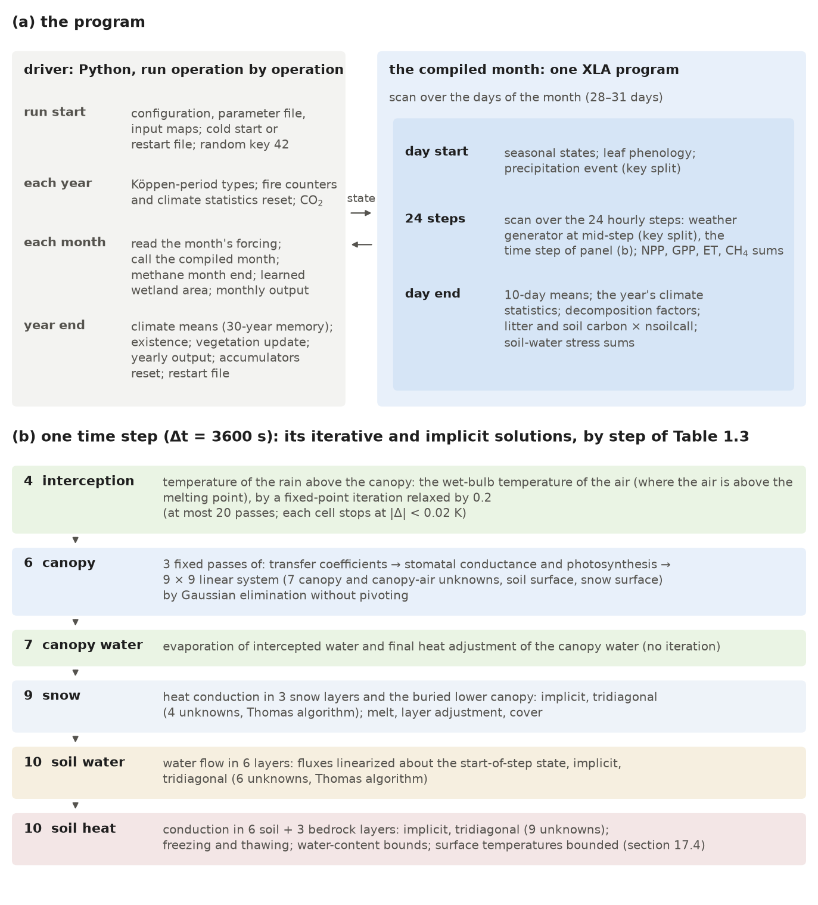
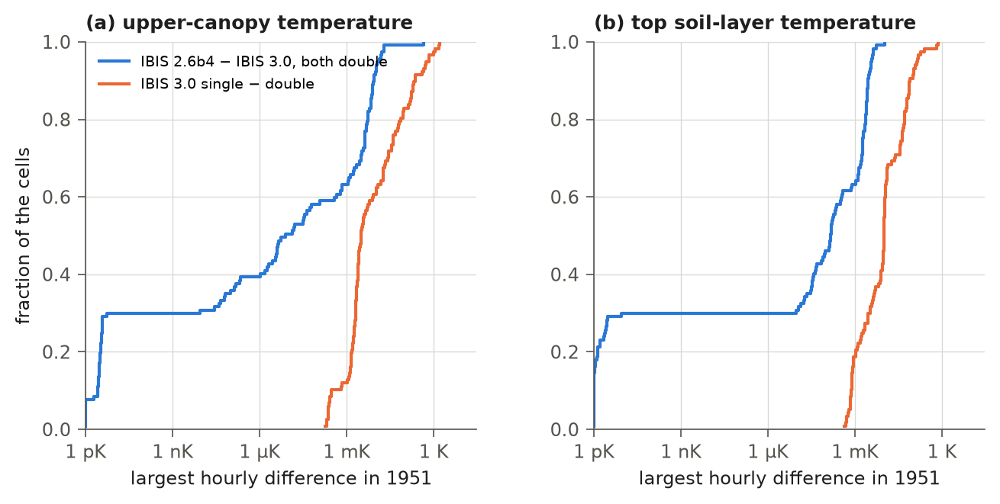
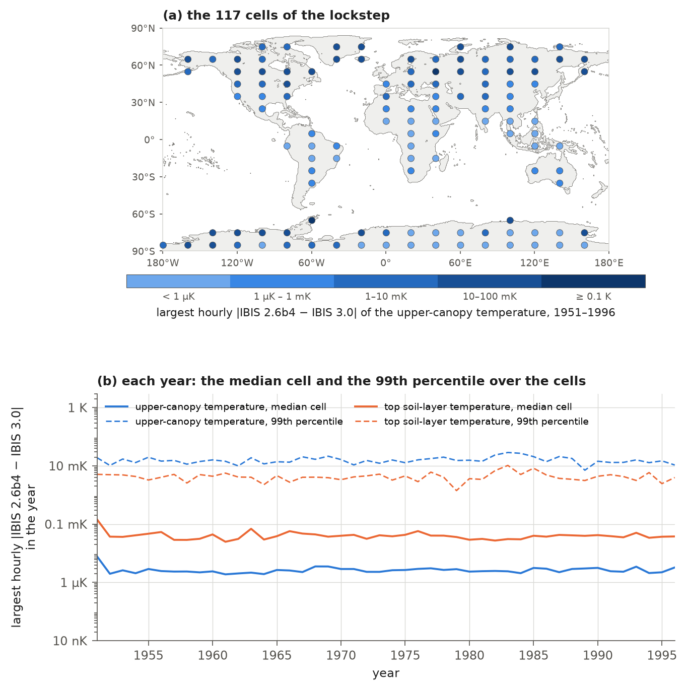

# 17. Numerical Implementation and Verification against IBIS 2.6b4

This chapter describes how IBIS 3.0 implements the equations in Chapters 3-15 and the checks of agreement
with IBIS 2.6b4 under shared inputs and settings. Sections 17.1 and 17.2 explain how the code stores model state and
runs its time loops. Sections 17.3 and 17.4 describe the solution of an hourly time step and the bounds imposed on it.
Sections 17.5 to 17.8 cover floating-point precision, weather-generator random numbers,
restart files and reproducibility. Section 17.9 describes verification against the IBIS 2.6b4 Fortran code,
both routine by routine and for the full hourly time step. Section 17.10 lists where IBIS 3.0 differs from
IBIS 2.6b4 by design or by correction, and section 17.11 describes the test suite. Section 17.12 provides
developer notes, including changes made after the release.

Throughout, "IBIS 2.6b4" means the copy of the Fortran kept in the repository (`fortran/ibis_2.6b4/`; section 17.9.1),
before the changes of Table 17.6. The chapter describes the code as revised after the release, in November 2026.
Results of the release run (`final_rel30`, made with the release code) are labelled as such.

## 17.1 Software and data structures

IBIS 3.0 is written in Python using JAX, a library that compiles array code for CPUs or GPUs. This section describes
the code's location, the organization of model state and the switches selecting alternative formulations.

IBIS 3.0 is the Python package `ibis` (`python-port/ibis/`). It is built on JAX (Bradbury et al., 2018) and on Equinox
(Kidger and Garcia, 2021), a library that keeps the model's state and parameters as trees of arrays. The CPU
environment has JAX and jaxlib 0.11.0 and Equinox 0.13.8. The release run was made on a GPU (an NVIDIA GeForce RTX
4090), in a separate environment on the workstation's local disk with the same JAX, jaxlib and Equinox versions and the
CUDA 12 plug-in of JAX 0.11.0. `docs/ENVIRONMENT.md` describes both environments, the GPU one with its CUDA libraries
and driver. The global driver is `python-port/scripts/run_global.py`. The hourly time step is the function
`timestep_body` (`ibis/timestepping/loops.py`), the counterpart of the Fortran routine `lsxmain`. The day and month
loops of the runs driven by the GSWP3 forcing are in `ibis/timestepping/loops_gswp3.py`.

Model state is stored as a tree of arrays, `IBISState` (`ibis/state/model_state.py`). Its leaves are arrays, almost
all with land cell as the first dimension (Table 17.1). Physics functions receive
the state, or parts of it, and return new arrays. Each calculation constructs a new state from the old one;
it never modifies state in place. Optional components are absent (`None`) when a run does not need them, consuming no
memory and adding no code. In the release transient and hindcast, the state had 272 leaves: 268
single-precision floating-point arrays and 4 integer arrays (release restart file for 2010). Nineteen leaves
have no cell dimension: soil layer thicknesses, layer root fractions, seven snow constants, CO₂
and O₂ concentrations, four arrays over the twelve vegetation positions and four step counters. Spin-up, which has
no wetland state, had 269 leaves. Revised code has the same counts in the same configuration; the yearly
water-balance diagnostic (`physics.water_balance`; Chapter 7) adds 18 leaves, for a total of 290.

**Table 17.1** Components of the model state (`IBISState`). The leaf counts are those of the transient and hindcast
stages of the release run (the spin-up has no wetland state). The last two components were not part of the release
run; their counts are those of the revised code.

| Component | Contents | Leaves |
|---|---|---|
| `soil` | soil and bedrock temperatures, liquid water and ice, puddles, texture and hydraulic properties, stress factors | 33 |
| `snow` | snow layer temperatures and thicknesses, snow cover, snow constants | 14 |
| `canopy` | canopy and air temperatures and humidities, intercepted water, stomatal and photosynthetic state, radiation and flux diagnostics | 60 |
| `atm` | the forcing of the current time step, CO₂ and O₂ | 22 |
| `vegetation` | leaf area, cover, heights, carbon pools of the twelve positions, existence, phenology and climate statistics, fire accumulators | 57 |
| `carbon` | litter and soil carbon pools, decomposition factors | 24 |
| `hydrology` | water-flux diagnostics of the time step, the water stored in the cell | 18 |
| `summary` | daily, 10-day and annual accumulators | 30 |
| `wetland` | wetland methane state (with `physics.enable_methane`) | 3 |
| `stress` | annual soil-water stress sums (with the tree cover limit and the other options of section 10.10) | 4 |
| `etparts` | components of evapotranspiration (with `physics.et_components` or the seasonal formulations) | 4 |
| `seasonal` | acclimation and senescence states (with the seasonal formulations of Chapters 9 and 10) | 3 |
| `neeparts` | day and night sums of the net ecosystem exchange and their numbers of steps (the tower runs of Chapter 16; also with `physics.water_balance`) | 4 |
| `wbal` | the water stored at the start of the year, the water each bound and floor added during the year, and the number of steps and the water of three events: the ground-evaporation bound acting, excess ground snowfall and a canopy store overshooting (with `physics.water_balance`; Chapter 7) | 14 |

Parameters form a second tree, `SimParams` (`ibis/timestepping/loops.py`), containing process parameters,
per-position arrays for climate-zone types (Chapter 2) and cell latitudes. Switches selecting alternative
formulations are fixed when the month is compiled (section 17.2). This applies to parameter-file switches such as
`soil.h2o_consistent_weights` and run-configuration switches acting within the compiled month, such as
`physics.methane_hourly`. These switches determine the compiled operations, so changing one produces a different
program. For most switches in Tables 1.7 and 1.8, off selects the IBIS 2.6b4 formulation; the process chapters
identify exceptions. Some corrections enabled by default restore an earlier version of the port when switched off,
rather than IBIS 2.6b4 (for example `physics.fire_annual_reset`, Chapter
13, and `pft.tree_kill_to_litter`, Chapter 11). Five switches added after the release are on by default, and each gives
the release's rule when off. Two restore IBIS 2.6b4's rule where the release departed from it
(`bgc.rgrowth_positive_only` and `pheno.climate_stats_daily`; Table 17.10). One corrects IBIS 2.6b4
(`weather.sun_midstep`; Table 17.9). Two change processes that IBIS 3.0 added (`pheno.drop_stress_gate` and `methane.t_anaer_substrate`; Chapters 10
and 14). The optional `fire.daylight_only` rule is off by default: fire weather again counts every step, as in the
release (Chapter 13).

Arrays over the cells keep the cell dimension first, and every operation inside the time step acts on each cell
separately: no water, energy or carbon moves between cells (Chapter 1).

## 17.2 Compilation and the time loops

JAX accelerates the model by compiling a whole simulation month into one program. This section describes
which calculations are compiled, which run in plain Python, and when recompilation is needed.

JAX turns a Python function into a program for the XLA compiler, which compiles it for the CPU or the GPU. IBIS 3.0
compiles one calendar month at a time: a loop over the days of the month whose body contains a second loop over the
$`N = 86400/\Delta t = 24`$ time steps of the day, where $`\Delta t`$ = 3600 s is the time step (Figure 17.1a). Both loops
are JAX scans, allowing the compiler to process each loop as a whole. Day of year is a program input rather than a
constant, so one program can serve months of the same length. The number of days per month, year length
(365 or 366 days), daily decomposition-call count (`physics.nsoilcall`) and switches are fixed at
compile time. A run therefore compiles a program for each month-length and year-length combination it
encounters, then recompiles when `nsoilcall` changes at the end of accelerated spin-up (Chapter 12).

The driver runs in Python outside the compiled program. Each month, it reads forcing from disk and converts
it to daily weather (Chapter 3), calls the compiled month, evaluates the monthly methane step and learned wetland
area (Chapter 14), and writes monthly output. At each year's start, it resets fire-season counters and,
when using IBIS 2.6b4's daily climate statistics (`pheno.climate_stats_daily`, the default), temperature
extremes and degree-days. The compiled days then accumulate these statistics (Table 17.2). At year end, the driver
updates the 30-year running climate means and each position's existence (Chapter 11), calls the annual vegetation update
(Chapter 11), writes yearly output, resets annual sums and writes a restart file. These annual calculations run
operation by operation; the full update is not compiled.



**Figure 17.1** (a) The structure of the program: the driver, run in Python, and the month, compiled as one program, in
which a loop over the days contains a loop over the 24 time steps of the day. (b) The iterative and implicit solutions
within one time step, in their order, labelled with their step of Table 1.3, with the method of each (section 17.3).
The numbers of layers, iterations and unknowns, and the relaxation factor and tolerance of the wet-bulb iteration, are
read from the code of the revised model.

**Table 17.2** The calculations of one day inside the compiled month, in order.

| Step | Calculation | Chapter |
|---|---|---|
| 1 | acclimation and senescence states from the day's mean temperature (seasonal formulations) | 9, 10 |
| 2 | leaf phenology | 10 |
| 3 | length and start of the day's precipitation event (random draws) | 3 |
| 4 | 24 time steps: hourly weather from the generator at the middle of each step (random draw for the wind), the time step of Table 1.3, and the sums of NPP, GPP, evapotranspiration and runoff, of the methane flux (with `physics.methane_hourly`) and of the soil temperature, water and ice (with the learned wetland area) | 3, 5-9, 14 |
| 5 | 10-day running means of temperature and canopy photosynthesis | 10 |
| 6 | the year's climate statistics: the lowest and highest 10-day mean temperature so far (the mean as it stood at the start of the day) and the degree-days above 0 and 5 °C of the day's mean temperature (with `pheno.climate_stats_daily`, the default) | 10, 11 |
| 7 | temperature and moisture factors of decomposition from the end-of-day soil state | 12 |
| 8 | litter and soil carbon decomposition, called `physics.nsoilcall` times | 12 |
| 9 | sums of soil-water stress over the growing-season days (with the tree cover limit) | 11 |

## 17.3 Numerical solution of the time step

### 17.3.1 Sequential splitting

Within each hour, the model solves processes in sequence, each starting from the state left by its predecessor.
This section describes that structure and identifies the equations solved implicitly.

The time step $`\Delta t`$ = 3600 s is fixed, with no substeps or adaptive adjustment. The
processes in Table 1.3 are solved sequentially, each over the full step using the state left by the preceding process
(sequential operator splitting):

```math
\mathbf{x}^{n+1} = \mathcal{S}_{12} \circ \mathcal{S}_{11} \circ \cdots \circ \mathcal{S}_{1}\left(\mathbf{x}^{n};\, \mathbf{f}^{n}\right),
\tag{17.1}
```

where $`\mathbf{x}^{n}`$ is the model state at the start of step $`n`$, $`\mathbf{f}^{n}`$ is the forcing of the step from the
weather generator (Chapter 3), and $`\mathcal{S}_{1}, \ldots, \mathcal{S}_{12}`$ are the calculations of Table 1.3,
applied from right to left. Within $`\mathcal{S}_{6}`$ (canopy), $`\mathcal{S}_{9}`$ (snow) and $`\mathcal{S}_{10}`$ (soil)
the model finds the unknowns of the step by implicit, linearized solutions of the energy and water balances, described
in the chapters of the processes (Chapters 5-8); Table 17.3 summarizes their numerical structure. Apart from the
fire-weather counters of the fire scheme of IBIS 3.0 (in $`\mathcal{S}_{11}`$, Chapter 13) and the methane flux
($`\mathcal{S}_{12}`$, Chapter 14), the order and the methods are those of IBIS 2.6b4.

**Table 17.3** The iterative and coupled solutions of the time step, in their order (Table 1.3).

| Calculation | Unknowns | Discretization | Solver | Chapter |
|---|---|---|---|---|
| wet-bulb temperature of the air (temperature of the rain intercepted by the upper canopy; interception, step 4) | 1 per cell where the air is above the melting point | relaxed fixed-point iteration (relaxation factor 0.2) | at most 20 iterations, each cell keeping its value from the first with a change below 0.02 K | 5 |
| canopy energy and water vapour balance | 9 per cell: $`T_u`$, $`T_s`$, $`T_l`$, $`T_{12}`$, $`T_{34}`$, $`q_{12}`$, $`q_{34}`$, $`T_g`$, $`T_i`$ | implicit, linearized about the current iterate; implicit and explicit parts weighted near the melting point | 3 fixed iterations, each with a 9 × 9 linear system solved by Gaussian elimination without pivoting | 5 |
| snow temperature | 3 snow layers and the lower canopy buried by snow | implicit | tridiagonal (Thomas algorithm) | 8 |
| soil water | 6 soil layers | implicit, fluxes linearized about the current state | tridiagonal (Thomas algorithm) | 7 |
| soil and bedrock temperature | 6 soil + 3 bedrock layers (the release configuration) | implicit | tridiagonal (Thomas algorithm) | 6 |

### 17.3.2 The canopy system

The canopy calculation (Chapter 5) evaluates turbulent transfer coefficients, stomatal conductance and
photosynthesis, then solves the linearized energy and water vapour balances of the canopy, canopy air,
ground and snow surface. This sequence is repeated three times. Each pass $`i = 1, 2, 3`$ solves

```math
\mathbf{A}^{(i)}\,\mathbf{y}^{(i)} = \mathbf{b}^{(i)}, \qquad
\mathbf{y} = \left(T_u, T_s, T_l, T_{12}, T_{34}, q_{12}, q_{34}, T_g, T_i\right)^{\mathsf{T}},
\tag{17.2}
```

where $`T_u`$, $`T_s`$ and $`T_l`$ (K) are the temperatures of the upper-canopy leaves, the upper-canopy stems and the
lower canopy; $`T_{12}`$ and $`T_{34}`$ (K) and $`q_{12}`$ and $`q_{34}`$ (kg kg⁻¹) are the temperatures and specific
humidities of the air within the upper and the lower canopy; $`T_g`$ and $`T_i`$ (K) are the temperatures of the soil
surface and the snow surface; and $`\mathbf{A}^{(i)}`$ and $`\mathbf{b}^{(i)}`$ are the coefficients and right-hand sides
built from the transfer coefficients, conductances, heat capacities and radiation of pass $`i`$ (Chapter 5). The
transfer coefficients and stomatal conductances for pass $`i + 1`$ are evaluated at the solution from pass $`i`$.
The third pass supplies the time-step solution. As in IBIS 2.6b4 (`canopy.f`), convergence is not tested.
Several quantities carry over between passes, as they do through Fortran common blocks:
stability factors, wind $`u_{2}`$ at the bottom of the upper canopy, logarithms of the two effective
roughness lengths and implicit fractions (section 5.3.2).

The system (17.2) is solved for every cell by Gaussian elimination without pivoting, in the loop order of the Fortran
routine `linsolve` (`math.f`):

```math
\ell_{jk} = \frac{a_{jk}}{a_{kk}}, \quad a_{jm} \leftarrow a_{jm} - \ell_{jk}\,a_{km}, \quad
b_{j} \leftarrow b_{j} - \ell_{jk}\,b_{k} \quad (k = 1, \ldots, 8;\; j = k+1, \ldots, 9;\; m = 1, \ldots, 9),
\qquad
y_{k} = \frac{b_{k} - \sum_{m > k} a_{km}\,y_{m}}{a_{kk}} \quad (k = 9, \ldots, 1),
\tag{17.3}
```

where $`a_{jm}`$ and $`b_{j}`$ are the elements of $`\mathbf{A}`$ and $`\mathbf{b}`$ and $`\ell_{jk}`$ is the multiplier of row
$`j`$ at elimination step $`k`$. Elimination without pivoting relies on the diagonal elements staying away from zero, as
the comment of the Fortran routine states. The Fortran updates only the columns $`m = k, \ldots, 9`$ and skips the
operations on elements that are zero in a fixed sparsity pattern. The port updates whole rows. This gives the same
solution: subtracting a multiple of zero leaves an element unchanged, and columns to the left of the
pivot are not read again. Retaining the Fortran elimination order also keeps rounding similar between codes.
A partial-pivoting solver used in an early port chose a different order for the nearly singular
systems of snow-covered cells at the melting point, changing canopy temperatures by up to 5 mK.

### 17.3.3 Tridiagonal systems

Heat conduction in the snow, water flow in the soil and heat conduction in the soil and bedrock each lead to one
tridiagonal system per cell,

```math
a_{k}\,x_{k-1} + b_{k}\,x_{k} + c_{k}\,x_{k+1} = r_{k}, \qquad k = 1, \ldots, K, \quad a_{1} = c_{K} = 0,
\tag{17.4}
```

where $`x_{k}`$ is the unknown of layer $`k`$ at the end of the step (a temperature in K, or a volumetric water content as
a fraction of the pore space), $`a_{k}`$, $`b_{k}`$ and $`c_{k}`$ are the coefficients of the implicit discretization
(Chapters 6-8), $`r_{k}`$ is the right-hand side and $`K`$ is the number of layers. (These $`a`$ and $`b`$ are unrelated to the
matrix elements of (17.3).) They are solved by the Thomas algorithm (`ibis/physics/solvers.py`, the counterpart of the
Fortran routine `tridia` of `math.f`):

```math
\gamma_{1} = \frac{c_{1}}{b_{1}}, \quad x'_{1} = \frac{r_{1}}{b_{1}}, \qquad
\gamma_{k} = \frac{c_{k}}{b_{k} - a_{k}\gamma_{k-1}}, \quad x'_{k} = \frac{r_{k} - a_{k}x'_{k-1}}{b_{k} - a_{k}\gamma_{k-1}}
\quad (k = 2, \ldots, K), \qquad
x_{K} = x'_{K}, \quad x_{k} = x'_{k} - \gamma_{k}\,x_{k+1} \quad (k = K-1, \ldots, 1),
\tag{17.5}
```

where $`\gamma_{k}`$ and $`x'_{k}`$ are the coefficients of the forward sweep. With the three bedrock layers of the release
configuration (`grid.nbedrock` = 3; Chapter 6) the soil heat system has $`K = 9`$, the bedrock layers being added below
the six soil layers; without them $`K = 6`$, as in IBIS 2.6b4. In either case no heat flows through the base of the
column; the drainage carries the heat of its water out through the base of the soil (Chapter 6).

The soil water system treats interlayer fluxes implicitly, linearized about water content at the
start of the step (Chapter 7). The linearization water content at each interface is a weighted
mean of the adjacent layers' contents. IBIS 2.6b4 weights each layer by its own half-thickness, while the same
routine's matrix weights it by the other layer's half-thickness. IBIS layers thicken with depth (doubling below
0.25 m). With the first weighting, the linearization can move water downward from a dry layer above a wet one,
if the lower layer is wet enough for its texture (section 7.7.2). The end-of-step lower bound then
refills the dry layer without a supplying flux. With `soil.h2o_consistent_weights` (default
false; true in the release parameter file), linearization uses the matrix weights.

### 17.3.4 Other iterations, and the daily and annual steps

Air wet-bulb temperature determines the temperature of rain intercepted by the upper canopy (step 4 of Table
1.3; section 5.4.1, equation (5.23)). Where air temperature exceeds the melting point, the model solves for wet-bulb
temperature by fixed-point iteration with a relaxation factor of 0.2 and at most 20 passes. Each cell retains the
value from the first pass with a change below 0.02 K, matching the Fortran's loop exit. Intercepted-water evaporation
(step 7) has no iteration. Decomposition (Chapter 12) updates litter and soil carbon pools explicitly each day. It is
called `physics.nsoilcall` times a day: 10 times in the first 150 years of the 200-year spin-up, and once in its last 50
years (`physics.soilcspin_tail_years`) and in the transient and hindcast stages. The annual vegetation update (Chapter
11) is an explicit annual step of the vegetation carbon pools and cover.

The model retains the 3600 s step of IBIS 2.6b4. At a few wet tropical cells with large leaf area, coupled canopy
and soil temperatures can oscillate with increasing amplitude across steps. A verification runner tested a
1800 s step to address this instability; the model instead bounds surface temperatures (section 17.4).

## 17.4 Bounds on the solution

At several points, IBIS 3.0 bounds a time-step result within a fixed range where IBIS 2.6b4 imposes no limit.
These bounds keep global runs finite when the hourly scheme becomes unstable. This section lists the bounds and
reports how often they act.

The bounds (Table 17.4) were added after global port runs produced non-finite values or runaway temperatures
under conditions not sampled by Fortran verification. Each has the form

```math
\phi' = \min\left[\max\left(\phi,\; \phi_{lo}\right),\; \phi_{hi}\right],
\tag{17.6}
```

where $`\phi`$ is the value computed by the step, $`\phi'`$ the value used, and $`\phi_{lo}`$ and $`\phi_{hi}`$ the limits of
Table 17.4. Clipping a temperature can change stored energy without a matching flux, and a floor on a water store
can add water. A consistently applied flux bound need not have either effect. The ground-evaporation bound
supplies a single rate used for water removal from puddles and soil, latent heat in the ground energy balance, and
reported evapotranspiration. These three quantities therefore remain consistent when the bound acts.
(The release run bounded water removal only.)

**Table 17.4** Bounds of the time step that IBIS 2.6b4 does not have. None of them has a switch. $`T_a`$: air temperature
of the step; $`f_i`$: snow cover; $`E_g`$: ground evaporation per unit snow-free area.

| Quantity | Limits | Where in the step |
|---|---|---|
| ground evaporation of the snow-free part, $`(1 - f_i)\,E_g`$ (kg m⁻² s⁻¹) | ±1.0 × 10⁻³ | after the canopy solution; the bounded rate is used for the puddle and soil water, the latent heat of the ground and the evapotranspiration written out |
| sensible heat and net longwave radiation of the soil and snow surfaces (W m⁻²) | ±2000 (`IBIS_FLUX_MAX`) | in the heat fluxes into the soil and the snow |
| temperatures $`T_u`$, $`T_s`$, $`T_l`$, $`T_g`$ (K) | $`T_a`$ ± 40 (`IBIS_T_MAX_DEV`) | after the soil calculation |
| water content of each soil layer after root uptake | ≥ 0 | before the soil water solution |
| puddle liquid and ice (kg m⁻²) | ≥ 0 | after ground evaporation |

The yearly water-balance diagnostic (`physics.water_balance`, off by default; Chapter 7) counts
steps on which the ground-evaporation bound acts and totals the water supplied by the two water floors. It was
run for one diagnostic year on revised code: 2001, starting from the release state at the end of 2000 with
the parameter file that starts the refits (`params_32a_base.yaml`, which turns on `soil.evap_needs_store`; Table
17.9). In that year the ground-evaporation bound acted in none of the 95,333 land cells, and the floor on the layer
water after root uptake supplied no water. The puddle floor supplied water in 16,415 cells, at most 0.17 mm in the year
(`make_ch17.py wbal`). The bounds on the surface heat fluxes and temperatures are not counted, and how often they
acted in the release run is not known.

The surface-flux and temperature limits come from environment variables `IBIS_FLUX_MAX` and `IBIS_T_MAX_DEV` if
set; otherwise, they are 2000 W m⁻² and 40 K. No repository launch script sets these variables. The global driver now
logs both values at run start. The release log predates this addition, but no variables were set, so the release is
assumed to have used the defaults.

The bounds also act where IBIS 2.6b4 itself becomes unstable. In the cold-snap test of the time-step verification
(section 17.9.3) the air cools by 20 K within 12 hours, and at the tropical cell both codes run into a growing
oscillation of the hourly step: both give a ground sensible heat flux of 3,085 W m⁻² at one step, and IBIS 2.6b4 gives
15,481 W m⁻² at the next. IBIS 3.0's bounds then act, and the two codes diverge by up to 7.2 K in
top-layer soil temperature. With the bounds on surface heat fluxes, surface temperatures and ground evaporation
lifted, the two codes agree to 4.8 × 10⁻¹² K over the whole week.

Three further changes protect the canopy system itself. They were applied identically to the port and reference
Fortran after multi-cell lockstep verification exposed the relevant cases (section 17.9.3; Table 17.6).

1. Where the canopy is absent ($`2L_uf_u + 2S_uf_u + 2(L_l + S_l)f_l(1 - f_i)`$ below $`10^{-7}`$, with $`L`$ and $`S`$ the
   leaf and stem area indices of the upper ($`u`$) and lower ($`l`$) canopy and $`f_u`$ and $`f_l`$ their covers), the seven
   canopy and canopy-air rows of (17.2) are replaced by $`T = T_a\,\theta`$ and $`q = q_a`$, where $`\theta`$ is the
   potential-temperature factor of the reference level and $`q_a`$ the specific humidity of the air (Chapter 5). The
   ground and snow rows are then solved against the air. IBIS 2.6b4 divides by a vanishing pivot there.
2. The humidity factor of the soil surface is the weighted sum $`\beta_s h_1 + (1 - \beta_s) h_2`$, where $`\beta_s`$ is
   the soil-wetness weight, $`h_1`$ an exponential of the matric potential of the top layer and $`h_2`$ the ratio of the
   canopy-air humidity to the saturation humidity of the soil surface (Chapter 5). Where the top layer is at the
   wilting point ($`\beta_s = 0`$) the factor is set to $`h_2`$. The guard matters only for a negative saturated suction,
   such as that of the soils the verification harness used until November 2026 (−0.15 m; section 17.9.1): there $`h_1`$
   exceeded 1 and overflowed at a dry layer, and the product $`0 \times \infty`$ was not a number. With the positive
   saturated suctions of IBIS's soils (0.07-0.37 m; Table 2.6), $`h_1`$ lies between 0 and 1, and the guard does not
   change the result in either code.
3. Comparisons selecting branches in the canopy, interception and soil calculations include small tolerance bands
   to prevent differences of a few units in the last digit from sending the port and Fortran down
   different branches: $`10^{-9}`$ K at the melting point, $`10^{-8}`$ (J m⁻² or K) in the tests of the implicit fractions
   (added to the $`\epsilon = 10^{-7}`$ of the Fortran's tests), and $`10^{-10}`$ kg kg⁻¹ between humidities. In single
   precision the band at the melting point is narrower than the spacing of the numbers there (section 17.5) and has
   no effect. The humidity band has no effect where the compared humidity is $`2^{-9} \approx 1.95 \times 10^{-3}`$
   kg kg⁻¹ or more; below that value it moves the threshold by one or more units in the last digit, so it acts over
   cold surfaces (at 1000 hPa the saturation humidity falls below that value at about −8 °C). The bands of the implicit
   fractions, which compare a difference against the small constant $`1.1 \times 10^{-7}`$, remain in effect.

## 17.5 Floating-point precision

Global and tower runs hold their state in single precision, which keeps about seven significant digits. In the
117-cell comparison described below, rounding changed some individual hours noticeably, while differences in daily,
monthly and annual means were much smaller. These results describe that test, not an error bound for every run.

IBIS 2.6b4 was built for the verification in double precision (`-fdefault-real-8 -fdefault-double-8`), and the port
was verified in double precision (section 17.9). The GSWP3 month loop, which runs the global simulations and the tower
simulations of Chapter 16, holds the state in single precision whatever JAX's precision setting. It converts every
floating-point leaf of the state to single precision before each month, after each time step and after each day, and
its forcing arrays and sums are single-precision arrays. The release run was made on the GPU with JAX's
double-precision mode off (its log records that the code's double-precision constants were truncated to single
precision), so every operation of its time step was in single precision. The relative precision of the two formats is

```math
u_{32} = 2^{-24} \approx 6.0 \times 10^{-8}, \qquad u_{64} = 2^{-53} \approx 1.1 \times 10^{-16},
\tag{17.7}
```

where $`u`$ is the unit roundoff. Near the melting point (273.16 K), neighbouring single-precision numbers are $`2^{-15} \approx 3.05 \times 10^{-5}`$ K apart, and double-precision numbers $`2^{-44} \approx 5.7 \times 10^{-14}`$ K apart.
Single precision loses the most accuracy when nearly equal numbers are subtracted. For example, reference height in
the canopy calculation (Chapter 5) is computed from surface pressure minus 0.999 times that
pressure. In single precision, this difference carries a relative error of up to 7.2 × 10⁻⁵ (median 2.1 × 10⁻⁵) over
surface pressures of 500-1050 hPa.

The effect on the full time step was measured using the 46-year verification setup (section 17.9.4):
117 cells, their synthetic soils and surface templates, the initial state, the other settings then supplied to both
codes by the harness (section 17.9.1), and 1951 forcing, with vegetation held fixed. The release-code time step
was run through that year once in double and once in single precision (`make_ch17.py`; 8,760 steps).
This experiment therefore inherits the old harness soils, with no capillary diffusion between layers.
Figure 17.2 compares each cell's largest hourly precision difference with its largest hourly difference
between IBIS 2.6b4 and the port in the same verification year, both in double precision.

In single precision the largest hourly difference of the upper-canopy temperature is 3.1 mK at the median cell (90th
percentile 0.22 K, more than 0.1 K at 20 of the 117 cells, largest 1.6 K), against 7.8 µK between IBIS 2.6b4 and the
port. For the top soil layer it is 10 mK (largest 0.72 K), against 0.15 mK. Most hourly differences are much smaller
(median 0.19 mK for upper-canopy temperature and 0.40 mK for the top soil layer).

Annual means from the two
precisions differ by at most 0.4 mK in the upper-canopy temperature, 9.3 mK in the temperature and 3.6 × 10⁻⁵ in the
water content of the top soil layer, and 0.09 W m⁻² in the sensible heat flux of the soil surface. At the median cell,
single-precision rounding therefore shifts the hourly solution about two (top soil layer, a factor of 70) to nearly
three (upper canopy, a factor of 390) orders of magnitude more than port–Fortran differences,
while shifting annual means by less than 0.01 K. Repeating the experiment with revised code gives nearly the same results:
for the upper-canopy temperature 3.3 mK at the median cell, more than 0.1 K at 21 cells and 1.55 K at most; for the top
soil layer 10 mK and 0.72 K; annual means within 0.5 mK in the canopy temperatures and 9.3 mK in the top soil layer.

Hourly output from single-precision runs, including the tower runs in Chapter 16, carries these rounding effects.
At individual cells and hours, canopy temperatures can differ by 1-2 K from a double-precision run of
the same model, and sensible heat fluxes by tens of W m⁻² (up to 30 W m⁻² at the soil surface in the release
code, and 63 W m⁻² for the upper canopy at one cell in the revised code). Averaging removes most of it. In the same
experiment with the release code, daily means differ by at most 0.19 K (temperature of the top soil layer; 0.09 K for
the upper canopy), monthly means by at most 0.012 K and annual means by at most 0.009 K. These rounding effects should
inform comparisons of hourly output with observations.



**Figure 17.2** The largest hourly difference in 1951 at each of the 117 cells of the lockstep verification, as the
fraction of the cells at or below a value: between IBIS 2.6b4 and IBIS 3.0, both in double precision (the 46-year
lockstep of section 17.9.4, made with the code of the port of May-June 2026), and between the release code of IBIS 3.0
in single and in double precision, from the same initial state and forcing. (a) Upper-canopy temperature. (b)
Temperature of the top soil layer. Differences below 1 pK are drawn at 1 pK. The revised code gives nearly the same
distributions (section 17.5).

Single precision also loses small increments added to large totals. This matters on ice sheets, where snowpacks have
no thickness cap (as in IBIS 2.6b4) and grow to hundreds of metres (1,771 m in the release run; to be updated after
the final revised-model run, whose deep packs retain their snowfall). In the release code,
re-dividing deep packs into three layers at every step lost hourly snowfall to rounding: in a column test, a
1,500 m pack kept none of a year of hourly snowfall of 10⁻⁴ m. The heat flux from the pack into the soil, found by
subtracting nearly equal heat contents, was rounding noise beneath the ice sheets (10th to 90th percentile −1.2 to
+1.1 W m⁻², against a double-precision median of −0.02 W m⁻²).

For packs of 10 m or more, revised code re-divides
the layers only when the top layer has moved by half its thickness, retaining 99.6 % of that snowfall. It also computes
the soil heat flux from conductance between the buried layer and soil, matching a double-precision
reference to 10⁻³ W m⁻² (Chapter 8). Thinner packs, including all seasonal packs, are computed as before. Some
rounding remains: in the diagnostic year of section 17.4, all 518 land cells whose annual water budget fails to close by more
than 1 mm in the year lie south of 60°S or in the box 60-84°N, 10-75°W around Greenland (up to 5.8 mm), while elsewhere
the budget closes to within 0.62 mm (`make_ch17.py wbal`).

## 17.6 Random numbers

The weather generator uses random numbers for hourly wind and daily precipitation timing. This section explains
how those numbers are drawn and why restarting changes the generated weather relative to an uninterrupted run.

Random draws determine hourly wind speed and the duration and start of each day's precipitation event
(Chapter 3). IBIS 3.0 uses JAX's counter-based generator (threefry-2x32; Salmon et al., 2011),
with explicit keys rather than a mutable random-number stream. Repeating a draw with the same key,
array shape and generator settings produces the same pseudo-random values. Changing the draw shape or the mapping of
array entries to cells can change a cell's weather. Global runs start with key 42, which is split each day,

```math
\left(k_{d+1},\, k^{p}_{d},\, k^{s}_{d,0}\right) = \operatorname{split}(k_{d}), \qquad
\left(k^{s}_{d,n+1},\, \kappa_{d,n}\right) = \operatorname{split}\left(k^{s}_{d,n}\right), \quad n = 0, \ldots, 23,
\tag{17.8}
```

where $`k_{d}`$ is the key carried into day $`d`$, $`k^{p}_{d}`$ the key of the day's precipitation event (split again into
one key for the length and one for the start), $`k^{s}_{d,n}`$ the key carried through the steps of the day and
$`\kappa_{d,n}`$ the key given to the hourly generator for step $`n`$, which splits it once more before drawing the wind.
(These keys are unrelated to the layer index $`k`$ of (17.3)-(17.5).) Each draw gives one uniform number per cell. IBIS
2.6b4 draws from the generator `ran2` of Press et al. (1992), seeded at the start of each run: one number for the event
length, one for its start (and a new start when the limit of 15 mm per step lengthens the event) and, in every step,
one for the wind of each cell in turn. The two sequences differ, so the port cannot repeat the Fortran's random
weather. Instead, a Python transcription using a port of `ran2` reproduced the Fortran generator exactly.
The port's generator was then compared statistically with that transcription (section 17.9.2). By default, the
generator is evaluated at each step's midpoint (`weather.sun_midstep`; Chapter 3). This controls the time of day
represented by generated weather and does not alter its random numbers.

Restart files do not store the key (section 17.7). A restarted run therefore begins again
with key 42, just as IBIS 2.6b4 reseeds its generator at every run start. Splitting a run into two parts changes the
random weather, so an interrupted run cannot resume with the weather it would otherwise have generated.
Each of the three release-protocol stages (Chapter 1) started with key 42.

## 17.7 Restart files

A restart file stores physical model state at year end so that a run can continue from it. The driver holds the
random key separately and does not save it. This section describes file contents and the checks made on loading.

At each year's end, the driver writes state to a compressed NumPy archive (`ibis/io/restart.py`), with one
array per state-tree leaf in JAX flattening order, a text representation of the tree structure,
and the model year. Files are written after the annual update and reset of annual sums. They
do not store the random key (section 17.6). A release transient or hindcast restart file
holds 272 arrays, 49.1 million numbers in all, in 58-59 MB; those of the spin-up, without the wetland state, hold 269
arrays in 55-66 MB. With the water-balance diagnostic a file holds 290 arrays.

A file is loaded into a template state built from the run configuration, with each array cast to the template
leaf's data type. When saved structure is available, the loader first compares it with the template. Each of the eight
components present in every state (`soil` to `summary` in Table 17.1) must have matching array counts, or loading
stops with an error. This detects, for example, loading a bedrock restart into a configuration without bedrock, or vice versa
(`grid.nbedrock` 3 versus 0; Chapter 6), because its soil component has one array more or fewer. The check compares
array counts rather than every array shape or parameter meaning. Optional trailing components (Table 17.1, from
`stress` onward) may differ between file and template; the loader fills or drops them as needed. Snow constants come
from the template, and the saved structure indicates whether the file contains wetland
state.

## 17.8 Reproducibility

The repeated CPU time-step test gave identical numbers. Two GPU launches of the release code differed in the last
digits of a few monthly sums. The global driver now enables deterministic GPU reductions by default; repeated
GPU runs with that setting also gave identical numbers in the test described below.

In the recorded CPU test, the time step repeated bit for bit: two launches of the single-precision year in
section 17.5 (117 cells for 8,760 steps) gave identical values for all eight recorded quantities at every step (`make_ch17.py
numbers`). The driver, the monthly methane step, the learned wetland area and the annual update were not repeated on
the CPU.

On the GPU, two launches with identical code, configuration and restart files can differ in the last digits. This
was measured by repeating the release hindcast's first year, 2001, from its restart for
2000 on release code, then comparing every output field with the original run (Table 17.5). Land-surface
state repeated exactly: GPP, NPP, evapotranspiration, runoff, leaf area, cover, month-end soil state and
every carbon pool were identical in all monthly and annual output. The two restart files
written at the end of 2001 differ in only one of their 272 arrays: the final monthly methane emission in wetland
state (22,635 cells, at most 1.1 × 10⁻⁷ kg C m⁻² d⁻¹).

Differences arose in monthly sums accumulated over
time steps for the methane calculation (Chapter 14): methane flux and mean soil temperature, water
and ice differed by a few units in the last digit in 7 or 8 of the 12 months. The learned wetland-area
decision trees use these soil means, so the rounding differences changed inundated fraction in up to 296 cells per
month. This altered methane emissions and, through methane carbon partitioning, heterotrophic respiration
recorded as CO₂.

**Table 17.5** Two launches of the same year (2001) on the GPU with the release code: land cells in which an output
field differs, and the relative difference of the field summed over the land cells (an unweighted sum of the values
per unit area; for the monthly fields, the largest over the months). Release run; to be updated after the final run of
the revised model, which is to use the deterministic setting described below.

| Field | Cells differing | Relative difference of the sum over the land cells |
|---|---|---|
| annual GPP, NPP, evapotranspiration, runoff, drainage; leaf area, cover, vegetation, litter and soil carbon | 0 | 0 |
| monthly mean soil temperature, water and ice, ground temperature (7-8 of 12 months) | up to 94,962 | ≤ 1.2 × 10⁻⁸; ≤ 6.7 × 10⁻⁷ in any cell |
| monthly inundated fraction of the learned wetland area (7 months) | up to 296 | ≤ 4.3 × 10⁻⁵ |
| monthly wetland methane emission (8 months) | up to 26,152 | ≤ 1.3 × 10⁻⁴ |
| monthly heterotrophic respiration booked as CO₂ and net ecosystem exchange (12 months) | up to 418 | ≤ 2.1 × 10⁻⁷ (respiration); ≤ 1.5 × 10⁻⁶ (net exchange) |
| annual wetland methane emission | 17,214 | 2.8 × 10⁻⁵ |
| annual heterotrophic respiration booked as CO₂ | 743 | 4.4 × 10⁻⁸ |
| annual net ecosystem exchange | 743 | 6.9 × 10⁻⁷ |

The global driver asks the XLA compiler to avoid operations whose result on the GPU depends on the order in which
parallel threads finish. It adds `--xla_gpu_exclude_nondeterministic_ops=true` to `XLA_FLAGS`, including when that
variable already contains other flags. An existing setting of this particular option takes precedence. Setting
`IBIS_NONDETERMINISTIC=1` skips the addition; it does not remove a flag already supplied by the user. With deterministic
reductions enabled, two launches of 2001 on the revised code, from the release run's state of 2000, gave identical
values in all 372 output fields (twelve monthly files and the yearly file) and in all 290 restart arrays. They took
559 and 594 s for the year, against 550 s for a launch without the setting on the same machine. The setting changes the
order of some sums, so a launch with it differs from a launch without it in the last digits (94 of the 372 fields
differ). These repeats used the same machine, software, inputs and launch settings (`make_ch17.py d83`; section
17.12). They do not establish bit-for-bit agreement across devices or software versions, or between an uninterrupted
run and one continued from a restart, whose random keys differ (section 17.6).

## 17.9 Verification against IBIS 2.6b4

Agreement with IBIS 2.6b4 was tested by running both codes on shared inputs and comparing
their results, first for individual routines and then for the full hourly time step. This section describes the
comparisons, their findings and their limits.

Verification proceeded in two stages. First, each compiled Fortran routine and its port received the same inputs.
Then the full hourly time step was checked by advancing both codes side by side ("in lockstep") from the same
state and comparing them after every step. The harness is in `verify/`, with the verification record in
`verify/STATUS.md`. The main verification ran from May to early June 2026 using double precision in both codes,
the code versions then current and a Python environment that has since been replaced
(`docs/ENVIRONMENT.md`). In November 2026, the harness was changed to supply IBIS 2.6b4's own settings to both codes,
and time-step checks were repeated (sections 17.9.1 and 17.9.3). Section 17.9.5 defines the verification's coverage.

### 17.9.1 The reference Fortran

The reference Fortran is compiled from `fortran/ibis_2.6b4/`, a copy of IBIS 2.6b4 distributed by the Center for
Sustainability and the Global Environment (SAGE), University of Wisconsin-Madison. For two changes in Table 17.6,
the absent-canopy guard and declarations, the verification record checks the affected routines against the
distributed code. The copy is built with `-fdefault-real-8 -fdefault-double-8`, and routines are called through
wrappers compiled with `f2py` that set the Fortran's common blocks (`verify/fortran_wrappers/`,
`python-port/tests/f2py/`). The wrappers are compiled for five cells, so the lockstep runs advance the cells in batches
of five.

For time-step comparisons (sections 17.9.3 and 17.9.4), the harness supplies identical soils,
constants and settings to both codes. Until 1 November 2026, several differed from IBIS 2.6b4. The 46-year lockstep
(section 17.9.4) and precision experiment in section 17.5 used the following settings
(`python-port/tests/f2py/synthetic_inputs.py` and the wrapper's `set_soil` and `set_snow` as they then stood):

1. Soils: one synthetic soil, the same in every layer of every cell, with a porosity of 0.45, a saturated
   conductivity of 10⁻⁵ m s⁻¹, an exponent $`b`$ of 5, a field capacity of 0.35 and a wilting point of 0.15 (fractions
   of the pore space), and a saturated suction of −0.15 m, where IBIS's texture classes have positive suctions of
   0.07-0.37 m (Table 2.6). With the negative suction the coefficient of the diffusive term of the soil water flux is
   negative, and the code of both models then sets the hydraulic diffusivity between the layers to its floor of 10⁻⁹
   m² s⁻¹ (Chapter 7). Water therefore moved between the layers by gravity drainage only, without capillary diffusion,
   and the matric humidity factor of the soil surface could exceed 1 (section 17.4). The routine-level comparisons of
   the soil water and canopy routines (section 17.9.2) used positive suctions.
2. Soil solids and albedos: a specific heat of 870 J kg⁻¹ K⁻¹ and a density of 2650 kg m⁻³, where IBIS 2.6b4 derives
   880.5 J kg⁻¹ K⁻¹ and 2636.5 kg m⁻³ from a fixed organic fraction of 1 %, the same for every texture (`initial.f`),
   as IBIS 3.0 does (Table 17.10); and soil albedos of 0.10 and 0.20, where IBIS 2.6b4 derives them from the texture
   of the top layer.
3. Snow constants: a minimum snow thickness of 0.10 m, a maximum snow cover of 0.95, a snow roughness length of
   0.005 m and a minimum snow cover of 0.02, where IBIS 2.6b4 sets 0.15 m, 1.0, 0.0005 m and 4 × 10⁻⁵ (`initial.f`).
4. The permeability of the base of the soil column was 0.04 in both codes, where the parameter file of IBIS 2.6b4 has
   0.10; the puddle capacity was that of IBIS 2.6b4, 4.5 kg m⁻² (the release has 0.04 and 10 kg m⁻²; Chapter 7).
5. The existence flags of the twelve positions were zero at every cell, so that both codes took the fall-back values
   of the photosynthetic capacities.

Since 1 November 2026, the harness has supplied IBIS 2.6b4's settings to both codes from a single source
(`python-port/tests/f2py/synthetic_inputs.py`). Each of the five synthetic cells uses soil properties from the
texture class assigned by IBIS 2.6b4 to its sand and clay fractions: clay loam, sandy loam, loam, sand and clay, with
saturated suctions of 0.26, 0.15, 0.11, 0.07 and 0.37 m. Cells also use the solids and soil albedos derived by IBIS 2.6b4,
its base permeability (0.10), puddle capacity (4.5 kg m⁻²), snow constants, and existence flags determined by its
climate rules for each cell's specified climate. A test checks these settings against compiled Fortran routines
and the IBIS 2.6b4 parameter file. Capillary diffusion therefore acts in the time-step checks in section
17.9.3.

The 46-year lockstep therefore compares the codes under shared settings on old synthetic soils; it does not test
the Fortran with its own parameters and soils. The November 2026 checks use IBIS 2.6b4's settings. The repository's
Fortran copy includes the changes in Table 17.6, made during verification. The port received identical
absent-canopy guards, branch bands and humidity-factor changes. It already had the behavior introduced by the
Fortran weather-generator correction. The declaration change affects only the precision of the Fortran build.

**Table 17.6** Changes to the reference copy of IBIS 2.6b4. Record: the finding of `verify/STATUS.md` that documents
the change.

| File | Change | Reason | Record |
|---|---|---|---|
| `weather.f` | a wet day is followed by a wet day with probability $`p_{ww}`$ (the original never set the wet state in that branch) | daily weather generator: storms could not last more than one day | finding 5 |
| `compft.h` | `real*4` declarations of the photosynthesis, phenology and vegetation constants made `real` | `real*4` is not promoted by `-fdefault-real-8`; these constants were stored in single precision | finding 19 |
| `canopy.f` (`turvap`) | rows of the canopy unknowns replaced by the air values where the canopy is absent | division by a vanishing pivot (NaN) at hot, dry cells without vegetation | finding 20 |
| `canopy.f`, `soil.f` | bands at the melting-point, implicit-fraction and humidity comparisons (section 17.4) | branch choices differing at the last digit between the two codes | findings 21, 23 |
| `canopy.f` (`turvap`) | humidity factor of the soil surface equal to its air-humidity term where the soil-water factor is zero | product of zero and an overflowing exponential (NaN) at a dry cell of the old harness's soils, whose saturated suction was negative (section 17.4); with IBIS's soils the exponential does not overflow | finding 26 |

### 17.9.2 Routine by routine

Hourly physics, phenology, decomposition, climate statistics and annual vegetation routines were each called with
shared inputs in the Fortran and port. Inputs included fixed scenarios, sweeps across each input's range and random
samples, totaling hundreds to thousands of input sets per routine. Fortran branch coverage was measured with `gcov`.
Among the daily and annual accumulators in `stats.f`, only decomposition factors were compared (in November 2026);
the others, including 10-day running means, were not. Table 17.7 gives the results. Where the codes differ by design,
the port used the Fortran formulation for comparison: the two-stream scheme's leaf-orientation lookup table in place
of its underlying formula (Chapter 4), sand and clay rounded to whole percent for soil thermal
conductivity, and the Fortran lower bound on porosity available to water flow. The wet-bulb iteration's early exit,
initially implemented only for verification, has since been adopted by the model (section
17.3.4).

Weather-generator verification had two layers: the Fortran was compared with a Python transcription using a port of
`ran2` to reproduce its random numbers, then the transcription was compared statistically with the port's generator,
which draws different random numbers (section 17.6). The daily-generator comparison leaves unresolved a temperature
variance about 25 % lower in the port and a 2.7 K difference in mean maximum temperature.
GSWP3 runs do not use the daily generator (Chapter 3).

Two comparisons were added or repeated in November 2026. Litter and soil decomposition factors (Chapter 12)
were compared with the corresponding `stats.f` blocks, copied verbatim and compiled separately, over a grid of soil
temperature, water and ice. They agree to 2.3 × 10⁻⁶ of the factor, reflecting rounding of the port's single-precision
constants. Repeating the annual vegetation update with fire on release code gave a largest difference of
1.1 × 10⁻¹³. This comparison covers the IBIS 2.6b4 fire scheme; IBIS 3.0's season-length scheme has no
Fortran counterpart (Chapter 13).

**Table 17.7** Routine-by-routine comparison of IBIS 3.0 with IBIS 2.6b4 in double precision (`verify/STATUS.md`,
`verify/results/section_summary.csv`; the decomposition factors: `tests/test_review_decomposition_factor.py`). The
difference is the largest absolute difference over all outputs and inputs, in the units of the output with the largest
difference.

| Routines (Fortran file) | Outputs compared | Largest difference |
|---|---|---|
| saturation vapour pressure and humidity (`comsat.h`) | 6 | 0 |
| two-stream radiation, solar and longwave chain (`radiation.f`) | 52 + 17 | 6.6 × 10⁻¹² W m⁻² |
| soil thermal properties, soil water, soil heat, water bounds, freezing and thawing of soil and puddles (`soil.f`) | 24 | 2.0 × 10⁻¹⁴ in water content (one call); 4.7 × 10⁻¹⁰ after 100 steps |
| snow heat, layer adjustment, melt, cover (`snow.f`) | 11 | 6.1 × 10⁻¹³ (heat flux between snow layers) |
| soil-water stress (`physiology.f`) | 4 | 2.2 × 10⁻¹⁶ |
| photosynthesis and stomatal conductance (`physiology.f`) | 34 | 2.4 × 10⁻⁸ in the canopy-scaled rates (relative 10⁻⁷) |
| wet fractions, interception, drip, evaporation of intercepted water (`canopy.f`) | 19 + 12 + 26 | 1.1 × 10⁻¹³ |
| transfer coefficients and the canopy system (`canopy.f`: 6 routines) | all | 9 × 10⁻¹⁰ K; 3.5 × 10⁻⁸ W m⁻² at fluxes of 1500 W m⁻² |
| phenology (`vegetation.f`) | 12 | 0 |
| climate statistics and existence (`climate.f`) | 25 | 0 |
| annual vegetation update, fire, vegetation map (`vegetation.f`) | 25 | 1.4 × 10⁻¹³ |
| litter and soil carbon (`biogeochem.f`) | 23 | 3 × 10⁻⁸ |
| decomposition factors of litter and soil (`stats.f`; November 2026) | 2 | 2.3 × 10⁻⁶ relative (the port's single-precision constants) |
| daily weather generator (`weather.f`), Fortran against the transcription | 9 | 0 |
| hourly weather generator (`weather.f`), Fortran against the transcription | 10 | 1.1 × 10⁻¹³ |

### 17.9.3 The time step

The hourly time step was compared by advancing the Fortran's `lsxmain` and the port's `timestep_body` from shared
state for one step and for up to 30 days. Five synthetic cells span tropical, arctic, freezing, desert and
saturated conditions. Tests also perturbed the state randomly and imposed cold snaps,
heat waves, monsoons, polar night or repeated freezing and thawing. They exposed port defects
missed by routine-level tests: upper- and lower-canopy soil-water stress exchanged when unpacking a routine's
results, incorrect snow-calculation order and precipitation reaching snow, missing quantities carried between
Fortran canopy passes, a snow-surface temperature bound applied in every pass rather than after the last, and
incorrect root-uptake distribution among soil layers.

GSWP3 lockstep runs then preceded the 46-year comparison (section 17.9.4): up to about 120 cells,
for 30 days to one year in 1990 and for 35 years from 1951. They found further defects of the port, among them the
pivoting solver in section 17.3.2 and a missing Fortran cut-off for very small rain rates reaching soil.
They also exposed the cases requiring the guards and bands in section 17.4. After correction,
recorded single-step temperature differences at the five cells were at most $`8.5 \times 10^{-9}`$ K, and
30-day differences were at most $`6.6 \times 10^{-4}`$ K.

In November 2026 the checks of the verifier (`verify/timestepping/verify_lsxmain.py`) were run again with IBIS
2.6b4's own settings (section 17.9.1), on the revised code, in double precision (`make_ch17.py timestep`):

- One step from the base state: 27 of the 28 compared fields agree to at most 8.0 × 10⁻¹³ K in temperature,
  2.7 × 10⁻¹⁴ in the water and snow quantities and 2.1 × 10⁻¹¹ W m⁻² in the heat fluxes. The 28th, the sensible heat
  flux of the lower canopy, differs by design (by up to 49 W m⁻², at the tropical cell): IBIS 3.0 now computes this
  diagnostic against the lower canopy's own air (Table 17.9).
- Ten random perturbations of the base state: all 18 compared fields within the verifier's thresholds.
- 24 steps: 2.1 × 10⁻¹² K from the base state and 1.8 × 10⁻¹² K from a perturbed state.
- Seven days of a heat wave, of a polar night and of repeated freezing and thawing: at most 4.2 × 10⁻¹² K.
- Seven days of ordinary diurnal forcing and of a monsoon: at most 3.9 × 10⁻¹² K for three days, then one event on the
  fourth day, of 6.0 × 10⁻⁴ K (diurnal) and 1.9 × 10⁻⁴ K (monsoon) in a canopy temperature, which decays afterwards.
  The 30-day run of the diurnal forcing has further events of this kind, none larger.
- Seven days of a cold snap: up to 7.2 K, because the bounds of Table 17.4 act (section 17.4); with them lifted,
  4.8 × 10⁻¹² K.

Both fourth-day events begin at the freeze-thaw cell between 08:00 and 09:00, when forcing places air temperature
exactly at the melting point (273.16 K). To distinguish rounding from a code difference, the port was
restarted from the Fortran state immediately before that step (`make_ch17.py inject`). In the diurnal run, it then remains within
1.6 × 10⁻¹² K of the Fortran through day end. That event therefore arises from rounding: state differences of
10⁻¹² K send the codes down different phase-change branches. In the monsoon run, starting from the Fortran
state leaves the same 6.6 × 10⁻⁵ K difference at that step, identifying a code difference. It occurs
with both canopies' leaves at the melting point, holding snow and liquid water while rain and snow fall.
These conditions resemble the unexplained event in the one-year lockstep below. The cause remains unknown
(section 17.12).

One lockstep year, 1951, was also run with IBIS 2.6b4's settings at 20 of the 117 cells in section 17.9.4
(`verify/STATUS.md`). It used the code of 1 November 2026, before the order of the heat flux into the top soil layer
was corrected (Table 17.10). No value was non-finite. The largest hourly difference of the upper-canopy temperature in
the year was 0.67 mK at the median cell and 21 mK at the largest (55°N, 120°E), against 14 µK and 0.45 K at the same
cells in 1951 of the 46-year run. The larger differences fall into three groups:

- At 15-25°N they come from the order of the top-layer heat flux and from the bounds of Table 17.4. With the order
  corrected and the bounds lifted (together, as temporary changes), four of the five cells there agree to
  $`4 \times 10^{-12}`$ K over the year; the fifth keeps one event of $`2.3 \times 10^{-4}`$ K, not examined.
- At three of the five cells at 55°N they are rounding amplified at freezing and thawing: there the port started
  $`10^{-12}`$ K away from itself differs from itself about as much as from the Fortran.
- At the other two cells at 55°N (40°E and 120°E) the differences are 10 to 1000 times larger than that and start in
  spring. The first, on 23 March 1951 at 55°N, 40°E, arises within one step in the canopy calculation, at snow-laden
  leaves at the melting point: the two codes agree to $`1.4 \times 10^{-11}`$ before the step and differ by
  $`1.5 \times 10^{-2}`$ K in the canopy air after it. Giving the port the Fortran's state before the step leaves the
  difference unchanged, so it is not rounding. Its cause is not yet known (section 17.12).

The southern and Antarctic cells of that year were not examined.

### 17.9.4 The 46-year lockstep

The Fortran and port were then advanced side by side, hour by hour, for the 46 years 1951-1996 at 117 land cells.
These cells correspond to land points on a grid spaced 10° in latitude and 20° in longitude between 85°S and 75°N
(`verify/timestepping/pipeline/global_gswp3_multiyear.py`; its option `--legacy-cells` selects these cells, since the
runner otherwise samples 0.5° cell centres). Both codes received each cell's daily GSWP3 forcing.
The harness, rather than the weather generator, distributed this forcing identically over the hours: shortwave
radiation proportional to solar-zenith cosine; air temperature equal to the daily mean plus a sine with
5 K amplitude peaking at 14:00; humidity, wind, pressure and longwave radiation constant through the day; and
precipitation spread evenly over the day.

Soil and vegetation came from four of the harness's five synthetic surface templates, selected by latitude
(tropical below 15°, subtropical dry to 25°, temperate to 50°, boreal beyond). Vegetation remained fixed, so the
comparison covers the codes' hourly physics with every IBIS 3.0 switch off, using old synthetic soils and the shared
old settings in section 17.9.1. Neither code transported water between layers by capillary diffusion. After each
step, 21 quantities were compared: eight temperatures, top-layer soil water and ice, snow cover and top snow-layer
thickness, two stress factors, two canopy-air humidities and five surface fluxes.

For each cell, quantity and year the harness kept the largest absolute difference over the year's hourly steps,

```math
D_{c,y} = \max_{n \in y} \left| x^{F}_{c,n} - x^{J}_{c,n} \right|,
\tag{17.9}
```

where $`x^{F}_{c,n}`$ and $`x^{J}_{c,n}`$ are the Fortran's and the port's values of the quantity in cell $`c`$ after step $`n`$
of year $`y`$. Table 17.8 gives the distribution of $`D_{c,y}`$ over the 5,382 cell-years, and Figure 17.3 its geography and
its evolution over time. At the median cell-year, the largest hourly upper-canopy temperature difference is
2.6 µK, and in 99 % of the cell-years it is below 17 mK (the verification record and Chapter 1 round these to 3 µK
and 20 mK). Large differences arise at individual steps where the codes follow different phase-change branches
in cells with seasonal snow and frozen soil. One such event, at 55°N, 100°E on 25 April in the year-long
comparison of 1990 that preceded the 46-year run, was examined by giving the port the Fortran's state just before the
step; all quantities then agreed to $`2 \times 10^{-9}`$. That event therefore arose from rounding
differences amplified by the canopy iteration, rather than a code difference. The largest upper-canopy temperature
difference, 0.45 K, occurred in the first year, 1951, at 55°N, 40°E, the same cell as the
unexplained event in section 17.9.3. Neither code produced a non-finite value.

The harness also flagged values outside fixed plausibility windows. Per-year files contain 1,117,261 step-level
exceedances, although the verification summary reported none. Both codes flagged the same cell-months.
The flagged values were:

- temperatures below 200 K (down to 181.5 K) in the Antarctic winter at 18 cells at 75°S and 85°S, and a canopy-air
  temperature of 199.8 K at one cell at 65°N, 140°E;
- a sensible heat flux of the snow surface below −1500 W m⁻² in 8,109 cell-months at 37 cells (in the year-long
  comparison every such value occurred where the snow cover was zero, so that the flux did not enter the energy
  balance);
- sensible heat fluxes beyond ±500 W m⁻² (up to 1427 W m⁻²) in 176 cell-months at 20 cells (177 counted flux by flux);
- a canopy-air humidity above 0.04 kg kg⁻¹ in one cell-month at 15°S.

**Table 17.8** The 46-year lockstep (1951-1996, 117 cells): distribution over the 5,382 cell-years of the largest
hourly difference between IBIS 2.6b4 and IBIS 3.0 in the year, $`D_{c,y}`$ (17.9). The ground-evaporation row compares
unlike quantities at snow-covered cells (see below).

| Quantity | Median | 95th percentile | 99th percentile | Largest |
|---|---|---|---|---|
| upper-canopy leaf temperature $`T_u`$ (K) | 2.6 × 10⁻⁶ | 8.8 × 10⁻³ | 1.7 × 10⁻² | 0.45 |
| lower-canopy temperature $`T_l`$ (K) | 3.5 × 10⁻⁶ | 7.8 × 10⁻³ | 1.8 × 10⁻² | 0.87 |
| soil surface temperature $`T_g`$ (K) | 1.4 × 10⁻⁵ | 1.5 × 10⁻³ | 2.6 × 10⁻³ | 4.5 × 10⁻² |
| top soil-layer temperature (K) | 3.9 × 10⁻⁵ | 2.1 × 10⁻³ | 4.7 × 10⁻³ | 0.11 |
| top soil-layer water content (fraction of the pore space) | 6.6 × 10⁻⁸ | 1.7 × 10⁻⁴ | 6.3 × 10⁻⁴ | 6.5 × 10⁻³ |
| sensible heat flux of the soil surface (W m⁻²) | 3.4 × 10⁻⁴ | 0.11 | 0.17 | 7.5 |
| ground evaporation (kg m⁻² s⁻¹) | 1.5 × 10⁻⁹ | 4.5 × 10⁻⁵ | 5.8 × 10⁻⁵ | 3.7 × 10⁻⁴ |

The ground-evaporation row overstates the code difference. At snow-covered cells, IBIS 2.6b4 stores cell-mean
ground evaporation, $`(1 - f_i)E_g`$, while the port stores $`E_g`$. The 46-year runner compared these unlike quantities,
so the row measures $`f_i E_g`$ at snow-covered cells rather than a code difference.
The runners now compare equivalent quantities. In the one-year repeat in section 17.9.3, the largest hourly
ground-evaporation difference is $`3.3 \times 10^{-10}`$ kg m⁻² s⁻¹ at the median of 20 cells and
$`5.8 \times 10^{-8}`$ at the largest, against $`1.8 \times 10^{-5}`$ and $`4.0 \times 10^{-5}`$ for the same cells in 1951
of the 46-year run.



**Figure 17.3** The 46-year lockstep of IBIS 3.0 against IBIS 2.6b4 (1951-1996), both in double precision. (a) The
117 cells, each drawn at the centre of the 0.5° cell whose forcing it read and coloured by the largest hourly difference
of the upper-canopy temperature in the 46 years, in five classes: below 1 µK (35 cells, down to 5 × 10⁻¹³ K), 1 µK to
1 mK (22), 1-10 mK (28), 10-100 mK (30) and 0.1 K or more (2). (b) For each year, the largest hourly difference of the
upper-canopy temperature and of the temperature of the top soil layer at the median cell and at the 99th percentile of
the cells. The lockstep was made with the code of the port of May-June 2026 and the old settings of section 17.9.1.

### 17.9.5 What the verification covers

Verification shows close double-precision agreement for the tested routines and hourly steps under the
shared inputs and harness settings in section 17.9.1. The departures above, including two unexplained
canopy events, remain part of this result. The comparisons do not establish full equivalence and do not cover:

1. The processes added in IBIS 3.0 (Chapter 1) and every switch of Tables 1.7 and 1.8 in its release state. They have
   no counterpart in the Fortran and were tested on their own (section 17.11). The corrections of IBIS 2.6b4 made
   after the release (Table 17.9) make the two codes differ by design wherever they act.
2. The day and month loops of the GSWP3 driver. The daily and annual routines were verified one by one, but they were
   not advanced in lockstep with the Fortran's daily loop, and the lockstep set the hourly forcing itself. Defects of
   the driver were found after the verification by other means (Table 17.10), among them the latitude passed to the
   weather generator in radians instead of degrees, the surface pressure that did not reach the physics, and the
   10-day running means updated with the weight of one step instead of one day.
3. Long runs of the revised code. The 46-year lockstep was made with the code of May-June 2026 and has not been
   repeated since. The time-step checks and one year of the lockstep at 20 cells were repeated in November 2026 with
   IBIS 2.6b4's settings (section 17.9.3).
4. Single precision (section 17.5), the GPU, the climate-zone types and the vegetation of the release, and IBIS's soils
   at real cells. The 46-year lockstep ran on the old synthetic soils, without capillary diffusion between the soil
   layers. Since November 2026 the time-step checks use the texture-class soils of IBIS, so capillary diffusion is now
   compared in the time step as well as in the routine-level comparison of the soil water routine.

Within the tested scope, two code differences remain unexplained. Both occur on leaves at the melting point
that hold snow and liquid water (section 17.9.3).

## 17.10 Corrections and departures from IBIS 2.6b4

IBIS 3.0 differs from IBIS 2.6b4 for four reasons. First are the processes and switches added in IBIS 3.0 (Chapter 1).
Second are formulation and parameter differences listed in the process chapters (Chapter 3
and sections 4.11, 5.11, 6.10, 7.13, 8.16, 9.11, 10.12, 11.12.3, 12.9, 13.8, 14.11 and 15.11): for example the
decomposition factors based on end-of-day soil state in layers 1-4, puddle capacity and soil-column base
permeability. Third are the bounds in Table 17.4. Fourth are corrections and numerical departures documented in the
verification, calibration and review records, listed in Table 17.9. Table 17.10 instead lists port defects
corrected to restore IBIS 2.6b4 behavior. Those corrections changed results relative to earlier port runs,
while restoring agreement with IBIS 2.6b4.

**Table 17.9** Corrections of IBIS 2.6b4 and numerical departures from it in IBIS 3.0. The rows below "after the
release" were made after the release run, which has none of them. Switch: the default, then, where it differs, the
value in a parameter file. Record: where the change is documented, as a finding of `verify/STATUS.md`, a section of
`docs/CALIBRATION.md` (CALIBRATION) or an entry of `docs/DEFECTS_FOR_REVIEW.md` (DEFECTS).

| Change | In IBIS 2.6b4 | In IBIS 3.0 | Switch | Record |
|---|---|---|---|---|
| linearization point of the soil water fluxes | weights that move water out of a dry layer above a wet one | the weights of the matrix | `soil.h2o_consistent_weights` (false; true in the release file) | CALIBRATION 62-63 |
| booking of the annual litterfall | litterfall booked as $`C/\tau`$ while the pool decays by $`C(1 - e^{-1/\tau})`$: carbon conserved only at equilibrium | litterfall booked as the carbon the pool update removes (Chapter 11) | `pft.exact_litterfall` (false; true in the release file) | CALIBRATION 61, 63 |
| canopy system without canopy | division by a vanishing pivot | rows of the canopy unknowns set to the air values (section 17.4) | none | finding 20 |
| soil-surface humidity factor at the wilting point | product of zero and the matric factor, not a number only where that factor overflows (a negative saturated suction, as in the old harness's soils) | air-humidity term alone (the same value with IBIS's soils, whose suctions are positive) | none | finding 26 |
| bounds of Table 17.4 | none; puddles may become negative | ground evaporation, surface heat fluxes, surface temperatures, layer water and puddles bounded | none | section 17.4 |
| branch bands at the melting point, in the tests of the implicit fractions and between humidities | none | bands of section 17.4 (the melting-point band has no effect in single precision; the humidity band acts below 1.95 × 10⁻³ kg kg⁻¹ and the implicit-fraction bands act) | none | findings 21, 23 |
| timing of the daily precipitation event | one length and start for the whole grid | drawn for each cell (Chapter 3) | none | finding 6 |
| random numbers | `ran2`, one sequence | threefry keys (section 17.6) | none | section 17.6 |
| leaf-orientation coefficient of the two-stream scheme | 101-entry table of $`0.5 - \mu/3`$ at $`\mu`$ rounded to 0.01, four decimals | the formula; largest difference 0.0017 | none | finding 1 |
| soil thermal conductivity of dry solids | from sand and clay rounded to whole percent | from the unrounded values; at most 9.2 × 10⁻⁴ relative on the release soil file | none | finding 2 |
| *after the release:* | | | | |
| two-stream solution where the extinction coefficient $`K`$ of the direct beam nearly equals $`h`$ (section 4.4) | $`p`$ perturbed by 0.1 % to avoid the singularity, but three terms keep the unperturbed $`K`$: up to 0.18 of the direct near-infrared beam moved between the lower canopy and the soil | $`K`$ follows the perturbed $`p`$; unchanged outside these narrow windows of the solar angle | none | DEFECTS, technote review |
| evaporation shares of a dry top layer under a puddle | shares sum to the puddle fraction, so part of the evaporation comes from no store | shares sum to 1 (Chapter 7) | none | DEFECTS, technote review |
| ground snowfall beyond what covers the snow-free part in one step | discarded | added to the pack (Chapter 8) | none | DEFECTS, technote review |
| ground evaporation where neither the top soil layer nor a puddle holds water | evaporates from the empty puddle, which turns negative (in IBIS 3.0 with the rule off, the puddle floor of Table 17.4 supplies that water from no store) | no evaporation there; dew still forms (Chapters 5, 7) | `soil.evap_needs_store` (false; true in `params_32a_base.yaml`, the parameter file that starts the refits) | DEFECTS, technote review |
| time at which a step's sun and generated weather are evaluated | the start of the step | the middle of the step (Chapters 3, 4) | `weather.sun_midstep` (true) | CALIBRATION 87 |
| snowpacks of 10 m or more | layers re-divided every step; heat flux into the soil by subtraction | layers re-divided when the top layer has moved by half its thickness; flux from the conductance (section 17.5) | none | DEFECTS, technote review |
| lower-canopy sensible heat diagnostic | against the air of the upper canopy, $`T_{12}`$ | against the lower canopy's own air, $`T_{34}`$ (a diagnostic; read by no process) | none | DEFECTS, technote review |

**Table 17.10** Defects of the port, corrected to the behaviour of IBIS 2.6b4, that changed results against earlier
runs of the port. The rows dated November 2026 were corrected after the release run, which has none of them; a switch,
where there is one, gives the release's rule when off. Record: as in Table 17.9.

| Defect | Effect before the correction | Corrected | Record |
|---|---|---|---|
| the decomposition, the climate statistics and the annual update were not all called by the global runner, and the annual allocation ran twice a year | no litter or soil carbon; every position allowed everywhere | August 2026 | DEFECTS 2.1-2.4 |
| soil solid density and heat capacity computed but not used | heat capacity 0.69 % low | August 2026 | DEFECTS 2.7 |
| global grid sampled on cell boundaries | 22,301 distinct cells simulated for 95,333 | 31 August 2026 | DEFECTS, global grid |
| 10-day running means updated once a day with the weight of one hourly step | a 240-day memory in phenology | 20 September 2026 | DEFECTS, ten-day means |
| surface pressure of the forcing not passed to the physics | every cell at 101,325 Pa | 21 September 2026 | DEFECTS, surface pressure |
| latitude passed to the weather generator in radians, read as degrees | every cell's sun that of a latitude within 1.6° of the equator | 27 September 2026 | DEFECTS, solar latitude |
| fire-season counters not cleared at the start of each year | fire danger accumulated since the first spin-up year | 26 October 2026 (`physics.fire_annual_reset`, true) | CALIBRATION 59 |
| minimum snow thickness, minimum snow cover and snow roughness length not those of IBIS 2.6b4 (0.01 m, 0.02 and 0.005 m for 0.15 m, 4 × 10⁻⁵ and 0.0005 m) | full snow cover from a snowfall 15 times smaller | 26 October 2026 | CALIBRATION 63 |
| soil texture class on a class border | another class in at least one layer of 9.6 % of the land cells | 30 October 2026, after the release run | DEFECTS, texture classes; Chapter 2 |
| growth respiration charged also on negative net assimilation | NPP about 9 % higher than under IBIS 2.6b4's rule | November 2026 (`bgc.rgrowth_positive_only`, true) | DEFECTS, technote review |
| the year's climate statistics from monthly means instead of IBIS 2.6b4's daily statistics | the year's coldest temperature 2.3 K higher (median over the cells) and its warmest 1.4 K lower than under the daily rule (GSWP3 1901-1910); existence different in 6,398 of 95,333 cells | November 2026 (`pheno.climate_stats_daily`, true) | DEFECTS, technote review |
| heat flux into the top soil layer formed with the temperature after the transpiration adjustment | ordinarily below 0.01 W m⁻²; up to 6.9 × 10⁻⁶ K in one step of the time-step checks | November 2026 | DEFECTS, technote review |
| phase change of the puddle before the second water bounds | an effect of order 10⁻⁷ | November 2026 | DEFECTS, technote review |
| evaporation of intercepted water written out without subtracting what the evaporation took beyond the water the canopy stores held (section 5.7), and snow sublimation booked with the end-of-step snow cover | diagnostics only: the interception evaporation and the split between soil evaporation and snow sublimation | November 2026 | DEFECTS, technote review |

## 17.11 The test suite

The package tests check individual parts of the code. They are located in `python-port/tests/` and run with `pytest`.
At recorded commit `75d8935`, the suite contained 927 tests across 78 files (collected on 2 November 2026). They check:

- the physics routines, against values computed from the Fortran formulas and against physical bounds
  (thermodynamics, radiation, canopy, stomata, soil, snow, phenology, decomposition, weather);
- the tridiagonal solver, against a dense solver;
- finite gradients of two routines of the time step where their denominators vanish (`mix`, `impexp2`), and of
  modules that the release does not use;
- the closure of the soil and puddle water balance over a time step, and of the yearly water-balance diagnostic;
- the processes of IBIS 3.0 (climate-zone types, tree cover limit, fire, methane, cropland, bedrock, seasonal
  formulations) and the corrections made after the release;
- the input readers, the registration of the input grids, the restart files and the wiring of the configuration.

Three test files run compiled Fortran. `tests/f2py/test_process_verification.py` uses the wrappers in
section 17.9.1 to check harness settings against compiled routines. The soil texture test compiles the Fortran
classification routines and compares all 5,151 whole-percent points in the texture triangle (Chapter 2).
The decomposition test compiles the relevant `stats.f` blocks (section 17.9.2).

Tests of time-step gradients with respect to air temperature, solar radiation, soil water and leaf area, and of three
time steps, are marked as expected failures because the time step returns non-numeric gradients
(`tests/test_gradients.py`; with `--runxfail`, each fails with a NaN gradient). Two test files detect
unused code: every module outside `_legacy` folders must have a caller outside the tests,
every configuration flag except five listed as known to be unread must be read, every parameter set must be passed by
some caller and every state field must be written (`test_no_dead_code.py`, `test_no_dead_wiring.py`;
`docs/AUDIT.md`). On release code, the suite gave 824 passes, 6 skipped tests, 6 expected failures and 3 unexpected
passes. A recorded full run of the revised code on 1 November 2026 gave 912 passes. These historical counts are distinct
from the checks performed for subsequent documentation edits.

## 17.12 Notes for developers

This section documents changes after the release (code `e54e342`, run
`final_rel30`) to the code and records described in this chapter. It also lists open issues and sources for the
reported numbers. Decision numbers (D…) refer to the November 2026 technote review (`docs/CALIBRATION.md`
section 87; each defect with its evidence in `docs/DEFECTS_FOR_REVIEW.md`).

**Code.** The compiled month is `_run_month_scan` (`ibis/timestepping/loops_gswp3.py`, compiled with
`equinox.filter_jit`; it is called by `run_month_gswp3`); its day body holds the steps of Table 17.2 and calls
`timestep_body` (`ibis/timestepping/loops.py`) through a nested `jax.lax.scan`. New states are built with
`equinox.tree_at`. The year loop, the restart files and the yearly output are in `scripts/run_global.py`.

**What changed after the release**

- **The verification harness gives both codes IBIS 2.6b4's settings** (D62; commit bed0ae7).
  `python-port/tests/f2py/synthetic_inputs.py` holds them in one place: the texture-class soils (`RAWLS`,
  `CELL_TEXTURE`), the solids and soil albedos (`RHOSOI`, `CSOI`), the base permeability, puddle capacity and largest
  puddle fraction (`SOIL_PARAMS`), the snow constants (`SNOW_CONSTANTS`) and existence flags from the climate rules
  (`CELL_CLIMATE`). Every script of `verify/timestepping` takes them through `verify_lsxmain.setup_f77_state`,
  `setup_jax_state` and `harness_params`. The Fortran wrapper accepts `csoi` and provides `wrap_set_exist`; the Python
  wrapper rejects libraries built before the change (rebuild with `python tests/f2py/build_f77.py`); `TestHarnessSettings`
  checks the cells against the compiled Fortran routines and `params.soi`. The lockstep runners now compare the
  cell-mean ground evaporation $`(1 - f_i)E_g`$ of both codes; `--legacy-cells` selects the 117 cells of the 46-year run
  and `--jit` compiles the port's step. Reason: the old harness disabled capillary diffusion in both codes. Its
  negative suction produced finding 26, now withdrawn as an inherited bug (the guard remains in both codes).
  Its snow constants and solids, which the port no longer shared, made the verifier report up to 0.73 K in single
  steps of the release code. A first re-run with the new settings, before D51 was merged, gave up to 6.9 × 10⁻⁶ K in
  single steps (the D51 row of Table 17.10). Record: `verify/STATUS.md`, "Harness settings" and "Corrections".
- **One ground-evaporation rate** (D28; commit e6c70cb). `loops.bounded_ground_evaporation` supplies the bounded rate to
  `heatg`, the soil and puddle water, `canopy.fvapg` and `hydrology.gsuvap`; where the bound does not act the results
  are bit-identical. No switch; the water-balance diagnostic counts the steps on which it acts (`n_bound`,
  `ay_w_bound`). Reason: the release bounded only the water, so where the bound acted the latent heat and the ET
  output represented water that never left the soil.
- **Water-balance diagnostic** (D70; commits e6c70cb and 75d8935). `physics.water_balance` (default false) attaches
  `WaterBalance` (`ibis/state/water_balance.py`, 14 arrays) and the modules before it in the restart chain;
  `hydrology.wtot` is filled every step, as in `stats.f`. Since 75d8935, the diagnostic also records rain and melt
  discarded by the inherited cut-off for very small rates before they reach soil (finding 24). Reason: the release
  could check cell water budgets only offline, from restart files.
- **Bound limits in the log** (D69; commit e6c70cb). `run_global.py` writes `IBIS_FLUX_MAX` and `IBIS_T_MAX_DEV` to its
  log at start-up. The time step still reads them from the environment, when it is compiled. Reason: no configuration
  or log recorded them.
- **Restart structure check** (D71; commit e6c70cb). `load_state` compares the number of arrays of each of the eight
  `CORE_MODULES` in saved `treedef_repr` (`module_leaf_counts`) against the template and raises `ValueError` if they
  differ. `CHAIN_LEAVES` is now (4, 4, 3, 4, 14); checkpoints with the 2-array `NEEParts` used before November 2026
  still load. Reason: restarts written with a different `grid.nbedrock` loaded into incorrect arrays without error.
  `docs/BEDROCK.md` corrected.
- **Deep snowpacks in single precision** (D10; commit 31a4f0c). For packs of at least `SNOW_DEEP` = 10 m, `vadapt`
  re-divides the layers only when the top layer has moved by `SNOW_DEEP_SLACK` = 0.5 of its thickness, and the flux
  into the soil comes from the conductance (`ibis/physics/snow_physics.py`; `tests/test_snow_deep_pack.py`). No switch.
  Reason: single precision lost ice-sheet snowfall and supplied the underlying soil with a heat flux dominated by rounding noise (section
  17.5; Chapter 8).
- **The year's climate statistics, day by day** (D9; commit 307d0f8). `accumulate_climate_stats` runs at the end of
  each day of the compiled month (Table 17.2, step 6), and `run_global.py` resets the statistics with
  `reset_climate_stats` at the start of each year (`pheno.climate_stats_daily`, default true; false gives the
  release's statistics from monthly means). Reason: IBIS 2.6b4's rule (Table 17.10). The degree-day floors of the
  existence rules were tuned on monthly statistics. The refit preset `params_32a_base.yaml` now sets them to
  975 K d for temperate conifers (position 4) and 700 K d for boreal trees (positions 6–8), after quantile mapping
  to the daily statistics (release: 900 and 600 K d). Other parameter files keep their own values (Chapter 2).
- **The day's air temperature** (D56; commit e6c70cb). The day loop writes the day's mean air temperature into
  `atm.td`, which the frost ramp of the photosynthetic capacity reads (Chapter 9). Reason: `atm.td` kept its initial
  283 K, so the ramp never acted.
- **Sun and weather at mid-step** (D33; commit 8416c20). `step_time` gives the solar geometry and the weather generator
  the middle of the step (`weather.sun_midstep`, default true; false gives the start of the step, as IBIS 2.6b4 and
  the release). Reason: each hourly value was that of the start of the hour, half a step early against the sun
  (Chapters 3, 4).
- **Deterministic GPU reductions** (D83). The trial is in `verify_outputs/step2_d83` (`run_d83.sh`; runs `det1`, `det2`
  and `plain`, on this branch's code at 75d8935 with `physics.water_balance` on). Adopted under the review's rule (at
  most about 20 % slower), and now enabled by default in `scripts/run_global.py` before importing JAX. The driver
  appends the flag unless `XLA_FLAGS` already names `xla_gpu_exclude_nondeterministic_ops` or
  `IBIS_NONDETERMINISTIC=1` is set; see section 17.8 for the precise override behavior.
- **The other rows added to Tables 17.9 and 17.10**, by decision: D26, D52, D53, D25 (`soil.evap_needs_store`, commit
  b2d2cca) and D90 in Table 17.9; D1 (`bgc.rgrowth_positive_only`, commit 42a885c), D51, D84 and D44 in Table 17.10.
  D54 (a cold start at 278.13 K, as `initial.f`) and D87 (no minimum-thickness substitution in `snow_coverage`)
  changed no result. Commits: CALIBRATION 87, "Implementation".
- **Records corrected, no code change.** The random key (D73): DEFECTS 2.8 now says that the release driver's
  restarts do not carry it; `run_global.py` creates `PRNGKey(42)` after a restart is loaded. The plausibility flags of
  the 46-year run and the repeated comparison of the vegetation update (D76, D82): `verify/STATUS.md`, "Corrections".
  The GPU environment (D79): `docs/ENVIRONMENT.md`. The NaN gradients (D64): DEFECTS 2.9 and RELEASE_3.0 section 6.
  The hourly precision (D32): RELEASE_3.0 section 6. The release's base permeability (0.04) and puddle capacity
  (10 kg m⁻²), the port's defaults since its first commit, are of untraced origin and stay (D68; CALIBRATION 87).

**Open**

- `verify_lsxmain.py` compares `canopy.fsenl` with the Fortran's value, which since D90 differs by design, so the base
  step reports one field beyond the thresholds and the verifier exits with code 2. Compare it against $`T_{12}`$, or
  leave it out.
- The monsoon check's event on the fourth day is a difference of the codes, not rounding (`make_ch17.py inject`:
  started from the Fortran's state after step 80, the port differs at step 81 by the same 6.55 × 10⁻⁵ K in $`T_g`$, and
  by 1.95 × 10⁻⁴ K in $`T_l`$ at step 87). Before step 81 the freeze-thaw cell (cell 2) has its upper leaves and lower
  canopy at 273.16 K holding snow (1.58 and 1.28 kg m⁻²) and liquid water (0.19 and 0.035 kg m⁻²), a snow cover of
  0.21, rain and snow falling (2 × 10⁻⁴ and 1 × 10⁻⁴ kg m⁻² s⁻¹), air at 273.16 K and the sun up (cosine 0.2). At
  that step the solar radiation absorbed by the leaves, stems and snow agrees to 10⁻¹² W m⁻², so the difference arises
  later in the step. Switching off the D26 or the D53 correction in a temporary local test leaves it unchanged. The
  same check at bed0ae7 using `soil.f`'s top-layer heat-flux order showed no event (STATUS "Harness settings":
  6.4 × 10⁻¹² K), so a later change, or the harness's `hsnomin` of 0.15000000000000002, brings it out. It is a
  five-cell, 81-step case under conditions resembling the 55°N, 40°E difference below and may share its cause.
  (When comparing radiation: the Fortran's `solg` after the step is the cell mean, $`(1 - f_i)`$ times the port's
  `canopy.solg`, as for the ground evaporation of section 17.9.4.)
- The canopy-stage difference at 55°N, 40°E (23 March 1951, 09 h; section 17.9.3) remains unexplained. Localizing it
  requires updating `verify/timestepping/pipeline/drill_canopy_iters.py` to the current canopy loop; outputs are in
  `verify_outputs/d62_harness/years_1951_1951` and the probes `d62_harness_probe` and `d62_harness_probe_d51`.
- The one-year lockstep at 20 cells predates the merge of D51, and the 46-year lockstep has not been repeated on the
  revised code (section 17.9.5).

**Where the chapter's numbers come from**

- Section 17.1, Table 17.1 and section 17.7: `make_ch17.py numbers` (`numbers_code`: the state of the release
  configuration and with `physics.water_balance`; the release restarts of 1900 and 2010).
- Table 17.4: `ibis/timestepping/loops.py`, `FVAPG_PHYS_MAX` and `bounded_ground_evaporation` (finding 27);
  heat-flux limits `IBIS_FLUX_MAX` (commit 32fb7a8); temperature limits `IBIS_T_MAX_DEV` (finding 28, commit
  f73b002); layer-water floor after uptake (commit d35df40); puddle floors (DEFECTS 2.5).
- Section 17.3: the pivoting solver, finding 17; the linearization weights, CALIBRATION 62-63; the 1800 s trial,
  finding 28. Section 17.4: the guards and bands, findings 20, 21, 23 and 26; the diagnostic year,
  `verify_outputs/step2_wbal_2001_d25b` (this branch's code, `params_32a_base.yaml` with `soil.evap_needs_store`;
  `make_ch17.py wbal`); the cold snap, `make_ch17.py timestep` and STATUS "Harness settings".
- Section 17.5: `_cast_tree_f32` (`loops_gswp3.py:56`); the precision experiment, `make_ch17.py numbers` with the
  default `CH17_WORK` (release code) and with another `CH17_WORK` (revised code); the deep packs, commit 31a4f0c and
  `tests/test_snow_deep_pack.py`; the largest pack, 1,771 m, in the release run's state at the end of 2001.
- Section 17.8: the release repeat `verify_outputs/check_control_1030` (CALIBRATION 85; `make_ch17.py numbers`); the
  deterministic trial, `make_ch17.py d83` (the run times are the "Year 2001 complete in" lines of the three run logs).
- Section 17.9.3: findings 16 (stress exchange), 8 and 13 (snow order), 9 (precipitation on snow), 11 (carries
  between passes), 12 (snow-surface bound), 15 (root uptake), 17 (pivoting) and 24 (rain cut-off); finding 25 (state
  injection) in section 17.9.4. The checks of November 2026: `make_ch17.py timestep`, `selfpert` and `inject`; the
  one-year lockstep: STATUS "Harness settings".
- Section 17.9.4 and Table 17.8: `make_ch17.py numbers` (`numbers_lockstep`).
- Section 17.11: the count from `pytest --collect-only` at 75d8935 (927 tests in 78 files); the 912 passes from the
  message of commit b2d2cca (the same tests); the release numbers from CALIBRATION 85.

**`make_ch17.py`.** `precision_run` reads the harness inputs of the 46-year lockstep from `bed0ae7~1`
(`_lockstep_harness`, a read-only `git show`), so the experiment no longer changes with the harness. Figure 17.2 is
drawn from the release code's runs (cached in the default `CH17_WORK`, 31 October 2026); the revised-code numbers of
section 17.5 come from the same experiment run with another `CH17_WORK`. `timestep` runs the verifier as checked in,
then the cold snap with the bounds lifted (the release-era version gave the port the old harness constants instead).
`selfpert` runs the port against itself started $`10^{-12}`$ K apart. `inject` repeats the diurnal and monsoon checks to
the end of the fourth day with the Fortran's state given to the port after step 80 (`_inject_f77_state`). All three
send the coverage files of the canopy wrapper to `CH17_WORK/gcov`. `d83` and `wbal` print the numbers of sections
17.8, 17.4 and 17.5. Figure 17.1 was redrawn for the daily climate statistics and the mid-step weather.

## References

Bradbury, J., et al., 2018: JAX: composable transformations of Python+NumPy programs. http://github.com/google/jax.

Kidger, P., and C. Garcia, 2021: Equinox: neural networks in JAX via callable PyTrees and filtered transformations.
*Differentiable Programming workshop at Neural Information Processing Systems 2021*.

Press, W. H., S. A. Teukolsky, W. T. Vetterling, and B. P. Flannery, 1992: *Numerical Recipes in Fortran 77: The Art
of Scientific Computing*, 2nd ed. Cambridge University Press, Cambridge.

Salmon, J. K., M. A. Moraes, R. O. Dror, and D. E. Shaw, 2011: Parallel random numbers: as easy as 1, 2, 3.
*Proceedings of the International Conference for High Performance Computing, Networking, Storage and Analysis (SC11)*,
Article 16.
